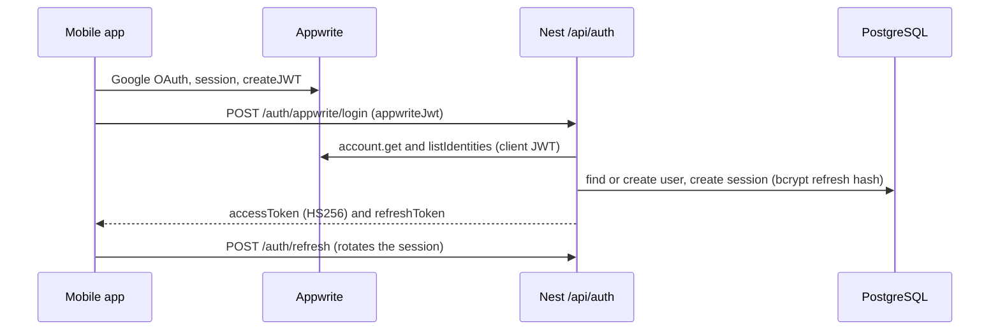
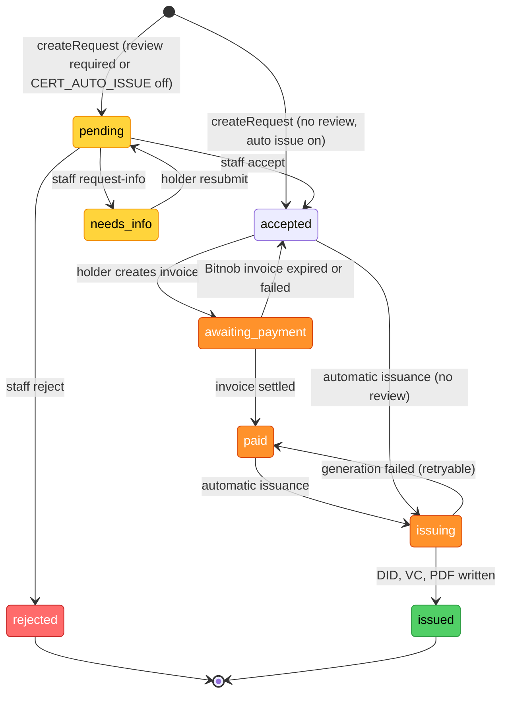
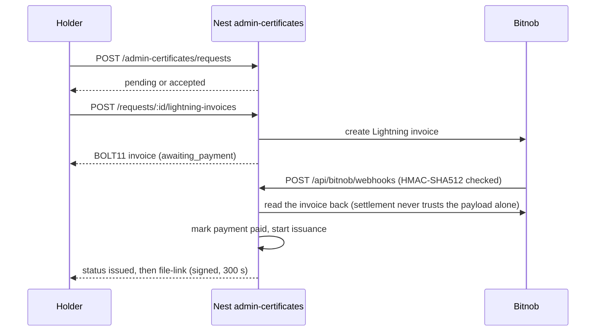

# Backend and secrets architecture: backend-nest

Companion to `CLAUDE.md` (workflow) and `docs/ARCHITECTURE_AS_BUILT.md` (canonical architecture, flows and
integrations). This note keeps only what an agent must know before touching the backend. Verified against
`backend-nest/src/`.

---

## 1. What runs

- **Active backend:** `backend-nest/`, NestJS 11 + TypeORM 0.3 + PostgreSQL. Port 3001 (`PORT`), global prefix
  `/api`, liveness probe `GET /api/healthz`, Swagger UI at `/api-docs` (`src/main.ts`).
- **Database:** `dioteko-postgres` (PostgreSQL 18) from `docker-compose.dev.yml`, host port 5435
  (`DIOTEKO_PG_HOST_PORT`). Databases: `dioteko_dev`, `dioteko_test`, `dioteko_prod` (placeholder, never created
  locally). Schema changes only through TypeORM migrations in `backend-nest/src/database/migrations/`
  (`up()` and `down()`, `synchronize: false`).
- **Pay-in:** Bitnob Lightning is the only pay-in rail.

---

## 2. Global wiring

| Concern | Real setting (file) |
|---|---|
| Raw body | `rawBody: true` in `NestFactory.create`, so the Bitnob webhook HMAC is checked on the exact bytes (`main.ts`) |
| Validation | global `ValidationPipe`: `whitelist`, `transform`, `forbidNonWhitelisted` (`common/apply-global-app-config.ts`) |
| Errors | global `HttpExceptionFilter` (same file) |
| CORS | only for the origins in `CORS_ORIGINS` (web console). The mobile app is not subject to CORS (`main.ts`) |
| Guards | global `JwtAuthGuard`, then `RolesGuard`, both `APP_GUARD` (`app.module.ts`) |
| Public routes | `@Public()` skips the JWT check |
| Roles | `@Roles(RoleCode.ISSUER, RoleCode.ADMIN)`. `JwtPayload` carries `sub` and `roles` only. The organisation is read from the database, not the token |

---

## 3. Modules

| Module | State | Role |
|---|---|---|
| `identity` | active | Appwrite + Google login, Nest JWT and refresh sessions, users, roles, organisations |
| `admin-certificates` | active | certificate requests, staff review, invoice, issuance, signed PDF link, verification |
| `bitnob` | active | Lightning pay-in invoices, settlement, webhooks, payouts, withdrawals, bulk transfers |
| `did-vc` | active | DIDs, verifiable credentials, presentations (`/api/did-vc/...`) |
| `consent` | active | consent records and access logs (`/api/audit/...`) |
| `healthz` | active | ops probe `GET /api/healthz` |
| `lightning` | active (registry) | No HTTP route. `LightningInvoicesService` records invoices and payments for Bitnob |
| `health` and 6 domain shells (`kyc`, `education`, `transport`, `employment`, `social-aid`, `merchant`) | shell | placeholder `GET /api/{domain}` only, no business logic |

---

## 4. Identity model

Login is Appwrite (Google OAuth). Nest does not handle Google itself. It verifies the Appwrite client JWT,
then issues its own tokens.

- `AppwriteService.verifyClientJwt` (`identity/services/appwrite.service.ts`) rejects accounts without a Google
  identity while `APPWRITE_REQUIRE_GOOGLE_IDENTITY` is on. It is always on in production.
- Refresh tokens live in the `sessions` table as a bcrypt hash (`auth.service.ts`).
- `POST /api/auth/login` (email and password) also exists. It serves the seeded demo users and the web console.

---

## 5. Certificate payment and issuance

Request statuses are the `AdminCertificateRequestStatus` enum (`admin-certificates/entities/`).

- `requiresReview` types (`residence`, `identity`) always go through an agent. Types without review (`birth`,
  `marriage`, `death`) are issued automatically only when `CERT_AUTO_ISSUE` is on
  (`admin-certificates.constants.ts`, `admin-certificates.service.ts`).
- The invoice is issued by Bitnob (`BitnobLightningService`), the only pay-in rail.
  `LightningInvoicesService` records the invoice and its `payments` row (registry only, no provider call).
- Settlement is confirmed by a reconciler poll (`BITNOB_INVOICE_RECONCILE_INTERVAL_MS`, default 60000) or by the webhook.
  Both read the invoice from Bitnob before marking it paid.
- Anchoring is **simulated**: `certificate-anchor.service.ts` generates a random txId. No real Bitcoin
  transaction is made.
- A certificate issued through `PAYMENT_SIMULATION` is flagged `payment_simulated` and cannot start a payout.

---

## 6. Secrets and configuration

- Env file per `NODE_ENV` (`src/config/env-files.ts`): unset or `development` gives `.env`, `test` gives
  `.env.test`, `production` gives `.env.prod`. All three are gitignored. Only `*.example` files are committed.
- Validated at boot (`src/config/env.validation.ts`). The app refuses to start when one of these is empty:
  `APP_BASE_URL`, `DB_HOST`, `DB_PORT`, `DB_USERNAME`, `DB_PASSWORD`, `DB_NAME`, `JWT_SECRET`,
  `VC_SIGNING_SECRET`.
- Test-only secrets (prefix `e2e-test-only-`) are refused whenever `NODE_ENV` is not `test`.

| Variable | Unset behaviour | Note |
|---|---|---|
| `JWT_SECRET` | refuses to boot | signs access tokens (HS256) |
| `VC_SIGNING_SECRET` | refuses to boot | signs verifiable credentials (HS256) |
| `JWT_ACCESS_TTL`, `JWT_REFRESH_TTL` | `15m`, `30d` | |
| `APPWRITE_ENDPOINT`, `APPWRITE_PROJECT_ID`, `APPWRITE_API_KEY` | empty, warning only | the API key is server-only |
| `APPWRITE_REQUIRE_GOOGLE_IDENTITY` | on (fail closed) | `false` is honoured only outside production |
| `BITNOB_CLIENT_ID`, `BITNOB_CLIENT_SECRET` | empty, warning only | outbound request signing |
| `BITNOB_WEBHOOK_SECRET` | falls back to `BITNOB_CLIENT_SECRET`, with a warning | inbound webhook HMAC-SHA512 |
| `BITNOB_ENVIRONMENT` | `sandbox` | `production` enables the live-money guards |
| `PAYMENT_SIMULATION` | off | boot refused unless `NODE_ENV` is development or test and `BITNOB_ENVIRONMENT=sandbox` |
| `CERT_AUTO_ISSUE` | on outside production, off when live unless `true` | live means `NODE_ENV=production` or `BITNOB_ENVIRONMENT=production` |
| `CORS_ORIGINS` | localhost:3000 outside production, none in production | exact origins only |

- The mobile app holds only public values: `EXPO_PUBLIC_API_BASE_URL`, `EXPO_PUBLIC_APPWRITE_ENDPOINT`,
  `EXPO_PUBLIC_APPWRITE_PROJECT_ID`. No secret lives in `frontmobile/`.
- The web console reads `VITE_API_BASE_URL` only.
- Logs follow the `[START]`, `[CALL]`, `[RESULT]`, `[STATE]` convention. Never log tokens, keys, or raw personal data.

---

## 7. Before you change something

- Bitnob webhook (`bitnob/controllers/bitnob-webhooks.controller.ts`): `@Public()` plus
  `BitnobWebhookSignatureGuard`. It needs `rawBody`. A webhook never marks money terminal on its own.
- Payout finalize (`POST /admin-certificates/:certificateId/bitnob/payouts/finalize`): admin only, and disabled
  in production by the code's own comment. Re-check this before enabling it.
- PDF download: the holder asks for a link through `file-link`, and the link expires after 300 seconds
  (`CERTIFICATE_FILE_LINK_TTL_SECONDS`).
- Staff organisation scope and the remaining gaps: see `docs/KNOWN_ISSUES.md`.
- Do not assume a backend route is live without checking its module in `app.module.ts`.
