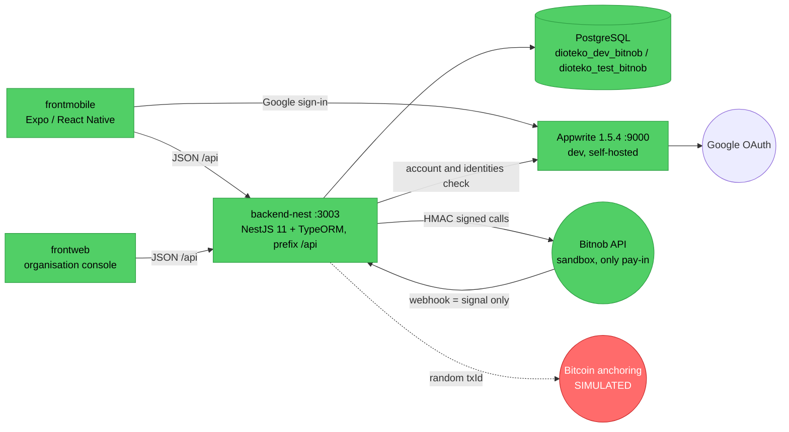
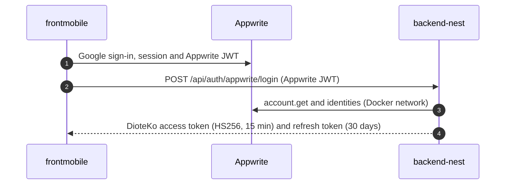

# Architecture

Short description of the system as it is built. The full detail (sequence diagrams, state machines, known gaps) is in [docs/ARCHITECTURE_AS_BUILT.md](docs/ARCHITECTURE_AS_BUILT.md). Tables and relations are in [docs/DATABASE_MODEL.md](docs/DATABASE_MODEL.md).

## 1. System overview

| Component | State | Notes |
|---|---|---|
| `backend-nest/` | Active | The only backend in use |
| Appwrite + Google login | Active (dev) | Citizen sign-in path |
| Bitnob Lightning pay-in | Active (sandbox) | Invoice created and read at Bitnob; a payment has not yet been observed in sandbox |
| Bitnob payouts | Active (sandbox) | Admin only; `finalize` disabled in production |
| DID and Verifiable Credentials | Active | VC signed with a shared HS256 secret |
| Bitcoin anchoring | Simulated | Random `txId`, nothing is broadcast |
| `frontmobile/` | Active | Certificate screens use the API; `app/admin/*` are mockups |
| `frontweb/` | Active | Real mode: list, detail, accept, reject, request-info, public verify |

## 2. backend-nest

### Bootstrap (`src/main.ts`, `src/common/apply-global-app-config.ts`)

- Port 3003 (`PORT`), global prefix `/api`, Swagger UI at `/api-docs` (outside the prefix).
- `ValidationPipe` with `whitelist`, `transform` and `forbidNonWhitelisted`; global `HttpExceptionFilter`.
- `rawBody: true`, required to verify Bitnob webhook signatures.
- CORS only for origins listed in `CORS_ORIGINS`. The mobile app is not subject to CORS.
- `NODE_ENV` selects the env file (`.env`, `.env.test`, `.env.prod`), see `src/config/env-files.ts`.

### Guards and roles

Two global guards, in this order: `JwtAuthGuard`, then `RolesGuard`. `@Public()` opts a route out of JWT checks. `@Roles(...)` restricts a route. Roles: `holder`, `issuer`, `verifier`, `admin`.

### Modules (`src/modules/`)

| Module | Prefix (under `/api`) | State |
|---|---|---|
| `healthz` | `GET /healthz` | Real: runs `SELECT 1` |
| `identity` | `/auth/*`, `/users/me` | Real (Appwrite + Google login, staff email and password) |
| `did-vc` | `/did-vc/dids`, `/did-vc/credentials`, `/did-vc/presentations` | Real |
| `admin-certificates` | `/admin-certificates/*` | Real; the only complete domain |
| `bitnob` | `/bitnob/webhooks`, `/bitnob/*` | Real in sandbox |
| `lightning` | None (no HTTP route) | Invoice and payment registry (`LightningInvoicesService`) |
| `consent` | `/audit/consents`, `/audit/access-logs` | Real, minimal |
| `health`, `kyc`, `education`, `transport`, `employment`, `social-aid`, `merchant` | `GET /{domain}` | Stubs returning `{ implemented: false }` |

`GET /api/health` is the stub of the health domain. The real probe is `GET /api/healthz`.

### Persistence

PostgreSQL through TypeORM. `synchronize` is off. Schema changes go through migrations in `src/database/migrations/`. Entities are discovered from `src/**/*.entity.ts`.

## 3. Identity

- The access token carries `sub`, `roles` and `did`. The refresh token is rotated on each use; only its bcrypt hash is stored.
- On first login the backend creates the holder user and a DID.
- The backend refuses accounts that are disabled, whose email is not verified, or that have no Google identity (the Google check is forced on in production).
- `POST /api/auth/login` (email and password) is used by the web console and by seeded demo accounts.

## 4. Certificates

Catalogue (`admin-certificates.constants.ts`):

| Type | Price (sats) | Agent review before payment |
|---|---|---|
| `birth`, `marriage`, `death` | 100 | No |
| `residence` | 100 | Yes |
| `identity` | 100 | Yes |

Lifecycle:

1. The citizen submits `POST /api/admin-certificates/requests`.
2. Types with review wait for an agent: `POST /api/admin-certificates/organization/requests/:id/accept`, `reject` or `request-info`. The citizen can `resubmit`. Types without review (birth, marriage, death) are accepted at submission when `CERT_AUTO_ISSUE` is on, and wait for an agent when it is off.
3. The citizen creates an invoice: `POST /api/admin-certificates/requests/:id/lightning-invoices`.
4. Payment is confirmed by reading the invoice at Bitnob. The status route and the background reconciler both do this. The webhook only triggers a read.
5. Issuance runs right after payment: a VC (HS256) and a PDF with a QR code. If it fails, an issuer or admin can retry with `POST /api/admin-certificates/requests/:id/issue`.
6. The holder gets a 5-minute signed link from `GET /api/admin-certificates/requests/:id/file-link`, then downloads the PDF with `exp` and `sig`.
7. Anyone can verify a certificate with `POST /api/admin-certificates/:certificateId/verify`. The check covers revocation, expiry and the HS256 signature, plus an optional document hash.

Details and the full state machine: [docs/ARCHITECTURE_AS_BUILT.md §5](docs/ARCHITECTURE_AS_BUILT.md).

## 5. Payments

- **Pay-in:** Bitnob Lightning, the only pay-in rail. A background reconciler reads pending invoices every `BITNOB_INVOICE_RECONCILE_INTERVAL_MS` (default 60 000 ms).
- **Simulation (dev only):** the Bitnob sandbox cannot settle an invoice, so `PAYMENT_SIMULATION=true` enables a route that marks the holder's own invoice as paid (it answers 404 otherwise). It refuses to boot unless `NODE_ENV` is `development` or `test` and `BITNOB_ENVIRONMENT=sandbox`. Certificates obtained this way carry `simulatedPayment=true`.
- **Payouts:** after issuance, an admin can settle a certificate's payment to the organisation through Bitnob payouts (quote, initialize, finalize). `finalize` is disabled when `BITNOB_ENVIRONMENT=production`.
- **Review skip:** `CERT_AUTO_ISSUE` lets types without review (birth, marriage, death) skip the agent. It defaults to on when not live and to off when `NODE_ENV=production` or `BITNOB_ENVIRONMENT=production`. A certificate issued without review carries `declaredNotVerified: true`.

## 6. DID and Verifiable Credentials

- DIDs have the form `did:dioteko:<uuid>`. They are local identifiers and cannot be resolved.
- A VC is a JWT signed with HS256 and the shared secret `VC_SIGNING_SECRET`. Only this backend can verify it.
- Validity is set by `CERTIFICATE_VALIDITY_DAYS` (default 365).

## 7. Known gaps

Full list: [docs/KNOWN_ISSUES.md](docs/KNOWN_ISSUES.md). The most important ones:

- Bitcoin anchoring is simulated.
- Certificate PDFs are written to the container filesystem, and no volume is mounted for them.
- Any issuer or admin can revoke a credential from another organisation (`TODO` in `credentials.controller.ts`).
- Issuance and revocation of VCs are not written to `access_logs`.
- The VC signing secret is shared, so third parties cannot verify certificates on their own.
- The `app/admin/*` screens in the mobile app are mockups.
