# DioteKo

[English](#english) | [Français](#français)

## English

**DioteKo** issues administrative certificates to citizens. A citizen signs in with Google, asks for a certificate in a mobile wallet, pays a Lightning invoice in sats, and receives a signed Verifiable Credential and a PDF with a QR code. Anyone can then verify the certificate publicly.

> **Status:** Not production-ready. Simulated parts and known gaps are listed below and in [docs/KNOWN_ISSUES.md](docs/KNOWN_ISSUES.md).

**Table of contents**

- [💡 Problem and inspiration](#-problem-and-inspiration)
- [✅ Features](#-features)
- [📸 App screenshots](#-app-screenshots)
- [🧭 User flow](#-user-flow)
- [🧱 Architecture](#-architecture)
- [🔄 Certificate request statuses](#-certificate-request-statuses)
- [💸 From payment to certificate](#-from-payment-to-certificate)
- [🟠 Bitnob: invoice and payout](#-bitnob-invoice-and-payout)
- [🔐 Identity verification (KYC)](#-identity-verification-kyc)
- [🔎 API overview](#-api-overview)
- [🧩 Project structure](#-project-structure)
- [🧰 Technologies used](#-technologies-used)
- [🔧 Installation](#-installation)
- [🚀 Usage](#-usage)
- [🧪 Testing](#-testing)
- [📚 Documentation index](#-documentation-index)
- [🏁 Challenges and next steps](#-challenges-and-next-steps)
- [🤝 Contributing](#-contributing)
- [📄 License](#-license)
- [👥 Team](#-team)

### 💡 Problem and inspiration

Getting an administrative paper usually means queuing, travelling and trusting a stamp. Citizens abroad depend on relatives and on postal delays. The person who receives a paper often has no quick way to check it. DioteKo moves the request, the payment and the proof online: the citizen pays a Lightning invoice, the server issues a signed credential, and a QR code lets anyone check the certificate.

### ✅ Features

- ✅ **Google sign-in through Appwrite**: the backend checks the Appwrite session, then issues its own short-lived access token and rotating refresh token. The full flow on a physical phone is still to be tested.
- ✅ **Five certificate types**: birth, marriage and death extracts, residence certificate, identity certificate. Each costs 100 sats (a test price).
- ✅ **Agent review**: an agent of the issuing organisation can accept a request, reject it with a reason, or ask the holder for more information. The holder resubmits when asked.
- ✅ **Lightning payment through Bitnob**: the backend creates the invoice and marks it paid only after reading it back from Bitnob.
- ✅ **Automatic issuance after payment**: a signed Verifiable Credential (JWT, HS256) and a PDF with a QR code.
- ✅ **Public verification** by certificate ID or QR code: returns `valid`, or the reason (`revoked`, `expired`, `signature_invalid`, `hash_mismatch`). No name and no personal data are returned.
- ✅ **Signed PDF link**: the holder gets a download link valid for 5 minutes. The PDF is never public.
- ✅ **Staff console** (`frontweb/`): list, detail, accept, reject and request more information, in real mode.
- ✅ **Identity verification (KYC) in the app**: the holder picks an ID type (national ID card or passport), photographs the document (front and back for a card) and takes a selfie. Residence and identity certificates require it.
- ✅ **Automatic check by Idswyft**: OCR of the document, face match and liveness, on a self-hosted instance in sandbox mode.
- ✅ **Agent fallback**: with `KYC_FALLBACK_MANUAL_REVIEW=on`, every refusal or outage of the automatic check sends the dossier to an agent instead of ending it. The holder sees "pending agent verification".
- ✅ **KYC review in the staff console** ("Vérifications d'identité"): the agent sees what the OCR read with its confidence, the scores, the reason and the photos, then validates or rejects with a note.
- ✅ **Read-only record of automatic validations**: a dossier validated without an agent is listed with scores only, no photo, no text read, and a sandbox warning.
- ✅ **KYC data encrypted at rest**: OCR text and photos are encrypted (AES-256-GCM), deleted at the decision or after the retention delay, never shown to the holder and never logged.

**Known limits** (see [docs/KNOWN_ISSUES.md](docs/KNOWN_ISSUES.md)):

- **Bitcoin anchoring is simulated.** The anchor transaction id is random and always reported as verified. Verification does not check it. Do not present it as a timestamp proof.
- **Identity verification (KYC, self-hosted Idswyft)** is wired, but it has not been tested on real identity documents, and the Idswyft instance runs in sandbox mode: its automatic verdict is not reliable for production. Residence and identity requests are blocked without a verified KYC file (`403 KYC_REQUIRED`) while enforcement is on. More limits in [Identity verification (KYC)](#-identity-verification-kyc).
- **Verifiable Credentials use a shared HS256 secret**, so only this backend can verify them.
- **Admin screens** in the mobile app (`frontmobile/app/admin/*`) are mockups with fake data.
- **PDF files are written to the backend container disk**, which has no volume: recreating the container loses them.
- **Sandbox Lightning invoices cannot be paid through the API.** A real wallet is needed for an end-to-end payment. A development-only button marks an invoice as paid.
- **No automated test runner on the mobile app**, and the app has not been checked on a physical phone by tests. The KYC screenshots below come from manual runs.

### 📸 App screenshots

Screenshots are in [frontmobile/Screen/](frontmobile/Screen/) (mobile app) and [frontweb/Screen/](frontweb/Screen/) (staff console). Click a screen to open the full-size image.

**Authentication.** The e-mail and password fields are UI only: their submit is not wired yet. Google sign-in is the working path.

<div align="center">

| Create account screen | Sign-in screen |
|:---:|:---:|
| <a href="./frontmobile/Screen/Inscription.jpeg">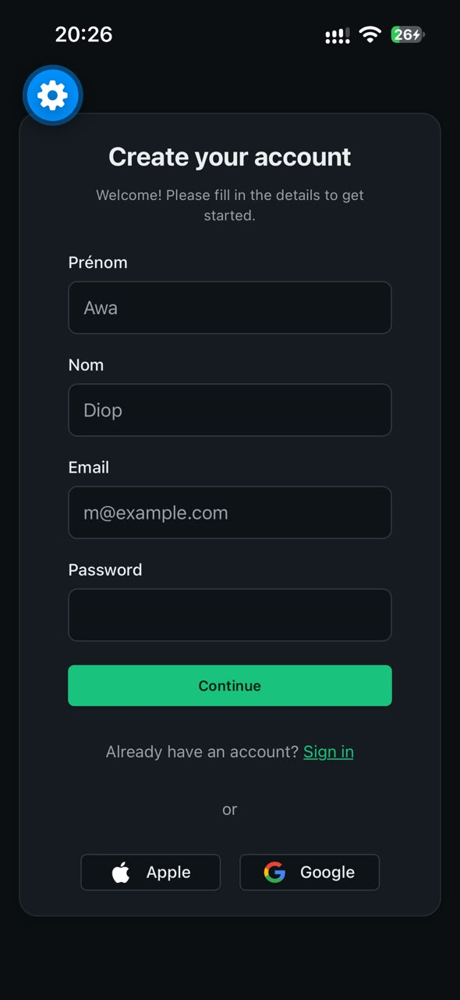</a> | <a href="./frontmobile/Screen/Connexion.jpeg">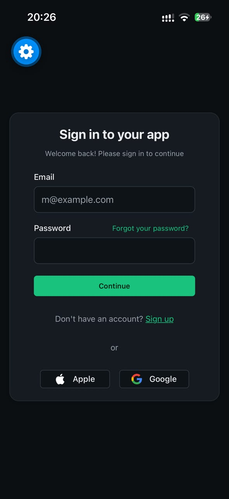</a> |

</div>

- **Inscription**: create-account form (first name, last name, e-mail, password) with Apple and Google buttons.
- **Connexion**: sign-in form (e-mail, password, "Forgot your password?" link, link to sign up) with Apple and Google buttons.

**Home.**

<div align="center">

| Home screen | Home screen, service list |
|:---:|:---:|
| <a href="./frontmobile/Screen/Accueil.jpeg">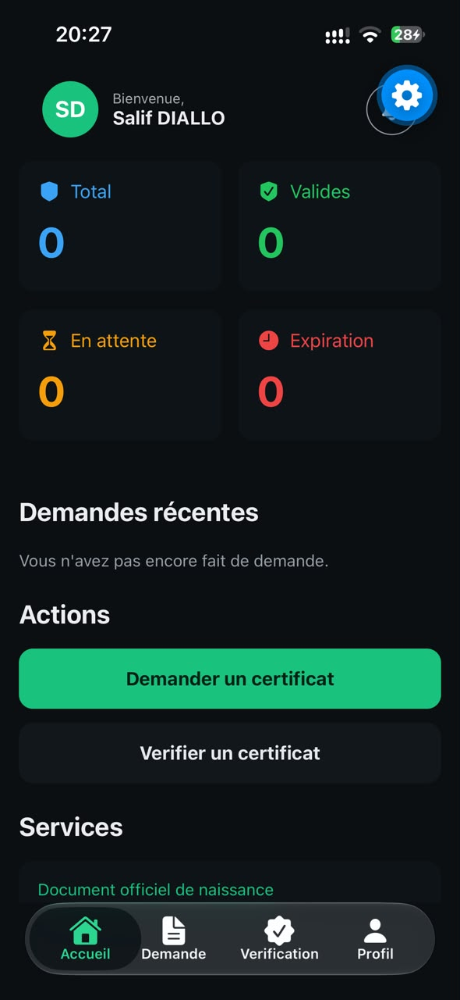</a> | <a href="./frontmobile/Screen/Accueil2.jpeg">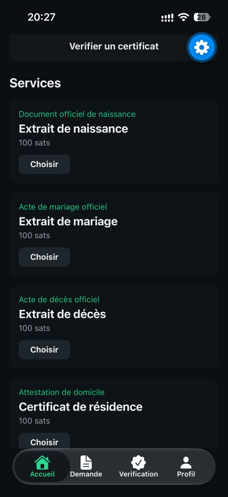</a> |

</div>

- **Accueil**: counters (total, valid, pending, expiring, all at 0 here), the "recent requests" block (empty: no request yet), and the actions "Request a certificate" and "Verify a certificate". A bottom tab bar: Home, Request, Verification, Profile.
- **Accueil2**: service cards for the birth, marriage and death extracts and the residence certificate (the first four visible), each at 100 sats with a "Choose" button.

**Request and payment.**

<div align="center">

| New request screen | Birth extract form | Accepted request, payment method | Lightning invoice QR code |
|:---:|:---:|:---:|:---:|
| <a href="./frontmobile/Screen/Demande.jpeg">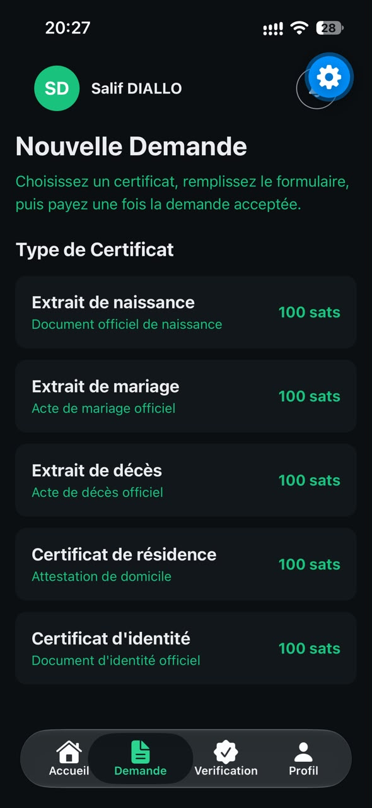</a> | <a href="./frontmobile/Screen/Demande_Extrait.jpeg">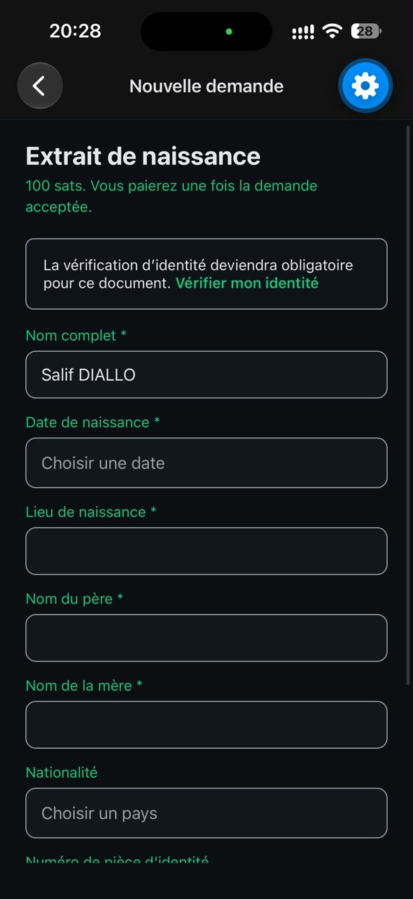</a> | <a href="./frontmobile/Screen/Demande_Extrait_Choix_Paiement.jpeg">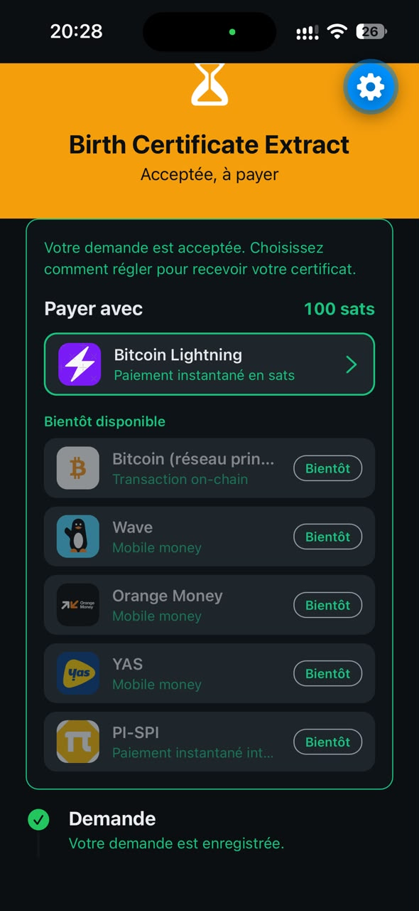</a> | <a href="./frontmobile/Screen/Demande_Extrait_Generation_QR_Code_Payment.jpeg">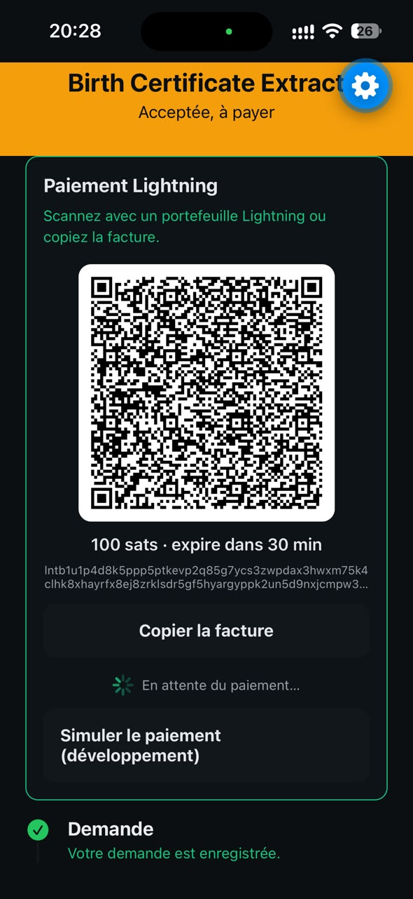</a> |

</div>

- **Demande**: new request, listing the five certificate types at 100 sats each.
- **Demande_Extrait**: birth extract form (full name, date and place of birth, parents' names, nationality, ID number). A banner says identity verification will become mandatory for this document.
- **Demande_Extrait_Choix_Paiement**: request accepted and ready to pay. Bitcoin Lightning is the available method; Bitcoin on-chain, Wave, Orange Money, YAS and PI-SPI are shown as coming soon.
- **Demande_Extrait_Generation_QR_Code_Payment**: Lightning invoice as a QR code and text, 100 sats, expiry countdown, copy button, waiting state, and a development-only "simulate payment" button.

**Verification.** There is no screenshot of the issued certificate screen yet. The scan screenshot below shows an issued certificate extract with its QR code.

<div align="center">

| Verify certificate screen | Verification result | QR scan mode |
|:---:|:---:|:---:|
| <a href="./frontmobile/Screen/Verifier.jpeg">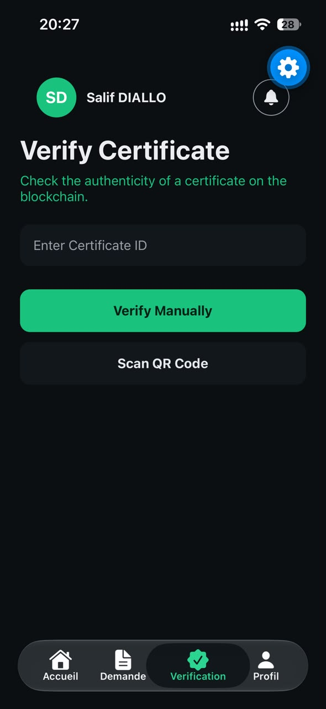</a> | <a href="./frontmobile/Screen/VeriferQrActivate.png">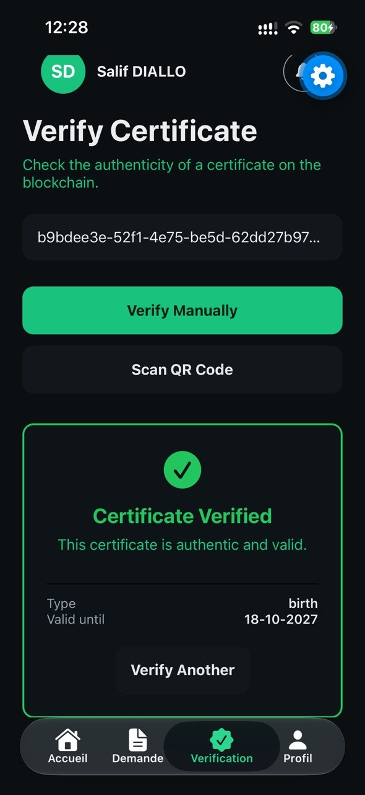</a> | <a href="./frontmobile/Screen/VeriferQrActivate2.png">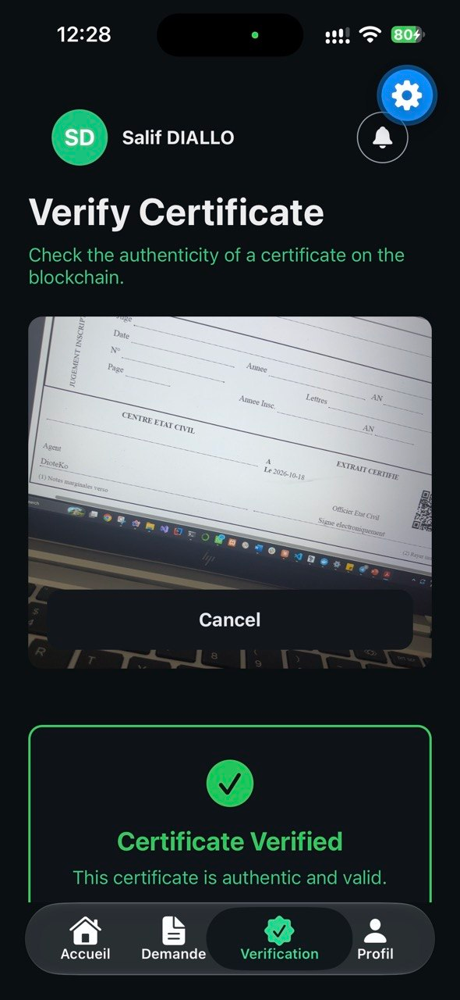</a> |

</div>

- **Verifier**: enter a certificate ID, "Verify Manually", or "Scan QR Code". The subtitle says "on the blockchain", but the anchor is simulated (see limits above).
- **VeriferQrActivate**: a certificate ID in the field and the result card "Certificate Verified: this certificate is authentic and valid", with the type (birth), the "valid until" date and a "Verify Another" button.
- **VeriferQrActivate2**: QR scan mode. The camera view shows a certificate extract with a QR code, displayed on a computer screen, and a Cancel button. The previous "Certificate Verified" card is still visible below the camera.

**Profile.**

<div align="center">

| Profile screen |
|:---:|
| <a href="./frontmobile/Screen/Profil.jpeg">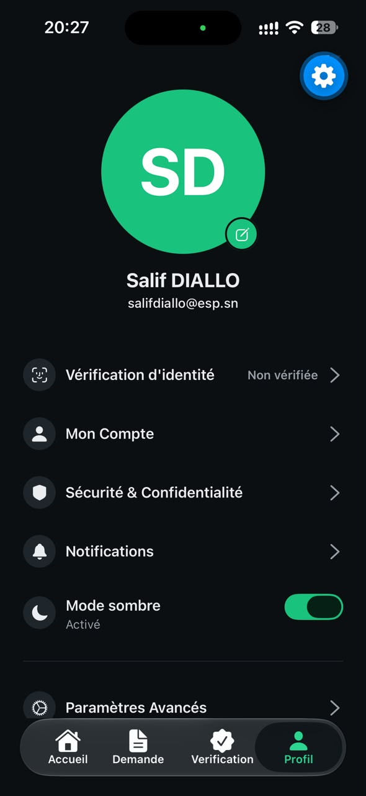</a> |

</div>

- **Profil**: name and e-mail, identity verification status ("not verified"), account, security and privacy, notifications, dark mode, advanced settings.

**Identity verification (KYC), mobile.** The app text is in French only. Parts of the identity document and the selfie are hidden by hand in these screenshots.

<div align="center">

| Intro screen | Country and ID type | Document photo (front) | Selfie |
|:---:|:---:|:---:|:---:|
| <a href="./frontmobile/Screen/KYC/OnBoardingKYC.png">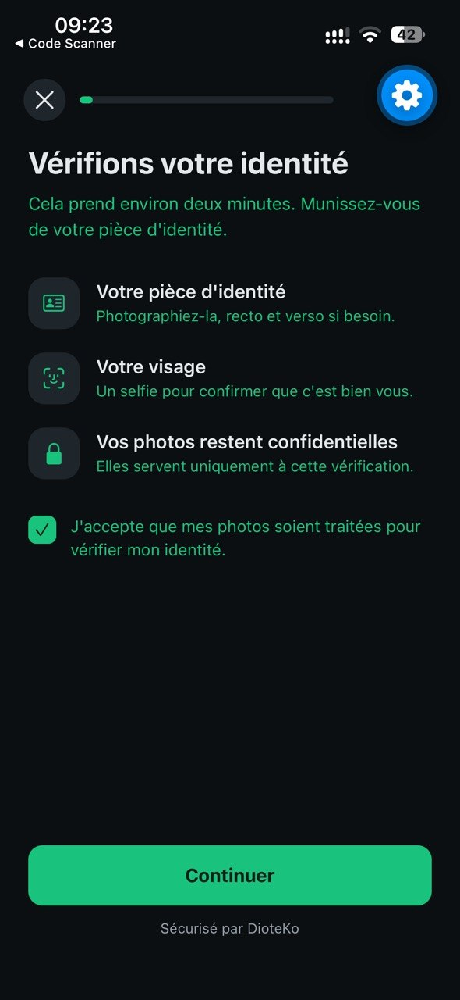</a> | <a href="./frontmobile/Screen/KYC/Step1_Choice_Piece.png">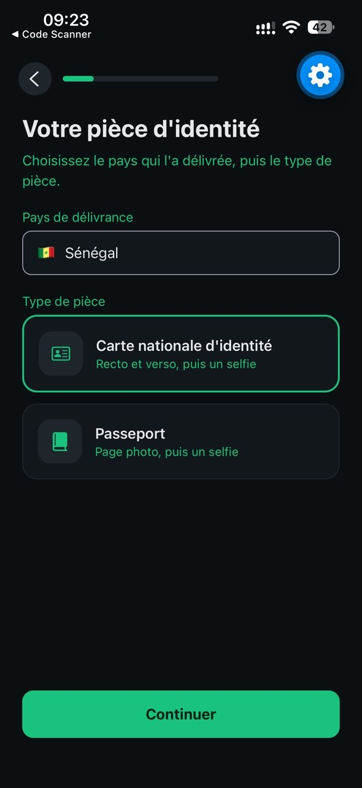</a> | <a href="./frontmobile/Screen/KYC/Step2_Upload_Piece.png">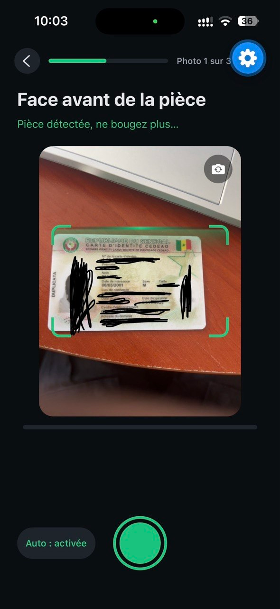</a> | <a href="./frontmobile/Screen/KYC/Step3_Selfie.png">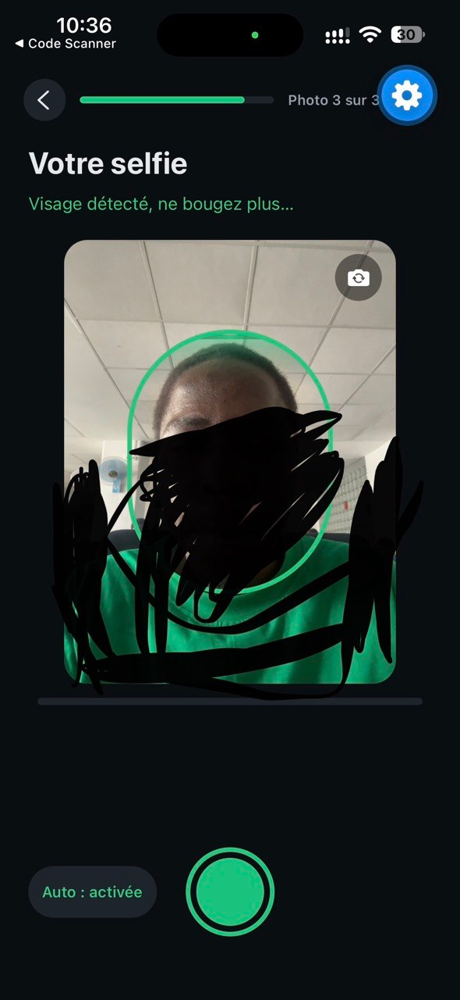</a> |

| Pending agent verification | Rejected by an agent | Identity verified |
|:---:|:---:|:---:|
| <a href="./frontmobile/Screen/KYC/Step3_Statut_Review_Pending_After_Automatically_Failed_Process.png">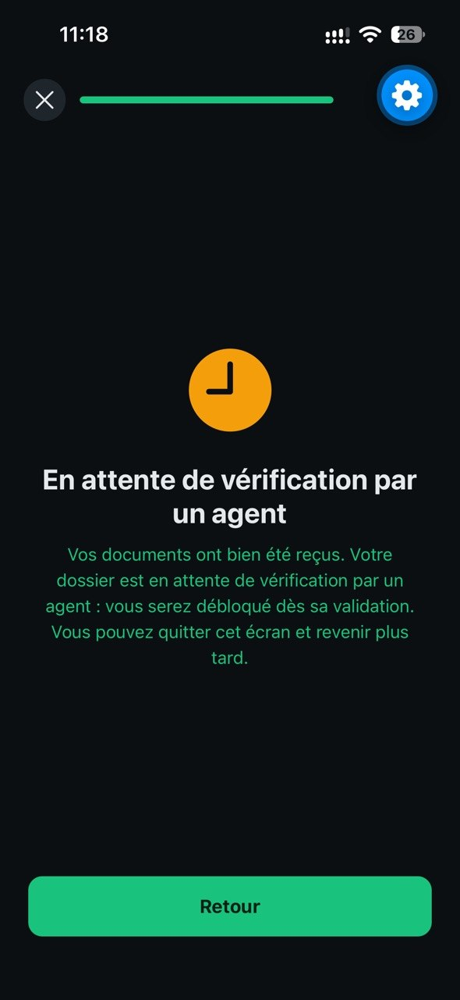</a> | <a href="./frontmobile/Screen/KYC/Step3_Statut_Review_Rejected_After_Automatically_Failed_Process_In_Console_By_Agent.png">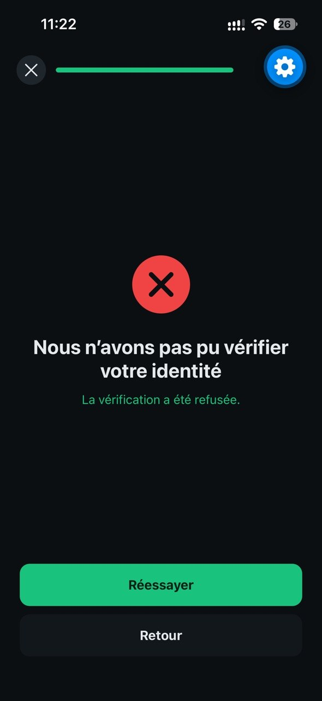</a> | <a href="./frontmobile/Screen/KYC/Step3_Statut_Review_Success.png">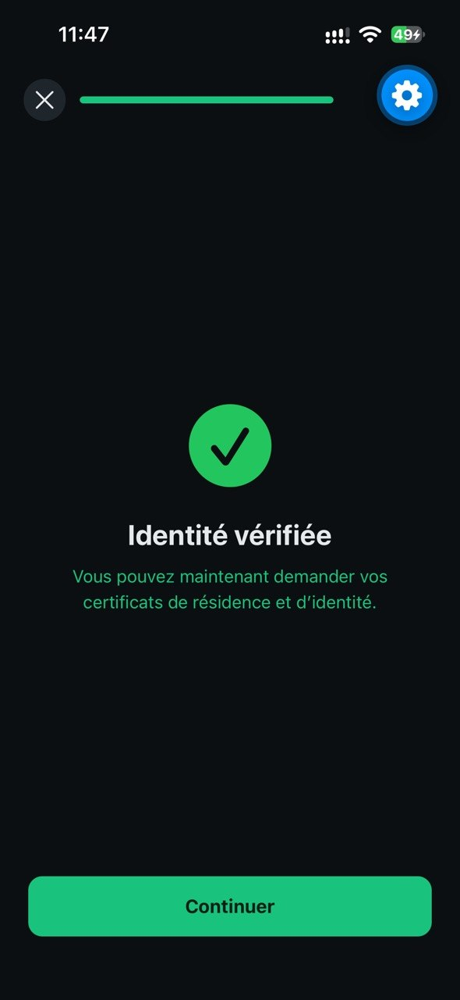</a> |

</div>

- **OnBoardingKYC**: "Vérifions votre identité". It takes about two minutes. Three points: the ID document (front and back if needed), a selfie, and photos that stay confidential. A consent checkbox ("I accept that my photos are processed to verify my identity") and a "Continuer" button.
- **Step1_Choice_Piece**: country of issue (Senegal is selected) and ID type: national ID card (front and back, then a selfie) or passport (photo page, then a selfie).
- **Step2_Upload_Piece**: "Face avant de la pièce", camera view with a frame, the hint "Pièce détectée, ne bougez plus…", the counter "Photo 1 sur 3", an "Auto: activée" switch and the shutter button.
- **Step3_Selfie**: "Votre selfie", camera view with an oval frame, the hint "Visage détecté, ne bougez plus…", the counter "Photo 3 sur 3".
- **Step3_Statut_Review_Pending_After_Automatically_Failed_Process**: "En attente de vérification par un agent". The documents were received, the holder is unblocked once the agent validates, and can leave the screen and come back. A "Retour" button.
- **Step3_Statut_Review_Rejected_After_Automatically_Failed_Process_In_Console_By_Agent**: "Nous n'avons pas pu vérifier votre identité", "La vérification a été refusée", with "Réessayer" and "Retour" buttons. This is what the holder sees after an agent rejected the dossier in the console.
- **Step3_Statut_Review_Success**: "Identité vérifiée": the holder can now ask for residence and identity certificates. A "Continuer" button.

**Staff console: identity verifications.** Screenshots of the page "Vérifications d'identité" in `frontweb/`. They were taken in development, against the sandbox Idswyft instance.

<div align="center">

| Work queue "À relire" | All states |
|:---:|:---:|
| <a href="./frontweb/Screen/KYC/Table_Submission_To_Be_Read.png">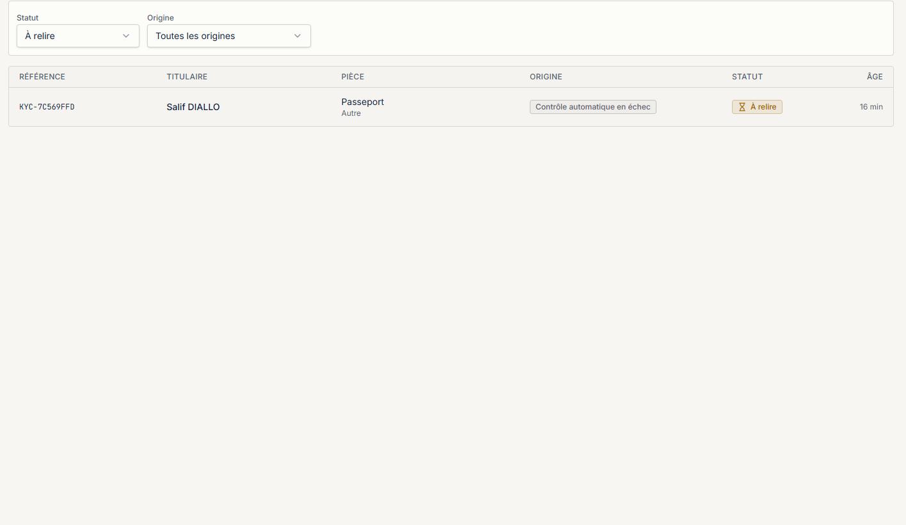</a> | <a href="./frontweb/Screen/KYC/Illisible_MRZ.png">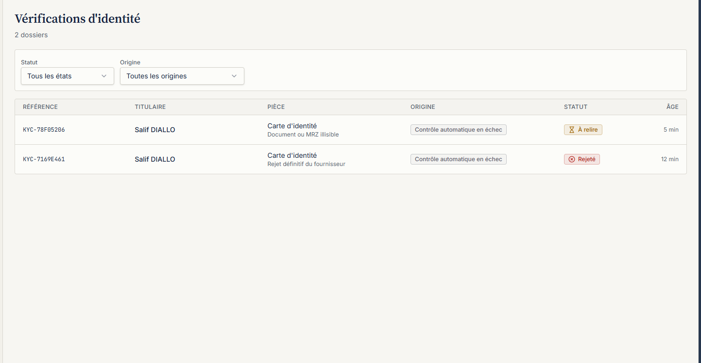</a> |

| Dossier detail, photo to compare | Automatic check inconclusive |
|:---:|:---:|
| <a href="./frontweb/Screen/KYC/User_Submission.png">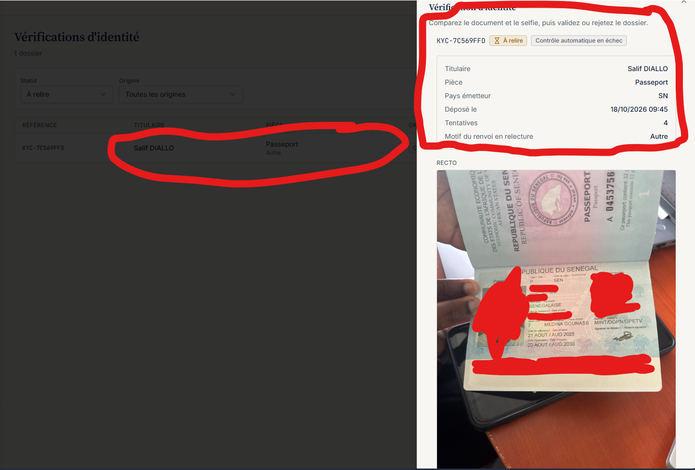</a> | <a href="./frontweb/Screen/KYC/Not_conclued_KYC.png">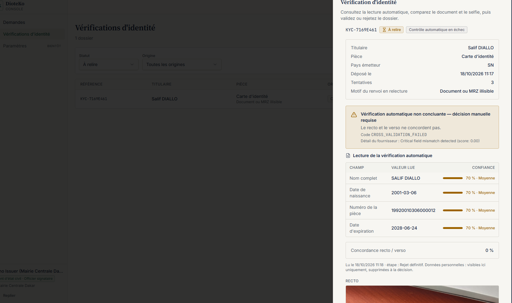</a> |

| Low score, agent decides | Rejected dossier |
|:---:|:---:|
| <a href="./frontweb/Screen/KYC/Scoring_Low_Validation_Agent.png">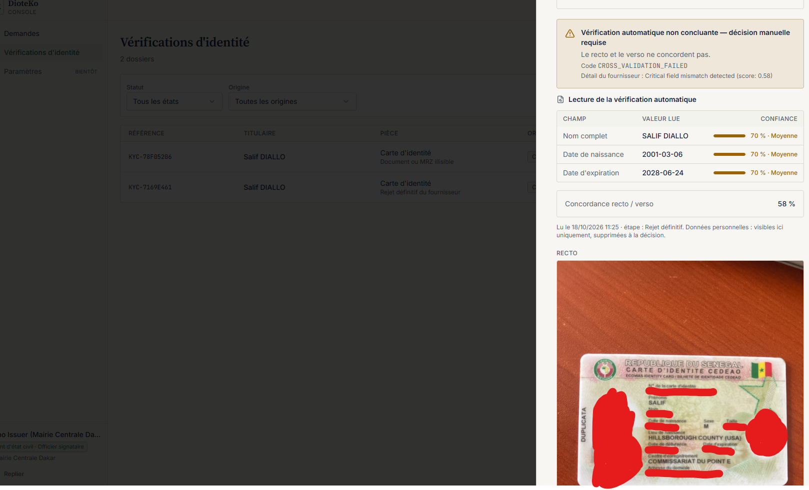</a> | <a href="./frontweb/Screen/KYC/Rejected_KYC.png">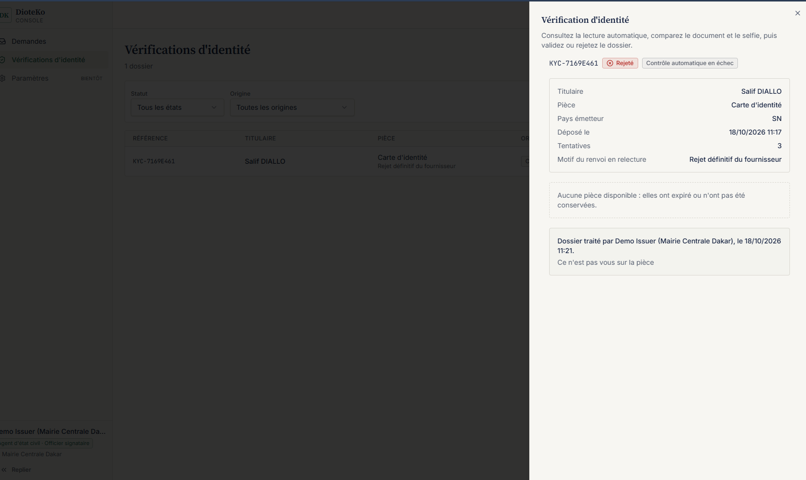</a> |

</div>

- **Table_Submission_To_Be_Read**: the list with the default "À relire" status filter and all origins. One passport dossier, origin "Contrôle automatique en échec", status "À relire", with its age in minutes. Columns: reference, holder, document, origin, status, age.
- **Illisible_MRZ**: the list with the "Tous les états" filter and two dossiers. One is "À relire" (reason "Document ou MRZ illisible"), the other is "Rejeté" (reason "Rejet définitif du fournisseur").
- **User_Submission**: the detail panel of the passport dossier. A summary (holder, document, issuing country, filing time, number of attempts, reason for the review) above the front photo of the document. Parts of the summary and of the photo are circled or hidden by hand in this screenshot. The agent compares the photos, then validates or rejects.
- **Not_conclued_KYC**: the detail panel of an ID card dossier. A banner "Vérification automatique non concluante — décision manuelle requise" with the reason in French ("Le recto et le verso ne concordent pas") and the provider code and detail (score 0.00). Then the OCR as read: one row per field (full name, date of birth, document number, expiry date) with a confidence bar, a percentage and a word, and the front and back match score (0 %). A note says the personal data are visible here only and deleted at the decision.
- **Scoring_Low_Validation_Agent**: the same kind of panel, scrolled to the OCR table (three fields), the front and back match score (58 %) and the start of the front photo, partly hidden by hand. A low score does not end the dossier: the agent decides.
- **Rejected_KYC**: the detail panel of a rejected dossier. The photos are gone ("Aucune pièce disponible : elles ont expiré ou n'ont pas été conservées"), and a box shows the agent who processed the dossier, the time, and the reason the agent wrote.

### 🧭 User flow

The flow follows the screens above. The identity check (KYC) and the agent review of the request apply only to residence and identity certificates. The KYC steps are detailed in [Identity verification (KYC)](#-identity-verification-kyc).

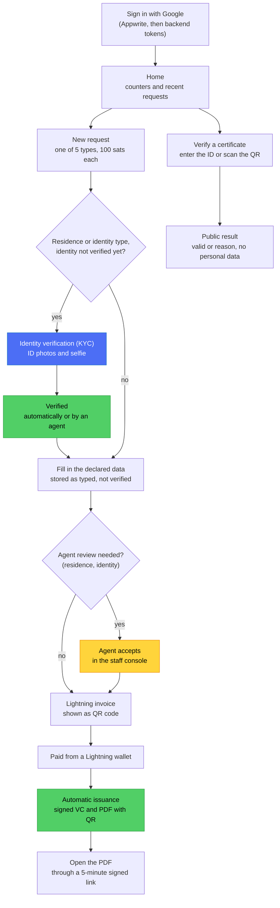

### 🧱 Architecture

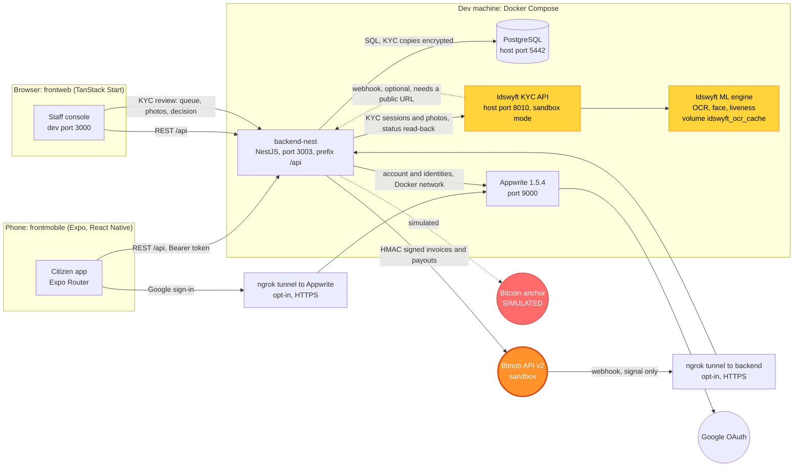

| Component | Folder | Role | State |
|---|---|---|---|
| Backend | `backend-nest/` | NestJS 11 + TypeORM + PostgreSQL API, port 3003, prefix `/api` | Active |
| Citizen app | `frontmobile/` | Expo Router + React Native wallet | Active. Admin screens are mockups |
| Staff console | `frontweb/` | TanStack Start console for organisation staff, dev port 3000 | Active. Real mode: list, detail, accept, reject, request info, identity verification review |
| Dev stack | `docker-compose.dev.yml` | DioteKo Postgres (5442), backend (3003), Appwrite (9000), Idswyft API (8010) with its ML engine and its own database | Development only |

Key rules of the design:

- **Bitnob Lightning is the only pay-in rail.**
- **A Bitnob webhook is only a signal.** The invoice is read again from Bitnob before it is marked paid.
- **Two Appwrite addresses.** The backend talks to Appwrite on the Docker network (`http://appwrite/v1`). The phone uses an HTTPS tunnel, because Google refuses IP addresses and a phone's `localhost` is the phone itself.

### 🔄 Certificate request statuses

The statuses come from the `AdminCertificateRequestStatus` enum in `backend-nest/src/modules/admin-certificates/entities/admin-certificate-request.entity.ts`.

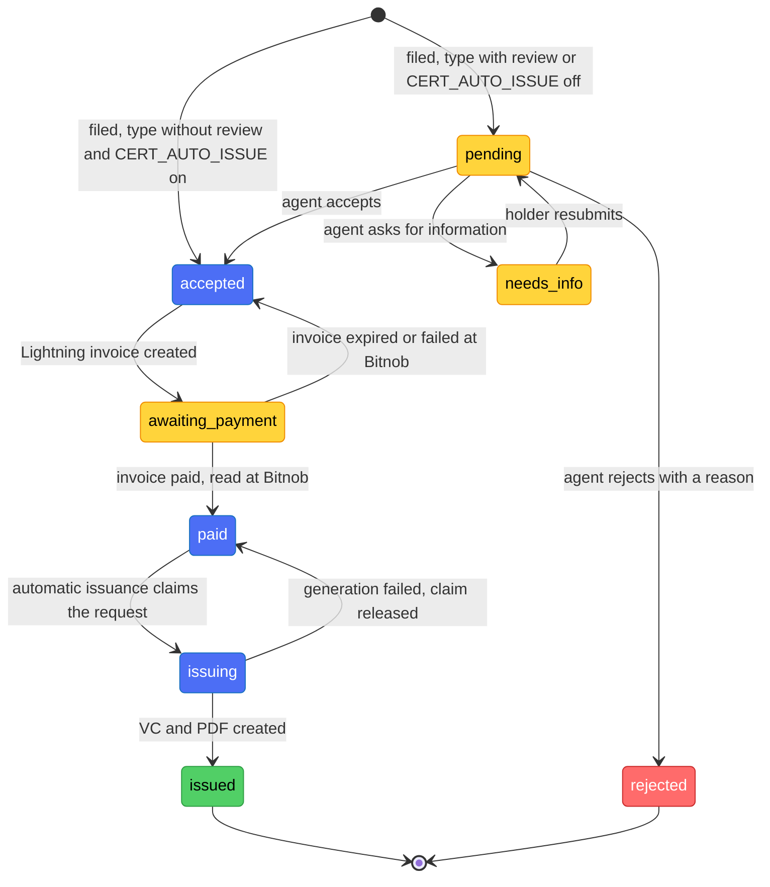

Certificate catalogue (`admin-certificates.constants.ts`):

| Type | Id | Price | Agent review before payment |
|---|---|---|---|
| Birth extract | `birth` | 100 sats | No |
| Marriage extract | `marriage` | 100 sats | No |
| Death extract | `death` | 100 sats | No |
| Residence certificate | `residence` | 100 sats | Yes |
| Identity certificate | `identity` | 100 sats | Yes |

### 💸 From payment to certificate

Part 1: the invoice, the payment and the automatic issuance. The reconciler re-reads pending invoices every 60 seconds by default, so a missing webhook does not block the flow.

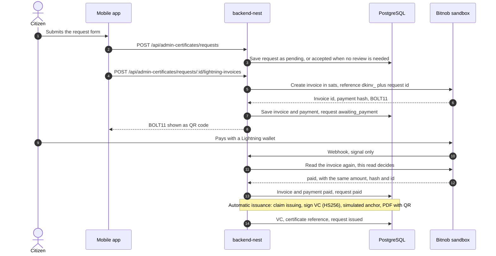

Part 2: the signed download link and the public verification.

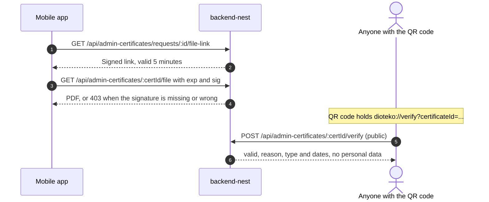

Notes:

- The invoice is created only for the holder, and only from `accepted`. The amount comes from the catalogue, not from the client.
- A paid invoice that does not match its request, provider or amount issues nothing and is logged for a human.
- Each issued credential carries `declaredNotVerified: true` when no agent reviewed the request.

### 🟠 Bitnob: invoice and payout

Bitnob is the only money rail of the project. It does two jobs, shown in orange below.

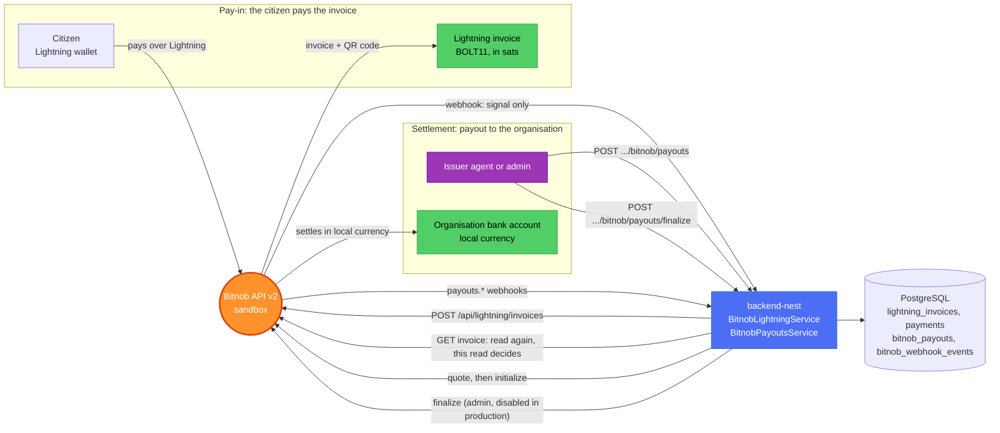

- **Pay-in (invoice).** The backend asks Bitnob for a Lightning invoice in sats. The citizen pays it from any Lightning wallet. The Bitnob webhook is only a signal: the backend reads the invoice again at Bitnob, and only that read marks it paid.
- **Payout (settlement).** After issuance, an issuer agent or an admin creates a payout: a quote, then an initialization. An admin finalizes it. Bitnob settles in local currency to the organisation's bank account. The beneficiary comes from the server configuration, never from the client.
- **Safeguards.** Every Bitnob request is HMAC-signed. Webhooks are verified with an HMAC-SHA512 signature on the raw body and de-duplicated by event id. `finalize` is disabled in production, `reference` is the idempotency key, and only one payout can be active per certificate.
- **Sandbox limits.** The sandbox does not let the API pay a Lightning invoice, so a real wallet or the development-only button is needed. Sending Lightning payments and bulk writes are refused by the sandbox.

Payout statuses:

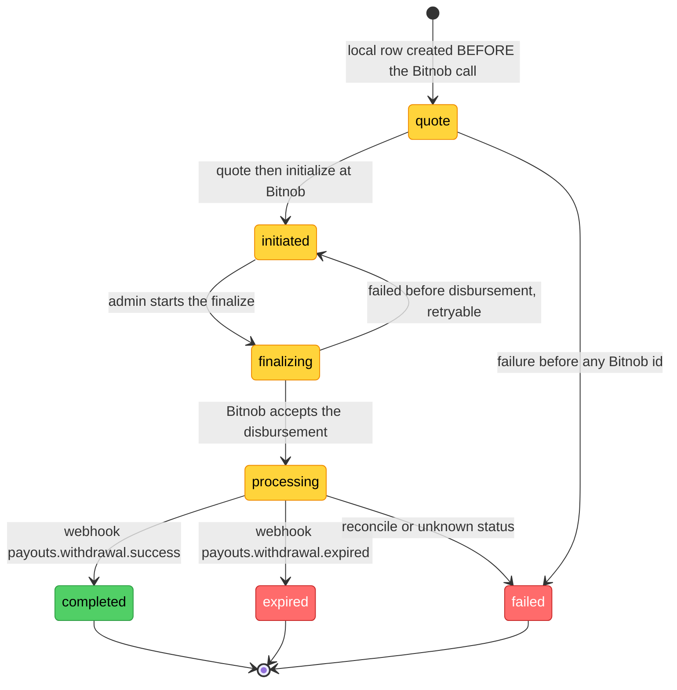

More detail: [docs/BITNOB.md](docs/BITNOB.md) and section 6 of [docs/ARCHITECTURE_AS_BUILT.md](docs/ARCHITECTURE_AS_BUILT.md).

### 🔐 Identity verification (KYC)

KYC (know your customer) proves **who is asking** for a certificate: the person who files the request is the person on the ID document and in the selfie. It does not prove the data written in the certificate.

- **Where it applies.** Residence and identity certificates require a verified identity (`403 KYC_REQUIRED` otherwise). Birth, marriage and death extracts are planned: they become blocking only if listed in `KYC_ENFORCED_TYPES`. `KYC_ENFORCEMENT=off` lifts the gate in development only and is ignored in production.
- **The server decides.** The mobile app only displays the state. A dossier becomes `verified` only after the backend has read the verdict again from Idswyft or after an agent approved it.

The journey of a dossier:

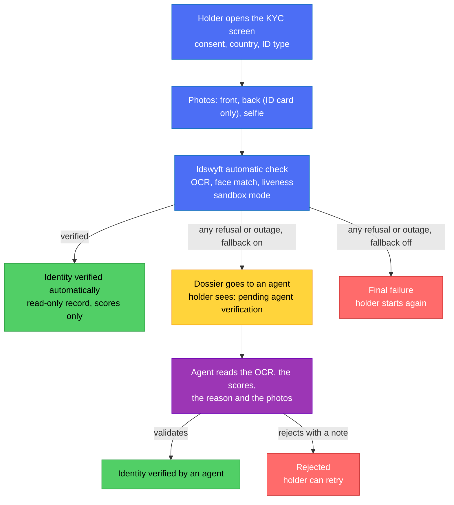

The states of a dossier, as stored in `kyc_verifications` (enum `KycStatus` in `backend-nest/src/modules/kyc/kyc.constants.ts`):

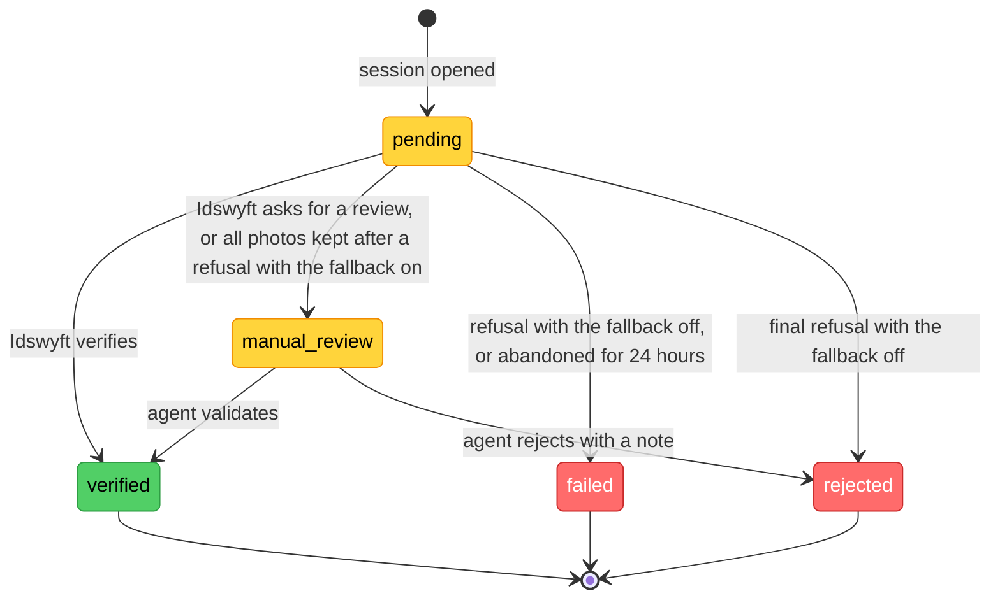

A refused dossier stays `pending` while the holder finishes sending the photos, then moves to `manual_review`. `failed` and `rejected` are closed: a new try opens a new dossier, within the daily limit (5 sessions per 24 hours by default, `KYC_MAX_SESSIONS_PER_DAY`). `verified` is written once and never changes.

**How it works**

- **Automatic check.** The holder sends the front of the document, the back for a national ID card, and a selfie. Idswyft, self-hosted in the dev stack and in sandbox mode, reads the document (OCR), compares the face on the selfie with the face on the document, checks liveness, and compares front and back for a card. A DioteKo overlay on its ML engine reads the ECOWAS ID card.
- **Agent fallback.** With `KYC_FALLBACK_MANUAL_REVIEW=on` and a valid encryption key, **every** refusal goes to an agent instead of ending the dossier: unreadable document, front and back that do not match, expired document, face or liveness failure, unexplained hard rejection, closed session, provider unreachable or too slow. The holder still sends all the photos. Only an agent validates or rejects: the holder has no override. With the flag off (the default), a refusal is final.
- **What the holder sees.** Never the text read on the document and never the scores. The holder sees "En attente de vérification par un agent", "Identité vérifiée", or a refusal screen with a "Réessayer" button.
- **What the agent sees.** In the console page "Vérifications d'identité" (issuer or admin account attached to an organisation), the status filter is "À relire" by default (the work queue, oldest first), with "Identité validée", "Rejeté" and "Tous les états". For a dossier to read: a banner "Vérification automatique non concluante", the provider reason in French, the OCR fields as read with their confidence (bar, percentage and word), the scores, and the photos. The agent validates or rejects with a note of at least 10 characters. An agent cannot decide their own dossier, an approval needs every photo, and each reading and decision is written to the access log.
- **Automatic validations stay visible.** A dossier validated by Idswyft alone is listed read-only, with the origin "Vérification automatique". Its record has scores, thresholds and flags only: no photo, no text read, no name. A warning says the provider ran in sandbox mode and the result is not reliable for production.
- **Privacy.** OCR text and photos are encrypted at rest (AES-256-GCM, key `KYC_DOC_ENCRYPTION_KEY`). They are deleted at the agent's decision or after `KYC_DOC_RETENTION_DAYS` (30 by default), never shown to the holder, and never written to the logs (logs carry ids and statuses only).
- **The name is not compared on purpose.** The name read on the document is **not** compared with the account name: a Google name can legitimately differ from the official one. An agent can compare by hand.

**Honest limits**

- **Not tested on real identity documents.** The Idswyft instance is a sandbox: its verdict is not reliable for production. Senegal is not in the list of countries Idswyft documents, so support is to be tested, not promised.
- **No per-step retake of the back side.** A refusal closes the provider session, so the back cannot be retaken alone. With the fallback on, the app keeps collecting the remaining photos for the agent. With the fallback off, the holder starts again.
- **Mobile app not checked on a physical phone by tests.** No automated test covers the mobile KYC screens.
- **The review queue is platform-wide.** A dossier belongs to no organisation: every active issuer or admin attached to an organisation sees them (see [docs/KNOWN_ISSUES.md](docs/KNOWN_ISSUES.md)).
- **Idswyft keeps its own data in development.** Its uploaded images stay in the `idswyft_uploads` volume and its logs contain fields read on the document. Settle this before any real data.
- **The holder is not notified** of the agent's decision: the app screen updates at its next status read (about every 4 seconds while it is open).

More detail: [docs/KYC.md](docs/KYC.md) (sections 16 and 17) and [docs/BUSINESS_RULES.md](docs/BUSINESS_RULES.md).

### 🔎 API overview

Base path `/api`. Interactive Swagger: `http://localhost:3003/api-docs` in development.

| Route | Who | What |
|---|---|---|
| `GET /healthz` | Public | Database probe (`SELECT 1`) |
| `POST /auth/appwrite/login` | Public | Appwrite JWT in, DioteKo tokens out |
| `GET /admin-certificates/types` | Public | Certificate catalogue |
| `POST /admin-certificates/requests` | Signed-in user | File a request |
| `POST /admin-certificates/requests/:id/lightning-invoices` | Holder of the request | Create the Lightning invoice |
| `POST /admin-certificates/:certId/verify` | Public | Verify a certificate |
| `POST /bitnob/webhooks` | Bitnob, HMAC signed | Payment and payout signals |
| `POST /kyc/sessions` | Signed-in user | Open an identity verification session (`national_id` or `passport`) |
| `POST /kyc/sessions/:sessionId/front`, `/back`, `/selfie` | Holder of the session | Send one photo (multipart, JPEG or PNG, 5 MB max). The selfie closes the session |
| `POST /kyc/sessions/:sessionId/cancel` and `/precheck/:step` | Holder of the session | Close the open session, or check a small photo before sending it |
| `GET /kyc/status` | Signed-in user | State of the holder's dossier (never what was read on the document) |
| `POST /kyc/webhook/idswyft` | Idswyft, HMAC signed | Verdict signal, read again before it is trusted |
| `GET /kyc/review` | Issuer or admin | KYC queue, filters `status` (`manual_review` by default, `verified`, `rejected`, `all`) and `origin` |
| `GET /kyc/review/:id` | Issuer or admin | Dossier detail: OCR as read, scores, reason, or the read-only automatic record |
| `GET /kyc/review/:id/documents/:kind` | Issuer or admin | One photo (`front`, `back`, `selfie`), decrypted for this request, never cached |
| `POST /kyc/review/:id/decision` | Issuer or admin | `approve` or `reject`, with a note of at least 10 characters |

### 🧩 Project structure

- `bitnob/` (repository root)
  - `backend-nest/`: NestJS API (identity, admin-certificates, bitnob, did-vc, consent, kyc, lightning, healthz, six domain stubs)
  - `frontmobile/`: Expo citizen wallet
    - `app/`: Expo Router screens (`kyc.tsx` is the identity verification flow)
    - `components/kyc/`: KYC step screens and camera capture
    - `services/`: API calls (`api.ts`), Appwrite login (`appwriteAuth.ts`), KYC (`kyc.ts`)
    - `Screen/`: screenshots used in this README (`Screen/KYC/` for the KYC flow)
  - `frontweb/`: TanStack Start staff console
    - `src/routes/_console.verifications.tsx`: the "Vérifications d'identité" page
    - `Screen/KYC/`: console screenshots used in this README
  - `docs/`: project documentation (architecture, rules, dev workflow, known issues)
  - `docker/idswyft/`: DioteKo overlay for the Idswyft ML engine (ECOWAS card reader, MRZ repair)
  - `scripts/`: dev stack, database, tunnel and KYC helper scripts
  - `docker-compose.dev.yml`: dev stack (includes the Appwrite and Idswyft files)
  - `docker-compose.appwrite.yml` and `docker-compose.idswyft.yml`: self-hosted services
  - `package.json`: root dev commands (`dev:up`, `db:setup`, `tunnel`, `kyc:bootstrap`)

### 🧰 Technologies used

**Backend API**: NestJS 11 with Passport JWT guards, TypeORM 0.3 on PostgreSQL, Swagger for the API docs, `pdfkit` and `qrcode` for the PDF, `node-appwrite` to check Appwrite sessions, AES-256-GCM encryption of the KYC copies.

**Citizen app**: Expo SDK 57 and React Native 0.86 with Expo Router, `react-native-appwrite` for Google sign-in, `expo-camera` for QR scanning, `expo-secure-store` for tokens, NativeWind 5 (release candidate) for styling.

**Staff console**: TanStack Start on Vite, Node 22+, Vitest for tests, ESLint and Prettier.

**Infrastructure and integrations**: Docker Compose for the dev stack, Appwrite 1.5.4 (identity and Google OAuth), Idswyft community v1.12.19 (self-hosted KYC, pinned version, with a DioteKo overlay on its ML engine; OCR, face match and liveness), ngrok (HTTPS tunnels), Bitnob API v2 sandbox (Lightning invoices, payouts).

### 🔧 Installation

**Prerequisites**

- Docker with Docker Compose. The first start is slow: the Appwrite and Idswyft images are large.
- Node.js 22+ and npm.
- Expo Go or a development build for the mobile app. A physical phone is needed for the Google sign-in flow.
- Optional: a Google Cloud OAuth client, one ngrok account per tunnel, and a Bitnob sandbox account (Bitnob rejects calls from IP addresses that are not allowlisted).

**Steps**

1. Clone the repository and go to its root:

   ```bash
   git clone <REPO_URL> bitnob
   cd bitnob
   ```

2. Start the dev stack (DioteKo Postgres, backend, Appwrite, Idswyft). Use this command, not a bare `docker compose up`:

   ```bash
   npm run dev:up
   ```

   Idswyft is built from its GitHub source. If Docker cannot reach GitHub, reuse the images already built locally:

   ```bash
   npm run dev:up:nobuild
   ```

3. Configure the backend. Copy the template, then fill `JWT_SECRET` and `VC_SIGNING_SECRET` with your own values (for example from `openssl rand -hex 32`):

   ```bash
   cd backend-nest
   npm install
   cp .env.example .env
   cd ..
   ```

4. Create and seed the databases (`dioteko_dev_bitnob` and `dioteko_test_bitnob`), then check the API:

   ```bash
   npm run db:setup
   curl http://localhost:3003/api/healthz
   ```

5. Finish the Appwrite first-run setup in the console (see the list below).

6. Start the mobile app. Copy the template (`frontmobile/.env.exemple`) to `frontmobile/.env` and set `EXPO_PUBLIC_APPWRITE_ENDPOINT` and `EXPO_PUBLIC_APPWRITE_PROJECT_ID`:

   ```bash
   cp frontmobile/.env.exemple frontmobile/.env
   cd frontmobile
   npm install
   npx expo start --clear
   ```

7. Start the staff console (`http://localhost:3000`):

   ```bash
   cd frontweb
   npm ci
   cp .env.example .env
   npm run dev
   ```

8. Optional, Google sign-in from a phone: open the HTTPS tunnels from the repo root with `npm run tunnel`. Then set the tunnel address in `frontmobile/.env` (`https://xxxx.ngrok-free.dev/v1`) and in the Google redirect URI, and restart Expo with `--clear`.

9. Optional, Lightning pay-in: set `BITNOB_CLIENT_ID`, `BITNOB_CLIENT_SECRET` and `BITNOB_ENVIRONMENT=sandbox` in `backend-nest/.env`.

10. Optional, identity verification (KYC). Create the Idswyft API key from the root (it is written to `backend-nest/.env` and never printed):

    ```bash
    npm run kyc:bootstrap
    ```

    Then set these variables in `backend-nest/.env` (template: `backend-nest/.env.example`):

    - `KYC_FALLBACK_MANUAL_REVIEW=on` sends every refusal of the automatic check to an agent. It is `off` by default.
    - `KYC_DOC_ENCRYPTION_KEY` is 64 hexadecimal characters (for example from `openssl rand -hex 32`). Without a valid key, no photo or reading is kept, and the fallback has no effect.
    - `KYC_DOC_RETENTION_DAYS` is the number of days a copy is kept without a decision (30 by default).

    Run `npm run dev:up` again after any change to `backend-nest/.env` or `backend-nest/src/`: the container reads the file when it is created.

    The Idswyft ML engine downloads its OCR models (about 13 MB) from the internet at the first OCR call. The Docker volume `idswyft_ocr_cache` keeps them afterwards. Without the volume, a recreated container has no models: offline, OCR fails and Idswyft refuses every document.

**Appwrite console, first run** (once, at `http://localhost:9000`):

- Create the admin account.
- Create a project with a custom Project ID, and put it in `APPWRITE_PROJECT_ID` in `backend-nest/.env`.
- Create an API key with the `users.read` and `users.write` scopes, and put it in `APPWRITE_API_KEY`.
- Enable the Google OAuth2 provider with your Google Cloud client ID and secret (`<GOOGLE_CLIENT_ID>`, `<GOOGLE_CLIENT_SECRET>`).
- Add a Web platform with hostname `*`. This is for local development only, never for production.

Never commit `.env` files or keys. Use placeholders in documentation.

### 🚀 Usage

- **Backend**: `http://localhost:3003/api` (health: `/api/healthz`), Swagger at `http://localhost:3003/api-docs`.
- **Demo accounts** are created by `npm run seed` in `backend-nest/`: `issuer-demo@dioteko.local`, `admin-demo@dioteko.local`, `holder-demo@dioteko.local`. The shared demo password is in [docs/DEV_WORKFLOW.md](docs/DEV_WORKFLOW.md).
- **Citizen app**: sign in with Google, request a certificate, pay the invoice (in development, with the simulate button), open the PDF through the signed link, then verify a certificate by ID or QR code.
- **Staff console**: sign in as an issuer or admin account, then review requests of your organisation.
- **Identity verification, holder**: in the app, open "Vérification d'identité" in the profile, or "Vérifier mon identité" on a residence or identity request. Pick the ID type, photograph the document, take a selfie, then wait for the result.
- **Identity verification, agent**: in the console, open "Vérifications d'identité". The default filter "À relire" lists the dossiers waiting for you. Open one, compare the OCR, the scores and the photos, then validate or reject with a note. "Identité validée" and "Tous les états" also list the dossiers validated automatically, read-only.

### 🧪 Testing

| Package | Command | What it runs |
|---|---|---|
| `backend-nest/` | `npm test` | Jest unit tests, no database |
| `backend-nest/` | `npm run test:e2e` | Jest end-to-end tests on `dioteko_test_bitnob` (copy `.env.test.example` to `.env.test` first) |
| `backend-nest/` | `npm run typecheck` | TypeScript check (`tsc --noEmit`) |
| `frontweb/` | `npm test` and `npm run lint` | Vitest, ESLint and Prettier |
| `frontmobile/` | `npm run lint` | Expo lint. There is no test runner for the mobile app |

### 📚 Documentation index

- [docs/ARCHITECTURE_AS_BUILT.md](docs/ARCHITECTURE_AS_BUILT.md): architecture as built, flows, integrations, known deviations
- [docs/DEV_WORKFLOW.md](docs/DEV_WORKFLOW.md): every development command and first-run steps
- [docs/DATABASE_MODEL.md](docs/DATABASE_MODEL.md): tables and their links
- [docs/BUSINESS_RULES.md](docs/BUSINESS_RULES.md): business rules, each with its source file
- [docs/DOMAIN_NOTES.md](docs/DOMAIN_NOTES.md): concepts and vocabulary
- [docs/KYC.md](docs/KYC.md): identity verification with Idswyft (sections 16 and 17: agent review and audit of automatic validations)
- [docs/BITNOB.md](docs/BITNOB.md): Bitnob API contract and Lightning pay-in
- [docs/CERTIFICATE_EVENT_CHAIN.md](docs/CERTIFICATE_EVENT_CHAIN.md): proposal for a tamper-evident event chain (not implemented)
- [docs/KNOWN_ISSUES.md](docs/KNOWN_ISSUES.md): known gaps and workarounds
- [docs/DECISIONS.md](docs/DECISIONS.md) and [docs/TESTING.md](docs/TESTING.md)

### 🏁 Challenges and next steps

**Challenges**

- **Google sign-in on a phone.** Appwrite builds the OAuth callback without the port, and Google refuses IP addresses. A phone therefore needs an HTTPS tunnel.
- **Version skew.** `react-native-appwrite` 0.34 targets Appwrite 1.6, but the local server runs 1.5.4. The app falls back to `/account/jwt`.
- **Trusting a webhook.** The Bitnob webhook event name is not documented, so the backend uses it only as a signal and reads the invoice again.
- **Declared data.** Names are typed by the citizen and are not checked against a civil register. Issued certificates say so in the signed credential and in the PDF.
- **An OCR engine that downloads its models at runtime.** Idswyft's PaddleOCR fetches its models from the internet at the first OCR call. A recreated container without a cache had none, and offline every document was refused as unreadable. The fix is a persistent Docker volume, `idswyft_ocr_cache`.
- **A refusal that ended the journey.** With a strict provider, a front and back mismatch closed the dossier before the selfie. The fallback now sends every refusal to an agent, and the app keeps collecting the photos.

**Next steps**

- Real Bitcoin anchoring on testnet, in place of the simulation.
- KYC spike on real identity documents, and a production identity provider instead of the sandbox.
- Scope the KYC review queue (a dedicated reviewer role, or per organisation) before any real data.
- A persistent volume for the PDF files.
- Real admin screens in the mobile app.
- Audit entries for credential issuance and revocation (not written yet).

### 🤝 Contributing

Read [CONTRIBUTING.md](CONTRIBUTING.md) and [docs/DEV_WORKFLOW.md](docs/DEV_WORKFLOW.md) before opening a pull request. Run the checks in the Testing table for the packages you touched.

### 📄 License

MIT. See [LICENSE](LICENSE).

### 👥 Team

The DioteKo team (5 people):

**Salif Diallo** Developer
- GitHub: [@MrSalifDiallo](https://github.com/MrSalifDiallo)
- LinkedIn: [Salif Diallo](https://www.linkedin.com/in/salif-diallo-152650313/)
- Email: [salifdiallo@esp.sn](mailto:salifdiallo@esp.sn)

**Aicha Ndiaye** Big Data & AI Engineer
- GitHub: [@smiley100](https://github.com/smiley100)
- LinkedIn: [Aicha Ndiaye](https://www.linkedin.com/in/ndiaye-a%C3%AFcha-72ba87331)
- Email: [ndiayeaicha0928@gmail.com](mailto:ndiayeaicha0928@gmail.com)

**Fatou Tambedou** Big Data & AI Engineer
- GitHub: [@fatoutambedou-ctl](https://github.com/fatoutambedou-ctl)
- Email: [fatoutambedou@esp.sn](mailto:fatoutambedou@esp.sn)

**Ndeye Marieme Sy** Developer
- GitHub: [@Maryam-SY](https://github.com/Maryam-SY)
- Email: [meriemsy3@gmail.com](mailto:meriemsy3@gmail.com)

**Mame Saye Fall** Developer
- GitHub: [@mamesayefall125-svg](https://github.com/mamesayefall125-svg)
- Email: [mamesayefall125@gmail.com](mailto:mamesayefall125@gmail.com)

[⬆ Back to top](#dioteko)

---

## Français

**DioteKo** délivre des certificats administratifs aux citoyens. Un citoyen se connecte avec Google, demande un certificat dans un wallet mobile, paie une facture Lightning en sats, et reçoit une Verifiable Credential signée ainsi qu'un PDF avec un QR code. Ensuite, n'importe qui peut vérifier le certificat publiquement.

> **Statut :** Pas prêt pour la production. Les parties simulées et les écarts connus sont listés ci-dessous et dans [docs/KNOWN_ISSUES.md](docs/KNOWN_ISSUES.md).

**Table des matières**

- [💡 Problème et inspiration](#-problème-et-inspiration)
- [✅ Fonctionnalités](#-fonctionnalités)
- [📸 Écrans mobiles](#-écrans-mobiles)
- [🧭 Parcours utilisateur](#-parcours-utilisateur)
- [🧱 Architecture technique](#-architecture-technique)
- [🔄 Statuts des demandes](#-statuts-des-demandes)
- [💸 Du paiement au certificat](#-du-paiement-au-certificat)
- [🟠 Bitnob : facture et payout](#-bitnob--facture-et-payout)
- [🔐 Vérification d'identité (KYC)](#-vérification-didentité-kyc)
- [🔎 Aperçu API](#-aperçu-api)
- [🧩 Structure du projet](#-structure-du-projet)
- [🧰 Technologies utilisées](#-technologies-utilisées)
- [🔧 Mise en route](#-mise-en-route)
- [🚀 Utilisation](#-utilisation)
- [🧪 Tests](#-tests)
- [📚 Index de la documentation](#-index-de-la-documentation)
- [🏁 Défis et prochaines étapes](#-défis-et-prochaines-étapes)
- [🤝 Contribuer](#-contribuer)
- [📄 Licence](#-licence)
- [👥 Équipe](#-équipe)

### 💡 Problème et inspiration

Obtenir un papier administratif demande en général de faire la queue, de se déplacer et de faire confiance à un tampon. Les citoyens de la diaspora dépendent de proches et des délais postaux. La personne qui reçoit un papier n'a souvent aucun moyen rapide de le vérifier. DioteKo déplace la demande, le paiement et la preuve en ligne : le citoyen paie une facture Lightning, le serveur émet un justificatif signé, et un QR code permet à n'importe qui de vérifier le certificat.

### ✅ Fonctionnalités

- ✅ **Connexion avec Google via Appwrite** : le backend vérifie la session Appwrite, puis émet ses propres jetons (accès de courte durée, refresh rotatif). Le parcours complet sur un téléphone physique reste à tester.
- ✅ **Cinq types de certificats** : extraits de naissance, de mariage et de décès, certificat de résidence, certificat d'identité. Chacun coûte 100 sats (prix de test).
- ✅ **Revue par un agent** : un agent de l'organisation émettrice peut accepter une demande, la rejeter avec un motif, ou demander un complément au titulaire. Le titulaire renvoie sa demande quand on le lui demande.
- ✅ **Paiement Lightning via Bitnob** : le backend crée la facture et ne la marque payée qu'après l'avoir relue chez Bitnob.
- ✅ **Émission automatique après paiement** : une Verifiable Credential signée (JWT, HS256) et un PDF avec QR code.
- ✅ **Vérification publique** par identifiant ou QR code : renvoie `valid`, ou la raison (`revoked`, `expired`, `signature_invalid`, `hash_mismatch`). Aucun nom ni donnée personnelle n'est renvoyé.
- ✅ **Lien signé vers le PDF** : le titulaire reçoit un lien de téléchargement valable 5 minutes. Le PDF n'est jamais public.
- ✅ **Console staff** (`frontweb/`) : liste, détail, accepter, rejeter et demander un complément, en mode réel.
- ✅ **Vérification d'identité (KYC) dans l'application** : le titulaire choisit un type de pièce (carte nationale d'identité ou passeport), photographie le document (recto et verso pour une carte) et fait un selfie. Les certificats de résidence et d'identité l'exigent.
- ✅ **Contrôle automatique par Idswyft** : OCR du document, correspondance du visage et vivacité, sur une instance auto-hébergée en mode bac à sable.
- ✅ **Repli vers un agent** : avec `KYC_FALLBACK_MANUAL_REVIEW=on`, tout refus ou toute panne du contrôle automatique envoie le dossier à un agent au lieu de le clore. Le titulaire voit « en attente de vérification par un agent ».
- ✅ **Relecture KYC dans la console staff** (« Vérifications d'identité ») : l'agent voit ce que l'OCR a lu avec sa confiance, les scores, le motif et les photos, puis valide ou rejette avec une note.
- ✅ **Trace en lecture seule des validations automatiques** : un dossier validé sans agent est listé avec des scores seulement, sans photo, sans texte lu, et un avertissement bac à sable.
- ✅ **Données KYC chiffrées au repos** : le texte OCR et les photos sont chiffrés (AES-256-GCM), supprimés à la décision ou après le délai de conservation, jamais montrés au titulaire et jamais journalisés.

**Limites connues** (voir [docs/KNOWN_ISSUES.md](docs/KNOWN_ISSUES.md)) :

- **L'ancrage Bitcoin est simulé.** L'identifiant de transaction est aléatoire et toujours présenté comme vérifié. La vérification ne le contrôle pas. Ne pas le présenter comme une preuve d'horodatage.
- **La vérification d'identité (KYC, Idswyft auto-hébergé)** est câblée, mais n'a pas été testée sur de vraies pièces d'identité, et l'instance Idswyft tourne en mode bac à sable : son verdict automatique n'est pas fiable pour la production. Les demandes de résidence et d'identité sont bloquées sans dossier KYC vérifié (`403 KYC_REQUIRED`) tant que l'application est active. Autres limites dans [Vérification d'identité (KYC)](#-vérification-didentité-kyc).
- **Les Verifiable Credentials utilisent un secret HS256 partagé**, donc seul ce backend peut les vérifier.
- **Les écrans admin** de l'application mobile (`frontmobile/app/admin/*`) sont des maquettes avec de fausses données.
- **Les fichiers PDF sont écrits sur le disque du conteneur backend**, qui n'a pas de volume : recréer le conteneur les perd.
- **Les factures Lightning du bac à sable ne peuvent pas être payées par l'API.** Un vrai wallet est nécessaire pour un paiement de bout en bout. Un bouton réservé au développement marque une facture comme payée.
- **Pas de lanceur de tests automatiques sur l'application mobile**, et l'application n'a pas été vérifiée sur un téléphone physique par des tests. Les captures KYC ci-dessous viennent de parcours manuels.

### 📸 Écrans mobiles

Les captures sont dans [frontmobile/Screen/](frontmobile/Screen/) (application mobile) et [frontweb/Screen/](frontweb/Screen/) (console staff). Cliquer sur une miniature ouvre l'image en taille réelle.

**Authentification.** Les champs e-mail et mot de passe sont seulement visuels : leur envoi n'est pas encore branché. La connexion avec Google est le parcours fonctionnel.

<div align="center">

| Écran de création de compte | Écran de connexion |
|:---:|:---:|
| <a href="./frontmobile/Screen/Inscription.jpeg"></a> | <a href="./frontmobile/Screen/Connexion.jpeg"></a> |

</div>

- **Inscription** : formulaire de création de compte (prénom, nom, e-mail, mot de passe) avec les boutons Apple et Google.
- **Connexion** : formulaire de connexion (e-mail, mot de passe, lien « Forgot your password? », lien vers l'inscription) avec les boutons Apple et Google.

**Accueil.**

<div align="center">

| Écran d'accueil | Écran d'accueil, liste des services |
|:---:|:---:|
| <a href="./frontmobile/Screen/Accueil.jpeg"></a> | <a href="./frontmobile/Screen/Accueil2.jpeg"></a> |

</div>

- **Accueil** : compteurs (total, valides, en attente, expiration, tous à 0 ici), le bloc « demandes récentes » (vide : aucune demande pour l'instant), et les actions « Demander un certificat » et « Vérifier un certificat ». Une barre d'onglets en bas : Accueil, Demande, Vérification, Profil.
- **Accueil2** : cartes de services pour les extraits de naissance, de mariage et de décès, et le certificat de résidence (les quatre premiers visibles), chacun à 100 sats avec un bouton « Choisir ».

**Demande et paiement.**

<div align="center">

| Écran nouvelle demande | Formulaire extrait de naissance | Demande acceptée, moyen de paiement | QR code de la facture Lightning |
|:---:|:---:|:---:|:---:|
| <a href="./frontmobile/Screen/Demande.jpeg"></a> | <a href="./frontmobile/Screen/Demande_Extrait.jpeg"></a> | <a href="./frontmobile/Screen/Demande_Extrait_Choix_Paiement.jpeg"></a> | <a href="./frontmobile/Screen/Demande_Extrait_Generation_QR_Code_Payment.jpeg"></a> |

</div>

- **Demande** : nouvelle demande, avec la liste des cinq types de certificats à 100 sats chacun.
- **Demande_Extrait** : formulaire d'extrait de naissance (nom complet, date et lieu de naissance, noms des parents, nationalité, numéro de pièce). Un bandeau indique que la vérification d'identité deviendra obligatoire pour ce document.
- **Demande_Extrait_Choix_Paiement** : demande acceptée et prête à être payée. Bitcoin Lightning est le moyen disponible ; Bitcoin on-chain, Wave, Orange Money, YAS et PI-SPI sont affichés comme « bientôt disponible ».
- **Demande_Extrait_Generation_QR_Code_Payment** : facture Lightning en QR code et en texte, 100 sats, compte à rebours d'expiration, bouton de copie, état d'attente, et un bouton « simuler le paiement » réservé au développement.

**Vérification.** Il n'y a pas encore de capture de l'écran du certificat émis. La capture de scan ci-dessous montre un extrait de certificat émis avec son QR code.

<div align="center">

| Écran de vérification de certificat | Résultat de la vérification | Mode scan QR |
|:---:|:---:|:---:|
| <a href="./frontmobile/Screen/Verifier.jpeg"></a> | <a href="./frontmobile/Screen/VeriferQrActivate.png"></a> | <a href="./frontmobile/Screen/VeriferQrActivate2.png"></a> |

</div>

- **Verifier** : saisir un identifiant de certificat, « Vérifier manuellement », ou « Scanner un QR code ». Le sous-titre indique « sur la blockchain », mais l'ancrage est simulé (voir les limites ci-dessus).
- **VeriferQrActivate** : un identifiant de certificat dans le champ et la carte de résultat « Certificate Verified : ce certificat est authentique et valide », avec le type (naissance), la date « valable jusqu'au » et un bouton « Verify Another ».
- **VeriferQrActivate2** : mode scan QR. La vue caméra montre un extrait de certificat avec un QR code, affiché sur un écran d'ordinateur, et un bouton Annuler. La carte « Certificate Verified » précédente reste visible sous la caméra.

**Profil.**

<div align="center">

| Écran de profil |
|:---:|
| <a href="./frontmobile/Screen/Profil.jpeg"></a> |

</div>

- **Profil** : nom et e-mail, état de la vérification d'identité (« non vérifiée »), compte, sécurité et confidentialité, notifications, mode sombre, paramètres avancés.

**Vérification d'identité (KYC), mobile.** Le texte de l'application est en français seulement. Des parties de la pièce d'identité et du selfie sont masquées à la main dans ces captures.

<div align="center">

| Écran d'accueil du KYC | Pays et type de pièce | Photo du document (recto) | Selfie |
|:---:|:---:|:---:|:---:|
| <a href="./frontmobile/Screen/KYC/OnBoardingKYC.png"></a> | <a href="./frontmobile/Screen/KYC/Step1_Choice_Piece.png"></a> | <a href="./frontmobile/Screen/KYC/Step2_Upload_Piece.png"></a> | <a href="./frontmobile/Screen/KYC/Step3_Selfie.png"></a> |

| En attente de vérification par un agent | Rejeté par un agent | Identité vérifiée |
|:---:|:---:|:---:|
| <a href="./frontmobile/Screen/KYC/Step3_Statut_Review_Pending_After_Automatically_Failed_Process.png"></a> | <a href="./frontmobile/Screen/KYC/Step3_Statut_Review_Rejected_After_Automatically_Failed_Process_In_Console_By_Agent.png"></a> | <a href="./frontmobile/Screen/KYC/Step3_Statut_Review_Success.png"></a> |

</div>

- **OnBoardingKYC** : « Vérifions votre identité ». Cela prend environ deux minutes. Trois points : la pièce d'identité (recto et verso si besoin), un selfie, et des photos qui restent confidentielles. Une case de consentement (« J'accepte que mes photos soient traitées pour vérifier mon identité ») et un bouton « Continuer ».
- **Step1_Choice_Piece** : pays de délivrance (le Sénégal est sélectionné) et type de pièce : carte nationale d'identité (recto et verso, puis un selfie) ou passeport (page photo, puis un selfie).
- **Step2_Upload_Piece** : « Face avant de la pièce », vue caméra avec un cadre, l'indication « Pièce détectée, ne bougez plus… », le compteur « Photo 1 sur 3 », un interrupteur « Auto : activée » et le bouton de prise de vue.
- **Step3_Selfie** : « Votre selfie », vue caméra avec un cadre ovale, l'indication « Visage détecté, ne bougez plus… », le compteur « Photo 3 sur 3 ».
- **Step3_Statut_Review_Pending_After_Automatically_Failed_Process** : « En attente de vérification par un agent ». Les documents ont été reçus, le titulaire est débloqué dès la validation de l'agent, et peut quitter l'écran puis revenir. Un bouton « Retour ».
- **Step3_Statut_Review_Rejected_After_Automatically_Failed_Process_In_Console_By_Agent** : « Nous n'avons pas pu vérifier votre identité », « La vérification a été refusée », avec les boutons « Réessayer » et « Retour ». C'est ce que voit le titulaire après le rejet du dossier par un agent dans la console.
- **Step3_Statut_Review_Success** : « Identité vérifiée » : le titulaire peut maintenant demander ses certificats de résidence et d'identité. Un bouton « Continuer ».

**Console staff : vérifications d'identité.** Captures de la page « Vérifications d'identité » dans `frontweb/`. Elles ont été prises en développement, sur l'instance Idswyft en bac à sable.

<div align="center">

| File de travail « À relire » | Tous les états |
|:---:|:---:|
| <a href="./frontweb/Screen/KYC/Table_Submission_To_Be_Read.png"></a> | <a href="./frontweb/Screen/KYC/Illisible_MRZ.png"></a> |

| Détail d'un dossier, photo à comparer | Contrôle automatique non concluant |
|:---:|:---:|
| <a href="./frontweb/Screen/KYC/User_Submission.png"></a> | <a href="./frontweb/Screen/KYC/Not_conclued_KYC.png"></a> |

| Score bas, l'agent décide | Dossier rejeté |
|:---:|:---:|
| <a href="./frontweb/Screen/KYC/Scoring_Low_Validation_Agent.png"></a> | <a href="./frontweb/Screen/KYC/Rejected_KYC.png"></a> |

</div>

- **Table_Submission_To_Be_Read** : la liste avec le filtre de statut par défaut « À relire » et toutes les origines. Un dossier de passeport, origine « Contrôle automatique en échec », statut « À relire », avec son âge en minutes. Colonnes : référence, titulaire, pièce, origine, statut, âge.
- **Illisible_MRZ** : la liste avec le filtre « Tous les états » et deux dossiers. L'un est « À relire » (motif « Document ou MRZ illisible »), l'autre est « Rejeté » (motif « Rejet définitif du fournisseur »).
- **User_Submission** : le panneau de détail du dossier de passeport. Un résumé (titulaire, pièce, pays émetteur, date de dépôt, nombre de tentatives, motif du renvoi en relecture) au-dessus de la photo du recto du document. Des parties du résumé et de la photo sont entourées ou masquées à la main dans cette capture. L'agent compare les photos, puis valide ou rejette.
- **Not_conclued_KYC** : le panneau de détail d'un dossier de carte d'identité. Un bandeau « Vérification automatique non concluante — décision manuelle requise » avec le motif en français (« Le recto et le verso ne concordent pas ») et le code et le détail du fournisseur (score 0,00). Puis l'OCR tel que lu : une ligne par champ (nom complet, date de naissance, numéro de la pièce, date d'expiration) avec une barre de confiance, un pourcentage et un mot, et le score de concordance recto / verso (0 %). Une note précise que les données personnelles ne sont visibles qu'ici et supprimées à la décision.
- **Scoring_Low_Validation_Agent** : le même type de panneau, défilé jusqu'au tableau OCR (trois champs), au score de concordance recto / verso (58 %) et au début de la photo du recto, en partie masquée à la main. Un score bas ne clôt pas le dossier : l'agent décide.
- **Rejected_KYC** : le panneau de détail d'un dossier rejeté. Les photos ont disparu (« Aucune pièce disponible : elles ont expiré ou n'ont pas été conservées »), et un encadré indique l'agent qui a traité le dossier, l'heure, et le motif écrit par l'agent.

### 🧭 Parcours utilisateur

Le parcours suit les écrans ci-dessus. La vérification d'identité (KYC) et la revue de la demande par un agent ne concernent que les certificats de résidence et d'identité. Les étapes du KYC sont détaillées dans [Vérification d'identité (KYC)](#-vérification-didentité-kyc).

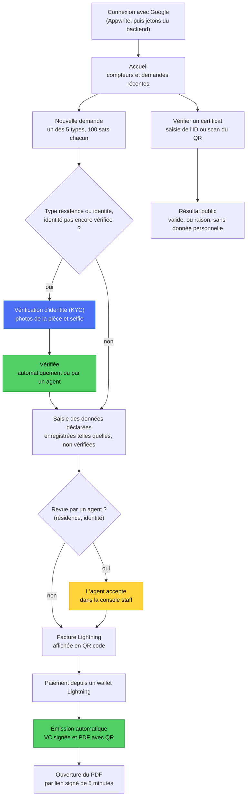

### 🧱 Architecture technique

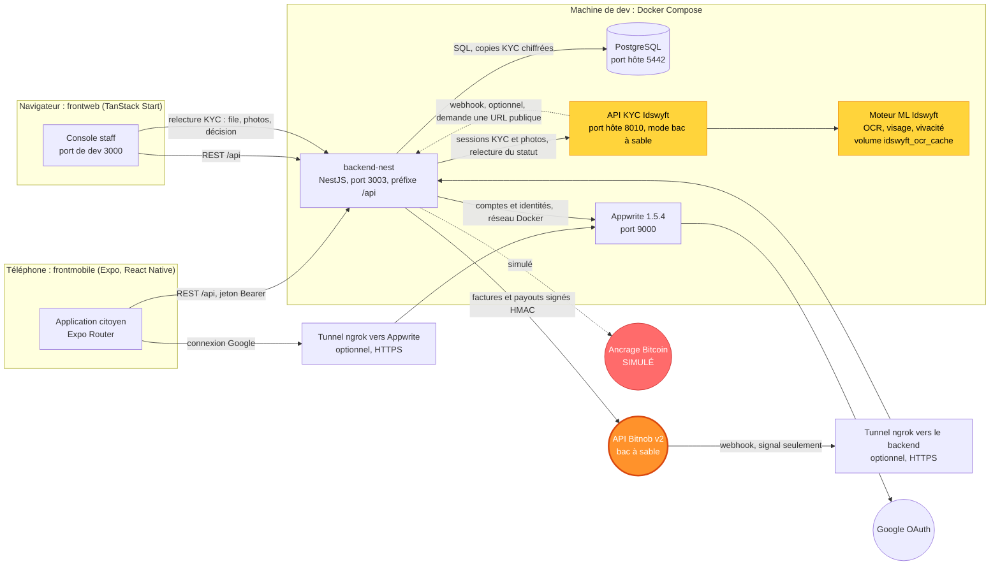

| Composant | Dossier | Rôle | État |
|---|---|---|---|
| Backend | `backend-nest/` | API NestJS 11 + TypeORM + PostgreSQL, port 3003, préfixe `/api` | Actif |
| Application citoyen | `frontmobile/` | Wallet Expo Router + React Native | Actif. Les écrans admin sont des maquettes |
| Console staff | `frontweb/` | Console TanStack Start pour le personnel des organisations, port de dev 3000 | Actif. Mode réel : liste, détail, accepter, rejeter, demander un complément, relecture des vérifications d'identité |
| Environnement de dev | `docker-compose.dev.yml` | Postgres DioteKo (5442), backend (3003), Appwrite (9000), API Idswyft (8010) avec son moteur ML et sa propre base | Développement seulement |

Règles clés de la conception :

- **Bitnob Lightning est le seul rail d'encaissement.**
- **Un webhook Bitnob n'est qu'un signal.** La facture est relue chez Bitnob avant d'être marquée payée.
- **Deux adresses Appwrite.** Le backend parle à Appwrite sur le réseau Docker (`http://appwrite/v1`). Le téléphone passe par un tunnel HTTPS, car Google refuse les adresses IP et le `localhost` d'un téléphone est le téléphone lui-même.

### 🔄 Statuts des demandes

Les statuts viennent de l'énumération `AdminCertificateRequestStatus` dans `backend-nest/src/modules/admin-certificates/entities/admin-certificate-request.entity.ts`.

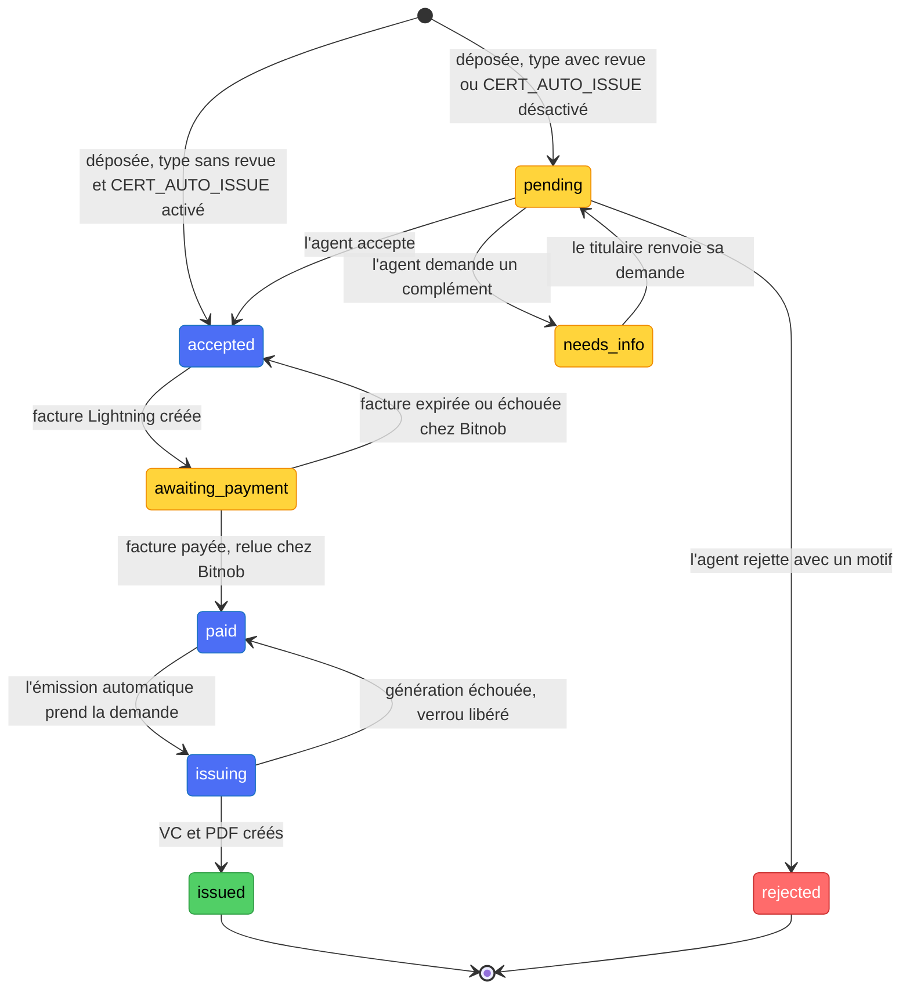

Catalogue des certificats (`admin-certificates.constants.ts`) :

| Type | Identifiant | Prix | Revue par un agent avant paiement |
|---|---|---|---|
| Extrait de naissance | `birth` | 100 sats | Non |
| Extrait de mariage | `marriage` | 100 sats | Non |
| Extrait de décès | `death` | 100 sats | Non |
| Certificat de résidence | `residence` | 100 sats | Oui |
| Certificat d'identité | `identity` | 100 sats | Oui |

### 💸 Du paiement au certificat

Partie 1 : la facture, le paiement et l'émission automatique. Le réconciliateur relit les factures en attente toutes les 60 secondes par défaut, donc un webhook absent ne bloque pas le parcours.

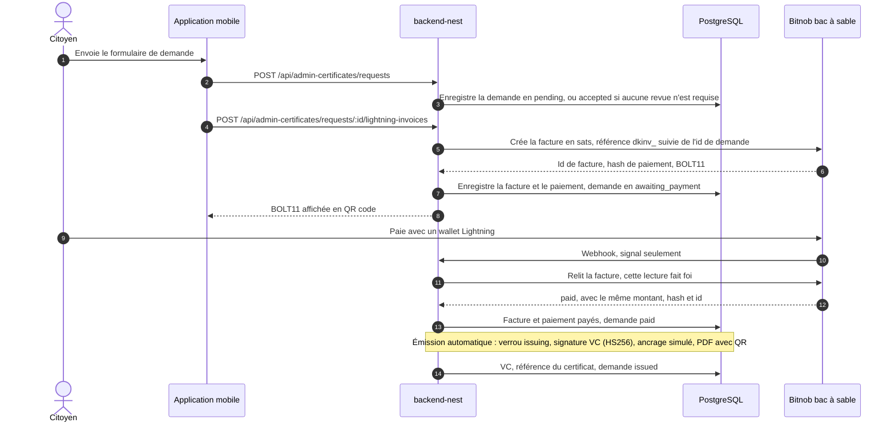

Partie 2 : le lien de téléchargement signé et la vérification publique.

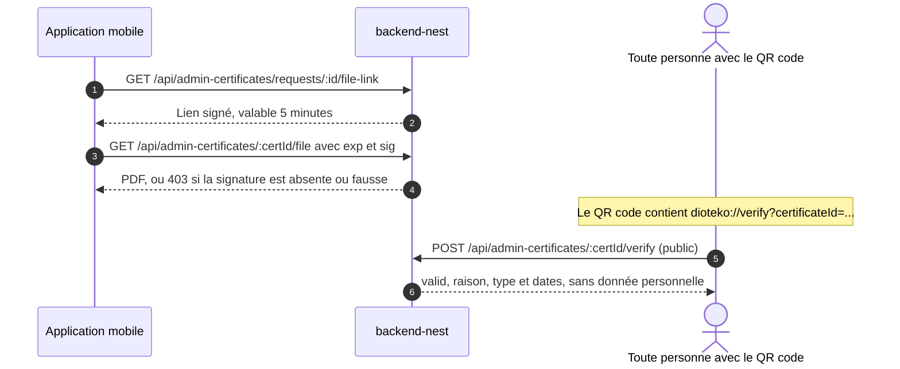

Remarques :

- La facture n'est créée que pour le titulaire, et seulement depuis `accepted`. Le montant vient du catalogue, jamais du client.
- Une facture payée qui ne correspond pas à sa demande, à son fournisseur ou à son montant n'émet rien et est journalisée pour un humain.
- Chaque justificatif émis porte `declaredNotVerified: true` quand aucun agent n'a revu la demande.

### 🟠 Bitnob : facture et payout

Bitnob est le seul rail financier du projet. Il remplit deux rôles, en orange ci-dessous.

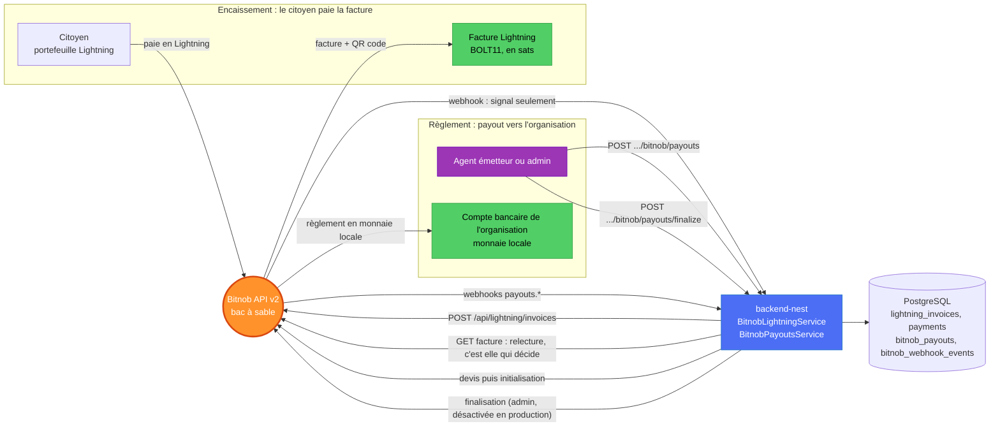

- **Encaissement (facture).** Le backend demande à Bitnob une facture Lightning en sats. Le citoyen la paie depuis n'importe quel portefeuille Lightning. Le webhook Bitnob n'est qu'un signal : le backend relit la facture chez Bitnob, et seule cette relecture la marque payée.
- **Règlement (payout).** Après l'émission, un agent émetteur ou un admin crée un payout : un devis, puis une initialisation. Un admin le finalise. Bitnob règle en monnaie locale sur le compte bancaire de l'organisation. Le bénéficiaire vient de la configuration serveur, jamais du client.
- **Garde-fous.** Chaque requête vers Bitnob est signée HMAC. Les webhooks sont vérifiés par une signature HMAC-SHA512 sur le corps brut et dédupliqués par identifiant d'événement. `finalize` est désactivé en production, `reference` sert de clé d'idempotence, et un seul payout peut être actif par certificat.
- **Limites du bac à sable.** Le bac à sable ne permet pas de payer une facture Lightning par l'API : il faut un vrai portefeuille ou le bouton réservé au développement. L'envoi de paiements Lightning et les écritures groupées sont refusés par le bac à sable.

Statuts d'un payout :

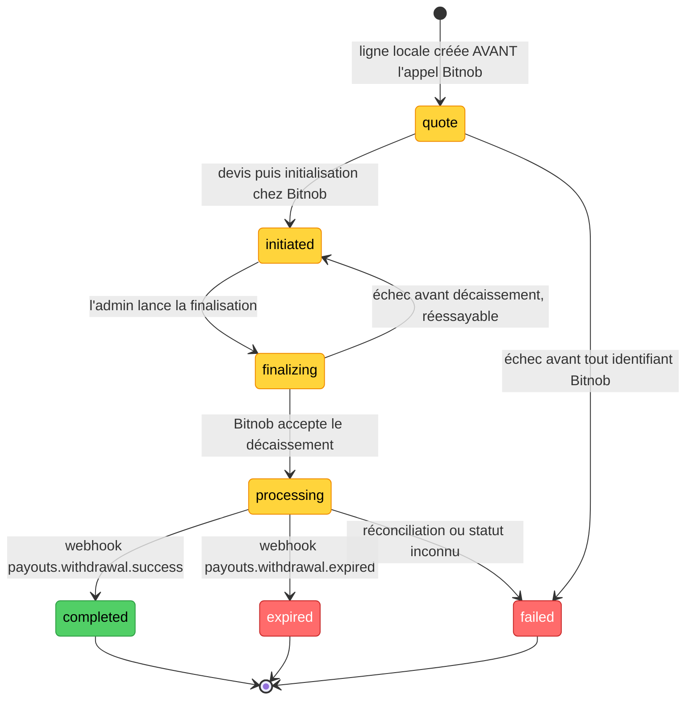

Pour aller plus loin : [docs/BITNOB.md](docs/BITNOB.md) et la section 6 de [docs/ARCHITECTURE_AS_BUILT.md](docs/ARCHITECTURE_AS_BUILT.md).

### 🔐 Vérification d'identité (KYC)

Le KYC (know your customer, « connaître son client ») prouve **qui demande** un certificat : la personne qui dépose la demande est bien celle de la pièce d'identité et du selfie. Il ne prouve pas les données écrites dans le certificat.

- **Où il s'applique.** Les certificats de résidence et d'identité exigent une identité vérifiée (sinon `403 KYC_REQUIRED`). Les extraits de naissance, de mariage et de décès sont prévus : ils ne deviennent bloquants que s'ils figurent dans `KYC_ENFORCED_TYPES`. `KYC_ENFORCEMENT=off` lève la porte en développement seulement et est ignoré en production.
- **Le serveur décide.** L'application mobile ne fait qu'afficher l'état. Un dossier ne devient `verified` qu'après une relecture du verdict chez Idswyft par le backend, ou après l'approbation d'un agent.

Le parcours d'un dossier :

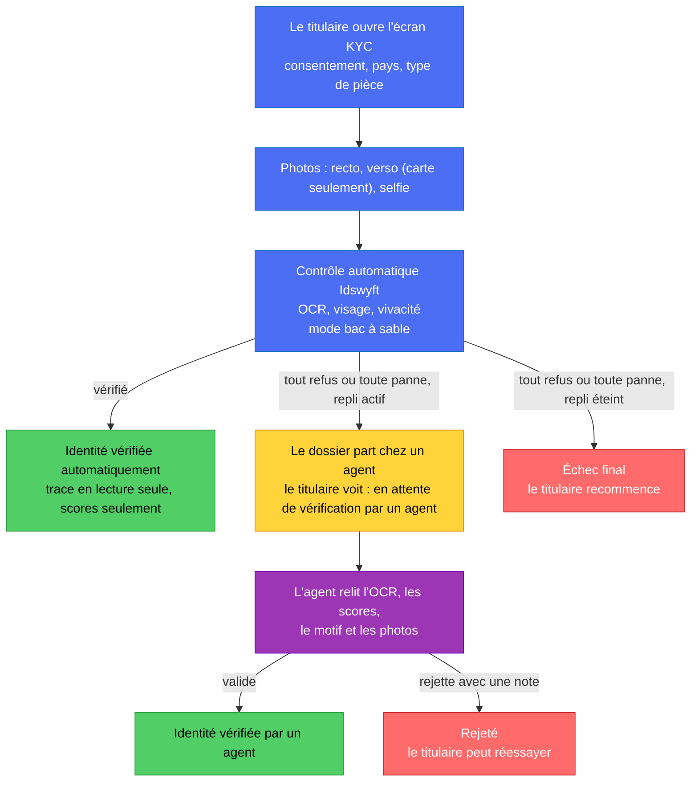

Les états d'un dossier, tels que stockés dans `kyc_verifications` (énumération `KycStatus` dans `backend-nest/src/modules/kyc/kyc.constants.ts`) :

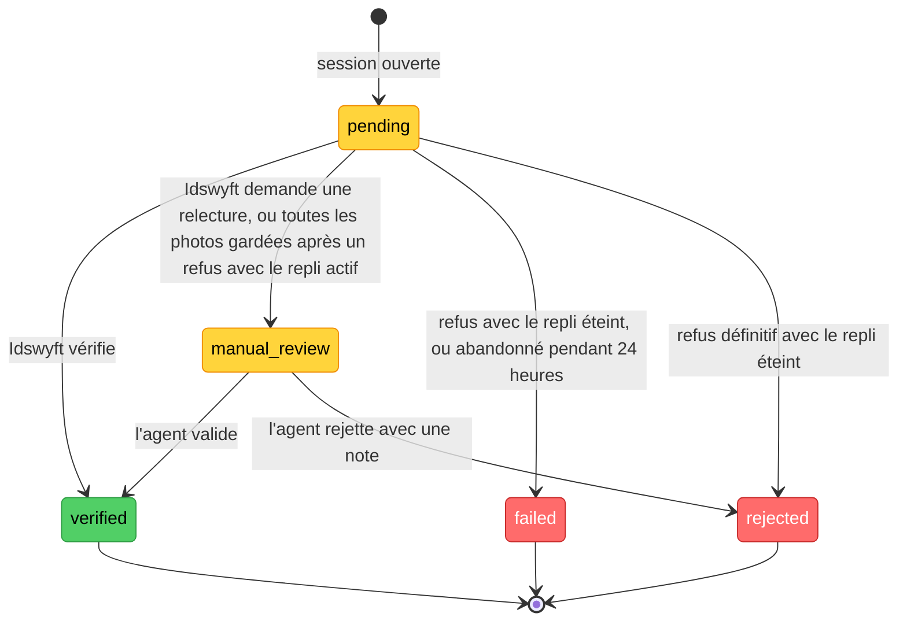

Un dossier refusé reste `pending` pendant que le titulaire finit d'envoyer les photos, puis passe à `manual_review`. `failed` et `rejected` sont clos : un nouvel essai ouvre un nouveau dossier, dans la limite quotidienne (5 sessions sur 24 heures par défaut, `KYC_MAX_SESSIONS_PER_DAY`). `verified` est écrit une seule fois et ne change plus.

**Comment ça marche**

- **Contrôle automatique.** Le titulaire envoie le recto du document, le verso pour une carte nationale d'identité, et un selfie. Idswyft, auto-hébergé dans l'environnement de dev et en mode bac à sable, lit le document (OCR), compare le visage du selfie à celui du document, contrôle la vivacité, et compare le recto et le verso pour une carte. Un overlay DioteKo sur son moteur ML lit la carte d'identité CEDEAO.
- **Repli vers un agent.** Avec `KYC_FALLBACK_MANUAL_REVIEW=on` et une clé de chiffrement valide, **tout** refus part chez un agent au lieu de clore le dossier : pièce illisible, recto et verso qui ne concordent pas, pièce expirée, échec du visage ou de la vivacité, rejet définitif inexpliqué, session fermée, prestataire injoignable ou trop lent. Le titulaire envoie quand même toutes les photos. Seul un agent valide ou rejette : le titulaire n'a aucun moyen de forcer. Avec le flag éteint (par défaut), un refus est final.
- **Ce que voit le titulaire.** Jamais le texte lu sur le document ni les scores. Il voit « En attente de vérification par un agent », « Identité vérifiée », ou un écran de refus avec un bouton « Réessayer ».
- **Ce que voit l'agent.** Dans la page « Vérifications d'identité » de la console (compte issuer ou admin rattaché à une organisation), le filtre de statut est « À relire » par défaut (la file de travail, le plus ancien d'abord), avec « Identité validée », « Rejeté » et « Tous les états ». Pour un dossier à relire : un bandeau « Vérification automatique non concluante », le motif du fournisseur en français, les champs OCR tels que lus avec leur confiance (barre, pourcentage et mot), les scores, et les photos. L'agent valide ou rejette avec une note d'au moins 10 caractères. Un agent ne peut pas décider son propre dossier, une approbation exige toutes les photos, et chaque lecture et chaque décision sont écrites dans le journal d'accès.
- **Les validations automatiques restent visibles.** Un dossier validé par Idswyft seul est listé en lecture seule, avec l'origine « Vérification automatique ». Sa trace ne contient que des scores, des seuils et des indicateurs : ni photo, ni texte lu, ni nom. Un avertissement indique que le fournisseur tournait en mode bac à sable et que le résultat n'est pas fiable pour la production.
- **Confidentialité.** Le texte OCR et les photos sont chiffrés au repos (AES-256-GCM, clé `KYC_DOC_ENCRYPTION_KEY`). Ils sont supprimés à la décision de l'agent ou après `KYC_DOC_RETENTION_DAYS` (30 par défaut), jamais montrés au titulaire, et jamais écrits dans les journaux (les journaux ne portent que des identifiants et des statuts).
- **Le nom n'est pas comparé, volontairement.** Le nom lu sur le document n'est **pas** comparé au nom du compte : un nom Google peut légitimement différer du nom officiel. Un agent peut comparer à la main.

**Limites honnêtes**

- **Pas testé sur de vraies pièces d'identité.** L'instance Idswyft est un bac à sable : son verdict n'est pas fiable pour la production. Le Sénégal ne fait pas partie des pays documentés par Idswyft : le support est à tester, pas à promettre.
- **Pas de reprise du verso seul.** Un refus ferme la session chez le prestataire, donc le verso ne peut pas être repris seul. Avec le repli actif, l'application continue de collecter les photos restantes pour l'agent. Avec le repli éteint, le titulaire recommence.
- **Application mobile non vérifiée sur un téléphone physique par des tests.** Aucun test automatique ne couvre les écrans KYC du mobile.
- **La file de relecture est commune à toute la plateforme.** Un dossier n'appartient à aucune organisation : tout issuer ou admin actif rattaché à une organisation les voit (voir [docs/KNOWN_ISSUES.md](docs/KNOWN_ISSUES.md)).
- **Idswyft garde ses propres données en développement.** Ses images envoyées restent dans le volume `idswyft_uploads` et ses journaux contiennent des champs lus sur le document. À régler avant toute donnée réelle.
- **Le titulaire n'est pas notifié** de la décision de l'agent : l'écran de l'application se met à jour à sa prochaine lecture du statut (environ toutes les 4 secondes tant qu'il est ouvert).

Pour aller plus loin : [docs/KYC.md](docs/KYC.md) (sections 16 et 17) et [docs/BUSINESS_RULES.md](docs/BUSINESS_RULES.md).

### 🔎 Aperçu API

Chemin de base `/api`. Swagger interactif en développement : `http://localhost:3003/api-docs`.

| Route | Qui | Rôle |
|---|---|---|
| `GET /healthz` | Public | Sonde base de données (`SELECT 1`) |
| `POST /auth/appwrite/login` | Public | JWT Appwrite en entrée, jetons DioteKo en sortie |
| `GET /admin-certificates/types` | Public | Catalogue des certificats |
| `POST /admin-certificates/requests` | Utilisateur connecté | Déposer une demande |
| `POST /admin-certificates/requests/:id/lightning-invoices` | Titulaire de la demande | Créer la facture Lightning |
| `POST /admin-certificates/:certId/verify` | Public | Vérifier un certificat |
| `POST /bitnob/webhooks` | Bitnob, signé HMAC | Signaux de paiement et de payout |
| `POST /kyc/sessions` | Utilisateur connecté | Ouvrir une session de vérification d'identité (`national_id` ou `passport`) |
| `POST /kyc/sessions/:sessionId/front`, `/back`, `/selfie` | Titulaire de la session | Envoyer une photo (multipart, JPEG ou PNG, 5 Mo max). Le selfie ferme la session |
| `POST /kyc/sessions/:sessionId/cancel` et `/precheck/:step` | Titulaire de la session | Fermer la session ouverte, ou contrôler une petite photo avant de l'envoyer |
| `GET /kyc/status` | Utilisateur connecté | État du dossier du titulaire (jamais ce qui a été lu sur le document) |
| `POST /kyc/webhook/idswyft` | Idswyft, signé HMAC | Signal de verdict, relu avant d'être cru |
| `GET /kyc/review` | Issuer ou admin | File KYC, filtres `status` (`manual_review` par défaut, `verified`, `rejected`, `all`) et `origin` |
| `GET /kyc/review/:id` | Issuer ou admin | Détail d'un dossier : OCR tel que lu, scores, motif, ou la trace automatique en lecture seule |
| `GET /kyc/review/:id/documents/:kind` | Issuer ou admin | Une photo (`front`, `back`, `selfie`), déchiffrée pour cette requête, jamais mise en cache |
| `POST /kyc/review/:id/decision` | Issuer ou admin | `approve` ou `reject`, avec une note d'au moins 10 caractères |

### 🧩 Structure du projet

- `bitnob/` (racine du dépôt)
  - `backend-nest/` : API NestJS (identity, admin-certificates, bitnob, did-vc, consent, kyc, lightning, healthz, six stubs de domaines)
  - `frontmobile/` : wallet citoyen Expo
    - `app/` : écrans Expo Router (`kyc.tsx` est le parcours de vérification d'identité)
    - `components/kyc/` : écrans d'étapes du KYC et capture caméra
    - `services/` : appels API (`api.ts`), connexion Appwrite (`appwriteAuth.ts`), KYC (`kyc.ts`)
    - `Screen/` : captures utilisées dans ce README (`Screen/KYC/` pour le parcours KYC)
  - `frontweb/` : console staff TanStack Start
    - `src/routes/_console.verifications.tsx` : la page « Vérifications d'identité »
    - `Screen/KYC/` : captures de la console utilisées dans ce README
  - `docs/` : documentation du projet (architecture, règles, workflow de dev, écarts connus)
  - `docker/idswyft/` : overlay DioteKo pour le moteur ML d'Idswyft (lecteur de carte CEDEAO, réparation de la MRZ)
  - `scripts/` : scripts de l'environnement de dev, de la base, des tunnels et du KYC
  - `docker-compose.dev.yml` : environnement de dev (inclut les fichiers Appwrite et Idswyft)
  - `docker-compose.appwrite.yml` et `docker-compose.idswyft.yml` : services auto-hébergés
  - `package.json` : commandes racine (`dev:up`, `db:setup`, `tunnel`, `kyc:bootstrap`)

### 🧰 Technologies utilisées

**API backend** : NestJS 11 avec des guards Passport JWT, TypeORM 0.3 sur PostgreSQL, Swagger pour la documentation de l'API, `pdfkit` et `qrcode` pour le PDF, `node-appwrite` pour vérifier les sessions Appwrite, chiffrement AES-256-GCM des copies KYC.

**Application citoyen** : Expo SDK 57 et React Native 0.86 avec Expo Router, `react-native-appwrite` pour la connexion Google, `expo-camera` pour le scan QR, `expo-secure-store` pour les jetons, NativeWind 5 (release candidate) pour le style.

**Console staff** : TanStack Start sur Vite, Node 22+, Vitest pour les tests, ESLint et Prettier.

**Infrastructure et intégrations** : Docker Compose pour l'environnement de dev, Appwrite 1.5.4 (identité et OAuth Google), Idswyft community v1.12.19 (KYC auto-hébergé, version figée, avec un overlay DioteKo sur son moteur ML ; OCR, correspondance du visage et vivacité), ngrok (tunnels HTTPS), API Bitnob v2 en bac à sable (factures Lightning, payouts).

### 🔧 Mise en route

**Prérequis**

- Docker avec Docker Compose. Le premier démarrage est long : les images Appwrite et Idswyft sont volumineuses.
- Node.js 22+ et npm.
- Expo Go ou un build de développement pour l'application mobile. Un téléphone physique est nécessaire pour le parcours de connexion Google.
- Optionnel : un client OAuth Google Cloud, un compte ngrok par tunnel, et un compte Bitnob en bac à sable (Bitnob refuse les appels depuis des adresses IP non autorisées).

**Étapes**

1. Cloner le dépôt et aller à sa racine :

   ```bash
   git clone <REPO_URL> bitnob
   cd bitnob
   ```

2. Démarrer l'environnement de dev (Postgres DioteKo, backend, Appwrite, Idswyft). Utiliser cette commande, pas un `docker compose up` direct :

   ```bash
   npm run dev:up
   ```

   Idswyft est construit depuis ses sources GitHub. Si Docker n'atteint pas GitHub, réutiliser les images déjà construites en local :

   ```bash
   npm run dev:up:nobuild
   ```

3. Configurer le backend. Copier le modèle, puis renseigner `JWT_SECRET` et `VC_SIGNING_SECRET` avec vos propres valeurs (par exemple avec `openssl rand -hex 32`) :

   ```bash
   cd backend-nest
   npm install
   cp .env.example .env
   cd ..
   ```

4. Créer et initialiser les bases (`dioteko_dev_bitnob` et `dioteko_test_bitnob`), puis vérifier l'API :

   ```bash
   npm run db:setup
   curl http://localhost:3003/api/healthz
   ```

5. Terminer la configuration initiale d'Appwrite dans la console (liste ci-dessous).

6. Démarrer l'application mobile. Copier le modèle (`frontmobile/.env.exemple`) vers `frontmobile/.env`, puis renseigner `EXPO_PUBLIC_APPWRITE_ENDPOINT` et `EXPO_PUBLIC_APPWRITE_PROJECT_ID` :

   ```bash
   cp frontmobile/.env.exemple frontmobile/.env
   cd frontmobile
   npm install
   npx expo start --clear
   ```

7. Démarrer la console staff (`http://localhost:3000`) :

   ```bash
   cd frontweb
   npm ci
   cp .env.example .env
   npm run dev
   ```

8. Optionnel, connexion Google depuis un téléphone : ouvrir les tunnels HTTPS depuis la racine avec `npm run tunnel`. Renseigner ensuite l'adresse du tunnel dans `frontmobile/.env` (`https://xxxx.ngrok-free.dev/v1`) et dans l'URI de redirection Google, puis relancer Expo avec `--clear`.

9. Optionnel, encaissement Lightning : renseigner `BITNOB_CLIENT_ID`, `BITNOB_CLIENT_SECRET` et `BITNOB_ENVIRONMENT=sandbox` dans `backend-nest/.env`.

10. Optionnel, vérification d'identité (KYC). Créer la clé API Idswyft depuis la racine (elle est écrite dans `backend-nest/.env` et jamais affichée) :

    ```bash
    npm run kyc:bootstrap
    ```

    Puis renseigner ces variables dans `backend-nest/.env` (modèle : `backend-nest/.env.example`) :

    - `KYC_FALLBACK_MANUAL_REVIEW=on` envoie tout refus du contrôle automatique à un agent. Il vaut `off` par défaut.
    - `KYC_DOC_ENCRYPTION_KEY` fait 64 caractères hexadécimaux (par exemple avec `openssl rand -hex 32`). Sans clé valide, aucune photo ni lecture n'est gardée, et le repli est sans effet.
    - `KYC_DOC_RETENTION_DAYS` est le nombre de jours pendant lesquels une copie est gardée sans décision (30 par défaut).

    Relancer `npm run dev:up` après tout changement dans `backend-nest/.env` ou `backend-nest/src/` : le conteneur lit le fichier à sa création.

    Le moteur ML d'Idswyft télécharge ses modèles OCR (environ 13 Mo) depuis Internet au premier appel OCR. Le volume Docker `idswyft_ocr_cache` les conserve ensuite. Sans le volume, un conteneur recréé n'a plus de modèles : hors ligne, l'OCR échoue et Idswyft refuse tous les documents.

**Console Appwrite, première configuration** (une fois, sur `http://localhost:9000`) :

- Créer le compte administrateur.
- Créer un projet avec un identifiant de projet personnalisé, et le mettre dans `APPWRITE_PROJECT_ID` dans `backend-nest/.env`.
- Créer une clé API avec les scopes `users.read` et `users.write`, et la mettre dans `APPWRITE_API_KEY`.
- Activer le fournisseur OAuth2 Google avec votre identifiant et secret client Google Cloud (`<GOOGLE_CLIENT_ID>`, `<GOOGLE_CLIENT_SECRET>`).
- Ajouter une plateforme Web avec le nom d'hôte `*`. Pour le développement local uniquement, jamais en production.

Ne jamais committer de fichiers `.env` ni de clés. Utiliser des placeholders dans la documentation.

### 🚀 Utilisation

- **Backend** : `http://localhost:3003/api` (santé : `/api/healthz`), Swagger sur `http://localhost:3003/api-docs`.
- **Comptes de démonstration** créés par `npm run seed` dans `backend-nest/` : `issuer-demo@dioteko.local`, `admin-demo@dioteko.local`, `holder-demo@dioteko.local`. Le mot de passe de démonstration commun est dans [docs/DEV_WORKFLOW.md](docs/DEV_WORKFLOW.md).
- **Application citoyen** : se connecter avec Google, demander un certificat, payer la facture (en développement, avec le bouton de simulation), ouvrir le PDF par le lien signé, puis vérifier un certificat par identifiant ou QR code.
- **Console staff** : se connecter avec un compte issuer ou admin, puis traiter les demandes de votre organisation.
- **Vérification d'identité, titulaire** : dans l'application, ouvrir « Vérification d'identité » dans le profil, ou « Vérifier mon identité » sur une demande de résidence ou d'identité. Choisir le type de pièce, photographier le document, faire un selfie, puis attendre le résultat.
- **Vérification d'identité, agent** : dans la console, ouvrir « Vérifications d'identité ». Le filtre par défaut « À relire » liste les dossiers qui vous attendent. Ouvrir un dossier, comparer l'OCR, les scores et les photos, puis valider ou rejeter avec une note. « Identité validée » et « Tous les états » listent aussi les dossiers validés automatiquement, en lecture seule.

### 🧪 Tests

| Paquet | Commande | Ce qui est lancé |
|---|---|---|
| `backend-nest/` | `npm test` | Tests unitaires Jest, sans base de données |
| `backend-nest/` | `npm run test:e2e` | Tests Jest de bout en bout sur `dioteko_test_bitnob` (copier d'abord `.env.test.example` vers `.env.test`) |
| `backend-nest/` | `npm run typecheck` | Vérification TypeScript (`tsc --noEmit`) |
| `frontweb/` | `npm test` et `npm run lint` | Vitest, ESLint et Prettier |
| `frontmobile/` | `npm run lint` | Lint Expo. Il n'y a pas de lanceur de tests pour l'application mobile |

### 📚 Index de la documentation

- [docs/ARCHITECTURE_AS_BUILT.md](docs/ARCHITECTURE_AS_BUILT.md) : architecture réelle, flux, intégrations, écarts connus
- [docs/DEV_WORKFLOW.md](docs/DEV_WORKFLOW.md) : toutes les commandes de développement et la première configuration
- [docs/DATABASE_MODEL.md](docs/DATABASE_MODEL.md) : tables et liens entre elles
- [docs/BUSINESS_RULES.md](docs/BUSINESS_RULES.md) : règles métier, chacune avec son fichier source
- [docs/DOMAIN_NOTES.md](docs/DOMAIN_NOTES.md) : concepts et vocabulaire
- [docs/KYC.md](docs/KYC.md) : vérification d'identité avec Idswyft (sections 16 et 17 : relecture par un agent et audit des validations automatiques)
- [docs/BITNOB.md](docs/BITNOB.md) : contrat de l'API Bitnob et encaissement Lightning
- [docs/CERTIFICATE_EVENT_CHAIN.md](docs/CERTIFICATE_EVENT_CHAIN.md) : proposition de chaîne d'événements infalsifiable (non implémentée)
- [docs/KNOWN_ISSUES.md](docs/KNOWN_ISSUES.md) : écarts connus et contournements
- [docs/DECISIONS.md](docs/DECISIONS.md) et [docs/TESTING.md](docs/TESTING.md)

### 🏁 Défis et prochaines étapes

**Défis**

- **Connexion Google sur téléphone.** Appwrite construit l'URL de retour OAuth sans le port, et Google refuse les adresses IP. Un téléphone a donc besoin d'un tunnel HTTPS.
- **Décalage de versions.** `react-native-appwrite` 0.34 vise Appwrite 1.6, alors que le serveur local est en 1.5.4. L'application revient sur `/account/jwt`.
- **Faire confiance à un webhook.** Le nom de l'événement Bitnob « facture payée » n'est pas documenté : le backend ne l'utilise que comme signal et relit la facture.
- **Données déclarées.** Les noms sont saisis par le citoyen et ne sont pas contrôlés par un registre d'état civil. Les certificats émis le précisent dans le justificatif signé et dans le PDF.
- **Un moteur OCR qui télécharge ses modèles à l'exécution.** PaddleOCR, dans Idswyft, récupère ses modèles sur Internet au premier appel OCR. Un conteneur recréé sans cache n'en avait plus, et hors ligne tout document était refusé comme illisible. Le correctif est un volume Docker persistant, `idswyft_ocr_cache`.
- **Un refus qui terminait le parcours.** Avec un prestataire strict, un désaccord entre recto et verso clôturait le dossier avant le selfie. Le repli envoie maintenant tout refus à un agent, et l'application continue de collecter les photos.

**Prochaines étapes**

- Ancrage Bitcoin réel sur testnet, à la place de la simulation.
- Test KYC sur de vraies pièces d'identité, et un prestataire d'identité de production à la place du bac à sable.
- Cadrer la file de relecture KYC (un rôle de relecteur dédié, ou par organisation) avant toute donnée réelle.
- Un volume persistant pour les fichiers PDF.
- Des écrans admin réels dans l'application mobile.
- Une trace d'audit pour l'émission et la révocation des justificatifs (pas encore écrite).

### 🤝 Contribuer

Lire [CONTRIBUTING.md](CONTRIBUTING.md) et [docs/DEV_WORKFLOW.md](docs/DEV_WORKFLOW.md) avant d'ouvrir une pull request. Lancer les vérifications du tableau des tests pour les paquets modifiés.

### 📄 Licence

MIT. Voir [LICENSE](LICENSE).

### 👥 Équipe

L'équipe DioteKo (5 personnes) :

**Salif Diallo** Développeur Principal
- GitHub : [@MrSalifDiallo](https://github.com/MrSalifDiallo)
- LinkedIn : [Salif Diallo](https://www.linkedin.com/in/salif-diallo-152650313/)
- Email : [salifdiallo@esp.sn](mailto:salifdiallo@esp.sn)

**Aicha Ndiaye** Ingénieure BIG DATA / IA
- GitHub : [@smiley100](https://github.com/smiley100)
- LinkedIn : [Aicha Ndiaye](https://www.linkedin.com/in/ndiaye-a%C3%AFcha-72ba87331)
- Email : [ndiayeaicha0928@gmail.com](mailto:ndiayeaicha0928@gmail.com)

**Fatou Tambedou** Ingénieure BIG DATA / IA
- GitHub : [@fatoutambedou-ctl](https://github.com/fatoutambedou-ctl)
- Email : [fatoutambedou@esp.sn](mailto:fatoutambedou@esp.sn)

**Ndeye Marieme Sy** Développeuse
- GitHub : [@Maryam-SY](https://github.com/Maryam-SY)
- Email : [meriemsy3@gmail.com](mailto:meriemsy3@gmail.com)

**Mame Saye Fall** Développeuse
- GitHub : [@mamesayefall125-svg](https://github.com/mamesayefall125-svg)
- Email : [mamesayefall125@gmail.com](mailto:mamesayefall125@gmail.com)

[⬆ Retour en haut](#dioteko)
