# DioteKo

[English](#english) | [Français](#français)

## English

**DioteKo** issues administrative certificates to citizens. A citizen signs in with Google, asks for a certificate in a mobile wallet, pays a Lightning invoice in sats, and receives a signed Verifiable Credential and a PDF with a QR code. Anyone can then verify the certificate publicly.

> **Status:** development prototype for the Africa DID Hackathon 2026. Not production-ready. Simulated parts and known gaps are listed below and in [docs/KNOWN_ISSUES.md](docs/KNOWN_ISSUES.md).

**Table of contents**

- [💡 Problem and inspiration](#-problem-and-inspiration)
- [✅ Features](#-features)
- [📸 App screenshots](#-app-screenshots)
- [🧭 User flow](#-user-flow)
- [🧱 Architecture](#-architecture)
- [🔄 Certificate request statuses](#-certificate-request-statuses)
- [💸 From payment to certificate](#-from-payment-to-certificate)
- [🟠 Bitnob: invoice and payout](#-bitnob-invoice-and-payout)
- [🔎 API overview](#-api-overview)
- [🧩 Project structure](#-project-structure)
- [🧰 Technologies used](#-technologies-used)
- [🔧 Installation](#-installation)
- [🚀 Usage](#-usage)
- [🧪 Testing](#-testing)
- [📚 Documentation index](#-documentation-index)
- [🏁 Challenges and next steps](#-challenges-and-next-steps)
- [🤝 Contributing](#-contributing)
- [📄 License](#-license)
- [👥 Team](#-team)

### 💡 Problem and inspiration

Getting an administrative paper usually means queuing, travelling and trusting a stamp. Citizens abroad depend on relatives and on postal delays. The person who receives a paper often has no quick way to check it. DioteKo moves the request, the payment and the proof online: the citizen pays a Lightning invoice, the server issues a signed credential, and a QR code lets anyone check the certificate.

### ✅ Features

- ✅ **Google sign-in through Appwrite**: the backend checks the Appwrite session, then issues its own short-lived access token and rotating refresh token. The full flow on a physical phone is still to be tested.
- ✅ **Five certificate types**: birth, marriage and death extracts, residence certificate, identity certificate. Each costs 100 sats (a test price).
- ✅ **Agent review**: an agent of the issuing organisation can accept a request, reject it with a reason, or ask the holder for more information. The holder resubmits when asked.
- ✅ **Lightning payment through Bitnob**: the backend creates the invoice and marks it paid only after reading it back from Bitnob.
- ✅ **Automatic issuance after payment**: a signed Verifiable Credential (JWT, HS256) and a PDF with a QR code.
- ✅ **Public verification** by certificate ID or QR code: returns `valid`, or the reason (`revoked`, `expired`, `signature_invalid`, `hash_mismatch`). No name and no personal data are returned.
- ✅ **Signed PDF link**: the holder gets a download link valid for 5 minutes. The PDF is never public.
- ✅ **Staff console** (`frontweb/`): list, detail, accept, reject and request more information, in real mode.

**Known limits** (see [docs/KNOWN_ISSUES.md](docs/KNOWN_ISSUES.md)):

- **Bitcoin anchoring is simulated.** The anchor transaction id is random and always reported as verified. Verification does not check it. Do not present it as a timestamp proof.
- **Identity verification (KYC, self-hosted Idswyft)** is wired, but it has not been tested on real identity documents. Residence and identity requests are blocked without a verified KYC file (`403 KYC_REQUIRED`) while enforcement is on.
- **Verifiable Credentials use a shared HS256 secret**, so only this backend can verify them.
- **Admin screens** in the mobile app (`frontmobile/app/admin/*`) are mockups with fake data.
- **PDF files are written to the backend container disk**, which has no volume: recreating the container loses them.
- **Sandbox Lightning invoices cannot be paid through the API.** A real wallet is needed for an end-to-end payment. A development-only button marks an invoice as paid.
- **No automated test runner on the mobile app**, and the app has not been checked on a physical phone.

### 📸 App screenshots

Screenshots are in [frontmobile/Screen/](frontmobile/Screen/). Click a screen to open the full-size image.

**Authentication.** The e-mail and password fields are UI only: their submit is not wired yet. Google sign-in is the working path.

<div align="center">

| Create account screen | Sign-in screen |
|:---:|:---:|
| <a href="./frontmobile/Screen/Inscription.jpeg"></a> | <a href="./frontmobile/Screen/Connexion.jpeg"></a> |

</div>

- **Inscription**: create-account form (first name, last name, e-mail, password) with Apple and Google buttons.
- **Connexion**: sign-in form (e-mail, password) with Apple and Google buttons.

**Home.**

<div align="center">

| Home screen | Home screen, service list |
|:---:|:---:|
| <a href="./frontmobile/Screen/Accueil.jpeg"></a> | <a href="./frontmobile/Screen/Accueil2.jpeg"></a> |

</div>

- **Accueil**: counters (total, valid, pending, expiring), recent requests, and the actions "Request a certificate" and "Verify a certificate".
- **Accueil2**: service cards for the birth, marriage and death extracts and the residence certificate (the first four visible), each at 100 sats with a "Choose" button.

**Request and payment.**

<div align="center">

| New request screen | Birth extract form | Accepted request, payment method | Lightning invoice QR code |
|:---:|:---:|:---:|:---:|
| <a href="./frontmobile/Screen/Demande.jpeg"></a> | <a href="./frontmobile/Screen/Demande_Extrait.jpeg"></a> | <a href="./frontmobile/Screen/Demande_Extrait_Choix_Paiement.jpeg"></a> | <a href="./frontmobile/Screen/Demande_Extrait_Generation_QR_Code_Payment.jpeg"></a> |

</div>

- **Demande**: new request, listing the five certificate types at 100 sats each.
- **Demande_Extrait**: birth extract form (full name, date and place of birth, parents' names, nationality, ID number). A banner says identity verification will become mandatory for this document.
- **Demande_Extrait_Choix_Paiement**: request accepted and ready to pay. Bitcoin Lightning is the available method; other methods are shown as coming soon.
- **Demande_Extrait_Generation_QR_Code_Payment**: Lightning invoice as a QR code and text, 100 sats, expiry countdown, copy button, waiting state, and a development-only "simulate payment" button.

**Certificate.**

<div align="center">

| Certificate details and PDF preview |
|:---:|
| <a href="./frontmobile/Screen/Generation_Certificat.jpeg">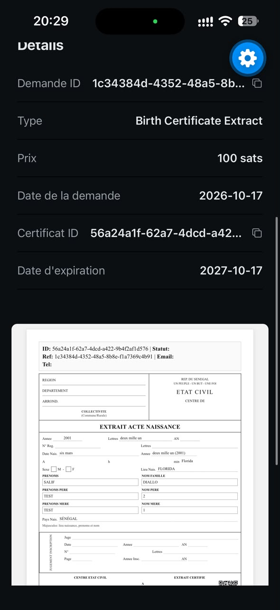</a> |

</div>

- **Generation_Certificat**: request ID, certificate ID, type, price, request date, expiry date, and a PDF preview with sample data.

**Verification.**

<div align="center">

| Verify certificate screen | QR scan mode |
|:---:|:---:|
| <a href="./frontmobile/Screen/Verifier.jpeg"></a> | <a href="./frontmobile/Screen/VeriferQrActivate.jpeg">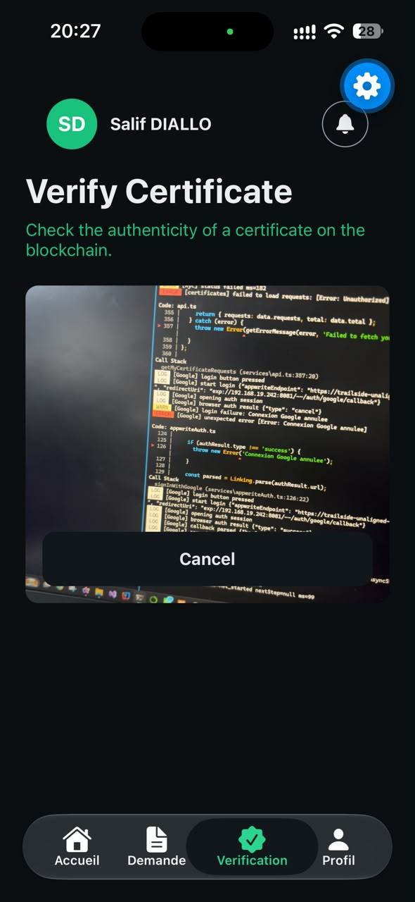</a> |

</div>

- **Verifier**: enter a certificate ID, "Verify Manually", or "Scan QR Code". The subtitle says "on the blockchain", but the anchor is simulated (see limits above).
- **VeriferQrActivate**: QR scan mode, with the camera view and a Cancel button. The photo was taken with the camera pointed at a development screen.

**Profile.**

<div align="center">

| Profile screen |
|:---:|
| <a href="./frontmobile/Screen/Profil.jpeg"></a> |

</div>

- **Profil**: name and e-mail, identity verification status ("not verified"), account, security and privacy, notifications, dark mode, advanced settings.

### 🧭 User flow

The flow follows the screens above. Steps marked as an agent review apply only to residence and identity certificates.

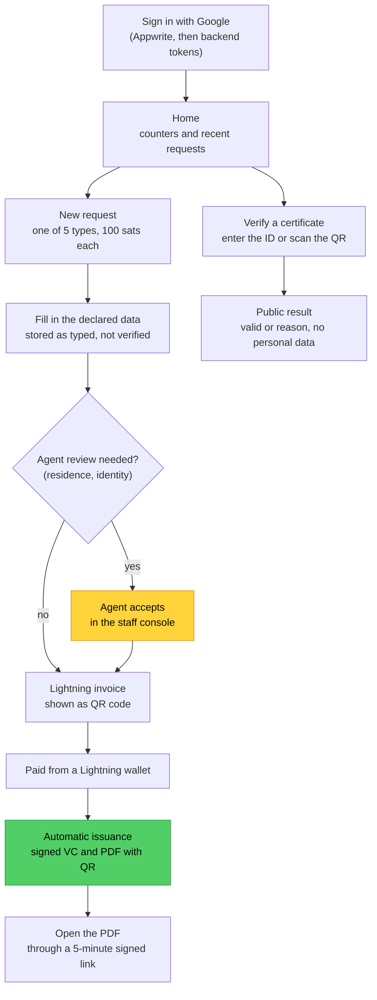

### 🧱 Architecture

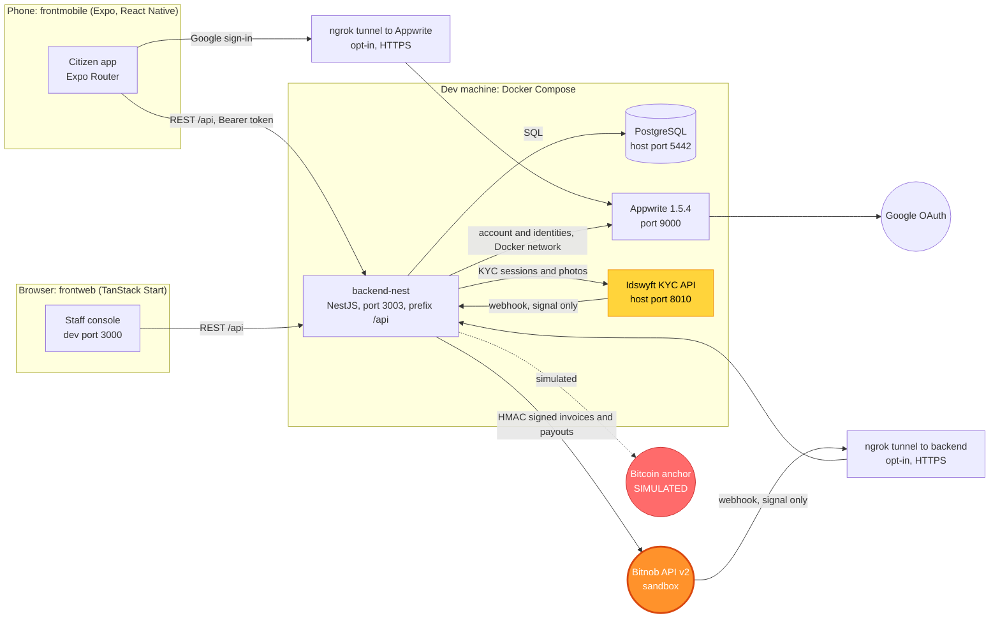

| Component | Folder | Role | State |
|---|---|---|---|
| Backend | `backend-nest/` | NestJS 11 + TypeORM + PostgreSQL API, port 3003, prefix `/api` | Active |
| Citizen app | `frontmobile/` | Expo Router + React Native wallet | Active. Admin screens are mockups |
| Staff console | `frontweb/` | TanStack Start console for organisation staff, dev port 3000 | Active. Real mode: list, detail, accept, reject, request info |
| Dev stack | `docker-compose.dev.yml` | DioteKo Postgres (5442), backend (3003), Appwrite (9000), Idswyft API (8010) | Development only |

Key rules of the design:

- **Bitnob Lightning is the only pay-in rail.**
- **A Bitnob webhook is only a signal.** The invoice is read again from Bitnob before it is marked paid.
- **Two Appwrite addresses.** The backend talks to Appwrite on the Docker network (`http://appwrite/v1`). The phone uses an HTTPS tunnel, because Google refuses IP addresses and a phone's `localhost` is the phone itself.

### 🔄 Certificate request statuses

The statuses come from the `AdminCertificateRequestStatus` enum in `backend-nest/src/modules/admin-certificates/entities/admin-certificate-request.entity.ts`.

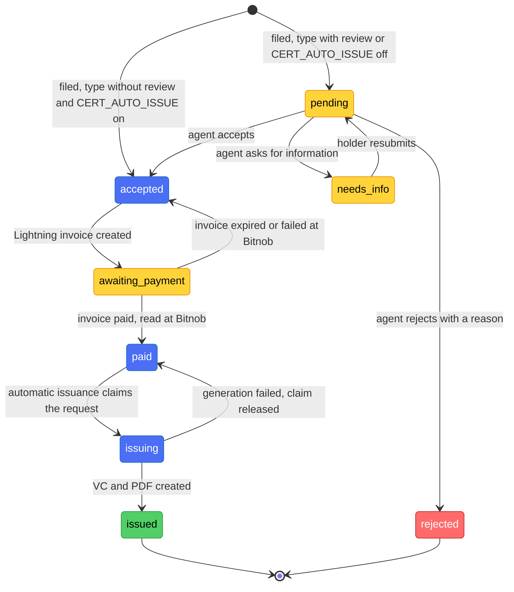

Certificate catalogue (`admin-certificates.constants.ts`):

| Type | Id | Price | Agent review before payment |
|---|---|---|---|
| Birth extract | `birth` | 100 sats | No |
| Marriage extract | `marriage` | 100 sats | No |
| Death extract | `death` | 100 sats | No |
| Residence certificate | `residence` | 100 sats | Yes |
| Identity certificate | `identity` | 100 sats | Yes |

### 💸 From payment to certificate

Part 1: the invoice, the payment and the automatic issuance. The reconciler re-reads pending invoices every 60 seconds by default, so a missing webhook does not block the flow.

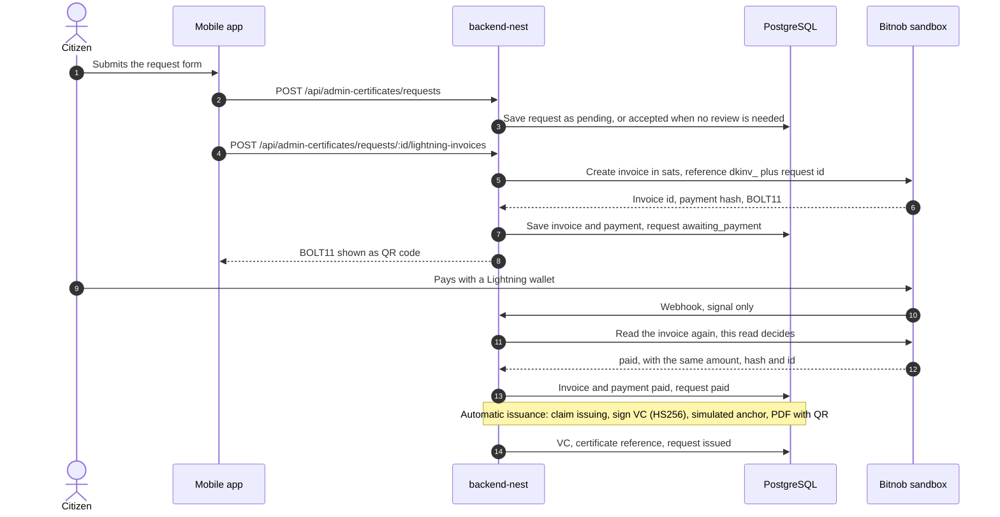

Part 2: the signed download link and the public verification.

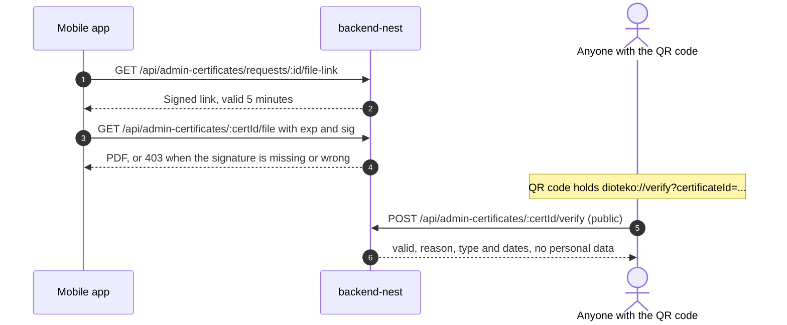

Notes:

- The invoice is created only for the holder, and only from `accepted`. The amount comes from the catalogue, not from the client.
- A paid invoice that does not match its request, provider or amount issues nothing and is logged for a human.
- Each issued credential carries `declaredNotVerified: true` when no agent reviewed the request.

### 🟠 Bitnob: invoice and payout

Bitnob is the only money rail of the project. It does two jobs, shown in orange below.

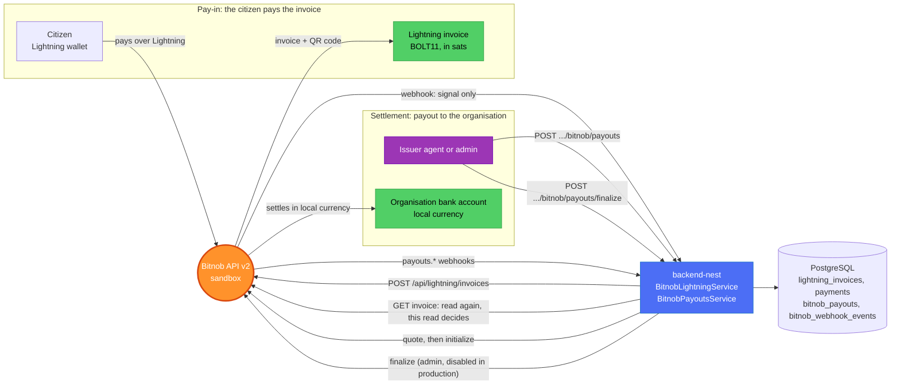

- **Pay-in (invoice).** The backend asks Bitnob for a Lightning invoice in sats. The citizen pays it from any Lightning wallet. The Bitnob webhook is only a signal: the backend reads the invoice again at Bitnob, and only that read marks it paid.
- **Payout (settlement).** After issuance, an issuer agent or an admin creates a payout: a quote, then an initialization. An admin finalizes it. Bitnob settles in local currency to the organisation's bank account. The beneficiary comes from the server configuration, never from the client.
- **Safeguards.** Every Bitnob request is HMAC-signed. Webhooks are verified with an HMAC-SHA512 signature on the raw body and de-duplicated by event id. `finalize` is disabled in production, `reference` is the idempotency key, and only one payout can be active per certificate.
- **Sandbox limits.** The sandbox does not let the API pay a Lightning invoice, so a real wallet or the development-only button is needed. Sending Lightning payments and bulk writes are refused by the sandbox.

Payout statuses:

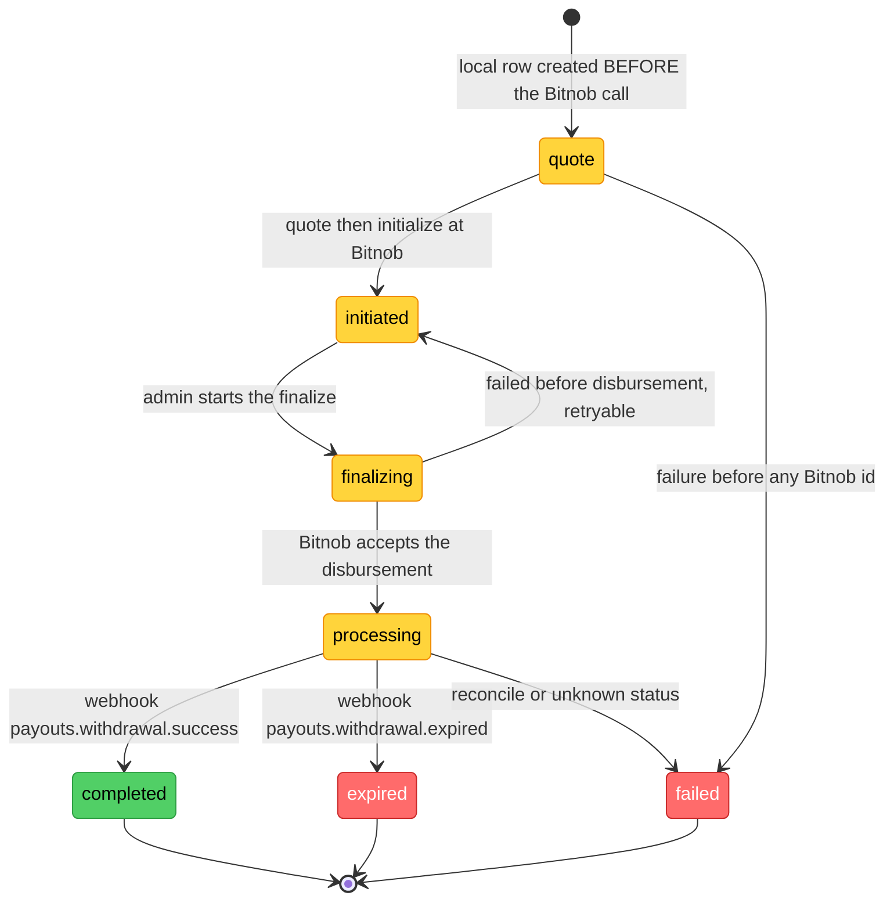

More detail: [docs/BITNOB.md](docs/BITNOB.md) and section 6 of [docs/ARCHITECTURE_AS_BUILT.md](docs/ARCHITECTURE_AS_BUILT.md).

### 🔎 API overview

Base path `/api`. Interactive Swagger: `http://localhost:3003/api-docs` in development.

| Route | Who | What |
|---|---|---|
| `GET /healthz` | Public | Database probe (`SELECT 1`) |
| `POST /auth/appwrite/login` | Public | Appwrite JWT in, DioteKo tokens out |
| `GET /admin-certificates/types` | Public | Certificate catalogue |
| `POST /admin-certificates/requests` | Signed-in user | File a request |
| `POST /admin-certificates/requests/:id/lightning-invoices` | Holder of the request | Create the Lightning invoice |
| `POST /admin-certificates/:certId/verify` | Public | Verify a certificate |
| `POST /bitnob/webhooks` | Bitnob, HMAC signed | Payment and payout signals |

### 🧩 Project structure

- `bitnob/` (repository root)
  - `backend-nest/`: NestJS API (identity, admin-certificates, bitnob, did-vc, consent, kyc, lightning, healthz, six domain stubs)
  - `frontmobile/`: Expo citizen wallet
    - `app/`: Expo Router screens
    - `services/`: API calls (`api.ts`), Appwrite login (`appwriteAuth.ts`), KYC (`kyc.ts`)
    - `Screen/`: screenshots used in this README
  - `frontweb/`: TanStack Start staff console
  - `docs/`: project documentation (architecture, rules, dev workflow, known issues)
  - `scripts/`: dev stack, database, tunnel and KYC helper scripts
  - `docker-compose.dev.yml`: dev stack (includes the Appwrite and Idswyft files)
  - `docker-compose.appwrite.yml` and `docker-compose.idswyft.yml`: self-hosted services
  - `package.json`: root dev commands (`dev:up`, `db:setup`, `tunnel`, `kyc:bootstrap`)

### 🧰 Technologies used

**Backend API**: NestJS 11 with Passport JWT guards, TypeORM 0.3 on PostgreSQL, Swagger for the API docs, `pdfkit` and `qrcode` for the PDF, `node-appwrite` to check Appwrite sessions.

**Citizen app**: Expo SDK 57 and React Native 0.86 with Expo Router, `react-native-appwrite` for Google sign-in, `expo-camera` for QR scanning, `expo-secure-store` for tokens, NativeWind 5 (release candidate) for styling.

**Staff console**: TanStack Start on Vite, Node 22+, Vitest for tests, ESLint and Prettier.

**Infrastructure and integrations**: Docker Compose for the dev stack, Appwrite 1.5.4 (identity and Google OAuth), Idswyft community v1.12.19 (self-hosted KYC, pinned version), ngrok (HTTPS tunnels), Bitnob API v2 sandbox (Lightning invoices, payouts).

### 🔧 Installation

**Prerequisites**

- Docker with Docker Compose. The first start is slow: the Appwrite and Idswyft images are large.
- Node.js 22+ and npm.
- Expo Go or a development build for the mobile app. A physical phone is needed for the Google sign-in flow.
- Optional: a Google Cloud OAuth client, one ngrok account per tunnel, and a Bitnob sandbox account (Bitnob rejects calls from IP addresses that are not allowlisted).

**Steps**

1. Clone the repository and go to its root:

   ```bash
   git clone <REPO_URL> bitnob
   cd bitnob
   ```

2. Start the dev stack (DioteKo Postgres, backend, Appwrite, Idswyft). Use this command, not a bare `docker compose up`:

   ```bash
   npm run dev:up
   ```

3. Configure the backend. Copy the template, then fill `JWT_SECRET` and `VC_SIGNING_SECRET` with your own values (for example from `openssl rand -hex 32`):

   ```bash
   cd backend-nest
   npm install
   cp .env.example .env
   cd ..
   ```

4. Create and seed the databases (`dioteko_dev_bitnob` and `dioteko_test_bitnob`), then check the API:

   ```bash
   npm run db:setup
   curl http://localhost:3003/api/healthz
   ```

5. Finish the Appwrite first-run setup in the console (see the list below).

6. Start the mobile app. Copy the template (`frontmobile/.env.exemple`) to `frontmobile/.env` and set `EXPO_PUBLIC_APPWRITE_ENDPOINT` and `EXPO_PUBLIC_APPWRITE_PROJECT_ID`:

   ```bash
   cp frontmobile/.env.exemple frontmobile/.env
   cd frontmobile
   npm install
   npx expo start --clear
   ```

7. Start the staff console (`http://localhost:3000`):

   ```bash
   cd frontweb
   npm ci
   cp .env.example .env
   npm run dev
   ```

8. Optional, Google sign-in from a phone: open the HTTPS tunnels from the repo root with `npm run tunnel`. Then set the tunnel address in `frontmobile/.env` (`https://xxxx.ngrok-free.dev/v1`) and in the Google redirect URI, and restart Expo with `--clear`.

9. Optional, Lightning pay-in and KYC: set `BITNOB_CLIENT_ID`, `BITNOB_CLIENT_SECRET` and `BITNOB_ENVIRONMENT=sandbox` in `backend-nest/.env`, then run `npm run kyc:bootstrap` from the root to create the Idswyft API key. Run `npm run dev:up` again after any change to `backend-nest/.env` or `backend-nest/src/`.

**Appwrite console, first run** (once, at `http://localhost:9000`):

- Create the admin account.
- Create a project with a custom Project ID, and put it in `APPWRITE_PROJECT_ID` in `backend-nest/.env`.
- Create an API key with the `users.read` and `users.write` scopes, and put it in `APPWRITE_API_KEY`.
- Enable the Google OAuth2 provider with your Google Cloud client ID and secret (`<GOOGLE_CLIENT_ID>`, `<GOOGLE_CLIENT_SECRET>`).
- Add a Web platform with hostname `*`. This is for local development only, never for production.

Never commit `.env` files or keys. Use placeholders in documentation.

### 🚀 Usage

- **Backend**: `http://localhost:3003/api` (health: `/api/healthz`), Swagger at `http://localhost:3003/api-docs`.
- **Demo accounts** are created by `npm run seed` in `backend-nest/`: `issuer-demo@dioteko.local`, `admin-demo@dioteko.local`, `holder-demo@dioteko.local`. The shared demo password is in [docs/DEV_WORKFLOW.md](docs/DEV_WORKFLOW.md).
- **Citizen app**: sign in with Google, request a certificate, pay the invoice (in development, with the simulate button), open the PDF through the signed link, then verify a certificate by ID or QR code.
- **Staff console**: sign in as an issuer or admin account, then review requests of your organisation.

### 🧪 Testing

| Package | Command | What it runs |
|---|---|---|
| `backend-nest/` | `npm test` | Jest unit tests, no database |
| `backend-nest/` | `npm run test:e2e` | Jest end-to-end tests on `dioteko_test_bitnob` (copy `.env.test.example` to `.env.test` first) |
| `backend-nest/` | `npm run typecheck` | TypeScript check (`tsc --noEmit`) |
| `frontweb/` | `npm test` and `npm run lint` | Vitest, ESLint and Prettier |
| `frontmobile/` | `npm run lint` | Expo lint. There is no test runner for the mobile app |

### 📚 Documentation index

- [docs/ARCHITECTURE_AS_BUILT.md](docs/ARCHITECTURE_AS_BUILT.md): architecture as built, flows, integrations, known deviations
- [docs/DEV_WORKFLOW.md](docs/DEV_WORKFLOW.md): every development command and first-run steps
- [docs/DATABASE_MODEL.md](docs/DATABASE_MODEL.md): tables and their links
- [docs/BUSINESS_RULES.md](docs/BUSINESS_RULES.md): business rules, each with its source file
- [docs/DOMAIN_NOTES.md](docs/DOMAIN_NOTES.md): concepts and vocabulary
- [docs/KYC.md](docs/KYC.md): identity verification with Idswyft
- [docs/BITNOB.md](docs/BITNOB.md): Bitnob API contract and Lightning pay-in
- [docs/CERTIFICATE_EVENT_CHAIN.md](docs/CERTIFICATE_EVENT_CHAIN.md): proposal for a tamper-evident event chain (not implemented)
- [docs/KNOWN_ISSUES.md](docs/KNOWN_ISSUES.md): known gaps and workarounds
- [docs/DECISIONS.md](docs/DECISIONS.md) and [docs/TESTING.md](docs/TESTING.md)

### 🏁 Challenges and next steps

**Challenges**

- **Google sign-in on a phone.** Appwrite builds the OAuth callback without the port, and Google refuses IP addresses. A phone therefore needs an HTTPS tunnel.
- **Version skew.** `react-native-appwrite` 0.34 targets Appwrite 1.6, but the local server runs 1.5.4. The app falls back to `/account/jwt`.
- **Trusting a webhook.** The Bitnob webhook event name is not documented, so the backend uses it only as a signal and reads the invoice again.
- **Declared data.** Names are typed by the citizen and are not checked against a civil register. Issued certificates say so in the signed credential and in the PDF.

**Next steps**

- Real Bitcoin anchoring on testnet, in place of the simulation.
- KYC spike on real identity documents.
- A persistent volume for the PDF files.
- Real admin screens in the mobile app.
- Audit entries for credential issuance and revocation (not written yet).

### 🤝 Contributing

Read [CONTRIBUTING.md](CONTRIBUTING.md) and [docs/DEV_WORKFLOW.md](docs/DEV_WORKFLOW.md) before opening a pull request. Run the checks in the Testing table for the packages you touched.

### 📄 License

MIT. See [LICENSE](LICENSE).

### 👥 Team

The DioteKo team (5 people):

**Salif Diallo** Developer
- GitHub: [@MrSalifDiallo](https://github.com/MrSalifDiallo)
- LinkedIn: [Salif Diallo](https://www.linkedin.com/in/salif-diallo-152650313/)
- Email: [salifdiallo@esp.sn](mailto:salifdiallo@esp.sn)

**Aicha Ndiaye** Big Data & AI Engineer
- GitHub: [@smiley100](https://github.com/smiley100)
- LinkedIn: [Aicha Ndiaye](https://www.linkedin.com/in/ndiaye-a%C3%AFcha-72ba87331)
- Email: [ndiayeaicha0928@gmail.com](mailto:ndiayeaicha0928@gmail.com)

**Fatou Tambedou** Big Data & AI Engineer
- GitHub: [@fatoutambedou-ctl](https://github.com/fatoutambedou-ctl)
- Email: [fatoutambedou@esp.sn](mailto:fatoutambedou@esp.sn)

**Ndeye Marieme Sy** Developer
- GitHub: [@Maryam-SY](https://github.com/Maryam-SY)
- Email: [meriemsy3@gmail.com](mailto:meriemsy3@gmail.com)

**Mame Saye Fall** Developer
- GitHub: [@mamesayefall125-svg](https://github.com/mamesayefall125-svg)
- Email: [mamesayefall125@gmail.com](mailto:mamesayefall125@gmail.com)

[⬆ Back to top](#dioteko)

---

## Français

**DioteKo** délivre des certificats administratifs aux citoyens. Un citoyen se connecte avec Google, demande un certificat dans un wallet mobile, paie une facture Lightning en sats, et reçoit une Verifiable Credential signée ainsi qu'un PDF avec un QR code. Ensuite, n'importe qui peut vérifier le certificat publiquement.

> **Statut :** prototype de développement pour l'Africa DID Hackathon 2026. Pas prêt pour la production. Les parties simulées et les écarts connus sont listés ci-dessous et dans [docs/KNOWN_ISSUES.md](docs/KNOWN_ISSUES.md).

**Table des matières**

- [💡 Problème et inspiration](#-problème-et-inspiration)
- [✅ Fonctionnalités](#-fonctionnalités)
- [📸 Écrans mobiles](#-écrans-mobiles)
- [🧭 Parcours utilisateur](#-parcours-utilisateur)
- [🧱 Architecture technique](#-architecture-technique)
- [🔄 Statuts des demandes](#-statuts-des-demandes)
- [💸 Du paiement au certificat](#-du-paiement-au-certificat)
- [🟠 Bitnob : facture et payout](#-bitnob--facture-et-payout)
- [🔎 Aperçu API](#-aperçu-api)
- [🧩 Structure du projet](#-structure-du-projet)
- [🧰 Technologies utilisées](#-technologies-utilisées)
- [🔧 Mise en route](#-mise-en-route)
- [🚀 Utilisation](#-utilisation)
- [🧪 Tests](#-tests)
- [📚 Index de la documentation](#-index-de-la-documentation)
- [🏁 Défis et prochaines étapes](#-défis-et-prochaines-étapes)
- [🤝 Contribuer](#-contribuer)
- [📄 Licence](#-licence)
- [👥 Équipe](#-équipe)

### 💡 Problème et inspiration

Obtenir un papier administratif demande en général de faire la queue, de se déplacer et de faire confiance à un tampon. Les citoyens de la diaspora dépendent de proches et des délais postaux. La personne qui reçoit un papier n'a souvent aucun moyen rapide de le vérifier. DioteKo déplace la demande, le paiement et la preuve en ligne : le citoyen paie une facture Lightning, le serveur émet un justificatif signé, et un QR code permet à n'importe qui de vérifier le certificat.

### ✅ Fonctionnalités

- ✅ **Connexion avec Google via Appwrite** : le backend vérifie la session Appwrite, puis émet ses propres jetons (accès de courte durée, refresh rotatif). Le parcours complet sur un téléphone physique reste à tester.
- ✅ **Cinq types de certificats** : extraits de naissance, de mariage et de décès, certificat de résidence, certificat d'identité. Chacun coûte 100 sats (prix de test).
- ✅ **Revue par un agent** : un agent de l'organisation émettrice peut accepter une demande, la rejeter avec un motif, ou demander un complément au titulaire. Le titulaire renvoie sa demande quand on le lui demande.
- ✅ **Paiement Lightning via Bitnob** : le backend crée la facture et ne la marque payée qu'après l'avoir relue chez Bitnob.
- ✅ **Émission automatique après paiement** : une Verifiable Credential signée (JWT, HS256) et un PDF avec QR code.
- ✅ **Vérification publique** par identifiant ou QR code : renvoie `valid`, ou la raison (`revoked`, `expired`, `signature_invalid`, `hash_mismatch`). Aucun nom ni donnée personnelle n'est renvoyé.
- ✅ **Lien signé vers le PDF** : le titulaire reçoit un lien de téléchargement valable 5 minutes. Le PDF n'est jamais public.
- ✅ **Console staff** (`frontweb/`) : liste, détail, accepter, rejeter et demander un complément, en mode réel.

**Limites connues** (voir [docs/KNOWN_ISSUES.md](docs/KNOWN_ISSUES.md)) :

- **L'ancrage Bitcoin est simulé.** L'identifiant de transaction est aléatoire et toujours présenté comme vérifié. La vérification ne le contrôle pas. Ne pas le présenter comme une preuve d'horodatage.
- **La vérification d'identité (KYC, Idswyft auto-hébergé)** est câblée, mais n'a pas été testée sur de vraies pièces d'identité. Les demandes de résidence et d'identité sont bloquées sans dossier KYC vérifié (`403 KYC_REQUIRED`) tant que l'application est active.
- **Les Verifiable Credentials utilisent un secret HS256 partagé**, donc seul ce backend peut les vérifier.
- **Les écrans admin** de l'application mobile (`frontmobile/app/admin/*`) sont des maquettes avec de fausses données.
- **Les fichiers PDF sont écrits sur le disque du conteneur backend**, qui n'a pas de volume : recréer le conteneur les perd.
- **Les factures Lightning du bac à sable ne peuvent pas être payées par l'API.** Un vrai wallet est nécessaire pour un paiement de bout en bout. Un bouton réservé au développement marque une facture comme payée.
- **Pas de lanceur de tests automatiques sur l'application mobile**, et l'application n'a pas été vérifiée sur un téléphone physique.

### 📸 Écrans mobiles

Les captures sont dans [frontmobile/Screen/](frontmobile/Screen/). Cliquer sur une miniature ouvre l'image en taille réelle.

**Authentification.** Les champs e-mail et mot de passe sont seulement visuels : leur envoi n'est pas encore branché. La connexion avec Google est le parcours fonctionnel.

<div align="center">

| Écran de création de compte | Écran de connexion |
|:---:|:---:|
| <a href="./frontmobile/Screen/Inscription.jpeg"></a> | <a href="./frontmobile/Screen/Connexion.jpeg"></a> |

</div>

- **Inscription** : formulaire de création de compte (prénom, nom, e-mail, mot de passe) avec les boutons Apple et Google.
- **Connexion** : formulaire de connexion (e-mail, mot de passe) avec les boutons Apple et Google.

**Accueil.**

<div align="center">

| Écran d'accueil | Écran d'accueil, liste des services |
|:---:|:---:|
| <a href="./frontmobile/Screen/Accueil.jpeg"></a> | <a href="./frontmobile/Screen/Accueil2.jpeg"></a> |

</div>

- **Accueil** : compteurs (total, valides, en attente, expiration), demandes récentes, et les actions « Demander un certificat » et « Vérifier un certificat ».
- **Accueil2** : cartes de services pour les extraits de naissance, de mariage et de décès, et le certificat de résidence (les quatre premiers visibles), chacun à 100 sats avec un bouton « Choisir ».

**Demande et paiement.**

<div align="center">

| Écran nouvelle demande | Formulaire extrait de naissance | Demande acceptée, moyen de paiement | QR code de la facture Lightning |
|:---:|:---:|:---:|:---:|
| <a href="./frontmobile/Screen/Demande.jpeg"></a> | <a href="./frontmobile/Screen/Demande_Extrait.jpeg"></a> | <a href="./frontmobile/Screen/Demande_Extrait_Choix_Paiement.jpeg"></a> | <a href="./frontmobile/Screen/Demande_Extrait_Generation_QR_Code_Payment.jpeg"></a> |

</div>

- **Demande** : nouvelle demande, avec la liste des cinq types de certificats à 100 sats chacun.
- **Demande_Extrait** : formulaire d'extrait de naissance (nom complet, date et lieu de naissance, noms des parents, nationalité, numéro de pièce). Un bandeau indique que la vérification d'identité deviendra obligatoire pour ce document.
- **Demande_Extrait_Choix_Paiement** : demande acceptée et prête à être payée. Bitcoin Lightning est le moyen disponible ; les autres moyens sont affichés comme « bientôt disponible ».
- **Demande_Extrait_Generation_QR_Code_Payment** : facture Lightning en QR code et en texte, 100 sats, compte à rebours d'expiration, bouton de copie, état d'attente, et un bouton « simuler le paiement » réservé au développement.

**Certificat.**

<div align="center">

| Détail du certificat et aperçu du PDF |
|:---:|
| <a href="./frontmobile/Screen/Generation_Certificat.jpeg"></a> |

</div>

- **Generation_Certificat** : identifiant de demande, identifiant de certificat, type, prix, date de demande, date d'expiration, et aperçu du PDF avec des données d'exemple.

**Vérification.**

<div align="center">

| Écran de vérification de certificat | Mode scan QR |
|:---:|:---:|
| <a href="./frontmobile/Screen/Verifier.jpeg"></a> | <a href="./frontmobile/Screen/VeriferQrActivate.jpeg"></a> |

</div>

- **Verifier** : saisir un identifiant de certificat, « Vérifier manuellement », ou « Scanner un QR code ». Le sous-titre indique « sur la blockchain », mais l'ancrage est simulé (voir les limites ci-dessus).
- **VeriferQrActivate** : mode scan QR, avec la vue caméra et un bouton Annuler. La photo a été prise caméra pointée vers un écran de développement.

**Profil.**

<div align="center">

| Écran de profil |
|:---:|
| <a href="./frontmobile/Screen/Profil.jpeg"></a> |

</div>

- **Profil** : nom et e-mail, état de la vérification d'identité (« non vérifiée »), compte, sécurité et confidentialité, notifications, mode sombre, paramètres avancés.

### 🧭 Parcours utilisateur

Le parcours suit les écrans ci-dessus. Les étapes de revue par un agent ne concernent que les certificats de résidence et d'identité.

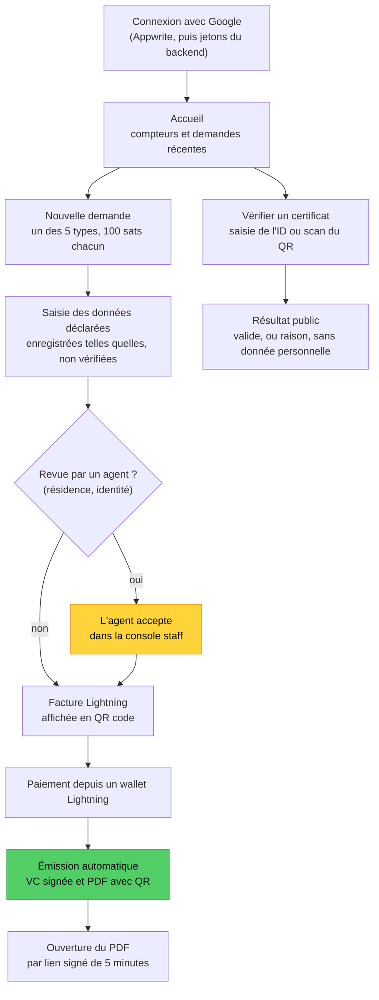

### 🧱 Architecture technique

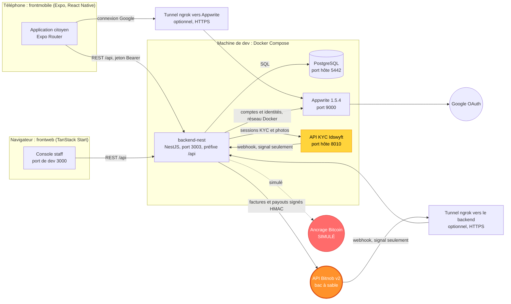

| Composant | Dossier | Rôle | État |
|---|---|---|---|
| Backend | `backend-nest/` | API NestJS 11 + TypeORM + PostgreSQL, port 3003, préfixe `/api` | Actif |
| Application citoyen | `frontmobile/` | Wallet Expo Router + React Native | Actif. Les écrans admin sont des maquettes |
| Console staff | `frontweb/` | Console TanStack Start pour le personnel des organisations, port de dev 3000 | Actif. Mode réel : liste, détail, accepter, rejeter, demander un complément |
| Environnement de dev | `docker-compose.dev.yml` | Postgres DioteKo (5442), backend (3003), Appwrite (9000), API Idswyft (8010) | Développement seulement |

Règles clés de la conception :

- **Bitnob Lightning est le seul rail d'encaissement.**
- **Un webhook Bitnob n'est qu'un signal.** La facture est relue chez Bitnob avant d'être marquée payée.
- **Deux adresses Appwrite.** Le backend parle à Appwrite sur le réseau Docker (`http://appwrite/v1`). Le téléphone passe par un tunnel HTTPS, car Google refuse les adresses IP et le `localhost` d'un téléphone est le téléphone lui-même.

### 🔄 Statuts des demandes

Les statuts viennent de l'énumération `AdminCertificateRequestStatus` dans `backend-nest/src/modules/admin-certificates/entities/admin-certificate-request.entity.ts`.

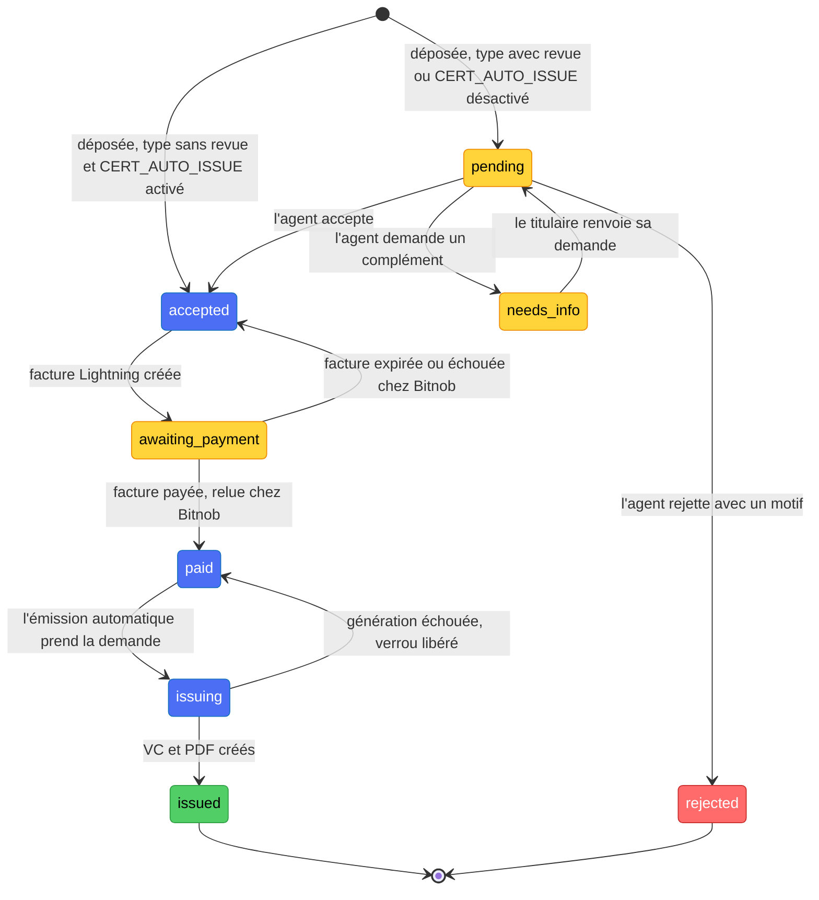

Catalogue des certificats (`admin-certificates.constants.ts`) :

| Type | Identifiant | Prix | Revue par un agent avant paiement |
|---|---|---|---|
| Extrait de naissance | `birth` | 100 sats | Non |
| Extrait de mariage | `marriage` | 100 sats | Non |
| Extrait de décès | `death` | 100 sats | Non |
| Certificat de résidence | `residence` | 100 sats | Oui |
| Certificat d'identité | `identity` | 100 sats | Oui |

### 💸 Du paiement au certificat

Partie 1 : la facture, le paiement et l'émission automatique. Le réconciliateur relit les factures en attente toutes les 60 secondes par défaut, donc un webhook absent ne bloque pas le parcours.

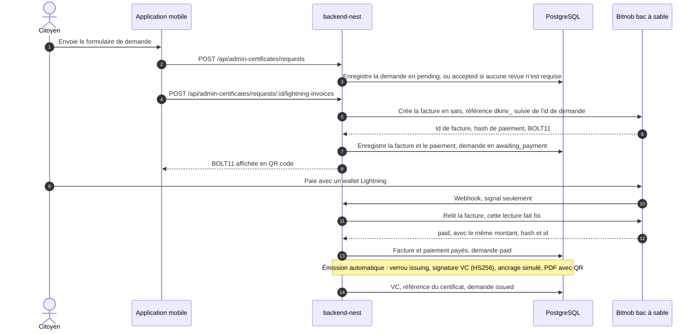

Partie 2 : le lien de téléchargement signé et la vérification publique.

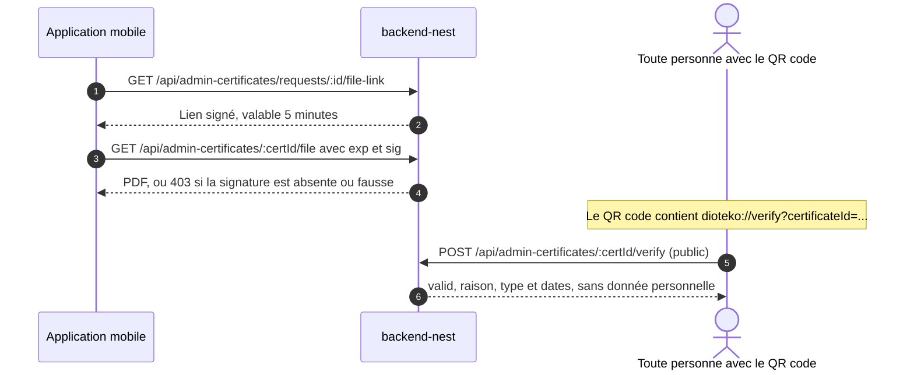

Remarques :

- La facture n'est créée que pour le titulaire, et seulement depuis `accepted`. Le montant vient du catalogue, jamais du client.
- Une facture payée qui ne correspond pas à sa demande, à son fournisseur ou à son montant n'émet rien et est journalisée pour un humain.
- Chaque justificatif émis porte `declaredNotVerified: true` quand aucun agent n'a revu la demande.

### 🟠 Bitnob : facture et payout

Bitnob est le seul rail financier du projet. Il remplit deux rôles, en orange ci-dessous.

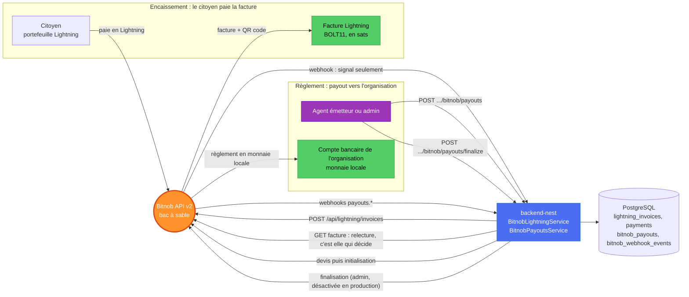

- **Encaissement (facture).** Le backend demande à Bitnob une facture Lightning en sats. Le citoyen la paie depuis n'importe quel portefeuille Lightning. Le webhook Bitnob n'est qu'un signal : le backend relit la facture chez Bitnob, et seule cette relecture la marque payée.
- **Règlement (payout).** Après l'émission, un agent émetteur ou un admin crée un payout : un devis, puis une initialisation. Un admin le finalise. Bitnob règle en monnaie locale sur le compte bancaire de l'organisation. Le bénéficiaire vient de la configuration serveur, jamais du client.
- **Garde-fous.** Chaque requête vers Bitnob est signée HMAC. Les webhooks sont vérifiés par une signature HMAC-SHA512 sur le corps brut et dédupliqués par identifiant d'événement. `finalize` est désactivé en production, `reference` sert de clé d'idempotence, et un seul payout peut être actif par certificat.
- **Limites du bac à sable.** Le bac à sable ne permet pas de payer une facture Lightning par l'API : il faut un vrai portefeuille ou le bouton réservé au développement. L'envoi de paiements Lightning et les écritures groupées sont refusés par le bac à sable.

Statuts d'un payout :

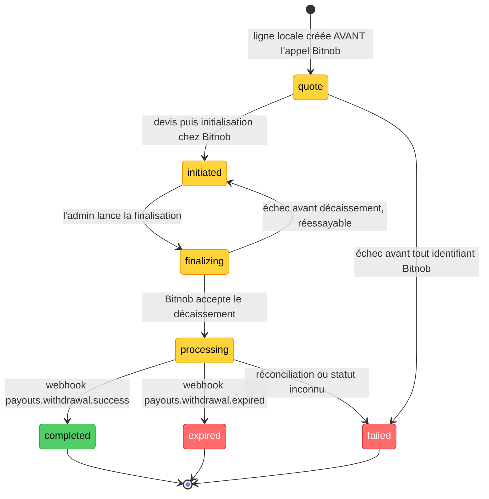

Pour aller plus loin : [docs/BITNOB.md](docs/BITNOB.md) et la section 6 de [docs/ARCHITECTURE_AS_BUILT.md](docs/ARCHITECTURE_AS_BUILT.md).

### 🔎 Aperçu API

Chemin de base `/api`. Swagger interactif en développement : `http://localhost:3003/api-docs`.

| Route | Qui | Rôle |
|---|---|---|
| `GET /healthz` | Public | Sonde base de données (`SELECT 1`) |
| `POST /auth/appwrite/login` | Public | JWT Appwrite en entrée, jetons DioteKo en sortie |
| `GET /admin-certificates/types` | Public | Catalogue des certificats |
| `POST /admin-certificates/requests` | Utilisateur connecté | Déposer une demande |
| `POST /admin-certificates/requests/:id/lightning-invoices` | Titulaire de la demande | Créer la facture Lightning |
| `POST /admin-certificates/:certId/verify` | Public | Vérifier un certificat |
| `POST /bitnob/webhooks` | Bitnob, signé HMAC | Signaux de paiement et de payout |

### 🧩 Structure du projet

- `bitnob/` (racine du dépôt)
  - `backend-nest/` : API NestJS (identity, admin-certificates, bitnob, did-vc, consent, kyc, lightning, healthz, six stubs de domaines)
  - `frontmobile/` : wallet citoyen Expo
    - `app/` : écrans Expo Router
    - `services/` : appels API (`api.ts`), connexion Appwrite (`appwriteAuth.ts`), KYC (`kyc.ts`)
    - `Screen/` : captures utilisées dans ce README
  - `frontweb/` : console staff TanStack Start
  - `docs/` : documentation du projet (architecture, règles, workflow de dev, écarts connus)
  - `scripts/` : scripts de l'environnement de dev, de la base, des tunnels et du KYC
  - `docker-compose.dev.yml` : environnement de dev (inclut les fichiers Appwrite et Idswyft)
  - `docker-compose.appwrite.yml` et `docker-compose.idswyft.yml` : services auto-hébergés
  - `package.json` : commandes racine (`dev:up`, `db:setup`, `tunnel`, `kyc:bootstrap`)

### 🧰 Technologies utilisées

**API backend** : NestJS 11 avec des guards Passport JWT, TypeORM 0.3 sur PostgreSQL, Swagger pour la documentation de l'API, `pdfkit` et `qrcode` pour le PDF, `node-appwrite` pour vérifier les sessions Appwrite.

**Application citoyen** : Expo SDK 57 et React Native 0.86 avec Expo Router, `react-native-appwrite` pour la connexion Google, `expo-camera` pour le scan QR, `expo-secure-store` pour les jetons, NativeWind 5 (release candidate) pour le style.

**Console staff** : TanStack Start sur Vite, Node 22+, Vitest pour les tests, ESLint et Prettier.

**Infrastructure et intégrations** : Docker Compose pour l'environnement de dev, Appwrite 1.5.4 (identité et OAuth Google), Idswyft community v1.12.19 (KYC auto-hébergé, version figée), ngrok (tunnels HTTPS), API Bitnob v2 en bac à sable (factures Lightning, payouts).

### 🔧 Mise en route

**Prérequis**

- Docker avec Docker Compose. Le premier démarrage est long : les images Appwrite et Idswyft sont volumineuses.
- Node.js 22+ et npm.
- Expo Go ou un build de développement pour l'application mobile. Un téléphone physique est nécessaire pour le parcours de connexion Google.
- Optionnel : un client OAuth Google Cloud, un compte ngrok par tunnel, et un compte Bitnob en bac à sable (Bitnob refuse les appels depuis des adresses IP non autorisées).

**Étapes**

1. Cloner le dépôt et aller à sa racine :

   ```bash
   git clone <REPO_URL> bitnob
   cd bitnob
   ```

2. Démarrer l'environnement de dev (Postgres DioteKo, backend, Appwrite, Idswyft). Utiliser cette commande, pas un `docker compose up` direct :

   ```bash
   npm run dev:up
   ```

3. Configurer le backend. Copier le modèle, puis renseigner `JWT_SECRET` et `VC_SIGNING_SECRET` avec vos propres valeurs (par exemple avec `openssl rand -hex 32`) :

   ```bash
   cd backend-nest
   npm install
   cp .env.example .env
   cd ..
   ```

4. Créer et initialiser les bases (`dioteko_dev_bitnob` et `dioteko_test_bitnob`), puis vérifier l'API :

   ```bash
   npm run db:setup
   curl http://localhost:3003/api/healthz
   ```

5. Terminer la configuration initiale d'Appwrite dans la console (liste ci-dessous).

6. Démarrer l'application mobile. Copier le modèle (`frontmobile/.env.exemple`) vers `frontmobile/.env`, puis renseigner `EXPO_PUBLIC_APPWRITE_ENDPOINT` et `EXPO_PUBLIC_APPWRITE_PROJECT_ID` :

   ```bash
   cp frontmobile/.env.exemple frontmobile/.env
   cd frontmobile
   npm install
   npx expo start --clear
   ```

7. Démarrer la console staff (`http://localhost:3000`) :

   ```bash
   cd frontweb
   npm ci
   cp .env.example .env
   npm run dev
   ```

8. Optionnel, connexion Google depuis un téléphone : ouvrir les tunnels HTTPS depuis la racine avec `npm run tunnel`. Renseigner ensuite l'adresse du tunnel dans `frontmobile/.env` (`https://xxxx.ngrok-free.dev/v1`) et dans l'URI de redirection Google, puis relancer Expo avec `--clear`.

9. Optionnel, encaissement Lightning et KYC : renseigner `BITNOB_CLIENT_ID`, `BITNOB_CLIENT_SECRET` et `BITNOB_ENVIRONMENT=sandbox` dans `backend-nest/.env`, puis lancer `npm run kyc:bootstrap` depuis la racine pour créer la clé API Idswyft. Relancer `npm run dev:up` après tout changement dans `backend-nest/.env` ou `backend-nest/src/`.

**Console Appwrite, première configuration** (une fois, sur `http://localhost:9000`) :

- Créer le compte administrateur.
- Créer un projet avec un identifiant de projet personnalisé, et le mettre dans `APPWRITE_PROJECT_ID` dans `backend-nest/.env`.
- Créer une clé API avec les scopes `users.read` et `users.write`, et la mettre dans `APPWRITE_API_KEY`.
- Activer le fournisseur OAuth2 Google avec votre identifiant et secret client Google Cloud (`<GOOGLE_CLIENT_ID>`, `<GOOGLE_CLIENT_SECRET>`).
- Ajouter une plateforme Web avec le nom d'hôte `*`. Pour le développement local uniquement, jamais en production.

Ne jamais committer de fichiers `.env` ni de clés. Utiliser des placeholders dans la documentation.

### 🚀 Utilisation

- **Backend** : `http://localhost:3003/api` (santé : `/api/healthz`), Swagger sur `http://localhost:3003/api-docs`.
- **Comptes de démonstration** créés par `npm run seed` dans `backend-nest/` : `issuer-demo@dioteko.local`, `admin-demo@dioteko.local`, `holder-demo@dioteko.local`. Le mot de passe de démonstration commun est dans [docs/DEV_WORKFLOW.md](docs/DEV_WORKFLOW.md).
- **Application citoyen** : se connecter avec Google, demander un certificat, payer la facture (en développement, avec le bouton de simulation), ouvrir le PDF par le lien signé, puis vérifier un certificat par identifiant ou QR code.
- **Console staff** : se connecter avec un compte issuer ou admin, puis traiter les demandes de votre organisation.

### 🧪 Tests

| Paquet | Commande | Ce qui est lancé |
|---|---|---|
| `backend-nest/` | `npm test` | Tests unitaires Jest, sans base de données |
| `backend-nest/` | `npm run test:e2e` | Tests Jest de bout en bout sur `dioteko_test_bitnob` (copier d'abord `.env.test.example` vers `.env.test`) |
| `backend-nest/` | `npm run typecheck` | Vérification TypeScript (`tsc --noEmit`) |
| `frontweb/` | `npm test` et `npm run lint` | Vitest, ESLint et Prettier |
| `frontmobile/` | `npm run lint` | Lint Expo. Il n'y a pas de lanceur de tests pour l'application mobile |

### 📚 Index de la documentation

- [docs/ARCHITECTURE_AS_BUILT.md](docs/ARCHITECTURE_AS_BUILT.md) : architecture réelle, flux, intégrations, écarts connus
- [docs/DEV_WORKFLOW.md](docs/DEV_WORKFLOW.md) : toutes les commandes de développement et la première configuration
- [docs/DATABASE_MODEL.md](docs/DATABASE_MODEL.md) : tables et liens entre elles
- [docs/BUSINESS_RULES.md](docs/BUSINESS_RULES.md) : règles métier, chacune avec son fichier source
- [docs/DOMAIN_NOTES.md](docs/DOMAIN_NOTES.md) : concepts et vocabulaire
- [docs/KYC.md](docs/KYC.md) : vérification d'identité avec Idswyft
- [docs/BITNOB.md](docs/BITNOB.md) : contrat de l'API Bitnob et encaissement Lightning
- [docs/CERTIFICATE_EVENT_CHAIN.md](docs/CERTIFICATE_EVENT_CHAIN.md) : proposition de chaîne d'événements infalsifiable (non implémentée)
- [docs/KNOWN_ISSUES.md](docs/KNOWN_ISSUES.md) : écarts connus et contournements
- [docs/DECISIONS.md](docs/DECISIONS.md) et [docs/TESTING.md](docs/TESTING.md)

### 🏁 Défis et prochaines étapes

**Défis**

- **Connexion Google sur téléphone.** Appwrite construit l'URL de retour OAuth sans le port, et Google refuse les adresses IP. Un téléphone a donc besoin d'un tunnel HTTPS.
- **Décalage de versions.** `react-native-appwrite` 0.34 vise Appwrite 1.6, alors que le serveur local est en 1.5.4. L'application revient sur `/account/jwt`.
- **Faire confiance à un webhook.** Le nom de l'événement Bitnob « facture payée » n'est pas documenté : le backend ne l'utilise que comme signal et relit la facture.
- **Données déclarées.** Les noms sont saisis par le citoyen et ne sont pas contrôlés par un registre d'état civil. Les certificats émis le précisent dans le justificatif signé et dans le PDF.

**Prochaines étapes**

- Ancrage Bitcoin réel sur testnet, à la place de la simulation.
- Test KYC sur de vraies pièces d'identité.
- Un volume persistant pour les fichiers PDF.
- Des écrans admin réels dans l'application mobile.
- Une trace d'audit pour l'émission et la révocation des justificatifs (pas encore écrite).

### 🤝 Contribuer

Lire [CONTRIBUTING.md](CONTRIBUTING.md) et [docs/DEV_WORKFLOW.md](docs/DEV_WORKFLOW.md) avant d'ouvrir une pull request. Lancer les vérifications du tableau des tests pour les paquets modifiés.

### 📄 Licence

MIT. Voir [LICENSE](LICENSE).

### 👥 Équipe

L'équipe DioteKo (5 personnes) :

**Salif Diallo** Développeur Principal
- GitHub : [@MrSalifDiallo](https://github.com/MrSalifDiallo)
- LinkedIn : [Salif Diallo](https://www.linkedin.com/in/salif-diallo-152650313/)
- Email : [salifdiallo@esp.sn](mailto:salifdiallo@esp.sn)

**Aicha Ndiaye** Ingénieure BIG DATA / IA
- GitHub : [@smiley100](https://github.com/smiley100)
- LinkedIn : [Aicha Ndiaye](https://www.linkedin.com/in/ndiaye-a%C3%AFcha-72ba87331)
- Email : [ndiayeaicha0928@gmail.com](mailto:ndiayeaicha0928@gmail.com)

**Fatou Tambedou** Ingénieure BIG DATA / IA
- GitHub : [@fatoutambedou-ctl](https://github.com/fatoutambedou-ctl)
- Email : [fatoutambedou@esp.sn](mailto:fatoutambedou@esp.sn)

**Ndeye Marieme Sy** Développeuse
- GitHub : [@Maryam-SY](https://github.com/Maryam-SY)
- Email : [meriemsy3@gmail.com](mailto:meriemsy3@gmail.com)

**Mame Saye Fall** Développeuse
- GitHub : [@mamesayefall125-svg](https://github.com/mamesayefall125-svg)
- Email : [mamesayefall125@gmail.com](mailto:mamesayefall125@gmail.com)

[⬆ Retour en haut](#dioteko)
