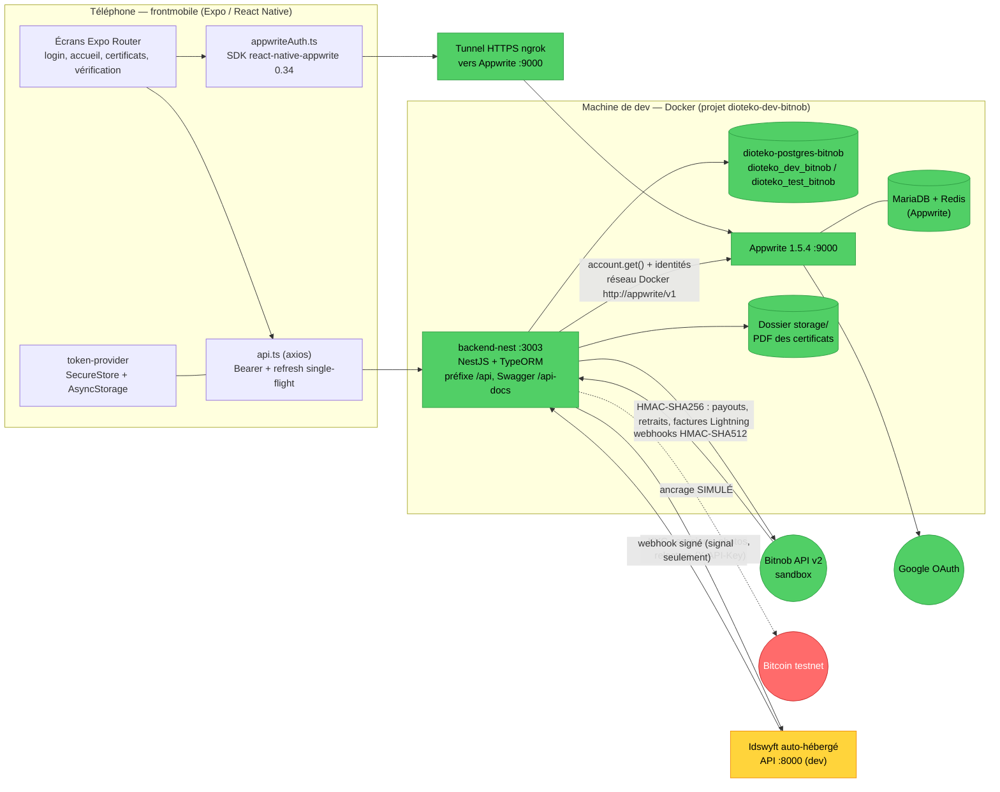
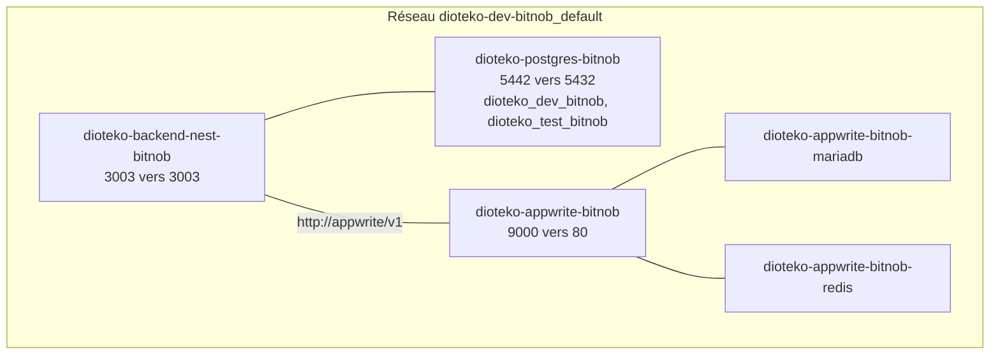
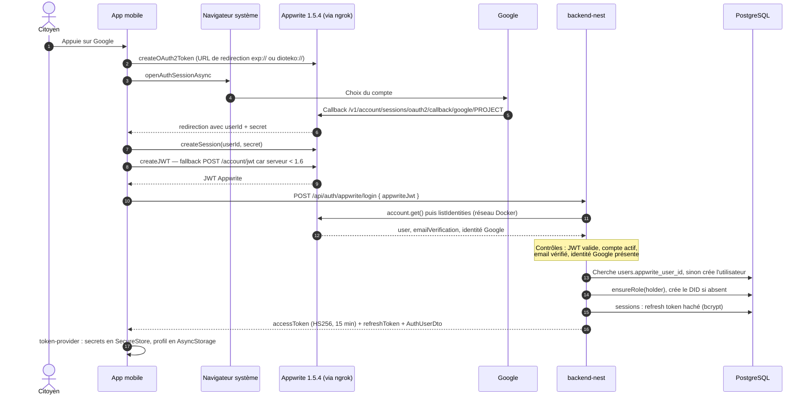
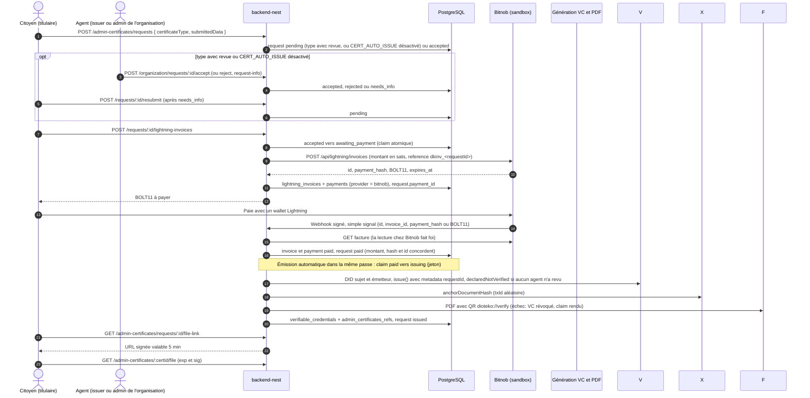
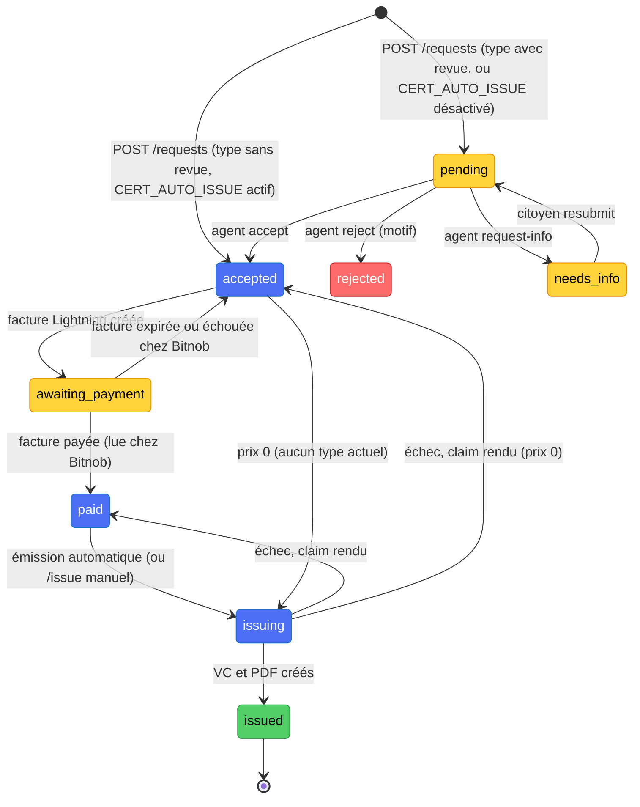
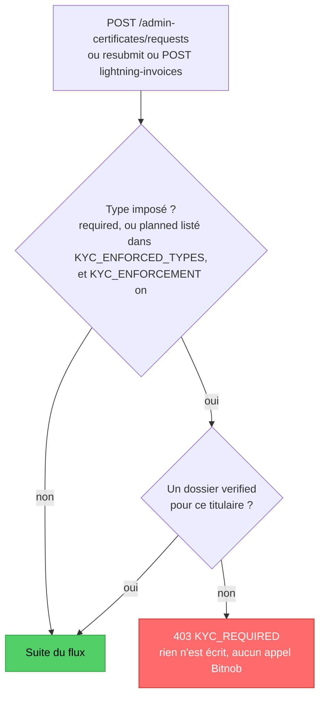
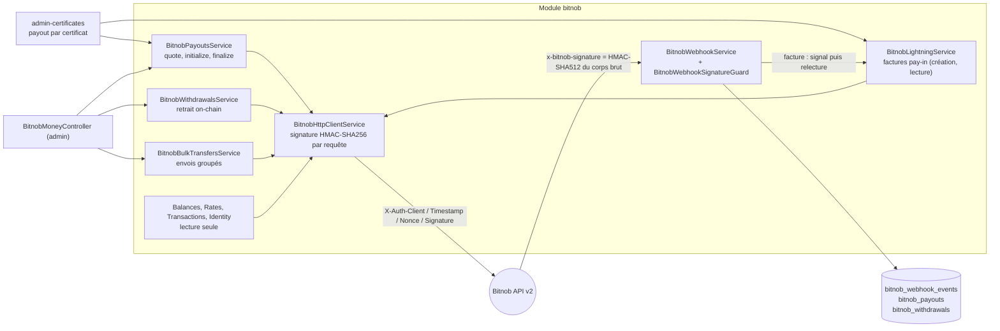
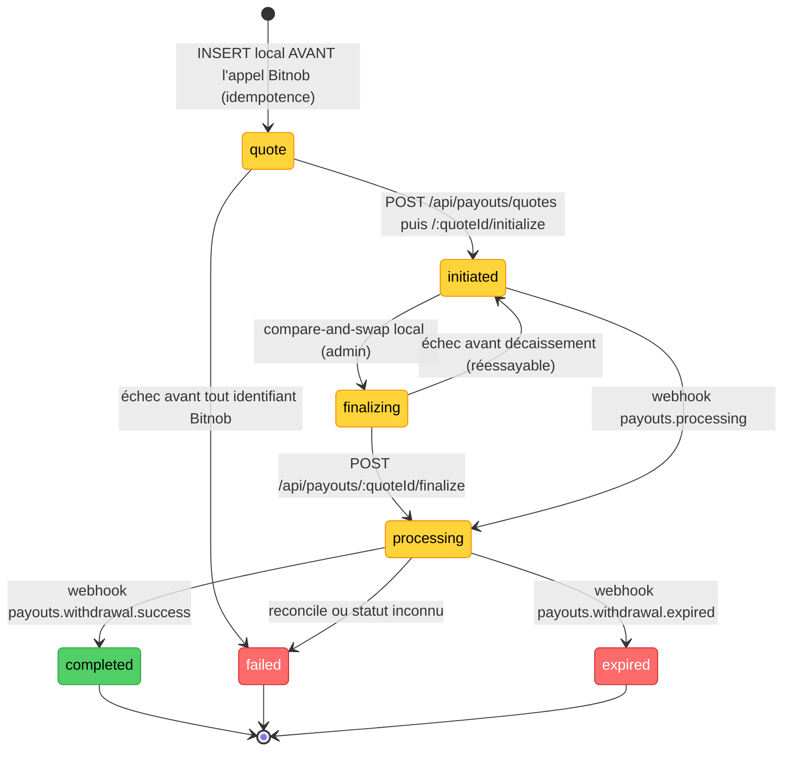
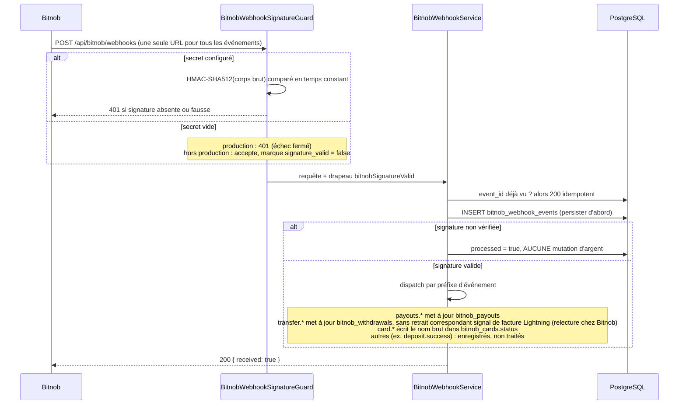
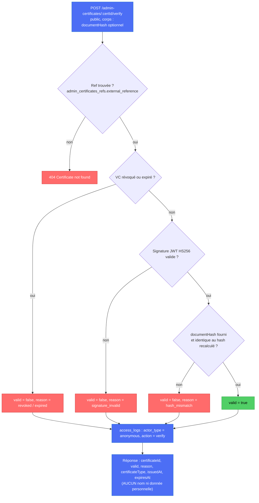

# Architecture réelle (as-built) — DioteKo

> **Statut :** photographie du code de `backend-nest/`, `frontmobile/` et des `docker-compose*.yml`, relus fichier par fichier.
> **Source de vérité :** le code, pas les autres documents.
> **Documents liés :** modèle de données complet → [`DATABASE_MODEL.md`](./DATABASE_MODEL.md) · dictionnaire de schéma → [`SCHEMA.md`](./SCHEMA.md) · règles métier → [`BUSINESS_RULES.md`](./BUSINESS_RULES.md) · révocation et expiration prouvables (proposition 🎯) → [`CERTIFICATE_EVENT_CHAIN.md`](./CERTIFICATE_EVENT_CHAIN.md).

**Légende d'état** (utilisée partout dans ce document)

| Symbole | Signification |
|---|---|
| ✅ | Réel et câblé de bout en bout |
| 🟡 | Code présent et testable, mais non configuré ou non câblé en local (clé vide, service absent, flux inactif) |
| 🔴 | Simulé, stub ou mock — ne fait pas ce que son nom suggère |
| 🎯 | Cible visée, **pas encore implémentée** |

---

## 1. Vue d'ensemble

*Couleurs : vert = réel et câblé (✅), rouge = simulé (🔴), jaune = câblé mais pas encore validé sur de vraies pièces (KYC).*

### État réel de chaque composant

| Composant | Rôle | État | Détail vérifié |
|---|---|---|---|
| **Mobile — login Google** | Connexion citoyen | ✅ | Google → Appwrite → JWT Appwrite → `/api/auth/appwrite/login` → tokens DioteKo |
| **Mobile — écrans certificats / paiement / vérif** | Parcours métier | 🟡 | Branché sur Nest (`/admin-certificates/*`) : types, demande, liste, détail, facture Lightning (QR, polling, simulation en dev), complément et renvoi, PDF par lien signé, vérification. Reste : jamais vérifié sur téléphone ; les écrans `app/admin/*` sont des maquettes (`mockApiCall`) |
| **backend-nest** | API métier | ✅ | Démarre healthy, 31 tables, 12 migrations, guards globaux JWT + rôles |
| **PostgreSQL** | Données métier | ✅ | `dioteko-postgres-bitnob` (instance propre au projet, port hôte 5442), bases `dioteko_dev_bitnob` / `dioteko_test_bitnob` |
| **Appwrite 1.5.4** | Comptes + OAuth Google | ✅ | Conteneurs `dioteko-appwrite-bitnob`, `-mariadb`, `-redis` ; exposé en HTTPS par ngrok |
| **DID / VC** | Identifiants et attestations | ✅ | DID `did:dioteko:<uuid>` ; VC = JWT HS256 signé avec `VC_SIGNING_SECRET` |
| **Consentement / audit** | Consents + `access_logs` | ✅ partiel | Consentement CRUD minimal, journal d'accès réel ; VP minimal (sans divulgation sélective) |
| **Bitnob** | Rail financier (encaissement et règlements) | ✅ sandbox | Encaissement Lightning des demandes (factures, webhook = signal, relecture chez Bitnob, réconciliateur) ; payouts, retraits, bulk, lecture. Clés `BITNOB_CLIENT_*` et `BITNOB_ENVIRONMENT=sandbox` à renseigner localement (§5, §6) |
| **Vérification d'identité (KYC)** | Titulaire identifié avant certains certificats | 🟡 | Idswyft auto-hébergé ; porte sur `residence` et `identity` (403 `KYC_REQUIRED`). **Spike B0 non fait** (aucune vraie pièce testée). Détail : [`KYC.md`](KYC.md) |
| **Ancrage Bitcoin** | Preuve d'horodatage | 🔴 | `CertificateAnchorService` **simule** : `txId` aléatoire, `verified: true` systématique |
| **6 domaines (health, education, transport, employment, social-aid, merchant)** | Futurs domaines | 🔴 | Un `GET /api/{domaine}` renvoyant `{ implemented: false }` + une table `*_record_refs` vide |

---

## 2. Topologie d'exécution (Docker)

Points qui comptent :

- **Une seule commande de démarrage** : `npm run dev:up` (le compose refuse un `docker compose up` direct via la garde `DEV_UP_GUARD`).
- **Postgres propre au projet** : le conteneur `dioteko-postgres-bitnob` est dans le réseau du projet, sans réseau ni conteneur partagé avec d'autres projets et sans service d'initialisation ; `dioteko_dev_bitnob` est créée par `POSTGRES_DB`, `dioteko_test_bitnob` par `dev:up` / `db:setup`. Port hôte : `DIOTEKO_PG_HOST_PORT` (5442 par défaut).
- **Deux URLs Appwrite différentes** : le **backend** parle à `http://appwrite/v1` (réseau Docker) ; le **mobile** parle à l'URL **HTTPS ngrok** (Google refuse les IP et un `localhost` de téléphone est le téléphone — voir `DEV_WORKFLOW.md`).
- **URL de l'API côté mobile** : dérivée automatiquement de l'hôte Metro (`exp://<IP>:8083` → `http://<IP>:3003/api`, voir `frontmobile/config/config.ts`).
- **PDF des certificats** : écrits sur le **système de fichiers du conteneur** (`storage/admin-certificates/`, ou `ADMIN_CERTIFICATES_STORAGE_DIR`). Le service `backend-nest` n'a **aucun volume** monté (compose dev **et** prod : seul le service `postgres` en a un) → un `docker compose up --force-recreate` **perd les PDF** (les lignes en base restent, `GET :id/file` renverrait alors 404). À corriger avant toute démo persistante.
- **Environnements** : `NODE_ENV` choisit `.env` / `.env.test` / `.env.prod` → bases `dioteko_dev_bitnob` / `dioteko_test_bitnob` / `dioteko_prod` (placeholder, jamais créée en local).

---

## 3. Carte des modules `backend-nest`

Préfixe global `/api`. Deux **guards globaux** dans `AppModule`, dans cet ordre : `JwtAuthGuard` (sauf `@Public()`), puis `RolesGuard` (lit `@Roles(...)`). Rôles : `holder`, `issuer`, `verifier`, `admin`.

| Module | Routes (préfixe `/api`) | Accès | État |
|---|---|---|---|
| `healthz` | `GET /healthz` | public | ✅ vraie sonde (SELECT 1). **Ne pas confondre** avec `GET /health` (stub du domaine santé) |
| `identity` | `POST /auth/appwrite/login`, `/auth/refresh`, `/auth/logout`, `/auth/login`, `GET /auth/me`, `GET /users/me` | login/refresh/logout publics ; `me` JWT | ✅ |
| `did-vc` | `POST /did-vc/dids` (admin), `GET /did-vc/dids/:id`, `GET /did-vc/credentials/:id`, `POST …/:id/revoke` (issuer, admin), `POST /did-vc/presentations` | JWT / rôles | ✅ |
| `admin-certificates` | `GET /admin-certificates/types` (public) ; **citoyen, ses seules demandes** : `POST /requests`, `GET /requests` (filtres `status`, `validity`, `limit`, `offset` ; réponse `{success, requests, total}` ; chaque élément a `expiresAt` et `validity`), `GET /requests/stats` (`{total, byStatus, byValidity}`), `GET /requests/:id` (avec `submittedData`, 404 sinon), `POST /requests/:id/lightning-invoices`, `GET …/status` ; **organisation (issuer, admin)** : `GET /organization/requests` (mêmes filtres, sans `submittedData` ni `paymentId`), `GET /organization/requests/:requestId` (avec `submittedData`, trace `access_logs`) ; **autres** : `POST /requests/:id/issue` (issuer, admin), `GET /requests/:id/file-link` (titulaire, lien signé valable 5 min), `GET /:certId/file` (public, exige `exp` + `sig`, sinon 403), `POST /:certId/verify` (public), `POST /dev/requests/:id/mark-paid` (dev, `PAYMENT_SIMULATION`), `POST /:certId/bitnob/payouts` (issuer, admin), `…/payouts/finalize` et `…/payouts/reconcile` (admin) | mixte | ✅ liste, détail, statistiques, lecture organisation ; revue (`accept`, `reject`, `request-info`), émission, facture et versement limités à l'organisation ; PDF par lien signé |
| `lightning` | aucune route HTTP : registre des factures et paiements (`LightningInvoicesService`) | — | ✅ registre |
| `bitnob` | `GET /bitnob/whoami` (admin) ; lecture `balances`, `exchange-rates`, `transactions`, `payouts/{supported-countries,limits,banks}` (issuer/admin, certaines + verifier) ; argent `payouts/*`, `withdrawals/*`, `bulk-transfers/*` (admin) ; `POST /bitnob/webhooks` (public + signature) | rôles | ✅ sandbox |
| `consent` | `POST|GET /audit/consents` (holder = appelant), `GET /audit/access-logs` (admin, verifier) | JWT / rôles | ✅ |
| `kyc` | citoyen : `POST /kyc/sessions`, `POST /kyc/sessions/:sessionId/front`, `…/back`, `…/selfie`, `GET /kyc/status` ; public signé : `POST /kyc/webhook/idswyft` | JWT titulaire ; webhook public avec signature HMAC | 🟡 code, spike B0 non fait. Détail : [`KYC.md`](KYC.md) |
| 6 domaines | `GET /{health,education,transport,employment,social-aid,merchant}` | JWT | 🔴 stubs |

Limite actuelle : la ligne « 6 domaines » indique `JWT`, mais leurs contrôleurs sont `@Public()` dans le code.

Constat d'autorisation à connaître (détails §9) :
- Les routes **citoyen** (`/requests…`) ne renvoient que les demandes de l'appelant, y compris pour un issuer ou un admin.
- Les routes **organisation** (`/organization/requests…`) lisent `users.organization_id` **en base** (jamais le JWT ni le client). Compte sans organisation ou suspendu : 403 ; demande d'une autre organisation : 404.
- La revue (`/organization/requests/:id/accept|reject|request-info`), l'émission (`/requests/:id/issue`) et les versements d'un certificat (`…/bitnob/payouts*`) sont limités à l'organisation de l'acteur, lue en base. La facture (`/lightning-invoices`) est réservée au titulaire. Les routes `bitnob/*` génériques (hors certificat) restent globales : voir KNOWN_ISSUES.

---

## 4. Identité et sessions

### 4.1 Flux réel : Google via Appwrite (✅)

Règles importantes :

- **Jetons DioteKo** : access JWT HS256 `{ sub, roles, did? }` TTL 15 min ; refresh = `"<sessionId>.<secret>"`, **seul le hash bcrypt du secret est stocké** (`sessions.refresh_token_hash`), TTL 30 j, **rotation à chaque refresh** avec révocation atomique (anti-réutilisation concurrente).
- **Création de compte** : e-mail normalisé (`lower(trim)`) ; e-mail déjà pris par un autre compte → `409` ; `google_id` est **lié une seule fois** (jamais écrasé ; un autre `google_id` → `403`).
- **Réponses** : toujours un `AuthUserDto` (`id, email, displayName, emailVerified, accountStatus, googleLinked, roles, did`) — jamais l'entité `User`.
- **Mobile** : `api.ts` ajoute le Bearer sauf sur `/auth/*`, et sur `401` lance **un seul** refresh partagé (single-flight) puis rejoue la requête ; refresh refusé → session locale effacée → retour à l'écran de connexion.
- **Version Appwrite** : le SDK mobile 0.34 vise Appwrite ≥ 1.6 ; le serveur est en 1.5.4 → fallback sur `/account/jwt` (voir `KNOWN_ISSUES.md`).

### 4.2 Source du nom

La connexion citoyenne passe uniquement par Appwrite + Google (§4.1). Il n'existe pas de source de nom d'état civil vérifié (voir §8).

---

## 5. Demande, paiement et émission d'un certificat

### 5.1 Flux tel que codé aujourd'hui (flux B : revue, paiement Lightning Bitnob, émission automatique)

Le rail d'encaissement est Bitnob Lightning. Détail du contrat Bitnob vérifié : [`BITNOB.md`](BITNOB.md).

Catalogue (en dur dans `admin-certificates.constants.ts`) :

| Type | Prix (sats) | Revue par un agent avant paiement |
|---|---|---|
| `birth`, `marriage`, `death` | 100 | non : `accepted` dès le dépôt |
| `residence` | 100 | oui : `pending` jusqu'à acceptation |
| `identity` | 100 | oui |

Sans webhook (tunnel absent), le réconciliateur et le statut relisent Bitnob : voir les règles ci-dessous.

À retenir sur ce flux :

- **L'émission est automatique après paiement** (`onInvoicePaid`, puis `performIssuance`). Le jeton `issuing` (claim conditionnel) empêche deux émissions concurrentes ; un claim resté `issuing` plus de 5 min (`ISSUING_STALE_MS`) est repris par la passe de reprise. `POST /requests/:id/issue` ne sert plus qu'à la reprise manuelle (issuer/admin de l'organisation, `paid` seulement).
- **Revue par type** (`admin-certificates.constants.ts`, `requiresReview`) : naissance, mariage et décès = `false` ; résidence et identité = `true`. Un type avec revue passe par l'agent (`pending`, puis `accepted`) avant paiement.
- **`CERT_AUTO_ISSUE`** (`certificates.autoIssue`) : actif par défaut hors mode réel, désactivé par défaut en mode réel (`NODE_ENV=production` **ou** `BITNOB_ENVIRONMENT=production`) ; seule la valeur exacte `true` l'active alors. Désactivé, même un type sans revue attend un agent (`pending`). Le mode automatique ne vérifie pas les données : une attestation émise sans revue porte `declaredNotVerified: true` dans le VC signé et une mention dans le PDF.
- **Idempotence de l'émission** : chaque VC porte `metadata.requestId`. Avant de signer, `revokeActiveByMetadata('requestId')` retire les VC actifs orphelins d'une tentative précédente. Si la génération du PDF échoue, le VC créé est révoqué et le fichier supprimé.
- **Catalogue et prix** (en dur dans `admin-certificates.constants.ts`) : les cinq types = 100 sats (prix de test pour les premiers paiements Lightning réels ; à remonter avant l'ouverture au public).
- **Contenu du certificat** : `submittedData` est copié **tel quel** dans `credentialSubject` et dans le PDF. Le serveur n'accepte que les clés de `SUBMITTED_DATA_ALLOWED_KEYS` (`fullName` obligatoire, valeurs en texte de 200 caractères au plus, la même liste pour tous les types, voir KNOWN_ISSUES) ; aucun champ n'est lié à l'identité du compte (voir §8.3).
- **Politique d'émission** (`IssuancePolicyService`) : seules les organisations `municipality` et `ministry` peuvent émettre le type `AdminCertificate` ; les autres types d'organisation ont une liste vide.
- **`documentHash`** renvoyé et attendu à la vérification = `verifiable_credentials.hash` (SHA-256 du payload JWT, clés triées par `stableStringify`), **pas** l'empreinte envoyée à l'ancrage simulé.
- **Le webhook Bitnob n'est qu'un signal.** Le nom de l'événement « facture payée » n'est pas documenté : le backend ne s'y fie pas, il retrouve la facture par `data.id`, `data.invoice_id`, `data.payment_hash` ou `data.invoice` (BOLT11), puis **lit la facture chez Bitnob**. Une facture n'est marquée payée que si Bitnob répond `paid` avec le même montant, le même hash et le même id. Un webhook falsifié ou rejoué ne change donc rien. Sans webhook (tunnel absent), le réconciliateur relit les factures `pending` (50 par passe : 25 récentes et 25 anciennes), et le statut et l'émission lisent Bitnob eux-mêmes.
- **Clé d'idempotence Bitnob** : `reference` = `dkinv_<requestId>` (id de `admin_certificate_requests`) pour la première facture, puis `dkinv_<requestId>_<n>`, où `n` est le nombre de lignes `payments` déjà liées à la demande. Le préfixe `dkinv_` ne sert pas à retrouver la facture côté webhook. Source : `admin-certificates.service.ts` (`createInvoiceForRequest`).
- **Une facture expirée n'est plus un cul-de-sac** : la lecture chez Bitnob la clôt (`expired` ou `failed`), la demande revient à `accepted` (son `payment_id` est retiré) et une nouvelle facture reçoit une nouvelle clé d'idempotence.
- **Contrôle de propriété** : la facture (création, lecture) est réservée au titulaire ; le statut est lisible par le titulaire et le personnel de l'organisation. Une demande d'une autre organisation répond 404 (pas 403). Si Bitnob répond avec un montant différent du prix du catalogue, la facture n'est ni montrée ni enregistrée (log `ORPHAN`, erreur 502).
- **Fournisseur** : une facture dont le `provider` n'est pas Bitnob est refusée (`PROVIDER_MISMATCH`), jamais relue ni réglée.

### 5.2 Machine à états d'une demande

---

## 5 bis. Vérification d'identité (KYC) : la porte avant l'argent

Code : `backend-nest/src/modules/kyc/` (module `KycDomainModule`, exporte `KycService`). Détail des routes, limites, états et
configuration : [`KYC.md`](KYC.md). Statut : **spike B0 non fait**.

À retenir :

- La porte est appliquée à la **création** de la demande, au **renvoi** après `needs_info`, et à la **création de la facture**
  (avant le passage à `awaiting_payment`). Elle n'est **pas** appliquée à l'émission d'une demande déjà payée (choix délibéré,
  voir DECISIONS).
- Le prestataire (Idswyft, auto-hébergé) reçoit les photos et renvoie un verdict. Le webhook ne fait que déclencher une relecture ;
  seul un `verified` relu pour le bon identifiant est écrit, une seule fois.
- Le module `kyc` ne stocke ni image, ni numéro de pièce, ni donnée biométrique : seuls l'identifiant du prestataire, le statut,
  le nombre de photos envoyées et une raison d'échec parmi une liste fixe sont conservés (`kyc_verifications`).

---

## 6. Intégration Bitnob (ce qui existe réellement)

### 6.1 Ce que le code fait avec Bitnob

| Capacité | Implémentée | Garde-fous |
|---|---|---|
| Identité (`whoami`), soldes, taux, historique, référentiels de payout | ✅ lecture | rôles `issuer/admin/verifier` |
| **Payout fiat** (quote → initialize → finalize) | ✅ | `finalize` **désactivé en production** ; `reference` = clé d'idempotence ; bénéficiaire résolu **côté serveur** (`BITNOB_PAYOUT_BENEFICIARY_*`) |
| **Retrait on-chain** (`POST /api/withdrawals`) | ✅ sandbox | désactivé en production, déduplication par `reference` |
| **Envois groupés** (bulk) | ✅ code | désactivé en production ; écriture refusée (403) par le bac à sable Bitnob |
| **Webhooks** | ✅ | signature HMAC-SHA512 sur le corps brut, idempotence par `event_id`, « persister d'abord » |
| Trading, cartes, clients, bénéficiaires, envoi Lightning (`/lightning/pay`) | 🔴 | tables gardées ou non appelées ; l'envoi Lightning est refusé en sandbox (403, `send_lightning`) |
| **Encaissement du citoyen via Bitnob** (Lightning) | ✅ | Facture créée, payée ou non constatée par webhook-signal + lecture chez Bitnob ; essayé de bout en bout en sandbox jusqu'à l'attente du paiement (§5.1) |

### 6.2 Payout d'un certificat : le règlement vers l'organisation

C'est le **seul** flux où Bitnob touche le parcours certificat : après émission, l'argent encaissé en Lightning est **réglé en monnaie locale** vers le compte bancaire de l'organisation.

- Une **ligne `payments`** (`purpose_type = admin_certificate_bitnob_payout`) suit chaque payout ; `bitnob_payouts.status` est reporté sur `payments.status` par les routes admin `finalize` / `reconcile`, **pas** par le webhook (`dispatchPayoutEvent` ne touche que `bitnob_payouts` — limite connue S4).
- **Un seul payout actif par certificat** : index unique partiel (`failed` et `expired` ne bloquent pas un nouveau devis).
- **Audit** : chaque tentative d'argent écrit une ligne `access_logs` (`action = payout | withdrawal | bulk_transfer`).
- **Aucune donnée bancaire n'est conservée en clair** : `stripPayoutPii` nettoie `raw_result`, et les journaux ne contiennent que `code/title/type` des erreurs Bitnob.

### 6.3 Webhooks Bitnob

**Configuration locale actuelle** : `BITNOB_WEBHOOK_SECRET` est **vide** → en développement les événements sont **enregistrés mais jamais appliqués** (`signature_valid = false`). Pour tester de vrais changements d'état, renseigner le secret (ou la valeur de repli `BITNOB_CLIENT_SECRET`, dont l'usage réel par Bitnob reste à confirmer — voir `KNOWN_ISSUES.md`).

---

## 7. Rails et briques : état et reste à faire

> Bitnob est le **seul** rail d'encaissement (`DECISIONS.md`).

### 7.1 Rail ou brique retenue

| Brique | Aujourd'hui | Cible | Statut |
|---|---|---|---|
| **Encaissement Lightning** | Bitnob Lightning (`BitnobLightningService`) | Bitnob | ✅ |
| **Règlement vers l'organisation** | Bitnob payouts | Bitnob payouts | ✅ |
| **Identité du citoyen** | Google via Appwrite (réel) | Appwrite + Google ; nom déclaratif (décision D3 ouverte) | ✅ |
| **Backend** | NestJS + TypeORM (`backend-nest/`) | NestJS | ✅ |
| **Ancrage preuve** | `CertificateAnchorService` simulé | Vrai ancrage (OP_RETURN testnet ou service groupé) | 🔴 simulé · 🎯 |

### 7.2 Ce que l'API Bitnob Lightning couvre

La collection Postman `bitnob_api.postman_collection.json` (Bitnob API v2) décrit `POST /api/lightning/invoices`, `GET /api/lightning/invoices/:id`, `POST /api/lightning/decode`, `/preview` et `/pay`. Le code appelle seulement la création et la lecture d'une facture (`BitnobLightningService.createInvoice` et `getInvoice`). `decode` a été testé en sandbox (`docs/BITNOB.md`) mais n'est pas utilisé par le code. `pay` est refusé en sandbox (403, `send_lightning`). Le nom de l'événement webhook « facture payée » n'est pas documenté : le code ne s'y fie pas (§6.3).

### 7.3 Flux d'encaissement

Le flux réellement codé est décrit en §5.1 (demande, facture Bitnob, signal webhook ou relecture, émission automatique). Il n'y a plus de flux cible distinct pour l'encaissement.

### 7.4 Reste à faire

| # | Étape | État |
|---|---|---|
| 1 | Valider en sandbox les routes Lightning de Bitnob (création, lecture) | ✅ (`docs/BITNOB.md`). Payer une facture sandbox : 🟡 impossible sans wallet réel. Nom de l'événement « facture payée » : 🎯 à confirmer |
| 2 | Service `BitnobLightningService` (création, lecture) signé par `BitnobHttpClientService` | ✅ |
| 3 | Modèle : `payments.provider` et `lightning_invoices.provider` / `external_id` | ✅ migration `1788500000000` |
| 4 | Webhook : signal de facture (`data.id`, `invoice_id`, `payment_hash`, BOLT11), puis relecture chez Bitnob | ✅ |
| 5 | Mobile branché sur `/admin-certificates/*` et affichage du BOLT11 (QR) | ✅ |
| 6 | `payments.status` suit aussi les webhooks de payout (limite S4) | 🎯 acceptable en l'état : la réconciliation fait foi |
| 7 | Matrice des événements webhook vérifiés | 🎯 |

---

## 8. DID, VC, vérification et consentement

### 8.1 Objets et signature

- **DID** `did:dioteko:<uuid>` : identifiant **local, non résolvable** (pas une méthode DID standard) ; 1 DID par holder (créé au premier login) et 1 par organisation émettrice (créé à la première émission). La table `dids` n'a **pas** de contrainte d'unicité sur le contrôleur (risque de doublons en cas de premiers logins concurrents — connu).
- **VC** : JWT compact **HS256**, secret partagé `VC_SIGNING_SECRET` ; claims `iss, sub (DID du sujet), jti, iat, nbf, exp, vc{ type, issuer, credentialSubject }`. Conséquence : **seul ce backend peut vérifier** un VC ; un tiers ne peut pas le vérifier sans le secret (une vraie vérification publique demanderait une signature asymétrique — hors périmètre actuel).
- **Hash** : `sha256(stableStringify(payload))`.
- **Durée** : `CERTIFICATE_VALIDITY_DAYS` (365 par défaut).

### 8.2 Vérification publique d'un certificat

La vérification **ne consulte pas** l'ancrage Bitcoin (qui est simulé) : la confiance repose uniquement sur la signature HS256 + le statut + l'expiration.

### 8.3 Où se trouve le nom du titulaire — et pourquoi c'est un sujet d'architecture

| Où | Quel nom | Source |
|---|---|---|
| `users.display_name` | Nom Google (`"Salif DIALLO"`) | Appwrite `user.name`, copié à la **création** du compte (jamais mis à jour ensuite) |
| `admin_certificate_requests.submitted_data` → VC `credentialSubject` → PDF | Ce que le **formulaire** envoie | Saisi côté mobile, **non contrôlé** |
| Écran « extrait de naissance » (mobile) | `user.name` découpé en prénoms / nom (dernier mot = nom) | Heuristique fragile ; de plus le backend renvoie `displayName`, pas `name` (d'où « Utilisateur » dans l'app) |

Il n'existe **ni colonne prénom/nom séparée**, ni lien entre le nom du certificat et l'identité du compte. Les options (profil confirmé, nom masqué à la vérification publique, divulgation via consentement) sont discutées dans la conversation de conception ; à trancher puis consigner dans `DECISIONS.md`.

### 8.4 Consentement et présentations

- `consents` : accord du **holder** (DID résolu côté serveur depuis le JWT — jamais fourni par le client) pour qu'une organisation vérificatrice accède à un type de ressource, avec `scope` JSON, `status`, dates.
- `verifiable_presentations` : enregistrement minimal (`vp_hash`, liste d'ids de VC) **sans signature** ni divulgation sélective.
- `access_logs` : journal d'audit (qui, quoi, résultat) réellement écrit à chaque **vérification publique**, à chaque **mouvement d'argent** (payout, retrait, bulk) et à chaque **lecture détaillée d'une demande par une organisation** (acteur `issuer_organization`, metadata `{holderUserId, certificateType}`, échec fermé si l'écriture échoue). Pas de migration : `actor_type` est un varchar. **Pas** à l'émission ni à la révocation d'un VC : les actions `issue` et `revoke` existent dans l'enum mais **aucun code ne les écrit** (écart n°13, §9). `read` (lecture d'une demande par le staff) et `review` (décision d'un agent) sont écrits.

---

## 9. Écarts connus entre l'intention et la réalité

**Écarts ouverts** (les numéros sont stables : les références externes les citent)

| # | Écart | Impact | Preuve |
|---|---|---|---|
| 1 | **Écrans `app/admin/*` factices** (`mockApiCall`, non reliés aux onglets) ; `api.ts` n'appelle que `/admin-certificates/*` et `/auth/refresh`. La vérification sur téléphone n'a jamais été faite | Écrans admin mobiles non fonctionnels | `frontmobile/services/api.ts` |
| 2 | Écrans d'accueil, liste et détail : **branchés sur Nest** (filtres serveur, total, statistiques ; PDF téléchargé par lien signé). **Reste :** détail du certificat émis, émission côté mobile | Demandes réelles affichées ; certificat émis et PDF pas encore visibles sur le téléphone | `frontmobile/services/certificate-requests.ts`, `hooks/use-my-certificate-requests.ts` |
| 3 | **Ancrage Bitcoin simulé** (`txId` aléatoire, vérification toujours vraie) | Aucune preuve d'horodatage réelle | `certificate-anchor.service.ts` |
| 5 | **PDF sur disque éphémère** (aucun volume) | Perte des fichiers à la recréation du conteneur | `docker-compose.dev.yml`, `admin-certificates.service.ts:170` |
| 6 | `POST /requests/:id/lightning-invoices` et `GET …/status` contrôlent la propriété (demandeur, `issuer` ou `admin` ; `requestId` validé en UUID) | Pas de périmètre par organisation pour un `issuer` sur ces deux routes | `assertCanAccessRequest` |
| 7 | `GET /admin-certificates/:certId/file` exige `exp` et `sig` (HMAC, 5 min) délivrés au seul titulaire par `GET /requests/:id/file-link` | Le `certificateId` seul ne donne pas le PDF | `certificate-file-link.service.ts`, `admin-certificates.controller.ts` |
| 8 | VC signé en **HS256 partagé** + DID non résolvables | Vérification impossible par un tiers indépendant | `credential-issuance.service.ts` |
| 9 | `BITNOB_WEBHOOK_SECRET` vide ; `dispatchPayoutEvent` ne propage pas à `payments.status` | Webhooks non appliqués en dev ; ledger `payments` en retard | `KNOWN_ISSUES.md` (S4) |
| 10 | Nom d'utilisateur : le backend envoie `displayName`, le mobile lit `user.name` ; pas de prénom/nom séparés | « Utilisateur » affiché, nom du certificat non fiable | `auth-user.dto.ts`, `profile.tsx`, `extrait/[id].tsx` |
| 11 | `GET /api/health` est un **stub** de domaine | Faux positif lors d'un test de joignabilité (réponse `implemented: false`) | `health.controller.ts` ; utiliser `/api/healthz` |
| 13 | **Émission et révocation de VC non auditées** : `AccessLogAction.ISSUE` et `REVOKE` jamais écrits (`READ` et `REVIEW` sont écrits) | Pas de trace de qui a émis ou révoqué un certificat (sont journalisés : la vérification, les lectures staff, les décisions de revue et l'argent) | `grep AccessLogAction` : `VERIFY`, `READ`, `REVIEW`, `PAYOUT`, `WITHDRAWAL`, `BULK_TRANSFER` sont utilisés ; `ISSUE` et `REVOKE` ne le sont pas. Piste : journal d'événements chaîné et ancré, voir [`CERTIFICATE_EVENT_CHAIN.md`](./CERTIFICATE_EVENT_CHAIN.md) |
| 15 | **KYC non validé sur de vraies pièces** : Idswyft n'a jamais été interrogé avec une CNI ou un passeport réels ; le Sénégal n'est pas listé par Idswyft ; webhook non enregistrable en `localhost` ; la porte bloque résidence et identité tant que le spike n'est pas fait | Une demande `residence` ou `identity` peut être refusée à tort, ou laissée en revue, sans que le comportement réel soit connu. Le filet (relecture du statut) ne couvre que les dossiers ouverts | `kyc/services/idswyft-http-client.service.ts`, `docs/KYC.md` §11 et §12 |

---

## 10. Transversal

- **Logs** : convention `[START] / [ENTITY] / [CALL] / [RESULT] / [STATE]` dans tous les services significatifs ; **aucun secret ni donnée personnelle brute** (erreurs Bitnob résumées à `code/title/type`, évènements assainis avant log).
- **Validation** : `ValidationPipe` + `HttpExceptionFilter` globaux (`apply-global-app-config.ts`, partagés avec le harnais E2E) ; pas de stack trace dans les réponses.
- **Corps brut** : `rawBody: true` au démarrage, indispensable à la signature des webhooks Bitnob.
- **Configuration** : `ConfigModule` typé (`config/configuration.ts`) validé au boot (`env.validation.ts`) ; `JWT_SECRET` et `VC_SIGNING_SECRET` obligatoires.
- **Tests** : unitaires Jest par service + E2E (`test/appwrite-login.e2e-spec.ts`) sur la base `dioteko_test_bitnob` ; **aucun test automatique côté mobile**.
- **Comptes de démonstration** (seed) : `issuer-demo@`, `admin-demo@`, `holder-demo@dioteko.local`, organisation « Mairie Centrale Dakar » (type `municipality`).

## 11. Comment garder ce document juste

Mettre à jour ce fichier dans le **même commit** que : un nouveau module ou une nouvelle route, un changement de rail de paiement, le branchement du mobile sur `/admin-certificates/*`, le passage de l'ancrage de simulé à réel. Revoir en priorité les §1 (tableau d'état), §7 (cible) et §9 (écarts).
