# Faire de vrais paiements Lightning avec Bitnob (passer en live)

Ce guide dit comment encaisser un **vrai** paiement Lightning, sans dépendre de la sandbox, et ce qui
est vérifié ou non. Légende : ✅ vérifié (doc Bitnob ou notre code), ⚠️ non vérifié, à confirmer avec Bitnob.

## 1. Le problème actuel en sandbox (pourquoi on passe en live)

Pour voir une facture passer de `pending` à `paid`, quelqu'un doit la payer. En sandbox, il n'y a aucun moyen qui marche :

| Moyen | Résultat constaté |
|---|---|
| Payer par l'API (`POST /api/lightning/pay`) | 403 « Feature Not Enabled » (`send_lightning`) sur notre compte |
| Route de simulation de la doc (`POST /api/payouts/simulate-address-deposit`) | 405 : la route n'existe plus |
| Payer avec un vrai wallet | La facture sandbox commence par `lnbc` (préfixe du vrai réseau Bitcoin). On ne sait pas si cela débite de vrais sats ni si Bitnob le crédite en sandbox |

Notre code (webhook, réconciliateur, règlement) est écrit et testé avec de fausses réponses de Bitnob. Ce qui manque, c'est
de voir Bitnob répondre `paid` pour de vrai. Le mode live permet de le voir.

## 2. Le principe : sandbox et live utilisent la même adresse

✅ L'URL de l'API est la même (`https://api.bitnob.com`) et le Client ID aussi. **Seul le Client Secret change** : celui de
l'environnement décide si on est en sandbox ou en live.

```mermaid
flowchart LR
    A["Compte Bitnob<br/>vérifié (KYC / KYB)"] --> B["Générer le Client Secret<br/>de production"]
    B --> C["Autoriser l'IP du serveur<br/>dans le dashboard"]
    C --> D["Mettre à jour le .env<br/>(secret + environnement)"]
    D --> E["Déclarer l'URL de webhook<br/>HTTPS publique"]
    E --> F["Créer une facture de 100 sats<br/>et la payer avec un wallet"]
    F --> G["Constater paid<br/>(webhook ou réconciliateur)"]

    classDef step fill:#4c6ef5,stroke:#1971c2,color:#fff
    classDef ok fill:#51cf66,stroke:#2f9e44,color:#000
    class A,B,C,D,E,F step
    class G ok
```

## 3. À activer ou faire chez Bitnob

| # | Action | Statut |
|---|---|---|
| 1 | **Vérification du compte** : documents d'enregistrement de l'entreprise, pièces d'identité, coordonnées bancaires, dans « Identity & Compliance » du dashboard. La doc dit : « To lift transaction limits and unlock Production, submit your business registration documents, ID proofs, and bank account details ». Délai annoncé : 24 à 48 h | ✅ doc |
| 2 | **Générer le Client Secret de production** (un par environnement, affiché une seule fois). Le Client ID ne change pas | ✅ doc |
| 3 | **Autoriser l'IP du serveur** pour la clé de production. La sandbox exige déjà cette liste ; il est probable que la production aussi (autre clé, autre liste). Utiliser une adresse précise (`/32`), pas une grande plage : notre plage de test `/8` en sandbox est à resserrer | ⚠️ à vérifier |
| 4 | **Vérifier que la réception Lightning est active en live** (création de facture `POST /api/lightning/invoices`). L'envoi (`send_lightning`) est désactivé en sandbox, la réception marchait | ⚠️ à confirmer avec Bitnob |
| 5 | **Déclarer l'URL de webhook** dans le dashboard : `https://<ton-domaine>/api/bitnob/webhooks`. Adresses d'envoi de Bitnob : 18.171.51.218 et 13.134.154.133 (peuvent changer) | ✅ doc (adresses), ⚠️ chemin exact dans le dashboard |
| 6 | **Récupérer le secret de signature des webhooks** s'il est distinct du Client Secret, et le mettre dans `BITNOB_WEBHOOK_SECRET` | ⚠️ à confirmer dans le dashboard |
| 7 | **Minimums et limites du compte en live** (montant minimum d'une facture, plafonds avant vérification complète) | ⚠️ non documenté pour Lightning |

Question à poser à Bitnob pour les points 3, 4, 6 et 7 : « Pour passer en production avec la réception Lightning
(`POST /api/lightning/invoices`) : l'IP doit-elle être autorisée pour la clé de production, la fonction est-elle active
d'office après la vérification, quel secret signe les webhooks, et quels sont les limites ? »

## 4. À changer chez nous (`backend-nest/.env`)

Ne jamais commiter le `.env`. Valeurs à mettre pour un test live :

| Variable | Valeur | Pourquoi |
|---|---|---|
| `BITNOB_CLIENT_SECRET` | le secret de **production** | Choisit l'environnement live |
| `BITNOB_ENVIRONMENT` | `production` | Active les protections (voir ci-dessous) |
| `BITNOB_WEBHOOK_SECRET` | le secret de signature des webhooks | Sans lui, en production, tous les webhooks sont refusés (le code échoue de façon sûre) |
| `APP_BASE_URL` | l'adresse publique HTTPS de l'API | Doit être en HTTPS en production ; sert aux URL de rappel |
| `BITNOB_INVOICE_RECONCILE_INTERVAL_MS` | `60000` (défaut) | Le réconciliateur rattrape un webhook perdu |
| `CERT_AUTO_ISSUE` | non défini (= `false` dès que `BITNOB_ENVIRONMENT=production` ou `NODE_ENV=production`) | Sans `true`, les types sans revue (naissance, mariage, décès) attendent un agent avant paiement. `true` = émission automatique sans vérification des données (mention « déclaré, non vérifié ») : décision à prendre explicitement |

⚠️ **Effet de `BITNOB_ENVIRONMENT=production` :** notre code **désactive volontairement** les opérations qui sortent de
l'argent (finalisation des payouts, retraits on-chain, envois groupés). L'encaissement Lightning, lui, n'est pas bloqué.
Donc en live on peut encaisser et voir `paid`, mais **le versement vers l'administration (payout) ne partira pas** tant
qu'on n'a pas levé cette protection, ce qui demande une revue de sécurité (voir `DECISIONS.md` et `BITNOB.md`).

Le serveur doit être joignable depuis Internet pour les webhooks : en local, un tunnel (ngrok ou cloudflared) donne une
adresse HTTPS. Sans tunnel, le réconciliateur prend le relais (au plus 60 s de retard).

## 5. Le test live, étape par étape

1. Vérifier que le compte est approuvé et que la clé de production est générée.
2. Mettre à jour le `.env` (section 4), redémarrer le backend. Au démarrage, chercher dans les logs que le réconciliateur
   est actif et l'environnement `production`.
3. Créer une demande de certificat puis sa facture (route `lightning-invoices` de `admin-certificates`). Utiliser le plus
   petit montant possible.
4. Payer la facture BOLT11 avec un wallet Lightning (Phoenix, Wallet of Satoshi, Muun…). **C'est de l'argent réel.**
5. Observer les logs : `[START] webhook received`, puis `[STATE] invoice paid`. Sans webhook, attendre le tour du réconciliateur.
6. Relever dans `bitnob_webhook_events` le **nom exact de l'événement** reçu (la table garde le corps brut) et le noter
   dans `docs/BITNOB.md`. C'est l'information qui manque aujourd'hui.
7. Contrôler dans le dashboard Bitnob que la transaction apparaît et que le solde BTC a augmenté.

**Coût du test :** 1 000 sats valent environ 0,80 $ au cours du jour (1 BTC ≈ 81 659 $). 100 sats suffisent pour la
preuve (≈ 0,08 $), tant que le minimum du compte live le permet (⚠️ à vérifier).

## 6. Risques à connaître avant de passer en live

- **Argent réel :** ce que le citoyen paie arrive dans le portefeuille Bitnob de DioteKo. Rien ne ressort automatiquement
  (les payouts sont désactivés en production, voir plus haut). Pour le hackathon, c'est une bonne chose.
- **Le Client Secret live ne doit jamais être commité** ni collé dans un chat ou un ticket. Si cela arrive, le régénérer.
- **Garder la sandbox pour le développement.** Avoir deux fichiers `.env` distincts (par exemple `.env` pour la sandbox et
  un `.env.live` non versionné) évite de payer pour de vrai par erreur.
- **Définir `BITNOB_WEBHOOK_SECRET`** avant d'exposer l'URL : sans lui on retombe sur le Client Secret (avertissement au
  démarrage), et on ne sait pas encore lequel Bitnob utilise.
- **Un seul backend** doit tourner avec le réconciliateur actif (sinon lectures Bitnob en double, sans danger pour l'argent).
- **Honnêteté devant le jury :** dire clairement quelle partie est en sandbox et quelle partie est réelle (voir
  `ARCHITECTURE_AS_BUILT.md`).

## 7. Ce qu'on ne sait pas encore

- Comment régler une facture en sandbox (question ouverte, voir `KNOWN_ISSUES.md`).
- Le nom et le contenu exacts de l'événement webhook d'un paiement Lightning reçu (l'atelier Code & Chain cite
  `transfer.success`, non confirmé par la doc API).
- Si la réception Lightning est active d'office en live, et les limites avant vérification complète.
- Si l'IP du serveur doit être autorisée aussi pour la clé de production.
