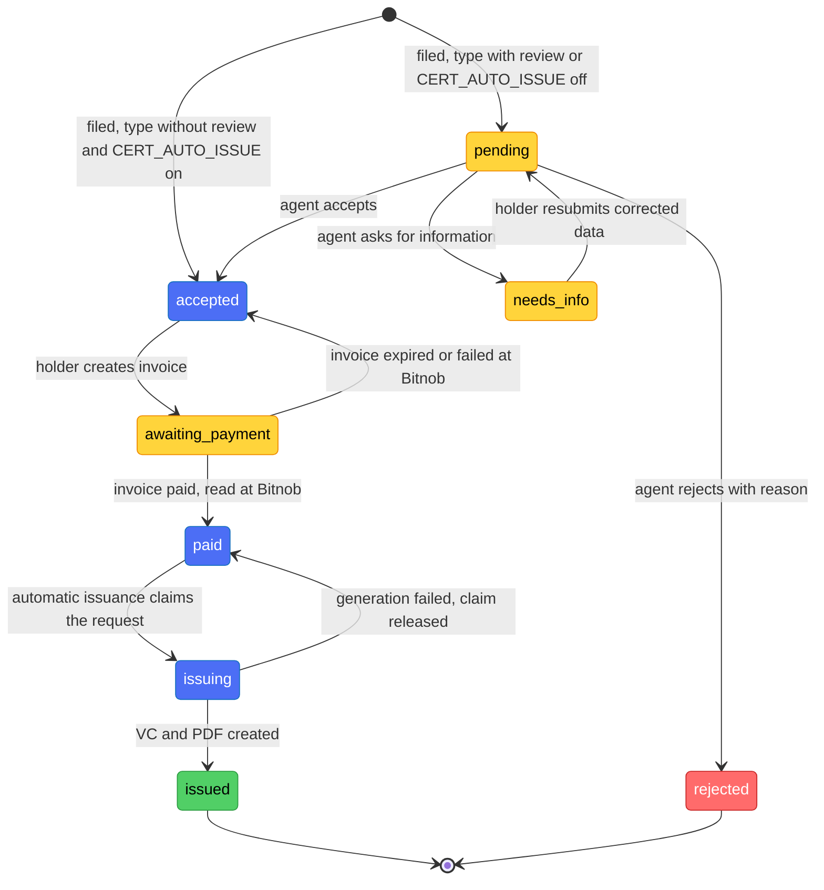

# Business Rules — DioteKo

Rules enforced by `backend-nest/`.
Each section names its source file so a rule can be re-checked before it is relied on.
Decisions that are not implemented yet are marked **open**.

---

## 1. Certificate catalog

| Type (`id`) | Name | Price (sats) | Agent review **before** payment |
|---|---|---|---|
| `birth` | Birth Certificate Extract | 100 | no |
| `marriage` | Marriage Certificate Extract | 100 | no |
| `death` | Death Certificate Extract | 100 | no |
| `residence` | Certificate of Residence | 100 | **yes** |
| `identity` | Identity Certificate | 100 | **yes** |

Source: `backend-nest/src/modules/admin-certificates/admin-certificates.constants.ts`
(`ADMIN_CERTIFICATE_TYPES`, field `requiresReview`). Setting `requiresReview: true` is the whole change
needed to add a review step to a type. A type priced at `0` would skip payment; no such type exists today.

---

## 2. Request lifecycle (flow B)

`AdminCertificateRequest.status` — source: `backend-nest/src/modules/admin-certificates/entities/admin-certificate-request.entity.ts`.

| Status | Meaning |
|---|---|
| `pending` | Filed; waiting for an agent of the issuing organization. |
| `accepted` | Can be paid. Reached by agent acceptance, or directly at filing for a type without review when `CERT_AUTO_ISSUE` is on. |
| `needs_info` | An agent asked the holder for a correction. |
| `awaiting_payment` | A Lightning invoice exists for the request. |
| `paid` | Payment confirmed. Issuance follows automatically. |
| `issuing` | Certificate being generated (claimed with a token). |
| `issued` | VC and PDF created. Terminal. |
| `rejected` | Refused by an agent, with a mandatory reason. Terminal. |

### Filing and review rules

- **Filing** (`POST /api/admin-certificates/requests`, any authenticated user): the type must be in the catalog;
  `submittedData` must pass §4. The issuing organization is `organizationId` when given (it must be a
  `municipality` or `ministry`), otherwise the oldest municipality or ministry. No such organization → 404.
- A type with review, or any type while `CERT_AUTO_ISSUE` is off, starts `pending`. Otherwise it starts `accepted`.
- **Agent decisions** (`accept`, `reject`, `request-info`): only on a `pending` request of the agent's own
  organization (another organization's request is 404). Nobody decides on a request they filed themselves (403).
  A request that is not `pending` gives 409. The transition is a conditional UPDATE, so two agents cannot both win.
- **Reject** and **request-info** need a text of 10 to 500 characters after trimming. It is shown to the holder.
- **Resubmit** (holder only, only from `needs_info`): replaces `submittedData` as a whole and returns the request to `pending`.
- Every agent decision writes an `access_logs` row (`action = review`).

---

## 3. Payment rules (Lightning, Bitnob)

- **Invoice creation** (`POST /api/admin-certificates/requests/:id/lightning-invoices`, holder only): only from
  `accepted`. The request is claimed atomically (`awaiting_payment`) before the provider is called, so a double tap
  cannot create two invoices.
- **Amount** = catalog price in sats. The client does not choose it.
- **Rail**: Bitnob Lightning is the only pay-in rail.
- **Confirmation**: a Bitnob webhook is only a signal. An invoice becomes `paid` only when Bitnob's own read returns
  `paid` with the same amount, payment hash and invoice id (`BitnobInvoiceSettlementService`). A background
  reconciler re-reads pending invoices every 60 s by default (`BITNOB_INVOICE_RECONCILE_INTERVAL_MS`). The status
  route also reads Bitnob.
- **Amount check**: the paid amount must cover the catalog price (`paymentCoversPrice`). A paid invoice that
  does not match its request, its provider or its amount issues nothing and is logged for a human
  (`PAID_UNLINKED`, `PROVIDER_MISMATCH`, `AMOUNT_MISMATCH`).
- **Expired or failed invoice**: Bitnob's read closes it, the request goes back to `accepted`, and the next invoice gets a new idempotency key (`dkinv_<requestId>_<n>`).
- **Simulation**: `PAYMENT_SIMULATION=true` marks an invoice paid without money. Dev only: refused at boot in production; the payment is flagged `payment_simulated`.
- **Sandbox limit**: a sandbox Lightning invoice cannot be settled through the API. An end-to-end payment needs a real wallet (see `docs/KNOWN_ISSUES.md`).

---

## 4. Submitted data (declared by the holder)

Source: `SUBMITTED_DATA_*` in `admin-certificates.constants.ts`; checks in `assertSubmittedDataValid`.

- `submittedData` becomes the credential subject verbatim and the content of the PDF.
- Allowed keys, for every type: `fullName` (required), `dateOfBirth`, `placeOfBirth`, `fatherName`, `motherName`, `nationality`, `idNumber`.
  Any other key is refused (400).
- Each value is non-empty text of at most 200 characters. Values are never logged.
- The data is **declared, not verified**. Nothing links it to the identity of the account.
  A certificate issued without review carries `declaredNotVerified: true` in the signed VC and a line in the PDF.
- **Open (D3)**: the source of the holder's name. The name is declarative (`docs/DECISIONS.md`). See `docs/ROADMAP_NEXT_STEPS.md`.

---

## 5. Issuance

- **Automatic after payment** (decision D2, flow B — `docs/ROADMAP_NEXT_STEPS.md`): `paid` → claim
  `issuing` with a token → VC signed (HS256) and PDF written → `issued`. Every path that sees a paid invoice
  (webhook, reconciler, status route, resume pass) runs the same paid check, then `startIssuance`.
- **`CERT_AUTO_ISSUE`** (`resolveAutoIssue` in `backend-nest/src/config/configuration.ts`):
  - not live (`NODE_ENV` and `BITNOB_ENVIRONMENT` not `production`): on by default; `false` turns it off;
  - live: off by default; only the exact value `true` turns it on.
  - When off, even a type without review goes through an agent (`pending`).
- **Manual recovery**: `POST /api/admin-certificates/requests/:id/issue` (issuer or admin of the organization). It
  works only from `paid`, and is refused (403) to the holder of the request.
- **Idempotence**: each VC carries `metadata.requestId`. A retry first revokes the orphan active VCs of the same
  request. If PDF generation fails, the VC just signed is revoked. A request stuck in `issuing` for more than 5 minutes
  (`ISSUING_STALE_MS`) is picked up by the resume pass.
- **Validity**: `CERTIFICATE_VALIDITY_DAYS`, default 365. The shown status is derived live from the credential:
  `valid`, `expiring_soon` (30 days or less left), `expired`, `revoked`.
- **Anchoring is simulated**: `CertificateAnchorService` returns a random transaction id. Do not present it as a
  real Bitcoin timestamp.

---

## 6. Verification and PDF access

- **Verification** (`POST /api/admin-certificates/:certificateId/verify`): public, no authentication. Returns
  `valid`, a reason (`revoked`, `expired`, `signature_invalid`, `hash_mismatch`), the type and the dates. It never
  returns a name or other personal data. Each call writes an `access_logs` row (`actor_type = anonymous`, `action = verify`).
  It does not check the Bitcoin anchor and does not check consent.
- **PDF is not public**. The holder asks `GET /api/admin-certificates/requests/:id/file-link` and receives a URL that
  is valid for 300 seconds (HMAC-signed `exp` and `sig`). `GET /api/admin-certificates/:certificateId/file` without a valid
  signature returns 403. Source: `certificate-file-link.service.ts`.
- The organization console never shows or downloads the PDF (`frontweb/AGENTS.md`).

---

## 7. Who can call what

Source: `@Roles`, `@Public` and service-level checks in `backend-nest/src/modules/**`.

| Route (prefix `/api`) | Allowed | Enforced by |
|---|---|---|
| `POST /admin-certificates/requests` | any authenticated user | JWT; owner is the caller |
| `GET /admin-certificates/requests`, `…/requests/stats`, `…/requests/:id` | holder, own requests only | service filter on `holderUserId` |
| `POST /admin-certificates/requests/:id/resubmit` | holder of the request | service (404 for others, 409 outside `needs_info`) |
| `POST /admin-certificates/requests/:id/lightning-invoices`, `…/lightning-invoice` | holder of the request | service (`holderOnly`) |
| `GET /admin-certificates/requests/:id/lightning-invoices/status` | holder of the request, or staff of its organization | service (`holderOrOrgStaff`) |
| `GET /admin-certificates/organization/requests[/:id]` | issuer, admin of the same organization | `@Roles` + organization read from the DB; another organization is 404; detail is audited |
| `POST /admin-certificates/organization/requests/:id/accept\|reject\|request-info` | issuer, admin of the same organization | `@Roles` + organization scope; not the holder |
| `POST /admin-certificates/requests/:id/issue` | issuer, admin of the same organization | `@Roles` + organization scope; not the holder |
| `GET /admin-certificates/requests/:id/file-link` | holder of the request | service (404 otherwise) |
| `GET /admin-certificates/:certificateId/file` | anyone with a valid signed link | `@Public` + HMAC check (403 otherwise) |
| `POST /admin-certificates/:certificateId/verify` | public | none, by design |
| `POST /admin-certificates/:certificateId/bitnob/payouts` | issuer, admin of the same organization | `@Roles` + organization scope |
| `POST …/bitnob/payouts/finalize`, `…/payouts/reconcile` | admin | `@Roles(ADMIN)`; finalize disabled in production |
| `POST /admin-certificates/dev/requests/:id/mark-paid` | any authenticated user, dev only | `PAYMENT_SIMULATION` (404 otherwise) |
| `/bitnob/payouts/*`, `/bitnob/withdrawals/*`, `/bitnob/bulk-transfers/*` (raw) | admin | class-level `@Roles(ADMIN)`; production gate (§10) |
| `/bitnob/balances`, `/bitnob/exchange-rates`, `/bitnob/transactions`, `/bitnob/payouts/{supported-countries,limits,banks}` | issuer, admin (verifier on some) | `@Roles` |
| `/bitnob/whoami` | admin | `@Roles(ADMIN)` |
| `POST /bitnob/webhooks` | public | HMAC-SHA512 signature guard |
| `POST /did-vc/dids` | admin | `@Roles(ADMIN)` |
| `POST /did-vc/credentials/:id/revoke` | issuer, admin | `@Roles` only; **not scoped to the organization** (open) |
| `GET /audit/access-logs` | admin, verifier | `@Roles` |
| `POST\|GET /audit/consents` | any authenticated user, own DID | JWT; DID resolved server-side |
| `/health`, `/kyc`, `/education`, `/transport`, `/employment`, `/social-aid`, `/merchant` | public | stubs returning `implemented: false` |

---

## 8. Roles and organizations

- `RoleCode` (`backend-nest/src/modules/identity/entities/role.entity.ts`): `holder`, `issuer`, `verifier`, `admin`.
- `RolesGuard` is global. A route with `@Roles(...)` returns 403 to a caller without one of the roles.
- **Automatic role**: only `holder`, granted at login (`AuthService` → `ensureRole(HOLDER)`). No route grants another
  role today. The other roles come from the seed or from direct database changes.
- **Staff organization**: each staff user has one `organization_id` (table `users`). Staff routes read it from the
  database, never from the JWT or the request. No organization, or an account that is not `active`, gives 403.
- **Four eyes**: nobody reviews or issues a request they filed.
- **Suspension**: `account_status` is checked when tokens are minted. `JwtStrategy` does not read the database, so an
  access token stays valid for up to 15 minutes after a suspension.

---

## 9. Identity

Source: `backend-nest/src/modules/identity/services/auth.service.ts`, `appwrite.service.ts`.

- **Mobile login**: Google through Appwrite. `POST /api/auth/appwrite/login` checks, in order: the Appwrite JWT
  (confirmed by a live `account.get()`), an active account, a verified email, and a linked Google identity
  (`APPWRITE_REQUIRE_GOOGLE_IDENTITY`, forced to `true` in production).
- **One user = one identity credential** (`appwrite_user_id`, i.e. Google via Appwrite) + one DID + the holder role.
- **No auto-link by email**: an email already used by another account returns 409. `google_id` is linked once; a
  different value later returns 403.
- **Manual identity review shows what the automatic check read** (`docs/KYC.md` §16). When the automatic KYC
  fails or cannot decide and a dossier goes to an agent (`manual_review`), the agent sees the OCR fields as read,
  their confidence, the scores and the provider rejection code, or an explicit "no data" state. This reading is
  personal data: kept only encrypted (same vault and key as the photos), deleted at the same moments as the photos
  (decision, retention `KYC_DOC_RETENTION_DAYS`), never returned to the holder, never logged, and readable only through
  `GET /api/kyc/review/:id` (issuer or admin of an organization). The holder only sees "waiting for an agent's
  verification". `failure_reason` still stores a fixed code only.
- **With the agent fallback on, no automatic verdict ends an identity dossier as a failure** (`docs/KYC.md` §16). When
  `KYC_FALLBACK_MANUAL_REVIEW=on` and the encryption key is valid, every refusal of the automatic check (unreadable
  document, front/back cross-validation failure, expiry, face or liveness failure, unexplained hard rejection, closed
  session) detaches the dossier to an agent instead of closing it: the holder still sends front, back and selfie, the
  reading is kept (encrypted) for the agent, and the dossier moves to `manual_review` once every photo is stored. Only an
  agent can validate or reject; the holder has no override and the daily session cap still applies. This reverses the
  earlier rule that an unexplained rejection or a face mismatch stays final. With the fallback off, or without a valid
  key, a refusal is final as before.
- **A dossier the provider verifies by itself stays auditable** (`docs/KYC.md` §17). Every `verified` identity dossier is
  listed in the console ("Identité validée", "Tous les états"), read-only, with the origin "Vérification automatique"
  when no agent was involved. What is kept for it is a reduced record with **no personal data** (provider verdict, face
  similarity and threshold, liveness, per-field cross-validation pass/fail and scores without values, expired flag,
  sandbox flag): no photo, no OCR text, no name. It is encrypted in the same vault, kept until `KYC_DOC_RETENTION_DAYS`,
  and shown with a warning when the provider ran in sandbox mode ("résultat non fiable pour la production"). The name
  read on the document is deliberately NOT compared with the account name (a Google name can legitimately differ).
  The console status filter defaults to the work queue ("À relire"); "Tous les états" lists every state.

---

## 10. Bitnob money rules (payouts, withdrawals, bulk transfers)

Source: `backend-nest/src/modules/bitnob/**`, `admin-certificates.service.ts`. Details: `docs/BITNOB.md`.

- **Certificate payout** (issuer or admin, then admin for finalize): three steps. `quote` → `initialize` (no money moves)
  → `finalize` (money moves, admin only). Reconcile by polling is the authority. A webhook can only move a status
  forward, never back from a terminal state.
- **One live payout per certificate**: a partial unique index. `failed` and `expired` payouts do not block a new quote.
- **Beneficiary**: never supplied by the client. It is read from `BITNOB_PAYOUT_BENEFICIARY_*` (one platform account, an interim choice).
- **Withdrawals** (on-chain): admin only, minimum 10 USD, `reference` used as the idempotency key.
- **Bulk transfers**: admin only. `draft` → `confirm` is irreversible. Retry must re-read Bitnob before resending (open blocker).
- **Production gate**: when `BITNOB_ENVIRONMENT=production`, every money-moving method throws Forbidden before any external call.
- **Trading and cards**: deferred. Entities exist, no write path.
- **Lightning pay-in** for certificate requests: see §3.

---

## 11. Consent and audit

- **Consent** (`consents`): a granted or revoked record linking a holder's DID to a verifier organization and a resource scope.
  It is a record only. Verification and issuance do not check it yet (future work).
- **Access logs** (`access_logs`): append-only. Actions written today:
  `verify` (public verification), `read` (staff reads a request detail), `review` (agent decision),
  `payout`, `withdrawal`, `bulk_transfer`.
  Not written yet: `issue` and `revoke` (open).
- **Actor types**: `anonymous`, `issuer_organization` (staff), `holder`, `verifier_organization`, `system`.
- **Who reads them**: admin and verifier (`GET /api/audit/access-logs`).
