# Journal d'événements chaîné des certificats

> **Statut :** proposition de conception 🎯 — **non implémentée**.
> **Question traitée :** comment prouver qu'un certificat a été **révoqué** (ou renouvelé, ou qu'il expire) alors que le certificat lui-même ne doit plus être modifié, et que Bitcoin ne connaît que ce qu'on lui envoie ?
> **Documents liés :** [`DioteKo_v2_Bitcoin_Issuer_Architecture.md`](./DioteKo_v2_Bitcoin_Issuer_Architecture.md) (version française : `..._FR.md`) · [`ARCHITECTURE_AS_BUILT.md`](./ARCHITECTURE_AS_BUILT.md) · [`DATABASE_MODEL.md`](./DATABASE_MODEL.md)

**Légende :** ✅ réel et câblé · 🟡 présent mais non configuré · 🔴 simulé ou manquant · 🎯 cible, pas encore codée.

---

## En bref (5 idées à retenir)

1. Un certificat ne change jamais. Ce qui change, c'est **son histoire**, et l'histoire s'écrit par **événements ajoutés à la suite**.
2. Chaque événement contient le **hash de l'événement précédent** (`previousHash`). Le premier événement a `previousHash = null`.
3. On ne connaît jamais le « hash suivant » : la chaîne ne regarde que **vers l'arrière**.
4. Une chaîne seule peut être réécrite par celui qui contrôle la base. C'est l'**ancrage sur Bitcoin** qui la **fige** à un instant donné.
5. L'**expiration** n'a pas besoin d'événement : la date de fin est dans l'événement d'émission et se compare à l'heure actuelle.

---

## 1. Le problème en 30 secondes

Aujourd'hui, révoquer un certificat revient à **changer un champ** dans PostgreSQL. Bitcoin n'en est jamais informé : il ne sait rien d'une révocation qu'on ne lui a pas enregistrée.

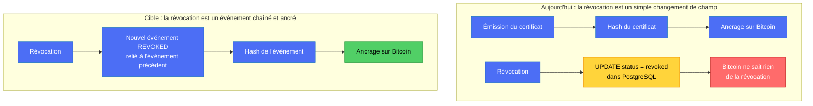

**Ce que le code fait aujourd'hui** (vérifié) :

- `RevocationService.revoke()` passe seulement `status` de `active` à `revoked` : **aucune trace** de qui a révoqué, quand, ni pourquoi (`backend-nest/src/modules/did-vc/services/revocation.service.ts`).
- Aucune ligne d'audit (`access_logs`) n'est écrite à l'émission ni à la révocation.
- L'ancrage Bitcoin est **simulé** (identifiant de transaction aléatoire).

---

## 2. L'idée : une chaîne d'événements par certificat

> **On n'écrit jamais par-dessus. On ajoute un événement à la suite, et chaque événement contient l'empreinte du précédent.**

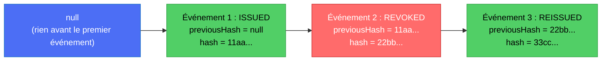

- L'événement 2 contient `11aa...`, c'est-à-dire le hash de l'événement 1.
- Si quelqu'un modifie l'événement 1, son hash change : il ne vaut plus `11aa...`, donc l'événement 2 ne « colle » plus. **Toute la suite de la chaîne devient incohérente.**
- Le premier événement n'a rien avant lui : son `previousHash` vaut `null` (comme le bloc « genesis » de Bitcoin).

---

## 3. Le parallèle avec les blocs Bitcoin

Ton intuition est la bonne : c'est **le même mécanisme de chaînage** que la blockchain.

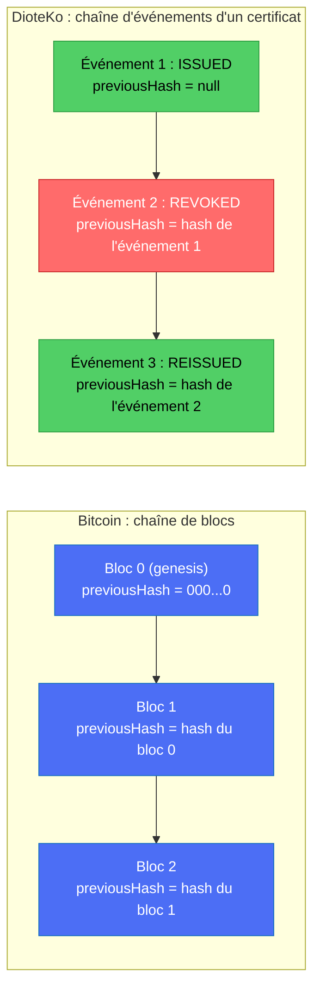

| Point | Bitcoin | DioteKo |
|---|---|---|
| Premier élément | Bloc genesis, hash précédent à zéro | Événement `ISSUED`, `previousHash = null` |
| Le lien | Hash du bloc précédent dans l'en-tête du bloc | Hash de l'événement précédent dans l'événement |
| Modifier le passé | Casse tous les liens suivants | Casse tous les liens suivants |
| Qui garde la chaîne | Des milliers de nœuds, avec des copies identiques | **Une seule base de données** (PostgreSQL) |
| Pourquoi la réécriture est difficile | Preuve de travail + copies multiples | **Seulement** si la chaîne est **ancrée** sur Bitcoin |

**La différence qui compte :** dans Bitcoin, personne ne peut réécrire la chaîne car tout le monde en possède une copie. Chez DioteKo, celui qui contrôle la base peut **recalculer tous les hashs** après avoir modifié un événement. La chaîne seule ne suffit donc pas : c'est l'ancrage sur Bitcoin (section 8) qui joue le rôle des « copies multiples ».

---

## 3 bis. Pourquoi seulement `previousHash` (et jamais un « hash suivant »)

Quand on crée l'événement 2, l'événement 3 **n'existe pas encore** : son hash est inconnu. Et si l'événement 2 devait contenir le hash de l'événement 3, qui lui-même contient le hash de l'événement 2, on tournerait en rond (impossible à calculer). La chaîne ne se lit donc que **vers l'arrière**, de l'événement le plus récent jusqu'au premier.

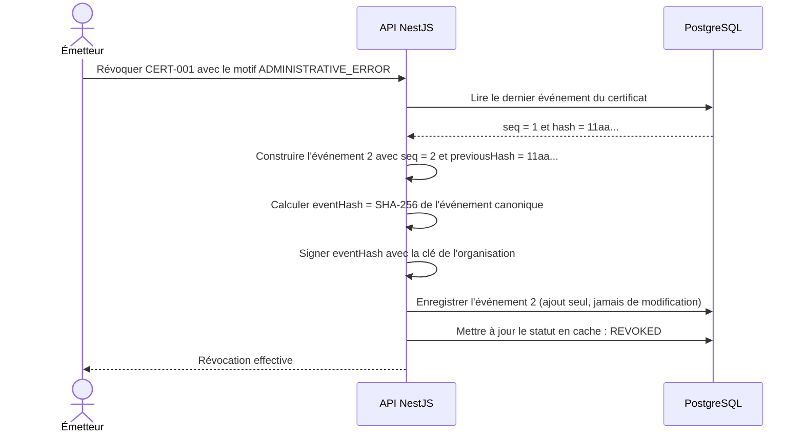

---

## 4. Que contient un événement ?

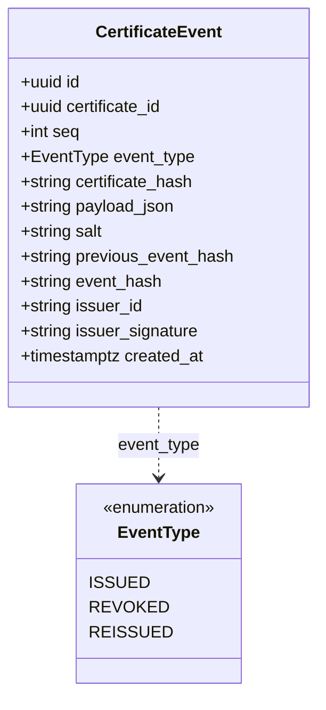

Exemple d'événement de révocation :

```json
{
  "certificateId": "CERT-001",
  "seq": 2,
  "eventType": "REVOKED",
  "certificateHash": "A7F83C91...",
  "reason": "ADMINISTRATIVE_ERROR",
  "issuerId": "MUNICIPALITY-001",
  "createdAt": "2026-10-20T15:42:00Z",
  "previousEventHash": "11aa...",
  "salt": "5d0c9e...",
  "eventHash": "22bb...",
  "issuerSignature": "..."
}
```

Règles :

- **`eventHash`** = SHA-256 de la **forme canonique** de l'événement (mêmes champs, même ordre, même format), **sans** `eventHash` ni `issuerSignature`.
- **`salt`** : une valeur aléatoire propre à chaque événement, incluse dans le hash. Sans elle, un contenu simple (un nom, une date de naissance) peut être **deviné** puis **confirmé** en recalculant le hash. Seul le hash va sur Bitcoin, mais il ne doit pas permettre de retrouver le contenu.
- **`issuerSignature`** : signature de l'émetteur sur `eventHash`. Elle répond à « **qui** a déclaré cet événement ? ». Le hash répond à « **quoi** exactement ? », et Bitcoin répond à « **quand au plus tard** ? ».
- **`seq`** : numéro d'ordre 1, 2, 3… On ordonne les événements par `seq`, jamais par l'horodatage (qu'on pourrait truquer ou qui peut être identique).
- Seuls les **hashs** vont sur Bitcoin, jamais le contenu.

---

## 5. Le cycle de vie se déduit des événements

Le statut d'un certificat n'est plus « écrit » : il est **calculé** à partir du dernier événement et de la date actuelle.

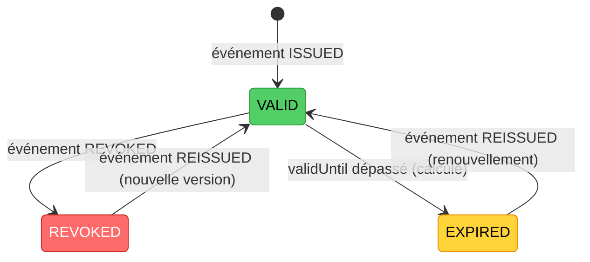

Règles de calcul :

- Le statut courant = le résultat de la lecture des événements dans l'ordre de `seq`, plus la comparaison de `validUntil` avec l'heure actuelle.
- Un certificat révoqué ne redevient **jamais** valide « tout seul » : il faut un événement `REISSUED`, qui porte un **nouveau hash de certificat** (nouvelle version). L'ancienne version reste révoquée.
- Le champ `current_status` dans la base n'est qu'un **cache** pour aller vite : si le calcul donne autre chose, c'est une alerte (section 9).

---

## 6. L'expiration : pas besoin d'événement

Ta question : *« et un document qui arrive en expiration ? »*

La date de fin de validité (`validUntil`) est écrite **dans l'événement d'émission**, donc elle est couverte par son hash : personne ne peut la changer sans casser la chaîne. À la vérification, on compare simplement avec l'heure actuelle.

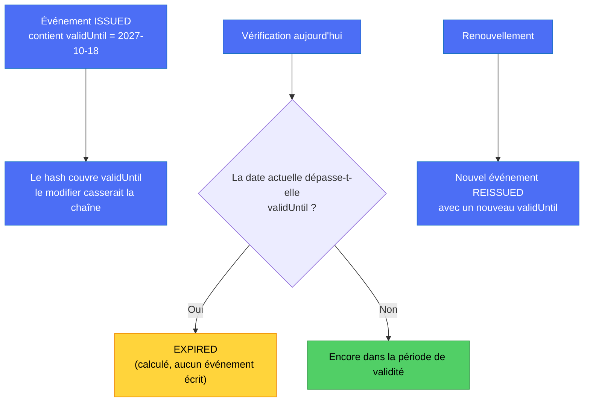

- **Aucune tâche planifiée** n'est nécessaire pour « faire expirer » un certificat.
- Un événement n'est écrit que pour ce qui **ne se déduit pas du temps** : une révocation, une réémission (correction ou renouvellement), éventuellement plus tard une suspension.
- Le code actuel va déjà dans ce sens : le statut `EXPIRED` est déclaré dans l'énumération mais **jamais écrit** ; l'expiration est détectée à la vérification (`exp` du JWT et `expiresAt`).

---

## 7. La vie complète d'un certificat, étape par étape

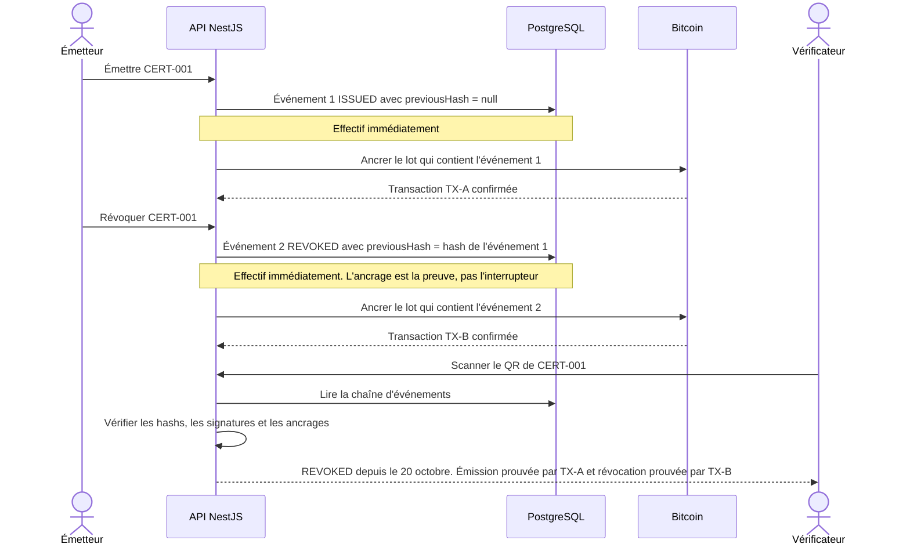

**Important :** la révocation est **effective tout de suite** dans l'API (signée par l'émetteur). L'ancrage Bitcoin arrive un peu plus tard (délai de confirmation, regroupement) : il sert de **preuve**, il n'est pas l'interrupteur.

---

## 8. L'ancrage sur Bitcoin : un seul point d'ancrage pour plusieurs événements

Inutile de faire une transaction Bitcoin par événement. On regroupe les nouveaux événements dans un **arbre de Merkle** et on ancre **sa racine**.

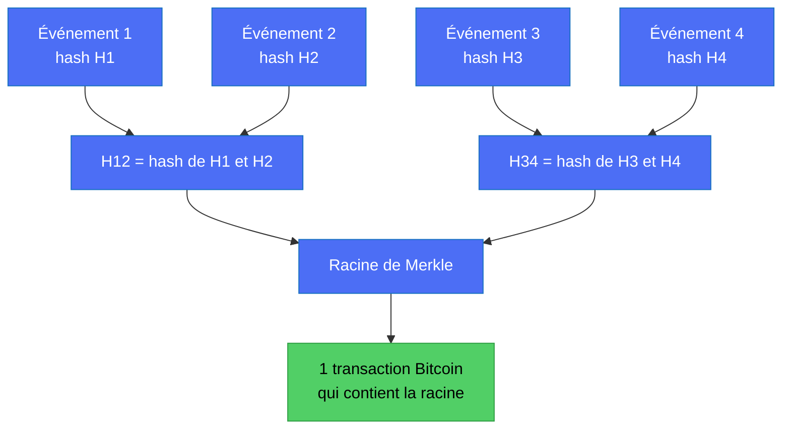

> Exemple complet avec les tables, les hashs réels et la preuve pas à pas : [`MERKLE_TREE_EXPLAINED.md`](MERKLE_TREE_EXPLAINED.md).

- Pour prouver qu'**un** événement fait partie du lot, on fournit la **preuve de Merkle** : les quelques hashs voisins qui permettent de remonter jusqu'à la racine ancrée.
- Chaque événement garde cette preuve et l'identifiant du lot ancré (`anchor_batch_id`).

| Stratégie | Avantage | Inconvénient |
|---|---|---|
| Une transaction par événement | Simple, preuve immédiate | Plus de frais, plus de transactions |
| **Lots (Merkle)** | Peu de transactions, même preuve | Délai avant l'ancrage d'un événement |

**Piste pragmatique pour le hackathon, à vérifier avant adoption :** utiliser un service d'ancrage groupé existant (par exemple OpenTimestamps) plutôt que d'écrire sa propre diffusion de transactions Bitcoin. Aujourd'hui, `CertificateAnchorService` **simule** l'ancrage : il doit être remplacé par un vrai ancrage quel que soit le choix.

---

## 9. La vérification complète

Quand quelqu'un scanne le QR, le backend ne se contente pas de lire un statut : il **rejoue** toute la chaîne.

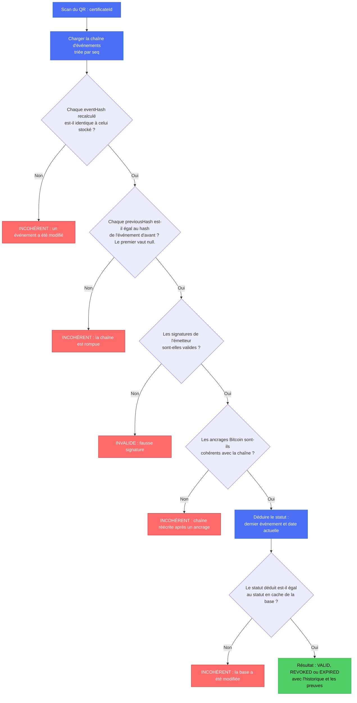

Résultat montré à l'utilisateur :

| Résultat | Signification |
|---|---|
| **VALID** | Chaîne intacte, dernier événement `ISSUED` ou `REISSUED`, date de validité non dépassée |
| **REVOKED** | Chaîne intacte, dernier événement `REVOKED`, avec la date et le motif |
| **EXPIRED** | Chaîne intacte, mais `validUntil` est dépassé |
| **INCOHÉRENT** | La base ne correspond pas à l'historique prouvé : ne pas faire confiance |
| **INVALIDE** | Signature de l'émetteur incorrecte |

---

## 10. Ce que le système détecte, et ce qu'il ne détecte pas

C'est le point le plus important à comprendre pour rester honnête devant un jury.

| Attaque | Détectée ? | Pourquoi |
|---|---|---|
| Modifier le contenu d'un événement du milieu | **Oui** | Son hash change : le `previousHash` de l'événement suivant ne correspond plus |
| Supprimer un événement du milieu | **Oui** | Le suivant pointe vers un hash qui n'existe plus, et `seq` a un trou |
| Réécrire toute la chaîne **après** un ancrage | **Oui** | Le hash ou la racine ancrés sur Bitcoin ne correspondent plus |
| Réécrire la chaîne **avant** tout ancrage | **Non**, tant qu'elle n'est pas ancrée | Rien d'extérieur ne l'a encore figée |
| Supprimer le **dernier** événement (par exemple la révocation) avant son ancrage | **Non**, jusqu'au prochain ancrage | La chaîne raccourcie reste cohérente |
| Supprimer le dernier événement **après** un ancrage | **Oui** | Le point de contrôle ancré contient `seq` et le nombre d'événements |
| Changer seulement `current_status` dans la base | **Oui** | Le statut calculé ne correspond plus au statut en cache |
| Un backend compromis qui signe de faux événements | **Non** | La signature est celle de la plateforme (voir phase 3) |

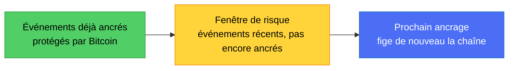

**Comment réduire la fenêtre de risque :**

- ancrer **souvent** (toutes les quelques minutes ou quelques heures) ;
- inclure dans chaque point de contrôle ancré le **numéro de séquence** et le **nombre d'événements** : on détecte ainsi une chaîne raccourcie ;
- conserver une **copie du journal** chez un tiers (un auditeur, un stockage externe).

**Deux limites à dire clairement :** la base reste un point de confiance pour la **disponibilité** (si elle disparaît, la preuve Bitcoin seule ne redonne pas le contenu), et un bloc Bitcoin prouve « cela existait **au plus tard** à ce moment », pas l'heure exacte.

---

## 11. Modèle de données cible 🎯

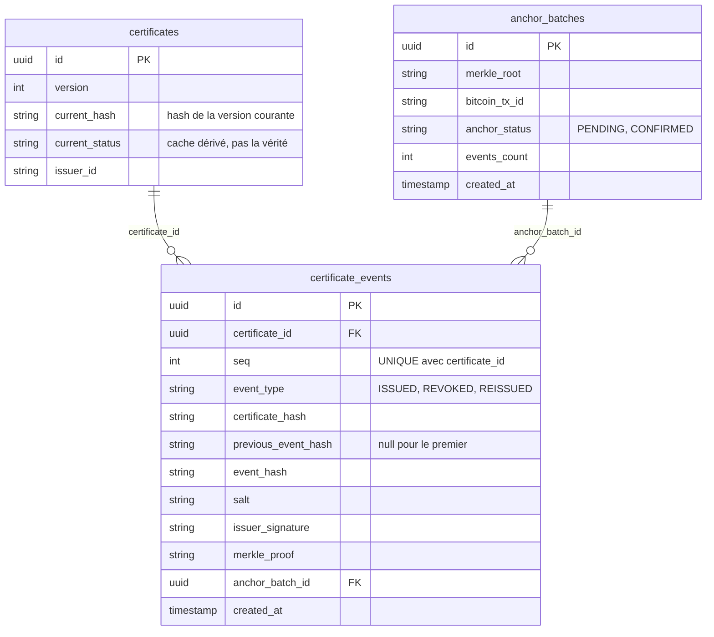

Règles de base de données :

- `UNIQUE (certificate_id, seq)` : pas deux événements au même rang.
- `UNIQUE (certificate_id, previous_event_hash)` : pas de **fourche** (deux suites possibles au même événement).
- Table en **ajout seul** : aucun droit `UPDATE` / `DELETE` pour l'application, et un déclencheur qui refuse les modifications. C'est de l'**hygiène**, pas une preuve : l'administrateur de la base peut toujours contourner. La vraie protection est l'ancrage.
- `current_status` est **recalculé** depuis les événements, jamais modifié librement.

**Rapprochement avec l'existant :** les tables actuelles les plus proches de `certificates` sont `admin_certificates_refs` et `verifiable_credentials`. Le journal peut s'y rattacher au lieu de créer une table de plus (voir `DATABASE_MODEL.md`).

---

## 12. Aujourd'hui et cible, puis les étapes

| Sujet | Aujourd'hui | Cible 🎯 |
|---|---|---|
| Révocation | 🔴 `status = revoked` modifié, sans trace | Événement `REVOKED` chaîné, signé, ancré |
| Qui a révoqué, et pourquoi | 🔴 non conservé | Dans l'événement (`issuer_id`, `reason`) |
| Audit | 🔴 `access_logs` n'écrit ni l'émission ni la révocation | L'événement **est** l'audit |
| Expiration | ✅ calculée à la vérification, statut `EXPIRED` jamais écrit | Idem, avec `validUntil` couvert par le hash de l'événement `ISSUED` |
| Ancrage Bitcoin | 🔴 simulé | Réel, par lots (Merkle) |
| Signature | 🟡 HS256 avec un secret partagé (en fait la signature du backend) | Clé par organisation (asymétrique), phase 3 |
| Autorisation de révoquer | 🔴 tout issuer peut révoquer les VC de toute organisation (TODO connu) | Contrôle : l'organisation de l'émetteur de l'événement `ISSUED` |

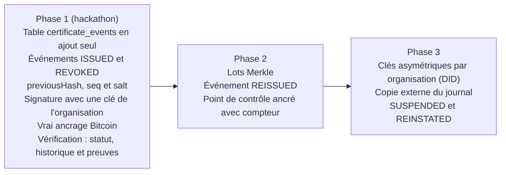

Pour la phase 1, le plus important est de **supprimer l'ancrage simulé** : sans vrai ancrage, la chaîne reste réécrivable par quiconque contrôle la base.

---

## 13. La phrase pour le jury

> **« Nous ne modifions jamais un certificat émis. Nous ajoutons des événements signés et chaînés : l'émission, puis une éventuelle révocation ou réémission. Chaque événement contient l'empreinte du précédent, et les événements sont ancrés sur Bitcoin. Le vérificateur rejoue l'historique et détecte toute incohérence entre la base de données de l'application et l'historique cryptographique ancré. »**

Version anglaise :

> **“We never modify an issued certificate. We append signed, hash-chained events: issuance, then possibly revocation or reissuance. Each event contains the hash of the previous one, and events are anchored on Bitcoin. The verifier replays the history and detects any inconsistency between the application's database and the anchored cryptographic history.”**

**Nuance à garder en tête :** l'ancrage garantit la détection pour les événements **déjà ancrés** ; les tout derniers événements, pas encore ancrés, restent dans la fenêtre de risque décrite à la section 10.
