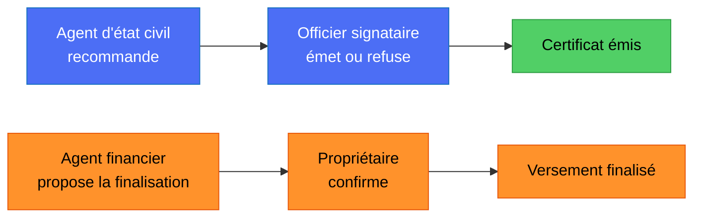

# Cahier des écrans : console web des organisations (DioteKo Console)

> Spécification de départ de la console web des organisations qui émettent les certificats ; la console
> est implémentée dans `frontweb/`. Le mobile reste réservé au citoyen. Contexte : [`ROADMAP_NEXT_STEPS.md`](ROADMAP_NEXT_STEPS.md) (chantier C10).
>
> **Écarts voulus depuis cette spécification :** la console n'affiche ni n'offre le téléchargement du PDF (il appartient au
> titulaire) et limite les données personnelles affichées au besoin de chaque rôle. Voir le chantier C10.
>
> **État réel du code :** ces points corrigent la spécification de départ.
> - **Fait :** liste, détail, refus et demande de complément des demandes de l'organisation (`/admin-certificates/organization/requests`) ; CORS (`CORS_ORIGINS`, `backend-nest/src/main.ts`).
> - **Reste à faire :** liste des certificats et statistiques de l'organisation (C7).
> - **Statuts :** `RequestStatus` inclut `accepted`, `needs_info` et `issuing` (`frontweb/src/lib/types.ts`).
> - **Routeur :** TanStack Router, pas React Router (`frontweb/AGENTS.md`).
> - **PDF :** la console ne l'affiche ni ne le télécharge (`frontweb/AGENTS.md`). Les passages du cahier qui le demandent sont marqués **NON RETENU**.
> - **Émission :** automatique après paiement. L'agent accepte, refuse ou demande un complément avant le paiement (`docs/BUSINESS_RULES.md` §2 et §5). Le diagramme ci-dessous décrit le modèle de départ.

## Comment l'utiliser

1. Le bloc ci-dessous décrit les écrans, les rôles et le contrat d'API attendus : à utiliser comme référence pour relire
   `frontweb/` ou pour le faire évoluer, un écran à la fois.
2. La console fonctionne en **mode simulé** avec `VITE_USE_MOCKS=true` (sélecteur de rôle pour tester chaque permission).
3. Quand le backend a les routes manquantes, passer `VITE_USE_MOCKS=false` et pointer `VITE_API_BASE_URL` vers l'API Nest.

## Ce qui est réel et ce qui est simulé

| Élément du prompt | Backend aujourd'hui |
|---|---|
| Connexion `POST /auth/login`, `/auth/refresh`, `/auth/logout`, `GET /auth/me` | ✅ existe (rôles globaux `holder, issuer, verifier, admin`, pas d'organisation dans `/auth/me`) |
| Types, émission, PDF, vérification, versements Bitnob | ✅ existe |
| `GET /audit/access-logs` (admin, verifier), `GET /bitnob/payouts` (admin) | ✅ existent, non filtrés par organisation |
| Liste, détail, acceptation, refus et demande de complément des demandes de l'organisation | ✅ |
| Liste des certificats, statistiques de l'organisation | 🎯 à créer (C7). `GET /admin-certificates/requests/stats` existe mais ne renvoie que les demandes du demandeur |
| Rôles par organisation, membres, invitations, recommandation, notes, finalisation à deux personnes | 🎯 à créer (voir ci-dessous) |
| CORS pour un navigateur | ✅ `CORS_ORIGINS` (`backend-nest/src/main.ts`) |

**Côté Nest, à prévoir avant de brancher la console :** table `organization_memberships` (utilisateur, organisation, rôle,
statut) et invitations (pas encore créées) ; rôles d'organisation `org_owner`, `registrar`, `approver`, `finance_officer`, `auditor` en plus du
rôle plateforme `admin` (super-administrateur) ; garde par permission appuyée sur la matrice du prompt ; contrôle de
l'organisation dans l'émission (fait : le staff est limité à l'organisation lue en base) ; règle des quatre yeux (faite
pour la revue et l'émission) ; finalisation d'un versement par deux personnes (à faire). Revue `@security-analyst` obligatoire.



> Diagramme du modèle d'origine (recommandation puis émission manuelle, finalisation à deux personnes). Dans
> l'implémentation actuelle, l'émission est automatique après paiement et la finalisation d'un versement n'est pas encore à deux personnes.

## Le prompt

```text
Build "DioteKo Console": the web back-office for organizations (town halls, civil registries, hospitals,
ministries) that deliver paid, verifiable administrative certificates (birth, marriage, death, residence,
identity). Citizens request and pay on a mobile app (Bitcoin Lightning). Staff of the organization process
requests, issue certificates, handle payouts and audit on THIS web app. UI language: French, formal "vous".

USERS AND TONE
Civil-registry clerks, signing officers, finance officers, auditors. Eight hours a day on laptops (1280px+
first, tablet usable). Calm, dense, trustworthy, bureaucratic-but-modern. Not a crypto dashboard, not a SaaS
landing page. No marketing copy, no emoji, no stock illustrations, no gradients, no glassmorphism.

STACK
React + Vite + TypeScript, Tailwind, shadcn/ui, React Router [remplacé par TanStack Router, voir frontweb/AGENTS.md], TanStack Query, React Hook Form + Zod,
Recharts (dashboard only). No backend code. All server access goes through one typed client, src/lib/api.ts,
using VITE_API_BASE_URL (default http://localhost:3003/api). VITE_USE_MOCKS=true serves realistic fixtures
from src/lib/mocks.ts with 400 ms latency, including a dev-only user switcher in the sidebar footer to
impersonate each role, so every screen and every permission can be reviewed without a backend.

VISUAL DIRECTION
Paper-like and institutional. Background #F7F6F2, ink #14213D, accent deep green #1F6F54 (primary actions,
"valid"), amber #B7791F (waiting), blue #1D4E89 (paid, to process), red #B3261E (rejected, revoked).
Source Serif 4 for page titles and the certificate preview only, Inter for UI, JetBrains Mono for ids and
hashes. 8 px grid, 1 px borders instead of shadows, 6 px radius. Full dark mode through CSS variables.
Status is never shown by colour alone: always icon + text.

ROLES AND PERMISSIONS (core of the app)
Two levels. Platform level: "Super-administrateur DioteKo" (platform staff, sees all organizations, can
switch organization, create organizations and assign the first owner). Organization level: every user
belongs to exactly one organization and has exactly one role in it:

1. Propriétaire de l'organisation (org_owner): manages members, invitations and the organization profile;
   sees everything of their organization; confirms payout finalization. Cannot issue certificates.
2. Agent d'état civil (registrar): prepares the work. Sees requests, checks the submitted data, adds internal
   notes, recommends "Émettre" or "Refuser" with a reason. Cannot issue or refuse definitively.
3. Officier signataire (approver): the only role that issues, refuses definitively and revokes certificates.
   Four-eyes rule: cannot approve a request they recommended themselves.
4. Agent financier (finance_officer): sees payments and payouts, creates payout drafts, reconciles, proposes
   finalization. Cannot confirm finalization alone.
5. Auditeur (auditor): read-only on requests, certificates, payouts, members and the audit log; can export CSV.
   No action buttons anywhere.
Roles are not cumulative by default; an owner may grant a user a second role explicitly.

Permission matrix. Implement it as a single const in src/lib/permissions.ts, consumed by a <Can permission="...">
component and a useCan() hook. Routes are guarded too, not only hidden.
- dashboard.view: all roles
- request.view: owner, registrar, approver, finance, auditor
- request.note: registrar, approver
- request.recommend: registrar
- request.issue: approver
- request.reject: approver
- certificate.view: all roles
- certificate.revoke: approver (reason + confirmation)
- payout.view: owner, finance, auditor
- payout.create, payout.reconcile, payout.propose_finalize: finance
- payout.confirm_finalize: owner
- audit.view, audit.export: owner, auditor
- member.view: owner, auditor
- member.invite, member.change_role, member.suspend, org.edit: owner
- org.switch, org.create: super-admin only
Behaviour: a forbidden route shows "Vous n'avez pas accès à cette page" and names the role needed. Forbidden
actions are hidden, except dangerous ones (finalize) which are shown disabled with an explanation. A 403 from
the server is shown verbatim in a toast.

Two-person rule for money: finalizing a payout needs two different people. The finance officer "propose la
finalisation"; the owner then confirms by typing the payout reference. Show the pending proposal with who
proposed it and when; nobody can confirm their own proposal. When VITE_ENV=production the backend refuses
finalization: render the button disabled with the tooltip "Désactivé en production par sécurité".

AUTH
/login: email + password (POST /auth/login -> accessToken, refreshToken, expiresIn). Access token in memory,
refresh token in sessionStorage, one silent refresh on 401 via POST /auth/refresh, then redirect to /login
with "Session expirée". After login call GET /auth/me (user, roles, organization). A user with no staff role
sees "Accès réservé au personnel habilité" and is logged out. /invitation/:token lets an invited person set a
name and password. Idle timeout 15 minutes with a warning dialog. Never log or display tokens.

LAYOUT
Collapsible left sidebar showing only the entries the role may open: Tableau de bord, Demandes (badge = paid
requests waiting), Certificats, Versements, Journal d'audit, Équipe, Paramètres. Footer: user name, role
badge, organization name. Top bar: global search (certificate id, payment hash, citizen name), environment
pill "SANDBOX" or "PRODUCTION" from VITE_ENV, user menu. The super-admin gets an organization switcher.

SCREENS
1. Tableau de bord. Four stat cards: payées à traiter, émises sur 30 jours, sats encaissés, délai moyen
   paiement->émission. One stacked bar chart (30 days, by status). Below, "À traiter maintenant": the five
   oldest paid requests with an "Examiner" button. Content adapts to the role (finance sees money cards,
   auditor sees counts only).
2. Demandes. Table: référence (mono), type, titulaire, date, montant en sats, statut, âge. Statuses: pending, accepted, needs_info, issuing [ajoutés depuis la spécification de départ],
   awaiting_payment ("En attente de paiement", amber), paid ("Payée, à traiter", blue), issued ("Émise",
   green), rejected ("Refusée", red). Filters (status default = paid, type, dates, search) kept in the URL.
   Server pagination 25/page, row skeletons, error with "Réessayer", empty "Aucune demande payée à traiter."
   Keyboard: j/k to move, Enter to open.
3. Détail d'une demande (drawer). Left: submittedData as a labelled read-only list, type and price. Right:
   vertical timeline (Demande créée, Facture Lightning créée, Paiement reçu, Recommandée par X, Émise ou
   Refusée par Y) with timestamps and the payment hash in mono + copy button. Below: internal notes thread.
   Sticky action bar by role: registrar -> "Recommander l'émission" / "Recommander le refus"; approver ->
   "Émettre le certificat" / "Refuser…" (reason of 10+ characters). Issuing opens a dialog restating citizen
   and type and stating the action is irreversible; success shows certificate id, document hash, validity
   date and a PDF download link [NON RETENU : la console ne montre ni ne télécharge le PDF, frontweb/AGENTS.md]. Prevent double-submit.
4. Certificats. Table: id, type, titulaire, émis le, valide jusqu'au, statut (Valide, Expiré, Révoqué). Side
   panel: PDF preview (iframe on GET /admin-certificates/{id}/file) [NON RETENU : interdit, frontweb/AGENTS.md], document hash, anchor txId and network
   labelled honestly ("Ancrage : simulé" when it is a placeholder), "Vérifier" button
   (POST /admin-certificates/{id}/verify), and "Révoquer" for approvers.
5. Versements. Table: certificat, montant, devise, pays, statut, référence, date. Create form: settlementAmount
   (^\d{1,12}(\.\d{1,2})?$), toCurrency NGN|KES|GHS|USD, country NG|KE|GH, fromAsset USDT|BTC (default USDT),
   paymentReason (max 140, single line). Actions: Rapprocher, Proposer la finalisation, Confirmer.
6. Équipe. Members table: nom, email, rôle, statut (Actif, Invité, Suspendu), dernière connexion. "Inviter un
   membre" dialog: email + role, each role with a one-line description. Change role and suspend with
   confirmation. The last owner cannot be demoted or suspended. A "Ce que ce rôle peut faire" matrix view is
   generated from permissions.ts.
7. Journal d'audit. Read-only: horodatage, acteur, rôle, action, objet; filters by actor and date; CSV export
   of the filtered view.
8. Paramètres. Profile, password change, theme, session info; organization profile for owners.

RULES
- Every mutation shows a toast with the result and refreshes the affected queries.
- Every table has skeleton, error-with-retry and empty states, and no layout shift.
- Accessibility: WCAG AA contrast, visible focus rings, labelled icon buttons, focus-trapped dialogs.
- Never render submittedData as HTML. Money is always "12 500 sats". French copy only, no exclamation marks.
- Types in src/lib/types.ts: RequestStatus = 'pending' | 'accepted' | 'needs_info' | 'awaiting_payment' | 'paid' | 'issuing' | 'issued' | 'rejected';
  OrgRole = 'org_owner' | 'registrar' | 'approver' | 'finance_officer' | 'auditor'; PlatformRole = 'super_admin'.

API CONTRACT (base /api, Bearer token, errors are {statusCode, message})
POST /auth/login, /auth/refresh, /auth/logout; GET /auth/me
GET  /admin-certificates/types -> {types:[{id,name,priceSats}]}
GET  /admin-certificates/organization/requests?status=&validity=&limit=&offset=  (ajouté ; pas de filtre type ni recherche texte)
GET  /admin-certificates/organization/requests/{id}              (ajouté)
POST /admin-certificates/organization/requests/{id}/accept | /request-info {message} | /reject {reason}  (ajoutés, 10 à 500 caractères)
POST /admin-certificates/requests/{id}/issue (reprise manuelle seulement, statut paid) -> {certificateId, documentHash, blockchainAnchor:{txId,network,timestamp,blockHeight}, validUntil, qrCodeData}
GET  /admin-certificates/certificates                            (to be added)
GET  /admin-certificates/{certificateId}/file -> application/pdf   [NON RETENU dans la console : interdit, frontweb/AGENTS.md]
POST /admin-certificates/{certificateId}/verify {documentHash?} -> {valid, reason?, certificateType, issuedAt, expiresAt}
POST /admin-certificates/{certificateId}/bitnob/payouts, .../payouts/finalize, .../payouts/reconcile
GET  /bitnob/payouts; GET /audit/access-logs
Members, invitations, recommendations, notes and stats endpoints do not exist yet: mock them behind the same client.

FIRST ITERATION
Build only: login, app shell with role-filtered sidebar, permissions.ts, the mock user switcher, and the
Demandes list + detail with the recommend / issue / refuse flow. Stop there and wait for my review before
building the other screens.
```

## Étapes suivantes

1. Certificats + vérification + révocation.
2. Versements avec la règle des deux personnes.
3. Équipe : membres, invitations, matrice des rôles.
4. Tableau de bord et journal d'audit.
5. Passage en mode réel : `VITE_USE_MOCKS=false`, gestion des erreurs 403/409 renvoyées par l'API.
