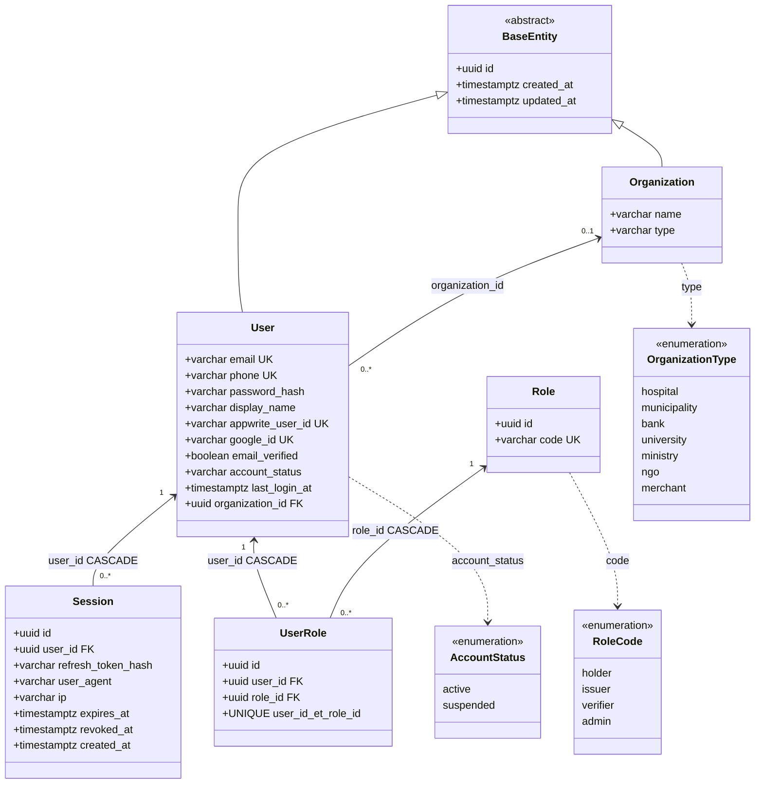
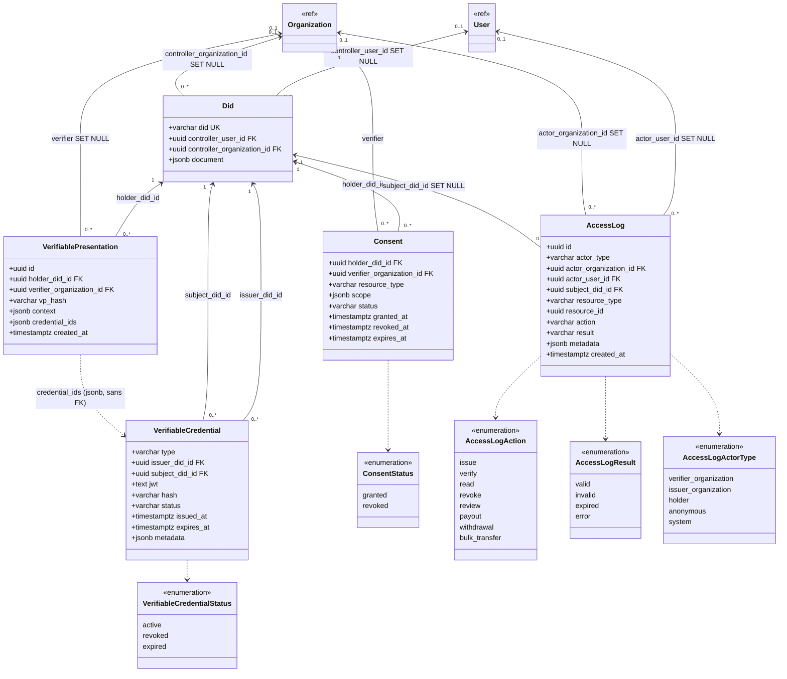
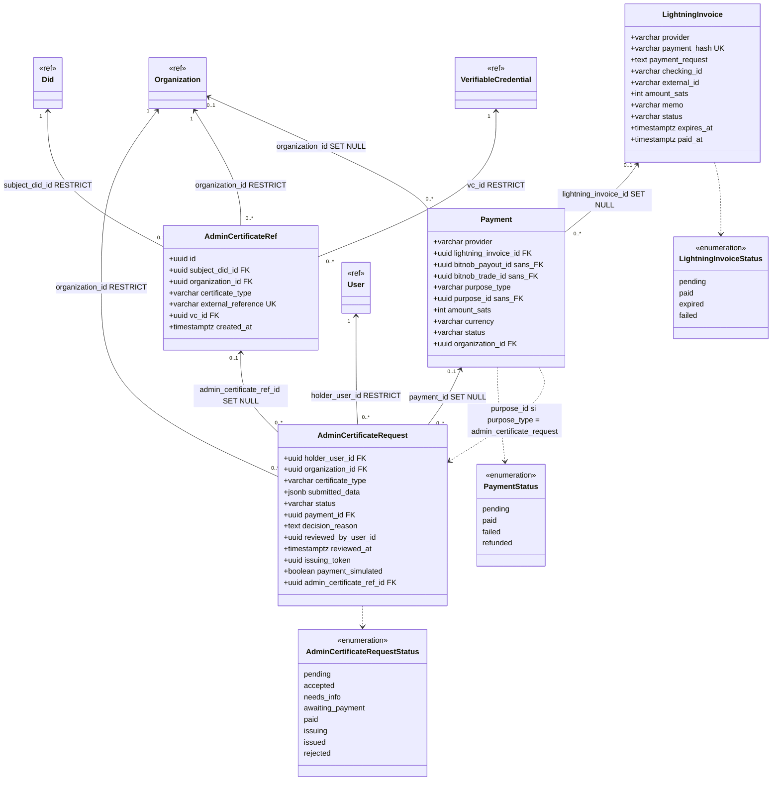
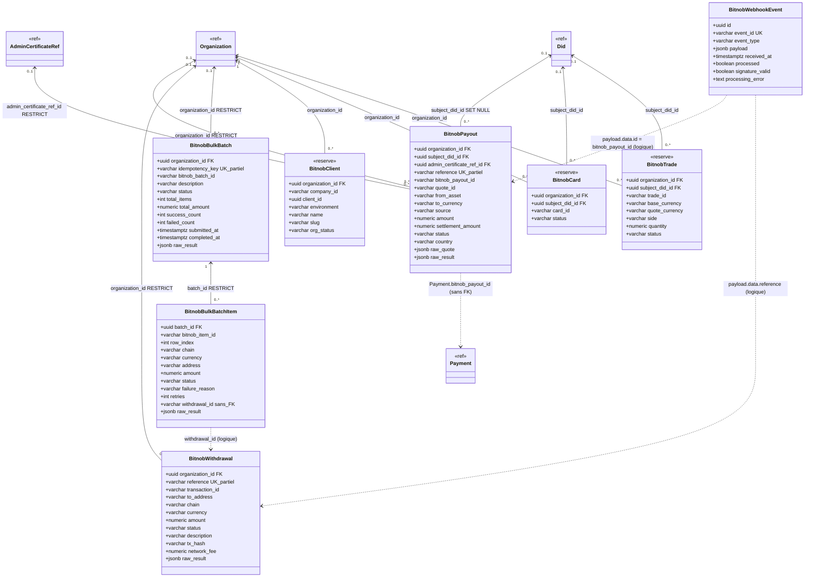
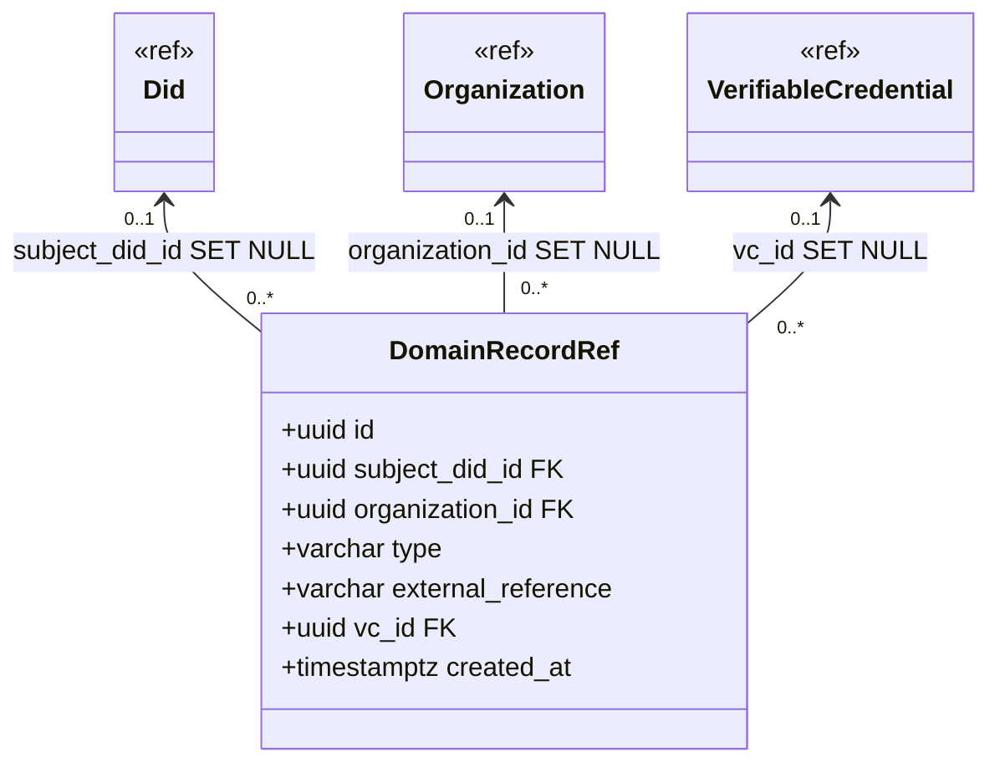
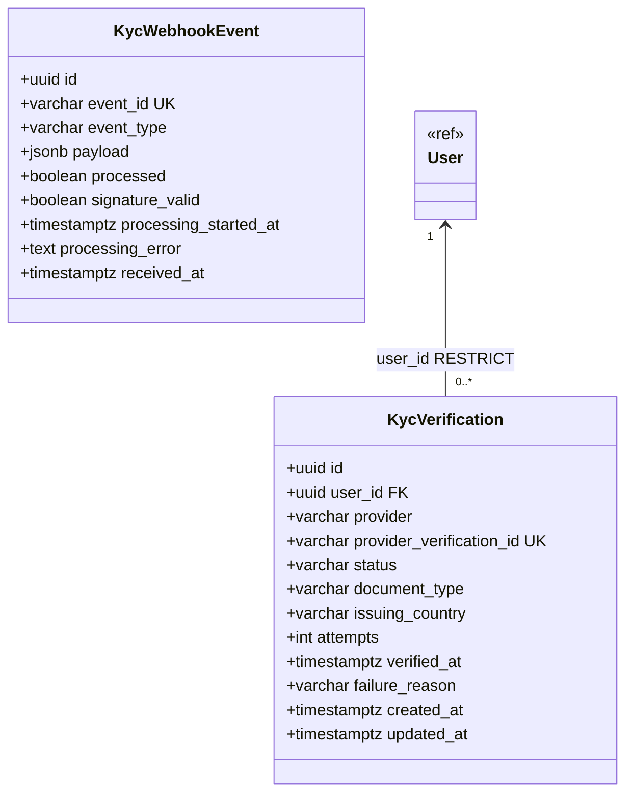
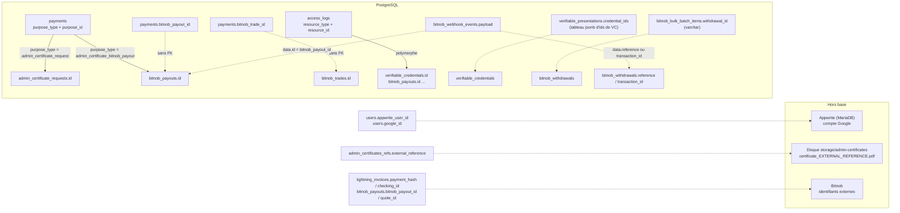
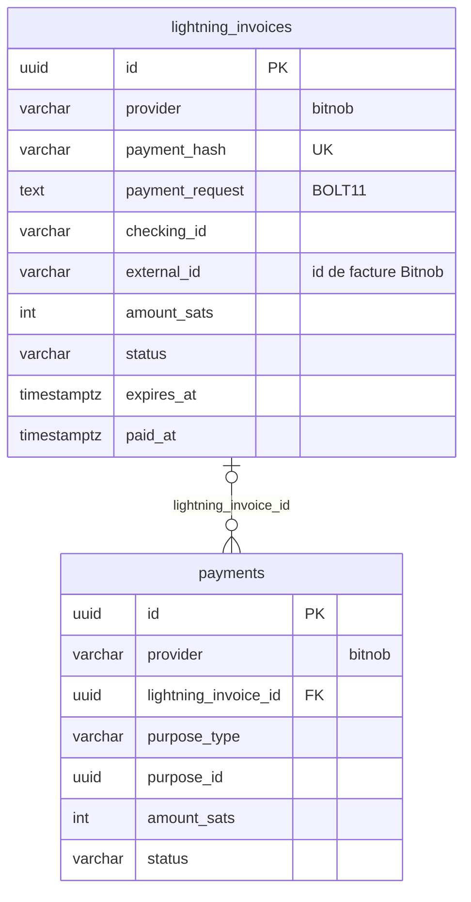

# Modèle de données — DioteKo (backend-nest)

> **Statut :** relevé des **32 entités TypeORM** (`backend-nest/src/**/*.entity.ts`), recoupé avec les **13 migrations** de `src/database/migrations/` (§8).
> **Base :** PostgreSQL `dioteko_dev` (ou `dioteko_test` / `dioteko_prod` selon `NODE_ENV`). `synchronize: false` → **seules les migrations** modifient le schéma.
> **Documents liés :** [`ARCHITECTURE_AS_BUILT.md`](./ARCHITECTURE_AS_BUILT.md) (flux et intégrations) · [`SCHEMA.md`](./SCHEMA.md) (dictionnaire de schéma).
> Les **comptes d'authentification** (mots de passe Google/OAuth) vivent dans **Appwrite** (MariaDB), pas dans cette base : voir §4.

---

## 1. Vue d'ensemble

| Domaine | Tables | Rôle |
|---|---|---|
| **Identité** | `users`, `roles`, `user_roles`, `sessions`, `organizations` | Comptes, rôles, sessions de refresh, organisations |
| **DID / VC / consentement** | `dids`, `verifiable_credentials`, `verifiable_presentations`, `consents`, `access_logs` | Identifiants décentralisés locaux, attestations signées, accords du holder, audit |
| **Certificats administratifs** | `admin_certificate_requests`, `admin_certificates_refs` | Demande (revue par un agent, paiement, émission) → certificat émis |
| **Paiement** | `payments`, `lightning_invoices` | Registre de paiements + factures Lightning (Bitnob ; colonne `provider`) |
| **Bitnob** | `bitnob_payouts`, `bitnob_withdrawals`, `bitnob_bulk_batches`, `bitnob_bulk_batch_items`, `bitnob_webhook_events`, `bitnob_clients`, `bitnob_cards`, `bitnob_trades` | Règlements fiat, retraits, envois groupés, événements webhook ; clients/cartes/trades = **tables vides réservées** |
| **Vérification d'identité (KYC)** | `kyc_verifications`, `kyc_documents`, `kyc_webhook_events` | Un dossier par tentative (statut miroir du prestataire, ou décision d'un agent), les copies chiffrées pour la relecture et le journal assaini des webhooks (§3.6, §7.7) |
| **7 domaines futurs** | `health_record_refs`, `kyc_record_refs` (non utilisée par le module KYC), `education_record_refs`, `employment_record_refs`, `social_aid_record_refs`, `merchant_record_refs`, `transport_record_refs` | Tables **vides réservées**, toutes de même forme (§3.5) |

**Conventions**

- **Clé primaire** : `id uuid` partout. Les tables qui héritent de `BaseEntity` ajoutent `created_at` et `updated_at` (`timestamptz`) ; les autres n'ont qu'un `created_at` (ou rien).
- **Énumérations** : stockées en `varchar` (pas de type `ENUM` Postgres, pas de `CHECK`) — la validité est portée par le code. Exemple connu : `account_status` n'a pas de contrainte de base.
- **Montants** : `numeric` (chaînes côté TypeScript) pour Bitnob ; `int` en **satoshis** pour Lightning.
- **Données brutes de tiers** : colonnes `jsonb` `raw_quote` / `raw_result` / `payload`, **nettoyées** des données bancaires (`stripPayoutPii`) sauf `bitnob_webhook_events.payload` (non nettoyé — limite connue S3).

**Héritent de `BaseEntity`** : `users`, `organizations`, `dids`, `verifiable_credentials`, `consents`, `admin_certificate_requests`, `payments`, `lightning_invoices`, tous les `bitnob_*` **sauf** `bitnob_webhook_events`.
**N'en héritent pas** : `roles`, `user_roles`, `sessions`, `access_logs`, `verifiable_presentations`, `admin_certificates_refs`, `bitnob_webhook_events`, les 7 `*_record_refs`, `kyc_verifications`, `kyc_webhook_events`.

---

## 2. Diagramme entité-relation global (clés étrangères réelles)

> Lecture : `A ||--o{ B` = « un A pour zéro ou plusieurs B ». `|o` = zéro ou un (clé étrangère **nullable**). Le libellé donne la colonne FK et la règle `ON DELETE`.
> `domain_record_refs` représente **les 7 tables** `*_record_refs` (identiques) pour ne pas multiplier les lignes.

```mermaid
erDiagram
  organizations |o--o{ users : "organization_id SET NULL"
  users ||--o{ sessions : "user_id CASCADE"
  users ||--o{ user_roles : "user_id CASCADE"
  roles ||--o{ user_roles : "role_id CASCADE"

  users |o--o{ dids : "controller_user_id SET NULL"
  organizations |o--o{ dids : "controller_organization_id SET NULL"

  dids ||--o{ verifiable_credentials : "issuer_did_id RESTRICT"
  dids ||--o{ verifiable_credentials : "subject_did_id RESTRICT"
  dids ||--o{ verifiable_presentations : "holder_did_id RESTRICT"
  organizations |o--o{ verifiable_presentations : "verifier_organization_id SET NULL"

  dids ||--o{ consents : "holder_did_id RESTRICT"
  organizations ||--o{ consents : "verifier_organization_id RESTRICT"

  organizations |o--o{ access_logs : "actor_organization_id SET NULL"
  users |o--o{ access_logs : "actor_user_id SET NULL"
  dids |o--o{ access_logs : "subject_did_id SET NULL"

  users ||--o{ admin_certificate_requests : "holder_user_id RESTRICT"
  organizations ||--o{ admin_certificate_requests : "organization_id RESTRICT"
  payments |o--o{ admin_certificate_requests : "payment_id SET NULL"
  admin_certificates_refs |o--o{ admin_certificate_requests : "admin_certificate_ref_id SET NULL"

  users ||--o{ kyc_verifications : "user_id RESTRICT"
  users |o--o{ kyc_verifications : "reviewed_by SET NULL"
  kyc_verifications ||--o{ kyc_documents : "verification_id CASCADE"

  dids ||--o{ admin_certificates_refs : "subject_did_id RESTRICT"
  organizations ||--o{ admin_certificates_refs : "organization_id RESTRICT"
  verifiable_credentials ||--o{ admin_certificates_refs : "vc_id RESTRICT"

  lightning_invoices |o--o{ payments : "lightning_invoice_id SET NULL"
  organizations |o--o{ payments : "organization_id SET NULL"

  organizations |o--o{ bitnob_payouts : "organization_id RESTRICT"
  dids |o--o{ bitnob_payouts : "subject_did_id SET NULL"
  admin_certificates_refs |o--o{ bitnob_payouts : "admin_certificate_ref_id RESTRICT"

  organizations |o--o{ bitnob_withdrawals : "organization_id RESTRICT"
  organizations |o--o{ bitnob_bulk_batches : "organization_id RESTRICT"
  bitnob_bulk_batches ||--o{ bitnob_bulk_batch_items : "batch_id RESTRICT"

  organizations ||--o{ bitnob_clients : "organization_id RESTRICT"
  organizations ||--o{ bitnob_cards : "organization_id RESTRICT"
  dids |o--o{ bitnob_cards : "subject_did_id SET NULL"
  organizations ||--o{ bitnob_trades : "organization_id RESTRICT"
  dids |o--o{ bitnob_trades : "subject_did_id SET NULL"

  dids |o--o{ domain_record_refs : "subject_did_id SET NULL"
  organizations |o--o{ domain_record_refs : "organization_id SET NULL"
  verifiable_credentials |o--o{ domain_record_refs : "vc_id SET NULL"
```

`bitnob_webhook_events` n'a **aucune clé étrangère** : elle est isolée par conception (journal brut), reliée aux autres tables par des liens **logiques** (§4).

### Lecture en une phrase par chaîne métier

- **Qui suis-je ?** `users` → `user_roles` → `roles` ; `users` → `sessions` ; `users` → `organizations` (agents de mairie).
- **Quelle est mon identité décentralisée ?** `users` → `dids` (1 DID personnel) ; `organizations` → `dids` (1 DID émetteur).
- **Mon certificat :** `users` → `admin_certificate_requests` → (`payments` → `lightning_invoices`) puis → `admin_certificates_refs` → `verifiable_credentials` (signé par le DID émetteur, sujet = mon DID).
- **Règlement de l'organisation :** `admin_certificates_refs` → `bitnob_payouts` (1 payout actif max) ↔ `payments` (lien logique).
- **Traçabilité :** `access_logs` pointe vers un acteur (`users` / `organizations`) et un sujet (`dids`).
- **Vérification d'identité :** `users` → `kyc_verifications` (un dossier actif au plus par titulaire, index unique partiel). `kyc_webhook_events` n'a aucune clé étrangère, comme `bitnob_webhook_events`.

---

## 3. Diagrammes de classes par domaine

> Notation : `+type nom` = colonne ; `<<enumeration>>` = énumération applicative (stockée en `varchar`). Les classes `<<ref>>` ne sont des rappels que pour montrer les liens (leur définition complète est dans l'autre diagramme).

### 3.1 Identité

### 3.2 DID, attestations, consentement, audit

### 3.3 Certificats administratifs et paiement

### 3.4 Bitnob

### 3.5 Tables de domaine réservées (7 tables identiques)

Tables concernées (chacune a exactement ces colonnes) : `health_record_refs`, `education_record_refs`, `employment_record_refs`, `social_aid_record_refs`, `merchant_record_refs`, `transport_record_refs`. `kyc_record_refs` a la même forme, mais elle n'est **jamais utilisée** : le module KYC écrit dans `kyc_verifications` (§3.6). **Aucune écriture** n'existe aujourd'hui dans ces tables (`GET /api/{domaine}` renvoie `{ implemented: false }`).

### 3.6 Vérification d'identité (KYC)

`kyc_webhook_events` n'a aucune clé étrangère (journal isolé, comme `bitnob_webhook_events`).

---

## 4. Liens **logiques** sans clé étrangère (à connaître, la base ne les garantit pas)

| Lien logique | Conséquence |
|---|---|
| `payments.purpose_type/purpose_id` | Le sens de `purpose_id` dépend de `purpose_type` (`admin_certificate_request` → une demande ; `admin_certificate_bitnob_payout` → un payout). **Pas d'intégrité référentielle** : une demande supprimée laisse un paiement orphelin. |
| `payments.bitnob_payout_id`, `payments.bitnob_trade_id` | Colonnes `uuid` **sans FK** (confirmé dans la migration initiale : la seule FK vers `payments` est `admin_certificate_requests.payment_id`). |
| `access_logs.resource_type/resource_id` | `resource_id` est un `uuid NOT NULL` polymorphe (VC, payout, retrait, batch). C'est pourquoi un rejet de webhook ne peut pas y écrire (pas de ressource). |
| `verifiable_presentations.credential_ids` | Tableau d'identifiants dans un `jsonb` : aucune vérification que les VC existent. |
| `users.appwrite_user_id / google_id` | Rattachement à des systèmes externes ; unicité garantie localement seulement. |
| `admin_certificates_refs.external_reference` | Clé publique du certificat (QR + vérification) **et** nom du fichier PDF sur disque. |

---

## 5. Quelles lignes sont créées à chaque étape

| Étape (route) | Tables écrites | Détail |
|---|---|---|
| **Premier login Google** (`POST /auth/appwrite/login`) | `users` (INSERT), `user_roles` (rôle `holder`), `dids` (DID personnel), `sessions` (INSERT) | `google_id` posé une seule fois ; `display_name` = nom Google à cet instant |
| **Login suivant / refresh** | `users` (`last_login_at`, `email_verified`), `sessions` (nouvelle ligne ; l'ancienne `revoked_at`) | `display_name` **non** mis à jour |
| **Logout** | `sessions.revoked_at` | |
| **Demande** (`POST /admin-certificates/requests`) | `admin_certificate_requests` (`pending`, ou `accepted` si le type n'a pas de revue et que `CERT_AUTO_ISSUE` est actif) | `submitted_data` = corps du formulaire, tel quel (clés en liste blanche) ; `organization_id` = celle donnée, sinon la 1re municipalité/ministère trouvée |
| **Revue** (`accept`, `reject`, `request-info`) | `admin_certificate_requests` (`status`, `decision_reason`, `reviewed_by_user_id`, `reviewed_at`), `access_logs` (`review`) | Une seule décision sur une demande `pending` (UPDATE conditionnel, 409 sinon) |
| **Complément** (`POST …/resubmit`, holder) | `admin_certificate_requests` (`submitted_data` remplacé, `pending`, `decision_reason` effacé) | Pas de ligne `access_logs` (la question reste tracée par la revue) |
| **Facture** (`POST …/lightning-invoices`) | `lightning_invoices` (`pending`, `provider`, `external_id`, `expires_at`), `payments` (`pending`, `purpose_type = admin_certificate_request`), `admin_certificate_requests` (`payment_id`, `awaiting_payment`) | Montant = prix du catalogue en sats ; clé d'idempotence Bitnob `dkinv_<id de la demande>` |
| **Paiement constaté** (webhook Bitnob, réconciliateur, ou `GET …/status`) | `lightning_invoices` (`paid`, `paid_at`), `payments` (`paid`), `admin_certificate_requests` (`paid`) | Bitnob : lecture de la facture chez Bitnob avant toute mise à jour  |
| **Émission** (automatique après paiement ; `POST …/issue` seulement en reprise manuelle) | `admin_certificate_requests` (`issuing` avec `issuing_token`, puis `issued` et `admin_certificate_ref_id`), `dids` (DID émetteur et sujet si absents), `verifiable_credentials` (`active`), `admin_certificates_refs` + **fichier PDF** | **Aucune ligne `access_logs`** |
| **Vérification** (`POST …/:id/verify`) | `access_logs` (`anonymous`, `verify`, `valid|invalid|expired`) | Lecture seule sinon |
| **Révocation** (`POST /did-vc/credentials/:id/revoke`) | `verifiable_credentials.status = revoked` | **Aucune ligne `access_logs`** |
| **Payout** : devis + initialisation (`POST …/bitnob/payouts`) | `bitnob_payouts` (`quote` puis `initiated`), `payments` (`pending`, `purpose_type = admin_certificate_bitnob_payout`, `bitnob_payout_id`), `access_logs` (`payout`) | Insertion locale **avant** l'appel Bitnob (clé d'idempotence `dkpayout_<id>`) |
| **Payout** : finalisation / réconciliation (admin) | `bitnob_payouts.status`, `payments.status`, `access_logs` | `finalize` interdit en production |
| **Webhook Bitnob** | `bitnob_webhook_events` (toujours), puis `bitnob_payouts.status` ou `bitnob_withdrawals.status` si signature valide | N'écrit **pas** `payments` |
| **Consentement** (`POST /audit/consents`) | `consents` | DID du holder résolu côté serveur |
| **Retrait / bulk** (admin) | `bitnob_withdrawals` ; `bitnob_bulk_batches` + `bitnob_bulk_batch_items` ; `access_logs` | Désactivés en production |

---

## 6. Factures Lightning Bitnob : colonnes du schéma

Les factures Bitnob réutilisent `lightning_invoices` et `payments` grâce aux colonnes `provider` et `external_id` (migration réversible `1788500000000-AddProviderToLightningInvoicesAndPayments`) :

| Décision | Choix retenu | Pourquoi |
|---|---|---|
| Table des factures | `lightning_invoices`, avec `provider` et `external_id` | `payments` et la machine à états de la demande restent indépendants du fournisseur |
| `payment_hash` | **Unique et obligatoire** | Bitnob le renvoie à la création (vérifié en sandbox) |
| `external_id` | Index unique **partiel** `(provider, external_id)` quand `external_id` n'est pas nul | Une facture Bitnob ne peut pas être enregistrée deux fois |
| Webhook | Pas de table dédiée : `bitnob_webhook_events` garde tout, et une facture n'est marquée payée qu'après lecture chez Bitnob | Voir `BITNOB.md` |

### Évolutions de schéma identifiées

| Besoin | Changement de schéma suggéré |
|---|---|
| Prénom / nom fiables pour le titulaire | Colonnes nullables `users.first_name`, `users.last_name` (+ éventuellement `name_source = google|declared`) ; le backend **injecte** ces valeurs dans `submitted_data` au lieu de se fier au formulaire |
| Auditer émission / révocation | Écrire `access_logs` avec `issue` / `revoke` (valeurs déjà prévues) |
| Un seul DID actif par utilisateur | Index unique partiel sur `dids(controller_user_id)` (connu : doublons possibles en cas de premiers logins concurrents) |
| E-mail insensible à la casse | `UNIQUE (lower(trim(email)))` |

---

## 7. Dictionnaire des tables

> « **+base** » = hérite de `BaseEntity` (`id uuid PK`, `created_at`, `updated_at`). `FK` = clé étrangère ; la règle `ON DELETE` figure au §2. `UK` = unique.

### 7.1 Identité

**`users`** (+base) — comptes.
| Colonne | Type | Null | Notes |
|---|---|---|---|
| `email` | varchar | oui | UK ; e-mail Google, normalisé par l'app |
| `phone` | varchar | oui | UK ; jamais renvoyé au client |
| `password_hash` | varchar | oui | comptes de démo e-mail + mot de passe ; jamais renvoyé |
| `display_name` | varchar | oui | **un seul champ** nom complet (pas de prénom/nom séparés) |
| `appwrite_user_id` | varchar | oui | UK ; lien avec Appwrite (migration `AddAppwriteUserId`) |
| `google_id` | varchar | oui | UK ; `sub` Google, lié **une fois** (migration `AddGoogleIdentityToUsers`) |
| `email_verified` | boolean | non | défaut `false` |
| `account_status` | varchar(20) | non | `active` \| `suspended` ; pas de `CHECK` |
| `last_login_at` | timestamptz | oui | |
| `organization_id` | uuid | oui | FK → `organizations` (agents d'une organisation) |

**`organizations`** (+base) — `name varchar`, `type varchar` (`hospital`, `municipality`, `bank`, `university`, `ministry`, `ngo`, `merchant`).

**`roles`** — `id uuid PK`, `code varchar UK` (`holder`, `issuer`, `verifier`, `admin`), catalogue statique semé une fois.

**`user_roles`** — `id uuid PK`, `user_id` FK, `role_id` FK ; `UNIQUE(user_id, role_id)`.

**`sessions`** — `id uuid PK`, `user_id` FK (CASCADE), `refresh_token_hash varchar` (bcrypt du secret), `user_agent`, `ip`, `expires_at`, `revoked_at`, `created_at`. Le jeton de refresh envoyé au client est `"<id>.<secret>"` ; seul le hash est stocké.

### 7.2 DID, VC, consentement, audit

**`dids`** (+base) — `did varchar UK` (`did:dioteko:<uuid>`), `controller_user_id` FK nullable, `controller_organization_id` FK nullable (exactement **un** des deux, imposé par le service, pas par la base), `document jsonb` (`{id, controller, created}`).

**`verifiable_credentials`** (+base) — `type varchar` (ex. `AdminCertificate`), `issuer_did_id` FK, `subject_did_id` FK, `jwt text` (VC signé HS256), `hash varchar` (SHA-256 du payload), `status varchar` (`active|revoked|expired`), `issued_at`, `expires_at`, `metadata jsonb`.

**`verifiable_presentations`** — `id`, `holder_did_id` FK, `verifier_organization_id` FK nullable, `vp_hash`, `context jsonb`, `credential_ids jsonb` (tableau d'ids, sans FK), `created_at`. Aucune signature.

**`consents`** (+base) — `holder_did_id` FK, `verifier_organization_id` FK, `resource_type varchar`, `scope jsonb`, `status varchar` (`granted|revoked`), `granted_at`, `revoked_at`, `expires_at`.

**`access_logs`** — `id`, `actor_type` (`verifier_organization|holder|anonymous|system`), `actor_organization_id` FK null, `actor_user_id` FK null, `subject_did_id` FK null, `resource_type varchar`, `resource_id uuid NOT NULL`, `action` (`issue|verify|read|revoke|review|payout|withdrawal|bulk_transfer`), `result` (`valid|invalid|expired|error`), `metadata jsonb`, `created_at`. `actor_type` peut aussi valoir `issuer_organization` (staff d'une organisation). **Actions réellement écrites** : `verify` (vérification publique), `read` (lecture d'une demande par le staff), `review` (décision d'un agent), `payout`, `withdrawal`, `bulk_transfer`. **Jamais écrites** : `issue` et `revoke` (écart n°13 de `ARCHITECTURE_AS_BUILT.md`).

### 7.3 Certificats administratifs

**`admin_certificate_requests`** (+base) — `holder_user_id` FK, `organization_id` FK, `certificate_type varchar` (`birth|marriage|death|residence|identity`, validé par le code), `submitted_data jsonb` (**deviendra** le `credentialSubject` ; clés limitées par `SUBMITTED_DATA_ALLOWED_KEYS`), `status varchar` (`pending|accepted|needs_info|awaiting_payment|paid|issuing|issued|rejected`), `payment_id` FK null, `admin_certificate_ref_id` FK null, `decision_reason text` null, `reviewed_by_user_id uuid` null, `reviewed_at timestamptz` null, `issuing_token uuid` null, `payment_simulated boolean` (défaut `false`).
Index :
- `IDX_admin_certificate_requests_holder_user_id` : index non unique sur `holder_user_id` (lectures titulaire `GET requests`, `requests/stats`, `requests/:id`, renvoi). Créé par la migration `1788800000000-AddHolderIndexToAdminCertificateRequests` (additive, `down()` le supprime, aucune donnée touchée).
- `UQ_admin_certificate_requests_ref` : unique partiel sur `admin_certificate_ref_id` où il n'est pas nul (migration `1788700000000-AddIssuanceGuardsToAdminCertificateRequests`).

**`admin_certificates_refs`** — `id`, `subject_did_id` FK, `organization_id` FK, `certificate_type`, `external_reference varchar UK` (identifiant **public** : QR, vérification, nom du PDF), `vc_id` FK, `created_at`.

### 7.4 Paiement

**`payments`** (+base) — `provider varchar(20)` (valeur applicative `bitnob`), `lightning_invoice_id` FK null, `bitnob_payout_id uuid` (**sans FK**), `bitnob_trade_id uuid` (**sans FK**), `purpose_type varchar`, `purpose_id uuid`, `amount_sats int` null, `currency varchar` (défaut `SATS`), `status varchar` (`pending|paid|failed|refunded`), `organization_id` FK null.

**`lightning_invoices`** (+base) — `provider varchar(20)` (valeur applicative `bitnob`), `payment_hash varchar UK`, `payment_request text` (BOLT11), `checking_id varchar` null, `external_id varchar` null (id Bitnob ; unique avec `provider` quand renseigné), `amount_sats int`, `memo varchar` null, `status varchar` (`pending|paid|expired|failed`), `expires_at timestamptz` null, `paid_at timestamptz` null.

### 7.5 Bitnob

**`bitnob_payouts`** (+base) — `organization_id` FK null, `subject_did_id` FK null, `admin_certificate_ref_id` FK null, `reference varchar` (`dkpayout_<id>`), `bitnob_payout_id varchar`, `quote_id varchar` (`QT2_…`), `from_asset`, `to_currency`, `source` (`offchain`), `amount numeric` (côté crypto), `settlement_amount numeric` (côté fiat), `status varchar` (`quote|initiated|finalizing|pending|processing|completed|failed|expired`), `country`, `raw_quote jsonb` (sans PII par contrat), `raw_result jsonb` (nettoyé).
Index : `UQ_bitnob_payouts_active_cert` (unique sur `admin_certificate_ref_id` **où** `status NOT IN ('failed','expired')`), `UQ_bitnob_payouts_reference` (unique partiel `reference IS NOT NULL`).

**`bitnob_withdrawals`** (+base) — `organization_id` FK null, `reference` (`dkwd_<uuid>`, unique partiel), `transaction_id`, `to_address`, `chain`, `currency`, `amount numeric`, `status` (`pending|completed|failed`), `description`, `tx_hash`, `network_fee numeric`, `raw_result jsonb`.

**`bitnob_bulk_batches`** (+base) — `organization_id` FK null, `idempotency_key` (unique partiel), `bitnob_batch_id`, `description`, `status` (défaut `draft`), `total_items int`, `total_amount numeric`, `success_count int`, `failed_count int`, `submitted_at`, `completed_at`, `raw_result jsonb`.

**`bitnob_bulk_batch_items`** (+base) — `batch_id` FK (RESTRICT, index `IDX_bitnob_bulk_batch_items_batch_id`), `bitnob_item_id`, `row_index int`, `chain`, `currency`, `address`, `amount numeric`, `description`, `status` (défaut `pending`), `failure_reason`, `retries int` (défaut 0), `withdrawal_id varchar` (**sans FK**), `raw_result jsonb`.

**`bitnob_webhook_events`** — `id`, `event_id varchar UK` null (clé d'idempotence), `event_type varchar`, `payload jsonb` (**non nettoyé**), `received_at`, `processed boolean` (défaut `false`), `signature_valid boolean` (défaut `true`), `processing_error text`. Aucune FK.

**Tables réservées (vides, aucune écriture)** : `bitnob_clients` (+base ; `organization_id` FK, `company_id`, `client_id uuid`, `environment`, `name`, `slug`, `org_status`), `bitnob_cards` (+base ; `organization_id` FK, `subject_did_id` FK null, `card_id`, `status`), `bitnob_trades` (+base ; `organization_id` FK, `subject_did_id` FK null, `trade_id`, `base_currency`, `quote_currency`, `side`, `quantity numeric`, `status`).

### 7.6 Tables de domaine réservées

`health_record_refs`, `kyc_record_refs`, `education_record_refs`, `employment_record_refs`, `social_aid_record_refs`, `merchant_record_refs`, `transport_record_refs` : `id uuid PK`, `subject_did_id` FK null, `organization_id` FK null, `type varchar`, `external_reference varchar` null, `vc_id` FK null, `created_at`. Toutes les FK sont `SET NULL`.

### 7.7 Vérification d'identité (KYC)

**`kyc_verifications`** — non `+base` : `id uuid PK`, `created_at` et `updated_at` (`timestamptz`) propres. Entité `kyc-verification.entity.ts`, migration `1789000000000-CreateKycVerifications`.

| Colonne | Type | Null | Notes |
|---|---|---|---|
| `user_id` | uuid | non | FK → `users`, `ON DELETE RESTRICT`, index `IDX_kyc_verifications_user_created` avec `created_at` |
| `provider` | varchar | non | défaut `idswyft` |
| `provider_verification_id` | varchar | non | UK `UQ_kyc_verifications_provider_verification_id` ; identifiant renvoyé par Idswyft |
| `status` | varchar | non | défaut `pending` ; `pending`, `verified`, `failed`, `manual_review`, `rejected` ; pas de `CHECK` |
| `document_type` | varchar | non | `national_id` ou `passport`, choix du titulaire (pas la lecture du prestataire) |
| `issuing_country` | varchar | oui | réservé ; jamais renseigné aujourd'hui |
| `attempts` | int | non | défaut `0` ; photos envoyées sur la session (plafond 8) |
| `verified_at` | timestamptz | oui | renseigné avec `verified` seulement |
| `failure_reason` | varchar | oui | une valeur de l'énumération fixe (`document_unreadable`, `document_expired`, `selfie_mismatch`, `liveness_failed`, `rejected`, `other`) |
| `review_origin` | varchar | oui | migration `1789100000000-AddManualReviewToKyc` ; `provider`, `fallback` ou `manual_only` ; non nul = le dossier est dans le circuit de relecture par un agent (`fallback` et `manual_only` : détaché du prestataire) |
| `reviewed_by` | uuid | oui | FK → `users`, `ON DELETE SET NULL` ; l'agent qui a décidé |
| `reviewed_at` | timestamptz | oui | date de la décision de l'agent |
| `review_note` | text | oui | justification de l'agent, jamais montrée au titulaire |

Index : `UQ_kyc_verifications_one_active_per_user` — **unique partiel** sur `user_id` `WHERE status IN ('pending', 'manual_review')` (un dossier actif au plus par titulaire ; une course entre deux appels ouvre au plus une session).

**`kyc_documents`** — non `+base` : `id uuid PK`, `created_at` (`timestamptz`). Entité `kyc-document.entity.ts`, migration `1789100000000-AddManualReviewToKyc`. Copie chiffrée d'une photo, gardée seulement pour la relecture (`docs/KYC.md` §16).

| Colonne | Type | Null | Notes |
|---|---|---|---|
| `verification_id` | uuid | non | FK → `kyc_verifications`, `ON DELETE CASCADE` ; UK `UQ_kyc_documents_verification_kind` avec `kind` |
| `kind` | varchar | non | `front`, `back` ou `selfie` |
| `mime` | varchar | non | `image/jpeg` ou `image/png` (reconnu sur les octets) |
| `iv` | bytea | non | 12 octets aléatoires |
| `auth_tag` | bytea | non | étiquette GCM de 16 octets |
| `ciphertext` | bytea | non | photo chiffrée AES-256-GCM |
| `expires_at` | timestamptz | non | index `IDX_kyc_documents_expires_at` ; purge au démarrage puis toutes les heures |

**`kyc_webhook_events`** — pas de `+base` : `id uuid PK`, `received_at` (`timestamptz`). Entité `kyc-webhook-event.entity.ts`, même migration. Aucune FK.

| Colonne | Type | Null | Notes |
|---|---|---|---|
| `event_id` | varchar | oui | UK `UQ_kyc_webhook_events_event_id` ; valeur de `X-Idswyft-Webhook-Id` (dédoublonnage) |
| `event_type` | varchar | non | `verification.completed`, `verification.failed`, `verification.manual_review` ou `unknown` |
| `payload` | jsonb | non | **réduit** : seuls `event`, `verification_id`, `status`, `timestamp` (données personnelles retirées) |
| `processed` | boolean | non | défaut `false` ; passe à `true` quand la livraison est traitée |
| `signature_valid` | boolean | non | défaut `true` ; `false` seulement hors production sans secret (stocké, jamais exécuté) |
| `processing_started_at` | timestamptz | oui | bail de traitement (2 minutes) ; une redélivrance peut reprendre un bail expiré |
| `processing_error` | text | oui | code fixe ou nom de classe d'erreur, jamais un message du prestataire |

Lien logique (sans FK) : `kyc_webhook_events.payload.verification_id` correspond à `kyc_verifications.provider_verification_id`.

---

## 8. Règles `ON DELETE` et intégrité — synthèse

| Règle | Où | Intention |
|---|---|---|
| **`RESTRICT`** | VC → DID ; demandes → `users`/`organizations` ; `kyc_verifications` → `users` ; refs → DID/org/VC ; consents → DID/org ; `bitnob_*` → org ; `bitnob_payouts` → `admin_certificates_refs` ; `bitnob_bulk_batch_items` → batch | On **ne peut pas supprimer** ce qui porte une attestation, une demande ou de l'argent |
| **`CASCADE`** | `sessions` et `user_roles` → `users` ; `user_roles` → `roles` | Supprimer un utilisateur supprime ses sessions et rôles |
| **`SET NULL`** | `dids` → `users`/`organizations` ; `users` → `organizations` ; `payments` → facture/org ; `access_logs` → acteur/sujet ; demandes → `payment`/`ref` ; refs de domaine ; `bitnob_*` → `subject_did_id` | Garder l'historique même si l'acteur disparaît |

**Points d'attention d'intégrité**

- Un utilisateur qui a un **DID** (`dids.controller_user_id` en `SET NULL`) puis qui est supprimé laisse un DID orphelin ; les VC dont il est sujet restent (RESTRICT sur le DID) — c'est voulu pour l'historique, mais la **suppression d'un utilisateur est de fait bloquée** dès qu'il a une demande (`admin_certificate_requests.holder_user_id` en `RESTRICT`).
- **Index uniques partiels** (Postgres) : payout actif unique par certificat ; `reference` unique non nulle (payouts, withdrawals) ; `idempotency_key` unique non nulle (batches). TypeORM les déclare via `@Index(..., { where })`.
- **Migrations** (12, dans l'ordre d'exécution ; fichiers dans `backend-nest/src/database/migrations/`) :
  1. `1786832813470-InitSchema`
  2. `1786839271278-AddAppwriteUserId`
  3. `1787059800000-ReworkBitnobPayouts`
  4. `1788057330245-AddBitnobWithdrawalsAndBulkTables`
  5. `1788230400000-AddWebhookSignatureAndTransferColumns`
  6. `1788400000000-AddGoogleIdentityToUsers`
  7. `1788500000000-AddProviderToLightningInvoicesAndPayments`
  8. `1788600000000-AddReviewFlowToAdminCertificateRequests` (`decision_reason`, `reviewed_by_user_id`, `reviewed_at`)
  9. `1788700000000-AddIssuanceGuardsToAdminCertificateRequests` (`issuing_token`, `payment_simulated`, index unique partiel `UQ_admin_certificate_requests_ref`)
  10. `1788800000000-AddHolderIndexToAdminCertificateRequests` (`IDX_admin_certificate_requests_holder_user_id`)
  11. `1788900000000-DropEsignetSubFromUsers`
  12. `1789000000000-CreateKycVerifications` (tables `kyc_verifications` et `kyc_webhook_events`, index et contraintes décrits au §7.7 ; `down()` supprime les deux tables et l'index partiel)
  13. `1789100000000-AddManualReviewToKyc` (colonnes `review_origin`, `reviewed_by`, `reviewed_at`, `review_note` sur `kyc_verifications` et table `kyc_documents`, §7.7 ; `down()` supprime la table puis les colonnes)

  Avant d'exécuter une migration contre une base contenant de vraies données : `@migration-reviewer`.

## 9. Garder ce document juste

À mettre à jour dans le **même commit** que toute modification d'entité ou de migration. Contrôle rapide : `grep -rhoE "@Entity\(\{ name: '[a-z_]+'" backend-nest/src` doit renvoyer **31** tables ; sinon ce document est en retard.
