# DioteKo v2 — Architecture, Issuer & Bitcoin Proof Model

> **Document purpose**
>
> This document defines the target architecture for DioteKo for the Code & Chain Dakar hackathon.
> It focuses on three questions:
>
> 1. What is the role of the **issuer**?
> 2. What exactly does **Bitcoin** prove?
> 3. How do **Bitnob, Bitcoin, hashing and the issuer** complement one another?
>
> The goal is not to put the whole certificate on-chain. The goal is to put a **cryptographic commitment to the finalized certificate** on Bitcoin.

---

## 1. The central idea

DioteKo should not present Bitcoin as the authority that decides whether a certificate is true.

Bitcoin cannot know whether:

- a person was actually born in Dakar;
- a municipality entered the correct date of birth;
- an issuer checked the underlying civil record.

That responsibility belongs to the **issuer**.

Bitcoin has a different job:

> **Bitcoin provides an independently verifiable timestamped proof of the exact version of a certificate that was finalized and officially issued.**

The distinction is fundamental:

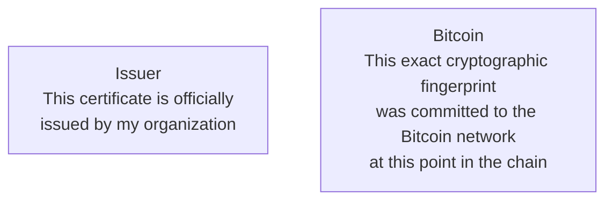

The issuer establishes the **institutional claim**.

Bitcoin provides the **independent integrity/timestamp proof**.

*Certificate lifecycle: from issuance to verification*

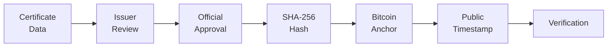

---

# 2. Why the issuer is still necessary

A blockchain does not magically create the truth contained in a document.

Consider:

```text
{
  "name": "Amadou Diop",
  "certificateType": "birth",
  "dateOfBirth": "2001-04-17"
}
```

A SHA-256 function can transform this data into a fingerprint:

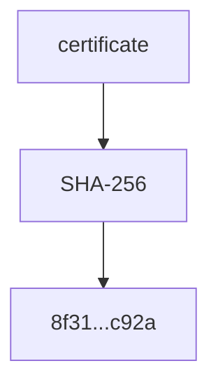

But SHA-256 cannot tell us whether `2001-04-17` is actually Amadou's date of birth.

That requires a trusted authority.

For DioteKo:

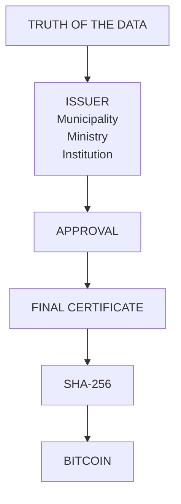

Therefore, **removing the issuer would actually weaken the conceptual model**.

The issuer should remain the entity responsible for the official issuance decision.

---

# 3. What happens if the issuer can modify the certificate?

This is where the lifecycle must be carefully designed.

The issuer may review and correct a certificate **before finalization**.

However, after finalization, the exact document that was approved becomes immutable **from DioteKo's business perspective**.

Recommended lifecycle:

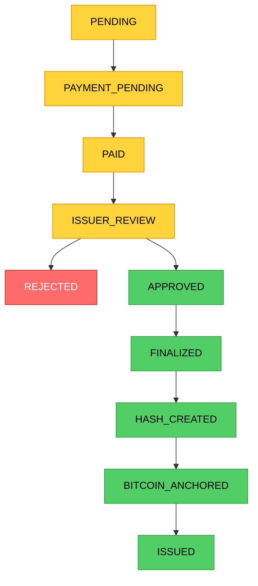

After `FINALIZED`:

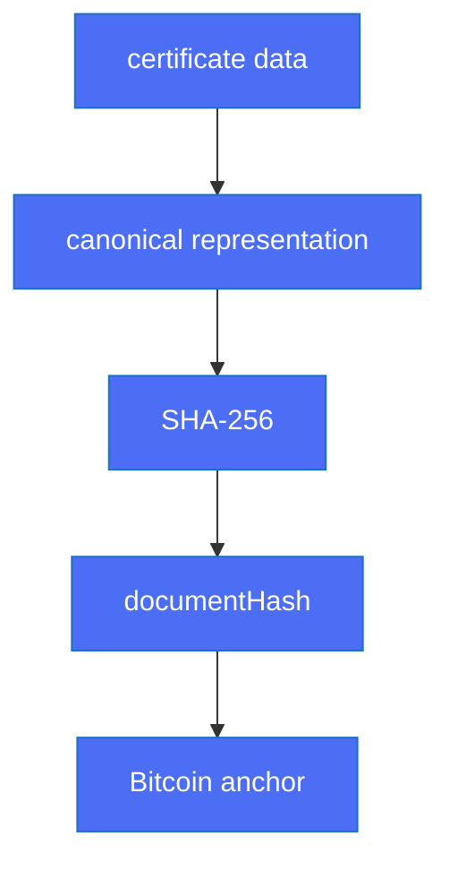

The finalized content should no longer be edited in place.

*Certificate status transitions*

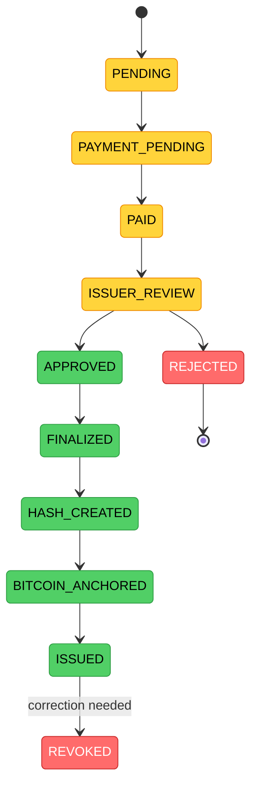

---

# 4. What if there is a mistake?

Do **not** modify the old issued certificate.

Instead, create a new version.

Example:

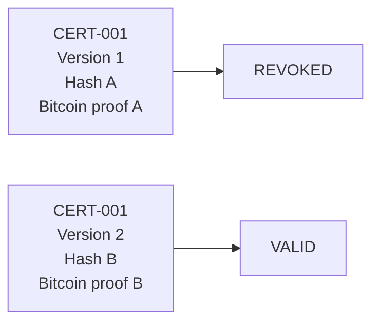

This creates an auditable history.

The important statement becomes:

> **A certificate can be corrected, but a previously issued version is not silently rewritten.**

That is a much stronger model than pretending errors never happen.

## 4.1 Revocation as a chained event

The certificate content never changes, but its **status** does. Revocation must therefore not be a simple `status = REVOKED` update in PostgreSQL: Bitcoin cannot know about a revocation that was never recorded.

Instead, every change of status is a **new event appended to the certificate's history**. Each event contains the hash of the previous one (`previousHash`), exactly like a Bitcoin block points to the previous block. The first event has `previousHash = null`.

*Certificate history as a chain of events*

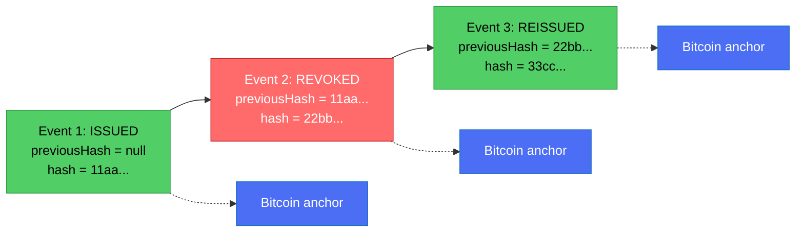

- Each event is signed by the issuer and its hash is anchored on Bitcoin (several events can be grouped in one anchor with a Merkle tree).
- A chain alone can be rewritten by whoever controls the database; the Bitcoin anchor is what freezes the history at a given moment.
- **Expiration needs no event**: `validUntil` is part of the `ISSUED` event, and the verifier compares it with the current time.
- Detailed design, attack analysis and rollout phases: [`CERTIFICATE_EVENT_CHAIN.md`](./CERTIFICATE_EVENT_CHAIN.md) (written in French).

---

# 5. The exact role of hashing

A cryptographic hash is a **fingerprint**, not encryption.

For a simplified example:

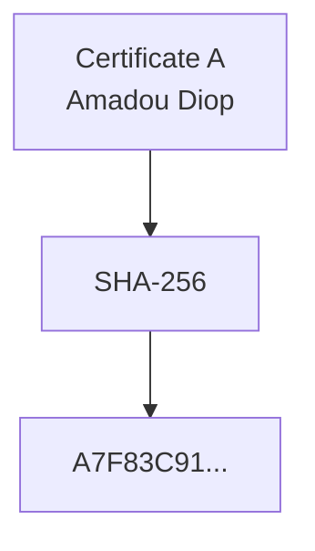

If one character changes:

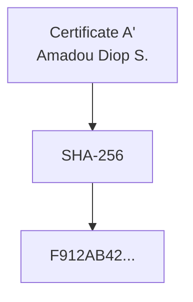

The resulting hash changes.

Therefore verification can compare:

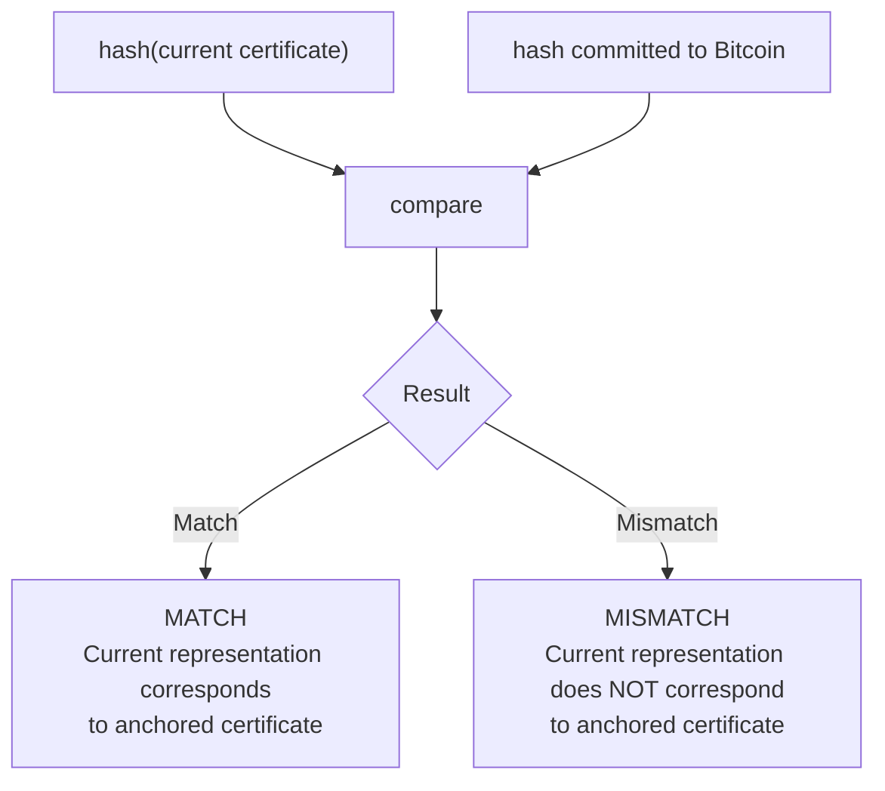

*Hash verification: detecting modifications*

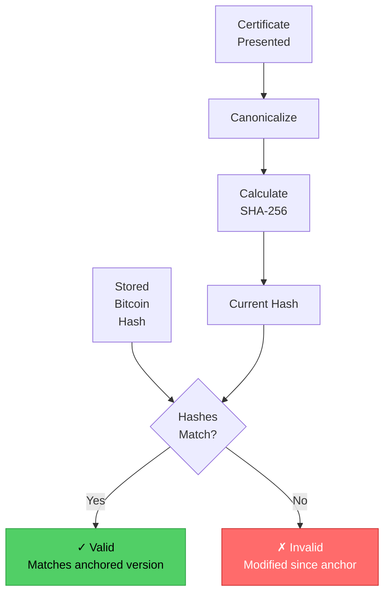

---

# 6. The important analogy with Bitcoin itself

This is the part that is easy to misunderstand.

At first glance, DioteKo and Bitcoin seem to use hashing in completely different ways.

But there is a useful parallel.

## 6.1 DioteKo

DioteKo starts with something meaningful:

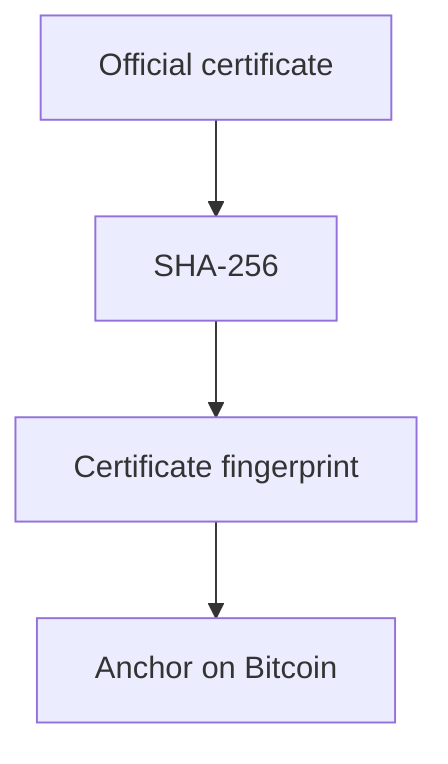

The certificate already exists because an issuer created and approved it.

The blockchain is used to **commit to that exact state**.

---

## 6.2 Bitcoin

Bitcoin works in the opposite direction.

There is a decentralized network of transactions waiting to be included in blocks.

A miner constructs a candidate block and performs Proof of Work.

Simplified:

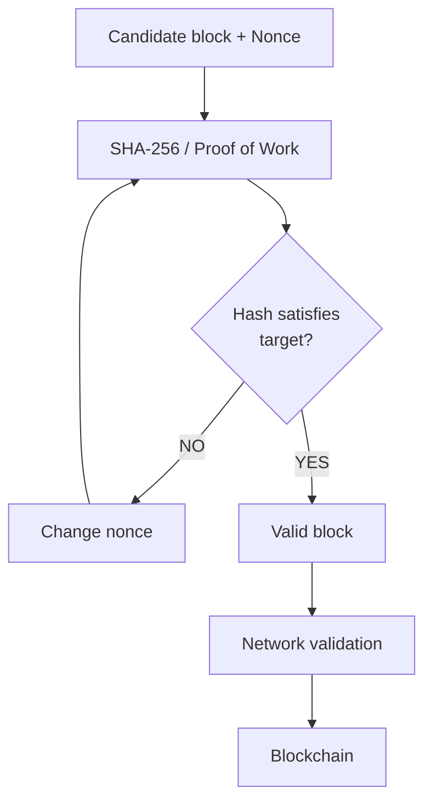

Bitcoin miners repeatedly try different values until they find a valid Proof-of-Work solution. The network can verify the result much more cheaply than the work required to discover it. Bitcoin's documentation describes this asymmetry: finding the proof requires enormous numbers of calculations, while nodes can verify a proposed block against the consensus rules.

---

# 7. The key parallel

This is the analogy to remember:

> **In both systems, hashing creates something that is cheap to verify but expensive or impossible to fake without changing the underlying input.**

But there is an important difference.

### DioteKo

The difficult/important part is not mining.

The important event is:

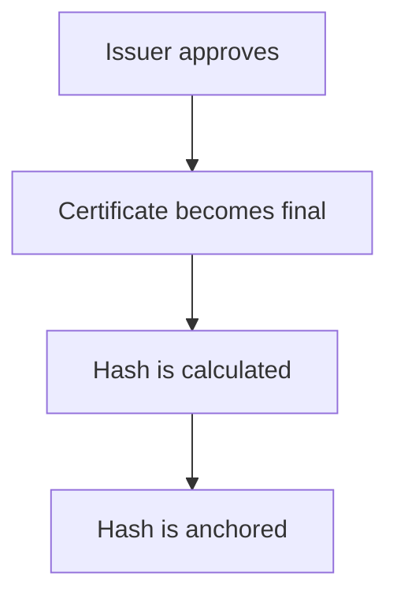

The hash answers:

> "Does this certificate correspond to the exact version that was committed?"

### Bitcoin

Bitcoin's Proof of Work adds a second property:

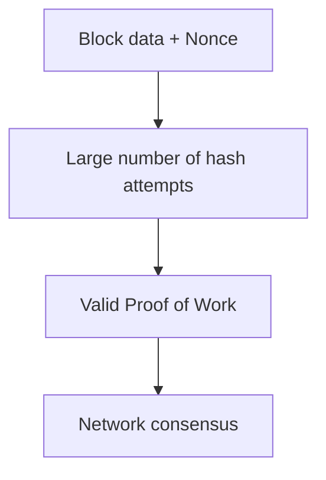

The Proof of Work answers a different question:

> "Has sufficient computational work been demonstrated for this block, according to Bitcoin's consensus rules?"

Bitcoin's chain also links blocks through previous-block information, so changing an older block requires redoing the subsequent Proof-of-Work.

---

# 8. Why Bitcoin does not need an "issuer"

This is probably the most important conceptual distinction.

For a certificate:

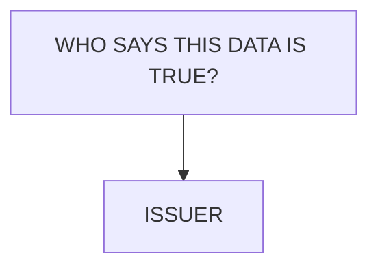

For Bitcoin:

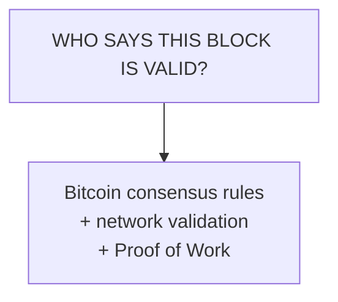

There is no municipal authority saying:

> "I approve this Bitcoin block."

Instead, nodes independently validate blocks against the protocol rules.

Bitcoin Core documentation explicitly describes this property: a node can validate blocks without trusting the miner who produced them.

That is why Bitcoin is fundamentally different from DioteKo.

*Why issuer is needed for DioteKo but not for Bitcoin*

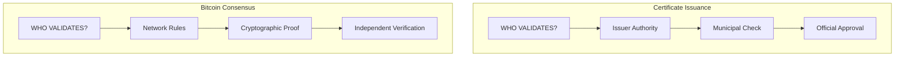

---

# 9. Bitcoin's "first point of contact"

There is another subtle point.

For DioteKo, there must indeed be a **first trusted point**:

```mermaid
flowchart TD
    A["Civil information"]
    B["Issuer"]
    C["Official certificate"]

    A --> B --> C
```

Bitcoin does not solve the problem of determining whether the original information is true.

It solves another problem:

> Once the information has been committed to the network, can we later prove that a particular version existed and detect whether it has changed?

This is why blockchain should be considered a **trust-minimization layer**, not a magical truth generator.

---

# 10. A useful real-world analogy

Imagine a notary.

### Without blockchain

A municipality gives you:

```text
Certificate #123
```

Later, someone has a copy.

You ask the municipality:

> "Is this the original?"

You are trusting the municipality's current database and response.

### With DioteKo + Bitcoin

At issuance:

```mermaid
flowchart TD
    A["Official certificate"]
    B["SHA-256 fingerprint"]
    C["Bitcoin commitment"]

    A --> B --> C
```

Later:

```mermaid
flowchart TD
    A["Someone presents certificate"]
    B["DioteKo calculates its hash"]
    C["DioteKo retrieves/checks the anchor"]
    D["Compare hashes"]

    A --> B --> C --> D
```

The blockchain does not tell you:

> "This person's birth certificate is true."

It tells you:

> **"This exact fingerprint was committed to a public blockchain history."**

The issuer still establishes the official meaning of the document.

---

# 11. Bitcoin itself as a giant public timestamping system

One way to explain the architecture to a jury:

> **DioteKo uses Bitcoin as a public, independently verifiable timestamping and integrity layer for officially issued certificates.**

The certificate does not need to be stored directly on Bitcoin.

Instead:

```mermaid
flowchart TD
    A["FULL CERTIFICATE"]
    B["SHA-256"]
    C["CERTIFICATE HASH"]
    D["anchor"]
    E["BITCOIN"]
    F["PUBLIC PROOF"]

    A --> B --> C --> D --> E --> F
```

This is preferable to publishing personal information directly on a public blockchain.

The blockchain should receive the minimum necessary information.

*Certificate flow: from issuance to Bitcoin commitment*

```mermaid
flowchart LR
    A["Finalized<br/>Certificate"] --> B["SHA-256"]
    B --> C["Cryptographic<br/>Hash"]
    C --> D["Bitcoin<br/>Anchor"]
    D --> E["Block Height<br/>+ TXID"]
    E --> F["Public<br/>Timestamp"]
```

---

# 12. Target DioteKo architecture

```mermaid
flowchart TD
    A[Citizen Mobile App] --> B[Google / Appwrite]
    A --> C[NestJS API]

    C --> D[PostgreSQL]

    C --> E[Certificate Request]
    E --> F[Payment]

    F --> G[Bitnob]
    G --> H[Lightning / Bitcoin Payment]

    E --> I[Issuer Review]

    I --> J{Approved?}
    J -->|No| K[Rejected]
    J -->|Yes| L[Finalize Certificate]

    L --> M[Canonical Certificate Representation]
    M --> N[SHA-256]
    N --> O[Document Hash]

    O --> P[Bitcoin Anchor]
    P --> Q[Bitcoin Blockchain]

    Q --> R[TXID / Anchor Proof]

    L --> S[PDF + QR Code]
    S --> T[Verification API]

    T --> N
    T --> Q
```

---

# 13. Complete certificate flow

```mermaid
sequenceDiagram
    actor C as Citizen
    participant M as Mobile App
    participant N as NestJS
    participant B as Bitnob
    participant DB as PostgreSQL
    actor I as Issuer
    participant BTC as Bitcoin

    C->>M: Request certificate
    M->>N: Create certificate request
    N->>DB: Save PENDING request

    M->>N: Request payment
    N->>B: Create payment / invoice
    B-->>N: Payment reference
    N->>DB: Save payment

    C->>B: Pay
    B-->>N: Payment confirmed
    N->>DB: Mark payment PAID

    I->>N: Review certificate
    I->>N: Approve

    N->>DB: Finalize certificate
    N->>N: Canonicalize certificate
    N->>N: SHA-256(certificate)
    N->>BTC: Anchor document hash
    BTC-->>N: Transaction / anchor proof

    N->>DB: Save hash + anchor proof
    N-->>M: Certificate + QR

    C->>M: Present QR
    M->>N: Verify certificate
    N->>N: Recalculate hash
    N->>BTC: Verify anchor
    BTC-->>N: Anchor confirmed
    N-->>M: Verification result
```

---

# 14. What Bitnob does

Bitnob should not be confused with the blockchain itself.

For DioteKo:

```mermaid
flowchart TD
    A["BITNOB"]
    B["Payments<br/>Lightning"]
    C["Bitcoin rails<br/>/ wallet APIs"]

    A --> B
    A --> C
```

Its main role in the hackathon architecture is the **financial rail**.

The DioteKo project integrates Bitnob for payouts/withdrawals and as the certificate pay-in rail (Lightning invoices).

The important implementation target is:

```mermaid
flowchart TD
    A["Citizen"]
    B["Certificate request"]
    C["Bitnob payment"]
    D["Payment confirmed"]
    E["Issuer review"]
    F["Certificate finalized"]
    G["Bitcoin anchor"]

    A --> B --> C --> D --> E --> F --> G
```

*Payment flow: Bitnob enables certificate issuance*

```mermaid
flowchart TD
    A["Citizen Initiates<br/>Request"] --> B["Certificate<br/>Created"]
    B --> C["Payment Invoice<br/>from Bitnob"]
    C --> D["Lightning Network<br/>Payment"]
    D --> E["Payment<br/>Confirmed"]
    E --> F["Issuer Reviews<br/>Certificate"]
    F --> G{Approved?}
    G -->|Yes| H["Finalize &<br/>Calculate Hash"]
    G -->|No| I["Reject"]
    H --> J["Anchor to<br/>Bitcoin"]

    classDef success fill:#51cf66,stroke:#2f9e44,color:#000
    classDef error fill:#ff6b6b,stroke:#c92a2a,color:#fff
    classDef process fill:#4c6ef5,stroke:#1971c2,color:#fff

    class H,J,E success
    class I error
    class D,F process
```

---

# 15. What should change

For the hackathon target architecture:

### Change

| Component | Reason |
|---|---|
| Simulated random Bitcoin TXID | Must use real Bitcoin anchor |

### Keep

| Component | Purpose |
|---|---|
| Expo / React Native | Mobile client |
| Google / Appwrite | Identity & authentication |
| NestJS | Modern API backend |
| PostgreSQL | Data persistence |
| DID / VC | Digital identity (if useful) |
| Issuer workflow | Certificate approval |
| Bitnob | Bitcoin/Lightning payments |
| Bitcoin | Blockchain anchor |
| QR verification | Certificate proof |

The Bitcoin anchor is currently simulated; it must be replaced by a real anchor in the final hackathon architecture.

---

# 16. What should be stored in PostgreSQL?

A simplified certificate model could contain:

```mermaid
classDiagram
    class Certificates {
        +UUID id
        +UUID request_id
        +UUID holder_user_id
        +UUID issuer_organization_id
        +String certificate_type
        +Integer version
        +String status
        +Text canonical_payload
        +String document_hash
        +String hash_algorithm
        +String anchor_network
        +String anchor_tx_id
        +String anchor_status
        +Timestamp issued_at
        +Timestamp revoked_at
        +Timestamp created_at
    }
```

The key fields are:

| Field | Purpose |
|---|---|
| `document_hash` | SHA-256 fingerprint of the finalized certificate |
| `hash_algorithm` | Algorithm used (SHA-256) |
| `anchor_network` | Blockchain network (BITCOIN) |
| `anchor_tx_id` | Transaction ID on the blockchain |
| `anchor_status` | Confirmation status (CONFIRMED, PENDING) |

Example:

```json
{
  "documentHash": "a7f83c91...",
  "hashAlgorithm": "SHA-256",
  "anchorNetwork": "BITCOIN",
  "anchorTxId": "abc123...",
  "anchorStatus": "CONFIRMED"
}
```

*Certificate schema: key fields for integrity and anchoring*

```mermaid
erDiagram
    USERS ||--o{ CERTIFICATES : "holds"
    ORGANIZATIONS ||--o{ CERTIFICATES : "issues"

    CERTIFICATES {
        string id PK
        string request_id
        string holder_user_id FK
        string issuer_organization_id FK
        string certificate_type
        int version
        string status
        text canonical_payload
        string document_hash "SHA-256"
        string hash_algorithm "SHA-256"
        string anchor_network "BITCOIN"
        string anchor_tx_id "transaction ID"
        string anchor_status "CONFIRMED"
        timestamp issued_at
        timestamp revoked_at
        timestamp created_at
    }
```

---

# 17. Verification

The verifier should never blindly trust the PDF.

Instead:

```mermaid
flowchart TD
    A["QR"]
    B["certificateId"]
    C["DioteKo API"]
    D["retrieve certificate"]
    E["canonicalize"]
    F["SHA-256"]
    G["compare with stored documentHash"]
    H["check Bitcoin anchor"]
    I["return result"]

    A --> B --> C --> D --> E --> F --> G --> H --> I
```

Possible result:

```json
{
  "valid": true,
  "certificateId": "CERT-001",
  "status": "ISSUED",
  "issuer": "Municipality",
  "documentHash": "a7f83c91...",
  "anchor": {
    "network": "bitcoin",
    "txId": "abc123...",
    "status": "confirmed"
  }
}
```

Or:

```json
{
  "valid": false,
  "reason": "DOCUMENT_HASH_MISMATCH"
}
```

*Verification workflow: from QR scan to integrity check*

```mermaid
flowchart TD
    A["Scan QR Code"] --> B["Extract<br/>Certificate ID"]
    B --> C["Query DioteKo API"]
    C --> D["Retrieve Certificate<br/>from PostgreSQL"]
    D --> E["Canonicalize<br/>Data"]
    E --> F["Calculate SHA-256<br/>Hash"]
    F --> G{Hashes<br/>Match?}
    G -->|No| H["✗ INVALID<br/>Modification Detected"]
    G -->|Yes| I["Check Bitcoin<br/>Anchor"]
    I --> J{Anchor<br/>Valid?}
    J -->|No| K["✗ INVALID<br/>Anchor Not Found"]
    J -->|Yes| L["✓ VALID<br/>Certificate Verified"]

    classDef success fill:#51cf66,stroke:#2f9e44,color:#000
    classDef error fill:#ff6b6b,stroke:#c92a2a,color:#fff

    class L success
    class H,K error
```

---

# 18. The strongest security property

The most important property is not:

> "Nobody can ever modify the database."

That would be an unrealistic claim.

The stronger and more precise property is:

> **If someone modifies the certificate after it was finalized, the cryptographic fingerprint changes, allowing the verifier to detect that the presented document no longer corresponds to the anchored version.**

This is what makes the blockchain component meaningful.

---

# 19. What Bitcoin adds compared with a normal database

Without Bitcoin:

```mermaid
flowchart TD
    A["Certificate"]
    B["SHA-256"]
    C["PostgreSQL"]

    A --> B --> C
```

The verifier is still relying heavily on the organization controlling PostgreSQL.

With an external public blockchain anchor:

```mermaid
flowchart TD
    A["Certificate"]
    B["SHA-256"]
    C["Bitcoin"]

    A --> B --> C
```

The proof is no longer dependent exclusively on DioteKo's own database.

DioteKo can say:

> "Here is the hash we calculated."

Bitcoin provides an independent public history against which that commitment can be checked.

That is the real reason to use a blockchain here.

---

# 20. The deeper parallel with Bitcoin Proof of Work

There are actually **three different uses of hashing** that should not be confused.

| Mechanism | Input | Hash purpose | Who verifies? |
|---|---|---|---|
| Certificate hash | Certificate | Fingerprint/integrity | DioteKo/verifier |
| Bitcoin transaction/block hashing | Transactions + block data | Cryptographic structure | Bitcoin nodes |
| Bitcoin Proof of Work | Block header + nonce | Demonstrate computational work | Bitcoin nodes |

The certificate hash is **not Proof of Work**.

You do not need to make the issuer solve billions of hashes.

You simply need a deterministic fingerprint.

Bitcoin's Proof of Work is a consensus mechanism: miners search for a nonce satisfying the network's target, and nodes verify the resulting proof and the block's validity.

---

# 21. An even better analogy

Think of DioteKo as a **notary**, and Bitcoin as the **public timestamped archive**.

### DioteKo says:

> "I, the authorized issuer, certify that this document is official."

### Hash says:

> "This exact document has fingerprint X."

### Bitcoin says:

> "Fingerprint X was committed into this public chain."

### Verification says:

> "The document presented today produces the same fingerprint X."

Together:

```mermaid
flowchart TD
    A["AUTHORITY"]
    B["ISSUER"]
    C["OFFICIAL DATA"]
    D["HASH"]
    E["BITCOIN"]
    F["PUBLIC EVIDENCE"]
    G["VERIFICATION"]

    A --> B --> C --> D --> E --> F --> G
```

---

# 22. What Bitcoin does NOT prove

This section should be kept in the technical documentation because it prevents overclaiming.

Bitcoin does **not** prove:

- that the issuer entered truthful information;
- that the citizen really has the claimed identity;
- that the municipality performed a correct administrative check;
- that the certificate's underlying facts are true;
- that a particular human approved the document.

Bitcoin proves something narrower but extremely useful:

> **The anchored cryptographic commitment corresponds to a specific piece of data, and changing that data changes the fingerprint.**

The issuer remains responsible for the meaning and authority of the certificate.

*What Bitcoin proves vs. does not prove in certificate verification*

```mermaid
flowchart TD
    A["Bitcoin Commitment"] --> B{Question}

    B -->|Does prove| C["✓ Exact fingerprint<br/>committed to chain"]
    B -->|Does prove| D["✓ Point in time<br/>immutably recorded"]
    B -->|Does prove| E["✓ Detection of<br/>tampering"]

    B -->|Does NOT prove| F["✗ Data truthfulness"]
    B -->|Does NOT prove| G["✗ Citizen identity"]
    B -->|Does NOT prove| H["✗ Administrative<br/>correctness"]
    B -->|Does NOT prove| I["✗ Human approval<br/>of document"]

    J["Issuer Authority<br/>establishes these claims"]

    classDef proved fill:#51cf66,stroke:#2f9e44,color:#000
    classDef notproved fill:#ff6b6b,stroke:#c92a2a,color:#fff

    class C,D,E proved
    class F,G,H,I notproved
```

---

# 23. Recommended final mental model

Remember this four-layer model:

```mermaid
flowchart TD
    A["1. IDENTITY<br/>Google / Appwrite<br/>Who is the user?"]
    B["2. AUTHORITY<br/>Issuer<br/>Is this certificate officially issued?"]
    C["3. FINANCE<br/>Bitnob / Lightning<br/>Was the certificate paid for?"]
    D["4. INTEGRITY / TIMESTAMP<br/>Bitcoin<br/>Does this exact version match the anchor?"]

    A --> B --> C --> D

    classDef identity fill:#4c6ef5,stroke:#1971c2,color:#fff
    classDef authority fill:#9c36b5,stroke:#6f00b6,color:#fff
    classDef finance fill:#ff922b,stroke:#d9480f,color:#fff
    classDef integrity fill:#51cf66,stroke:#2f9e44,color:#000

    class A identity
    class B authority
    class C finance
    class D integrity
```

This separation makes the architecture easy to explain.

---

# 24. One sentence for the hackathon jury

> **DioteKo uses Google/Appwrite for access, an authorized issuer for institutional trust, Bitnob for Bitcoin/Lightning payments, and Bitcoin as an independent cryptographic anchoring layer that lets anyone verify that a certificate has not been altered since its officially issued version was committed.**

---

# 25. The core principle

The entire architecture can ultimately be reduced to this:

```mermaid
flowchart TD
    A["Issuer creates<br/>TRUST"]
    B["Hash creates<br/>FINGERPRINT"]
    C["Bitcoin creates<br/>PUBLIC COMMITMENT"]
    D["Verifier checks<br/>INTEGRITY"]

    A --> B --> C --> D

    classDef trust fill:#9c36b5,stroke:#6f00b6,color:#fff
    classDef fingerprint fill:#4c6ef5,stroke:#1971c2,color:#fff
    classDef commitment fill:#ff922b,stroke:#d9480f,color:#fff
    classDef integrity fill:#51cf66,stroke:#2f9e44,color:#000

    class A trust
    class B fingerprint
    class C commitment
    class D integrity
```

And the Bitcoin analogy is:

```mermaid
flowchart TD
    A["Bitcoin transactions"]
    B["Blocks"]
    C["Hash + Proof of Work"]
    D["Network validation"]
    E["Public chronological chain"]

    A --> B --> C --> D --> E

    classDef process fill:#4c6ef5,stroke:#1971c2,color:#fff
    classDef validation fill:#51cf66,stroke:#2f9e44,color:#000

    class A,B,C process
    class D,E validation
```

The two systems use cryptography differently, but they share the same fundamental idea:

> **A cryptographic result is easy for everyone to verify, while changing the underlying committed information produces a different result.**

Bitcoin then adds the decentralized consensus and Proof-of-Work machinery that allows a network without a central issuer to agree on the history.

---

## 26. Final target architecture

```mermaid
flowchart TD
    DK["DIOTEKO"]
    AW["Appwrite<br/>Google Auth"]
    BN["Bitnob<br/>Lightning"]
    ISS["Issuer<br/>Institution"]
    API["NestJS API"]
    DB["PostgreSQL"]
    CERT["Certificate"]
    FIN["FINALIZE"]
    H256["SHA-256"]
    DOC_H["Document Hash"]
    BTC["BITCOIN"]
    ANC["Anchor / TX"]
    QR["QR Verification"]

    DK --> AW
    DK --> BN
    DK --> ISS
    AW --> API
    BN --> API
    ISS --> API
    API --> DB
    API --> CERT
    DB --> QR
    CERT --> FIN
    FIN --> H256
    H256 --> DOC_H
    DOC_H --> BTC
    BTC --> ANC
    ANC --> QR
```

**Architecture principle:** Bitcoin is not the issuer. Bitnob is not the issuer. The database is not the final proof. The issuer establishes the official claim; the cryptographic hash identifies the exact finalized version; Bitcoin provides the independent public anchor; and the verifier checks the whole chain.

*End-to-end DioteKo architecture: components and data flow*

```mermaid
flowchart TD
    subgraph Identity ["Layer 1: Identity"]
        Google["Google/Appwrite<br/>User Authentication"]
    end

    subgraph Authority ["Layer 2: Authority"]
        Issuer["Issuer Workflow<br/>Approve/Finalize"]
    end

    subgraph Finance ["Layer 3: Finance"]
        Bitnob["Bitnob/Lightning<br/>Payment Processing"]
    end

    subgraph Integrity ["Layer 4: Integrity"]
        Hash["SHA-256<br/>Fingerprinting"]
        Bitcoin["Bitcoin Network<br/>Timestamping"]
    end

    Google --> Issuer
    Issuer --> Bitnob
    Bitnob --> Hash
    Hash --> Bitcoin
    Bitcoin --> Verify["Verification &<br/>QR Code Check"]

    classDef identity fill:#4c6ef5,stroke:#1971c2,color:#fff
    classDef authority fill:#9c36b5,stroke:#6f00b6,color:#fff
    classDef finance fill:#ff922b,stroke:#d9480f,color:#fff
    classDef integrity fill:#51cf66,stroke:#2f9e44,color:#000
    classDef verify fill:#51cf66,stroke:#2f9e44,color:#000

    class Google identity
    class Issuer authority
    class Bitnob finance
    class Hash,Bitcoin integrity
    class Verify verify
```
