# DioteKo v2 — Architecture, Émetteur et modèle de preuve Bitcoin

> **Objectif du document**
>
> Ce document définit l'architecture cible de DioteKo pour le hackathon Code & Chain Dakar.
> Il porte sur trois questions :
>
> 1. Quel est le rôle de l'**émetteur** ?
> 2. Que prouve exactement **Bitcoin** ?
> 3. Comment **Bitnob, Bitcoin, le hachage et l'émetteur** se complètent-ils ?
>
> L'objectif n'est pas de mettre tout le certificat sur la blockchain. L'objectif est de mettre sur Bitcoin un **engagement cryptographique du certificat finalisé**.

---

## 1. L'idée centrale

DioteKo ne devrait pas présenter Bitcoin comme l'autorité qui décide si un certificat est vrai.

Bitcoin ne peut pas savoir si :

- une personne est réellement née à Dakar ;
- une municipalité a saisi la bonne date de naissance ;
- un émetteur a vérifié le registre d'état civil sous-jacent.

Cette responsabilité appartient à l'**émetteur**.

Bitcoin a un rôle différent :

> **Bitcoin fournit une preuve horodatée, vérifiable de manière indépendante, de la version exacte d'un certificat qui a été finalisée et officiellement émise.**

La distinction est fondamentale :

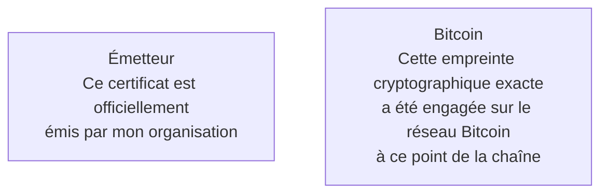

L'émetteur établit l'**affirmation institutionnelle**.

Bitcoin fournit la **preuve indépendante d'intégrité et d'horodatage**.

*Cycle de vie du certificat : de l'émission à la vérification*

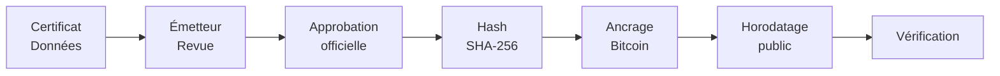

---

# 2. Pourquoi l'émetteur reste nécessaire

Une blockchain ne crée pas par magie la vérité contenue dans un document.

Considérons :

```text
{
  "name": "Amadou Diop",
  "certificateType": "birth",
  "dateOfBirth": "2001-04-17"
}
```

Une fonction SHA-256 peut transformer ces données en empreinte :

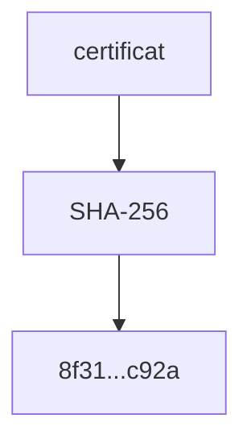

Mais SHA-256 ne peut pas nous dire si `2001-04-17` est réellement la date de naissance d'Amadou.

Cela requiert une autorité de confiance.

Pour DioteKo :

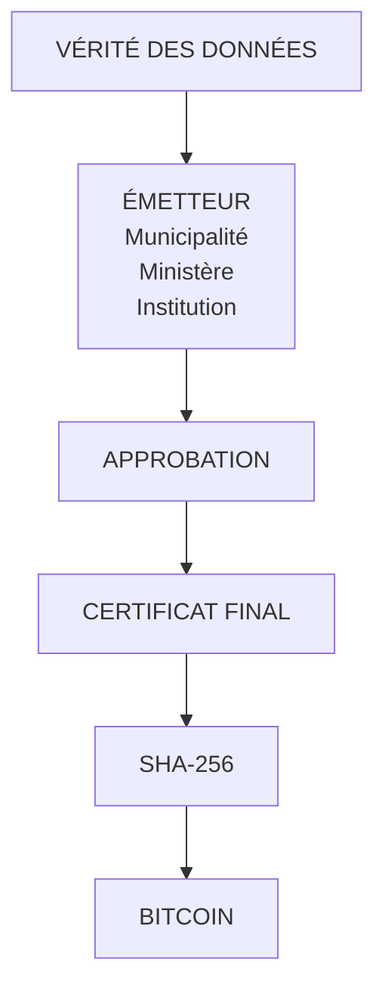

Par conséquent, **supprimer l'émetteur affaiblirait en réalité le modèle conceptuel**.

L'émetteur doit rester l'entité responsable de la décision officielle d'émission.

---

# 3. Que se passe-t-il si l'émetteur peut modifier le certificat ?

C'est ici que le cycle de vie doit être conçu avec soin.

L'émetteur peut examiner et corriger un certificat **avant la finalisation**.

Cependant, après la finalisation, le document exact qui a été approuvé devient immuable **du point de vue métier de DioteKo**.

Cycle de vie recommandé :

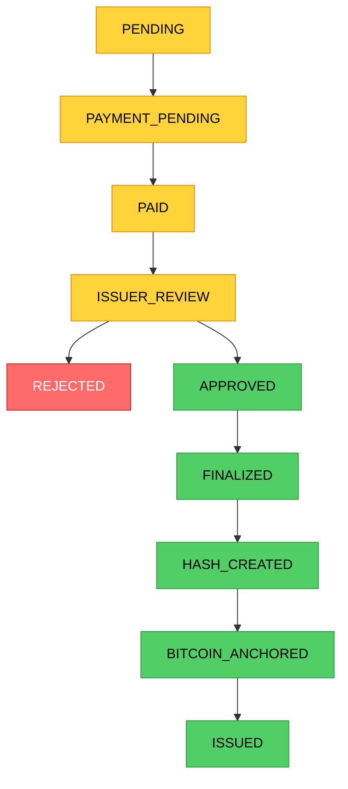

Après `FINALIZED` :

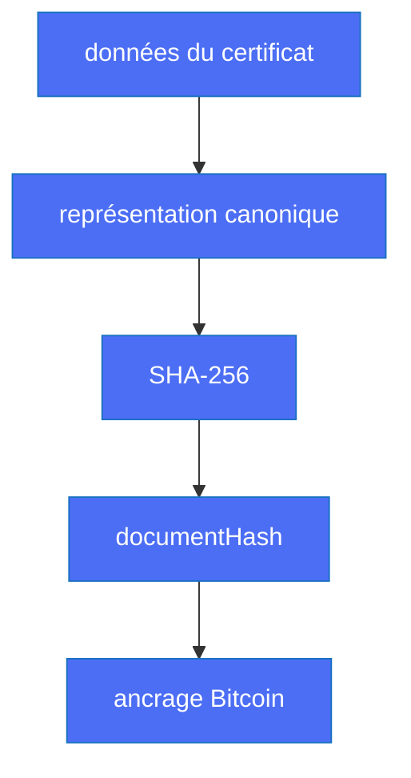

Le contenu finalisé ne devrait plus être modifié sur place.

*Transitions de statut du certificat*

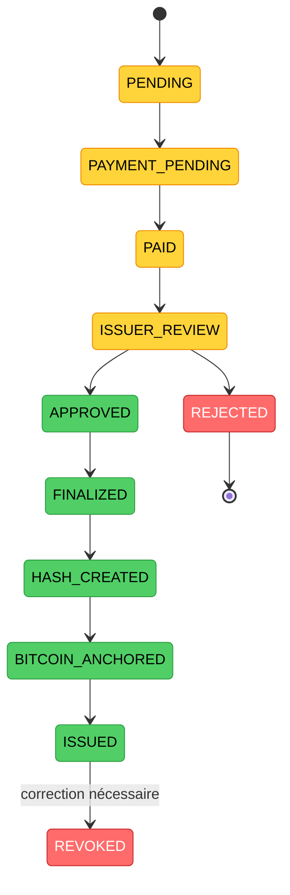

---

# 4. Et s'il y a une erreur ?

Ne **modifiez pas** l'ancien certificat émis.

Créez plutôt une nouvelle version.

Exemple :

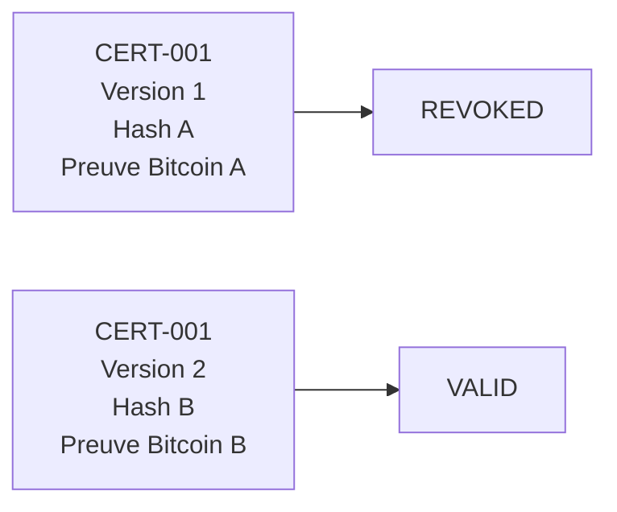

Cela crée un historique auditable.

L'énoncé important devient :

> **Un certificat peut être corrigé, mais une version précédemment émise n'est pas réécrite en silence.**

C'est un modèle bien plus solide que de prétendre que les erreurs n'arrivent jamais.

## 4.1 La révocation comme événement chaîné

Le contenu du certificat ne change jamais, mais son **statut** change. La révocation ne doit donc pas être un simple `status = REVOKED` dans PostgreSQL : Bitcoin ne peut pas connaître une révocation qui n'a jamais été enregistrée.

À la place, chaque changement de statut est un **nouvel événement ajouté à l'historique du certificat**. Chaque événement contient le hash du précédent (`previousHash`), exactement comme un bloc Bitcoin pointe vers le bloc précédent. Le premier événement a `previousHash = null`.

*Historique du certificat sous forme de chaîne d'événements*

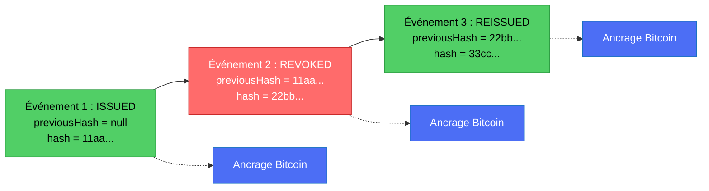

- Chaque événement est signé par l'émetteur et son hash est ancré sur Bitcoin (plusieurs événements peuvent être regroupés dans un seul ancrage grâce à un arbre de Merkle).
- Une chaîne seule peut être réécrite par celui qui contrôle la base de données ; c'est l'ancrage Bitcoin qui fige l'historique à un instant donné.
- **L'expiration n'a pas besoin d'événement** : `validUntil` fait partie de l'événement `ISSUED`, et le vérificateur le compare à l'heure actuelle.
- Conception détaillée, analyse des attaques et étapes de mise en œuvre : [`CERTIFICATE_EVENT_CHAIN.md`](./CERTIFICATE_EVENT_CHAIN.md).

---

# 5. Le rôle exact du hachage

Un hash cryptographique est une **empreinte**, pas un chiffrement.

Pour un exemple simplifié :

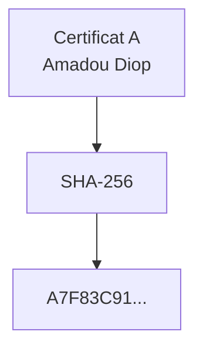

Si un seul caractère change :

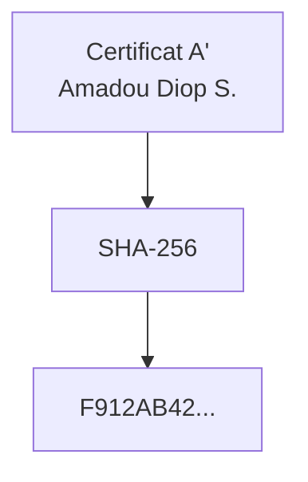

Le hash obtenu change.

La vérification peut donc comparer :

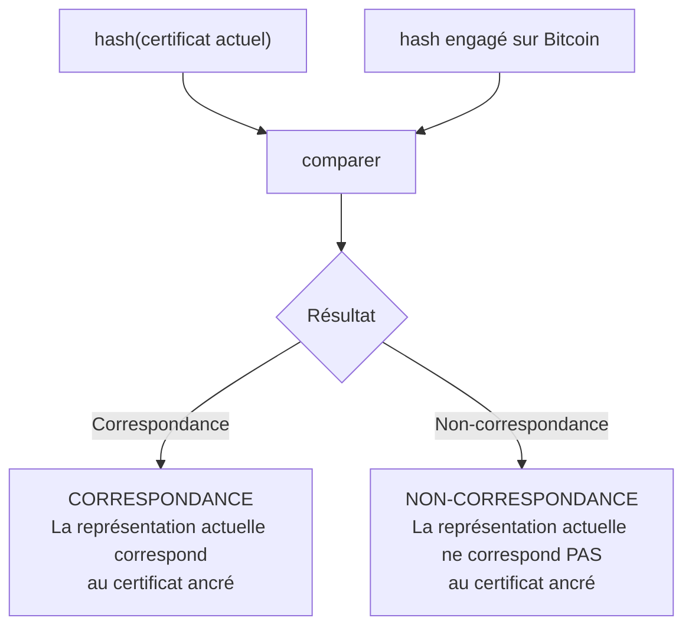

*Vérification du hash : détecter les modifications*

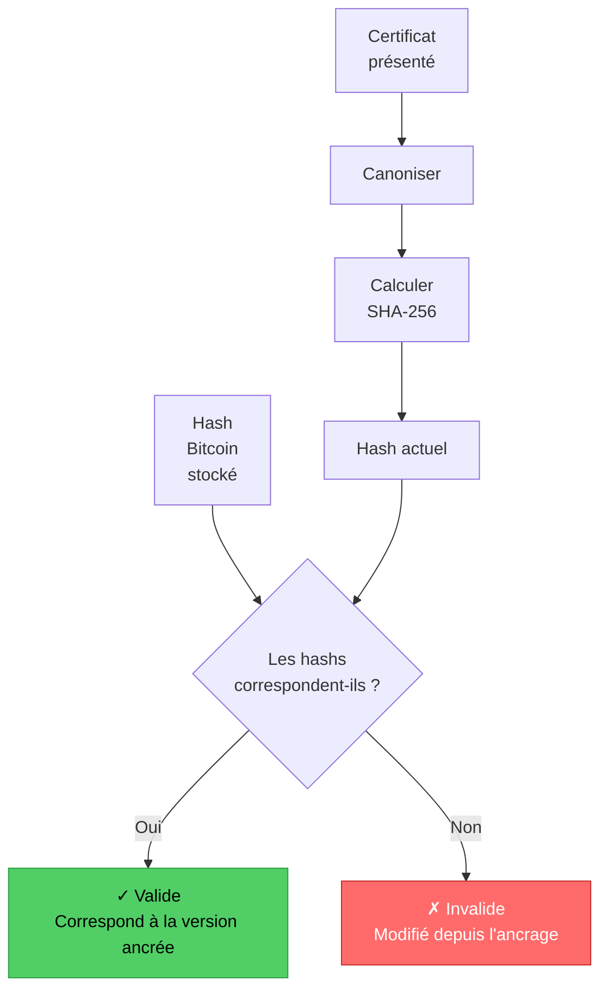

---

# 6. L'analogie importante avec Bitcoin lui-même

C'est la partie qui est facile à mal comprendre.

À première vue, DioteKo et Bitcoin semblent utiliser le hachage de manières complètement différentes.

Mais il existe un parallèle utile.

## 6.1 DioteKo

DioteKo part de quelque chose de significatif :

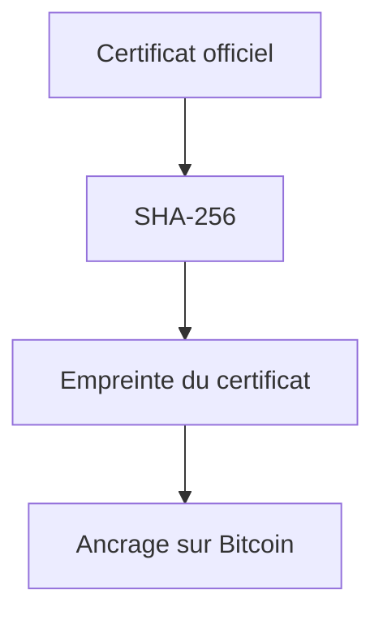

Le certificat existe déjà parce qu'un émetteur l'a créé et approuvé.

La blockchain sert à **s'engager sur cet état exact**.

---

## 6.2 Bitcoin

Bitcoin fonctionne dans le sens opposé.

Il existe un réseau décentralisé de transactions en attente d'être incluses dans des blocs.

Un mineur construit un bloc candidat et effectue la preuve de travail (Proof of Work).

En simplifié :

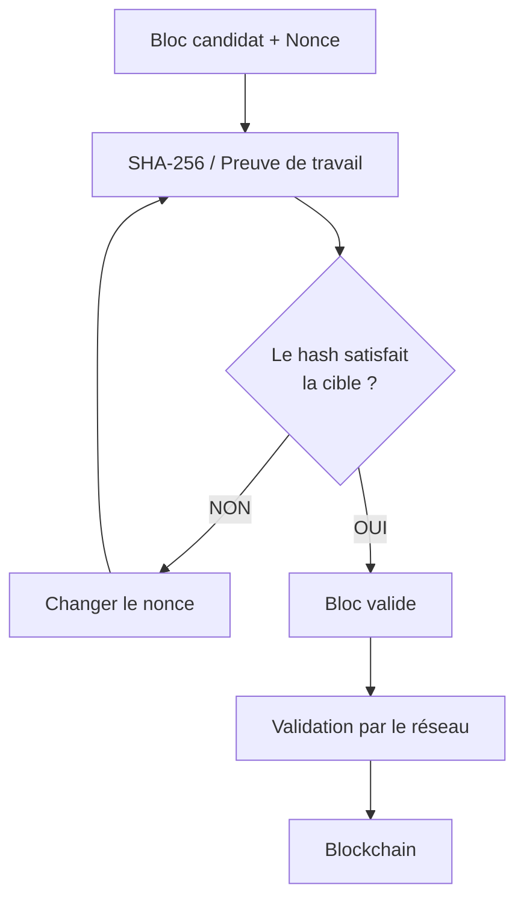

Les mineurs Bitcoin essaient de façon répétée différentes valeurs jusqu'à trouver une solution de preuve de travail valide. Le réseau peut vérifier le résultat bien plus économiquement que le travail nécessaire pour le découvrir. La documentation de Bitcoin décrit cette asymétrie : trouver la preuve exige un nombre énorme de calculs, tandis que les nœuds peuvent vérifier un bloc proposé selon les règles de consensus.

---

# 7. Le parallèle clé

Voici l'analogie à retenir :

> **Dans les deux systèmes, le hachage crée quelque chose qui est peu coûteux à vérifier mais coûteux, voire impossible, à falsifier sans modifier l'entrée sous-jacente.**

Mais il y a une différence importante.

### DioteKo

La partie difficile/importante n'est pas le minage.

L'événement important est :

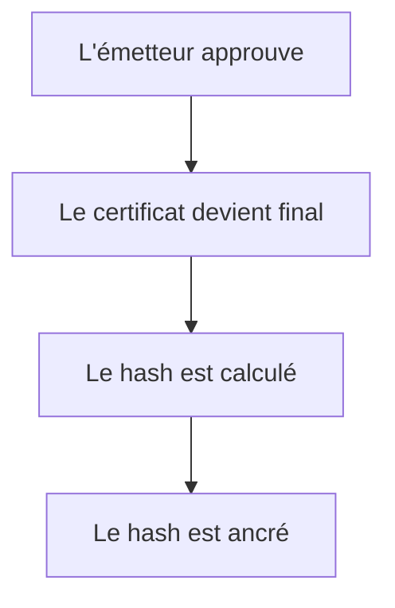

Le hash répond à :

> « Ce certificat correspond-il à la version exacte qui a été engagée ? »

### Bitcoin

La preuve de travail de Bitcoin ajoute une seconde propriété :

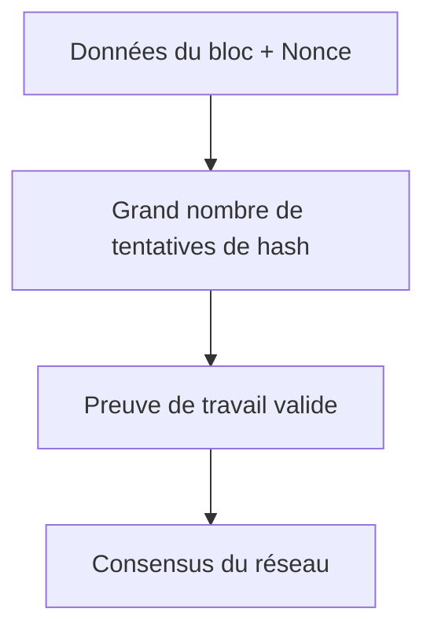

La preuve de travail répond à une question différente :

> « Un travail de calcul suffisant a-t-il été démontré pour ce bloc, selon les règles de consensus de Bitcoin ? »

La chaîne de Bitcoin relie aussi les blocs via l'information du bloc précédent, de sorte que modifier un bloc plus ancien exige de refaire la preuve de travail qui suit.

---

# 8. Pourquoi Bitcoin n'a pas besoin d'un « émetteur »

C'est probablement la distinction conceptuelle la plus importante.

Pour un certificat :

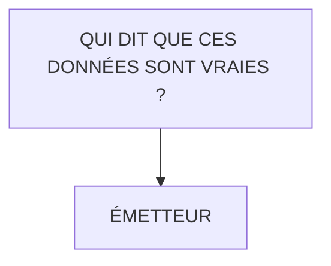

Pour Bitcoin :

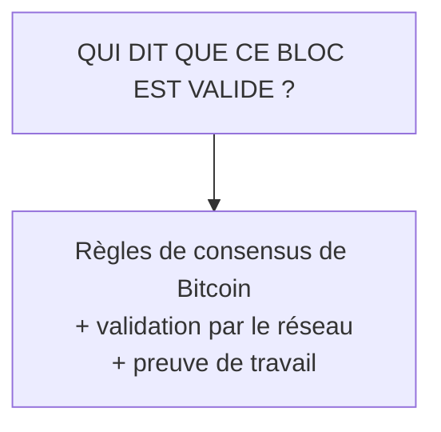

Il n'existe aucune autorité municipale qui dise :

> « J'approuve ce bloc Bitcoin. »

Au lieu de cela, les nœuds valident indépendamment les blocs selon les règles du protocole.

La documentation de Bitcoin Core décrit explicitement cette propriété : un nœud peut valider des blocs sans faire confiance au mineur qui les a produits.

C'est pourquoi Bitcoin est fondamentalement différent de DioteKo.

*Pourquoi l'émetteur est nécessaire pour DioteKo mais pas pour Bitcoin*

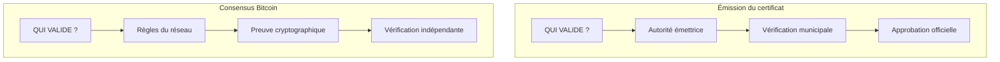

---

# 9. Le « premier point de contact » de Bitcoin

Il y a un autre point subtil.

Pour DioteKo, il doit en effet exister un **premier point de confiance** :

```mermaid
flowchart TD
    A["Informations d'état civil"]
    B["Émetteur"]
    C["Certificat officiel"]

    A --> B --> C
```

Bitcoin ne résout pas le problème de déterminer si l'information d'origine est vraie.

Il résout un autre problème :

> Une fois l'information engagée sur le réseau, pouvons-nous prouver plus tard qu'une version particulière existait et détecter si elle a changé ?

C'est pourquoi la blockchain doit être considérée comme une **couche de minimisation de la confiance**, et non comme un générateur magique de vérité.

---

# 10. Une analogie utile du monde réel

Imaginez un notaire.

### Sans blockchain

Une municipalité vous remet :

```text
Certificat #123
```

Plus tard, quelqu'un a une copie.

Vous demandez à la municipalité :

> « Est-ce l'original ? »

Vous faites confiance à la base de données actuelle de la municipalité et à sa réponse.

### Avec DioteKo + Bitcoin

À l'émission :

```mermaid
flowchart TD
    A["Certificat officiel"]
    B["Empreinte SHA-256"]
    C["Engagement Bitcoin"]

    A --> B --> C
```

Plus tard :

```mermaid
flowchart TD
    A["Quelqu'un présente un certificat"]
    B["DioteKo calcule son hash"]
    C["DioteKo récupère/vérifie l'ancrage"]
    D["Comparer les hashs"]

    A --> B --> C --> D
```

La blockchain ne vous dit pas :

> « Le certificat de naissance de cette personne est vrai. »

Elle vous dit :

> **« Cette empreinte exacte a été engagée dans l'historique d'une blockchain publique. »**

L'émetteur établit toujours le sens officiel du document.

---

# 11. Bitcoin lui-même comme un gigantesque système public d'horodatage

Une façon d'expliquer l'architecture à un jury :

> **DioteKo utilise Bitcoin comme couche publique, vérifiable de manière indépendante, d'horodatage et d'intégrité pour les certificats officiellement émis.**

Le certificat n'a pas besoin d'être stocké directement sur Bitcoin.

À la place :

```mermaid
flowchart TD
    A["CERTIFICAT COMPLET"]
    B["SHA-256"]
    C["HASH DU CERTIFICAT"]
    D["ancrage"]
    E["BITCOIN"]
    F["PREUVE PUBLIQUE"]

    A --> B --> C --> D --> E --> F
```

C'est préférable à la publication d'informations personnelles directement sur une blockchain publique.

La blockchain doit recevoir le minimum d'informations nécessaire.

*Flux du certificat : de l'émission à l'engagement Bitcoin*

```mermaid
flowchart LR
    A["Certificat<br/>finalisé"] --> B["SHA-256"]
    B --> C["Hash<br/>cryptographique"]
    C --> D["Ancrage<br/>Bitcoin"]
    D --> E["Hauteur de bloc<br/>+ TXID"]
    E --> F["Horodatage<br/>public"]
```

---

# 12. Architecture cible de DioteKo

```mermaid
flowchart TD
    A[Application mobile du citoyen] --> B[Google / Appwrite]
    A --> C[API NestJS]

    C --> D[PostgreSQL]

    C --> E[Demande de certificat]
    E --> F[Paiement]

    F --> G[Bitnob]
    G --> H[Paiement Lightning / Bitcoin]

    E --> I[Revue par l'émetteur]

    I --> J{Approuvé ?}
    J -->|Non| K[Rejeté]
    J -->|Oui| L[Finaliser le certificat]

    L --> M[Représentation canonique du certificat]
    M --> N[SHA-256]
    N --> O[Hash du document]

    O --> P[Ancrage Bitcoin]
    P --> Q[Blockchain Bitcoin]

    Q --> R[TXID / Preuve d'ancrage]

    L --> S[PDF + code QR]
    S --> T[API de vérification]

    T --> N
    T --> Q
```

---

# 13. Flux complet du certificat

```mermaid
sequenceDiagram
    actor C as Citoyen
    participant M as Application mobile
    participant N as NestJS
    participant B as Bitnob
    participant DB as PostgreSQL
    actor I as Émetteur
    participant BTC as Bitcoin

    C->>M: Demander un certificat
    M->>N: Créer la demande de certificat
    N->>DB: Enregistrer la demande PENDING

    M->>N: Demander le paiement
    N->>B: Créer le paiement / la facture
    B-->>N: Référence de paiement
    N->>DB: Enregistrer le paiement

    C->>B: Payer
    B-->>N: Paiement confirmé
    N->>DB: Marquer le paiement PAID

    I->>N: Examiner le certificat
    I->>N: Approuver

    N->>DB: Finaliser le certificat
    N->>N: Canoniser le certificat
    N->>N: SHA-256(certificat)
    N->>BTC: Ancrer le hash du document
    BTC-->>N: Transaction / preuve d'ancrage

    N->>DB: Enregistrer le hash + la preuve d'ancrage
    N-->>M: Certificat + QR

    C->>M: Présenter le QR
    M->>N: Vérifier le certificat
    N->>N: Recalculer le hash
    N->>BTC: Vérifier l'ancrage
    BTC-->>N: Ancrage confirmé
    N-->>M: Résultat de la vérification
```

---

# 14. Ce que fait Bitnob

Bitnob ne doit pas être confondu avec la blockchain elle-même.

Pour DioteKo :

```mermaid
flowchart TD
    A["BITNOB"]
    B["Paiements<br/>Lightning"]
    C["Rails Bitcoin<br/>/ API de portefeuille"]

    A --> B
    A --> C
```

Son rôle principal dans l'architecture du hackathon est le **rail financier**.

Le projet DioteKo intègre Bitnob pour les payouts/retraits et comme rail d'encaissement des certificats (factures Lightning).

L'objectif d'implémentation important est :

```mermaid
flowchart TD
    A["Citoyen"]
    B["Demande de certificat"]
    C["Paiement Bitnob"]
    D["Paiement confirmé"]
    E["Revue par l'émetteur"]
    F["Certificat finalisé"]
    G["Ancrage Bitcoin"]

    A --> B --> C --> D --> E --> F --> G
```

*Flux de paiement : Bitnob permet l'émission du certificat*

```mermaid
flowchart TD
    A["Le citoyen initie<br/>la demande"] --> B["Certificat<br/>créé"]
    B --> C["Facture de paiement<br/>de Bitnob"]
    C --> D["Paiement<br/>Lightning Network"]
    D --> E["Paiement<br/>confirmé"]
    E --> F["L'émetteur examine<br/>le certificat"]
    F --> G{Approuvé ?}
    G -->|Oui| H["Finaliser et<br/>calculer le hash"]
    G -->|Non| I["Rejeter"]
    H --> J["Ancrer sur<br/>Bitcoin"]

    classDef success fill:#51cf66,stroke:#2f9e44,color:#000
    classDef error fill:#ff6b6b,stroke:#c92a2a,color:#fff
    classDef process fill:#4c6ef5,stroke:#1971c2,color:#fff

    class H,J,E success
    class I error
    class D,F process
```

---

# 15. Ce qui doit changer

Pour l'architecture cible du hackathon :

### Changer

| Composant | Raison |
|---|---|
| TXID Bitcoin aléatoire simulé | Doit utiliser un véritable ancrage Bitcoin |

### Conserver

| Composant | Objectif |
|---|---|
| Expo / React Native | Client mobile |
| Google / Appwrite | Identité et authentification |
| NestJS | Backend d'API moderne |
| PostgreSQL | Persistance des données |
| DID / VC | Identité numérique (si utile) |
| Workflow de l'émetteur | Approbation des certificats |
| Bitnob | Paiements Bitcoin/Lightning |
| Bitcoin | Ancrage blockchain |
| Vérification par QR | Preuve du certificat |

L'ancrage Bitcoin est actuellement simulé ; il doit être remplacé par un véritable ancrage dans l'architecture finale du hackathon.

---

# 16. Que faut-il stocker dans PostgreSQL ?

Un modèle simplifié de certificat pourrait contenir :

```mermaid
classDiagram
    class Certificates {
        +UUID id
        +UUID request_id
        +UUID holder_user_id
        +UUID issuer_organization_id
        +String certificate_type
        +Integer version
        +String status
        +Text canonical_payload
        +String document_hash
        +String hash_algorithm
        +String anchor_network
        +String anchor_tx_id
        +String anchor_status
        +Timestamp issued_at
        +Timestamp revoked_at
        +Timestamp created_at
    }
```

Les champs clés sont :

| Champ | Objectif |
|---|---|
| `document_hash` | Empreinte SHA-256 du certificat finalisé |
| `hash_algorithm` | Algorithme utilisé (SHA-256) |
| `anchor_network` | Réseau blockchain (BITCOIN) |
| `anchor_tx_id` | Identifiant de transaction sur la blockchain |
| `anchor_status` | Statut de confirmation (CONFIRMED, PENDING) |

Exemple :

```json
{
  "documentHash": "a7f83c91...",
  "hashAlgorithm": "SHA-256",
  "anchorNetwork": "BITCOIN",
  "anchorTxId": "abc123...",
  "anchorStatus": "CONFIRMED"
}
```

*Schéma du certificat : champs clés pour l'intégrité et l'ancrage*

```mermaid
erDiagram
    USERS ||--o{ CERTIFICATES : "détient"
    ORGANIZATIONS ||--o{ CERTIFICATES : "émet"

    CERTIFICATES {
        string id PK
        string request_id
        string holder_user_id FK
        string issuer_organization_id FK
        string certificate_type
        int version
        string status
        text canonical_payload
        string document_hash "SHA-256"
        string hash_algorithm "SHA-256"
        string anchor_network "BITCOIN"
        string anchor_tx_id "identifiant de transaction"
        string anchor_status "CONFIRMED"
        timestamp issued_at
        timestamp revoked_at
        timestamp created_at
    }
```

---

# 17. Vérification

Le vérificateur ne doit jamais faire aveuglément confiance au PDF.

À la place :

```mermaid
flowchart TD
    A["QR"]
    B["certificateId"]
    C["API DioteKo"]
    D["récupérer le certificat"]
    E["canoniser"]
    F["SHA-256"]
    G["comparer avec le documentHash stocké"]
    H["vérifier l'ancrage Bitcoin"]
    I["renvoyer le résultat"]

    A --> B --> C --> D --> E --> F --> G --> H --> I
```

Résultat possible :

```json
{
  "valid": true,
  "certificateId": "CERT-001",
  "status": "ISSUED",
  "issuer": "Municipality",
  "documentHash": "a7f83c91...",
  "anchor": {
    "network": "bitcoin",
    "txId": "abc123...",
    "status": "confirmed"
  }
}
```

Ou :

```json
{
  "valid": false,
  "reason": "DOCUMENT_HASH_MISMATCH"
}
```

*Flux de vérification : du scan du QR au contrôle d'intégrité*

```mermaid
flowchart TD
    A["Scanner le code QR"] --> B["Extraire<br/>l'ID du certificat"]
    B --> C["Interroger l'API DioteKo"]
    C --> D["Récupérer le certificat<br/>depuis PostgreSQL"]
    D --> E["Canoniser<br/>les données"]
    E --> F["Calculer le hash<br/>SHA-256"]
    F --> G{Les hashs<br/>correspondent-ils ?}
    G -->|Non| H["✗ INVALIDE<br/>Modification détectée"]
    G -->|Oui| I["Vérifier l'ancrage<br/>Bitcoin"]
    I --> J{Ancrage<br/>valide ?}
    J -->|Non| K["✗ INVALIDE<br/>Ancrage introuvable"]
    J -->|Oui| L["✓ VALIDE<br/>Certificat vérifié"]

    classDef success fill:#51cf66,stroke:#2f9e44,color:#000
    classDef error fill:#ff6b6b,stroke:#c92a2a,color:#fff

    class L success
    class H,K error
```

---

# 18. La propriété de sécurité la plus forte

La propriété la plus importante n'est pas :

> « Personne ne peut jamais modifier la base de données. »

Ce serait une affirmation irréaliste.

La propriété plus forte et plus précise est :

> **Si quelqu'un modifie le certificat après sa finalisation, l'empreinte cryptographique change, ce qui permet au vérificateur de détecter que le document présenté ne correspond plus à la version ancrée.**

C'est ce qui donne un sens à la composante blockchain.

---

# 19. Ce que Bitcoin apporte par rapport à une base de données classique

Sans Bitcoin :

```mermaid
flowchart TD
    A["Certificat"]
    B["SHA-256"]
    C["PostgreSQL"]

    A --> B --> C
```

Le vérificateur dépend toujours fortement de l'organisation qui contrôle PostgreSQL.

Avec un ancrage public externe sur une blockchain :

```mermaid
flowchart TD
    A["Certificat"]
    B["SHA-256"]
    C["Bitcoin"]

    A --> B --> C
```

La preuve ne dépend plus exclusivement de la base de données propre de DioteKo.

DioteKo peut dire :

> « Voici le hash que nous avons calculé. »

Bitcoin fournit un historique public indépendant par rapport auquel cet engagement peut être vérifié.

C'est la vraie raison d'utiliser une blockchain ici.

---

# 20. Le parallèle plus profond avec la preuve de travail de Bitcoin

Il existe en réalité **trois usages différents du hachage** qu'il ne faut pas confondre.

| Mécanisme | Entrée | Rôle du hash | Qui vérifie ? |
|---|---|---|---|
| Hash du certificat | Certificat | Empreinte/intégrité | DioteKo/vérificateur |
| Hachage des transactions/blocs Bitcoin | Transactions + données du bloc | Structure cryptographique | Nœuds Bitcoin |
| Preuve de travail Bitcoin | En-tête de bloc + nonce | Démontrer un travail de calcul | Nœuds Bitcoin |

Le hash du certificat n'est **pas** une preuve de travail.

Vous n'avez pas besoin de faire résoudre des milliards de hashs à l'émetteur.

Il vous faut simplement une empreinte déterministe.

La preuve de travail de Bitcoin est un mécanisme de consensus : les mineurs cherchent un nonce satisfaisant la cible du réseau, et les nœuds vérifient la preuve obtenue ainsi que la validité du bloc.

---

# 21. Une analogie encore meilleure

Considérez DioteKo comme un **notaire**, et Bitcoin comme l'**archive publique horodatée**.

### DioteKo dit :

> « Moi, l'émetteur autorisé, je certifie que ce document est officiel. »

### Le hash dit :

> « Ce document exact a pour empreinte X. »

### Bitcoin dit :

> « L'empreinte X a été engagée dans cette chaîne publique. »

### La vérification dit :

> « Le document présenté aujourd'hui produit la même empreinte X. »

Ensemble :

```mermaid
flowchart TD
    A["AUTORITÉ"]
    B["ÉMETTEUR"]
    C["DONNÉES OFFICIELLES"]
    D["HASH"]
    E["BITCOIN"]
    F["PREUVE PUBLIQUE"]
    G["VÉRIFICATION"]

    A --> B --> C --> D --> E --> F --> G
```

---

# 22. Ce que Bitcoin ne prouve PAS

Cette section doit être conservée dans la documentation technique car elle évite de surestimer.

Bitcoin **ne** prouve **pas** :

- que l'émetteur a saisi des informations véridiques ;
- que le citoyen a réellement l'identité revendiquée ;
- que la municipalité a effectué un contrôle administratif correct ;
- que les faits sous-jacents du certificat sont vrais ;
- qu'un humain particulier a approuvé le document.

Bitcoin prouve quelque chose de plus étroit mais extrêmement utile :

> **L'engagement cryptographique ancré correspond à une donnée précise, et modifier cette donnée change l'empreinte.**

L'émetteur reste responsable du sens et de l'autorité du certificat.

*Ce que Bitcoin prouve et ne prouve pas dans la vérification d'un certificat*

```mermaid
flowchart TD
    A["Engagement Bitcoin"] --> B{Question}

    B -->|Prouve| C["✓ Empreinte exacte<br/>engagée sur la chaîne"]
    B -->|Prouve| D["✓ Point dans le temps<br/>enregistré de façon immuable"]
    B -->|Prouve| E["✓ Détection de<br/>falsification"]

    B -->|Ne prouve PAS| F["✗ Véracité des données"]
    B -->|Ne prouve PAS| G["✗ Identité du citoyen"]
    B -->|Ne prouve PAS| H["✗ Exactitude<br/>administrative"]
    B -->|Ne prouve PAS| I["✗ Approbation humaine<br/>du document"]

    J["L'autorité de l'émetteur<br/>établit ces affirmations"]

    classDef proved fill:#51cf66,stroke:#2f9e44,color:#000
    classDef notproved fill:#ff6b6b,stroke:#c92a2a,color:#fff

    class C,D,E proved
    class F,G,H,I notproved
```

---

# 23. Modèle mental final recommandé

Retenez ce modèle à quatre couches :

```mermaid
flowchart TD
    A["1. IDENTITÉ<br/>Google / Appwrite<br/>Qui est l'utilisateur ?"]
    B["2. AUTORITÉ<br/>Émetteur<br/>Ce certificat est-il officiellement émis ?"]
    C["3. FINANCE<br/>Bitnob / Lightning<br/>Le certificat a-t-il été payé ?"]
    D["4. INTÉGRITÉ / HORODATAGE<br/>Bitcoin<br/>Cette version exacte correspond-elle à l'ancrage ?"]

    A --> B --> C --> D

    classDef identity fill:#4c6ef5,stroke:#1971c2,color:#fff
    classDef authority fill:#9c36b5,stroke:#6f00b6,color:#fff
    classDef finance fill:#ff922b,stroke:#d9480f,color:#fff
    classDef integrity fill:#51cf66,stroke:#2f9e44,color:#000

    class A identity
    class B authority
    class C finance
    class D integrity
```

Cette séparation rend l'architecture facile à expliquer.

---

# 24. Une phrase pour le jury du hackathon

> **DioteKo utilise Google/Appwrite pour l'accès, un émetteur autorisé pour la confiance institutionnelle, Bitnob pour les paiements Bitcoin/Lightning, et Bitcoin comme couche d'ancrage cryptographique indépendante qui permet à quiconque de vérifier qu'un certificat n'a pas été altéré depuis l'engagement de sa version officiellement émise.**

---

# 25. Le principe central

Toute l'architecture peut finalement se réduire à ceci :

```mermaid
flowchart TD
    A["L'émetteur crée la<br/>CONFIANCE"]
    B["Le hash crée<br/>l'EMPREINTE"]
    C["Bitcoin crée<br/>l'ENGAGEMENT PUBLIC"]
    D["Le vérificateur contrôle<br/>l'INTÉGRITÉ"]

    A --> B --> C --> D

    classDef trust fill:#9c36b5,stroke:#6f00b6,color:#fff
    classDef fingerprint fill:#4c6ef5,stroke:#1971c2,color:#fff
    classDef commitment fill:#ff922b,stroke:#d9480f,color:#fff
    classDef integrity fill:#51cf66,stroke:#2f9e44,color:#000

    class A trust
    class B fingerprint
    class C commitment
    class D integrity
```

Et l'analogie avec Bitcoin est :

```mermaid
flowchart TD
    A["Transactions Bitcoin"]
    B["Blocs"]
    C["Hash + preuve de travail"]
    D["Validation par le réseau"]
    E["Chaîne chronologique publique"]

    A --> B --> C --> D --> E

    classDef process fill:#4c6ef5,stroke:#1971c2,color:#fff
    classDef validation fill:#51cf66,stroke:#2f9e44,color:#000

    class A,B,C process
    class D,E validation
```

Les deux systèmes utilisent la cryptographie différemment, mais ils partagent la même idée fondamentale :

> **Un résultat cryptographique est facile à vérifier pour tout le monde, tandis que modifier l'information engagée sous-jacente produit un résultat différent.**

Bitcoin ajoute ensuite le consensus décentralisé et le mécanisme de preuve de travail qui permettent à un réseau sans émetteur central de s'accorder sur l'historique.

---

## 26. Architecture cible finale

```mermaid
flowchart TD
    DK["DIOTEKO"]
    AW["Appwrite<br/>Authentification Google"]
    BN["Bitnob<br/>Lightning"]
    ISS["Émetteur<br/>Institution"]
    API["API NestJS"]
    DB["PostgreSQL"]
    CERT["Certificat"]
    FIN["FINALISER"]
    H256["SHA-256"]
    DOC_H["Hash du document"]
    BTC["BITCOIN"]
    ANC["Ancrage / TX"]
    QR["Vérification par QR"]

    DK --> AW
    DK --> BN
    DK --> ISS
    AW --> API
    BN --> API
    ISS --> API
    API --> DB
    API --> CERT
    DB --> QR
    CERT --> FIN
    FIN --> H256
    H256 --> DOC_H
    DOC_H --> BTC
    BTC --> ANC
    ANC --> QR
```

**Principe d'architecture :** Bitcoin n'est pas l'émetteur. Bitnob n'est pas l'émetteur. La base de données n'est pas la preuve finale. L'émetteur établit l'affirmation officielle ; le hash cryptographique identifie la version finalisée exacte ; Bitcoin fournit l'ancrage public indépendant ; et le vérificateur contrôle toute la chaîne.

*Architecture DioteKo de bout en bout : composants et flux de données*

```mermaid
flowchart TD
    subgraph Identity ["Couche 1 : Identité"]
        Google["Google/Appwrite<br/>Authentification de l'utilisateur"]
    end

    subgraph Authority ["Couche 2 : Autorité"]
        Issuer["Workflow de l'émetteur<br/>Approuver/Finaliser"]
    end

    subgraph Finance ["Couche 3 : Finance"]
        Bitnob["Bitnob/Lightning<br/>Traitement des paiements"]
    end

    subgraph Integrity ["Couche 4 : Intégrité"]
        Hash["SHA-256<br/>Empreinte"]
        Bitcoin["Réseau Bitcoin<br/>Horodatage"]
    end

    Google --> Issuer
    Issuer --> Bitnob
    Bitnob --> Hash
    Hash --> Bitcoin
    Bitcoin --> Verify["Vérification et<br/>contrôle du code QR"]

    classDef identity fill:#4c6ef5,stroke:#1971c2,color:#fff
    classDef authority fill:#9c36b5,stroke:#6f00b6,color:#fff
    classDef finance fill:#ff922b,stroke:#d9480f,color:#fff
    classDef integrity fill:#51cf66,stroke:#2f9e44,color:#000
    classDef verify fill:#51cf66,stroke:#2f9e44,color:#000

    class Google identity
    class Issuer authority
    class Bitnob finance
    class Hash,Bitcoin integrity
    class Verify verify
```
