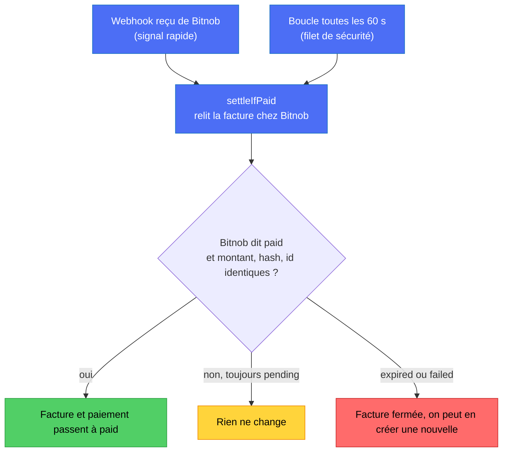
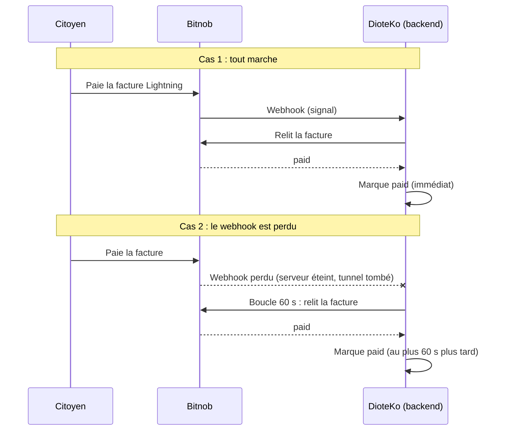

> **Obsolète : voir [BITNOB.md](BITNOB.md)** (section « Lightning pay-in » : webhook, réconciliateur et `settleIfPaid`). Fichier conservé pour l'historique.

# Webhook, réconciliateur : à quoi sert chacun (fichier temporaire)

## L'idée en une phrase

Le **webhook** prévient tout de suite quand Bitnob a reçu un paiement. Le **réconciliateur** vérifie de temps en temps
au cas où ce message ne soit jamais arrivé. Les deux font **la même vérification** à la fin, et c'est elle qui décide.

## Ce n'est pas un websocket

- Un websocket garde une connexion ouverte : le serveur pousse les infos en continu. On n'en a pas ici.
- Un webhook est un simple appel HTTP : Bitnob appelle une URL de chez nous **une fois**, quand quelque chose arrive.
  Si notre serveur est éteint, ou si le réseau coupe, ou si ngrok est tombé, l'appel est perdu (Bitnob réessaie quelques fois, puis abandonne).
- Le réconciliateur ne « écoute » pas. Toutes les 60 s, c'est **nous** qui demandons à Bitnob : « cette facture est-elle payée ? »
  C'est du **polling** (interroger à intervalle régulier).

## Pourquoi les deux

| | Webhook | Réconciliateur (polling) |
|---|---|---|
| Qui déclenche | Bitnob | Nous, toutes les 60 s |
| Vitesse | Quasi immédiat | Jusqu'à 60 s de retard |
| Fiable seul ? | Non : un message perdu = paiement jamais vu | Oui, mais lent |
| Rôle | Rapidité | Filet de sécurité |

Bitnob le recommande lui-même : les webhooks peuvent arriver en retard, en double, ou pas du tout, donc il faut aussi
pouvoir **interroger**.

## La règle de sécurité : on ne croit jamais le message

Un webhook peut être faux (quelqu'un envoie un faux message « payé »). Donc ni le webhook ni le réconciliateur ne
marquent une facture payée sur la foi de ce qu'ils reçoivent. Les deux appellent la même fonction, `settleIfPaid`, qui :

1. **relit** la facture chez Bitnob (appel signé avec nos clés) ;
2. vérifie que le statut est `paid` **et** que le montant, le hash de paiement et l'identifiant sont ceux qu'on avait émis ;
3. seulement alors, passe la facture et le paiement à `paid` dans notre base.

Résultat : un faux webhook pour une facture non payée ne change rien, car Bitnob répond encore `pending`.

## Cas concrets

Sans le réconciliateur, le cas 2 laisserait la demande en `pending` pour toujours alors que le citoyen a payé.
Dans notre code il existait déjà un petit filet : quand l'appli demande l'état d'une demande, on relit la facture. Mais si
personne ne regarde, rien ne se passait. Le réconciliateur règle ça, sans qu'il faille que quelqu'un ouvre l'écran.

## Ce que j'ai changé

### 1. Correctif du webhook `transfer.*`

Avant : tous les événements dont le nom commence par `transfer.` partaient vers le traitement des **retraits** (envois
d'argent). S'il n'y avait aucun retrait correspondant, il s'arrêtait en disant « retrait inconnu ».

Problème : l'atelier Bitnob indique qu'un paiement Lightning reçu arrive sous le nom `transfer.success`. Il aurait donc
été avalé par le traitement des retraits sans jamais regarder nos factures.

Maintenant : si aucun retrait ne correspond, on regarde si l'événement concerne une de **nos factures Lightning**, et dans
ce cas on lance `settleIfPaid`. Un vrai retrait garde exactement son chemin habituel.

Fichier : `backend-nest/src/modules/bitnob/services/bitnob-webhook.service.ts`.

### 2. Le réconciliateur

Fichier nouveau : `backend-nest/src/modules/bitnob/services/bitnob-invoice-reconciler.service.ts`.

Ce qu'il fait à chaque tour (`runOnce`) :

1. liste jusqu'à 50 factures Bitnob encore `pending` : les 25 plus récentes et les 25 plus anciennes (dédoublonnées), pour qu'une ancienne facture ne reste pas invisible ;
2. pour chacune, appelle `settleIfPaid` (donc relecture chez Bitnob) ;
3. si une facture provoque une erreur, il la note et passe à la suivante ;
4. écrit un résumé dans les logs : combien vérifiées, payées, fermées, en erreur ;
5. si un tour est encore en cours quand le suivant démarre, le suivant est sauté (pas de doublon).

Quand il est actif :

| Situation | Actif ? |
|---|---|
| Dev ou prod (Bitnob, seul rail d'encaissement) | oui, toutes les 60 s |
| `NODE_ENV=test` (tests) | non |
| `BITNOB_INVOICE_RECONCILE_INTERVAL_MS=0` | non |

L'intervalle se règle avec `BITNOB_INVOICE_RECONCILE_INTERVAL_MS` (défaut 60000, minimum 5000, maximum 86400000).

Autres fichiers touchés :

| Fichier | Changement |
|---|---|
| `lightning/services/lightning-invoices.service.ts` | `listPendingByProvider` : liste les factures `pending` d'un fournisseur |
| `bitnob/bitnob.module.ts` | enregistre le réconciliateur |
| `config/configuration.ts`, `config/env.validation.ts`, `.env.example` | la variable d'intervalle et sa validation |
| fichiers `*.spec.ts` | 27 tests de plus (271 avant, 298 maintenant) |

## Ce que ça ne change pas

- Le chemin de sécurité : toujours « relire chez Bitnob avant de marquer payé ».
- Tant qu'on n'a pas de vrai paiement sandbox, on n'a **pas vu** une facture passer de `pending` à `paid` en vrai.
  Les tests simulent la réponse de Bitnob ; ils prouvent la logique, pas l'intégration réelle.
- Rien n'est commité.
