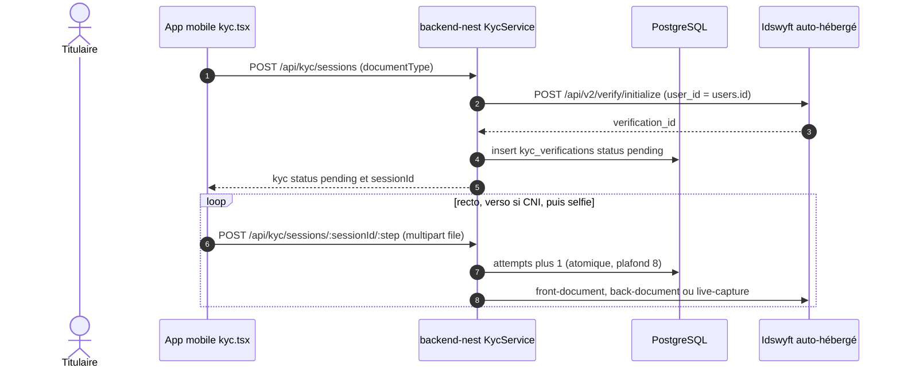
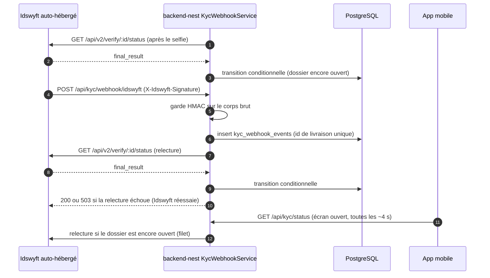
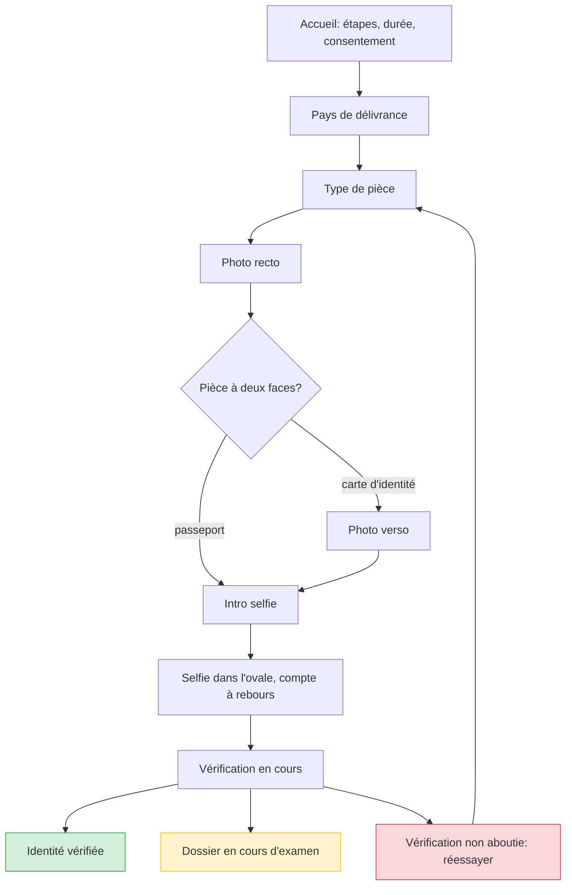
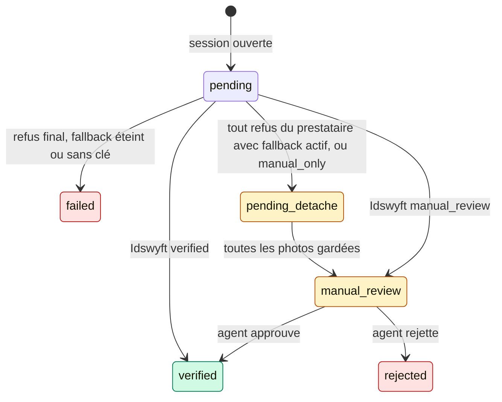
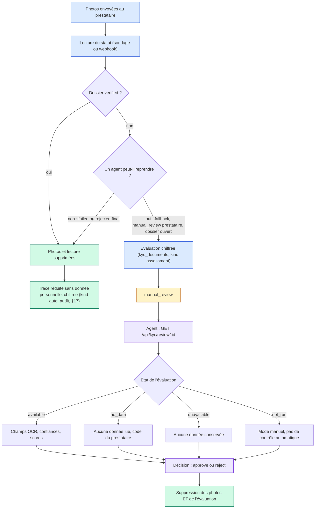
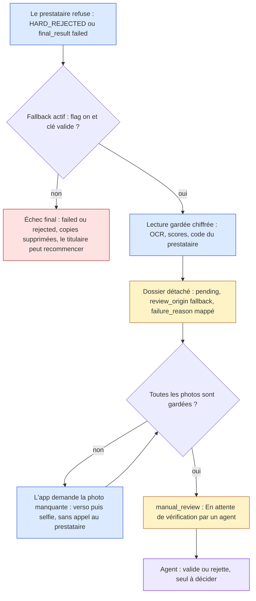
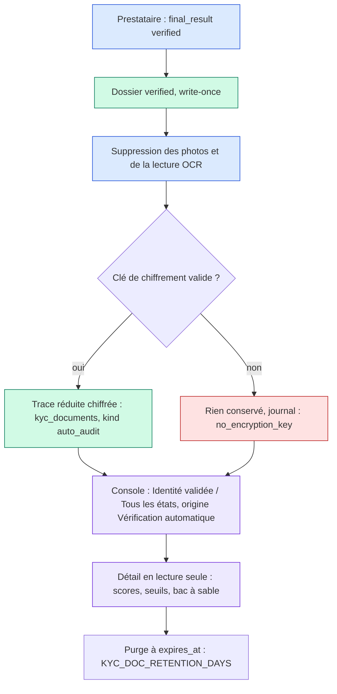

# Vérification d'identité (KYC) — DioteKo

> **Statut :** code sur `feat/kyc-idswyft` (backend `kyc/`, migration `1789000000000-CreateKycVerifications`, écrans et services mobiles). **Le spike B0 est partiel** (CNI sénégalaise évaluée, passeport non évalué, voir §12). Tout ce qui touche aux réponses du prestataire non mesurées est marqué « à vérifier ».
> **Source de vérité :** `backend-nest/src/modules/kyc/**`, `backend-nest/src/modules/admin-certificates/` (points d'appel de la porte), `frontmobile/app/kyc.tsx`, `frontmobile/services/kyc.ts`.

---

## 1. But et périmètre

Le KYC sert à prouver **qui demande** un certificat : la personne qui s'inscrit est bien celle dont la pièce d'identité et le selfie correspondent. Il ne prouve **pas** les données écrites dans l'acte.

Politique par type (`kyc` dans `admin-certificates.constants.ts`) :

| Type | Politique | Aujourd'hui | Cible |
|---|---|---|---|
| `residence` | `required` | bloquant | bloquant |
| `identity` | `required` | bloquant | bloquant |
| `birth` | `planned` | non bloquant (sauf si listé dans `KYC_ENFORCED_TYPES`) | obligatoire |
| `marriage` | `planned` | idem | obligatoire |
| `death` | `planned` | idem | obligatoire |

**Passer un type `planned` en bloquant**, dans l'ordre :
1. par configuration : ajouter le type à `KYC_ENFORCED_TYPES` (ex. `birth,marriage,death`), sans redéployer le code ;
2. pour de bon : changer sa valeur `kyc` en `'required'` dans le catalogue. `isKycEnforced` (`kyc-policy.util.ts`) ne change pas.

**Pourquoi les parents restent déclarés par le titulaire.** La CNI ne porte ni le nom du père ni celui de la mère. Ces champs restent donc saisis par le titulaire et passent par le flux existant `needs_info` (complément demandé par l'agent). Aucun nom vérifié n'est stocké : la décision D3 (source du nom) reste ouverte.

---

## 2. Architecture

Composants (tous dans `backend-nest/src/modules/kyc/`) :

- `controllers/kyc.controller.ts` : routes du titulaire (JWT). Une seule photo à la fois par titulaire.
- `controllers/kyc-webhook.controller.ts` : webhook Idswyft, public, protégé par signature.
- `services/kyc.service.ts` : machine d'états, porte `assertVerifiedFor`, relecture chez le prestataire.
- `services/kyc-webhook.service.ts` : enregistrement, dédoublonnage, relecture.
- `services/idswyft-http-client.service.ts` : client HTTP (`X-API-Key`, timeout 45 s).
- `guards/idswyft-webhook-signature.guard.ts` : HMAC-SHA256 sur le corps brut.
- `kyc-policy.util.ts`, `kyc-upload.util.ts`, `kyc.constants.ts` : politique, contrôle des octets, constantes.
- `entities/kyc-verification.entity.ts`, `entities/kyc-webhook-event.entity.ts` : deux tables (voir `DATABASE_MODEL.md` §7.7).

### 2.1 Ouverture de session et envoi des photos



### 2.2 Verdict : selfie, webhook et relecture

Le webhook n'est qu'un **signal**. Le statut est toujours relu chez Idswyft avant d'être écrit.



---

## 3. Points d'entrée

| Méthode et route | Accès | Corps ou fichier | Réponse utile |
|---|---|---|---|
| `POST /api/kyc/sessions` | JWT titulaire | JSON `{ documentType }` : `national_id` ou `passport` | `{ success, kyc }` ; idempotent (un dossier actif ou vérifié est renvoyé tel quel) |
| `POST /api/kyc/sessions/:sessionId/front` | JWT titulaire | multipart, champ `file` | `{ success, kyc }` |
| `POST /api/kyc/sessions/:sessionId/back` | JWT titulaire | multipart, champ `file` ; refusé (400) pour un passeport | `{ success, kyc }` |
| `POST /api/kyc/sessions/:sessionId/selfie` | JWT titulaire | multipart, champ `file` ; ferme la session, le verdict est relu avant la réponse | `{ success, kyc }` |
| `GET /api/kyc/status` | JWT titulaire | aucun | `{ success, kyc }` ; `not_started` s'il n'y a pas de dossier |
| `POST /api/kyc/webhook/idswyft` | public, signature HMAC obligatoire | JSON Idswyft | `{ received: true }` (200) ; 503 si la relecture échoue |

Un dossier d'un autre titulaire répond **404**, comme un dossier inexistant. La vue renvoyée au titulaire ne contient jamais l'identifiant du prestataire, l'identifiant utilisateur ni rien lu sur la pièce.

---

## 4. Limites

| Limite | Valeur | Où |
|---|---|---|
| Sessions par titulaire | 5 sur 24 h glissantes (`KYC_MAX_SESSIONS_PER_DAY`, entre 1 et 50) | `kyc.service.ts`, `startSession` |
| Photos par session | 8 (envois, reprises comprises ; jamais remboursés) | `KYC_MAX_UPLOADS_PER_SESSION` |
| Taille d'une photo | 5 Mo maximum | `KYC_UPLOAD_MAX_BYTES`, multer |
| Formats | JPEG ou PNG, détectés sur les premiers octets (jamais le nom ni le type déclaré) | `kyc-upload.util.ts` |
| Champs texte multipart | aucun (`fields: 0`), un seul fichier | `kyc.controller.ts` |
| Dossiers actifs par titulaire | un seul (`pending` ou `manual_review`), imposé par index unique partiel | `UQ_kyc_verifications_one_active_per_user` |
| Upload en vol | un seul par titulaire, **en mémoire du processus** | `KycController.uploading` |
| Délai d'un appel Idswyft | 45 s côté backend ; 60 s côté mobile | `IDSWYFT_REQUEST_TIMEOUT_MS`, `PHOTO_TIMEOUT_MS` |
| Dossier `pending` abandonné | fermé en `failed` (raison `other`) à la reprise, après 24 h | `STALE_PENDING_MS` |

---

## 4 bis. Parcours mobile (écran `/kyc`)

Le parcours reprend l'ordre du flow Didit (source : documentation publique de Didit, relevée à la conception). Didit ne publie
ni captures ni textes d'écran : l'**ordre** et les règles de reprise viennent de Didit, les **textes, le cadre de capture et
l'écran de relecture** sont des choix de DioteKo.



- Chaque photo passe par une **relecture** (« Utiliser cette photo » / « Reprendre ») avant l'envoi ; un refus du serveur
  (photo illisible, trop lourde) reste sur cet écran avec le message.
- Bouton fermer avec confirmation, barre de progression, « Photo X sur N ». Caméra arrière pour les pièces, avant pour le selfie,
  bouton de bascule. Déclencheur manuel (pas de capture automatique) ; compte à rebours de 3 s pour le selfie.
- Reprise : si un dossier est déjà ouvert, l'accueil propose « Reprendre » et repart de la photo que le prestataire attend
  (`nextStep` renvoyé par `/kyc/status`).
- Le pays choisi est envoyé en code ISO (`issuingCountry`) et transmis à Idswyft (`issuing_country`).
- Le résultat suit toujours le statut relu par le serveur ; si la relecture après le selfie échoue, l'écran « Vérification en
  cours » prend le relais par sondage.
- Pas de sélecteur de langue (français seul), pas de NFC (non supporté par Idswyft), pas de capture automatique.

Code : `frontmobile/app/kyc.tsx` (état et réseau), `frontmobile/components/kyc/` (`StepScreens`, `CaptureStep`, `kyc-ui`).

## 5. États d'un dossier

```mermaid
stateDiagram-v2
  [*] --> pending : POST /kyc/sessions (nouvelle ligne)
  pending --> verified : relecture final_result verified
  pending --> manual_review : relecture final_result manual_review
  pending --> failed : relecture final_result failed ou dossier abandonné (24 h)
  pending --> rejected : relecture HARD_REJECTED (fallback désactivé ou clé absente ; sinon le dossier va à un agent)
  manual_review --> verified : décision d un agent dans la console
  manual_review --> failed : idem
  manual_review --> rejected : idem
  verified --> [*]
  failed --> [*]
  rejected --> [*]

  classDef cWait fill:#ffd43b,stroke:#f08c00,color:#000
  classDef cOk fill:#51cf66,stroke:#2f9e44,color:#000
  classDef cKo fill:#ff6b6b,stroke:#c92a2a,color:#fff

  class pending,manual_review cWait
  class verified cOk
  class failed,rejected cKo
```



Règles :

- **`verified` est écrit une fois.** La transition est conditionnelle (`WHERE status IN ('pending','manual_review')`) : un dossier vérifié ne change plus jamais. Un échec ultérieur ne retire pas une vérification passée (la porte cherche « un dossier vérifié », pas « le dernier »).
- **Seule la relecture écrit un statut final.** Une réponse qui ne porte pas le même `verification_id` est ignorée et répond 502.
- **`failed` et `rejected` sont clos.** Un nouvel essai ouvre une **nouvelle ligne** (dans la limite quotidienne).
- **`manual_review`** attend une décision prise **uniquement dans le dashboard Idswyft**. DioteKo n'a pas d'écran pour cela.
- `rejected` est un statut écrit par DioteKo quand Idswyft signale un refus définitif (`HARD_REJECTED`). Avec le fallback actif (§16), ce refus, comme tout échec du contrôle automatique, part chez un agent au lieu de clore le dossier.

---

## 6. Où la porte s'applique

La porte (`KycService.assertVerifiedFor`) renvoie `403 KYC_REQUIRED` si le type est imposé et que le titulaire n'a aucun dossier `verified`. Le serveur décide ; l'application mobile ne fait qu'afficher l'état.

| Point d'appel | Moment | Effet si refusé |
|---|---|---|
| `createRequest` | après la recherche du type et la validation des données, avant le choix de l'organisation | aucune demande créée |
| `resubmitRequest` | après le contrôle du statut `needs_info`, avant le passage à `pending` | la demande reste `needs_info` |
| `createInvoiceForRequest` | après le contrôle `accepted` et le prix non nul, avant le passage à `awaiting_payment` | aucune facture, aucun appel Bitnob |
| `startIssuance` depuis `accepted` (type gratuit) | avant la génération | le claim est rendu, la passe de reprise réessaie |

**Choix délibéré : pas de contrôle à l'émission d'une demande déjà payée** (`startIssuance` depuis `paid`). Une demande payée ne doit pas rester bloquée parce que le dossier du titulaire a changé ensuite (voir DECISIONS).

**Note :** aucun type du catalogue n'est gratuit aujourd'hui (tous ont un prix supérieur à 0). La branche « type gratuit » est donc inactive tant qu'un type gratuit n'existe pas.

---

## 7. Contrat d'erreur

Le filtre global (`common/filters/http-exception.filter.ts`) expose désormais un champ `code`, en plus de `error`. Il ne le reprend que s'il est en majuscules (`KYC_REQUIRED`), jamais un texte libre.

Exemple de réponse à une demande `residence` sans dossier vérifié :

```json
{
  "success": false,
  "error": "Identity verification is required for this certificate. Complete it in the app first.",
  "code": "KYC_REQUIRED",
  "path": "/api/admin-certificates/requests",
  "timestamp": "2026-10-16T10:00:00.000Z"
}
```

Le champ `details` n'apparaît que hors production.

| Situation | HTTP | Remarque |
|---|---|---|
| Pas de dossier vérifié (porte) | 403 | `code: KYC_REQUIRED` |
| Compte suspendu | 403 | `Your account is not active` |
| Dossier d'un autre titulaire ou inexistant | 404 | |
| Trop de sessions sur 24 h | 429 | |
| Plus de 8 photos, ou plus de photo en vol | 429 | |
| Dossier qui n'accepte plus de photo | 409 | `failed`, `rejected`, `verified` ou `manual_review` |
| Photo refusée par Idswyft | 400 | message : reprendre la photo en bonne lumière |
| Passeport avec un verso | 400 | |
| Idswyft répond 409 (étape refusée) | 409 | la session est relue |
| Idswyft répond 401, 403 ou 5xx, ou réponse avec un autre identifiant | 502 | |
| Idswyft injoignable, clé absente, délai dépassé | 503 | |
| Webhook sans signature valide, ou secret absent en production | 401 | |
| Webhook : relecture impossible | 503 | Idswyft réessaie (il ne réessaie que sur 5xx et erreur réseau) |

---

## 8. Configuration

| Variable | Défaut | Rôle |
|---|---|---|
| `IDSWYFT_BASE_URL` | `http://localhost:8010` | Origine de l'API Idswyft. Dans la stack de dev, le conteneur `dioteko-backend-nest-bitnob` reçoit `http://idswyft-api:3001` de `docker-compose.dev.yml` (nom du service sur le réseau compose) ; la valeur par défaut ne sert que pour un backend lancé sur la machine. |
| `IDSWYFT_API_KEY` | vide | Clé `X-API-Key` créée par `npm run kyc:bootstrap` (ou dans le dashboard Idswyft). Vide : chaque appel répond 503. Avertissement au démarrage seulement. |
| `IDSWYFT_WEBHOOK_SECRET` | vide | Secret HMAC du webhook. Seuls `development` et `test` acceptent un webhook sans secret (stocké, jamais exécuté). Dans tout autre `NODE_ENV`, il répond 401. Avertissement au démarrage seulement. |
| `KYC_ENFORCEMENT` | `on` | `off` lève la porte partout, **hors production seulement** (ignoré si `NODE_ENV=production`, avec un avertissement). Toute autre valeur que `on` ou `off` est refusée au démarrage. |
| `KYC_ENFORCED_TYPES` | vide | Types `planned` rendus bloquants, séparés par des virgules (`birth,marriage,death`). |
| `KYC_MAX_SESSIONS_PER_DAY` | `5` | Sessions par titulaire sur 24 h glissantes. Entier de 1 à 50 ; hors de cette plage, le démarrage est refusé (validation d'environnement). |

Modèles : `backend-nest/.env.example` (valeurs de dev), `.env.test.example`, `.env.prod.example` (`KYC_ENFORCEMENT=on`).

---

## 9. Confidentialité

- **Aucune image, aucun numéro de pièce, aucune donnée biométrique** n'est écrit sur le disque ni en base, **sauf** quand la relecture par un agent est active (§16) : une copie chiffrée et de courte durée est alors gardée. Sinon les photos restent en mémoire le temps de l'envoi (multer `memoryStorage`), puis sont transmises à Idswyft.
- **Webhook réduit :** seuls `event`, `verification_id`, `status` et `timestamp` sont gardés (chaînes courtes). `data.ocr_data` (nom, date de naissance, numéro de pièce) est supprimé avant tout stockage ou log.
- **Trace réduite d'une vérification automatique (§17) :** pour un dossier validé seul par le prestataire, une ligne chiffrée `kind = 'auto_audit'` garde uniquement des scores, seuils et indicateurs (aucune photo, aucun texte lu, aucun nom), jusqu'à `KYC_DOC_RETENTION_DAYS`. Jamais renvoyée au titulaire, jamais journalisée, lisible seulement par la route de détail de la relecture.
- **Évaluation de la vérification automatique (§16) :** ce que le prestataire a lu (`ocr_data` : nom, date de naissance, numéro de pièce) et ses scores sont des données personnelles. Ils ne vivent que **chiffrés** (AES-256-GCM, `KYC_DOC_ENCRYPTION_KEY`) dans `kyc_documents` (`kind = 'assessment'`), seulement quand une relecture par un agent est possible, et sont supprimés avec les photos (décision, rétention `KYC_DOC_RETENTION_DAYS`). Jamais renvoyés au titulaire, jamais journalisés, lisibles uniquement par la route de détail de la relecture (`issuer` / `admin`). La ligne du webhook, elle, reste réduite à quatre champs.
- **Raisons d'échec en énumération fixe.** Le texte du prestataire peut répéter ce qui a été lu sur la pièce. `classifyFailureReason` le ramène à `document_unreadable`, `document_expired`, `selfie_mismatch`, `liveness_failed`, `rejected` ou `other`.
- **Le corps de réponse Idswyft n'est jamais recopié.** Seul son code d'erreur court (`providerCode`) est gardé pour les logs.
- **Téléphone :** chaque photo prise est supprimée du cache de l'application dès qu'elle est envoyée, reprise (« Reprendre ») ou que l'écran est quitté (`frontmobile/services/photo-cleanup.ts`, `expo-file-system`). Best effort : un échec de suppression ne bloque pas le parcours.
- **Côté Idswyft, les images sont conservées** dans le volume `idswyft_uploads` du stack de dev (stockage local). La purge automatique (`DATA_RETENTION_DAYS`, 90 par défaut) ne tourne qu'avec `NODE_ENV=production` : en dev, rien n'est effacé tout seul. À régler avant toute donnée réelle (autorisation CDP, durée de conservation, chiffrement `STORAGE_ENCRYPTION`).
- **Logs d'Idswyft (conteneur `dioteko-idswyft-api-bitnob`) :** ils contiennent les champs lus sur la pièce (nom, numéro, dates), au niveau info. Ne pas les exporter tels quels ; à filtrer ou faire tourner avant toute donnée réelle.
- **Logs :** identifiants et statuts seulement (`[START]`, `[ENTITY]`, `[CALL]`, `[RESULT]`, `[STATE]`), jamais de corps ni de nom de fichier.

---

## 10. Idswyft : faits retenus

Source : dépôt open source `team-idswyft/idswyft-community`, tag `v1.12.19` (hors de ce dépôt ; ce point n'a pas été recontrôlé dans le code de DioteKo). Ces points restent à confirmer par le spike (§12).

- `POST /api/v2/verify/initialize` : exige un `user_id` au format **UUID** (ici `users.id`) ; renvoie `verification_id`. DioteKo envoie `user_id` et `document_type`. `issuing_country` n'est jamais envoyé : la colonne reste `NULL`.
- Envois : multipart, champ `document` pour recto et verso (`front-document`, `back-document`), champ `selfie` pour `live-capture`.
- Statut : `GET /api/v2/verify/:id/status`. Champs lus : `verification_id`, `status`, `final_result` (`verified` | `failed` | `manual_review` | `null`), `failure_reason`, `rejection_reason`, `manual_review_reason`, `retry_available`.
- Webhook : en-tête `X-Idswyft-Signature: sha256=<hex>` (HMAC-SHA256 du corps JSON). En-tête `X-Idswyft-Webhook-Id` pour le dédoublonnage. Événements : `verification.completed`, `verification.failed`, `verification.manual_review`. Pas de filtre d'événements à l'enregistrement.
- Enregistrement du webhook : l'URL passe une vérification SSRF qui bloque les adresses privées et la boucle locale. **Un webhook vers `localhost` ne peut donc pas être enregistré.** La relecture de `GET /api/kyc/status` est le filet de sécurité.
- Réessais côté Idswyft : seulement sur 5xx et erreurs réseau ; toute réponse 4xx est considérée comme livrée.
- Limite de débit côté Idswyft : comptée sur 24 h (valeur à relever dans la configuration pendant le spike).

---

## 11. Limites et points ouverts

- **Sénégal non supporté par Idswyft (documenté).** Le Sénégal ne fait pas partie des 19 pays listés, et la CNI sénégalaise n'est documentée nulle part. Le support est **à tester, pas à promettre**. Le passeport (zone MRZ lisible) est le candidat le plus probable.
- **Doublons d'identité.** Un même document peut vérifier plusieurs comptes. Aucune empreinte n'est stockée pour le détecter.
- **Pas de réverification ni d'expiration.** Un dossier `verified` reste valable indéfiniment ; il n'existe aucun suivi d'expiration de pièce.
- **`manual_review`** : traité seulement dans le dashboard Idswyft ; le titulaire voit « En cours d'examen » sans délai.
- **Webhook en local impossible** (voir §10). En développement, seule la relecture par `GET /api/kyc/status` fait avancer un dossier.
- **Enregistrement du webhook** : aucun code DioteKo n'appelle `POST /api/webhooks/register`. L'enregistrement se fait à la main, côté Idswyft, avec une URL publique (tunnel).
- **Autorisation CDP** : à obtenir avant toute mise en production.
- **Pas de Cloud Idswyft avec de vraies données** tant que la région de stockage n'est pas connue.
- **Verrou d'upload en mémoire** : un seul processus backend. Avec plusieurs instances, le verrou « une photo à la fois » ne protège plus ; le plafond par session (`attempts`) reste en base.
- **Environnement E2E :** `.env.test` ne doit pas définir `KYC_ENFORCEMENT=off` : `test/kyc.e2e-spec.ts` attend la porte active (cas `403 KYC_REQUIRED`). L'E2E n'appelle jamais Idswyft.

---

## 12. Résultats mesurés (spike B0)

**Partiellement fait : CNI sénégalaise évaluée (recto, verso, selfie) ; passeport non évalué.** Le spike se fait avec des photos **fournies par l'utilisateur** (CNI recto et verso, passeport, selfie). L'agent ne manipule pas de vraie pièce. Le test se fait contre `http://localhost:8010` avec une clé créée dans le dashboard (`http://localhost:8087`).

Checklist à remplir :

- [ ] Lecture OCR des champs en français sur la CNI (nom, prénoms, date de naissance, numéro).
- [ ] Lecture du verso de la CNI (MRZ présente et lisible ?).
- [ ] Lecture du passeport (page photo, MRZ).
- [ ] Contrôle de vivacité (`liveness`) sur un selfie en direct.
- [ ] Correspondance du visage (selfie contre photo de la pièce).
- [ ] Octets réellement signés par Idswyft : corps brut reçu, ou `JSON.stringify(payload)` ? Si ce n'est pas le corps brut, la garde HMAC doit être revue.
- [ ] Clés exactes de `data.ocr_data` du webhook (supprimées par DioteKo). Pour la route `/status`, l'évaluation (§16) lit `ocr_data` avec des alias de clés ; les formes de `cross_validation_results`, `face_match_results`, `liveness_results` et `risk_score` ne sont pas figées par un échantillon enregistré : relever une réponse réelle d'un dossier qui lit bien la pièce et ajuster `kyc-assessment.util.ts` si une clé diffère.
- [ ] Code de réponse des envois (200 ou 201 ?) ; le client accepte tout 2xx.
- [ ] Configuration de la limite de débit (valeur réelle, fenêtre de 24 h).
- [ ] Verdict pour chaque type : CNI retenue, passeport seul, ou les deux (règle du plan : si la CNI est mal lue, ne proposer que le passeport et laisser `manual_review`).

À consigner : pièces testées (sans image ni numéro), réponses constatées.

### Photos modestes (CNI sénégalaise, 960 × 1280)

Pièces : une CNI (recto, verso) et un selfie, 960 × 1280 et 720 × 1280 px, JPEG d'environ 100 à 130 Ko. Instance : le stack du dépôt
(`docker-compose.idswyft.yml`, v1.12.19, clé sandbox). Flux : `initialize` puis `front-document`, `back-document`, `live-capture`, `status`.
Aucune valeur lue sur la pièce n'est consignée ici.

| Constat | Détail |
|---|---|
| Moteur ML | Utilisé (« Calling engine » dans les logs) : la correction `ENGINE_URL` … `:3002` du compose est validée. |
| Recto, pays `SN`, `FR`, type `national_id` ou `auto` | **Rejeté** : `HARD_REJECTED`, `rejection_reason = FRONT_LOW_CONFIDENCE`. Même résultat dans les 4 variantes. |
| Cause (« Gate 1 ») | Confiance OCR **0,576** pour un seuil de **0,60**. Le nom est mal lu, la date de naissance et la date d'expiration ne sont pas lues ; le numéro est lu. |
| Suite du flux | Une session rejetée est fermée : `back-document` et `live-capture` répondent **409**. Le verso, la vivacité et la correspondance du visage n'ont donc pas pu être évalués sur ces photos. |
| Type `other` | Refusé à l'initialisation (400). Types acceptés : `passport`, `drivers_license`, `national_id`, `auto`. |
| Durée | Recto 6 à 26 s (le premier appel charge les modèles), verso 12 à 27 s, selfie 1 à 4 s. |
| Contrat confirmé | `initialize` → `verification_id` ; `status` contient aussi `verification_id`, `is_sandbox`, `final_result`, `rejection_reason`, `failure_reason`, `retry_available`. Les envois répondent 200 (le recto) ; un envoi sur session rejetée répond 409. |
| Seuil | 0,60 est codé en dur dans l'image ; seul un réglage par organisation (`ocrConfidence`) peut le changer. Pas de variable d'environnement. |

Lecture : le rejet est proche du seuil (0,576 contre 0,60) et les photos sont modestes (pièce petite dans le cadre, compression).
**Ce n'est pas une preuve que la CNI est inutilisable**, mais ce n'est pas non plus un succès : une photo plus nette
(pièce qui remplit le cadre, au moins 1600 px de large, bonne lumière, sans reflet) est nécessaire avant de trancher « CNI retenue » ou « passeport seul ».
Tant que ce n'est pas tranché, la carte d'identité reste proposée dans l'application.

### Photo prise avec le téléphone, verso, selfies

Recto = photo du téléphone (2,3 Mo, pleine résolution) ; verso = `Verso.jpeg` (960 × 1280) ; selfies = `Selfie.jpeg` et `Selfie2.jpeg`.

| Constat | Détail |
|---|---|
| Recto de la photo téléphone | **Passe le contrôle** (confiance de lecture 0,80, seuil 0,60). Le texte brut contient tout, mais l'extraction ne remplit que le numéro (nom et dates non extraits) ; visage non détecté sur le recto (soft) ; indice de falsification (soft). Durée **33 à 48 s**. |
| Délai | Cette durée dépassait le délai de 45 s du backend : le recto était bien analysé mais l'app affichait « service injoignable ». Corrigé (voir §14). |
| `document_type` / `country_code` envoyés avec la photo | **Dégrade** le résultat : le même recto est rejeté (`FRONT_OCR_FAILED`) et prend autant de temps. Le classement « auto » le lit (`national_id`, confiance 0,85). On ne les envoie donc pas. |
| Verso (mode `full`) | **Lu** : nom, prénoms, naissance, numéro, expiration, nationalité, adresse. Mais la **validation croisée recto / verso échoue** (`CROSS_VALIDATION_FAILED`, « erreur critique », 3 champs comparés) : l'extraction du recto ne donne que le numéro de la carte, qui ne correspond pas à celui du verso. Les règles d'Idswyft sont pensées pour des permis américains. |
| Mode `identity` (recto + selfie, sans verso ni validation croisée) | Le recto passe et `requires_back` vaut `false`. Le selfie est ensuite jugé par la vivacité. |
| Vivacité (passive) | **Échec** : 0,607 (`Selfie2`) et 0,625 (`Selfie`) pour un seuil de **0,65** (mode test ; 0,75 en production). La correspondance du visage n'est donc jamais atteinte sur ces selfies. |
| Seuils | Codés en dur dans l'image (vivacité 0,65 / 0,75, visage 0,55 / 0,60, lecture 0,60, validation croisée 0,75) ; seul un réglage par organisation peut les changer. |

**Pourquoi le type devient « permis de conduire » (cause racine).** Le moteur d'Idswyft lit le recto à l'endroit (type `national_id`, confiance 0,85, avec le texte
complet), puis essaie les trois autres rotations et **garde la lecture au meilleur score** (`scoreExtraction`, `dist/routes/extract.js`). Ce score récompense le nombre de
champs extraits : la lecture propre d'une carte CEDEAO n'en remplit presque aucun (l'extracteur « carte d'identité » est pensé pour des formats américains), alors
qu'une lecture **à l'envers**, illisible mais classée « permis de conduire » par repli, en remplit plus. Le moteur fait donc pivoter de 180° une carte pourtant droite,
d'où : type `drivers_license` (confiance 0,5, signal `default_fallback`), noms et dates absents, visage non détecté, puis échec de la validation croisée. Ce n'est pas un
défaut de la photo. Seule une correction du moteur (ou un extracteur dédié aux cartes CEDEAO) y remédie ; **aucun seuil n'a été assoupli** (décision de conception).

Conclusion provisoire : **la CNI CEDEAO ne passe pas de bout en bout avec Idswyft tel quel**. Deux blocages indépendants : la validation croisée
(contournable avec le mode `identity`, au prix de ne plus contrôler le verso) et la vivacité passive (selfies à 0,61 - 0,63 pour 0,65). Pistes :
mode `identity` pour la CNI, passeport (recto seul, MRZ), et/ou seuils ajustés pour la démonstration (à décider explicitement : c'est de la sécurité).

**Constat de confidentialité.** Le conteneur API d'Idswyft écrit dans **ses propres logs** (niveau info, « Gate 1: evaluating front document »)
les champs lus sur la pièce (nom, numéro, dates). Les logs de DioteKo n'en contiennent pas, mais ceux d'Idswyft oui : ne pas les copier ni
les envoyer à un outil de supervision tels quels, et prévoir leur rotation / filtrage avant toute donnée réelle (voir §9).

---

## 13. Suite : naissance (non codé)

Le KYC prouve le demandeur, pas l'acte. Pour un extrait de naissance (chantier C14 dans `ROADMAP_NEXT_STEPS.md`) :

- le nom du titulaire lu sur la pièce peut être comparé au nom déclaré ;
- le père et la mère ne figurent pas sur la CNI : ils restent déclarés et se complètent par `needs_info` ;
- aucun nom vérifié n'est stocké tant que D3 n'est pas tranchée.

---

## 14. Capture automatique, délai d'envoi, NFC / MRZ

### Capture automatique (Expo Go)
L'écran de photo prend la photo **sans bouton** quand le téléphone est immobile (accéléromètre, ~1,3 s ; 1 s pour le selfie), avec un cadre dont une
ligne lumineuse balaie de haut en bas, des coins qui passent au vert, un retour haptique, puis l'envoi direct (pas d'écran de relecture ; en cas de refus :
message + « Reprendre »). Interrupteur « Auto » et déclencheur manuel conservés. La photo est réduite à 1800 px (JPEG 0,8) avant l'envoi.

**Limite assumée : c'est de la stabilité, pas de la reconnaissance de carte.** L'app tourne dans Expo Go (ni client de développement, ni dossier natif) :
la détection réelle d'un document dans l'image en direct (bords, netteté, reflets, texte lisible) demande un **build de développement** avec
VisionCamera et une reconnaissance de texte embarquée. À planifier après la démonstration.

### Contrôle préalable de la photo (avant l'envoi)
La prise automatique se déclenchait dès que le téléphone était immobile, **même sans carte dans l'image** ; une telle photo fait rejeter définitivement la session par
Idswyft (et il n'y en a que quelques-unes par jour). Avant l'envoi, l'app envoie donc une petite copie (900 px) à `POST /api/kyc/sessions/:id/precheck/:step` : le backend interroge
le **moteur ML d'Idswyft** (`POST /extract/ocr` pour une pièce, `POST /extract/live` pour un visage) et répond `ok`, `no_document`, `no_face` ou `skipped`.
- Pièce : au moins 3 mots propres aux documents d'identité (français ou anglais), ou une classification `national_id` / `passport` avec confiance ≥ 0,8 ; verso : 2 mots, une zone
  MRZ (`<`), ou beaucoup de texte et de chiffres. Règles dans `kyc-precheck.util.ts`.
- Mesuré sur les photos de test : recto et verso acceptés, selfie présenté comme faux recto ou faux verso refusé, visage détecté sur le selfie, aucun visage sur le recto.
- **Ne décide rien** : refus = « Reprendre » ou « Envoyer quand même » (le moteur peut se tromper sur une carte abîmée). Ne compte pas comme un envoi, ne touche pas au dossier.
  Si le moteur est éteint ou en erreur, la réponse est `skipped` et la photo part normalement. Désactivé si `IDSWYFT_ENGINE_URL` est vide.
- Couplage : le moteur n'a pas d'API publique versionnée (routes internes d'Idswyft v1.12.19) ; à revérifier à chaque changement de version.
- Après un refus, la prise automatique ne se réarme qu'au bout de 3,5 s pour laisser le temps de recadrer.

### Délai d'envoi
Le recto d'une photo pleine résolution met 33 à 48 s à être analysé (plusieurs passes de lecture, détection de falsification). Le client Idswyft avait
un délai unique de 45 s : le backend abandonnait quelques secondes avant la fin et traduisait « pas de réponse » en « injoignable ». Désormais :
envois de photo **150 s** (l'app attend 170 s), lecture de statut 45 s ; une erreur sans réponse est classée `timeout` (504, code `KYC_PROVIDER_TIMEOUT`)
ou `network` (503, code `KYC_PROVIDER_UNREACHABLE`), avec le code réseau et la durée dans le log. Après un délai dépassé, l'app **relit la progression** et
poursuit si la photo est bien arrivée au lieu de demander de la reprendre.

### NFC et lecture de la MRZ : non fait, voici pourquoi
- **Expo Go ne peut pas lire le NFC** : il faut un module natif (par exemple `react-native-nfc-manager`) donc un build de développement. Sur iPhone s'ajoutent un
  compte développeur Apple et le droit « lecture de balises NFC » (ISO 7816).
- Lire la puce d'un document passe par des clés d'accès dérivées de la **MRZ** (numéro de document, date de naissance, date d'expiration) : il faut donc d'abord
  lire la MRZ au verso (caméra), puis ouvrir la puce.
- **Non confirmé** : que la puce de la CNI CEDEAO sénégalaise suive la norme ICAO 9303 (aucune source trouvée). À vérifier avec un lecteur sur une vraie carte
  avant tout développement.
- **Idswyft ne sait pas utiliser des données de puce.** Les prouver authentiques demanderait de vérifier la signature de la puce avec les certificats de l'État
  émetteur, que nous n'avons pas.
- Le verso est déjà envoyé à Idswyft, qui lit la MRZ / le code ; c'est la piste à court terme. Le NFC est une phase 2, après un build de développement.

---

## 15. Moteur Idswyft modifié (overlay DioteKo) : résultats et ce qui reste

Décision : **aucun seuil n'est assoupli** ; on corrige à la place ce qui, dans le moteur, lisait mal la carte. Le code repris et
modifié (licence MIT) est dans `docker/idswyft/` (voir son `README.md`) ; l'image du moteur est construite à partir de la release pinned + cet overlay.

### Ce qui est corrigé (mesuré sur la carte CEDEAO de test, photo prise au téléphone)
| Avant | Après |
|---|---|
| 4 passes de lecture, rotation de 180° à tort | **1 passe**, orientation conservée |
| type détecté `drivers_license` (0,5, repli) | type `national_id` (0,85) |
| nom, naissance, expiration non lus | **lus** (analyseur dédié `ecowasCard.ts`, 14 tests sur textes fictifs) |
| visage non détecté sur le recto | **visage détecté** |
| recto 48 s | recto 21 à 38 s |

### Verso (MRZ)
Sans correction, le moteur ne lisait du verso que le numéro d'un faux « code-barres ». Trois causes, toutes dans `/extract/back` :
1. l'OCR du verso utilise une liste de caractères **sans `<`** (`barcode.ts`), donc une MRZ n'y est jamais reconnue ;
2. le résultat « code-barres » masque la MRZ même quand elle est lue ;
3. la lecture Tesseract est trop bruitée pour valider le chiffre de contrôle composite (lettres à la place des `<`).

Correction (overlay `extract.ts`, route `/back`) : si la passe code-barres ne donne pas de MRZ aux contrôles valides, on lit le verso avec le moteur OCR principal
(**PaddleOCR**, qui reconnaît les `<`) et on passe le texte dans le **même analyseur `mrz`**. Mesuré sur deux photos de verso prises au téléphone : TD1 reconnue, **tous les
chiffres de contrôle valides sans aucune réparation** (champs et composite). Une MRZ dont un contrôle échoue n'est jamais retenue à la place d'une MRZ valide, et la porte 2
(`BACK_MRZ_CHECKSUM_FAILED`) est inchangée. Une MRZ valide complète les champs que le code-barres a laissés vides et **remplace son numéro**, qui sur une carte non
américaine est un décodage PDF417 parasite.

Résultat du flux complet (recto + verso pris au téléphone, `SN`, `national_id`) : validation croisée **`PASS`**, `documents_match: true`, statut `AWAITING_LIVE`. Reste la vivacité.

### Verso à MRZ illisible
Un verso dont la MRZ n'est **pas lisible** (le moteur voit les `<` mais pas un bloc TD1 complet : une ligne de 29 caractères au lieu de 30) donne `CROSS_VALIDATION_FAILED` (les cinq champs à 0) : la session est **définitivement refusée** (`HARD_REJECTED`) et les étapes suivantes répondent 409. Deux garde-fous évitent que l'app s'y expose :
- le pré-contrôle du verso refuse une zone MRZ visible mais illisible, au lieu d'accepter quelques `<` ;
- l'app n'enchaîne pas vers le selfie après un refus.

Mécanismes en place (aucun seuil ni contrôle assoupli) :
1. **Moteur** (overlay `mrzRepair.ts`, `mrzRead.ts`, route `/back`) : si une seule ligne TD1 a perdu **un** caractère `<`, on le réinsère, puis le vrai analyseur `mrz` doit valider **tous** les chiffres de contrôle, sinon la MRZ est rejetée comme avant. Test : `docker/idswyft/tests/mrzRepair.test.mjs`.
2. **Pré-contrôle** : `/extract/ocr` renvoie `dioteko_mrz` ; le backend répond `mrz_unreadable` quand une zone MRZ est visible mais illisible. Un verso **sans** MRZ n'est pas bloqué. L'app attend alors une zone lisible avant la prise automatique ; l'envoi manuel (« Envoyer quand même ») reste possible.
3. **Motif de refus** : `classifyFailureReason` nomme la cause même pour un rejet définitif (`CROSS_VALIDATION_FAILED` → pièce illisible) au lieu d'un « refusé » générique.
4. **App** (`app/kyc.tsx`) : un dossier refusé affiche l'écran de résultat à n'importe quelle étape (prise, intro selfie, relecture), sans proposer l'étape suivante.
Deux autres photos de verso (floues, MRZ coupée) ne donnent rien : il faut un cadrage net de la zone du bas ; guide à ajouter dans l'app (§14).

### Vivacité
La « vivacité passive » d'Idswyft est une **heuristique sur le fichier** (poids de l'EXIF : 0,20, score de base 0,3 sans EXIF). Le **selfie est envoyé tel quel, avec son EXIF**
(réduire la photo l'effacerait). Les deux selfies de test (`TestKYC/`) n'ont **pas d'EXIF** (fichiers passés par une messagerie) et donnent 0,624 et 0,607 pour un seuil de 0,65 :
c'est le fichier de test qui est pénalisé. Le seuil n'est pas modifié. La vraie amélioration est le défi actif « tourner la tête » (≥ 8 s de vidéo), non faisable dans Expo Go.

### Écran mobile
Détection **avant** la prise (photo-sonde contrôlée par le moteur, voir §14), retour arrière à chaque étape avec la photo déjà envoyée réaffichée (changer une photo =
recommencer, le prestataire n'accepte pas de remplacement), pays et type de pièce sur le même écran, journal `[kyc] …` dans Metro et logs du backend (ids, tailles,
durées, résultats ; jamais le contenu d'une photo).

### Vivacité mesurée sur un selfie réel de l'app (0,632 pour 0,65)
Sous-scores : taille 0,90, entropie 0,95, variance des pixels 0,50 (neutre : le moteur ne reçoit pas les pixels), EXIF 0,50, JPEG 0,61, couleurs 0,40, contours 0,60, ratio 0,85. Le moteur cherchait des **noms** de balises
EXIF (absents d'un EXIF binaire) : corrigé dans l'overlay, mais l'EXIF du selfie de l'app ne contient que orientation, résolution et version (**pas de Make, Model, focale ni exposition**) : `expo-camera` n'écrit pas ces balises.
Le score reste donc 0,632. Pistes restantes, sans toucher au seuil : prendre le selfie avec la caméra du système (EXIF complet, mais perte de la détection automatique) ou défi actif « tourner la tête » (gauche/droite tiré au hasard, mesuré côté serveur ; build de développement).

---

## 16. Relecture manuelle par un agent (flags)

Quand le MRZ ou Idswyft échoue, le titulaire peut quand même déposer ses pièces ; un agent (rôle `issuer` ou `admin`) tranche dans la console web (`/verifications`). Plan et choix : `docs/PLAN_KYC_MANUAL_REVIEW.md`.

### Flags (`backend-nest/.env`)

| Variable | Valeurs | Effet |
|---|---|---|
| `KYC_MRZ_PRECHECK` | `strict` (défaut), `warn`, `off` | Hors `strict`, un MRZ illisible n'est plus un motif de refus de la photo côté app. **Forcé à `strict` en production.** |
| `KYC_FALLBACK_MANUAL_REVIEW` | `off` (défaut), `on` | `on` : **tout** refus ou échec du contrôle automatique envoie le dossier à un agent, quelle qu'en soit la raison : pièce illisible, recto et verso qui ne concordent pas (`CROSS_VALIDATION_FAILED`), pièce expirée, selfie non concordant, vivacité refusée, rejet inexpliqué (falsification possible), photo refusée, session fermée, prestataire injoignable ou trop lent. Le titulaire passe par **toutes** les étapes (recto, verso, selfie) et seul un agent valide ou rejette. Autorisé en production. Sans clé de chiffrement valide, le flag est sans effet (retour au comportement final ci-dessous). |
| `KYC_PROVIDER_MODE` | `idswyft` (défaut), `manual_only` | `manual_only` : Idswyft n'est pas appelé, chaque dossier est décidé par un agent. **Forcé à `idswyft` en production.** Sans clé de chiffrement, l'ouverture d'une session répond 503. |
| `KYC_DOC_ENCRYPTION_KEY` | 64 caractères hexadécimaux | Clé AES-256-GCM des copies (`openssl rand -hex 32`). Vide ou invalide : aucune copie n'est gardée, **ni la trace d'une vérification automatique (§17)**. Une rotation rend les copies existantes illisibles. |
| `KYC_DOC_RETENTION_DAYS` | 1 à 365 (30) | Durée de garde d'une copie non décidée, et de la trace réduite d'une vérification automatique (§17). |

`GET /kyc/status` renvoie en plus `reviewMode` (`automatic` ou `agent`) et `mrzPrecheck`, pour que l'app adapte son message.

### Parcours



`pending_detache` n'est pas un statut : c'est `pending` avec `review_origin` = `fallback` ou `manual_only`. Plus aucun appel au prestataire n'est fait pour ce dossier ; `nextStep` vient des photos déjà gardées. La porte `assertVerifiedFor` reste fermée tant qu'aucun dossier n'est `verified` : le titulaire peut déposer ses pièces mais pas payer avant la décision.

### Copies des photos

- Table `kyc_documents` : une ligne par côté (`front`, `back`, `selfie`), AES-256-GCM, IV aléatoire, identifiant du dossier et côté liés comme données authentifiées (une copie déplacée ne s'ouvre pas).
- Écrites **avant** l'envoi au prestataire, seulement si un flag les demande, en une seule requête conditionnelle à `status = pending`.
- Supprimées à la décision de l'agent, quand le dossier devient `verified`, `failed` ou `rejected` sans agent, ou annulé, et à `expires_at` (purge au démarrage puis toutes les heures).
- Jamais journalisées ni listées ; servies en `no-store`, `nosniff`, et chaque lecture est écrite dans `access_logs`.

### Routes agent (`@Roles(ISSUER, ADMIN)`)

`GET /api/kyc/review` (file ; filtres `status` = `manual_review` (défaut, la file de travail), `verified`, `rejected` ou `all` (tous les états), et `origin` = `provider`, `fallback`, `manual_only` ou `auto`), `GET /api/kyc/review/:id`, `GET /api/kyc/review/:id/documents/:kind`, `POST /api/kyc/review/:id/decision` (`approve` ou `reject` + note de 10 caractères minimum). Règles : un agent ne décide pas son propre dossier, une approbation exige toutes les photos, l'écriture est conditionnelle à `manual_review` (409 sinon), refus et décisions sont audités, un compte suspendu est refusé.

### Évaluation de la vérification automatique (ce que l'agent voit)

Quand le contrôle automatique échoue ou ne peut pas conclure, l'agent ne décide pas à l'aveugle : la console affiche **ce que le prestataire a lu et comment il a noté le dossier**. Cette lecture est conservée à part des photos, **chiffrée**, et jamais montrée au titulaire.



**Contenu** (`backend-nest/src/modules/kyc/kyc-assessment.util.ts`, extrait de `GET /api/v2/verify/:id/status`) : champs OCR tels que lus (`full_name`, `date_of_birth`, `id_number`, `expiry_date`, `nationality`, et quelques autres), confiance globale et par champ, scores de concordance recto / verso, de correspondance du visage et de vivacité, score de risque, étape de session, résultat final, **code de rejet stable** (`FRONT_OCR_FAILED`, `BACK_MRZ_CHECKSUM_FAILED`...) et sa phrase d'accompagnement. Une liste blanche de clés, des chaînes bornées, des nombres et des booléens : le reste de la réponse est ignoré. Les formes de `cross_validation_results`, `face_match_results` et `liveness_results` ne sont pas figées par un échantillon enregistré : la lecture est tolérante (plusieurs noms de clé) et un score absent reste `null`.

**Stockage.** Même table, même clé, même chiffrement que les photos : une ligne `kyc_documents` de `kind = 'assessment'` (`mime = application/json`), AES-256-GCM, données authentifiées = `identifiant du dossier:assessment` (une ligne déplacée ne s'ouvre pas). **Aucune migration** : `kind` est un `varchar` sans contrainte. `assessment` n'est pas dans `KYC_DOCUMENT_KINDS` : il n'est jamais listé comme une photo, jamais servi par la route des photos, jamais compté parmi les photos exigées pour approuver.

**Quand elle est écrite.** À chaque lecture (statut ou webhook, qui relit le statut) d'un dossier que le prestataire n'a pas encore tranché ou qui part chez un agent, **si une copie est voulue** (`KYC_FALLBACK_MANUAL_REVIEW=on` ou `manual_only`) et la clé valide, et seulement si elle a changé (empreinte sans la date de lecture, pour ne pas réécrire à chaque sondage de 3 s). Elle est écrite **avant** le basculement vers l'agent. Jamais pour un dossier `verified`, ni pour un `failed` / `rejected` final sans agent (fallback éteint ou sans clé). L'écriture est conditionnelle à `pending` ou `manual_review` (une seule requête). Un échec d'écriture ne change ni le statut ni le verdict. Après un refus de photo ou une session fermée (409), le serveur relit le statut une fois pour garder la lecture et nommer la vraie cause (`document_unreadable` au lieu de `other`).

**Quand elle est supprimée.** Exactement quand les photos le sont : décision de l'agent, dossier `verified` / `failed` / `rejected` / annulé sans agent, et `expires_at` (`KYC_DOC_RETENTION_DAYS`). `deleteFor` efface toutes les lignes du dossier.

**Où elle est visible.** Uniquement `GET /api/kyc/review/:id` (rôles `issuer` / `admin`, compte actif rattaché à une organisation, dossier en `manual_review`), déchiffrée pour la requête. Pas dans la liste, pas dans `GET /kyc/status`, pas dans une réponse du titulaire, pas dans un log (les logs ne portent que des comptes : nombre de champs, de scores, code de rejet). L'ouverture est écrite dans `access_logs` avec l'état seulement (`available`, `no_data`...), jamais le contenu. `failure_reason` reste une énumération fixe : l'évaluation s'ajoute à côté, elle ne la remplace pas.

**Quatre états** (champ `assessment.state` de la réponse de détail) :

| État | Sens | Ce que l'agent voit |
|---|---|---|
| `available` | le prestataire a lu ou noté quelque chose | tableau des champs avec une jauge de confiance chacun, scores, risque |
| `no_data` | il a répondu sans rien lire (ex. `FRONT_OCR_FAILED`, `ocr_data` nul) | « La vérification automatique n'a produit aucune donnée » + le motif en clair |
| `unavailable` | rien de conservé : panne, lecture expirée, clé changée, flag éteint | le même message, sans motif |
| `not_run` | mode `manual_only` : pas de contrôle automatique | « Vérification manuelle », sans bandeau d'échec |

La console (`KycReviewDrawer` + `KycAssessmentPanel`) affiche le bandeau « Vérification automatique non concluante — décision manuelle requise », le motif du prestataire en français (`kyc-labels.ts`), les champs lus avec confiance (barre, pourcentage **et** mot : élevée, moyenne, faible), les scores, puis les photos et les actions inchangées.

**Mobile.** Aucune donnée lue n'est montrée au titulaire. Un dossier `manual_review` affiche « En attente de vérification par un agent ».

**Tout refus du prestataire avec le fallback actif (règle du 2026-10-18).** « Même si le selfie, ou n'importe quoi, n'est pas bon, c'est l'agent qui relit. » Avec `KYC_FALLBACK_MANUAL_REVIEW=on` **et** une clé de chiffrement valide, aucun verdict automatique ne clôt un dossier en échec définitif : `refreshFromProvider` détache le dossier à l'agent pour **toute** raison (`document_unreadable`, `document_expired`, `selfie_mismatch`, `liveness_failed`, `rejected`, `other`), y compris une validation croisée recto / verso en échec ou un soupçon de falsification. L'ancienne règle (« un rejet inexpliqué ou un selfie non concordant reste final, pas d'override humain ») est **volontairement inversée** : un agent arbitre désormais, et lui seul peut valider ou rejeter.



- **Cas observé.** Recto et verso envoyés, puis `HARD_REJECTED` / `CROSS_VALIDATION_FAILED` (« Critical field mismatch ») : le dossier devenait `rejected` sans photo gardée et l'app ne pouvait plus atteindre le selfie. Désormais le dossier reste `pending` détaché avec `nextStep = selfie`, le selfie est gardé sans appel au prestataire (session close), puis le dossier passe à `manual_review`. Le même chemin vaut pour un refus qui arrive après le selfie (visage, vivacité, expiration) : `manual_review` avec la lecture, jamais `failed` ni `rejected`.
- **Raison enregistrée.** `classifyFailureReason` lit maintenant le code stable du prestataire (`CROSS_VALIDATION_FAILED` donne `document_unreadable`) en plus de sa phrase ; sans code exploitable, un rejet définitif reste `rejected`. Seul le code mappé est stocké dans `failure_reason`, jamais le texte du prestataire.
- **Un prestataire qui a oublié la session** (404 à la relecture) est lui aussi confié à l'agent au lieu d'être clos.
- **Inchangé.** Quota `KYC_MAX_SESSIONS_PER_DAY`, limite de photos par session, aucune validation possible côté titulaire, 429 du prestataire non absorbé, journaux sans donnée personnelle, périmètre rôle / organisation et entrées d'audit de la relecture.
- **Fallback éteint, ou clé de chiffrement absente (l'agent n'aurait rien à regarder) :** comportement final d'avant. `failed` ou `rejected`, copies supprimées, le titulaire recommence. L'app affiche alors l'écran de refus.
- **Application mobile.** Aucun écran de résultat avant que les photos soient complètes : tant que le statut est `pending` avec un `nextStep`, l'app redemande la photo suivante ; si une photo antérieure manquait au moment du selfie, elle repart à cette étape (`frontmobile/app/kyc.tsx`). Le message final est « En attente de vérification par un agent ».
- **Console.** Le code du prestataire est traduit (`CROSS_VALIDATION_FAILED` : « Le recto et le verso ne concordent pas. »), avec les mots-clés de repli (falsification, MRZ, visage, expiration...) et, pour un code inconnu, « Code du prestataire : ... ». La phrase du prestataire est affichée à l'agent en « Détail du fournisseur ».
- Le précontrôle du verso renvoie 409 uniquement si le dossier n'est plus `pending` (fallback éteint ou clé absente) : vérifier `KYC_FALLBACK_MANUAL_REVIEW=on` et `KYC_DOC_ENCRYPTION_KEY` dans le conteneur `backend-nest`.

### Limite connue

La file est **commune à toute la plateforme** : un dossier n'appartient à aucune organisation. Voir `docs/KNOWN_ISSUES.md`.

---

## 17. Audit des vérifications automatiques (dossiers validés sans agent)

**Problème observé (2026-10-18).** Un dossier validé seul par le prestataire (visage 0,905 pour un seuil de 0,55, vivacité réussie, concordance recto / verso réussie, prestataire en **bac à sable**) devenait `verified` sans que personne ne puisse le revoir : la console ne listait que les dossiers où un agent était intervenu, et rien n'était conservé.

**Choix.** La console liste aussi ces dossiers, en **lecture seule**, avec une **trace réduite sans donnée personnelle**. Aucune photo ni aucun texte lu sur la pièce n'est conservé (minimisation des données). **Le nom lu sur la pièce n'est volontairement pas comparé au nom du compte** : un nom Google peut légitimement différer de celui du document, rien ne bloque ni ne réoriente un dossier pour une différence de nom.



### Ce que la trace contient

Construite par `kyc-auto-audit.util.ts` directement depuis le corps brut de `GET /api/v2/verify/:id/status` (pas depuis la lecture OCR) : uniquement des nombres, des booléens, des codes courts et des **noms de contrôles** jamais leurs valeurs.

| Champ | Contenu |
|---|---|
| `providerVerdict` | `final_result` du prestataire (`verified`) |
| `isSandbox` | `is_sandbox` : le prestataire tournait en mode test |
| `faceMatch` | similarité du visage, **seuil** exigé, réussi ou non |
| `liveness` | score de vivacité, réussi ou non |
| `crossValidation` | verdict, score, et **par champ** (`date_of_birth`, `id_number`...) réussi ou non + score, sans valeur |
| `documentExpired` | le prestataire a signalé la pièce comme expirée |
| `readAt` | date de lecture |

Un nom de contrôle n'est gardé que s'il ressemble à un identifiant en minuscules (`^[a-z][a-z0-9_.-]{0,39}$`) : une chaîne qui pourrait être une valeur (espaces, majuscules, nom propre) est écartée. Comme pour l'évaluation du §16, les formes de `cross_validation_results`, `face_match_results` et `liveness_results` ne sont pas figées par un échantillon enregistré : la lecture est tolérante et une valeur absente reste `null`. À confirmer sur une réponse réelle (§12).

### Stockage et rétention

- Même table, même clé, même chiffrement que les photos : une ligne `kyc_documents` de `kind = 'auto_audit'` (AES-256-GCM, données authentifiées = `identifiant du dossier:auto_audit`). **Aucune migration** : `kind` est un `varchar` sans contrainte, et l'origine « Vérification automatique » est **dérivée** (statut `verified` et `review_origin` vide), jamais écrite.
- Écrite par `KycService.refreshFromProvider` **après** la suppression des photos et de la lecture OCR, une seule requête conditionnelle à `status = 'verified'`. Elle n'exige que la clé valide, pas le flag `KYC_FALLBACK_MANUAL_REVIEW`. Sans clé, ou en cas d'échec d'écriture, le verdict n'est pas modifié et un `[RESULT] kyc auto audit not kept` explique pourquoi.
- **Rétention : `expires_at` = `KYC_DOC_RETENTION_DAYS`**, la même purge que les copies (au démarrage, toutes les heures, et à chaque lecture de la file). La décision d'un agent (`deleteFor`) efface toutes les lignes du dossier, mais ne concerne pas un dossier validé seul. Passé `expires_at`, le dossier reste listé mais le détail annonce « Aucun détail n'est conservé ».
- Les dossiers validés **avant** cette fonction apparaissent aussi (« Vérification automatique »), sans trace : même message.

### Console

- Filtre « Statut » : **À relire** (défaut, la file de travail, plus ancien d'abord), **Identité validée**, **Rejeté**, **Tous les états** (`status=all` dans l'URL, conservé au rechargement). Les vues autres que la file sont triées du plus récent au plus ancien. Chaque ligne garde son badge de statut et d'origine. Liste paginée comme avant.
- « Identité validée » et « Tous les états » incluent **tous** les dossiers `verified` : ceux qu'un agent a décidés (origine du renvoi) et ceux du prestataire seul (origine **Vérification automatique**, filtre `origin=auto`). « Rejeté » et « À relire » restent limités aux dossiers où un agent est impliqué (`review_origin` renseigné).
- Détail d'un dossier automatique (`GET /api/kyc/review/:id`, champ `autoAudit: { state: 'available' | 'unavailable', audit }`) : bandeau neutre **« Vérifié automatiquement »** avec les scores, et, si `isSandbox` vaut vrai, bandeau d'avertissement **« Fournisseur en mode bac à sable : résultat non fiable pour la production »**. Aucune photo, aucun bouton de décision (`decide` répond 409 : le dossier est déjà validé).
- Rôles et périmètre inchangés : `issuer` / `admin`, compte actif rattaché à une organisation. L'ouverture du détail est écrite dans `access_logs` avec l'état de la trace seulement (`autoAudit: available`), jamais son contenu. La liste ne déchiffre rien.
- Le nom du titulaire du **compte** (`holderName`) reste affiché comme pour les autres dossiers ; aucune donnée lue sur la pièce n'est exposée.

### Mobile

Inchangé : le titulaire ne voit ni la trace ni le drapeau bac à sable.

### Règle à retenir

Un verdict automatique ne doit jamais être invisible. Tout dossier `verified` doit pouvoir être retrouvé dans la console, sans que cela exige de garder une photo ou un texte lu sur une pièce d'identité.
