# L'arbre de Merkle expliqué avec un exemple complet (4 événements, 3 certificats)

> Complète [`CERTIFICATE_EVENT_CHAIN.md`](CERTIFICATE_EVENT_CHAIN.md) (§8). Ce document
> suit **un exemple concret** de bout en bout : les tables, les lignes qu'elles contiennent,
> les hashs, l'arbre, la preuve et la triche détectée.
>
> **Légende :** 🎯 = cible, **pas encore dans le code**. Aujourd'hui `CertificateAnchorService`
> **simule** l'ancrage (faux `txId` aléatoire) et il n'existe ni table d'événements ni arbre de Merkle.
> Les hashs de ce document sont **réels** : ils ont été calculés avec SHA-256 sur les JSON montrés
> (affichés en version courte, 6 caractères, suivie de `…`).

---

## 1. L'idée en une minute

Chaque événement d'un certificat (émission, révocation…) a un **hash** : une empreinte de 64
caractères. On veut prouver sur Bitcoin que ces événements existaient à une certaine date, **sans
payer une transaction Bitcoin par événement**.

L'arbre de Merkle règle ça : on **colle les hashs deux par deux**, on re-hache, et on recommence
jusqu'à ne plus avoir qu'**un seul hash : la racine**. Une seule transaction Bitcoin contient cette
racine, et elle « scelle » **tous** les événements du lot.

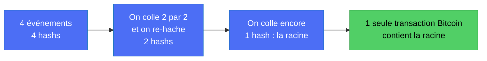

Si **un seul caractère** d'un seul événement change, son hash change, donc tous les hashs
au-dessus changent, donc la racine change, et elle ne correspond plus à celle écrite dans Bitcoin.

---

## 2. Le modèle conceptuel de données (MCD) 🎯

Trois tables nouvelles autour de ce qui existe déjà (la demande et le paiement). Les relations se lisent
ainsi : un certificat a **plusieurs** événements ; chaque événement appartient à **au plus un** lot
d'ancrage ; un lot regroupe **plusieurs** événements et correspond à **une** transaction Bitcoin.

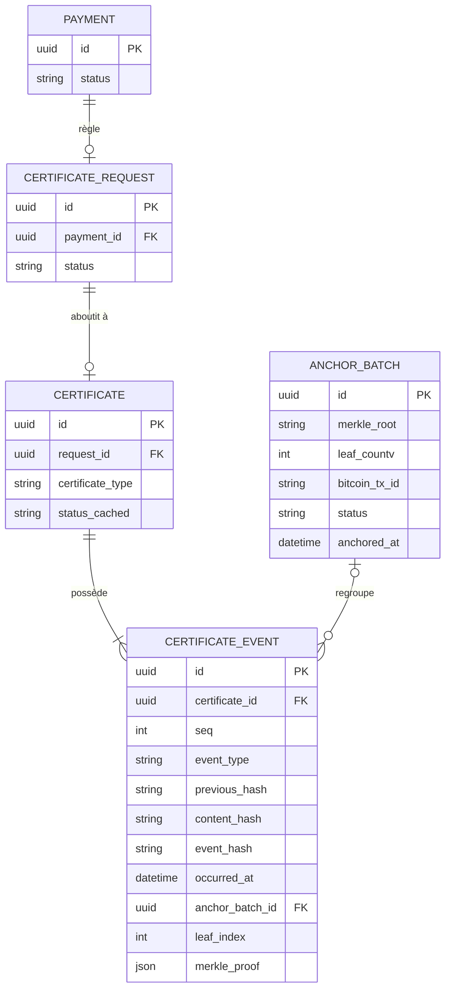

| Table | Rôle | Existe aujourd'hui ? |
|---|---|---|
| `payments` | Le paiement du citoyen (un par demande) | ✅ oui |
| `admin_certificate_requests` | La demande (porte `payment_id`) | ✅ oui |
| `certificates` | Le certificat émis (aujourd'hui : `admin_certificates_refs` + `verifiable_credentials`) | 🟡 en partie |
| `certificate_events` | Le journal : 1 ligne par événement, jamais modifiée, jamais supprimée | 🎯 non |
| `anchor_batches` | 1 ligne par lot ancré : racine de Merkle + transaction Bitcoin | 🎯 non |

> **Le paiement.** Chaque nouveau certificat vient d'une demande **payée**. Seul un certificat
> **réellement émis** produit un événement `ISSUED`. Le paiement ne fait donc pas partie de l'arbre :
> il déclenche l'émission, l'émission crée l'événement, et c'est l'**événement** qui entre dans l'arbre.
> Le coût d'une transaction Bitcoin est partagé entre tous les certificats du lot.

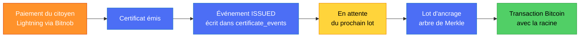

---

## 3. Le scénario de l'exemple

Entre 09h00 et 09h12, le 20 octobre 2026, il se passe **4 choses** sur **3 certificats** :

| Événement | Heure | Certificat | Type | `seq` |
|---|---|---|---|---|
| E1 | 09:00 | C-001 | `ISSUED` | 1 |
| E2 | 09:04 | C-002 | `ISSUED` | 1 |
| E3 | 09:10 | C-001 | `REVOKED` | 2 |
| E4 | 09:12 | C-003 | `ISSUED` | 1 |

Deux idées qui ne se mélangent pas :

- **La chaîne `previousHash`** relie les événements **d'un même certificat** (C-001 : E3 pointe vers E1).
- **L'arbre de Merkle** regroupe les événements **de tous les certificats** qui arrivent pendant la même fenêtre.

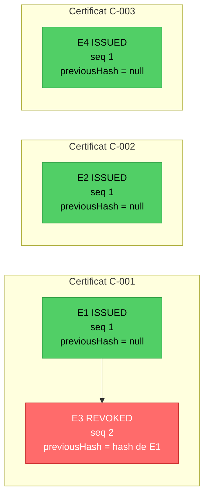

---

## 4. Étape 1 : chaque événement devient une feuille (son hash)

Un événement est écrit sous une forme **canonique** (clés triées, aucun espace superflu) puis passé
dans SHA-256. Exemple réel pour **E1** :

```json
{"certificateId":"C-001","contentHash":"sha256:aa11","occurredAt":"2026-10-20T09:00:00Z","previousHash":null,"seq":1,"type":"ISSUED"}
```

SHA-256 de ce texte = `47771d32b14a2bc9b2e7854f84497fe85ae1b824ff8b11072298351fdb54367f`, soit **H1 = `47771d…`**.

Pour **E3**, le champ `previousHash` contient le hash complet de E1. C'est ce qui fait la **chaîne** :

```json
{"certificateId":"C-001","contentHash":"sha256:cc33","occurredAt":"2026-10-20T09:10:00Z","previousHash":"47771d32b14a2bc9b2e7854f84497fe85ae1b824ff8b11072298351fdb54367f","seq":2,"type":"REVOKED"}
```

| Feuille | Événement | Hash (version courte) |
|---|---|---|
| **H1** | E1 : C-001 `ISSUED` | `47771d…` |
| **H2** | E2 : C-002 `ISSUED` | `72d45f…` |
| **H3** | E3 : C-001 `REVOKED` | `f7c7ab…` |
| **H4** | E4 : C-003 `ISSUED` | `f26144…` |

> **Aucune donnée personnelle** dans l'événement : seulement un `contentHash` (empreinte du contenu du
> certificat, avec un sel aléatoire côté serveur). Même la racine publiée sur Bitcoin ne révèle rien.

### Dans la base, avant l'ancrage 🎯

Les événements sont écrits **tout de suite**, mais ne sont pas encore dans un lot.

**`certificates`**

| id | certificate_type | status_cached |
|---|---|---|
| C-001 | résidence | REVOKED |
| C-002 | naissance | ISSUED |
| C-003 | nationalité | ISSUED |

**`certificate_events`**

| id | certificate_id | seq | event_type | previous_hash | event_hash | anchor_batch_id | leaf_index |
|---|---|---|---|---|---|---|---|
| E1 | C-001 | 1 | ISSUED | null | `47771d…` | *vide* | *vide* |
| E2 | C-002 | 1 | ISSUED | null | `72d45f…` | *vide* | *vide* |
| E3 | C-001 | 2 | REVOKED | `47771d…` | `f7c7ab…` | *vide* | *vide* |
| E4 | C-003 | 1 | ISSUED | null | `f26144…` | *vide* | *vide* |

> `status_cached` n'est qu'un **cache** pour répondre vite. La vérité, c'est la suite des événements.

---

## 5. Étape 2 : construire l'arbre

Règle unique : **le parent = SHA-256 des deux enfants collés, gauche puis droite.**

| Calcul | Résultat |
|---|---|
| H12 = SHA-256(H1 puis H2) | `57a8ee…` |
| H34 = SHA-256(H3 puis H4) | `c5a465…` |
| **Racine R = SHA-256(H12 puis H34)** | **`390ffa…`** |

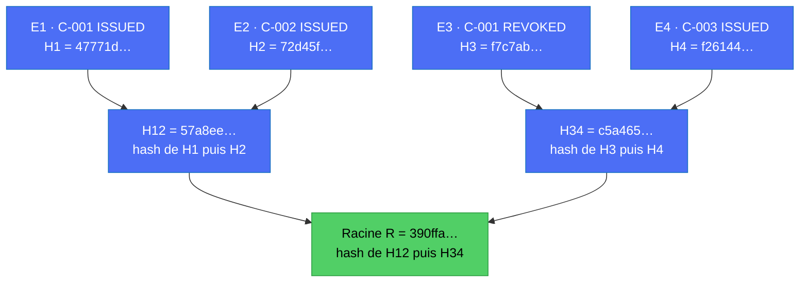

Remarque : l'arbre mélange **plusieurs certificats** (C-001, C-002, C-003). C'est voulu : un seul
point d'ancrage pour tout le monde.

---

## 6. Étape 3 : ancrer la racine sur Bitcoin

On écrit **uniquement la racine** (32 octets) dans une transaction Bitcoin (champ `OP_RETURN`) 🎯.
Une fois la transaction confirmée, on remplit la base.

**`anchor_batches`** (une seule ligne pour tout le lot)

| id | merkle_root | leaf_count | bitcoin_tx_id | status | anchored_at |
|---|---|---|---|---|---|
| B-001 | `390ffa91cdaf48c5…` | 4 | *l'identifiant de la transaction* | CONFIRMED | 2026-10-20 09:30 |

**`certificate_events`** après l'ancrage : on ajoute le lot, la position de la feuille et la **preuve**.

| id | certificate_id | event_hash | anchor_batch_id | leaf_index | merkle_proof |
|---|---|---|---|---|---|
| E1 | C-001 | `47771d…` | B-001 | 0 | `[H2, H34]` |
| E2 | C-002 | `72d45f…` | B-001 | 1 | `[H1, H34]` |
| E3 | C-001 | `f7c7ab…` | B-001 | 2 | `[H4, H12]` |
| E4 | C-003 | `f26144…` | B-001 | 3 | `[H3, H12]` |

Chaque événement garde **2 hashs** : ses « voisins » sur le chemin jusqu'à la racine. C'est sa preuve.

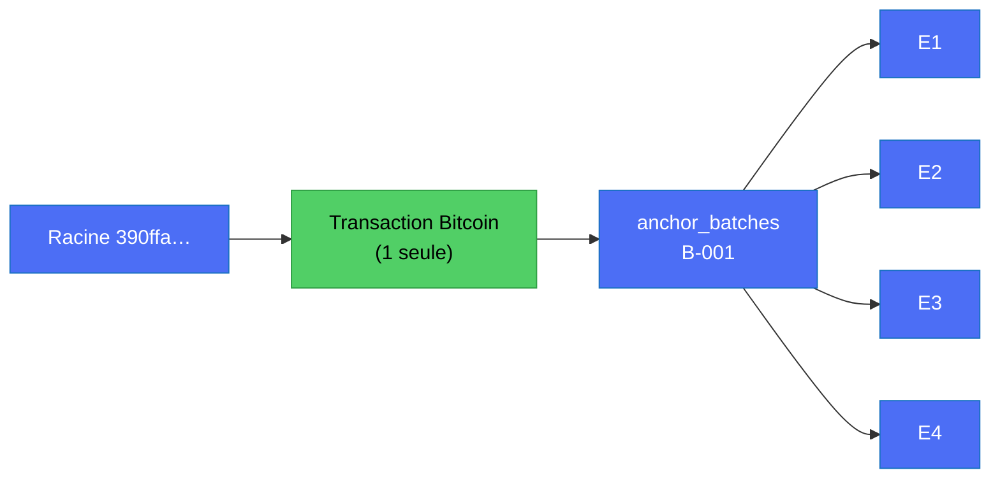

---

## 7. La preuve de Merkle : vérifier E3 sans connaître E1 ni E2

Un vérificateur veut savoir : « La révocation E3 était-elle bien dans le lot ancré sur Bitcoin ? »

Il reçoit : **E3** (son contenu), la **preuve** `[H4 à droite, H12 à gauche]`, et il lit la **racine
dans Bitcoin**. Il refait les calculs :

| # | Calcul du vérificateur | Résultat |
|---|---|---|
| 1 | H3 = SHA-256(JSON canonique de E3) | `f7c7ab…` |
| 2 | H34 = SHA-256(H3 puis **H4** à droite) | `c5a465…` |
| 3 | R = SHA-256(**H12** à gauche puis H34) | `390ffa…` |
| 4 | Comparer avec la racine lue dans Bitcoin | **identique** : E3 faisait bien partie du lot |

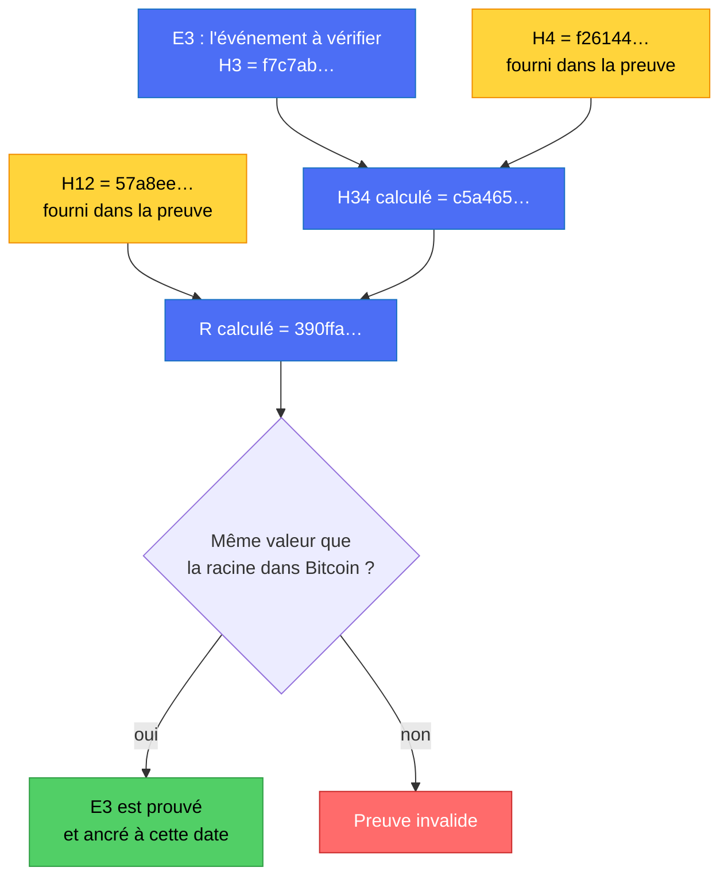

*Jaune = hashs fournis par la preuve. Bleu = calculés par le vérificateur. Les événements E1 et E2 ne sont
jamais montrés : on ne voit que `H12`, une empreinte.*

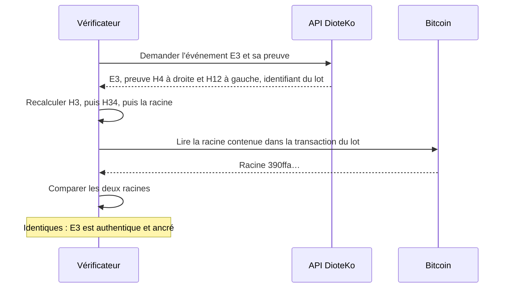

### Pourquoi c'est efficace

La taille de la preuve grandit **très lentement** avec le nombre d'événements :

| Événements dans le lot | Hashs dans la preuve | Taille de la preuve |
|---|---|---|
| 4 | 2 | 64 octets |
| 1 000 | 10 | 320 octets |
| 1 000 000 | 20 | 640 octets |

Un lot d'un million d'événements se vérifie avec **20 hashs** et **une** transaction Bitcoin.

---

## 8. Que se passe-t-il si quelqu'un triche ?

Imaginons que l'on transforme, après coup, la révocation E3 en émission (`REVOKED` devient `ISSUED`)
pour faire passer un certificat révoqué pour valide.

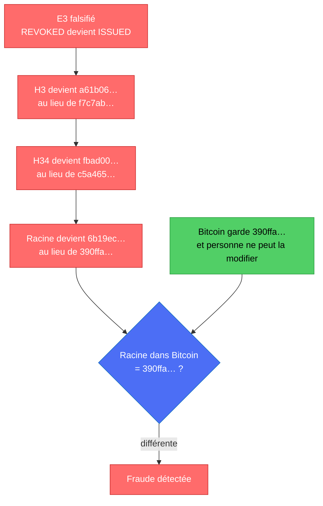

Le tricheur ne peut pas « réparer » la racine : il devrait **réécrire Bitcoin**. Il ne peut pas non plus
recalculer la chaîne `previousHash` pour tout masquer, car la racine ancrée ne correspondra plus.

Ce que Merkle **ne** fait **pas** : il ne protège pas les événements **pas encore ancrés** (voir
[`CERTIFICATE_EVENT_CHAIN.md`](CERTIFICATE_EVENT_CHAIN.md) §10 : fenêtre de risque). D'où l'intérêt d'ancrer
régulièrement.

---

## 9. Quand le nombre d'événements est impair

Un lot n'a pas une taille fixe de 4 : il peut contenir 1, 5 ou 1 000 événements, selon ce qui est
arrivé **avant sa fermeture** (voir §10). Si, au moment de fermer le lot, le nombre d'événements est
impair, le dernier n'a pas de voisin. Exemple avec 5 événements : on **recopie le dernier hash** pour
l'apparier avec lui-même (méthode utilisée par Bitcoin pour ses propres blocs). Cette recopie ne concerne
que l'instant où l'on construit l'arbre, jamais des événements qui arriveraient plus tard.

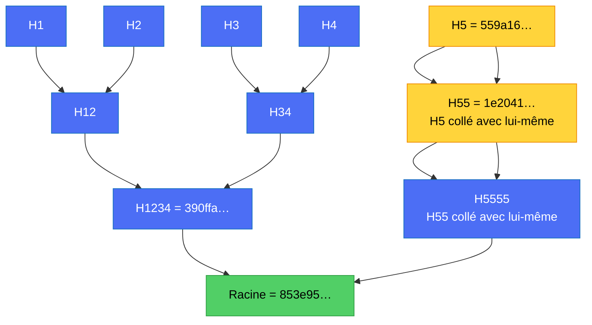

*Jaune = hash recopié pour combler le manque.*

> **Note de sécurité pour l'implémentation 🎯.** Dans une version de production, on préfixe les
> feuilles et les nœuds d'un octet différent avant de hacher (par exemple `0x00` pour une feuille, `0x01`
> pour un nœud) afin d'empêcher de faire passer un nœud pour une feuille. L'exemple ci-dessus reste
> volontairement simple.

---

## 10. Plusieurs lots : les événements qui arrivent après, et un certificat réparti sur plusieurs lots

### 10.1 Un lot fermé ne change plus : les nouveaux événements vont dans un nouveau lot

Un arbre se construit des feuilles vers la racine, **une seule fois**, au moment où le lot est fermé
(par exemple toutes les 30 minutes, ou dès qu'il y a 100 événements : à choisir 🎯). Une fois la racine
écrite dans Bitcoin, on n'y ajoute plus rien : ajouter une feuille changerait la racine, qui ne
correspondrait plus à celle de la transaction.

Les événements suivants attendent donc dans un **nouveau lot**, avec un **nouvel arbre**, une **nouvelle
racine** et une **nouvelle transaction**. Les anciens lots ne sont jamais recalculés et leurs preuves
restent valables. **Un lot = un ancrage.**

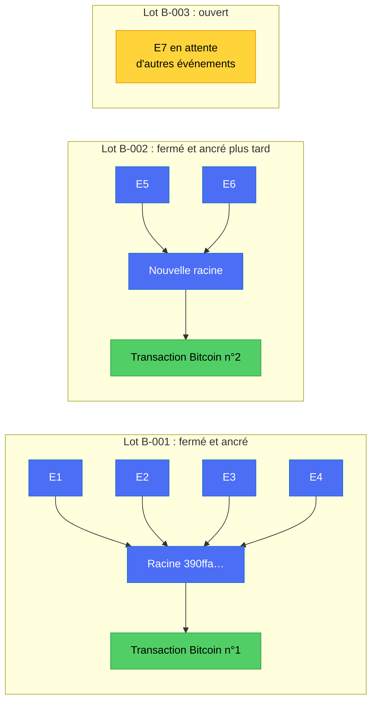

Cycle de vie d'un lot (colonne `status` de `anchor_batches`) :

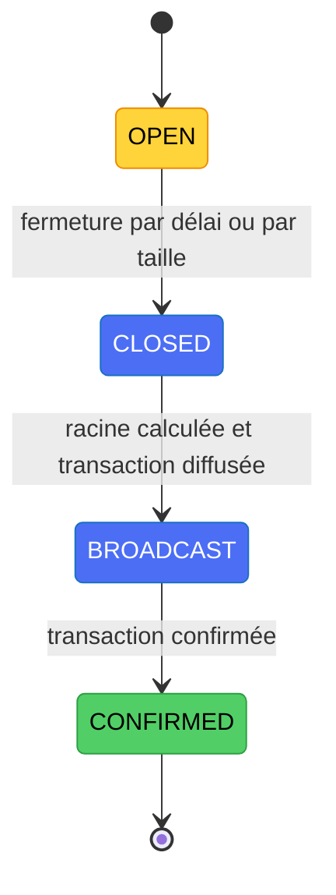

### 10.2 Un même certificat dont les événements sont dans plusieurs lots

Cas : le certificat **C-005** est émis, révoqué, réémis, révoqué, réémis. Cela fait 5 événements, répartis
sur 3 lots.

| Événement | `seq` | Type | `previous_hash` | Lot | Feuille |
|---|---|---|---|---|---|
| F1 | 1 | `ISSUED` | null | B-001 | 0 |
| F2 | 2 | `REVOKED` | hash de F1 | B-001 | 1 |
| F3 | 3 | `REISSUED` | hash de F2 | B-002 | 0 |
| F4 | 4 | `REVOKED` | hash de F3 | B-002 | 1 |
| F5 | 5 | `REISSUED` | hash de F4 | B-003 (ouvert) | 0 |

Il y a **deux liens indépendants** :

| Lien | Qui pointe vers quoi | Ce qu'il garantit |
|---|---|---|
| **Chaîne** | `previous_hash` de F(n) est le hash de F(n-1) | L'ordre et la continuité de l'historique. Elle ne dépend pas des lots. |
| **Ancrage** | `anchor_batch_id` et `merkle_proof` de chaque événement | Cet événement existait dans le lot X, donc avant la date de la transaction de X. |

Le **certificat** ne pointe vers aucun lot : ce sont ses **événements** qui le font.

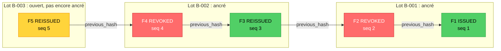

*Les flèches de chaîne traversent les lots sans problème : elles ne regardent que les hashs. Vert =
certificat valide, rouge = révoqué, jaune = pas encore ancré.*

**Vérification du certificat :** on prend les événements triés par `seq`, et pour **chacun** on contrôle :

1. son hash recalculé est identique à celui stocké ;
2. son `previous_hash` est le hash de l'événement précédent ;
3. sa preuve de Merkle remonte à la racine de **son** lot (F1 et F2 dans B-001, F3 et F4 dans B-002) ;
4. cette racine est bien dans la transaction Bitcoin de ce lot.

Le statut courant est le type du **dernier** événement (ici `REISSUED`), valide si `validUntil` n'est pas
dépassé. Comme F5 est dans un lot ouvert, l'API peut répondre « valide, mais le dernier événement n'est
pas encore ancré » (fenêtre de risque, `CERTIFICATE_EVENT_CHAIN.md` §10).

Deux conséquences utiles :

- **Le dernier ancrage couvre tout le passé.** Le hash de F5 dépend de celui de F4, qui dépend de F3, etc.
  Dès que F5 est ancré, on prouve que toute la chaîne F1 à F4 existait au plus tard à cette date. Les
  ancrages précédents servent à dater chaque événement plus précisément.
- **Règle d'implémentation 🎯 :** les événements d'un même certificat entrent dans les lots dans l'ordre
  de `seq`. Ainsi la date d'ancrage de F(n+1) n'est jamais antérieure à celle de F(n), et le vérificateur
  peut contrôler cette cohérence.

---

## 11. Qui paie l'ancrage ? 🎯 décision ouverte

Un lien `previous_hash` ne coûte rien (c'est une colonne de la base). L'**ancrage**, lui, est une
transaction Bitcoin : il a des **frais**. Une transaction coûte à peu près la même chose pour 4 ou pour
1 000 événements (les montants dépendent du réseau), donc **plus le lot est gros, moins chaque événement
coûte**. C'est la raison d'être de l'arbre de Merkle.

| Événement | Qui le déclenche | Paiement du citoyen ? | Qui porte l'ancrage |
|---|---|---|---|
| `ISSUED` | Le citoyen (demande payée) | Oui | L'administration, sur ce qu'elle gagne à l'émission |
| `REISSUED` | Le citoyen (renouvellement) | Oui | L'administration |
| `REVOKED` | L'administration | **Non** | L'administration, forcément |

Une révocation n'a pas de paiement à côté : elle ne doit **jamais être bloquée** faute de frais.

**Piège à éviter :** « profiter du paiement pour ancrer » ne veut pas dire une transaction Bitcoin par
paiement, ce qui annulerait l'intérêt de Merkle. Le paiement **alimente un budget d'ancrage** (un crédit par
administration), et l'ancrage se fait ensuite **par lot**, avec ce budget.

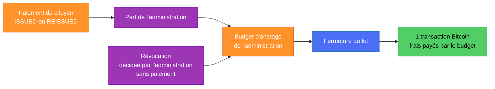

**Portée d'un lot : trois options.**

| Option | Avantage | Inconvénient |
|---|---|---|
| **Un lot global** (toutes les administrations) | Un seul portefeuille, coût par événement minimal | Il faut répartir les frais entre administrations |
| **Un lot par administration** | Chacune paie et signe son propre ancrage ; colle à `organization_id` | Une petite administration remplit son lot lentement : délai plus long ou coût par événement plus élevé |
| **Un lot global, frais répartis au prorata** | Un seul ancrage, frais équitables | Il faut une comptabilité par administration |

**Orientation actuelle (non figée) :** pour le hackathon, **un lot global géré par DioteKo sur le testnet**
(pas de vrais frais, un seul portefeuille, démonstration simple). En production, l'administration finance
l'ancrage avec son budget d'ancrage, et le lot par administration est l'évolution possible. Aujourd'hui l'argent
du citoyen arrive déjà à l'administration par le payout Bitnob, ce qui en fait le point naturel pour prélever la
part d'ancrage (non vérifié dans le code). Détail et points ouverts (règle de fermeture du lot, choix du vrai
ancrage) : [`DECISIONS.md`](DECISIONS.md).

---

## 12. Qui fait quoi : la chaîne et l'arbre se complètent

| | Chaîne `previousHash` | Arbre de Merkle |
|---|---|---|
| **Relie** | Les événements **d'un même certificat** | Les événements **de tous les certificats** d'un lot |
| **Sert à** | Rendre l'**historique** inviolable : on ne peut ni insérer ni retirer un événement au milieu | Prouver que des événements **existaient** à telle date avec **une seule** transaction |
| **Prouve** | L'ordre et la continuité | L'appartenance à un lot ancré |
| **Seul, il ne suffit pas car** | Celui qui contrôle la base peut tout recalculer | Il ne dit rien de l'ordre dans un certificat |
| **Dans la base** | `previous_hash`, `seq` | `anchor_batch_id`, `leaf_index`, `merkle_proof` |

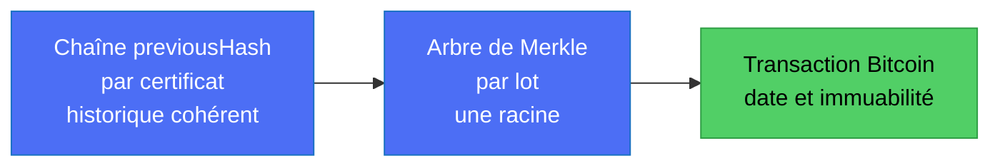

---

## 13. Ce qui existe aujourd'hui et ce qui reste à faire

| Élément | État | Détail |
|---|---|---|
| Hash d'un document | ✅ | `createDocumentHash` (SHA-256 d'un JSON) dans `certificate-anchor.service.ts` |
| Ancrage Bitcoin | 🔴 simulé | `anchorDocumentHash` renvoie un `txId` aléatoire, rien n'est diffusé |
| Vérification d'ancrage | 🔴 simulée | `verifyDocumentHash` répond toujours `verified: true` |
| Table `certificate_events` | 🎯 à créer | journal en ajout seul |
| Table `anchor_batches` | 🎯 à créer | une ligne par lot |
| Calcul de l'arbre et des preuves | 🎯 à écrire | un petit service (quelques dizaines de lignes) |
| Vrai ancrage | 🎯 à choisir | transaction `OP_RETURN` maison, ou un service d'ancrage groupé existant (OpenTimestamps) : **à vérifier avant adoption** |

Ordre conseillé pour le hackathon : (1) table `certificate_events` avec `previous_hash`, (2) calcul de
l'arbre et des preuves **en local** avec un vrai SHA-256 (déjà démontrable, sans Bitcoin), (3) brancher
le vrai ancrage de la racine.

---

## 14. Mini-glossaire

| Mot | Sens simple |
|---|---|
| **Hash** | Empreinte de 64 caractères. Même texte donne toujours le même hash. Un caractère changé change tout le hash. |
| **Feuille** | Le hash d'un événement, tout en bas de l'arbre. |
| **Nœud** | Le hash obtenu en collant deux hashs enfants. |
| **Racine (Merkle root)** | Le hash tout en haut. Il résume **tout** le lot. C'est lui qu'on écrit dans Bitcoin. |
| **Preuve de Merkle** | Les hashs voisins nécessaires pour remonter d'une feuille jusqu'à la racine. |
| **Lot (batch)** | Ensemble d'événements ancrés ensemble avec une seule transaction. |
| **Ancrage** | Écrire la racine dans une transaction Bitcoin pour la dater de façon immuable. |

---

## 15. Phrase pour le jury

> « Chaque événement d'un certificat est haché, enchaîné au précédent, puis tous les événements d'un
> lot sont regroupés dans un arbre de Merkle dont **une seule racine** est inscrite sur Bitcoin. N'importe
> qui peut vérifier un événement avec une preuve de quelques hashs, sans nous faire confiance et sans
> que l'on révèle les autres certificats. »
