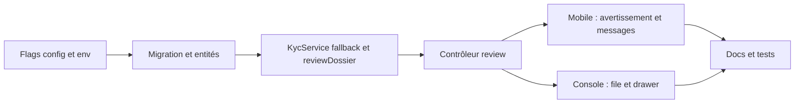

# Plan : KYC et MRZ en revue manuelle (flags) depuis la console

> **Implémenté** (console, backend, mobile). Le résultat est décrit dans `docs/KYC.md` §16. Écarts avec ce plan : le stockage chiffré des pièces est retenu (question 1), la portée des agents est commune à la plateforme (question 2, voir `docs/KNOWN_ISSUES.md`), un dossier en revue ne peut pas payer (question 3), et `rejected` n'est pas absorbé par le fallback (rejet inexpliqué = final).

## Contexte

Le contrôle automatique bloque aujourd'hui des utilisateurs légitimes :

- **MRZ** : le précheck refuse la photo du verso (`mrz_unreadable`, `CaptureStep.tsx`, `backPrecheckVerdict`). Idswyft ferme la session en `HARD_REJECTED` (`BACK_MRZ_CHECKSUM_FAILED`, `CROSS_VALIDATION_FAILED`, `FRONT_LOW_CONFIDENCE`). Ces seuils sont codés en dur dans l'image (voir `docs/KYC.md` §12, §14, §15).
- **Porte KYC** : `assertVerifiedFor` bloque `residence` et `identity` tant qu'aucun dossier n'est `verified`.
- **Absence de relecture humaine** : `manual_review` n'est décidé que dans le dashboard Idswyft. Il n'existe aucun écran ni endpoint DioteKo (point ouvert dans `PLAN_KYC_SCRAPING.md`).

Objectif : des flags qui laissent l'utilisateur déposer ses documents même quand le MRZ ou Idswyft échoue. Le message affiché est « vos documents seront vérifiés par un agent ». Un agent tranche ensuite dans la console web. Le plan doit rester évolutif : avec Bitnob en production réelle, ces flags seront coupés ou resserrés.

## Principes

1. **Fail-closed en production** : les flags d'assouplissement sont ignorés quand `NODE_ENV=production`, comme `parseKycEnforcement`. Une surcharge explicite est requise pour le hackathon.
2. **Pas de nouveau statut** : on réutilise `manual_review` (index unique partiel, `OPEN_STATUSES`, libellé mobile « En cours d'examen » déjà en place). On ajoute une colonne `review_origin` pour distinguer `provider` de `fallback`.
3. **`verified` reste write-once** et n'est écrit que par deux chemins : le read-back fournisseur, ou la décision d'un agent via un nouvel endpoint audité.
4. **Rien d'irréversible sans trace** : chaque décision agent est journalisée via `accessLogService.record`.

## Flags (nouveaux, patron `parseKycEnforcement`)

| Variable | Valeurs | Effet |
|---|---|---|
| `KYC_MRZ_PRECHECK` | `strict` (défaut), `warn`, `off` | `warn` : `mrz_unreadable` n'est plus un refus, c'est un avertissement et l'envoi reste possible. `off` : précheck MRZ ignoré. |
| `KYC_FALLBACK_MANUAL_REVIEW` | `off` (défaut), `on` | `on` : un `HARD_REJECTED`, un `failed` de type `document_unreadable`, ou un fournisseur injoignable ou en timeout, route le dossier vers `manual_review` (`review_origin=fallback`) au lieu de `rejected` ou `failed`. |
| `KYC_PROVIDER_MODE` | `idswyft` (défaut), `manual_only` | `manual_only` : Idswyft n'est pas appelé. Le dossier naît directement en `manual_review`. Utile quand Idswyft est arrêté pendant la démo. |

Fichiers :

- `backend-nest/src/config/configuration.ts` : bloc `kyc` (types, valeurs) et parseurs, avec le garde-fou production.
- `backend-nest/src/config/env.validation.ts` : `@IsOptional() @IsIn([...])` en chaînes, plus un avertissement de boot dans `validate()` si un flag d'assouplissement est actif.
- `.env.example`, `.env.dev.example`, `.env.test.example`, `.env.prod.example` : bloc KYC (lignes ~105-121).
- Exposer le mode au mobile : `GET /kyc/status` renvoie `reviewMode` (`automatic | agent`), sans exposer de config brute.

## Changements backend (`backend-nest/src/modules/kyc/`)

1. **Migration TypeORM réversible** : sur `kyc_verifications`, ajouter `review_origin` (`provider | fallback | manual_only`, nullable), `reviewed_by` (uuid, nullable), `reviewed_at`, `review_note`. Mettre à jour `docs/DATABASE_MODEL.md`. Aucune donnée existante n'est perdue, donc `@migration-reviewer` est inutile sur une base de dev fraîche.
2. **Stockage des pièces pour la relecture.** C'est le point structurant : les photos partent aujourd'hui vers Idswyft sans copie locale (en mémoire), donc l'agent n'aurait rien à voir. Recommandé :
   - nouvelle entité `kyc_document` (id, `verification_id`, `kind` `front|back|selfie`, `mime`, blob chiffré AES-GCM avec clé en env `KYC_DOC_ENCRYPTION_KEY`, `expires_at`) ;
   - écriture **uniquement** si `KYC_FALLBACK_MANUAL_REVIEW=on` ou `KYC_PROVIDER_MODE=manual_only` ;
   - rétention courte (`KYC_DOC_RETENTION_DAYS`, 30 par défaut) et suppression dès la décision ;
   - à tracer dans `docs/KYC.md` §9 (vie privée) : c'est une entorse assumée au principe « jamais stockées ».
3. **`KycService`** :
   - `uploadStep` : en `manual_only`, stocker sans appeler le fournisseur. Sinon, en cas de `HARD_REJECTED` ou d'erreur fournisseur avec le fallback actif, basculer en `manual_review`. Le point de bascule est `refreshFromProvider` (lignes ~402-408) et la capture d'erreur d'`uploadStep`.
   - `precheck` / `backPrecheckVerdict` : tenir compte de `KYC_MRZ_PRECHECK`.
   - Nouveau `reviewDossier(actor, id, decision, note)` : écriture conditionnelle `WHERE status='manual_review'`, 409 si le dossier a été pris entre-temps, règle des quatre yeux. Même patron que `reviewRequest` d'`admin-certificates`.
   - `startSession` : reprendre un dossier `manual_review` existant (déjà le cas), sans créer de session fournisseur en `manual_only`.
4. **Nouveau contrôleur `kyc-review.controller.ts`** (`@Roles(ISSUER, ADMIN)`) :
   - `GET /kyc/review` : file `manual_review` (filtres statut et origine, pagination) ;
   - `GET /kyc/review/:id` : détail et métadonnées ;
   - `GET /kyc/review/:id/documents/:kind` : flux du document, accès journalisé, en-têtes `no-store` ;
   - `POST /kyc/review/:id/decision` : `{ decision: 'approve' | 'reject', reason?, note }`. L'approbation passe en `verified`, le rejet en `rejected` avec un `failure_reason`.
   - Les dossiers n'ont pas d'`organizationId`, donc la portée est globale pour issuer/admin. À arbitrer (voir questions ouvertes).
5. **Logs** `[START] [ENTITY] [CALL] [RESULT] [STATE]` sur chaque bascule et chaque décision. Aucune donnée personnelle ni image dans les logs.
6. **Sécurité** : `@security-analyst` avant de toucher au scoping des rôles et à l'accès aux documents.

## Changements mobile (`frontmobile/`)

- `services/kyc.ts` : type de statut enrichi de `reviewMode`. Libellés `KYC_STATUS_LABELS` pour `manual_review` avec origine `fallback`.
- `components/kyc/CaptureStep.tsx` : si `reviewMode=agent` ou `KYC_MRZ_PRECHECK=warn`, `mrz_unreadable` devient un avertissement avec un bouton « Envoyer quand même », au lieu d'un refus. Même traitement dans la boucle de capture auto (lignes ~150-159, ~213).
- `components/kyc/StepScreens.tsx` et `app/kyc.tsx` : écran résultat `review` avec le message « Vos documents ont bien été reçus. Un agent les vérifiera dans la console, vous serez notifié ».
- `hooks/use-kyc-status.ts`, `app/(tabs)/profile.tsx`, `app/certificate/new.tsx` : le bandeau bloquant de `new.tsx` doit dire « vérification en cours par un agent » au lieu d'inviter à refaire le KYC quand le dossier est en `manual_review`.

**Décision à prendre** : un dossier en `manual_review` ne passe pas la porte `assertVerifiedFor`. L'utilisateur peut déposer sa demande, mais l'invoice est bloquée tant que l'agent n'a pas validé. C'est le comportement le plus sûr, retenu par défaut. Une alternative démo serait un flag `KYC_ALLOW_PENDING_REVIEW`, non retenue ici.

## Changements console web (`frontweb/`)

Règles `AGENTS.md` : appels uniquement via `src/lib/api.ts`, permissions uniquement dans `src/lib/permissions.ts`.

- `permissions.ts` : permission `kyc.review`, accordée à `registrar` et `approver` (Nest `issuer` ou `admin`).
- `api.ts` : `listKycReviews`, `getKycReview`, `getKycDocument`, `decideKycReview`, avec mocks derrière `VITE_USE_MOCKS`.
- Nouvelle route `src/routes/_console.verifications.tsx` : tableau (utilisateur masqué sans `request.view_personal_data`, date, origine `fallback`/`provider`, pays, type de pièce).
- Nouveau composant `components/console/KycReviewDrawer.tsx`, inspiré de `RequestDrawer.tsx` : visionneuse recto, verso et selfie, boutons Valider et Rejeter avec motif, état de conflit 409.
- `AppShell.tsx` : entrée de navigation « Vérifications d'identité ».

## Ordre d'implémentation

Contrat API : backend d'abord, puis mobile et console en parallèle.

## Vérification

- **Unitaires** (`kyc.service.spec.ts`, `configuration.spec.ts`, `kyc-precheck.util.spec.ts`) :
  - les flags sont ignorés en production ;
  - un `HARD_REJECTED` avec fallback `on` donne `manual_review`, et `rejected` avec fallback `off` ;
  - `reviewDossier` : 409 sur double décision, la décision par le demandeur lui-même est refusée, `verified` reste write-once.
- **E2E** (`test/kyc.e2e-spec.ts`) : dossier `manual_review`, puis le gate renvoie `403 KYC_REQUIRED`. Après approbation par un `issuer`, le gate passe. Un `holder` reçoit 403 sur `/kyc/review`.
- **Mobile** : `tsc`, puis un essai manuel avec une photo de verso à MRZ illisible (envoi autorisé, écran « agent »).
- **Console** : tests vitest `permissions.test.ts` et nouvelle route ; essai manuel avec `VITE_USE_MOCKS=false`.
- Lint et type-check de chaque paquet.

## Docs à mettre à jour

`docs/KYC.md` (§5 diagramme d'états, §6 porte, §8 config, §9 vie privée, §11 points ouverts), `docs/DATABASE_MODEL.md`, `docs/DEV_WORKFLOW.md`, `docs/KNOWN_ISSUES.md` (flags d'assouplissement à couper avant la prod Bitnob), `docs/DECISIONS.md` (stockage chiffré des pièces).

## Évolution : passage de Bitnob en production réelle

- Prod : `NODE_ENV=production` neutralise `KYC_MRZ_PRECHECK` (forcé à `strict`) et `KYC_PROVIDER_MODE=manual_only`.
- `KYC_FALLBACK_MANUAL_REVIEW` peut rester `on` : c'est alors un vrai processus de relecture, plus un contournement. Il faut alors une politique de rétention, une file de travail avec SLA, et idéalement l'autorisation CDP.
- La file console devient le composant durable : seuls les flags de contournement disparaissent.

## Questions ouvertes

1. Stockage chiffré des pièces en base : acceptable pour le hackathon, ou préférez-vous renvoyer l'agent vers le dashboard Idswyft ? Dans ce cas, le fallback `manual_only` serait impossible.
2. Portée des agents : tous les issuers/admins voient-ils tous les dossiers, ou faut-il rattacher le dossier à une organisation ?
3. Le demandeur doit-il pouvoir créer une demande payante pendant `manual_review` ? Le plan dit non.
