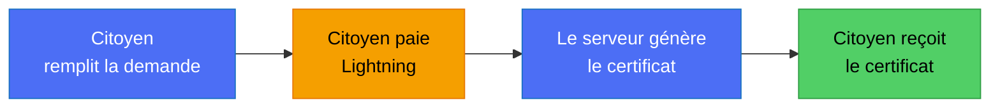
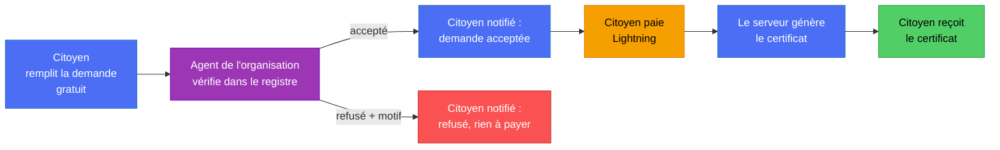
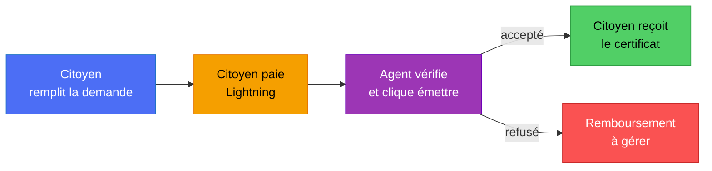

# Décisions à prendre : le flow de génération du certificat

> **Comment répondre :** remplis les lignes « **Ta réponse :** » (une lettre suffit, ou une phrase
> libre). Si aucune option ne te convient, écris ce que tu veux. Je pars de tes réponses pour écrire le plan de code.

## 0. Le vrai problème, en clair

Tu as vu juste sur trois points :

1. **L'organisation doit rester un point de contrôle.** Un certificat administratif engage l'administration : quelqu'un
   doit s'assurer que la demande est légitime et que les informations sont exactes.
2. **Si tout est automatique après le paiement, l'issuer ne sert plus à rien.** C'est vrai. Il faut donc décider
   *où* se place le contrôle humain, ou bien l'assumer comme inutile pour certains documents.
3. **Si on vérifie d'abord puis on paie puis on re-vérifie, le citoyen attend deux fois.** C'est ce qu'il faut éviter.

L'idée centrale de ce document : **le contrôle humain et la génération du certificat sont deux choses différentes.**
Le contrôle peut se faire *avant* le paiement. Une fois le contrôle fait, plus aucun humain n'est nécessaire :
dès que le paiement est constaté, le serveur génère le certificat tout seul. Le citoyen n'attend donc qu'**une** fois.

Et « repartir sur place » n'arrive pas : la vérification est faite en ligne par un agent de l'administration (il compare
la demande au registre), le citoyen ne se déplace pas. Le déplacement n'est utile que pour un cas particulier
(pièce d'identité à contrôler en personne), voir question 4.

## 1. Les trois flows possibles

### Flow A : payer, génération automatique (aucun humain)

- Avantages : le plus rapide, idéal pour la démo, aucun second compte à utiliser.
- Inconvénients : **aucun contrôle**. Quelqu'un peut payer pour un extrait de naissance qui n'existe pas. L'issuer ne
  sert à rien (au mieux, il révoque après coup).
- Convient si : le document ne fait que *reproduire* une donnée déjà certifiée dans un registre.

### Flow B : vérifier d'abord, puis payer, puis génération automatique (ma recommandation)

- Le contrôle humain est **avant** l'argent : un refus ne coûte rien au citoyen, **pas de remboursement à gérer**.
- L'issuer garde un vrai rôle (le point de contrôle que tu veux), et après le paiement plus aucun humain.
- Une seule attente : le temps de vérification (affichable : « traité sous 24 h »).
- Inconvénients : un nouveau statut (« acceptée »), une notification au citoyen, et un écran pour l'agent
  (c'est le chantier C10, la console web, qui existe déjà en maquette).

### Flow C : payer, puis vérifier, puis générer (ce que le code fait aujourd'hui)

- Avantage : c'est déjà codé (`/issue` réservé à l'issuer).
- Inconvénients : l'argent est pris avant le contrôle, **un refus oblige à rembourser** (rail Lightning : pas
  de remboursement simple), et l'attente vient après le paiement, ce qui est la pire expérience.

### Comparaison

| | A : auto | **B : vérifier, payer, auto** | C : payer, vérifier |
|---|---|---|---|
| Contrôle humain | aucun | **oui, avant l'argent** | oui, après l'argent |
| Rôle de l'issuer | aucun | **oui** | oui |
| Attente du citoyen | aucune | **une fois** | une fois, après paiement |
| Remboursement si refus | sans objet | **jamais** | **nécessaire** |
| Travail de code | petit | moyen | déjà fait |
| Démo avec un seul téléphone | oui | oui, avec un bouton « accepter » côté staff | oui, avec un bouton « émettre » |

## 2. Questions

### Q1. Quel flow pour DioteKo ?

- **A** : payer puis génération automatique, sans humain.
- **B** : vérifier par l'organisation, puis payer, puis génération automatique. *(recommandé)*
- **C** : payer, puis vérification humaine, puis émission (le code actuel).
- **D** : un mélange selon le type de document (voir Q2).

**Ta réponse :** **B** (vérifier, payer, génération automatique). *Réalisé, lots 1 à 3.*

### Q2. Tous les documents ont-ils le même contrôle ?

Un extrait de naissance reproduit une donnée du registre d'état civil, alors qu'un casier judiciaire ou un certificat
d'identité demande plus de prudence. On peut donc marquer chaque type de document :

| Type | Contrôle proposé |
|---|---|
| Extrait de naissance, mariage, décès | automatique (donnée du registre) ou vérification légère |
| Certificat de résidence | vérification par l'agent |
| Certificat d'identité | vérification par l'agent |

C'est un simple réglage par type (« à vérifier : oui/non »), pas deux systèmes.

**Ta réponse :** mélange comme le tableau : naissance, mariage et décès acceptés automatiquement ; résidence et identité vérifiés par un agent (`requiresReview` dans `admin-certificates.constants.ts`). *Réalisé.* ⚠️ Risque relevé par la revue CodeRabbit : les données sont déclarées par le titulaire puis signées au nom de la mairie. Un interrupteur d'environnement et une mention « déclaré, non vérifié » sont proposés (roadmap, lot 7, point 4).

### Q3. Qui vérifie, et qui signe ?

La maquette de la console (`CONSOLE_ORGANISATIONS_CAHIER_DES_ECRANS.md`) prévoit plusieurs rôles : agent d'état civil,
officier signataire, agent financier, auditeur.

- **Une seule personne** vérifie et signe (le plus simple, pour le hackathon).
- **Deux personnes** : l'agent d'état civil vérifie, l'officier signataire valide (plus réaliste, plus de code).
- Avec le flow B, la signature du certificat est faite par le serveur au moment de la génération : l'« officier »
  valide donc la demande, il ne signe pas à la main chaque PDF.

**Ta réponse :** une seule personne : l'issuer de l'organisation vérifie, le serveur signe. *Réalisé.* Les rôles de la console (D5) restent à décider.

### Q4. Que fait l'agent quand une demande est douteuse ?

- Refuser avec un **motif obligatoire** (ex. « informations non retrouvées dans le registre »). Le citoyen voit le motif.
- Demander un **complément** (une pièce, une correction) au lieu de refuser. Plus de code.
- Cas « se présenter sur place » pour un contrôle en personne : à prévoir, ou hors périmètre du hackathon ?

**Ta réponse :** refus avec motif obligatoire **et** demande de complément (le citoyen corrige puis renvoie) ; le contrôle sur place est hors périmètre. *Réalisé* : routes `reject`, `request-info` et `resubmit`.

### Q5. Comment prévenir le citoyen ?

- **Dans l'app seulement** : le statut change, le citoyen tire pour rafraîchir. Aucun travail de plus. *(suffisant pour la démo)*
- **Notification push** sur le téléphone (« votre demande est acceptée, payez »). Utile, un peu de travail (Expo).
- **E-mail ou SMS** : plus lourd (service externe).

**Ta réponse :** notification push d'abord, avec une porte ouverte pour l'e-mail et le SMS. *Non réalisé* (lot 4 : aucun module de notifications). Aujourd'hui l'écran de détail se rafraîchit par polling et par tirer-pour-actualiser.

### Q6. Un admin de plateforme voit-il toutes les organisations ?

Aujourd'hui, un issuer ou un admin d'une organisation B peut déclencher l'émission ou le payout d'une demande de
l'organisation A s'il en connaît l'identifiant : c'est une faille de sécurité connue (`KNOWN_ISSUES.md`).
Je la corrige de toute façon. Reste à fixer la règle :

- **Chacun limité à son organisation**, admin compris. *(recommandé : règle unique, la plus sûre)*
- **L'admin voit tout**, avec une trace dans le journal d'audit.

**Ta réponse :** chacun limité à son organisation, admin compris (décidé). *Réalisé* (lot 1). Une route « bris de glace » journalisée pour l'admin de plateforme reste à faire.

### Q7. Comment tester le paiement sans pouvoir payer en sandbox ?

Personne ne sait régler une facture Lightning dans le bac à sable Bitnob (voir `BITNOB_PASSER_EN_LIVE.md`).
Pour développer et faire la démo, il faut un moyen de passer une demande à « payée » :

- **Route de test réservée au développement** (désactivée en production) qui marque la facture payée.
  *(recommandé pour avancer vite et faire la démo)*
- Attendre la réponse de Bitnob.
- Faire un essai réel en mode live avec un tout petit montant.

**Ta réponse :** route de test réservée au développement, basculable sans changer le code. *Réalisé* : `PAYMENT_SIMULATION=true` monte `POST /admin-certificates/dev/requests/:id/mark-paid` ; le démarrage refuse ce réglage en production. Le vrai paiement Bitnob n'a toujours pas été observé.

### Q8. Dans quel ordre travailler ?

1. **Isolation par organisation** (sécurité, correctif de `issue` / facture / payout).
2. **Paiement dans l'app mobile** (écran de paiement réel : QR de la facture, suivi du statut, remplace le « paiement fictif »).
3. **Flow de vérification** (statut « acceptée », écran de l'agent, motif de refus, notification).
4. **Génération automatique après paiement** (si flow A, B ou D).

Mon ordre conseillé : 1, puis 3 si B (sinon 4 si A), puis 2, car l'écran de paiement mobile dépend du flow choisi.

**Ta réponse :** ordre laissé à Claude, suivi dans l'ordre des lots 1 à 6. Voir [`ROADMAP_NEXT_STEPS.md`](ROADMAP_NEXT_STEPS.md) §4 bis pour l'état par lot et §4 ter pour la suite (lot 7).

## 3. Ce que je fais avec tes réponses

| Si tu réponds | Je prépare |
|---|---|
| Q1 = B | nouveau statut « acceptée », route d'acceptation/refus pour l'agent, paiement ouvert seulement après acceptation, génération automatique au paiement, motif de refus (migration relue), écran de paiement mobile |
| Q1 = A | génération automatique au paiement (avec garde contre la double émission), écran de paiement mobile, l'issuer devient un rôle de supervision (révocation) |
| Q1 = C | on garde le code ; on ajoute un écran d'attente côté mobile et on traite le remboursement en cas de refus |
| Q1 = D | un réglage « à vérifier » par type de document + les deux chemins ci-dessus |
| Q6 | correctif de sécurité des routes `issue`, facture et payout, avec tests croisés entre organisations et revue `@security-analyst` |
| Q7 | route de test réservée au développement, ou rien |
