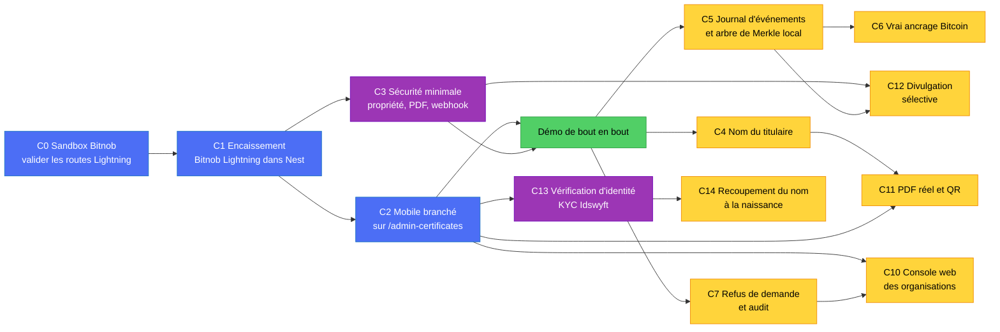
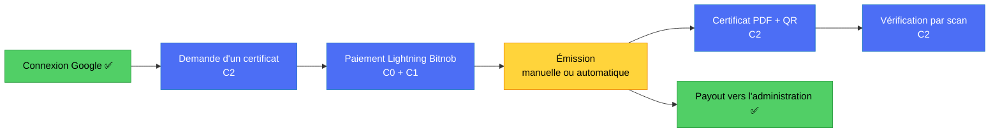
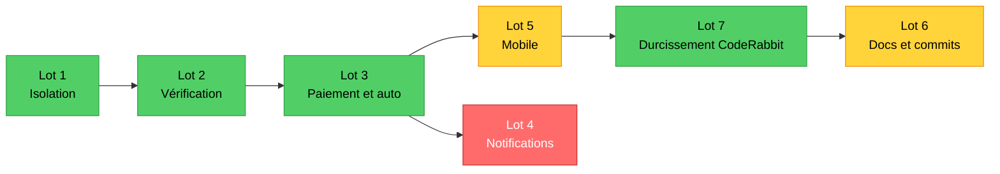
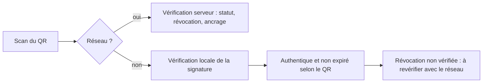

# Feuille de route : ce qui reste pour que DioteKo marche de bout en bout

> Écrit à partir de l'état réel du code (voir
> [`ARCHITECTURE_AS_BUILT.md`](ARCHITECTURE_AS_BUILT.md) §9 pour la liste détaillée des écarts). Les tailles
> **S / M / L** sont des ordres de grandeur relatifs, pas des durées.
>
> **Légende :** ✅ fait · 🟡 partiel · 🔴 simulé ou absent · 🎯 à construire.

---

## 1. Où tu en es

| Brique | État | Détail |
|---|---|---|
| Connexion Google via Appwrite | ✅ | Fonctionne de bout en bout (JWT, jetons, toasts) |
| Backend NestJS (29 tables, 10 migrations) | ✅ | Démarre en Docker, base `dioteko_dev_bitnob` |
| Demande, vérification par l'agent, paiement, émission **automatique**, PDF, QR, vérification (API) | ✅ | Flow B codé : statuts `accepted`, `needs_info`, `issuing`, `rejected` écrit avec motif ; périmètre par organisation ; paiement simulable en dev (`PAYMENT_SIMULATION`). Émission idempotente (lot 7, §4 ter) |
| Payout Bitnob vers l'administration | ✅ | Devis, initialisation, finalisation, webhooks |
| **Encaissement du citoyen** | 🟡 | **Bitnob Lightning codé et essayé de bout en bout** en sandbox jusqu'à l'attente du paiement ; reste un vrai paiement pour constater `paid` |
| **Application mobile** | 🟡 | Branchée sur Nest : types, demande, liste, détail, paiement Lightning (QR, polling, simulation en dev), complément et renvoi, PDF local (téléchargement par lien signé). **Reste :** `certificate/id2.tsx` (« paiement fictif », que tu supprimes), notifications push, **jamais vérifié sur téléphone** |
| **Console web des organisations** (`frontweb/`) | 🟡 | Branchée sur l'API réelle (liste, détail, accepter, compléter, refuser). Notes, recommandation, émission, certificats, statistiques, audit et révocation renvoient encore 501 (voir C10) |
| PDF réel du certificat (modèle officiel) et divulgation sélective | 🎯 | Conçus, pas codés (voir C11 et C12) |
| Ancrage Bitcoin | 🔴 | Simulé (faux `txId`) |
| Journal d'événements + arbre de Merkle | 🎯 | Conçu, pas codé |

**Le trou principal.** Le parcours demande, vérification, paiement, émission existe de bout en bout dans le code,
avec un paiement simulé en développement. Ce qui manque pour une démo crédible : **le voir tourner sur un téléphone** et un
vrai paiement Bitnob observé (ou assumer la simulation devant le jury).

### 1 bis. Ce qui reste vraiment

**Démo (priorité, avant l'atelier Bitnob)**

1. **Paiement : démo avec règlement simulé, assumé.** Le sandbox Bitnob ne permet pas de payer une facture (envoi 403, route de
   simulation 405, préfixe `lnbc` = mainnet). Le code est prêt : `PAYMENT_SIMULATION=true` (dev seulement, exige `BITNOB_ENVIRONMENT=sandbox`),
   bouton de simulation dans `PaymentPanel`, le certificat porte `simulatedPayment: true` et aucun versement n'est possible dessus.
2. **Répétition complète sur téléphone, jamais faite** : Google, demande « naissance », QR de facture, simulation, certificat, PDF partagé
   (lien signé), scan de vérification. `EXPO_PUBLIC_API_BASE_URL=http://<IP-LAN>:3003/api`, pare-feu ouvert sur 3003.
3. **Polish visible** : entrées du profil sans action (`profile.tsx`), cloche, « Version 1.0.0 (Beta) » ; les écrans `app/admin/*` sont des
   maquettes non reliées aux onglets.
4. **Fiche « réel vs simulé » pour le jury** : paiement simulé, ancrage Bitcoin simulé (faux `txId`), nom du titulaire déclaratif,
   Merkle et divulgation sélective non codés.
5. **Atelier Bitnob** : méthode de règlement sandbox, nom de l'événement webhook, secret de signature, KYC et production
   (voir `BITNOB_PASSER_EN_LIVE.md`).

**Sécurité à traiter** : `docs/APPWRITE_ID.md` était suivi par git avec un mot de passe en clair (désormais ignoré, **mot de passe à changer**,
il reste dans l'historique) ; `BITNOB_WEBHOOK_SECRET` distinct (repli sur le secret client aujourd'hui) ; liste d'IP Bitnob `/8` à resserrer en `/32` ;
`POST did-vc/credentials/:id/revoke` sans contrôle d'organisation ; pas de limitation de débit (`/auth/*`, `verify` public).

**Non fait, après la démo** : notifications (lot 4, `TODO(lot 4)` dans `performIssuance`), C4 nom du titulaire, C5 journal + Merkle, C6 ancrage réel,
C7 journalisation d'émission et de révocation dans `access_logs`, C10 rôles d'organisation (D5, notes, recommandation, révocation, statistiques et
audit renvoient 501 en mode réel), C11 PDF réel, C12 divulgation sélective, liste blanche de `submittedData` **par type**, volume de stockage des PDF
(perdus à la recréation du conteneur), `eslint.config.*` absent côté Nest, QR https puis hors ligne (§6 bis).

---

## 2. Les chantiers et leurs dépendances

*Bleu = chemin critique. Violet = sécurité. Jaune = après la démo, ou bonus. Vert = objectif.*

| # | Chantier | Taille | Dépend de | C'est fini quand |
|---|---|---|---|---|
| **C0** | **Valider Bitnob en sandbox** | S | comptes Bitnob | ✅ **Fait** : facture créée, décodée et relue ; montants en satoshis ; `customer_id` facultatif ; statuts `pending/paid/expired/failed` ; l'envoi Lightning est désactivé en sandbox ; le nom de l'événement webhook reste inconnu (le code n'en dépend pas). Voir `BITNOB.md` |
| **C1** | **Encaissement Bitnob Lightning** | L | C0 | 🟡 **Code + réconciliateur fait** : migration, `BitnobLightningService`, règlement par lecture chez Bitnob, webhook-signal, contrôle de propriété, réouverture après expiration, `BitnobInvoiceReconcilerService` (boucle en arrière-plan, 5 s–24 h d'intervalle), correctif webhook `transfer.*` → signal Lightning ; 298 tests ✅ ; revues sécurité et code faites. **Reste : observer un paiement sandbox** pour constater `paid` et la réconciliation. La méthode de règlement sandbox n'est pas documentée (la route de simulation de la doc répond 405) : à demander à Bitnob ou à l'atelier. **Ne pas payer avec un vrai wallet** avant leur confirmation (préfixe `lnbc` = mainnet) |
| **C2** | **Brancher le mobile** sur `/api/admin-certificates/*` : types, création de demande, paiement (affichage du BOLT11 en QR), statut, fichier PDF, vérification ; plus aucune donnée factice côté certificats (restent celles des écrans `app/admin/*`, voir §6.1). Les routes « mes demandes » (liste, détail, statistiques) sont **déjà implémentées** (§6.1) ; la liste des **certificats émis** reste à faire (voir la note après §6.1). Migration fonction par fonction M1 à M4 (§6.1) | L | contrat de C1 | Sur téléphone : demande, paiement, certificat visible, scan QR vérifié. 🟡 **État :** code fait (voir §4 bis, lots 2, 3 et 5 du flow B) ; **reste la vérification sur téléphone** et `id2.tsx` |
| **C3** | **Sécurité minimale** : contrôle de propriété sur les routes de paiement (#6), accès au PDF (#7), `BITNOB_WEBHOOK_SECRET` renseigné, revue `@security-analyst` | M | C1 | Un utilisateur ne peut ni payer ni lire la demande d'un autre ; le webhook refuse une fausse signature. 🟡 **État :** propriété et périmètre par organisation ✅ ; PDF servi par lien signé ✅. **Reste :** `BITNOB_WEBHOOK_SECRET` réel |
| **C4** | **Nom du titulaire** : prénom, nom, masquage à la vérification publique | M | décision D3 (§5) | Le certificat affiche le bon nom, et la vérification publique le masque |
| **C5** | **Journal d'événements chaîné + arbre de Merkle** en local (`certificate_events`, `anchor_batches`) | L | démo | Les preuves de Merkle se calculent et se vérifient, sans Bitcoin |
| **C6** | **Vrai ancrage** de la racine (testnet) | M | C5 | Une transaction réelle contient la racine ; `verifyDocumentHash` ne répond plus toujours vrai |
| **C7** | Refus d'une demande et journalisation de l'émission et de la révocation | M | démo | Un issuer peut refuser ; chaque émission et révocation laisse une trace. 🟡 **État :** refus avec motif obligatoire et demande de complément ✅ (`rejected` est écrit). **Reste :** journaliser l'émission et la révocation dans `access_logs` (écart n°13 de `ARCHITECTURE_AS_BUILT`, à revérifier) |
| **C10** | **Console web des organisations** (issuers) : rôles par organisation (propriétaire, agent d'état civil, officier signataire, agent financier, auditeur), CORS, routes de liste, détail, refus et statistiques, membres et invitations, finalisation de versement à deux personnes. 🟡 **Interface faite dans `frontweb/`** ; serveur Node (`npm start`), build, 8 tests et type-check ✅ ; cahier des écrans : [`CONSOLE_ORGANISATIONS_CAHIER_DES_ECRANS.md`](CONSOLE_ORGANISATIONS_CAHIER_DES_ECRANS.md). Côté Nest : `GET /api/admin-certificates/organization/requests[/:requestId]` (issuer/admin, périmètre lu en base, trace `access_logs`), routes `accept`, `reject`, `request-info`, CORS pour la console, isolation des routes d'émission, de facture et de versement ; console branchée sur ces routes (`frontweb/src/lib/api.ts`). **Reste :** retirer le PDF et l'aperçu du certificat de la console (il appartient au titulaire) et limiter les données personnelles selon le rôle ; passer `VITE_USE_MOCKS=false` ; rôles par organisation (D5), révocation, statistiques et audit d'organisation, notes (ces fonctions renvoient 501 en mode réel), recherche globale | L | C2 (routes de liste), C7 (refus), revue `@security-analyst` | Un officier signataire émet depuis le navigateur, un auditeur ne peut rien modifier, un versement ne se finalise qu'à deux personnes, et la console ne permet ni de voir ni de télécharger un certificat |
| **C11** | **PDF réel et QR** : reproduire le modèle d'extrait de naissance du Sénégal (écran `frontmobile/app/certificate/extrait/[id].tsx`) dans le PDF du backend, QR HTTPS en bas dans le cadre, nom masqué à la vérification publique, champs validés par type | M | C4, C2 | Un PDF émis ressemble au modèle officiel, son QR ouvre la vérification, et une feuille modifiée est détectée |
| **C12** | **Divulgation sélective** (prouver « majeur » sans montrer le certificat) : attestation de prédicat signée par le serveur, avec consentement du titulaire ; engagements salés par champ ensuite. Note de conception à écrire : `SELECTIVE_DISCLOSURE.md` | L | C3, C5 | Un vérificateur apprend « majeur : oui » sans nom ni date de naissance, et le titulaire voit l'historique |
| **C13** | **Vérification d'identité (KYC)** : dossier Idswyft auto-hébergé ; porte sur `residence` et `identity` (`required`, 403 `KYC_REQUIRED`) ; naissance, mariage et décès en `planned` (activables par `KYC_ENFORCED_TYPES`) ; écran `app/kyc.tsx`, statut sur le profil, bandeau sur la demande. Détail : [`KYC.md`](KYC.md) | M | C2 (écrans de demande) | 🟡 **État :** code commité sur `feat/kyc-idswyft` (backend `kyc/`, migration `1789000000000-CreateKycVerifications`, commits `51d8dcc` à `f110b36`). **Reste :** (1) spike B0 avec des photos fournies par toi (CNI recto-verso, passeport, selfie) ; (2) migration jouée sur `dioteko_dev_bitnob` et image reconstruite (`npm run dev:up`) ; (3) webhook enregistré côté Idswyft avec une URL publique (impossible en `localhost`) ; (4) revues `@security-analyst` (webhook public, données personnelles) et `@migration-reviewer` ; (5) support du Sénégal à tester, pas à promettre ; (6) autorisation CDP avant la production |
| **C14** | **Recoupement du nom à la naissance** (non codé) : le nom du titulaire lu sur la pièce est comparé au nom déclaré. Père et mère ne figurent pas sur la CNI : ils restent déclarés et se complètent par le flux `needs_info` | M | C13 (passage de `birth` à `required`), décision D3 | Un extrait de naissance ne part que si le nom de la pièce concorde avec le nom déclaré ; les parents ne sont jamais déduits d'une pièce qui ne les porte pas |

> **D2 est tranchée (flow B).** Le serveur émet tout seul dès que la facture est payée ; le contrôle humain
> se fait **avant** le paiement, par l'agent de l'organisation, pour les types marqués `requiresReview` (résidence,
> identité). Naissance, mariage et décès sont acceptés automatiquement (réglage par type dans
> `admin-certificates.constants.ts`). `POST …/issue` ne sert plus que de reprise manuelle. Le risque de cette auto-acceptation
> (données déclarées, signées au nom de la mairie) est traité au lot 7 (§4 ter).

---

## 3. Chantier C0 (fait) : valider Bitnob avant de coder

La création de facture Lightning, les unités (satoshis) et les statuts ont été vérifiés contre le bac à sable réel (voir
`BITNOB.md`, section Lightning). Règle conservée : on vérifie ce que Bitnob accepte vraiment avant d'écrire du code, parce que le contrat des
payouts avait dû être corrigé après coup. Pour le passage en live : [`BITNOB_PASSER_EN_LIVE.md`](BITNOB_PASSER_EN_LIVE.md).

> **Rappel de prudence :** ne pas payer une facture avec un vrai wallet tant que Bitnob n'a pas confirmé le mode sandbox
> (préfixe `lnbc` = mainnet).

---

## 4. Le minimum pour une démo, et le reste

- **Démo minimale (à viser en premier) :** C0, C1, C2, C3. Elle montre le parcours complet avec un vrai paiement Bitnob.
- **Ce qui fait la différence ensuite :** C5, l'arbre de Merkle local, car il se démontre **sans Bitcoin** et répond au thème
  « sécurisé par Bitcoin ». Puis C6 pour le vrai ancrage.
- **À ne pas oublier côté jury :** dire clairement ce qui est réel et ce qui est simulé (voir `ARCHITECTURE_AS_BUILT.md` §1).

---

## 4 bis. Prochaine étape et ce qu'il faut pour continuer

### Flow B : état par lot

Le plan « vérifier, payer, génération automatique » comptait 6 lots, plus le lot 7 de durcissement (§4 ter). Ils sont faits en grande partie, **sauf les notifications**.

| Lot | État | Détail vérifié dans le code |
|---|---|---|
| 1. Isolation par organisation | ✅ | Organisation lue en base, 404 inter-organisations sur émission, facture, versement (`KNOWN_ISSUES`) |
| 2. Flow de vérification | ✅ | Statuts `accepted`, `needs_info`, `issuing` ; routes `organization/requests/:id/accept\|reject\|request-info` et `requests/:id/resubmit` ; `requiresReview` par type |
| 3. Paiement et génération automatique | ✅ | `onInvoicePaid`, jeton `issuing`, reprise des demandes bloquées après 5 min, `PAYMENT_SIMULATION` (refusé au démarrage en production), prix 0, émission idempotente |
| 4. Notifications | ❌ pas commencé | Pas de module, pas de `device_tokens`, pas d'`expo-notifications` ; un `TODO(lot 4)` dans `performIssuance`. Non bloquant pour la démo : l'écran de détail se rafraîchit par polling |
| 5. Mobile | 🟡 presque | Paiement (`PaymentPanel`), complément et renvoi, statuts, PDF local. Reste `id2.tsx` (« paiement fictif », en cours de suppression par toi), l'enregistrement push, la vérification sur téléphone |
| 6. Documentation et commits | 🟡 | Documents d'architecture et de base à tenir à jour avec le code (`ARCHITECTURE_AS_BUILT`, `DATABASE_MODEL`, `KNOWN_ISSUES`, `BITNOB`, `LESSONS_LEARNED`, `DECISIONS`, `DEV_WORKFLOW`, `BITNOB_PASSER_EN_LIVE`) |

**Liste et détail mobiles.** Les écrans accueil, `my-certificates`, `all-certificates` et `certificate/[id]` lisent les demandes
de Nest (`getMyCertificateRequests` / `getMyCertificateRequest`), avec états chargement, erreur et vide. Côté serveur, les
filtres de liste (`status`, `validity`, `limit`, `offset`), le total et les statistiques (`GET …/requests/stats`) sont
disponibles. Les filtres Valides, En attente, Expire bientôt, Expirés et Refusés sont **pilotés par le serveur** :
`filterToParams` dans `frontmobile/services/certificate-requests.ts`, hook `use-my-certificate-requests.ts`. L'API renvoie
`expiresAt` et `validity` ; « expire bientôt » = dans les 30 jours. Le motif de refus est dans l'API (`decisionReason`), et le statut
`rejected` est écrit par la route `reject`. Vérifié par `tsc`, `expo lint` et `curl` ; **pas encore vérifié sur téléphone**
(pas de test automatisé côté mobile).

**Prochaine étape recommandée :** supprimer `certificate/id2.tsx`, puis **tester sur téléphone** (jamais fait). M3 est fait côté code
(`PaymentPanel`) ; il attend seulement un paiement observé, ou une simulation assumée devant le jury. Pour l'index
`admin_certificate_requests.holder_user_id`, la migration `1788800000000-AddHolderIndexToAdminCertificateRequests` est additive
(`down()` le supprime) ; à jouer : `npm run migration:run`.

### Ce qui manque pour avancer

| Type | Élément | Bloque | Qui |
|---|---|---|---|
| Décision | **D3** : source du nom du titulaire (profil Google ou saisie) | C4, C11 | toi |
| Action | **Changer le mot de passe** de l'ancien `docs/APPWRITE_ID.md` (il reste dans l'historique git) | sécurité | toi |
| Décision | **D5** : rôles de la console et finalisation de versement à deux personnes | C10 côté Nest | toi |
| Décision | Ordre après C2 : C10 côté Nest ou C5 (Merkle local) d'abord | planning | toi |
| Information | **Méthode de règlement d'une facture en sandbox Bitnob** (la route de simulation répond 405) | constater `paid`, donc finir C1 | Bitnob / atelier |
| Information | Nom exact de l'événement webhook Lightning reçu | documentation `BITNOB.md` (le code n'en dépend pas) | à relever au premier paiement |
| Configuration | `BITNOB_WEBHOOK_SECRET` réel et URL de tunnel (ngrok) déclarée chez Bitnob | vérifier la signature de bout en bout (C3) | toi |
| Environnement | Un téléphone ou émulateur pour vérifier M2 à M4 | vérification sur téléphone | toi |

> **Rappel de prudence :** ne pas payer une facture avec un vrai wallet tant que Bitnob n'a pas confirmé le mode sandbox
> (préfixe `lnbc` = mainnet).

## 4 ter. Lot 7 : durcissement après la revue CodeRabbit

Origine : la revue de la PR #3, synthétisée avec avis dans [`CODERABBIT_REVIEW_SYNTHESE.md`](CODERABBIT_REVIEW_SYNTHESE.md).
Les 5 points sont faits ; les docstrings (seuil 80 %) ne sont pas un objectif.

- **Idempotence de l'émission :** `generatePdf` et le contrôle du buffer sont dans le bloc `discardAttempt` de `performIssuance` ; `requestId` est stocké dans le `metadata` du VC ; au retry, les VC actifs orphelins de la même demande sont révoqués.
- **Réconciliateur et webhook :** le réconciliateur lit une moitié de factures récentes et une moitié d'anciennes (`listPendingByProvider`) ; le webhook retrouve la facture par `data.invoice` (BOLT11).
- **Mobile et console :** `setError(null)` après un chargement réussi ; `loadTypeNames` en échec ne bloque plus la liste de la console, prix absent affiché `—`, `certificateId` dans le détail, recherche globale masquée en mode réel.
- **Décisions de produit :** interrupteur d'émission automatique `CERT_AUTO_ISSUE` + mention « déclaré, non vérifié » dans le VC et le PDF ; PDF servi par lien signé de courte durée.
- **Liste blanche de `submittedData` :** clés autorisées et `fullName` obligatoire (`SUBMITTED_DATA_*` dans `admin-certificates.constants.ts`), valeurs en texte non vide ≤ 200 caractères, vérifiées au dépôt et au renvoi (`assertSubmittedDataValid`). **Limite :** la même liste pour tous les types (le formulaire mobile n'en a qu'une) ; une liste par type viendra avec le PDF réel (C11).

---

## 5. Décisions à prendre (elles bloquent ou orientent des chantiers)

| # | Décision | Bloque | Options | Orientation |
|---|---|---|---|---|
| D2 | Émission **automatique** après paiement, ou par un issuer ? | C1, C2 | automatique / manuelle | ✅ **Décidé :** automatique après paiement ; contrôle humain **avant** le paiement pour les types `requiresReview`. Interrupteur d'environnement `CERT_AUTO_ISSUE` fait (lot 7) |
| D3 | Modèle du nom (prénom, nom). **La source est le profil Google ou la saisie du citoyen**, donc déclarative | C4 | voir `ARCHITECTURE_AS_BUILT.md` §8.3 | À discuter ; à dire clairement au jury |
| D4 | Qui paie l'ancrage, portée d'un lot | C6 | voir `DECISIONS.md` | Lot global géré par DioteKo pour le hackathon |
| D5 | Rôles par organisation de la console (propriétaire, agent d'état civil, officier signataire, agent financier, auditeur) et versement finalisé par deux personnes | C10 | voir [`CONSOLE_ORGANISATIONS_CAHIER_DES_ECRANS.md`](CONSOLE_ORGANISATIONS_CAHIER_DES_ECRANS.md) | À valider avant d'écrire les gardes côté Nest, puis revue `@security-analyst` |

---

## 6. Ce que le mobile appelle vraiment

**Principe :** le mobile est migré **fonction par fonction** vers `backend-nest`. L'identité est Appwrite + Google (voir
`ARCHITECTURE_AS_BUILT.md` §4.1). Sans source d'état civil vérifiée par l'État, le nom d'un certificat vient de la saisie du
citoyen (`submittedData`) ou du profil Google : il est **déclaratif**. Cela influe sur la décision D3 et sur ce qu'on peut
affirmer devant le jury (voir §5).

### 6.1 De quoi le mobile dépend-il vraiment ?

- `frontmobile/services/api.ts` n'appelle que `/admin-certificates/*` (Nest, port **3003**) et `/auth/refresh`.
- **Données factices : seulement les écrans `app/admin/*`.** `mockApiCall` (`api.ts`) alimente des écrans non reliés aux
  onglets (`getTPoSTerminals` et `createTPoSTerminal`, `TPoSScreen`). Accueil, listes, détail, demande, paiement,
  PDF et vérification lisent Nest.

| Fonction de `api.ts` | Route Nest appelée | Étape |
|---|---|---|
| `verifyCertificate`, `extractCertificateId` | `POST /admin-certificates/:certId/verify` | **M1 ✅** |
| `getCertificateTypes` | `GET /admin-certificates/types` | **M2 ✅** |
| `createCertificateRequest`, `resubmitCertificateRequest` | `POST …/requests`, `POST …/requests/:id/resubmit` | **M2 ✅** |
| `getMyCertificateRequests`, `getMyCertificateRequestStats`, `getMyCertificateRequest` | `GET …/requests`, `…/requests/stats`, `…/requests/:id` | **M4 liste/détail ✅** |
| `createLightningInvoice`, `getOpenInvoice`, `getInvoiceStatus` | `POST …/requests/:id/lightning-invoices`, `GET …/lightning-invoice`, `GET …/lightning-invoices/status` | **M3 ✅ code** (attend un `paid` observé ou la simulation assumée) |
| `getPaymentConfig`, `simulatePayment` | `GET …/config`, `POST …/dev/requests/:id/mark-paid` (dev seulement) | ✅ |
| `getCertificateFileUrl` | `GET …/requests/:id/file-link` puis `GET …/:certId/file?exp&sig` (lien signé 5 min) | **M4 PDF ✅** |

> **Routes de liste, de détail et de statistiques :** `GET /requests` renvoie les demandes **de l'appelant
> seulement**, même pour un issuer ou un admin, avec filtres, total et `expiresAt`/`validity`, sans `submittedData`.
> `GET /requests/stats` donne les comptes exacts par statut et par validité. `GET /requests/:id` est **réservé au titulaire**
> (404 sinon) et renvoie `submittedData`. Décision de la revue `@security-analyst` : un issuer qui lirait les données
> personnelles d'autrui serait une fuite entre organisations.
> **Côté organisation (C10) :** `GET /organization/requests` et `GET /organization/requests/:requestId`
> (issuer/admin) : périmètre lu en base, projection minimale pour la liste, trace `access_logs`.
> **Restent à faire :** la liste des **certificats** (le détail d'un certificat émis passe par `certificateId`) ;
> les statistiques d'organisation.

---

## 6 bis. Évolution : vérifier le QR sans réseau (après la démo)

**Aujourd'hui** le QR du certificat contient seulement `dioteko://verify?certificateId=<id>`
(`frontmobile/services/certificate-requests.ts`, côté backend `admin-certificates.service.ts`). Il faut le réseau pour
interroger le serveur, et seule l'application DioteKo sait l'ouvrir (la caméra d'un téléphone ne fait rien).

**Cible, en deux étapes indépendantes :**

1. **Lien web `https`** : encoder `https://<domaine>/verify?certificateId=<id>` au lieu du lien profond, pour qu'un scan
   avec n'importe quelle caméra ouvre une page de vérification. Dépend d'un domaine et d'une page publique de vérification.
2. **Signature dans le QR (hors ligne)** : le QR contient `certificateId`, le type, le titulaire (empreinte, pas de données
   brutes), la date d'émission et d'expiration, plus une **signature** de l'émetteur. L'application garde les clés
   publiques des organisations et vérifie la signature sans réseau.

**À savoir avant de le coder :**
- Hors ligne on prouve que le certificat a bien été émis et n'a pas été modifié, **pas qu'il n'a pas été révoqué depuis**.
  L'écran doit le dire (« valide hors ligne, révocation non vérifiée »).
- Il faut décider qui signe (clé par organisation ou clé DioteKo), comment les clés publiques arrivent dans l'application
  (embarquées ou téléchargées puis mises en cache) et comment on les fait tourner.
- Le QR grossit avec la signature : garder le contenu court et vérifier qu'il reste lisible à la taille de l'extrait.
- Garder l'ancien format (`certificateId` seul) accepté par `extractCertificateId` pour les certificats déjà émis.
- Lien avec l'ancrage Bitcoin et l'arbre de Merkle ([`MERKLE_TREE_EXPLAINED.md`](MERKLE_TREE_EXPLAINED.md)) : une preuve
  de Merkle pourrait aussi être embarquée plus tard.

---

## 7. Ce qu'il ne faut pas faire maintenant

- **Ne pas coder le journal d'événements ni le vrai ancrage avant que la démo de bout en bout marche** (C5 et C6 viennent après C2 et C3).
- **Ne pas activer les routes d'argent en production** : `finalize`, retraits et envois groupés sont volontairement désactivés quand `BITNOB_ENVIRONMENT=production`.

---

## 8. Documents liés

| Sujet | Document |
|---|---|
| Architecture réelle et écarts | [`ARCHITECTURE_AS_BUILT.md`](ARCHITECTURE_AS_BUILT.md) |
| Tables et liens | [`DATABASE_MODEL.md`](DATABASE_MODEL.md) |
| Bitnob (contrat, payouts, webhooks) | [`BITNOB.md`](BITNOB.md) |
| Journal d'événements chaîné | [`CERTIFICATE_EVENT_CHAIN.md`](CERTIFICATE_EVENT_CHAIN.md) |
| Arbre de Merkle expliqué | [`MERKLE_TREE_EXPLAINED.md`](MERKLE_TREE_EXPLAINED.md) |
| Décisions | [`DECISIONS.md`](DECISIONS.md) |
| Flow du certificat (décisions Q1 à Q8) | [`QUESTIONS_FLOW_CERTIFICAT.md`](QUESTIONS_FLOW_CERTIFICAT.md) |
| Revue CodeRabbit de la PR #3 (synthèse et avis) | [`CODERABBIT_REVIEW_SYNTHESE.md`](CODERABBIT_REVIEW_SYNTHESE.md) |
| Console web des organisations (écrans, rôles) | [`CONSOLE_ORGANISATIONS_CAHIER_DES_ECRANS.md`](CONSOLE_ORGANISATIONS_CAHIER_DES_ECRANS.md) |
