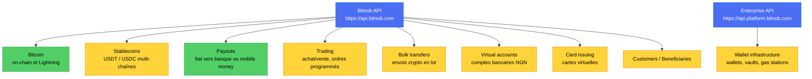

# Référence Bitnob : toute la documentation, en français

Dernière collecte : **2026-10-08**, depuis `https://bitnob.dev/` (miroir de `docs.bitnob.co`). Ce dossier résume les
**301 pages** du sitemap, menu par menu, avec les routes, champs, statuts et événements exacts, les contradictions de la doc
et ce qui compte pour DioteKo.

> **Lire ceci d'abord.** La doc Bitnob est vivante et parfois contradictoire. Chaque fichier a une section « Contradictions »
> et une section « À retenir pour DioteKo ». Quand deux pages se contredisent, **l'API reference (`/api-reference/...`) et ce
> que Bitnob répond en vrai l'emportent** sur les guides et les cours. Rien de ce qui est écrit ici n'a été inventé : quand la
> doc ne dit rien, le fichier écrit « non précisé dans la doc ».

## 1. Bitnob en une page

Bitnob est une infrastructure de paiement Bitcoin, stablecoins (USDT/USDC) et monnaies locales africaines, pilotée par API.



*Vert = ce que DioteKo utilise (encaissement Lightning, payout vers l'administration). Jaune = hors périmètre actuel.*

## 2. Table des matières

| Menu de la doc | Fichier | Pages | À lire si… |
|---|---|---|---|
| Genesis (démarrage, concepts, tutoriels, bonnes pratiques d'API) | [genesis.md](genesis.md) | 20 | tu démarres, ou tu veux comprendre l'auth, les webhooks, l'idempotence, la sandbox |
| Bitcoin (on-chain, Lightning, wallets, UTXO, guide PM) | [bitcoin.md](bitcoin.md) | 38 | tu travailles sur l'**encaissement Lightning** (le plus important pour DioteKo) |
| Stablecoins + Virtual accounts | [stablecoins.md](stablecoins.md) | 23 | tu manipules USDT/USDC ou les comptes virtuels |
| API reference de base : auth, wallets, transactions, withdrawal, addresses, exchange rates, virtual accounts, **Lightning** | [api-reference-core.md](api-reference-core.md) | 13 | tu cherches le contrat exact d'une route |
| Payouts (guides, corridors, cycle de vie, webhooks) | [payouts.md](payouts.md) | 36 | tu envoies de l'argent vers une banque ou un mobile money |
| API reference : payouts, beneficiaries, customers | [api-reference-payouts-customers.md](api-reference-payouts-customers.md) | 9 | contrat exact des payouts |
| Trading + bulk transfers | [trading.md](trading.md) | 24 | achat/vente, ordres, envois en lot |
| Card issuing (guides + API virtual cards) | [card-issuing.md](card-issuing.md) | 28 | cartes (hors périmètre DioteKo) |
| Card issuing : les deux cours | [card-issuing-courses.md](card-issuing-courses.md) | 37 | pédagogie cartes et fraude |
| Wallet infrastructure (API Enterprise) | [wallet-infrastructure.md](wallet-infrastructure.md) | 9 | wallets gérés, autre authentification |
| Playground (outils navigateur) | [playground.md](playground.md) | 27 | hachage, validateurs, convertisseurs |
| Enterprise, developer resources, changelogs, cours, home, bounties, marketplace, tooling | [enterprise-ressources-changelog.md](enterprise-ressources-changelog.md) | 38 | historique des changements, SDK, cours |

## 3. Les deux familles d'API (à ne pas mélanger)

| | API Core | API Enterprise (wallet infrastructure) |
|---|---|---|
| URL | `https://api.bitnob.com` | `https://api.platform.bitnob.com` |
| Authentification | Signature HMAC : en-têtes `X-Auth-Client`, `X-Auth-Timestamp`, `X-Auth-Nonce`, `X-Auth-Signature` | En-tête `X-API-Key` |
| Contenu | Payouts, Lightning, stablecoins, trading, cartes… | Wallets, vaults, gas stations, abonnements |
| Lightning | Oui | Non mentionné |

DioteKo utilise **uniquement l'API Core**.

## 4. Authentification des requêtes (API Core)

- Chaîne à signer : `CLIENT_ID:TIMESTAMP:NONCE:PAYLOAD` (corps JSON **exactement** tel qu'envoyé ; chaîne vide pour un GET).
- Signature : HMAC-SHA256 avec le **Client Secret**, encodée en **hex**.
- Horodatage en **secondes** (pas en millisecondes). Nonce unique par requête (16 octets en hex, ou UUID).
- C'est ce que fait notre code (`backend-nest/.../bitnob-hmac.util.ts`) et ça fonctionne en sandbox.
- ⚠️ Des pages obsolètes (`llms.txt`, page SDK, un exemple JS des stablecoins) montrent des **millisecondes, du base64 et une
  chaîne sans `:`**. Ne pas les suivre. D'autres pages parlent de clés `sk_test`/`sk_live` : vocabulaire d'une ancienne API.

## 5. Sandbox et live

- **Même URL, même Client ID.** Seul le **Client Secret** change : c'est lui qui choisit l'environnement. Les mélanger donne une erreur 401.
- `GET /api/whoami` renvoie `data.environment` (`sandbox` ou production) : le moyen le plus simple de savoir où on est.
- Passer en production : vérification du compte (KYC/KYB, annoncée sous 24 à 48 h), clé de production, bascule du secret.
- Les chaînes en sandbox sont un sous-ensemble de la production.
- **Simulations réellement documentées** : comptes virtuels `POST /api/virtual-accounts/{id}/simulate-deposit` (NGN, sandbox seulement),
  cartes `POST /api/cards/{cardId}/simulate-webhook`, et pour les payouts `POST /api/payouts/quotes/{quoteId}/deposits`.
- **Aucune simulation n'est documentée pour une facture créée par `POST /api/lightning/invoices`.** Deux routes citées par des
  guides (`/api/payouts/simulate-address-deposit`, `/api/addresses/simulate-deposit`) ne sont pas dans l'API reference ; la première répond 405 (testé le 2026-10-08).

## 6. Conventions communes

| Sujet | Règle |
|---|---|
| Idempotence | `reference` fournie par l'appelant : même `reference` = même résultat, pas de doublon (comportement exact sur doublon variable selon les pages : même réponse ou `409 DUPLICATE_REFERENCE`) |
| Montants | Entiers ou chaînes en **unités de base** : BTC et Lightning en satoshis, USDT/USDC en 6 décimales, NGN en kobo, cartes en micro-unités (1 USD = 1 000 000). Des pages de guides parlent en unités majeures : se fier à l'API reference |
| Erreurs | La plupart suivent RFC 7807 (`type`, `title`, `status`, `detail`, `correlation_id`, `timestamp`). Trois formats coexistent dans la doc |
| Cadence | 60 requêtes par minute et par clé (page stablecoins) |
| Pays | Alpha-2 presque partout ; alpha-3 pour `customers.country_code` et le KYC des comptes virtuels |

## 7. Webhooks : tous les événements documentés

Réception : répondre **200 vite** ; Bitnob réessaie (3 fois après le premier échec selon la plupart des pages, backoff exponentiel).
Signature : en-tête **`x-bitnob-signature`** = HMAC-SHA512 (hex) du **corps brut**, avec le secret du webhook. Adresses d'envoi : `18.171.51.218` et `13.134.154.133` (peuvent changer : la signature reste la vraie protection). Dédoublonner sur `event_id`.

| Famille | Événements | Remarques |
|---|---|---|
| **Lightning reçu** | `transfer.success` (la doc écrit « e.g. ») ; une page cite aussi `btc.lightning.received.success` sans payload | Payload ci-dessous. Pas de `status`, `preimage` ni `payment_hash` |
| Stablecoins | `deposit.success`, `transfer.success`, `transfer.failed` | `transfer.success` porte `transaction_id` |
| Payouts | `payouts.initialized`, `payouts.processing`, `payouts.withdrawal.success`, `payouts.withdrawal.expired` | `processing` n'est pas terminal. **Aucun webhook d'échec** : interroger le statut `FAILED`. Les anciens `payout.transfer.*` sont remplacés |
| Cartes | `virtualcard.*` (camelCase, enveloppe `eventId`, `companyId`, `event`, `data`) | Montants en micro-unités |
| Comptes virtuels | enveloppe `eventType`, `eventId`, `payload` | Différente des autres |
| Wallet infrastructure | `transaction.confirmed`, `wallet.created` (exemples) | Catalogue complet illisible dans la doc |

**Payload documenté d'un paiement Lightning reçu** (page « Issuing Bitcoin Addresses & Lightning Invoices ») :

```json
{
  "data": {
    "amount": "3000",
    "chain": "lightning",
    "currency": "BTC",
    "fee": "0",
    "invoice": "lnbc30u1p4q0yca...",
    "reference": "5ac65838-6166-4e98-b360-6747f53a4fa4",
    "timestamp": "2026-05-15T21:43:10Z",
    "transaction_id": "e212c8ba-16ce-46a3-8548-9fc4fc1a6484"
  },
  "event": "transfer.success",
  "event_id": "d22a304f-6b19-4371-a91b-b7ef08a1fbad"
}
```

La facture se retrouve par `data.invoice` (la chaîne BOLT11). `data.reference` est un UUID dans l'exemple, donc rien ne garantit
qu'il reprenne notre `reference` de création. `amount: "3000"` correspond à `lnbc30u`, soit 3 000 sats (déduction, non écrite).

## 8. Lightning : le contrat à retenir

| Route | Rôle | Points clés |
|---|---|---|
| `POST /api/lightning/invoices` | Créer une facture | `amount` en **sats** (1 à 20 000 000), `description` et `reference` requis ; `expiry` (secondes, défaut 86 400) et `customer_id` **facultatifs** (l'API reference). Un fichier OpenAPI tiers les marque obligatoires : l'API reference et nos tests font foi |
| `GET /api/lightning/invoices/:id` | Lire une facture | Statuts `pending`, `paid`, `expired`, `failed`. **Preuve de paiement : `status = paid` ET `preimage` non vide** |
| `GET /api/lightning/invoices` | Lister | `data.invoices[]`, `total_count`, `page`, `page_size` |
| `POST /api/lightning/decode` | Décoder un BOLT11 | Ne paie rien |
| `POST /api/lightning/preview` | Estimer routage et frais | Renvoie `route_found` |
| `POST /api/lightning/pay` | Payer un BOLT11 | `request`, `reference` requis ; `max_fee` (0 ou omis = pas de plafond). Réponse : `status`, `preimage`, `payment_hash`, `amount_sat`, `fee_sat`. **Désactivé sur notre compte sandbox** (403 `send_lightning`) |

Particularités : `expires_at` est une date RFC 3339 à la création mais un epoch (chaîne) en lecture ; Bolt12 n'est pas supporté ; le wallet est **custodial** par défaut (Bitnob détient les clés).

## 9. Ce qui compte pour DioteKo

1. **Webhook Lightning à rapprocher par `data.invoice`.** Notre code cherche `data.id`, `data.invoice_id` ou `data.payment_hash`, absents de ce payload : le chemin rapide ne retrouverait pas la facture. Le réconciliateur (60 s) la rattrape quand même. Correction à faire : chercher aussi par BOLT11.
2. **Sandbox.** Aucun moyen documenté de régler une facture Lightning. À demander à Bitnob (ou à l'atelier Code & Chain du 17 octobre) : activer `send_lightning`, ou la route de simulation. Le mode live est l'alternative ([../BITNOB_PASSER_EN_LIVE.md](../BITNOB_PASSER_EN_LIVE.md)).
3. **Sénégal.** XOF supporté en **mobile money seulement** (Orange Money, Free Money, Expresso, Wave) ; aucune banque sénégalaise listée. Champs du bénéficiaire à découvrir avec `GET /api/payouts/supported-countries/SN` et `GET /api/payouts/banks/SN`.
4. **Payout.** Le devis exige un seul de `amount` ou `settlement_amount`, plus `from_asset`, `to_currency`, `country`, `source`, `reference` ; flux devis, initialisation (bénéficiaire inline), finalisation sans corps. Ne créditer qu'au statut `COMPLETED` ou à `payouts.withdrawal.success`.
5. **Retraits stablecoin** : minimum 10 USD depuis le 2026-08-21 (changelog), alors que des guides disent 1 USD.
6. **Le webhook ne prouve rien tout seul.** La doc elle-même recommande d'interroger. Notre règle (relire la facture chez Bitnob avant `paid`) est la bonne.
7. **Secret de signature des webhooks** : la doc ne dit pas clairement s'il s'agit du Client Secret ou d'un secret du dashboard. À confirmer avant la production.

Détails projet : [../BITNOB.md](../BITNOB.md), [../BITNOB_PASSER_EN_LIVE.md](../BITNOB_PASSER_EN_LIVE.md), [../KNOWN_ISSUES.md](../KNOWN_ISSUES.md).

## 10. Contradictions les plus importantes de la doc

| Sujet | Contradiction | À croire |
|---|---|---|
| Signature des requêtes | Secondes/hex/`:` contre millisecondes/base64 | Secondes, hex, `CLIENT_ID:TIMESTAMP:NONCE:PAYLOAD` |
| Signature des webhooks | SHA-512 presque partout, SHA-256 dans un module de cours | SHA-512 (`x-bitnob-signature`) |
| Statuts de payout | MAJUSCULES dans l'API, minuscules dans le guide, `initiated/processing/success/expired` dans les webhooks | Se brancher sur le champ `event` du webhook |
| Noms d'événements payout | `payout.transfer.*` (anciennes pages) contre `payouts.*` | `payouts.*` |
| Routes de simulation | `/api/payouts/simulate-address-deposit` (405), `/api/addresses/simulate-deposit`, `/api/payouts/quotes/{id}/deposits` | Seule la dernière est dans l'API reference des payouts |
| Retries de webhook | 3 fois ou jusqu'à acquittement ; réponse sous 5 s ou « 200 » | 3 retries, répondre vite |
| Unités du trading | Cents/sats dans les guides, décimales en unités majeures dans l'API reference | L'API reference |
| `customer_id` | Obligatoire (un fichier OpenAPI) contre facultatif (API reference Lightning) | Facultatif, à reconfirmer en live |
| Cours de cartes | Routes qui se contredisent d'un module à l'autre | L'API reference des cartes |

Le détail complet figure dans la section « Contradictions » de chaque fichier.

## 11. Limites de cette collecte

- **Exemples JSON illisibles.** De nombreuses réponses d'exemple (payouts, trading, cartes, listes, wallets…) sont des marqueurs de rendu cassés (`$1e`, `$20`…) dans la page source ; les rédacteurs les ont reconstruites à partir des tables de champs en le signalant. Ne pas les copier dans du code sans test.
- **Ordre des menus.** Le texte brut ne contient pas la navigation : l'ordre suit la logique de chaque section.
- **Pages absentes.** `api-reference/webhooks` et `.../overview` figurent au sitemap mais répondent 404. Les pages `marketplace` et `tooling` n'ont qu'un titre ; 7 pages `_index` sont des index de section sans contenu. Une page d'erreurs et reprises (« Error Handling, Retries, and Fallbacks ») est listée dans un hub mais absente de la collecte.
- **Doublons.** `docs/bitcoin`, `docs/payouts`, `docs/card-issuing`, `docs/playground` sont identiques à leur `overview`.
- **Fraîcheur.** Les pages ne portent pas de date de mise à jour. Le changelog le plus récent date du 2026-08-23.
- **Méthode.** Texte récupéré en brut par script (HTML rendu côté serveur, extraits de code lus dans les données de la page), puis résumé par page par des agents sans accès au web. Le sitemap (301 URL) a servi de liste de contrôle : toutes les pages y sont couvertes, sauf les deux en 404.
