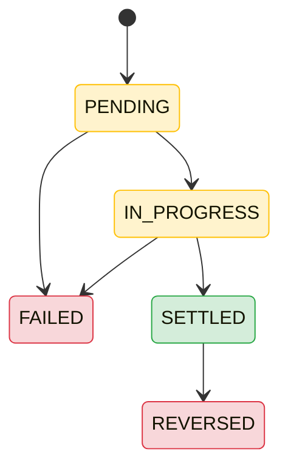
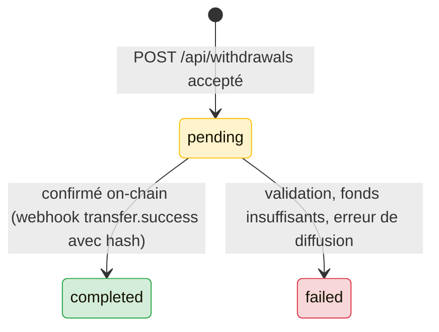
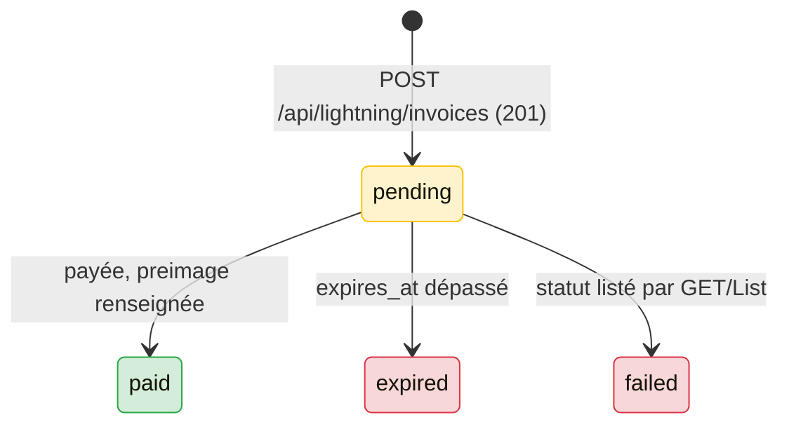

# Bitnob — Référence API « cœur » (authentification, wallets, transactions, retraits, adresses, taux, virtual accounts, Lightning)

> Référence en français, extraite du texte brut de https://bitnob.dev/api-reference/... (pages téléchargées en Markdown, session du 2026-10-08).
> Noms de champs, en-têtes, routes, événements et extraits : en anglais, tels que dans la doc. « Non précisé dans la doc » = information absente des pages.
> Les pages conceptuelles (`/docs/...`) sont dans `stablecoins.md` (même dossier).
> Limite connue : plusieurs blocs de code ou d'exemples JSON de la source sont des placeholders non résolus (`$1e`, `$1f`, `$20`, `$21`, `$22`, `$23`) dans le texte téléchargé ; ils sont signalés « exemple absent de la source ».

## Sommaire

1. [Pages couvertes (vérification)](#1-pages-couvertes-vérification)
2. [Conventions communes (base URL, enveloppe, erreurs, limites)](#2-conventions-communes)
3. [Authentification HMAC](#3-authentification-hmac)
4. [Wallets (soldes)](#4-wallets-soldes)
5. [Transactions](#5-transactions)
6. [Withdrawal (retraits on-chain)](#6-withdrawal-retraits-on-chain)
7. [Addresses (adresses de dépôt) et Stablecoins Supported Chains](#7-addresses-et-stablecoins-supported-chains)
8. [Webhooks stablecoins (dépôts et transferts)](#8-webhooks-stablecoins)
9. [Exchange Rates](#9-exchange-rates)
10. [Virtual Accounts](#10-virtual-accounts)
11. [Lightning](#11-lightning)
12. [Contradictions et obsolescences relevées](#12-contradictions-et-obsolescences-relevées)
13. [À retenir pour DioteKo](#13-à-retenir-pour-dioteko)

---

## 1) Pages couvertes (vérification)

Lot : 13 pages de référence API (toutes avec contenu, aucune page vide).

| Fichier source | Lien | Section ici |
| --- | --- | --- |
| `api-reference__authentication__authentication.md` | [https://bitnob.dev/api-reference/authentication/authentication](https://bitnob.dev/api-reference/authentication/authentication) | §3.1 |
| `api-reference__authentication__usage-examples.md` | [https://bitnob.dev/api-reference/authentication/usage-examples](https://bitnob.dev/api-reference/authentication/usage-examples) | §3.2 |
| `api-reference__wallets__wallets.md` | [https://bitnob.dev/api-reference/wallets/wallets](https://bitnob.dev/api-reference/wallets/wallets) | §4 |
| `api-reference__transactions__transactions.md` | [https://bitnob.dev/api-reference/transactions/transactions](https://bitnob.dev/api-reference/transactions/transactions) | §5 |
| `api-reference__withdrawal__withdrawal.md` | [https://bitnob.dev/api-reference/withdrawal/withdrawal](https://bitnob.dev/api-reference/withdrawal/withdrawal) | §6 |
| `api-reference__withdrawal__webhooks.md` | [https://bitnob.dev/api-reference/withdrawal/webhooks](https://bitnob.dev/api-reference/withdrawal/webhooks) | §8.2 |
| `api-reference__addresses__addresses.md` | [https://bitnob.dev/api-reference/addresses/addresses](https://bitnob.dev/api-reference/addresses/addresses) | §7 |
| `api-reference__addresses__webhooks.md` | [https://bitnob.dev/api-reference/addresses/webhooks](https://bitnob.dev/api-reference/addresses/webhooks) | §8.1 |
| `api-reference__stablecoins__stablecoins.md` | [https://bitnob.dev/api-reference/stablecoins/stablecoins](https://bitnob.dev/api-reference/stablecoins/stablecoins) | §7.5 |
| `api-reference__exchange-rates__exchange-rates.md` | [https://bitnob.dev/api-reference/exchange-rates/exchange-rates](https://bitnob.dev/api-reference/exchange-rates/exchange-rates) | §9 |
| `api-reference__virtual-accounts__virtual-accounts.md` | [https://bitnob.dev/api-reference/virtual-accounts/virtual-accounts](https://bitnob.dev/api-reference/virtual-accounts/virtual-accounts) | §10 |
| `api-reference__virtual-accounts__webhooks.md` | [https://bitnob.dev/api-reference/virtual-accounts/webhooks](https://bitnob.dev/api-reference/virtual-accounts/webhooks) | §10.9 |
| `api-reference__lightning__lightning.md` | [https://bitnob.dev/api-reference/lightning/lightning](https://bitnob.dev/api-reference/lightning/lightning) | §11 |

---

## 2) Conventions communes

- **Base URL unique** : `https://api.bitnob.com` (sandbox et live ; les clés déterminent l'environnement — cf. `whoami.data.environment` ∈ `sandbox` | `live`).
- **Enveloppe de succès** (observée sur toutes les réponses) : `{ "success": true, "message": "...", "data": {...}, "timestamp": "<RFC 3339>" }`, parfois `metadata.request_id`.
- **Montants** : toujours des **chaînes d'entiers en plus petite unité** (USDT/USDC : 6 décimales ; BTC : satoshis, 8 décimales ; NGN : kobo, /100). Exception Lightning : voir §11 (satoshis, parfois `number`, parfois `string`). Faire l'arithmétique sur les entiers, utiliser les champs `*_formatted` pour l'affichage.
- **Formats d'erreur (hétérogènes)** :
  - wallets : `{"type":"https://api.bitnob.com/errors/VALIDATION_ERROR","title":"Validation Error","status":400,"detail":"no account found for currency: ETH","code":"VALIDATION_ERROR","correlation_id":"req_...","timestamp":"..."}`
  - withdrawal : `{"success":false,"message":"Insufficient balance","error":{"code":"INSUFFICIENT_FUNDS","details":"..."},"timestamp":"..."}`
  - docs stablecoins (cf. `stablecoins.md`) : `{"status":false,"message":"...","errorCode":"CHAIN_ASSET_MISMATCH"}`
- **Limite de débit** : 60 req/min par clé (docs stablecoins) ; `429` avec `RATE_LIMITED` (`Retry-After` mentionné dans les docs). Non précisé dans la doc : limites spécifiques à Lightning.
- **Pagination** : par curseur pour transactions et adresses (`cursor`, `limit`) ; par `page`/`page_size` pour les factures Lightning ; `page_info` pour les virtual accounts ; `limit`/`offset` pour les transactions de VA.

---

## 3) Authentification HMAC

### 3.1 Authentication

Source : https://bitnob.dev/api-reference/authentication/authentication

- **But** : toutes les requêtes sont signées par HMAC avec `CLIENT_ID` et `CLIENT_SECRET`. Un seul mode d'authentification documenté : HMAC Signature.
- **Variables d'environnement** : `CLIENT_ID` (fourni par Bitnob quand on crée une app), `CLIENT_SECRET` (ne jamais l'exposer côté frontend).
- **Nonce** : « 16-byte cryptographically-random value, hex-encoded » (soit 32 caractères hex).
- **Timestamp** : timestamp Unix **en secondes** (ex. `1719236465`).
- **Message canonique** : `CLIENT_ID:TIMESTAMP:NONCE:PAYLOAD` (séparateur `:`, ordre exact). `PAYLOAD` = le JSON exact envoyé, **sans espaces ni sauts de ligne superflus** ; **sans corps : chaîne vide**.
- **Signature** : HMAC-SHA256 de la chaîne, clé = `CLIENT_SECRET`, sortie binaire encodée en **hexadécimal**.

```plaintext
stringToSign = CLIENT_ID:TIMESTAMP:NONCE:PAYLOAD
raw_hmac = HMAC_SHA256(stringToSign, CLIENT_SECRET)
signature = HexEncode(raw_hmac)
```

| En-tête | Valeur | Rôle |
| --- | --- | --- |
| `X-Auth-Client` | `CLIENT_ID` | Identifie l'appelant |
| `X-Auth-Timestamp` | Unix en secondes | Empêche le rejeu de vieilles requêtes |
| `X-Auth-Nonce` | nonce hex de 16 octets | Unicité par requête |
| `X-Auth-Signature` | HMAC hex | Intégrité et authenticité |

- Les 4 en-têtes sont obligatoires sur chaque requête. Conseils côté serveur (cité par la doc comme « tip ») : fenêtre de timestamp acceptable ±5 min, nonce jamais réutilisé, signature égale. **La fenêtre réellement appliquée par Bitnob n'est pas précisée** (c'est un conseil générique).
- Exemples de code de signature JS/Go/Python : absents de la source (placeholders `$21`, `$22`, `$23`).
- Une page « Try It Out » existe (`/api-reference/authentication/play-ground`), non incluse dans le lot.

**Pièges et incohérences**
- **Le chemin, la méthode et la query string ne font pas partie de la chaîne signée** (seulement `CLIENT_ID:TIMESTAMP:NONCE:PAYLOAD`). Pour un GET : la chaîne se termine par `:` suivi d'un payload vide.
- Casse des en-têtes : `X-Auth-*` ici, `x-auth-*` dans les exemples ; sans conséquence pratique (en-têtes HTTP).
- Nonce : « 16-byte hex » ici ; les exemples utilisent `uuid.uuid4().hex` (32 hex) **ou** `uuidv4()` avec tirets. Aucune règle explicite de format côté serveur n'est donnée.
- **Page `docs/stablecoins/sending-stablecoins` (exemple JS)** : ms + `clientId+method+path+timestamp+body` + base64 → **incompatible** avec cette page. Cette page-ci et tous les exemples Python/JS des pages de référence concordent (secondes, `:`, hex).
- Les webhooks sortants utilisent un schéma **différent** : en-tête `x-bitnob-signature`, HMAC **SHA-512** du corps brut (cf. §8). Ne pas mélanger avec la signature de requête (SHA-256).

### 3.2 Usage Examples (GET, POST, Validate Authentication)

Source : https://bitnob.dev/api-reference/authentication/usage-examples

- **GET** (sans corps, `null` en paramètre body du helper) : `GET /api/balances`. Exemples JS et Python ; exemple Go : absent de la source (`$1e`). La signature est calculée « sur le client ID, le timestamp et le nonce » seulement.

```json
{ "success": true, "message": "Company balances retrieved successfully",
  "data": { "accounts": [ { "account_id": "199d9585-8e36-42b8-839a-c227a34d7d11", "account_number": "7264979918",
      "currency": "USDT", "ledger_balance": "5101335847", "available_balance": "5101335847",
      "ledger_balance_formatted": "5101.335847 USDT", "available_balance_formatted": "5101.335847 USDT",
      "created_at": "2025-12-24T15:11:57.531010+00:00" } ],
    "company_id": "1bc7caba-08b9-49ff-a911-2a8fb570cbb9" },
  "timestamp": "2026-04-17T14:43:12.608723155Z" }
```

- **POST** (`POST /api/customers`) : passer le JSON au helper pour qu'il entre dans le HMAC. « Tout changement du payload — même un réordonnancement de clés — invalide la signature : **signez les octets exacts envoyés sur le fil** ». Exemple de corps : `email`, `first_name`, `last_name`, `phone_number`, `customer_type: "individual"`. Réponse : `id`, `company_id`, `created_at`, `created_by`, `customer_type`, `email`, `first_name`, `last_name`, `phone_number`, `is_active`, `metadata` (string `"{}"`), `updated_at`. Exemple Go : absent de la source (`$20`).
  - Observation (non issue de la doc) : l'exemple Python passe un `dict` à `generate_auth_headers` puis `json=customer_data` à `requests` ; le helper n'est pas visible (code absent). Pour être sûr de signer les octets envoyés, sérialiser soi-même une fois et envoyer `data=body_str`, comme dans les pages withdrawal/addresses.

### 3.3 Validate Authentication — `GET /api/whoami`

Source : https://bitnob.dev/api-reference/authentication/usage-examples (section « Validate Authentication »).

- Accepte **toute méthode HTTP et tout payload** ; marche avec HMAC. Renvoie les infos du client authentifié.
- Champs : `success`, `message` (`"Authenticated"`), `data.active`, `data.active_company_id`, `data.auth_method` (toujours `"hmac"`), `data.client_id` (UUID de l'app), `data.client_name`, `data.environment` (`"sandbox"` ou `"live"`), `data.permissions` (array ou `null` ; `null` = pas de scopes = accès complet), `timestamp`.

```json
{ "success": true, "message": "Authenticated",
  "data": { "active": true, "active_company_id": "1bc7caba-08b9-49ff-a911-2a8fb570cbb9", "auth_method": "hmac",
            "client_id": "2d94f264-bf10-4250-99fe-8c571927099e", "client_name": "EasyPut",
            "environment": "sandbox", "permissions": null },
  "timestamp": "2026-04-17T13:16:20.25597752Z" }
```

---

## 4) Wallets (soldes)

Source : https://bitnob.dev/api-reference/wallets/wallets

- **But** : lire les soldes par devise (USDT, USDC, BTC, NGN) : tableaux de bord, contrôle de liquidité avant paiement, réconciliation. Scope associé (docs stablecoins) : `wallet:read`.
- **Unités** : entiers en chaînes, **USDT/USDC 6 décimales, BTC 8 décimales (satoshis)** ; utiliser `*_formatted` pour l'affichage.

### 4.1 Get Balances — `GET /api/balances`

Pas de paramètres. Réponse : `data.company_id` (UUID), `data.accounts[]` avec `account_id`, `account_number` (numéro de compte entreprise, commun à toutes les devises), `currency`, `ledger_balance`, `available_balance` (= ledger moins retenues), `ledger_balance_formatted` (ex. `'5101.335847 USDT'`, `'0.00375783 BTC'`), `available_balance_formatted`, `created_at`. Exemple JSON de la page : absent (`$21`) ; voir l'exemple en §3.2.

```bash
curl https://api.bitnob.com/api/balances -X GET \
  -H "Content-Type: application/json" \
  -H "x-auth-client: <CLIENT_ID>" -H "x-auth-timestamp: $(date +%s)" \
  -H "x-auth-nonce: $(uuidgen)" -H "x-auth-signature: <SIGNATURE>"
```

### 4.2 Get Balance By Currency — `GET /api/balances/:currency`

- Paramètre de chemin `:currency` (requis) : `BTC`, `USDT`, `USDC`, `NGN`. Devise sans compte → `400 VALIDATION_ERROR` (`detail: "no account found for currency: <X>"`).
- Réponse : `data.account_number`, `data.currency`, `data.total_balance` (= available + pending), `data.available_balance`, `data.pending_balance` (retenues : dépôts non confirmés, retraits en cours), `data.company_id`. **Les noms de champs diffèrent de Get Balances** (`total_balance`/`pending_balance` ici ; `ledger_balance` là-bas, et pas de `*_formatted` dans cet exemple).

```json
{ "success": true, "message": "Account balance retrieved successfully",
  "data": { "account_number": "7264979918", "available_balance": "5101335847",
            "company_id": "1bc7caba-08b9-49ff-a911-2a8fb570cbb9", "currency": "USDT",
            "pending_balance": "0", "total_balance": "5101335847" },
  "timestamp": "2026-04-17T14:43:12.849460334Z" }
```

### 4.3 Erreurs wallets

| Code | Signification |
| --- | --- |
| `401 UNAUTHORIZED` | En-têtes d'auth manquants/invalides (`"Authentication failed"`) |
| `403` | Clé sans permission d'accéder aux données wallet |
| `400 VALIDATION_ERROR` | Devise non supportée / sans compte |
| `429 RATE_LIMITED` | `"Too many requests. Please retry after the cooldown period."` |

---

## 5) Transactions

Source : https://bitnob.dev/api-reference/transactions/transactions

### 5.1 Get All Transactions — `GET /api/transactions`

Liste paginée (par curseur) et filtrable : historique, audit, rattrapage de webhooks manqués.

**Query parameters**

| Paramètre | Type | Défaut / contrainte | Description |
| --- | --- | --- | --- |
| `cursor` | string | Omettre à la 1re requête | Curseur opaque base64 : `data.next_cursor` (page suivante) ou `data.previous_cursor` |
| `limit` | number | Défaut 20, **max 100** | Nombre d'enregistrements par page |
| `type` | string | Valeurs ci-dessous | Filtre par type de transaction |
| `status` | string | `PENDING`, `IN_PROGRESS`, `SETTLED`, `FAILED`, `REVERSED` | Filtre par **état** (le paramètre s'appelle `status`, le champ de réponse `state`) |
| `currency` | string | ex. `BTC`, `USDT`, `USDC` | Filtre par devise |

```http
GET /api/transactions?limit=10&type=DEPOSIT_CONFIRMED&status=SETTLED&currency=BTC
GET /api/transactions?limit=10&type=DEPOSIT_CONFIRMED&status=SETTLED&currency=BTC&cursor=<next_cursor>
```

**Réponse** : `data.transactions[]`, `data.next_cursor` (vide = plus de pages), `data.previous_cursor` (vide = 1re page), `data.total_count`, `data.has_more`. Chaque transaction :

| Champ | Description |
| --- | --- |
| `transaction_id` | UUID système |
| `account_number`, `currency` | Compte et devise |
| `type` | Voir types ci-dessous |
| `state` | `PENDING` / `IN_PROGRESS` / `SETTLED` / `FAILED` / `REVERSED` |
| `amount` | Plus petite unité, **négatif pour les débits** |
| `fee` | Frais total, plus petite unité |
| `reference` | Référence unique (système ou personnalisée), pour idempotence et recherche |
| `idempotency_key` | Peut être vide pour les enregistrements système |
| `trade_id` | UUID ou chaîne vide/null |
| `metadata` | Objet : adresse, chaîne, hash… ; `metadata.flow_type` (ex. `deposit`), `metadata.from_address` (omis si inconnu) |
| `created_at`, `updated_at`, `value_date` (YYYY-MM-DD) | Horodatages |
| `amount_formatted` (ex. `'-10.0 USDT'`), `fee_formatted` (ex. `'1.2 USDT'`) | Affichage |
| `side` | `Credit` (entrant) / `Debit` (sortant) |

Exemple JSON de réponse : absent de la source (`$1f`).

**Types** : `DEPOSIT_CONFIRMED` (dépôt confirmé et crédité), `DEPOSIT_DETECTED` (détecté, non confirmé), `DEPOSIT_PENDING` (en attente de confirmation), `WITHDRAWAL_INITIATED` (retrait initié, en cours), `WITHDRAWAL_FAILED`, `P2P_TRANSFER`, `SWAP_INTERNAL`, `FX_REBALANCING`, `FEE_ONLY`, `REVERSAL`.

**États**

| État | Description | Terminal ? |
| --- | --- | --- |
| `PENDING` | Créée, en attente de traitement | Non |
| `IN_PROGRESS` | En cours de traitement | Non |
| `SETTLED` | Terminée avec succès | Oui |
| `FAILED` | Échouée, ne sera pas traitée | Oui |
| `REVERSED` | Annulée après règlement | Oui |



(Le schéma ASCII de la source donne : PENDING → IN_PROGRESS → SETTLED ; PENDING → FAILED ; IN_PROGRESS → FAILED ; SETTLED → REVERSED. Seuls SETTLED, FAILED, REVERSED sont terminaux.)

### 5.2 Get Transaction By ID Or Reference — `GET /api/transactions/{id or reference}`

- Paramètre de chemin (requis) : UUID système **ou** `reference` fournie à la création. Réponse identique à un élément de la liste (champs ci-dessus). Exemple JSON : absent (`$21`).
- Utile pour lire `fee`/`fee_formatted` d'un retrait (absent de la réponse de création) et le hash on-chain.
- Non précisé dans la doc : code HTTP si la transaction est introuvable.

---

## 6) Withdrawal (retraits on-chain)

Source : https://bitnob.dev/api-reference/withdrawal/withdrawal

### 6.1 Create Withdrawal — `POST /api/withdrawals`

Envoi de BTC/USDT/USDC vers une adresse externe, **asynchrone** : statut `pending` immédiat, confirmation par webhook `transfer.success` ou via l'API Transactions. Scope : `transfer:create`.

| Champ | Type | Requis | Contraintes / description |
| --- | --- | --- | --- |
| `to_address` | string | Oui | Adresse valide pour la chaîne ; rejet si format incompatible (ex. adresse Tron sur Ethereum) |
| `amount` | string | Oui | Entier en plus petite unité : 6 décimales USDT/USDC (`'150500000'` = 150,5 USDT), satoshis pour BTC |
| `currency` | string | Oui | `USDC`, `USDT`, `BTC` ; devise dont vous avez un solde |
| `chain` | string | Oui | `ethereum`, `bsc`, `polygon`, `solana`, `tron`, `stellar`, `bitcoin` ; doit être supportée pour la devise |
| `reference` | string | **Optional** | Clé d'idempotence client ; même `reference` = même retrait. Toujours en fournir une |
| `memo` | string | Optional | Memo on-chain (surtout Stellar) ; chaîne vide sinon |
| `description` | string | Optional | Note interne stockée avec la transaction, **non envoyée on-chain** |

```json
{ "amount": "150500000", "chain": "ethereum", "currency": "USDT", "description": "Vendor payment",
  "memo": "", "reference": "withdraw-1776440856915922000",
  "to_address": "0xd0438C776d03df4FCfF69db78B97e2E6B5Cf033b" }
```

Autres exemples de la page : USDC/polygon (`"25000000"`), USDC/stellar avec `memo: "user-789"`, BTC/bitcoin (`amount: "150000"` = 0,0015 BTC, `to_address: "bc1q..."`). Exemples JS, Go, PHP : absents de la source (`$20`, `$21`, `$22`) ; exemple Python : signature `CLIENT_ID:TIMESTAMP:NONCE:body_str`, hex.

**Réponse** : `data.transaction_id` (UUID), `data.status` (`pending` | `completed` | `failed`), `data.address`, `data.amount`, `data.currency`, `data.chain`, `data.reference`, `data.memo`, `data.description`, `data.created_at`, `metadata.request_id`, `timestamp`. **Pas de champ `fee`** dans la réponse.

```json
{ "success": true, "message": "Withdrawal initiated successfully",
  "data": { "transaction_id": "5869dad9-494e-4d2c-9f57-6386165cf0fd", "status": "pending",
            "address": "0xd0438C776d03df4FCfF69db78B97e2E6B5Cf033b", "amount": "150500000",
            "currency": "USDT", "chain": "ethereum", "reference": "withdraw-1776440856915922000",
            "created_at": "2026-04-17T15:53:43Z", "memo": "", "description": "Vendor payment" },
  "timestamp": "2026-04-17T15:53:43.508430984Z" }
```

### 6.2 Cycle de vie du retrait

Les fonds sont **débités du solde disponible dès l'acceptation** ; ils ne sont rendus qu'en cas d'échec.



- `pending` : accepté, en file pour diffusion, fonds déjà retenus. `completed` (terminal) : confirmé on-chain ; le hash arrive dans le webhook `transfer.success`. `failed` (terminal) : fonds rendus au solde disponible.
- Piège : le statut du retrait est en minuscules (`pending/completed/failed`), l'état de la transaction correspondante est en majuscules (`PENDING/SETTLED/FAILED`…) — deux vocabulaires distincts.

### 6.3 Notes Stellar

Adresse Stellar : 56 caractères, commence par `G`. `currency` = actif Stellar (ex. `USDC`), `chain` = `stellar`. Si la destination fournit un memo, le copier **exactement** (type text/id/hash, casse) ; sinon `memo` = `""`. Bitnob **ne génère, ne valide ni n'interprète** le memo : transmis tel quel. Sans memo requis par un exchange, les fonds peuvent être mal attribués ou bloqués en réconciliation manuelle.

### 6.4 Codes d'erreur

| HTTP | Code (exemple) | Signification |
| --- | --- | --- |
| 400 | — | Corps invalide, champs manquants, combinaison devise/chaîne non supportée, format d'adresse invalide |
| 401 | — | En-têtes d'auth invalides ou manquants |
| 402 | `INSUFFICIENT_FUNDS` | Solde disponible < montant (`details`: `"Available USDT balance (826479) is less than withdrawal amount (5000000)."`) |
| 409 | `DUPLICATE_REFERENCE` | Une `reference` identique existe ; le retrait existant est renvoyé (`data.transaction_id`, `data.status`) |
| 422 | `INVALID_ADDRESS` | Adresse invalide pour la chaîne, **ou montant sous le minimum** (seuil chiffré : non précisé dans cette page ; docs : $1) |
| 429 | — | Limite de débit dépassée |

---

## 7) Addresses et Stablecoins Supported Chains

Source : https://bitnob.dev/api-reference/addresses/addresses

### 7.1 List addresses — `GET /api/addresses`

Liste paginée des adresses de wallet (audit, rattachement à des comptes). Query : `chain` (ex. bitcoin, ethereum, bsc, polygon, solana, tron, stellar, avalanche), `status` (`active` | `inactive`), `addresses` (une ou plusieurs chaînes d'adresse), `cursor`, `limit` (défaut 20). Champs : `id` (UUID), `address`, `company_id`, `label`, `chain`, `status`, `created_at`, `reference` (peut être vide), et `next_cursor`, `has_more` pour la pagination. Exemple JSON : absent (`$1f`).

### 7.2 Get address by ID — `GET /api/addresses/:id`

`:id` = **UUID système uniquement**. Passer une adresse ou une reference → `400 VALIDATION_ERROR` (`'invalid id'`). Pour chercher par adresse : `GET /api/addresses?addresses=<address>`. Réponse : `id`, `address`, `company_id`, `label`, `chain`, `status`, `created_at`.

### 7.3 Generate addresses — `POST /api/addresses`

Génère/assigne une adresse, éventuellement liée à un client. Scope : `wallet:write`.

| Champ | Type | Requis | Description |
| --- | --- | --- | --- |
| `chain` | string | Oui | `avalanche`, `base`, `bitcoin`, `ethereum`, `optimism`, `polygon`, `solana`, `stellar` ; liste faisant foi : `GET /api/stablecoins/supported-chains` |
| `customer_email` | string | Optional | Doit correspondre à un client déjà enregistré (API Customers) ; rattache les dépôts à ce client |
| `label` | string | Optional | Libellé lisible |
| `reference` | string | Optional | Identifiant unique client, renvoyé dans la réponse (idempotence/suivi) |

```json
{ "chain": "ethereum", "customer_email": "test@example.com", "label": "test-address", "reference": "test-addr-1776440856915909000" }
```

Réponse : `data.id`, `data.chain`, `data.company_id`, `data.address`, `data.status` (`active`), `data.label`, `data.reference`.

### 7.4 Stellar Address Generation — `POST /api/addresses` avec `chain: "stellar"`

Toute requête renvoie **la même adresse Stellar partagée de l'entreprise** (aucune nouvelle adresse). L'attribution par utilisateur exige un **memo unique** que vous gérez (Bitnob ne génère pas de memos). Exemple : `address: GDUKMGUGDZQK6YHYA5Z6AY2G4XDSZPSZ3SW5UN3ARVMO6QSRDWP5YLEX`, `label: stellar-shared`.

### 7.5 Validate Address — `POST /api/addresses/validate` (aussi sur `/api-reference/stablecoins`)

Source : https://bitnob.dev/api-reference/addresses/addresses — https://bitnob.dev/api-reference/stablecoins/stablecoins

- Requête : `address` (string, requis), `chain` (string, requis) → ex. `{"address":"36FJHVQDuEqRCz8Qcx3ZCkAcHnmC6sgPZjvUVgADDR","chain":"solana"}`.
- Réponse : `success`, `message` (`"Address validation completed"`), `data.valid` (booléen), `data.address`, `data.chain`, et `error` (court motif, ex. `'invalid address'`) **seulement si `valid` = false** (page addresses). La page `stablecoins` annonce plutôt un champ `request_id` à la place de `error`.
- Contrôle de **format** uniquement ; ne crée ni ne persiste rien.
- Piège : dans l'exemple, l'adresse envoyée (`...ADDR`) diffère de celle renvoyée (`...TUtvHY`) — exemple non cohérent ; ne pas s'y fier.

### 7.6 Stablecoins Supported Chains — `GET /api/stablecoins/supported-chains`

- Liste les réseaux supportés avec jeton natif et stablecoins. **Production : 13 chaînes ; sandbox : un sous-ensemble** (tout ce qui est listé en sandbox est pleinement utilisable en test). Appeler l'endpoint dans l'environnement visé pour la liste faisant foi.
- Réponse : `chains[]` avec `chain`, `native_token` (`symbol`, `decimals`), `stablecoins[]` (`symbol`, `decimals`). Exemple JSON : absent (`$21`/`$1f`).
- Les `decimals` servent à appliquer correctement les unités à l'envoi/réception.

---

## 8) Webhooks stablecoins

### 8.1 Pages `addresses/webhooks` et `withdrawal/webhooks` (contenu quasi identique)

Sources : https://bitnob.dev/api-reference/addresses/webhooks — https://bitnob.dev/api-reference/withdrawal/webhooks

- **Principe** : URL de votre serveur recevant les événements ; répondre `200 OK` pour éviter le renvoi. Configurer l'URL dans le Dashboard (ou via API selon la page « Handling webhooks » des docs).
- **Vérification** : en-tête **`x-bitnob-signature`** ; « HMAC SHA512 signature is the event payload signed with your secret key » ; hex ; corps brut.

```javascript
const crypto = require('crypto');
const webhookSecret = process.env.BITNOB_WEBHOOK_SECRET;
// Sign the raw body: re-serialising parsed JSON changes the bytes
app.post("/webhook_url", express.raw({ type: 'application/json' }), function(req, res) {
  const hash = crypto.createHmac('sha512', webhookSecret).update(req.body).digest('hex');
  if (hash == req.headers['x-bitnob-signature']) {
    const event = JSON.parse(req.body);
  }
  res.sendStatus(200);
});
```

- **Retries** : si la réponse n'est pas 200, retry **jusqu'à 3 fois avec backoff exponentiel** ; dédoublonner sur `reference` (un même événement peut arriver plusieurs fois). Prévoir un service qui interroge `GET /api/transactions` si les webhooks échouent.
- **IP sources** : `18.171.51.218` et `13.134.154.133` (« peuvent changer, annoncées à l'avance ») ; la liste d'IP n'est **pas** un substitut à la vérification de signature (n'importe quel hôte peut envoyer depuis une IP autorisée).

```nginx
location /webhook_url { allow 18.171.51.218; allow 13.134.154.133; deny all; }
```

- **Test local** : ngrok / localtunnel (test uniquement).

**Payloads exacts** (page `addresses/webhooks`, la plus récente des deux)

`deposit.success` — champs : `event`, `event_id`, `data.address`, `data.amount` (string, plus petite unité, ex. `'9000000'` = 9 USDT), `data.chain`, `data.currency`, `data.fee` (typiquement `'0'`), `data.from_address`, `data.hash`, `data.reference`, `data.timestamp`, `data.transaction_id`.

```json
{ "event_id": "0b7d6c1e-4f3a-4b8e-9a52-1c2d3e4f5a6b", "event": "deposit.success",
  "data": { "address": "Cev6GkmDnwSY3PvwhwBofwv65FrwcU1RxvF9Zt9aTJq4", "amount": "9000000", "chain": "tron",
            "currency": "USDT", "fee": "0", "from_address": "TQrY8tryqsYVCYS3MFbtffiPp2ccyn4rkr",
            "hash": "2426850248470ae3c24ff8ae62a5efbde325ea0c496475befb63947a65f5c122",
            "reference": "RCV_SBLNC_cc309ba8c361", "timestamp": "2025-12-12T20:38:23Z",
            "transaction_id": "8c3d1332-bd52-40f4-972f-768a2c4106f3" } }
```

`transfer.success` — même structure ; exemple de la page (sans `event_id`/`transaction_id`) :

```json
{ "event": "transfer.success",
  "data": { "address": "TRMPscTMrXg21YuDFuvpXRUkwEbipHEZXN", "amount": "2000000", "chain": "tron", "currency": "USDT",
            "fee": "1000000", "hash": "4ae4308579587370accbd31dbfaebf3a97c8cfc7f68e2128ddec840349cafc60",
            "reference": "SND_SBLNC_80c7895d89e9", "timestamp": "2025-12-12T20:30:18Z" } }
```

Autre exemple (page withdrawal, plus récent, avec `event_id` et `transaction_id`) : `{"data":{"address":"6AtXPbFNrvg6ZiG4g1j3p8Z7mkpqjtdT2jC5siQC5dqM","amount":"1100000","chain":"solana","currency":"USDC","fee":"1000000","hash":"3TfB...","reference":"SND_USDC_5c2d2dfd2fe2","timestamp":"2026-05-15T12:03:08Z","transaction_id":"3ac20197-f0c7-4553-ac32-9ead17c7f0a9"},"event":"transfer.success","event_id":"944a4089-6065-49ca-8f43-fb10f15c59e6"}`.

`transfer.failed` — `fee: "0"`, `hash: ""` :

```json
{ "event": "transfer.failed",
  "data": { "address": "TKVy2qjGyfxhPMvkeA8AEhv5XvpzLxGA5W", "amount": "2000000", "chain": "tron", "currency": "USDT",
            "fee": "0", "hash": "", "reference": "your-transfer-reference", "timestamp": "2025-12-12T20:30:00Z" } }
```

### 8.2 Écart entre les deux pages

La page `withdrawal/webhooks` décrit `deposit.success` **sans** `event_id`, `from_address`, `transaction_id` (9 champs) alors que `addresses/webhooks` les inclut (12 champs). Traiter ces trois champs comme potentiellement absents.

### 8.3 Lightning

Aucun webhook Lightning n'est documenté dans ce lot de références API. La page `/docs/stablecoins/webhooks` cite seulement l'événement `btc.lightning.received.success` (sans payload). La page Lightning recommande plutôt le **polling** de `GET /api/lightning/invoices/:id` pour confirmer le règlement.

---

## 9) Exchange Rates

Source : https://bitnob.dev/api-reference/exchange-rates/exchange-rates

Taux live fiat et crypto, avec `buy_rate` et `sell_rate` séparés, valides une courte durée (`valid_for_seconds`). Même chemin `GET /api/exchange-rates` selon les paramètres.

### 9.1 Get Exchange Rate — `GET /api/exchange-rates?from=USD&to=NGN`

- Query : `from` (string, requis, devise source), `to` (string, requis, devise cible ; fiat NGN/KES/GHS… et crypto BTC/USDT/USDC).
- Réponse (`data`) : `base_currency`, `target_currency`, `buy_rate`, `sell_rate`, `mid_rate`, `inverse_rate`, `valid_for_seconds` (300 dans l'exemple), `percent_change_24h`, `timestamp` (strings pour les taux).

```json
{ "success": true, "message": "Exchange rate retrieved",
  "data": { "base_currency": "USD", "target_currency": "NGN", "buy_rate": "1388.52644587", "sell_rate": "1374.71306400",
            "mid_rate": "1381.61975494", "inverse_rate": "0.00072742", "timestamp": "2026-06-18T15:29:17Z",
            "valid_for_seconds": 300, "percent_change_24h": "0.00" },
  "timestamp": "2026-06-18T15:29:36.16227233Z" }
```

### 9.2 List Exchange Rates — `GET /api/exchange-rates?base=USD`

Query : `base` (string, requis). Réponse : `base_currency`, `rates[]` (`target_currency`, `buy_rate`, `sell_rate`, `inverse_rate`, `percent_change_24h`), `skipped_currencies` (string[], devises sans taux, avec un motif court ; ne fait pas échouer la requête), `timestamp`. Exemple JSON : absent (`$1f`).

### 9.3 Convert Amount — `GET /api/exchange-rates/convert?from=USD&to=NGN&amount=100`

Query : `from`, `to`, `amount` (number) — tous requis. Utilise le **`sell_rate` live**. Réponse : `from_currency`, `to_currency`, `from_amount`, `to_amount`, `rate_used`, `timestamp`. Exemple : `100 USD → "137476.27644" NGN`, `rate_used "1374.76276440"`.

Non précisé dans la doc : arrondi, devises supportées exactes, comportement après expiration de `valid_for_seconds` (le taux est un devis indicatif à re-fetch).

---

## 10) Virtual Accounts

Source : https://bitnob.dev/api-reference/virtual-accounts/virtual-accounts

Compte bancaire nigérian dédié à un client ; l'argent reçu crédite le solde NGN de l'entreprise. **Montants : entiers en kobo** (`100000` = ₦1 000,00 ; diviser par 100).

### 10.1 Customer Requirements (KYC)

La fiche client doit déjà contenir :

| Champ | Requis | Détail |
| --- | --- | --- |
| `first_name`, `last_name` | Oui | Doivent correspondre au nom enregistré au BVN ; forment l'`account_name` vu par le payeur |
| `email` | Oui | Valide et unique |
| `customer_type` | Oui | ex. `individual` ; absent → `'Customer type is required'` |
| `phone_number` | Oui | ex. `'8012345678'` avec `dial_code` `'+234'` (stocké tel quel) |
| `dial_code` | Non | Jamais déduit du numéro |
| `date_of_birth` | Oui | ISO (`1994-03-21`), 18 ans minimum, vérifié contre le BVN |
| `id_type` | Oui | Doit être `'bvn'` |
| `id_number` | Oui | BVN à 11 chiffres, vérifié auprès du registre national à la création |
| `country` | Non | ISO 3166-1 **alpha-3** (`NGA`) ; `NG` est rejeté |
| `line1`, `city`, `state`, `postal_code` | Non | Stockés, non vérifiés à la création |

Fiche incomplète : un seul message liste tous les champs manquants (`customer  is missing bvn, date_of_birth; update the customer record and retry`) — ils concernent la fiche client, pas la requête.

**Clients entreprise** : `customer_type: "business"` + `company_name` (requis) + `registration_number` (requis, ex. `RC1487263`) ; champs personnels = représentant ; mêmes règles BVN.

### 10.2 Create Virtual Account — `POST /api/virtual-accounts` (201 Created)

| Champ | Type | Requis | Description |
| --- | --- | --- | --- |
| `reference` | string | Oui | Unique ; **clé d'idempotence** (réutilisée → renvoie le compte existant) |
| `currency` | string | Oui | `NGN` uniquement (voir Supported Currencies) |
| `customer_id` | uuid | Oui | Client déjà doté de BVN, date de naissance, contacts |
| `account_alias` | string | Non | Nom d'affichage ; défaut = nom du compte du client |

Réponse `data.virtual_account` : `id` (à persister), `company_id` (dérivé de la clé API), `account_number`, `account_name`, `bank_name` (assigné par Bitnob, ex. `Sandbox Bank` ; peut varier), `reference`, `customer_id` (un client peut avoir plusieurs comptes), `currency`, `status` (`active` = payable), `account_alias`, `account_type`, `created_at`, `updated_at`.

```json
{ "success": true, "message": "Virtual account created successfully",
  "data": { "virtual_account": { "id": "019fd85c-48d7-757e-9b91-249f8a2fbea8", "account_number": "900047185302",
      "account_name": "Ada Okafor", "bank_name": "Sandbox Bank", "reference": "NGN_ACCT_0f3a9c21",
      "customer_id": "019fb3df-8128-74a8-9cc9-1e7d40b5c962", "currency": "NGN", "status": "active",
      "account_alias": "Ada Okafor", "account_type": "individual",
      "created_at": "2026-08-09T18:43:17Z", "updated_at": "2026-08-09T18:43:17Z" } },
  "timestamp": "2026-08-09T18:43:17.468425985Z" }
```

### 10.3 List Virtual Accounts — `GET /api/virtual-accounts`

Réponse `data.virtual_accounts[]` (même forme que Create) et `data.page_info` : `has_next_page`, `has_previous_page`, `total`. Query params de pagination : non précisés dans la doc.

### 10.4 Get Virtual Account — `GET /api/virtual-accounts/:id`

Renvoie un `virtual_account` (même forme).

### 10.5 Get Account Transactions — `GET /api/virtual-accounts/:id/transactions`

Dépôts d'un compte. Chaque transaction : `id`, `virtual_account_id`, `provider_transaction_id` (référence de la banque, à citer au support), `ledger_transaction_id` (entrée du ledger Bitnob), `amount` (kobo, string), `currency` (`NGN`), `type` (`credit`), `status` (`completed` = réglé et solde déjà crédité), `reference` (référence Bitnob du dépôt, p. ex. `sbx-dep-3f8a2c14…` ; **pas** votre `reference` de création), `metadata` (**JSON encodé en string**, `'{}'` si vide), `created_at`, `updated_at`. Pagination plate : `data.total`, `data.limit` (20 dans l'exemple), `data.offset` (0) — différente de `page_info` de la liste. Paramètres de requête `limit`/`offset` : non précisés explicitement.

### 10.6 Update Account Alias — `PATCH /api/virtual-accounts/:id/alias`

Corps : `{"account_alias": "Payments Collection"}` (`account_alias` requis). Seuls `account_alias` et `updated_at` changent ; renvoie le compte complet.

### 10.7 Supported Currencies — `GET /api/virtual-accounts/supported-currencies`

Réponse : `data.currencies` (`["NGN"]`), `data.total` (1), `data.limit`, `data.offset`.

### 10.8 Simulate Deposit — `POST /api/virtual-accounts/:id/simulate-deposit`

**Sandbox uniquement ; rejeté en production.** Simule un virement entrant. Réponse : `data.transaction` (même forme que Get Account Transactions, `type: credit`, `status: completed`) et `data.new_balance` (kobo). **Chaque appel ajoute 100000 kobo (₦1 000,00).** Corps de requête : non précisé dans la doc.

### 10.9 Webhook `virtual_account.deposit.success`

Source : https://bitnob.dev/api-reference/virtual-accounts/webhooks

- Déclenché dès qu'un transfert arrive sur un compte virtuel ; répondre `200 OK`. Test en sandbox via Simulate Deposit.
- **Enveloppe en camelCase** : `eventType` (toujours `virtual_account.deposit.success` ; clé de routage), `eventId` (UUID unique **par livraison** ; à utiliser comme clé d'idempotence), `payload.amount` (string), `payload.currency` (`NGN`), `payload.virtual_account_id`, `payload.ledger_transaction_id`, `payload.provider_transaction_id`, `payload.reference` (généré par le serveur, ex. `DEP_fce659bd60fe7b7`).
- Les fonds créditent le **solde NGN de l'entreprise**, pas un solde par client : utiliser `virtual_account_id` pour attribuer au client.
- **Montant** : « in naira as a string. `'5000000'` is ₦50,000.00 » — en réalité c'est du **kobo** (5 000 000 kobo = ₦50 000,00), cohérent avec le reste de la page ; la formule « in naira » est trompeuse.

```json
{ "eventType": "virtual_account.deposit.success", "eventId": "c5efb1ec-2912-4619-90f7-93b5172fd712",
  "payload": { "amount": "5000000", "currency": "NGN", "ledger_transaction_id": "1fcda02a-8af6-4019-bef9-2a9dfacae4a3",
               "provider_transaction_id": "ad2c9abb-4a1e-470a-835c-228778fc17f0",
               "reference": "DEP_fce659bd60fe7b7", "virtual_account_id": "01a061d3-68c0-7ce6-80a5-af2cb46308bc" } }
```

- Non précisé dans la doc : en-tête de signature et algorithme pour ce webhook (probablement identique à `x-bitnob-signature`, mais **non confirmé** par cette page).

---

## 11) Lightning

Source : https://bitnob.dev/api-reference/lightning/lightning

### 11.1 Vue d'ensemble

- API pour **créer des factures, décoder/prévisualiser des requêtes BOLT11 et envoyer des paiements** sur Lightning. **Tous les montants sont en satoshis** (1 BTC = 100 000 000 sats).
- **Confirmation d'un paiement entrant : poller `GET /api/lightning/invoices/:id`** ; la présence de `preimage` **et** `status = paid` est la preuve cryptographique.
- Termes : `payment_hash` (64 hex, dérivé de la preimage), `preimage` (64 hex, secret révélé quand le paiement est réglé), `direction` (`incoming` = facture que vous avez créée ; `outgoing` = facture d'un tiers que vous avez payée), `reference` (clé d'idempotence : même `reference` → résultat d'origine renvoyé, pas de doublon).

Routes :

| Méthode | Chemin | Rôle |
| --- | --- | --- |
| POST | `/api/lightning/invoices` | Créer une facture (pay-in) |
| GET | `/api/lightning/invoices` | Lister les factures |
| GET | `/api/lightning/invoices/:id` | Lire une facture |
| POST | `/api/lightning/decode` | Décoder une requête BOLT11 |
| POST | `/api/lightning/preview` | Prévisualiser un paiement (titre de section : « Initiate Payment ») — **absent de la liste des routes de l'en-tête** |
| POST | `/api/lightning/pay` | Payer une facture BOLT11 (payout) |



(Seules les valeurs `pending`, `paid`, `expired`, `failed` sont documentées ; les transitions exactes ne le sont pas, y compris vers `failed`.)

### 11.2 Create Invoice — `POST /api/lightning/invoices` (201)

| Champ | Type | Requis | Contraintes / défaut |
| --- | --- | --- | --- |
| `customer_id` | UUID | **Optional** | Client auquel la facture est rattachée (utile pour associer les paiements à vos utilisateurs) |
| `amount` | number | **Requis** | Satoshis, **entre 1 et 20 000 000** (0,2 BTC) ; montant exact demandé au payeur |
| `description` | string | **Requis** | Libellé affiché dans le wallet du payeur |
| `expiry` | number | Optional | Secondes ; **défaut 86400 (24 h)** ; passé ce délai la facture ne peut plus être payée |
| `reference` | string | **Requis** | Clé d'idempotence ; même `reference` → la facture d'origine est renvoyée |

```json
{ "customer_id": "3257cdc0-f55b-46a5-85e5-74f57003a3f9", "amount": 1, "description": "Payment for order",
  "expiry": 3600, "reference": "LTG_{{$randomBankAccountIban}}" }
```

Réponse (`data`) : `id` (UUID), `payment_hash`, `request` (chaîne BOLT11 à faire payer), `amount_sat` (**string**), `description`, `status` (`pending` | `paid` | `expired`), `expires_at` (**ISO 8601 / RFC 3339**), `created_at`.

```json
{ "success": true, "message": "Lightning invoice created successfully",
  "data": { "id": "019da116-4bac-7cf1-b621-a6bb1e694a2e",
            "payment_hash": "c26c9ea19da532a7d957db62721082681d6ebc51f56946fa1d64ac04435a9034",
            "request": "lnbc10n1p578xekpp5cfkfag...", "amount_sat": "1", "description": "Payment for order",
            "status": "pending", "expires_at": "2026-04-18T15:54:45Z", "created_at": "2026-04-18T14:54:46Z" },
  "timestamp": "2026-04-18T14:54:46.196526141Z" }
```

### 11.3 Get Invoice — `GET /api/lightning/invoices/:id` (200)

Réponse (`data`) : `id`, `payment_hash`, `request`, **`preimage`** (**chaîne vide tant que `status` = `pending`**, remplie au règlement), `amount_sat` (string), `amount_msat` (string), `fee_sat`/`fee_msat` (**toujours `'0'` pour les factures entrantes**), `description`, `status` (`pending` | `paid` | `expired` | `failed`), `direction` (`incoming`/`outgoing`), `company_id`, `customer_id` (si fourni à la création), `reference`, **`expires_at` = secondes epoch Unix en string** (ex. `'1774192723'` — **différent de Create qui renvoie du RFC-3339**), `created_at` (RFC-3339), `updated_at` (RFC-3339 ; chaîne vide si jamais mis à jour), `metadata.request_id`, `timestamp`. Exemple JSON de la page : absent (`$20`).

### 11.4 List Invoices — `GET /api/lightning/invoices`

Query : `page` (integer, défaut 1), `page_size` (integer, défaut 20, **max 100**), `status` (`pending`, `paid`, `expired`, `failed`), `direction` (`incoming`, `outgoing`).
Réponse : `data.invoices[]` (forme de Get Invoice : `payment_hash`, `request`, `preimage`, `amount_sat`, `amount_msat`, `fee_sat`, `fee_msat`, `description`, `status`, `direction`, `company_id`, `customer_id`, `reference`, `expires_at`, `created_at`, `updated_at`), `data.total_count` (**string**), `data.page` (integer, base 1), `data.page_size` (integer), `timestamp`. **`expires_at` est une string epoch (ex. `"1776527685"`), pas du RFC-3339.** Exemple JSON : absent (`$21`).

### 11.5 Decode Payment Request — `POST /api/lightning/decode` (200)

Décode un BOLT11 sans envoyer de fonds. Corps : `request` (string, requis).

Réponse (`data`) : `payment_hash`, `destination` (clé publique du nœud, 66 hex), `amount_sat` (**number**), `amount_msat` (**number**), `description`, `expires_at` (**number**, epoch secondes), `is_expired` (booléen ; listé « Required » mais **absent de l'exemple**).

```json
{ "success": true, "message": "Payment request decoded successfully",
  "data": { "payment_hash": "bfb63a8d7187fbd6242075a4a9fbb9838f678ab22bfe97ae05a73fd02596efa6",
            "destination": "02e880b95c737bbe110c5ef4f5e70d0d4d04253503e42c4de2760d519f9cb9a81e",
            "amount_sat": 50000, "amount_msat": 50000000, "description": "Payment for order", "expires_at": 1774191318 },
  "timestamp": "2026-03-22T13:57:08.638205573Z" }
```

### 11.6 Initiate Payment (Preview) — `POST /api/lightning/preview` (200)

Prévisualise un paiement : destination, montant, frais de routage, existence d'une route — **avant** de finaliser. Corps : `request` (string BOLT11, requis). L'exemple cURL ne montre pas les en-têtes d'auth (à ajouter).

Réponse (`data`, toutes **strings** sauf booléens) : `payment_hash`, `destination`, `amount_sat`, `fee_sat` (frais de routage **estimés**), `total_sat` (montant + frais), `description`, `expires_at` (epoch en string), `is_expired`, `route_found` (**false = le paiement ne peut pas aboutir**).

```json
{ "success": true, "message": "Payment initiated successfully",
  "data": { "payment_hash": "c0d32a2f7ad0179a130f0b2763c6dc9dc1a7c2d88fc60a17f55e001855086b8d",
            "destination": "02e880b95c737bbe110c5ef4f5e70d0d4d04253503e42c4de2760d519f9cb9a81e",
            "amount_sat": "1", "fee_sat": "20", "total_sat": "21", "description": "Payment for order",
            "expires_at": "1774192722", "is_expired": true, "route_found": false },
  "timestamp": "2026-03-23T10:22:33.327842816Z" }
```

Pièges : le `message` dit « Payment initiated successfully » alors que ce n'est **qu'un aperçu** (aucun paiement envoyé) et que l'exemple montre `is_expired: true` et `route_found: false` — se fier aux booléens, pas au message. `amount_sat` est un `number` dans Decode mais une `string` dans Preview/Pay.

### 11.7 Pay Invoice — `POST /api/lightning/pay` (201)

**Paie une facture BOLT11.** Déduit **montant + frais de routage** de votre wallet, règle sur Lightning ; le paiement est **final et irréversible** dès que `status = paid`. Idempotent sur `reference`.

| Champ | Type | Requis | Description |
| --- | --- | --- | --- |
| `request` | string | **Requis** | BOLT11 valide et **non expiré** |
| `reference` | string | **Requis** | Clé d'idempotence unique ; mêmes `reference` = paiement d'origine renvoyé, **jamais de double débit** |
| `customer_id` | UUID | Optional | Client à l'origine du paiement (attribution sur la transaction) |
| `max_fee` | number | Optional | Frais de routage maximum tolérés en sats ; abandon **avant envoi** si l'estimation dépasse ; omis ou `0` = **pas de plafond** |

```json
{ "reference": "LT_{{$randomBankAccountIban}}", "request": "lnbc10n1p5788jypp5t0qslzv504kzg3em32wlqxpl8xes7736ml2qgmerjmuxap4casqsdqu2pshjmt9de6zqen0wgsx7unyv4eqcqzzsxqrrs0sp5r3l0psg46m5eweq8r6kt99qlaky0eev4kunv45rvj2jhj96szykq9qxpqysgqc4y922l8h652k6zfaswkdxkn6f3dezwr8jnw4at5am0ptwj0pcjncrc239d0668ere5fhzu3qnc6kqycuuaefsq52f0fpywtm5phnpqp9p3wnh" }
```

Réponse : `success`, `message` (`"Lightning payment sent successfully"`), `data.id` (UUID), `data.payment_hash`, **`data.preimage`** (64 hex, preuve que le destinataire a reçu les fonds ; **à stocker** pour les litiges), `data.amount_sat` (string), `data.fee_sat` (string ; frais réels, déduits **en plus** de `amount_sat`), `data.status` (`paid` | `pending` (en vol) | `failed` (non routable/non réglé)), `data.created_at`, `data.reference` (écho), `data.transaction_id` (lien avec le ledger, « généralement identique à `data.id` »), `metadata.request_id`, `timestamp`.

```json
{ "success": true, "message": "Lightning payment sent successfully",
  "data": { "id": "fecdd37d-16ae-4651-8309-62a2582838a3",
            "payment_hash": "5bc10f89947d6c24473b8a9df0183f39b30f7a3adfd4046f2396f86e86b8ec01",
            "preimage": "889e8fc3a0e834643f27389859b368622a7ccff2aebacff74ac82c5e00c8a9ad",
            "amount_sat": "1", "fee_sat": "20", "status": "paid", "created_at": "2026-04-18T15:08:05Z",
            "reference": "LT_GE56ZH3404596020763020", "transaction_id": "fecdd37d-16ae-4651-8309-62a2582838a3" },
  "timestamp": "2026-04-18T15:08:05.437705253Z" }
```

**Règles de reprise** : en cas d'erreur réseau, **réessayer avec la même `reference`** ; un **5xx sans corps = issue inconnue** tant qu'on n'a pas re-interrogé avec la même `reference`.

**Prérequis du pay (déduits de la doc)** : (1) solde suffisant pour `amount + frais` — doc : « Deducts the invoice amount plus the routing fee from your wallet » ; le wallet exact (BTC en satoshis) n'est pas nommé explicitement sur cette page ; (2) BOLT11 valide et non expiré ; (3) `reference` unique ; (4) route disponible (vérifiable via `/api/lightning/preview` → `route_found`) ; (5) scope/permission nécessaire : **non précisé dans la doc** (voir §13).

### 11.8 Erreurs Lightning

Non précisé dans la doc : aucun tableau de codes HTTP/erreurs pour les routes Lightning dans cette page (ni pour solde insuffisant, facture expirée, route introuvable, `reference` dupliquée). Voir les formats d'erreur génériques (§2).

---

## 12) Contradictions et obsolescences relevées

| # | Sujet | Constat |
| --- | --- | --- |
| 1 | Signature des requêtes | Cette référence : secondes, `CLIENT_ID:TIMESTAMP:NONCE:PAYLOAD`, hex, SHA-256. L'exemple JS de `docs/stablecoins/sending-stablecoins` : ms, concaténation sans `:`, base64 — **incompatible**. |
| 2 | Signature webhook | SHA-512 hex du corps brut (`x-bitnob-signature`), différente de la signature de requête. Le secret webhook (`BITNOB_WEBHOOK_SECRET`) est décrit comme « your secret key » sans préciser s'il s'agit du `CLIENT_SECRET` ou d'un secret dédié au Dashboard (la page des docs dit « vous recevrez les secrets dans votre dashboard »). |
| 3 | Lightning — `expires_at` | Create : RFC-3339 ; Get/List/Preview : epoch en string ; Decode : epoch en number. |
| 4 | Lightning — statuts | Create annonce `pending/paid/expired` ; Get et List ajoutent `failed` ; Pay : `paid/pending/failed`. |
| 5 | Lightning — liste des routes | L'en-tête liste 5 routes ; une 6e, `POST /api/lightning/preview`, existe sous le titre « Initiate Payment » ; son `message` est trompeur. |
| 6 | Lightning — types de montants | `amount` en entrée = number ; `amount_sat` = string (create/get/preview/pay) ou number (decode). |
| 7 | Lightning — webhooks | Aucun événement Lightning documenté ici ; `btc.lightning.received.success` n'est cité que dans `docs/stablecoins/webhooks` sans payload. |
| 8 | `reference` retrait | Optional (cette référence) vs requis (docs stablecoins). |
| 9 | Doublon de `reference` | `409 DUPLICATE_REFERENCE` (cette référence) vs « même réponse renvoyée » (docs). |
| 10 | Webhook `deposit.success` | 12 champs (addresses/webhooks) vs 9 champs (withdrawal/webhooks) ; `transfer.*` avec/sans `event_id`/`transaction_id`. |
| 11 | Soldes | `ledger_balance` (liste) vs `total_balance`/`pending_balance` (par devise). |
| 12 | Chaînes | Retrait : 7 chaînes ; génération d'adresse : 8 (sans tron/bsc) ; docs stablecoins : jusqu'à 13. Validate Address : `error` vs `request_id` selon la page. |
| 13 | Statuts retrait vs transaction | `pending/completed/failed` (minuscules) vs `PENDING/IN_PROGRESS/SETTLED/FAILED/REVERSED`. |
| 14 | Webhook VA | Enveloppe camelCase ; texte « in naira » alors que le montant est en kobo. |
| 15 | Placeholders | Exemples de réponse manquants dans la source téléchargée : supported-chains, list addresses, transactions, balances, Lightning get/list, extraits Go/JS/PHP. |

---

## 13) À retenir pour DioteKo

- **Lightning pay-in (créer la facture)** : `POST /api/lightning/invoices` avec `amount` (sats, 1 à 20 000 000), `description`, `reference` (**requis**, clé d'idempotence), `expiry` (secondes, défaut 86400, optionnel), `customer_id` (**optionnel**). Réponse 201 : `id`, `payment_hash`, `request` (BOLT11 à afficher/QR), `status: pending`, `expires_at`. Stocker `id`, `payment_hash`, `reference`.
- **Statuts** : `pending` → `paid` | `expired` (et `failed` listé en lecture). Pas de webhook Lightning documenté ici → **poller `GET /api/lightning/invoices/:id`** (ou lister avec `status=pending&direction=incoming`) ; considérer payé seulement si `status = paid` **et** `preimage` non vide. Parser `expires_at` selon la route (RFC-3339 à la création, epoch string en lecture). À comparer avec le code actuel du dépôt (le commit `b721f45` route des paiements Lightning reçus en `transfer.success` ; cet événement n'est pas décrit pour Lightning dans ce lot — à re-vérifier avec une vraie charge utile du bac à sable).
- **Payer (payout) `POST /api/lightning/pay`** : prérequis = BOLT11 valide non expiré, `reference` unique, solde suffisant (montant + frais de routage), idéalement `POST /api/lightning/preview` avant (`route_found`, `fee_sat`, `total_sat`), `max_fee` pour plafonner. Conserver `preimage` (preuve). Sur timeout/5xx : **rejouer avec la même `reference`**, ne jamais regénérer.
- **Webhooks stablecoins** : `deposit.success`, `transfer.success`, `transfer.failed` — payloads exacts en §8.1 ; vérifier `x-bitnob-signature` = HMAC-SHA512 hex du corps brut ; répondre 200 ; dédoublonner (`event_id` si présent, sinon `reference`/`hash`) ; IP `18.171.51.218`, `13.134.154.133`.
- **Signature des requêtes** : `X-Auth-Client`, `X-Auth-Timestamp` (s), `X-Auth-Nonce`, `X-Auth-Signature` = hex(HMAC-SHA256(`CLIENT_ID:TIMESTAMP:NONCE:PAYLOAD`)). Corps vide = chaîne vide ; query string et chemin non signés ; signer les octets exacts envoyés.
- **Sandbox vs live** : même URL `https://api.bitnob.com`, environnement = clés (`whoami.data.environment`). Les chaînes sandbox sont un sous-ensemble de la production ; `simulate-deposit` des virtual accounts n'existe qu'en sandbox (rejeté en prod). Aucune doc de Lightning sandbox (testnet/mainnet) dans ce lot.
- **KYC / limites** : virtual accounts NGN = BVN 11 chiffres + nom/date de naissance conformes + 18 ans + `customer_type` ; `country` en alpha-3 (`NGA`). Limites : retrait min $1 (docs), 60 req/min, `limit` ≤ 100 (transactions), `page_size` ≤ 100 (factures Lightning), montant facture ≤ 20 000 000 sats. Limites de retrait ou de volume par jour : non précisées dans la doc.
- **Unités** : USDT/USDC en 6 décimales (string), BTC/Lightning en satoshis, NGN en kobo ; arithmétique sur entiers.
- **Points non couverts / à re-vérifier avec la doc live ou le sandbox** : scope requis pour Lightning, codes d'erreur Lightning, signature du webhook des virtual accounts, payload d'un webhook Lightning, secret webhook exact.
