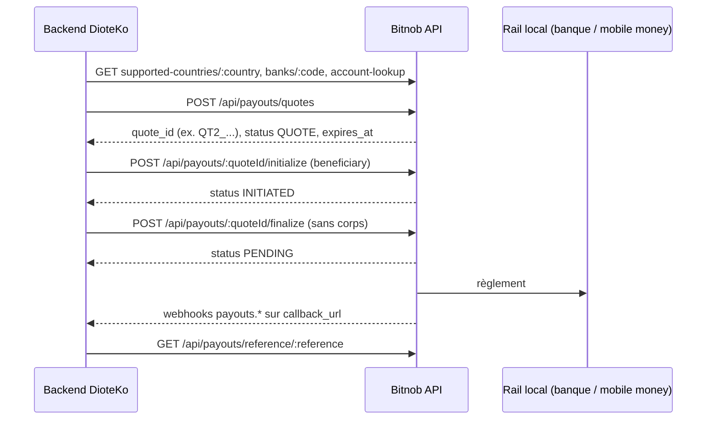

# Bitnob — API reference Payouts, Beneficiary, Customers

Source : documentation Bitnob (bitnob.dev), pages téléchargées en Markdown le 2026-10-08. Ce fichier ne reprend que ce qui est écrit dans ces pages ; le reste est marqué « non précisé dans la doc ». Noms techniques, champs et extraits en anglais exact.

## Sommaire

1. [Authentification et environnements](#1-authentification-et-environnements)
2. [Payouts : flux et statuts](#2-payouts--flux-et-statuts)
3. [Payouts : endpoints](#3-payouts--endpoints)
4. [Payouts : référentiels (pays, banques, limites, lookup)](#4-payouts--référentiels)
5. [Payouts SWIFT](#5-payouts-swift)
6. [Payouts : webhooks](#6-payouts--webhooks)
7. [Beneficiary](#7-beneficiary)
8. [Customers](#8-customers)
9. [Contradictions et obsolescences](#9-contradictions-et-obsolescences)
10. [À retenir pour DioteKo](#10-à-retenir-pour-dioteko)
11. [Index des pages couvertes](#11-index-des-pages-couvertes)

---

## 1. Authentification et environnements

### Payouts API — Integration Guide
Source : https://bitnob.dev/api-reference/payouts/usage-example

- Base URL : `https://api.bitnob.com`, identique en sandbox et production. Pas d'hôte sandbox séparé : « the secret you sign with is what selects sandbox or production ». Exception : les comptes Enterprise utilisent `https://api.platform.bitnob.com`.
- `CLIENT_ID` identique dans les deux environnements ; `CLIENT_SECRET` par environnement, affiché une seule fois.
- Headers : `X-Auth-Client`, `X-Auth-Timestamp` (secondes Unix, pas millisecondes), `X-Auth-Nonce` (UUID par requête), `X-Auth-Signature` (HMAC-SHA256 hex).
- Signature : `payload = CLIENT_ID + ":" + TIMESTAMP + ":" + NONCE + ":" + REQUEST_BODY`. Corps = JSON brut exact tel qu'envoyé ; chaîne vide pour GET et pour finalize. Re-sérialiser le JSON après signature invalide la signature.
- Erreurs d'auth (enveloppe `{"error":{"code","message"}}`) : `INVALID_SIGNATURE`, `TIMESTAMP_OUT_OF_RANGE`, `UNAUTHORIZED` (401), `FORBIDDEN` (403).
- Erreurs générales : 400 requête invalide, 401, 403, 429 (rate limit, réessayer avec backoff), 5xx (retry avec backoff). Corps d'erreur : `error{code, message, request_id, timestamp}`. Conserver `request_id` pour le support.
- Checklist go-live : payout sandbox complet vu en `completed`, signature vérifiée avec et sans corps, `reference` stockée, gestion `pending → processing → completed/failed`, secret jamais côté client, passage du secret sandbox au secret live.

---

## 2. Payouts : flux et statuts

Le guide dit que le flux payout convertit des cryptos (BTC, USDT, USDC) en fiat local (NGN, KES, GHS...) vers un compte bancaire ou mobile money.



Statuts du record payout (majuscules, via GET) selon l'API reference : `QUOTE` → `INITIATED` → `PENDING` → `PROCESSING` → `COMPLETED` / `FAILED`. Le guide d'intégration, lui, documente `pending`, `processing`, `completed`, `failed` en minuscules (voir contradictions). « Treat completed as the only success state ».

Financement (`source`) :

| source | sens |
| --- | --- |
| `offchain` | le solde du compte Bitnob est débité directement (à finalize pour offchain, d'après le guide) |
| `onchain` | dépôt crypto vers une adresse générée (BTC on-chain, Lightning ou stablecoins) |

En sandbox on ne peut pas diffuser un vrai dépôt : `POST {BASE_URL}/api/payouts/quotes/{quoteId}/deposits` avec `{ "amount": "50000" }` le simule (sandbox seulement ; route absente de l'API reference).

---

## 3. Payouts : endpoints

### Payouts — Create quote, Initialize, Finalize
Source : https://bitnob.dev/api-reference/payouts/payouts

#### Create Payouts Quote — `POST /api/payouts/quotes`

| champ | type | requis | description |
| --- | --- | --- | --- |
| `amount` | string | requis si `settlement_amount` absent | montant crypto à convertir (`from_asset`) ; prioritaire si les deux sont fournis |
| `settlement_amount` | string | requis si `amount` absent | montant fiat que le bénéficiaire doit recevoir ; ignoré si `amount` est présent |
| `country` | string | oui | ISO 3166-1 alpha-2 (`NG`, `KE`, `GH`), parmi `GET /api/payouts/supported-countries` |
| `from_asset` | string | oui | `BTC`, `USDT` ou `USDC` |
| `to_currency` | string | oui | devise fiat reçue (`NGN`, `KES`, `GHS`), supportée pour le pays |
| `source` | string | oui | `offchain` ou `onchain` (minuscules) |
| `chain` | string | requis si `onchain` | ex. `BITCOIN`, `TRON`, `ETHEREUM` ; à omettre en `offchain` |
| `reference` | string | oui | identifiant unique client, réutilisé à initialize/finalize |
| `payment_reason` | string | listé dans les exemples, non dans la table | ex. `"Invoice payment"` ; voir contradictions |

Exemple : `{"from_asset":"USDT","to_currency":"NGN","source":"offchain","country":"NG","settlement_amount":"1000","payment_reason":"Invoice payment","reference":"your-unique-ref-123"}`. Fournir `amount` OU `settlement_amount`, pas les deux.

Unités : montants en chaînes décimales (ex. `"amount": "0.00018555"` BTC dans un webhook, `"settlement_amount": "16823.2"`), c'est-à-dire unités majeures, pas de base units. Le quote renvoie aussi `sat_amount` et `btc_amount`.

Réponse (champs) : `id` (UUID du payout), `quote_id` (chaîne interne ex. `QT2_21015643`, à utiliser dans les chemins), `company_id`, `status` (ex. `QUOTE`), `source` (`OFFCHAIN`/`ONCHAIN`), `from_asset`, `chain` (ex. `CHAIN_TYPE_ETHEREUM`), `to_currency`, `amount` (montant crypto), `settlement_amount` (fiat exact reçu), `sat_amount`, `btc_amount`, `fees` (en `from_asset`), `exchange_rate{rate, btc_rate, currency}`, `reference`, `country`, `expires_at`, `created_at`. Le JSON d'exemple complet est absent de la source (`$20`).

#### Initialize Payout — `POST /api/payouts/:quoteId/initialize`
Verrouille le quote, attache le bénéficiaire, passe à `INITIATED`. `:quoteId` = ex. `QT2_21015643`, non expiré.

| champ | type | requis | description |
| --- | --- | --- | --- |
| `quote_id` | string | oui | doit correspondre au `:quoteId` du chemin |
| `reference` | string | oui | identifiant unique du payout, réutilisé à finalize |
| `payment_reason` | string | oui | code court (`salary`, `vendor_payment`, `family_support`) ; certains corridors imposent une liste fixe (voir Get Country Details) |
| `callback_url` | string | non | URL HTTPS pour les webhooks du cycle de vie |
| `beneficiary` | object | oui | forme variable selon `destination_type` et le pays |
| `beneficiary.destination_type` | string | oui | `bank`, `mobile_money` ou `swift` |
| `beneficiary.country` | string | oui | ISO alpha-2 du compte |
| `beneficiary.account_name` | string | oui | nom du compte (utiliser la valeur d'Account Lookup) |
| `beneficiary.account_number` | string | oui | numéro de compte (ou IBAN pour SWIFT) |
| `beneficiary.bank_code` | string | conditionnel | code de Get Banks ; requis pour `bank` et `mobile_money` |

Exemple :

```json
{
  "quote_id": "QT2_21015643",
  "payment_reason": "vendor_payment",
  "callback_url": "https://example.com/webhooks/payouts",
  "reference": "your-unique-ref-123",
  "beneficiary": {
    "destination_type": "bank",
    "country": "NG",
    "account_name": "OKEY JOY CHIDIMMA",
    "account_number": "0123456789",
    "bank_code": "058"
  }
}
```

Réponse : `success`, `message`, `data.payout` {`id` (UUID, à utiliser pour `GET /api/payouts/:id`), `quote_id`, `status` (`INITIATED`), `source` (`SOURCE_UNSET` si non fixé), `from_asset`, `to_currency`, `amount`, `settlement_amount`, `btc_amount`, `sat_amount`, `fees`, `cent_fees`, `exchange_rate`, `beneficiary` (renvoyé), `payment_reason`, `reference`, `expires_at`, `created_at`/`updated_at` (peuvent être null juste après initialize)}, `request_id`, `timestamp`. Il faut appeler finalize avant `expires_at`, sinon refaire quote + initialize. `customer_id` et `client_meta_data` sont mentionnés à l'initialize dans la page SWIFT (voir §5) mais ne sont pas dans la table de cette page.

#### Finalize Payout — `POST /api/payouts/:quoteId/finalize`
Aucun corps (tout corps est ignoré) ; signer avec une chaîne vide. « Finalizes a payout after the deposit has been confirmed ». Réponse : même forme `data.payout` que initialize plus : `status` (passe de `INITIATED` à `PENDING`, puis `COMPLETED`/`FAILED` selon le rail), `source` (réel), `company_id`, `cent_amount`, `callback_url`, `provider_settlement_id` (réf. du rail pour réconciliation), `country`, `trip{quote_at, initialized_at, processing_start, completion_time}`, `created_at`/`updated_at` renseignés. Exemple JSON absent (`$23`).

### List Payouts, Get by ID, Get by reference
Source : https://bitnob.dev/api-reference/payouts/list-payouts

- `GET /api/payouts?limit=20&offset=0` : paramètres `limit` (défaut 20) et `offset`. Réponse : `data.items[]`, `data.total_count`, `data.limit`, `data.offset`, `data.has_more`, `metadata.request_id`, `timestamp`. Statuts : `QUOTE`, `INITIATED`, `PENDING`, `COMPLETED`, `FAILED` (le texte mentionne aussi `PROCESSING` dans la section « by ID »). Les quotes jamais initialisés restent visibles avec `status: "QUOTE"`, expirent, ne sont jamais rejoués : les traiter comme abandonnés. Le guide d'intégration cite `?status=completed&from_date=...` mais l'API reference ne documente pas ces filtres.
- `GET /api/payouts/:id` : `id` = UUID interne du payout (pas le `quote_id`). Même forme que Finalize (`data.payout`) ; `trip` se remplit au fil du temps (`processing_start` quand `PROCESSING`, `completion_time` au terminal).
- `GET /api/payouts/reference/:reference` : recherche par votre `reference` (correspondance exacte, sensible à la casse selon la page). Même forme. Idéal pour réconcilier avec un numéro de commande ou facture.

---

## 4. Payouts : référentiels

### Supported countries, details, banks, limits
Source : https://bitnob.dev/api-reference/payouts/get-supported-countries

- `GET /api/payouts/supported-countries` : `countries[]` avec `code` (alpha-2), `name`, `flag` (emoji), `dial_code`, `corridors[]` {`currency`, `destination_types[]`}. Valeurs de `destination_types` : `bank`, `swift`, `mobile_money`, `sepa_eur`, `domestic_gbp`, `wire`, `ach`, `alipay`, `wechatpay`, `paybill`, `paytill`. « The country list you get in sandbox is a subset of the production list ». Appeler l'endpoint dans l'environnement visé avant de coder en dur.
- `GET /api/payouts/supported-countries/:country` : schéma complet des champs du bénéficiaire : `destination_types` (objet par rail) avec `label`, `fields[]` (`key`, `label`, `type`, `required`, `component`, optionnels `pattern`, `min_length`, `max_length`, `placeholder`, `options`, `options_ref`; types `group` et `variant`), `banks[]`, `limits{min_amount, max_amount, currency}`. Composants : `text`, `select`, `date`, `country_select`, `fieldset`, `variant_fieldset`. C'est la source de vérité pour construire le payload d'initialize par pays.
- `GET /api/payouts/banks/:countryCode` : `country_code`, `country_name`, `total` (ex. Nigeria : 358), `banks[]` {`bank_code`, `bank_name`}. Annuaire banques et opérateurs mobile money. Utiliser `bank_code` pour Account Lookup et initialize.
- `GET /api/payouts/limits` : `data.limits[]` par corridor (pays, devise) avec `country`, `currency`, `min_amount`, `max_amount` (en devise locale, chaînes décimales), `min_amount_usd`, `max_amount_usd` (calculés au taux live ; ne pas trop mettre en cache). Le guide d'intégration montre `?country=NG&currency=NGN`, non documenté ici.
- Exemples JSON de ces quatre réponses absents de la source (`$20`..`$23`). Aucune donnée sur le Sénégal/XOF dans ces pages (voir §10).

### Account Lookup — `GET /api/payouts/account-lookup`
Source : https://bitnob.dev/api-reference/payouts/account-lookup

Résout le nom d'un compte avant payout (pré-remplit `account_name`). Paramètres de requête : `country` (requis ; documenté `NG` banque ou `GH` mobile money), `type` (`mobile_money` pour les pays mobile money, à omettre pour les banques), `bank_code` (requis : code banque ex. `058`, ou réseau mobile en majuscules ex. `MTN`), `account_number` (requis : numéro de compte, ou téléphone avec indicatif pays pour mobile money, ex. `233246838933`). Réponse : `data.account_name`, `data.account_number`, `data.bank_code` (normalisé, peut différer), `data.bank_name`, `data.country`, `data.is_verified`. Seuls NG et GH sont documentés ; les autres pays (dont SN) : non précisé dans la doc.

---

## 5. Payouts SWIFT

Source : https://bitnob.dev/api-reference/payouts/swift-payouts

- Rail de repli (wire) pour USD, EUR, HKD, etc. quand aucun corridor local n'existe. Pas d'endpoint séparé : mêmes routes quotes/initialize/finalize ; la différence est `destination_type: "swift"` sur le bénéficiaire. Pas de webhook SWIFT spécifique.
- Le quote ne contient ni `beneficiary_info` ni `destination_type`.
- Initialize : champs de premier niveau en plus : `reference` (optionnel), `payment_reason` (optionnel), `callback_url`, `customer_id` (« Optional link to a persisted customer record »), `client_meta_data` (chaîne libre).
- `beneficiary` (tous requis) : `destination_type: "swift"`, `country`, `account_name`, `account_number` (ou IBAN), `swift_code` (majuscules, 8 ou 11 caractères), `bank_name`, `bank_address`, `bank_city`, `bank_post_code`, `bank_country`, `remittance_purpose` (snake_case minuscules, liste fixe), `beneficiary{country, city, post_code, address}`, `sender{type: business|individual, account_name, country, city, address, post_code}` ; `registration_number` (2–30 car.) requis si `business`, `date_of_birth` (YYYY-MM-DD) et `country_of_birth` requis si `individual`.
- Extras par pays : AU `bsb_number` (6 chiffres, sans tiret) ; IN `IFSCode` (camelCase, regex `^[A-Z]{4}0[A-Z0-9]{6}$`) ; HK regex SWIFT stricte ; RW et SG exigent `type` (`business`/`individual`) sur `beneficiary.beneficiary`.
- Valeurs de `remittance_purpose` : `family_support`, `education`, `gift_and_donation`, `medical_treatment`, `maintenance_expenses`, `travel`, `small_value_remittance`, `liberalized_remittance`, `construction_expenses`, `hotel_accommodation`, `advertising_expenses`, `advisory_fees`, `business_insurance`, `insurance_claims`, `delivery_fees`, `exported_goods`, `service_charges`, `loan_payment`, `office_expenses`, `property_purchase`, `property_rental`, `royalty_fees`, `shares_investment`, `fund_investment`, `tax_payment`, `transportation_fees`, `utility_bills`, `personal_transfer`, `salary_payment`, `computer_services`, `reward_payment`, `influencer_payment`, `other_fees`, `other`.
- Noms : `account_name` et `sender.account_name` doivent avoir au moins 2 mots de 2 caractères ou plus, sans `Mr`/`Dr` ni initiale pointée (`John Doe` passe, `J. Doe` non).
- Finalize : sans corps. Exemple de corridor : `{"currency":"USD","destination_types":["swift"],"limits":{"min_amount":"1","max_amount":"2000000"}}`.
- Erreurs de validation : 400 `VALIDATION_ERROR` (le `detail` nomme le champ), 401 `UNAUTHORIZED`, 404 `NOT_FOUND` (quote inexistant ou expiré), 422 `INSUFFICIENT_FUNDS` (solde société insuffisant en `offchain`).

---

## 6. Payouts : webhooks

Source : https://bitnob.dev/api-reference/payouts/webhooks

- Vérification : header `x-bitnob-signature`, HMAC SHA512 du payload (corps brut) avec votre secret ; ne parser le JSON qu'après vérification. Répondre `200`. En cas de réponse non 200 : jusqu'à 3 nouvelles tentatives avec backoff exponentiel. Dédoublonner avec `event_id`. Prévoir un polling de rattrapage.
- IP sources de livraison : `18.171.51.218`, `13.134.154.133` (susceptibles de changer ; ne remplace pas la signature).
- Événements payout : `payouts.initialized`, `payouts.processing`, `payouts.withdrawal.success`, `payouts.withdrawal.expired`. Seul `payouts.withdrawal.success` indique que les fonds sont livrés. Pas d'événement `failed` documenté dans cette page : non précisé dans la doc.
- Forme : `event`, `event_id`, `data{id, quote_id, company_id, reference, status, from_asset, to_currency, amount, settlement_amount, fees, beneficiary{country, bank_code, account_number masqué}, created_at, updated_at}` ; `success` ajoute `completed_at` ; `expired` ajoute `completed_at` et `payment_reason`.
- `data.status` des webhooks est un résultat d'événement en minuscules (`initiated`, `processing`, `success`, `expired`), distinct du statut majuscule du record (`QUOTE`... `COMPLETED`/`FAILED`). Router sur `event`, pas sur `data.status`. `from_asset`, `to_currency` et `beneficiary.country` sont en minuscules dans les webhooks.

---

## 7. Beneficiary

Source : https://bitnob.dev/api-reference/beneficiary/beneficiary

Un bénéficiaire = destinataire enregistré par un client (pour payouts, transferts, décaissements). Routes : `POST /api/beneficiaries`, `GET /api/beneficiaries`, `GET /api/beneficiaries/:beneficiaryId`, `PUT /api/beneficiaries/:beneficiaryId` (le DELETE est cité dans le texte d'intro, aucune route documentée).

**Créer** : champs :

| champ | type | requis | description |
| --- | --- | --- | --- |
| `name` | string | oui | libellé |
| `type` | string | oui | `bank` ou `crypto` (minuscules) |
| `destination` | string | oui (bank) | chaîne JSON encodée (pas un objet) avec `account_number`, `bank_code`, `account_name` |
| `wallet_address`, `currency`, `network` | string | pour `crypto` | à la place de `destination` (ex. `"currency":"USDT"`, `"network":"ethereum"`) |

Exemple : `{"name":"John Doe Bank","type":"bank","destination":"{\"account_name\":\"John Doe\",\"account_number\":\"0000611418\",\"bank_code\":\"058\"}"}`. L'exemple Python ajoute `companyId` et `createdBy`, mais le texte dit que `company_id` et `created_by` sont assignés par le serveur.

Réponse : `data.id`, `company_id`, `type`, `name`, `destination` (chaîne JSON ; `'{}'` pour crypto), `wallet_address`, `currency`, `network`, `is_blacklisted`, `is_active`, `created_by`, `created_at`, `updated_at`.

**Lister** (`GET /api/beneficiaries`) : champs des items + `total`, `limit`, `offset`, `request_id`. Aucun paramètre de requête documenté. **Get by ID** : l'exemple de réponse affiche `destination` comme objet (voir contradictions). **Update** (`PUT`) : corps non documenté (l'ancre pointe sur la section Get ; l'exemple « Update Beneficiary Response » montre un changement de `name` et `destination`).

Webhooks beneficiary : `beneficiary.status.pending` (immédiatement après l'ajout), `beneficiary.status.success`, `beneficiary.status.changed` ; forme `data{id, status (pending|success), reference, callbackUrl (ou null), companyId}`. Mêmes règles de signature (`x-bitnob-signature`, HMAC SHA512), IP sources identiques ; retries : « 3 times after the first failure ». Aucun lien documenté entre un `beneficiary.id` et l'initialize d'un payout : l'initialize reçoit le détail complet du bénéficiaire inline.

---

## 8. Customers

Source : https://bitnob.dev/api-reference/customers/customers

Routes : `POST /api/customers`, `GET /api/customers`, `GET /api/customers/:customerId`, `PUT /api/customers/:customerId`. La réponse parle de « get, update, blacklist » mais aucune route de blacklist ni de delete n'est documentée.

**Créer (`POST /api/customers`)** :

| champ | type | requis | description |
| --- | --- | --- | --- |
| `email` | string | oui | valide et unique |
| `customer_type` | string | oui | `individual` ou `business` |
| `first_name` | string | non | prénom |
| `last_name` | string | non | nom |
| `phone_number` | string | non | format international (ex. `+233XXXXXXXXX`) |
| `country_code` | string | non | ISO 3166-1 alpha-3 (`NGA`, `USA`, `GBR`) — pas alpha-2 |
| `reference` | string | non | identifiant client unique (idempotence / corrélation) |

La page précise : un client pour un compte virtuel naira ou une carte demande d'autres champs (liens vers Customer Requirements des virtual accounts et Card KYC, hors de ce lot). Les clients créés avec KYC complet exposent aussi `country`, `date_of_birth`, `id_type`, `id_number`, `dial_code`, `phone_number`, `line1`, `city`, `state`, `postal_code`.

Réponse : `data{id (UUID), first_name, last_name, email, customer_type, company_id, created_by, is_active (false si blacklisté), metadata (JSON en chaîne, ex. '{}'), created_at, updated_at}`, `metadata.request_id`, `timestamp`. Exemple : `"message": "Customer created successfully"`.

**Update (`PUT /api/customers/{id}`)** : corps optionnel `first_name`, `last_name`, `is_active` ; les champs omis restent inchangés. Pas de mise à jour documentée de l'email ou du téléphone.

**List (`GET /api/customers`)** : filtres `id`, `reference`, `email` (correspondance exacte), `customer_type`, `is_active`. Réponse `data.customers[]` avec pagination par curseur (`has_more`, `next_cursor`, `prev_cursor`, `page_size`, `total`). Exemple JSON absent (`$20`).

**Get (`GET /api/customers/:customerId`)** : objet client directement dans `data`.

---

## 9. Contradictions et obsolescences

1. **Statuts du payout** : API reference majuscules (`QUOTE`, `INITIATED`, `PENDING`, `PROCESSING`, `COMPLETED`, `FAILED`) ; guide d'intégration minuscules `pending`, `processing`, `completed`, `failed` et sans `QUOTE`/`INITIATED` ; webhooks `initiated`, `processing`, `success`, `expired`. Normaliser en insensible à la casse et mapper explicitement.
2. **Ordre de financement** : « Finalize ... after the deposit has been confirmed » (API reference) contre guide : finalize d'abord, puis « Fund » (onchain) ; offchain débité au finalize.
3. **`payment_reason` et `reference` au quote** : exemples de l'API reference l'envoient, la table de requête ne liste pas `payment_reason` ; `reference` « Required » (API reference) contre « Optional » (guide). `payment_reason` requis à initialize (API) contre optionnel (SWIFT et guide).
4. **Initialize** : l'exemple du guide omet `destination_type` et `country` du bénéficiaire, ainsi que `quote_id` dans le corps ; l'API reference les exige.
5. **Paramètres de liste/limites** : le guide montre `GET /api/payouts?status=completed&from_date=...` et `GET /api/payouts/limits?country=NG&currency=NGN`, non documentés dans l'API reference.
6. **Account Lookup** : seuls NG (banque) et GH (mobile money) décrits ; couverture des autres pays non précisée.
7. **Retries webhook** : « up to 3 times with exponential backoff » (payouts) contre « 3 times after the first failure » (beneficiary).
8. **Webhooks génériques** : l'intro mentionne l'événement `btc.lightning.received.success` en exemple (hors payouts).
9. **Beneficiary `destination`** : chaîne JSON encodée à la création, objet dans l'exemple du Get/Update ; sample Python envoie `companyId`/`createdBy` malgré « assigned by the server » ; corps du `PUT` non documenté ; l'intro cite delete sans route.
10. **Codes pays** : payouts/lookup en alpha-2 (`NG`) ; customers `country_code` en alpha-3 (`NGA`).
11. **Customers** : « blacklist » cité sans route.
12. **Extraits JSON manquants** dans la source (`$20`..`$23`) : réponses de quote, initialize, finalize, list, by-ID, countries, details, banks, limits, SWIFT, liste beneficiaries/customers.
13. **`source`** : `SOURCE_UNSET` après initialize (remplacé au finalize) ; `chain` renvoyé sous la forme `CHAIN_TYPE_ETHEREUM`, alors que la requête attend `ETHEREUM`/`TRON`.

---

## 10. À retenir pour DioteKo

1. **Champs réels du quote payout** : `from_asset` (`BTC`/`USDT`/`USDC`), `to_currency`, `country` (alpha-2), `source` (`offchain`/`onchain`, minuscules), `reference` (unique), et exactement un de `amount` (côté crypto, prioritaire) ou `settlement_amount` (côté fiat que le bénéficiaire reçoit). Pour garantir « le citoyen reçoit X en monnaie locale », utiliser `settlement_amount`. `chain` n'est requis que pour `onchain`. `payment_reason` : le mettre dans le quote (exemples) ET à initialize (requis). Montants en chaînes décimales d'unités majeures, jamais en base units/centimes.
2. **Bénéficiaire par pays** : ne pas coder en dur ; interroger `GET /api/payouts/supported-countries/:country` (schéma, validations, limites), `GET /api/payouts/banks/:countryCode` (codes), `GET /api/payouts/account-lookup` (nom). Pour `bank` : `account_number`, `bank_code`, `account_name`, `country`, `destination_type`. Pour `mobile_money` : `bank_code` = opérateur ; au Ghana, `account_number` = téléphone avec indicatif (`233...`). **Sénégal/XOF** : aucune donnée dans ces pages (ni dans `supported-countries`, dont les exemples sont NG/KE/GH/GB/CN). La page `docs/payouts/supported-currencies` (hors de ce lot, à vérifier par l'équipe) cite XOF en mobile money seulement (Orange Money, Free Money, Expresso, Wave au Sénégal). À valider en sandbox avec `GET /api/payouts/supported-countries/SN` (le sandbox est un sous-ensemble de la production).
3. **`customer_id`** : jamais requis pour un payout dans ces pages. Il apparaît seulement comme champ optionnel à l'initialize (page SWIFT, guide d'intégration : « links the payout to a customer in your account »). Le quote n'en a pas. Création d'un client : `POST /api/customers` avec `email` + `customer_type` (`individual`/`business`) minimum, `reference` recommandé ; `country_code` est en alpha-3. Pour comptes virtuels ou cartes, d'autres champs KYC sont requis (hors de ce lot).
4. **Conversion BTC/USDT vers fiat** : se fait directement dans Payouts (`from_asset` → `to_currency`), avec `exchange_rate{rate, btc_rate}` et `fees` (en `from_asset`) dans le quote. Le Trading n'offre pas de fiat sauf NGN. En `offchain`, le solde Bitnob est débité (à finalize) ; vérifier le solde car `422 INSUFFICIENT_FUNDS`. Le quote expire (`expires_at`) : enchaîner quote, initialize, finalize rapidement.
5. **Suivi et webhooks** : configurer `callback_url` ; vérifier `x-bitnob-signature` (HMAC SHA512 sur le corps brut) ; dédoublonner par `event_id` ; ne créditer qu'à `payouts.withdrawal.success` ; `payouts.withdrawal.expired` = rien n'a été réglé (refaire quote). Prévoir `GET /api/payouts/reference/:reference` comme filet de rattrapage et traiter les `QUOTE` non initialisés comme abandonnés. Confirmer le statut final avec une lecture, pas avec la seule réponse de finalize. Aucun événement d'échec (`failed`) n'est documenté : s'appuyer sur la lecture `FAILED`.
6. **Bulk transfers** (voir `trading.md`) : envois crypto groupés, pas des payouts fiat ; comportement sandbox non documenté.
7. **Sandbox** : mêmes URL et `CLIENT_ID` ; le secret choisit l'environnement ; un dépôt onchain se simule avec `POST /api/payouts/quotes/{quoteId}/deposits` (`{"amount":"50000"}`).
8. **Casse** : envoyer `destination_type`, `source`, `remittance_purpose` en minuscules ; ne pas dépendre de la casse des statuts renvoyés.

---

## 11. Index des pages couvertes

9 pages (aucune vide). Les 24 autres pages du lot sont dans `trading.md`.

| fichier source | lien |
| --- | --- |
| api-reference__payouts__payouts.md | https://bitnob.dev/api-reference/payouts/payouts |
| api-reference__payouts__usage-example.md | https://bitnob.dev/api-reference/payouts/usage-example |
| api-reference__payouts__list-payouts.md | https://bitnob.dev/api-reference/payouts/list-payouts |
| api-reference__payouts__get-supported-countries.md | https://bitnob.dev/api-reference/payouts/get-supported-countries |
| api-reference__payouts__account-lookup.md | https://bitnob.dev/api-reference/payouts/account-lookup |
| api-reference__payouts__swift-payouts.md | https://bitnob.dev/api-reference/payouts/swift-payouts |
| api-reference__payouts__webhooks.md | https://bitnob.dev/api-reference/payouts/webhooks |
| api-reference__beneficiary__beneficiary.md | https://bitnob.dev/api-reference/beneficiary/beneficiary |
| api-reference__customers__customers.md | https://bitnob.dev/api-reference/customers/customers |
