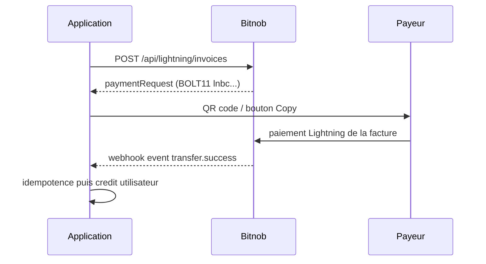
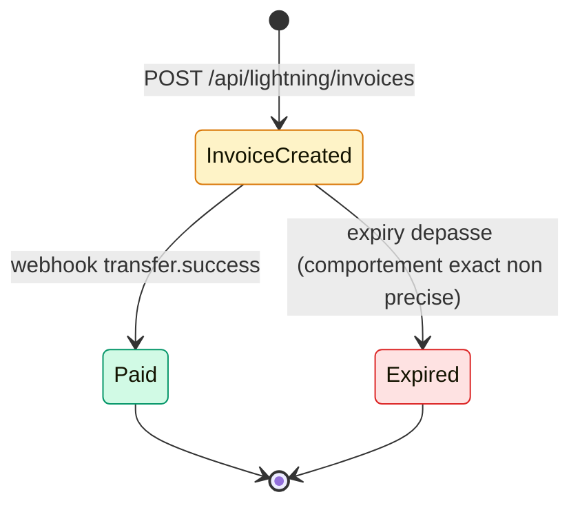

# Bitnob — Section « Bitcoin » (référence détaillée)

> Source : documentation publique `https://bitnob.dev/docs/bitcoin/...` (texte récupéré le 2026-10-08, 38 fichiers bruts).
> Le texte brut ne donne pas explicitement l'ordre du menu : l'ordre ci-dessous suit la logique de la page parente (aperçu, réception, wallets, UTXO, vie privée, frais, sécurité, architecture, futur, erreurs, puis guide PM). À confirmer contre la navigation en ligne si l'ordre exact compte.
> Langue : explications en français ; routes, champs, événements et code en anglais exact.
> Convention : « non précisé dans la doc » = absent des pages Bitcoin lues.

## Sommaire

- [1. Overview](#1-overview) : [Bitcoin Wallet: Overview](#bitcoin-wallet-overview) · [page parente `/docs/bitcoin`](#page-parente-docsbitcoin)
- [2. Réception : adresses et factures Lightning](#2-réception--adresses-et-factures-lightning) : [Issuing Bitcoin Addresses & Lightning Invoices](#issuing-bitcoin-addresses--lightning-invoices) · [LNURL & Lightning Addresses](#lnurl--lightning-addresses)
- [3. Modèles de wallet](#3-modèles-de-wallet) : [Business-Managed Non-Custodial](#business-managed-non-custodial-bitcoin-wallets-custody-by-business) · [User-Generated Non-Custodial](#user-generated-non-custodial-bitcoin-wallets-users-manage-their-own-keys)
- [4. Techniques de wallet](#4-techniques-de-wallet) : [UTXO Management Introduction](#utxo-management-introduction) · [Address and Privacy Best Practices](#address-and-privacy-best-practices) · [Fee Market and Transaction Strategies](#fee-market-and-transaction-strategies)
- [5. Sécurité et conformité](#5-sécurité-et-conformité) : [Threat Models and Security Risks](#threat-models-and-security-risks) · [Security and Compliance Reminders](#security-and-compliance-reminders-for-non-custodial-bitcoin-wallet-builders)
- [6. Architecture et évolution](#6-architecture-et-évolution) : [Sample Code Architecture and Folder Structure](#sample-code-architecture-and-folder-structure) · [Putting It All Together](#putting-it-all-together-master-blueprint) · [Future Upgrade Readiness](#future-upgrade-readiness) · [Fatal Mistakes to Avoid](#fatal-mistakes-to-avoid-when-building-bitcoin-wallets)
- [7. A Practical Guide for Non-Technical PMs](#7-a-practical-guide-for-non-technical-pms) : [index vide](#a-practical-guide-for-non-technical-pms--_index-index-vide) · [Course Abstract](#course-abstract) · [Modules 1 à 21](#modules-du-guide-pm)
- [8. À retenir pour DioteKo](#8-à-retenir-pour-dioteko)
- [9. Contradictions, obsolescences et artefacts](#9-contradictions-obsolescences-et-artefacts)
- [10. Couverture des 38 fichiers](#10-couverture-des-38-fichiers)

---

## 1. Overview

### Bitcoin Wallet: Overview

Lien : https://bitnob.dev/docs/bitcoin/overview

**À quoi ça sert.** Présente la ligne de produit « wallet Bitcoin » de Bitnob : chaque nouveau compte reçoit par défaut un wallet Bitcoin **custodial** gérant on-chain et Lightning ; des flux non-custodial existent pour qui veut plus de contrôle.

**Points clés.**
- « Custodial Wallets on Account Creation » : à l'inscription d'un utilisateur ou d'une entreprise, un wallet custodial est créé automatiquement ; **Bitnob gère les clés privées**.
- Usages listés : stocker des BTC, envoyer on-chain, envoyer en Lightning, recevoir vers « any supported address format ».
- Aucune route, aucun champ, aucun statut sur cette page (page d'introduction).

### Page parente `/docs/bitcoin`

Lien : https://bitnob.dev/docs/bitcoin

Contenu strictement identique à l'Overview ci-dessus (même titre « Bitcoin Wallet: Overview », même texte). Doublon de l'URL racine de la section.

---

## 2. Réception : adresses et factures Lightning

### Issuing Bitcoin Addresses & Lightning Invoices

Lien : https://bitnob.dev/docs/bitcoin/issuing-bitcoin-addresses-and-lightning-invoices

**À quoi ça sert.** Explique comment émettre des adresses on-chain et des factures Lightning (BOLT11), comment Bitnob notifie les paiements entrants par webhook, et comment créditer les soldes (confirmations, idempotence). Page centrale pour DioteKo.

#### Adresses on-chain

- Route : `POST /api/addresses` (référence complète : `/api-reference/addresses#generate-addresses` ; voir aussi `#validate-address` et le webhook d'adresse `/api-reference/addresses/webhooks#webhook`).
- Champs documentés dans le tableau : `chain` (réseau, ex. `bitcoin`), `label` (libellé humain), `reference` (chaîne unique de suivi, ex. `BTC_ADDRE_REF`). L'exemple de requête ajoute `customer_email`. Obligatoire/optionnel : non précisé dans la doc.

```json
{
  "chain": "bitcoin",
  "label": "home",
  "reference": "BTC_ADDRE_REF",
  "customer_email": "mose@gmail.com"
}
```

- Éviter la réutilisation d'adresse (vie privée) ; si un paiement arrive quand même sur une ancienne adresse, le webhook part quand même.
- Événement de dépôt : `deposit.success`, envoyé dès qu'au moins **1 confirmation** est vue. La doc recommande d'attendre **au moins 3 confirmations** avant de créditer (risque de reorg) ; on peut re-interroger l'endpoint de transaction pour le nombre de confirmations (route non nommée ici).

Webhook `deposit.success` (verbatim) :

```json
{
  "data": {
    "address": "bc1qy44gptm5lc50ggpsv7zzd6mj65ex5vjhxf9m6s",
    "amount": "10000",
    "chain": "bitcoin",
    "currency": "BTC",
    "fee": "0",
    "hash": "5d0118bf2ecff0cecdf488f6e2479b9e7ab038f996895bfcfe80743ac39e1ef6",
    "reference": "RCV_BTC_cd2f1a432f40",
    "timestamp": "2026-05-15T21:52:04Z",
    "transaction_id": "371d95f9-d525-4a15-8b27-669f47a4cb4d"
  },
  "event": "deposit.success",
  "event_id": "c250441d-5d22-42e7-8958-5bb3ddc4a404"
}
```

Remarque : ce payload **ne contient pas** de champ `confirmations`, alors que le flux d'exemple parle de `deposit.success` « avec `confirmations: 1` ». Unité de `amount` (`"10000"`) non précisée explicitement (très probablement satoshis, non confirmé).

#### Factures Lightning

- Pourquoi : paiements quasi instantanés, sans confirmation de bloc (tips, micropaiements).
- Route de création : **`POST /api/lightning/invoices`** (référence : `/api-reference/lightning#create-invoice` ; voir aussi `#get-invoice` et `#decode-payment-request`).
- La facture est une chaîne **BOLT11** commençant par `ln`. La réponse contient un champ **`paymentRequest`** (la facture BOLT11), exemple : `lnbc1500n1psjkltkpp55q5g2eltp56jzuk9300p404w5qfrac0mr77qde633htcvvgyheqsdp92fjk...`. Le reste de la forme de réponse n'est pas décrit sur cette page.

Requête de création (verbatim) :

```json
{
  "customer_id": "3257cdc0-f55b-46a5-85e5-74f57003a3f9",
  "amount": 1,
  "description": "Payment for order",
  "expiry": 3600,
  "reference": "LTG_REF"
}
```

- Champs vus : `customer_id`, `amount`, `description`, `expiry` (3600 ; unité secondes d'après la page LNURL, qui dit « 3600 seconds »), `reference`. Unité de `amount` (1) **non précisée** ; l'exemple « tip de 15 000 sats » suggère les sats, mais ce n'est pas écrit. Obligatoire/optionnel : non précisé.
- UI recommandée : QR code + bouton « Copy ».

#### Comment une facture est payée / confirmée

Quand le payeur règle la facture, Bitnob vérifie le réseau Lightning ; à confirmation, un webhook est envoyé (« e.g., `transfer.success` »). La page **ne mentionne ni preimage, ni statut `paid`** : la confirmation passe uniquement par l'événement webhook (et, implicitement, par `Get Invoice`, non détaillé ici).

« Lightning Webhook Payload » (verbatim) :

```json
{
  "data": {
    "amount": "3000",
    "chain": "lightning",
    "currency": "BTC",
    "fee": "0",
    "invoice": "lnbc30u1p4q0ycapp52sm243augg9uatfjumh6a032sh476468rxfedvdg425cupg7jchqdp82pshjgr5dusyymrfde4jq4mpd3kx2apq24ek2uscqzpuxqrwzqsp5w55j885l7kt9pka26cpsws0qauav3kaktafcngzhhu2t5ygkt5js9qxpqysgqpehna9zm79c0pkk2qkdu5kqtk657xu7und3mknsj4ejpjv9rupc3p8r7nt77ntlcv36779307wuk4d0cag4m2f0j058g567stj5ugyqp0mz8u7",
    "reference": "5ac65838-6166-4e98-b360-6747f53a4fa4",
    "timestamp": "2026-05-15T21:43:10Z",
    "transaction_id": "e212c8ba-16ce-46a3-8548-9fc4fc1a6484"
  },
  "event": "transfer.success",
  "event_id": "d22a304f-6b19-4371-a91b-b7ef08a1fbad"
}
```

- Nom exact de l'événement d'un paiement Lightning reçu : **`transfer.success`** (et non `deposit.success`, réservé à l'on-chain). Le texte dit « e.g. », donc la liste n'est pas exhaustive.
- Le payload n'a pas de champ `status`, ni `preimage`/`payment_hash` ; le lien avec la facture se fait via `data.invoice` (BOLT11 complet) ; `data.reference` est un UUID dans l'exemple (différent du format `LTG_REF` de la requête : l'écho de la `reference` de création n'est pas garanti par cette page). `amount: "3000"` correspond à `lnbc30u` (30 µBTC = 3000 sats) : l'unité du webhook est donc cohérente avec des **sats** (déduction, non écrite).
- Les `transaction_id` / `event_id` sont des UUID : clés d'idempotence candidates.

#### LNURL et Lightning Addresses

Mention rapide (détails dans la page dédiée). Les paiements via LNURL ou adresse Lightning déclenchent aussi `transfer.success`.

#### Bonnes pratiques (6 points)

1. Adresse/facture unique à chaque encaissement attendu.
2. Attacher `label` / email à chaque adresse ou facture.
3. On-chain : **3 confirmations ou plus** avant de créditer ; Lightning : pas de confirmation de bloc requise (« effectively instant once the invoice is paid »).
4. Webhook **idempotent** : stocker une `reference` pour ne pas créditer deux fois si Bitnob rejoue l'événement.
5. Ancienne adresse réutilisée : notification quand même, mais déconseillé.
6. Taproot / SegWit : « Bitnob supports Taproot addresses if you choose `addressType: 'taproot'` » (nom de paramètre en camelCase ici, contradictoire avec les champs `chain/label/reference` du tableau et avec `address_type` de l'API non-custodial ; voir section 9).

#### Flux d'exemple



Flux on-chain décrit : l'app demande une adresse (« segwit »), l'affiche (`bc1q...`), le client envoie, Bitnob envoie `deposit.success`, l'app vérifie 3 confirmations avant de créditer.

### LNURL & Lightning Addresses

Lien : https://bitnob.dev/docs/bitcoin/lnurl-and-lightning-addresses

**À quoi ça sert.** Décrit comment Bitnob supporte LNURL et les adresses Lightning (type `alice@company.com`) pour éviter de copier des factures BOLT11 : le wallet du payeur récupère une facture à la volée. Page conceptuelle : **aucune route exacte** n'est donnée.

**Points clés.**
- LNURL-Pay : lien statique qui récupère automatiquement une facture. LNURL-Withdraw : l'utilisateur scanne un lien pour récupérer des fonds auprès d'un service.
- Cas d'usage : tips, retrait de gains, dons statiques.
- Adresse Lightning : identifiant « email-like » ; le wallet payeur interroge l'adresse, obtient la facture et paie. Envoi : le système peut générer le flux LNURL sous le capot.
- Intégration Bitnob : émettre des LNURL, gérer des adresses Lightning par utilisateur, réutiliser les comptes Lightning existants, écouter les paiements par webhook.
- LNURL-Pay : le paiement arrive dans le wallet custodial ou non-custodial, et Bitnob envoie **`transfer.success`**. LNURL-Withdraw : Bitnob reçoit une demande de facture, le paiement part du côté « custody » du client (payout).
- Adresse Lightning : `username@yourdomain.com` ; domaine rendu LNURL-compatible via l'API Bitnob ou son propre serveur LNURL ; à chaque paiement Bitnob génère la facture et crédite le wallet de l'utilisateur.
- Création via API (étapes vagues) : enregistrer un domaine/sous-domaine, émettre un LNURL (Pay ou Withdraw) avec contraintes (plage de montants, commentaire), ou provisionner `name@yourdomain.com`. Routes : **non précisées dans la doc**.

Champs notables (tableau « Key Fields ») :

| Champ | Définition / exemple |
| --- | --- |
| Callback URLs | endpoint appelé par le wallet pour obtenir une facture fraîche, ex. `https://yourdomain.com/lnurlp/callback/9f2c1a` |
| Min/Max Sats | plage LNURL-Pay, ex. min 1 000 sats, max 100 000 sats ; hors plage = rejeté |
| Expiry | ex. 3600 secondes (facture valable une heure) |
| Reference IDs | ex. `LNURL_REF_001`, « echoed back on the payment webhook » pour rattacher au user |

**Notifications.** Événement `transfer.success` avec les détails de la facture payée ; idempotence via référence unique ; pour un withdraw, finaliser la demande ; pour un pay, créditer après confirmation.

**Sécurité.** Un LNURL/adresse unique par utilisateur ; valider la propriété du domaine si domaine propre ; limites sensées sur les withdraw ; suivre l'usage (pas de re-withdraw) ; gérer les re-polls du callback (cache/TTL court).

**Cas limites.** Utilisateur qui scanne sans finir (aucune facture demandée, rien ne bouge) ; sous-paiement rare car facture exacte ; DNS/domaine hors ligne = pas de facture (prévoir un lien LNURL direct de secours).

**FAQ.** Pas besoin de nœud Lightning séparé (Bitnob gère les opérations de nœud, ou on peut brancher le sien) ; utilisable sur mobile ; LNURL/adresses valables **uniquement pour Bitcoin Lightning**, pas pour les stablecoins.

---

## 3. Modèles de wallet

### Business-Managed Non-Custodial Bitcoin Wallets (Custody by Business)

Lien : https://bitnob.dev/docs/bitcoin/business-managed-non-custodial-bitcoin-wallets

**À quoi ça sert.** Bitnob fournit un service RPC Bitcoin managé ; l'entreprise détient **toutes les clés privées sur sa propre infrastructure**, Bitnob ne fournit que l'infra nœud (génération d'adresses, surveillance, broadcast, requêtes chaîne). Bitnob « never touches customer funds ». Permet de construire wallets custodial maison, néobanques crypto, exchanges, trésoreries, processeurs de paiement, explorateurs.

**Concepts.** Les utilisateurs ont des comptes dans l'app de l'entreprise ; la signature se fait entièrement côté backend de l'entreprise. Types d'adresses : Legacy (P2PKH), Nested SegWit (P2SH), Native SegWit (P2WPKH), Taproot (P2TR).

**Capacités.** Génération d'adresses, broadcast (unitaire ou batch), surveillance par webhooks, soldes (confirmés et en attente), requêtes de transactions (mempool ou chaîne), estimation des frais (fast/medium/economical), requêtes complètes explorateur/indexation.

**Routes (tableau complet de la page).**

| Action | Méthode | Chemin |
| --- | --- | --- |
| Generate new address | POST | `/api/noncustodial/bitcoin/address/new` |
| Watch address | POST | `/api/noncustodial/bitcoin/address/watch` |
| Watch multiple addresses | POST | `/api/noncustodial/bitcoin/address/watch/bulk` |
| Broadcast signed transaction | POST | `/api/noncustodial/bitcoin/transaction/broadcast` |
| Broadcast batch transactions | POST | `/api/noncustodial/bitcoin/transaction/batch/broadcast` |
| Fetch balance | GET | `/api/noncustodial/bitcoin/address/balance` |
| Fetch transaction history | GET | `/api/noncustodial/bitcoin/address/transactions` |
| Query transaction by TXID | GET | `/api/noncustodial/bitcoin/transaction/{txid}` |
| Label address for business use | POST | `/api/noncustodial/bitcoin/address/label` |
| General RPC Queries | POST | `/api/noncustodial/bitcoin/rpc` |

(La route d'estimation de frais `GET /api/noncustodial/bitcoin/fees/estimate` n'apparaît **pas** dans ce tableau mais dans la page User-Generated.)

**Types d'adresse (valeurs de `address_type`).** `legacy` (commence par `1`, frais élevés), `p2sh-segwit` (`3...`), `native-segwit` (`bc1q...`, recommandé), `taproot` (`bc1p...`, avancé).

```json
{
  "address_type": "native-segwit",
  "label": "user_wallet_123"
}
```

**Webhooks.** Global (un seul endpoint pour tout) ou par adresse ; payloads personnalisables. Événements : transaction entrante détectée, mises à jour de confirmation, échec de broadcast (si configuré). Noms exacts d'événements et format de payload : **non précisés dans la doc** de cette page.

**Bonnes pratiques.** Clés en HSM ou base chiffrée ; séparation hot/cold ; estimation de frais temps réel avant gros envois ; une adresse de réception par paiement ; **au moins 3 confirmations** avant de refléter un dépôt ; jobs de réconciliation périodiques pour recouper les webhooks.

**RPC générique.** Accès type Bitcoin Core (ex. `getblock`, `getblockhash`, mempool, historiques) sans nœud propre ; limites et quotas « depending on your subscription tier » (valeurs non précisées).

**Flux de bout en bout.** Requête client avec en-têtes **HMAC** vers la couche API Bitnob → Auth & Security (identifiants, rôles) → Wallet Management / Transactions Engine / Value-Added Services → Database & Ledger → réponse (détails de transaction, soldes, confirmation).

### User-Generated Non-Custodial Bitcoin Wallets (Users Manage Their Own Keys)

Lien : https://bitnob.dev/docs/bitcoin/user-managed-self-custodial-wallets

**À quoi ça sert.** Bitnob sert uniquement de couche infra (surveillance d'adresses, broadcast, estimation de frais, requêtes chaîne) pour des wallets où **l'utilisateur génère et garde ses clés** ; la signature se fait sur l'appareil. Bitnob ne voit jamais clés, transactions non signées ni fonds.

**Responsabilités du développeur.** Générer les wallets (BIP32, BIP39, BIP44 recommandés), construire la gestion de clés et la signature, utiliser les API Bitnob (soldes, broadcast, surveillance), ne jamais envoyer clés ou seed sur le réseau.

**Outils recommandés.** BDK (Bitcoin Development Kit, Spiral ; Rust, Swift, Kotlin), bitcoinjs-lib, bibliothèques Noble, btcd/lnd (Go).

**Routes clés.**

| Action | Méthode | Chemin |
| --- | --- | --- |
| Watch address | POST | `/api/noncustodial/bitcoin/address/watch` |
| Watch multiple addresses | POST | `/api/noncustodial/bitcoin/address/watch/bulk` |
| Broadcast signed transaction | POST | `/api/noncustodial/bitcoin/transaction/broadcast` |
| Batch broadcast transactions | POST | `/api/noncustodial/bitcoin/transaction/batch/broadcast` |
| Estimate fees | GET | `/api/noncustodial/bitcoin/fees/estimate` |
| Fetch address balance | GET | `/api/noncustodial/bitcoin/address/balance` |
| Fetch address transactions | GET | `/api/noncustodial/bitcoin/address/transactions` |

**Parcours en 5 étapes.** (1) Génération côté client : seed BIP39, clés maîtresses, première adresse SegWit/Taproot, sauvegarde. (2) Dashboard : soldes et historique via API, mises à jour par webhook ou polling. (3) Réception : adresse fraîche, rotation, surveillance Bitnob. (4) Envoi : UTXO, frais via l'API Bitnob, signature locale, `POST .../transaction/broadcast`. (5) Opérations : rotation, labels, statut mempool, RBF optionnel.

**Implémentation de référence.** Clés/Transactions : BDK ou bitcoinjs-lib ; interface chaîne, webhooks : Bitnob ; sauvegarde : seed manuelle, cloud chiffré optionnel.

**Bénéfices.** Contrôle UX total, vie privée et custody conservées, pas de full node à opérer, prêt pour Taproot/Schnorr/Miniscript. Le titre « Example Full System Flow Diagram » ne contient aucun diagramme dans le texte récupéré.

---

## 4. Techniques de wallet

### UTXO Management Introduction

Lien : https://bitnob.dev/docs/bitcoin/utxo-management-introduction

**À quoi ça sert.** Explique ce qu'est un UTXO et pourquoi sa gestion (consolidation, sélection, poussière, change) conditionne frais, vie privée et passage à l'échelle d'un wallet.

**Points clés.**
- Un wallet est un ensemble d'UTXO contrôlés par des clés. Exemple : 0,5 BTC + 1,0 BTC reçus = deux UTXO.
- Problèmes : trop de petits UTXO (frais élevés), pas de consolidation en période creuse, fuites de vie privée, change mal géré, poussière (« dust »).
- Techniques : consolidation en période de frais bas (ex. 20 UTXO de 0,001 BTC vers 1 de 0,02 BTC) ; stratégies de sélection (Largest-First, Oldest-First, Randomized, Merge Outputs, Privacy-Preserving) ; poussière (ex. UTXO de 200 sats pour 500 sats de frais) ; change toujours vers une nouvelle adresse interne.
- Comportements : frais élevés = moins d'UTXO ; frais bas = consolider ; vie privée = sélection non liante ; envoi de poussière = avertir, « sweep » seulement si frais bas.
- **Bitnob aujourd'hui** : on gère les UTXO côté client (BDK/bitcoinjs-lib). Bitnob « plans to expose » des API de découverte/liste d'UTXO (futur, pas disponible).
- Modèle de données conceptuel : comptes avec `externalAddresses`, `internalAddresses`, `utxos` (`txid`, `vout`, `amount`, `confirmations`, `address`), `balance`, `pendingTransactions`.
- Envoi en 5 temps : sélection, estimation de frais (API Bitnob), construction, ajout de change, signature + broadcast.

### Address and Privacy Best Practices

Lien : https://bitnob.dev/docs/bitcoin/address-and-privacy-best-practices

**À quoi ça sert.** Règles de gestion d'adresses et de confidentialité pour un wallet non-custodial : une adresse par paiement, pas de réutilisation, rotation automatique, adresses internes pour le change.

**Points clés.**
- Principes : une adresse = un paiement ; ne pas réutiliser ; rotation automatique ; séparer externe (réception) et interne (change) ; labels internes (jamais on-chain).
- Wallets HD (BIP32/BIP44, seed BIP39) avec deux chaînes : externe et interne. Chemins natifs SegWit (BIP84) : `m/84'/0'/account'/0/0` (externe), `m/84'/0'/account'/1/0` (interne) ; Legacy BIP44 `m/44'`, P2SH-SegWit BIP49 `m/49'`, Taproot BIP86 `m/86'`. `account` = identifiant utilisateur. Chemin mainnet (`0'` = Bitcoin mainnet) : l'adaptation testnet n'est pas décrite.
- Après chaque réception : marquer l'adresse « used », dériver la suivante, afficher la nouvelle (pré-génération possible).
- Change : jamais vers l'adresse externe, sinon lien trivial entre envois et fonds reçus.
- Frontend : ne jamais montrer deux fois la même adresse.
- Graphe de transactions : peu d'UTXO par envoi ; change frais ; diffusion via Tor/Dandelion (envisagé plus tard).
- Évolution : PayJoin (P2EP), CoinJoin non obligatoires au MVP mais à anticiper.

Pseudocode fourni (verbatim) :

```pseudocode
if (lastReceiveAddressUsed) {
    receiveAddress = deriveNewExternalAddress();
} else {
    receiveAddress = getLastExternalAddress();
}

// When sending
tx = buildTransaction(inputs, outputs);
tx.changeAddress = deriveNewInternalAddress();
```

### Fee Market and Transaction Strategies

Lien : https://bitnob.dev/docs/bitcoin/fee-market-and-transaction-strategies

**À quoi ça sert.** Explique le marché des frais Bitcoin (on paie la **taille en vBytes**, pas le montant) et comment concevoir l'UX et la logique de frais d'un wallet non-custodial.

**Points clés.**
- Termes : fee rate (sats/vByte), mempool, block target, RBF (Replace-by-Fee), CPFP (Child-Pays-For-Parent).
- Comportement : faible activité 1–2 sat/vB confirme en quelques blocs ; congestion moyenne 10–20 ; forte 50–200+ ; pics (Ordinals, BRC-20) 500+ pour le bloc suivant.
- Options UI : **Fast** (bloc suivant, ~10 min), **Normal** (3–6 blocs, 30–60 min), **Economy** (6+ blocs, 1 h+).
- Afficher le coût réel en BTC et en fiat. Exemple : 200 vB × 20 sats/vB = 4 000 sats (~1,80 $).
- RBF : marquer les transactions remplaçables (`sequence < 0xffffffff - 1`) ; proposer « Speed up » ; CPFP si le wallet dépense depuis une transaction bloquée ; avertir pour frais trop bas.
- Surveillance mempool (optionnel) : si mempool > 300 Mo, preset Fast +20 % ; si < 30 Mo, -10 %.
- Exemples de wallets : Muun, BlueWallet, Phoenix, CashApp.
- **Ce que Bitnob offre aujourd'hui** : API d'estimation de frais dynamique avec cibles **low, medium, high** (route : `GET /api/noncustodial/bitcoin/fees/estimate`, voir page User-Generated). **Prévu (futur)** : webhooks d'événements mempool, API de suivi du marché des frais, helpers RBF, templates CPFP.

---

## 5. Sécurité et conformité

### Threat Models and Security Risks

Lien : https://bitnob.dev/docs/bitcoin/threat-models-and-security-risks

**À quoi ça sert.** Cartographie des menaces pour les wallets où l'utilisateur détient ses clés (« users are their own banks ») et défenses produit/ingénierie/éducation.

| Menace | Mitigation |
| --- | --- |
| Perte/vol d'appareil | Chiffrement local (AES-256), PIN/biométrie, auto-lock, 2FA optionnelle sur envoi ; clé de chiffrement dérivée du code de l'utilisateur, pas codée en dur |
| Perte de sauvegarde seed | Sauvegarde forcée à l'onboarding + vérification (« Enter word #12 »), rappels, cloud chiffré seulement s'il est réellement sûr |
| Supply chain | Minimiser les SDK tiers, auditer les libs, builds reproductibles, isoler le code wallet des analytics/pubs |
| Phishing / faux recovery | Ne jamais redemander la seed après la vérification initiale, avertissements in-app |
| Malware / presse-papiers | QR codes, empreinte partielle de l'adresse (4 premiers et 4 derniers caractères), alerte au collage |

État d'esprit : supposer des erreurs utilisateur, un environnement potentiellement compromis, traiter chaque action sur clés comme événement critique (logs sécurisés, surveillance), se comparer à Sparrow, Phoenix, BlueWallet, Green.

### Security and Compliance Reminders for Non-Custodial Bitcoin Wallet Builders

Lien : https://bitnob.dev/docs/bitcoin/security-and-compliance-reminders

**À quoi ça sert.** Rappelle que le non-custodial n'exempte pas des obligations opérationnelles et légales.

**Points clés.**
- Données personnelles : e-mails, identifiants d'appareil, IP, métadonnées de sauvegarde ; RGPD/CCPA s'appliquent ; politique de confidentialité, minimisation, suppression/export, pseudonymisation, logs minimaux (ne pas lier adresses et IP), conception « local-first ».
- Avertissements de custody : l'utilisateur contrôle ses fonds ; perte de seed = pas de récupération ; l'entreprise n'a aucun accès. Clause type citée dans la doc (« You are solely responsible for securing your Bitcoin... »).
- Licences : en général pas de licence pour un pur non-custodial, mais combiner avec on/off-ramp, swaps ou services custodial peut en déclencher ; régulation africaine souvent floue ; consulter des juristes tôt.
- Sécurité d'infra : webhooks signés, rate limiting (surtout sur les envois), HMAC ou JWT en interne, TLS 1.3, logs sans donnée sensible ; attaques citées : injection de webhook, replay, accès non autorisé, DoS, falsification.
- Criminalité financière : conseils de confidentialité, listes de blocage (ex. OFAC) pour services optionnels, mentions dans les CGU.
- Politiques de clés : jamais d'accès employé aux clés, jamais de reset de mot de passe qui restaure l'accès BTC sans seed.
- Transparence : code crypto open-source si possible, CGU lisibles, éducation à l'onboarding.

---

## 6. Architecture et évolution

### Sample Code Architecture and Folder Structure

Lien : https://bitnob.dev/docs/bitcoin/sample-code-architecture-and-folder-structure

**À quoi ça sert.** Architecture de code recommandée pour un wallet non-custodial (mobile, web, desktop).

**Points clés.**
- Principes : modularité par responsabilité, fonctions critiques sans état, chiffrement au repos, interfaces blockchain abstraites (ne pas dépendre en dur de Bitnob), moteurs de frais/politiques remplaçables.
- Modules : `/core/keys/`, `/core/addresses/`, `/core/transactions/`, `/core/utxos/`, `/infrastructure/bitnob/`, `/models/`, `/utils/`, `/config/` (réseaux mainnet/testnet, politiques de frais), `/screens/`, `/services/` (sauvegarde, alertes, webhooks, monitoring mempool), `/tests/`.
- **Artefact** : l'arborescence de dossiers est remplacée dans le texte récupéré par le jeton `$22` (bloc de code non rendu) ; seule la description des modules est exploitable.
- Recommandations : clés uniquement sur l'appareil ; envelopper l'API Bitnob dans un `BlockchainClient` (`watchAddress()`, `broadcastTransaction()`) pour pouvoir passer à Bitcoin Core RPC ou Esplora ; appels en batch ; échec gracieux avec file d'attente/retry ; webhooks authentifiés (HMAC) ; modèles multi-comptes.
- Lisibilité : noms clairs (`deriveExternalAddress()`), fonctions courtes, doc des fonctions sensibles, pas d'erreurs avalées, **100 %** de couverture sur génération de clés/signature/construction de transactions.
- Ordre de construction : cryptographie, interface blockchain, puis UI.
- Pseudocode de démarrage fourni : `generateMnemonic()`, `encryptSeed()`, `saveToSecureStorage()`, `loadWallet()`, `deriveAddresses()`, `fetchBalances()`, `getNextReceiveAddress()`, `selectUtxos()`, `estimateFees()`, `buildTransaction()`, `signTransaction()`, `broadcastTransaction()`.

### Putting It All Together (Master Blueprint)

Lien : https://bitnob.dev/docs/bitcoin/putting-it-all-together

**À quoi ça sert.** Plan complet pour bâtir un wallet non-custodial avec le RPC Bitnob et des bibliothèques comme BDK.

**Points clés.**
- Génération client : seed BIP39 de **12 ou 24 mots**, BIP32, chaînes externe/interne ; les clés ne quittent jamais l'appareil.
- Dashboard via `/address/balance` et `/address/transactions` ; réception : adresse fraîche, rotation, enregistrement à l'API de surveillance d'adresses (webhook), solde confirmé après **1–3 confirmations**.
- Envoi : UTXO, frais via `/fees/estimate`, construction (sélection, sorties, change vers adresse interne), signature locale, broadcast via `/transaction/broadcast`, RBF optionnel.
- Trois niveaux de frais : Fast, Normal, Economy.
- Statuts UI : Pending à 0 confirmation, Confirmed à 1–3, Final à 6 (optionnel).
- Scaling : consolider en frais bas, rotation agressive, Taproot, architecture modulaire (Silent Payments, Lightning, Miniscript).
- Modules : Key Management, Address Derivation, Transaction Builder, Blockchain Interface (API Bitnob), Webhooks Handler, Mempool Monitor (optionnel).

### Future Upgrade Readiness

Lien : https://bitnob.dev/docs/bitcoin/future-upgrade-readiness

**À quoi ça sert.** Prépare l'architecture aux évolutions Bitcoin sur 5 à 10 ans.

**Points clés.**
- Taproot (P2TR, activé en 2021) : meilleure confidentialité, frais réduits pour scripts complexes, MAST, Schnorr ; adresses `bc1p...` à valider/décoder (longueur différente de `bc1q`).
- Lightning (couche 2) : paiements instantanés, frais quasi nuls. Trois phases d'intégration : (1) afficher des factures Lightning dans l'app et router via des providers externes (Strike, OpenNode, **Bitnob Lightning APIs**) ; (2) wallet Lightning intégré (Breez, LDK, BDK + modules Lightning) ; (3) nœuds et canaux propres. Au MVP : intégrations **custodial ou semi-custodial** recommandées. « Bitnob plans to offer future support for easy Lightning settlement endpoints » (futur).
- Miniscript : conditions de dépense complexes, encore « early » ; Silent Payments et PayJoin (P2EP) pour la confidentialité.
- Architecture : séparer gestion de clés, dérivation d'adresses, construction, broadcast, estimation de frais (pluggable), monitoring.
- Roadmap Bitnob annoncée (futur, non disponible) : surveillance Taproot native, endpoints/bridges Lightning, broadcast par politique, détection Silent Payments, PayJoin, API de gestion d'UTXO.

### Fatal Mistakes to Avoid When Building Bitcoin Wallets

Lien : https://bitnob.dev/docs/bitcoin/fatal-mistakes-to-avoid

**À quoi ça sert.** Dix erreurs fatales tirées de cas réels (Mycelium, Bitcoin Gold, etc.) avec prévention.

**Points clés (les 10 erreurs).**
1. Mauvaise gestion des clés/seeds (chiffrer au repos AES-256-GCM, KDF PBKDF2/Argon2id, ne jamais logger les clés).
2. Frais codés en dur (ex. 5 sats/vB) : toujours récupérer des estimations dynamiques (Bitnob ou mempool), offrir Fast/Normal/Economical, RBF.
3. Mauvaise gestion des UTXO (wallet bloat, poussière).
4. Réutilisation d'adresses et fuites de vie privée.
5. Sauvegarde/récupération incomplète (forcer BIP39, vérification par mots aléatoires).
6. Trop de confiance envers des bibliothèques tierces (préférer bitcoinjs-lib, BDK, Noble).
7. **Sécurité webhook faible ou absente** : authentifier (HMAC), valider les ID de transaction on-chain avant de créditer, protéger contre le rejeu (IDs uniques, horodatage).
8. Ignorer la sécurité mobile (root/jailbreak, Keychain/Keystore, stockage chiffré).
9. Pas de chemin d'évolution (Taproot, Silent Payments, Lightning).
10. MVP trop ambitieux (Bitcoin seul, SegWit/Taproot, envoi/réception basiques, sauvegarde obligatoire).

Checklist finale : ne jamais transmettre de clés hors appareil, jamais de réutilisation d'adresse, change toujours en adresse neuve, frais dynamiques, sauvegarde forcée, authentifier webhooks, durcir l'app, architecture modulaire.

---

## 7. A Practical Guide for Non-Technical PMs

### A Practical Guide for Non-Technical PMs — `_index` (index vide)

Lien : https://bitnob.dev/docs/bitcoin/a-practical-guide-for-non-technical-pms/_index

Fichier **vide** : index de section sans contenu (seule la ligne `source` est présente).

### Course Abstract

Lien : https://bitnob.dev/docs/bitcoin/a-practical-guide-for-non-technical-pms

Page d'introduction du cours : 21 modules, destinés aux Product Managers qui construisent des produits Bitcoin (marchands, migrants, activistes, épargnants). Ton très éditorialisé (« Bitcoin is survival infrastructure »). Contient la table des matières complète (module 1 à 21, titres repris ci-dessous). Aucune route ni donnée technique d'API.

### Modules du guide PM

#### Module 1: What Bitcoin Really Is
Lien : https://bitnob.dev/docs/bitcoin/a-practical-guide-for-non-technical-pms/module-1
- Bitcoin est un registre public décentralisé d'UTXO, pas un compte : aucun solde n'est stocké, il est calculé en sommant les UTXO.
- Un bloc toutes les **~10 minutes** en moyenne ; blocs chaînés cryptographiquement.
- Une transaction est diffusée (broadcast) au réseau pair-à-pair ; les mineurs l'incluent dans un bloc ; pas de lien direct émetteur/destinataire.
- Sécurité : Proof-of-Work, décentralisation, incitations économiques.
- Implications wallet : scanner/sommer les UTXO ; états unconfirmed/confirming/confirmed ; clés privées protégées, adresses publiques ; irréversible après confirmation.
- L'app est un panneau de contrôle de clés, pas un conteneur de BTC. Le diagramme (§1.7) est un bloc non rendu (`$23`).

#### Module 2: Private Keys, Public Keys, and Bitcoin Addresses
Lien : https://bitnob.dev/docs/bitcoin/a-practical-guide-for-non-technical-pms/module-2
- Clé privée = nombre aléatoire de **256 bits** (64 caractères hex) ; clé publique via courbe **secp256k1** (compressée 33 octets `02`/`03`, non compressée 65 octets).
- Adresse : SHA-256 puis RIPEMD-160 (Legacy et SegWit v0) ; Taproot encode la clé publique directement (Bech32m).
- Préfixes : Legacy P2PKH `1`, P2SH `3`, Native SegWit `bc1q`, Taproot `bc1p`.
- Seed BIP39 de 12 ou 24 mots ; perte de seed = perte définitive.
- Produit : sauvegarde obligatoire avec vérification (« Enter word 6 of 12 »), clés chiffrées sur l'appareil, aucune récupération côté serveur, avertissements anti-partage de seed.
- Artefact : titre « ##W## 2.9 » (balisage cassé) ; les diagrammes de dérivation sont des flèches ASCII dans la source.

#### Module 3: Understanding UTXOs
Lien : https://bitnob.dev/docs/bitcoin/a-practical-guide-for-non-technical-pms/module-3
- UTXO = pièce de bitcoin envoyée à une adresse et non dépensée ; **indivisible** : on dépense l'UTXO en entier et on reçoit du change.
- Exemple : UTXO 0,5 + 1,0 BTC ; envoi de 0,8 BTC dépense le 1,0 et crée 0,8 (destinataire) + 0,2 (change).
- Plus d'UTXO en entrée = transaction plus grosse = frais plus élevés.
- Stratégies : Largest First, Smallest First, Randomized, Privacy-Preserving.
- Poussière : UTXO de 200 sats si 400 sats de frais pour le dépenser ; « wallet bloat » = frais, lenteur.
- Le wallet doit suivre, sélectionner, gérer le change, consolider en frais bas.

#### Module 4: Anatomy of a Bitcoin Transaction
Lien : https://bitnob.dev/docs/bitcoin/a-practical-guide-for-non-technical-pms/module-4
- Composants : inputs (txid précédent + index de sortie + signature), outputs (adresse, montant, script de verrouillage), signatures, frais.
- **Frais = somme des inputs - somme des outputs** (non indiqué explicitement dans la transaction).
- Exemple : inputs 0,4 + 0,2 = 0,6 BTC ; outputs 0,5 + 0,099 ; frais 0,001 BTC.
- Change vers une nouvelle adresse interne ; types spéciaux : multisig, SegWit, Taproot, batch.
- Modèle commun : Inputs vers Outputs vers Frais vers Signatures. Le diagramme §4.9 est en ASCII dans la source.

#### Module 5: How Bitcoin Blocks and Confirmations Work
Lien : https://bitnob.dev/docs/bitcoin/a-practical-guide-for-non-technical-pms/module-5
- Finalité **probabiliste** : mempool, puis 1 confirmation à l'inclusion dans un bloc, +1 par bloc suivant.
- Règle de la chaîne la plus longue ; reorg : transactions des blocs orphelins retournent au mempool.
- Fréquence : reorgs d'1 bloc environ toutes les 1 à 2 semaines ; 2 blocs rares ; 3+ extrêmement rares.
- Seuils usuels : petits paiements retail 0–1 confirmation ; dépôts d'exchange 3–6 ; gros règlements 6+.
- Statuts UI : Unconfirmed (0), Confirming (1–5), Finalized (6+).
- 6 confirmations = considéré extrêmement sûr.

#### Module 6: What a Bitcoin Wallet Actually Does
Lien : https://bitnob.dev/docs/bitcoin/a-practical-guide-for-non-technical-pms/module-6
- Un wallet gère les clés, dérive adresses, détecte les UTXO, construit et signe les transactions, surveille la chaîne ; il ne contient pas de bitcoin.
- Cinq responsabilités : clés, adresses, suivi d'UTXO, construction/signature, broadcast/monitoring (états unconfirmed, confirmed, replaced via RBF).
- Surveillance via « Bitnob RPC or node ».
- Idées reçues : les wallets stockent le BTC (faux, ils stockent des clés) ; mot de passe perdu récupérable (faux, seule la seed).
- Le flowchart §6.4 est en ASCII dans la source.

#### Module 7: Security Model of Bitcoin Wallets
Lien : https://bitnob.dev/docs/bitcoin/a-practical-guide-for-non-technical-pms/module-7
- Principes : contrôle des clés = contrôle du BTC ; Bitcoin final (ni undo ni chargeback) ; opérations crypto locales.
- Six menaces : vol/perte d'appareil, malware/phishing, cloud, supply chain, accès physique, ingénierie sociale.
- Défenses : chiffrement au repos, PIN/biométrie, auto-lock, chiffrement côté client avant cloud, Secure Enclave/Keystore, détection root/jailbreak, ne jamais redemander la seed.
- Seed perdue = fonds perdus, aucun support ne peut récupérer.
- Protections avancées optionnelles : passphrase BIP39, multisig, notifications de transaction, sauvegardes time-locked.

#### Module 8: Wallet Product Architecture Mapping
Lien : https://bitnob.dev/docs/bitcoin/a-practical-guide-for-non-technical-pms/module-8
- Cinq composants : Key Management Engine, Address Management, UTXO and Blockchain Monitor, Transaction Builder and Broadcaster, UX Layer.
- Mapping fonctionnalité vers primitive : sauvegarde seed vers BIP39 ; solde vers somme d'UTXO ; frais Fast/Normal/Economy vers fee rate à la construction.
- Statuts UI : mempool 0 conf = Pending ; 1 bloc = « 1 Confirmation » ; **6 conf = Finalized** ; transaction retirée = Dropped/Resubmit ; pic de frais = notification.
- Le diagramme §8.4 est un bloc non rendu (`$22`).

#### Module 9: Designing a Bitcoin Wallet for Real Users
Lien : https://bitnob.dev/docs/bitcoin/a-practical-guide-for-non-technical-pms/module-9
- Onboarding : Welcome, génération seed (12/24 mots), sauvegarde, **vérification**, puis seulement génération d'adresse.
- Réception : QR + texte, rotation après usage, labels internes ; envoi : validation immédiate de l'adresse, choix de frais, écran de confirmation.
- Frais : Fast (bloc suivant), Normal (**1–3 blocs**), Economy (**3+ blocs**) ; exemple 250 octets × 50 sats/vB = 12 500 sats (~5 $).
- Statuts : Pending (0), Confirming (1–5), Finalized (6+) ; « Speed up » (RBF) si bloqué.
- Vie privée par défaut (rotation, SegWit/Taproot) ; récupération par seed uniquement, jamais de récupération partielle simulée.

#### Module 10: Designing Bitcoin Support for Existing Custodial Wallets
Lien : https://bitnob.dev/docs/bitcoin/a-practical-guide-for-non-technical-pms/module-10
- Un wallet custodial tient un registre interne ; pour le BTC il faut un pont : soldes internes + fonds réels gérés on-chain (« claims over real Bitcoin »).
- Principes : custody agrégée (adresses poolées), clés durcies (multisig, HSM), gestion d'UTXO, gestion des frais, séparation hot/cold.
- Quatre modèles : Buy/Sell seul, envoi/réception on-chain, Lightning (optionnel), hybride.
- Conformité : KYC/AML, source des fonds, licences, Travel Rule, assurance ; le régulateur voit l'entreprise comme **dépositaire**.
- Infrastructure : construire soi-même (risque élevé) ou partenaire comme Bitnob (lancement rapide, risque de dépendance, SLA).
- Cas : Cash App, Strike, Binance.

#### Module 11: Bitcoin Address Types, Multi-Address Watching, Batching, and Webhooks
Lien : https://bitnob.dev/docs/bitcoin/a-practical-guide-for-non-technical-pms/module-11
- Types d'adresse : Legacy P2PKH, P2SH-SegWit, Native SegWit (Bech32), Taproot ; recommandation : défaut **Bech32**, Taproot pour besoins privacy/futur, accepter tous les types en entrée.
- Surveillance multi-adresses : une adresse fraîche par paiement ; gap limit (regarder ex. 20 adresses non utilisées d'avance).
- UX : « Payment detected — 0/3 confirmations » ; finalisé à 3+.
- Batching : 10 paiements = 10 transactions = 10× frais de base, contre 1× + petit coût par sortie en batch ; annoncer les fenêtres de retrait.
- Webhooks (noms **génériques d'illustration** à ne pas confondre avec l'API réelle) : `btc.received.detected`, `btc.confirmed.success`, `btc.sent.broadcasted` ; responsabilités : retry avec backoff exponentiel, signature/HMAC, idempotence, historique consultable. Ces noms diffèrent des événements réels `deposit.success` / `transfer.success` (voir section 9).

#### Module 12: Designing Bitcoin Payment Products for Merchants
Lien : https://bitnob.dev/docs/bitcoin/a-practical-guide-for-non-technical-pms/module-12
- Flux marchand en 6 étapes : créer la facture, l'afficher (QR + adresse + montant BTC/fiat), détecter, confirmer (1–6 conf selon risque), marquer payée, régler (garder en BTC ou convertir).
- Règlement : hold BTC, auto-conversion fiat (défaut conseillé), hybride.
- Expiration de facture : 15 min, 30 min ou 1 h typiques ; après expiration, annuler et regénérer.
- Confirmations par montant : < 50 $ : 0–1 ; 50–1000 $ : 1–3 ; > 1000 $ : 3–6.
- Remboursements manuels (irréversible) ; statuts de facture : Pending, Paid, Expired, Refunded, Cancelled ; export CSV.
- Frais : réseau (payés par le client), service, spread FX ; Lightning pour petits montants avec repli on-chain si capacité insuffisante.

#### Module 13: Bitcoin Liquidity and Treasury Management for Wallets
Lien : https://bitnob.dev/docs/bitcoin/a-practical-guide-for-non-technical-pms/module-13
- Hot wallet : **1–5 %** des réserves (« petty cash box ») ; cold storage **> 95 %**.
- Entrées : détecter les UTXO, créditer après les confirmations requises ; sorties : batcher les retraits ; RBF pour urgences.
- Accès exchanges/OTC (Kraken, Binance, OKX, Coinbase Prime), seuils de réapprovisionnement (ex. « below 10 BTC »).
- Volatilité citée : +10 %/jour, -20 %/semaine, +50 %/mois ; buffer de trésorerie, couvertures fiat.
- Réconciliation quotidienne blockchain vs soldes internes ; proof-of-reserves optionnel.
- Sécurité trésorerie : segmentation de clés, multisig cold, HSM, audit trails ; playbooks d'urgence (bank run, pic de frais, compromission).

#### Module 14: Practical Bitcoin Product and UX Guidelines for Designers and Product Managers
Lien : https://bitnob.dev/docs/bitcoin/a-practical-guide-for-non-technical-pms/module-14
- Modèles mentaux : Bitcoin est final, public, solde calculé, frais réseau, confirmations nécessaires, clés au lieu de comptes.
- Flux : sauvegarde obligatoire, réception avec adresse fraîche (« Most payments confirm in 10–60 minutes »), envoi avec écran de confirmation (montant, adresse, frais), transactions pendantes (« 0 Confirmations »).
- Copywriting : action claire (« Send Bitcoin »), pas de jargon (UTXO, OP_RETURN, SegWit), pas de promesse d'« instantané » hors Lightning.
- UX : avertir sur frais bas, proposer « Speed Up » (RBF), complexité progressive (réglages avancés).
- Erreurs : pas de backup forcé, frais cachés, pas de rotation, confusion avec le fiat, Lightning trop compliqué.

#### Module 15: Bitcoin Security Operations (SecOps) for Companies
Lien : https://bitnob.dev/docs/bitcoin/a-practical-guide-for-non-technical-pms/module-15
- Principes : clés = Bitcoin, perte irréversible (ni Bitnob ni Bitcoin ne peuvent restituer), cold storage « sacré ».
- Hot wallet **< 5 %** ; cold **> 95 %** en multisig (ex. 2-sur-3, 3-sur-5), clés réparties géographiquement.
- Contrôles hot wallet : plafonds journaliers programmatiques, bouton « freeze », logs d'audit immédiats ; cérémonies de signature auditées.
- Culture : séparation des rôles, formation, vacances obligatoires des opérateurs trésorerie, pas de BYOD.
- Incidents : compromission hot wallet (rotation, gel, déplacement vers cold d'urgence), perte d'une clé multisig, brèche interne, défaillance d'exchange ; exercices réguliers.
- Audits : bilans BTC vs ledger interne **hebdomadaires**, audit externe **annuel**, pentests ; assurance et responsabilité légale.

#### Module 16: Bitcoin Product Revenue Models — Building Sustainable Businesses
Lien : https://bitnob.dev/docs/bitcoin/a-practical-guide-for-non-technical-pms/module-16
- Modèles : frais de transaction, spread (broker), frais de custody, traitement marchand, frais de routage Lightning, API/infra, abonnements premium.
- Spread typique **1 %–2 %** ; exemple : BTC 40 000 $, cotation d'achat 40 400 $ (spread 400 $ = 1 %).
- Frais de service sur envoi : ex. réseau 5 000 sats + service 1 000 sats = 6 000 sats ; custody ex. 0,5 %/an ; marchand 0,5–1 % ou 0,50 $/paiement ; API ex. 199/499/999 $ par mois.
- Revenus Lightning faibles sauf gros volumes (ex. 0,1 % de routage).
- Scénarios chiffrés : app wallet ≈ 1 135 000 $/mois (≈ 13,62 M$/an) ; plateforme marchande ≈ 91 500 $/mois ; API ≈ 149 800 $/mois.
- Erreurs : sous-tarifer, tout offrir gratuitement, cacher les spreads, trop complexifier, aller trop tôt vers fiat/stablecoins. Transparence des frais = confiance.

#### Module 17: Key Performance Indicators (KPIs) for Bitcoin Products
Lien : https://bitnob.dev/docs/bitcoin/a-practical-guide-for-non-technical-pms/module-17
- Catégories : activité utilisateur, volume/comportement, liquidité/trésorerie, revenu, sécurité.
- Cibles wallet grand public : DAU/MAU > 30 %, 2+ envois/mois, 2+ réceptions/mois, solde moyen > 100 $, croissance volume 5–10 % MoM, spread 1,2–1,8 %, rétention J90 40–50 %.
- Marchands : activation 30 %+, conversion de paiement > 70 % de factures payées avant expiration.
- API : uptime 99,9 % minimum, NPS développeur 60+ (le tableau mélange aussi « 99.8 % success on API payment calls » dans la ligne latence).
- Signaux d'alerte : spread négatif, backlog de non-confirmées, exposition hot wallet en hausse, retraits > dépôts, plaintes de frais, remboursements marchands en pic.
- Cadence : activité quotidien/hebdo ; revenus hebdo ; sécurité et liquidité quotidien ; stratégique mensuel. Tableaux partiellement tronqués dans la source.

#### Module 18: Marketing Bitcoin Products
Lien : https://bitnob.dev/docs/bitcoin/a-practical-guide-for-non-technical-pms/module-18
- Vendre le problème résolu (envoi à la famille, protection contre l'inflation), pas l'idéologie ; économies circulaires (El Zonte, Lagos/Abuja/Jos, Kenya/Ouganda, Philippines).
- Plateformes custodial = rampes d'accès acceptables ; storytelling (vidéos 3–5 min, micro-histoires in-app).
- Design : sauvegarde forcée expliquée en une phrase, frais Fast/Normal/Economy, rotation silencieuse.
- Playbook en 4 phases (semer, usage quotidien, visibilité/confiance, passage à l'échelle) ; plan à 30 jours (5 marchands, 10 freelances, récompenser 100 premiers envois P2P).
- Kit d'activation marchand en 8 sections (cibles, scripts, setup rapide via wallet custodial, supports visuels, incentives, plan de première semaine, métriques, objections). Exemples : cashback 2 % sur 5 premiers paiements.

#### Module 19: Building Bitcoin Products for Activists, Refugees, and Displaced Persons
Lien : https://bitnob.dev/docs/bitcoin/a-practical-guide-for-non-technical-pms/module-19
- Contexte de survie : téléphones volés, internet censuré, fouilles aux frontières, utilisateurs épuisés.
- Personas : Amina (enseignante réfugiée), Luis (travailleur apatride), Sonia (journaliste en exil).
- Exigences : self-custody par défaut, sauvegarde d'abord, aides mnémotechniques, wallets cachés, pas de KYC e-mail/téléphone par défaut, QR par défaut, adaptation faible connectivité, Lightning pour petits paiements.
- Stress : tons calmes, flux en **3 clics max**, gros boutons, pause/reprise d'onboarding.
- Parcours des 5 premières minutes ; éducation par micro-leçons. Tableau §19.5 tronqué (« Fast, minimal onboarding... Wallet created in » coupé) dans la source.

#### Module 20: How Companies Can Incorporate Bitcoin Responsibly and Sustainably
Lien : https://bitnob.dev/docs/bitcoin/a-practical-guide-for-non-technical-pms/module-20
- Trois rôles : fondation (Muun, Phoenix, River, Strike), pont (Strike, **Bitnob APIs**), fonctionnalité (Cash App, Revolut, PayPal).
- Principes : honnêteté, optionnel, **expliquer le modèle de custody** (custodial / semi / non-custodial), règlement réel, respecter l'auto-custody.
- Custody : custodial pour onboarder, semi-custodial (multisig/assisté) pour marchands/ONG, non-custodial pour avancés ; prévoir des voies de sortie vers moins de custody.
- Revenus : spread 1–2 %, frais de transaction, frais d'API, premium, appréciation de trésorerie.
- Réglementation : bien de propriété (US), e-money (certains pays africains), actif virtuel (Asie, LATAM) ; limiter le KYC ; séparer les flux Bitcoin des flux crypto à risque.

#### Module 21: Mastering Bitcoin Product Building — Final Reflections and Action Tasks
Lien : https://bitnob.dev/docs/bitcoin/a-practical-guide-for-non-technical-pms/module-21
- Synthèse : survie d'abord, UX utilisable sous stress, revenus honnêtes, custody choisie, enseignement qui responsabilise, croissance qui protège liquidité et sécurité.
- Plans par rôle : PM (KPI avant fonctionnalités, tests de stress de liquidité), designers (backup forcé, flux QR/hors ligne), direction (frais transparents, discipline hot/cold, proof-of-reserves).
- Auto-tests : quitter le pays en 5 minutes avec seulement la mémoire ; activer 10 marchands en 7 jours.
- Checklist : backup avant usage, self-custody possible, tests de liquidité trimestriels, prix transparents, vie privée par défaut, pas de psychologie fiat dans les flux BTC.

---

## 8. À retenir pour DioteKo

1. **Création de facture Lightning** : `POST /api/lightning/invoices` (confirmé par la doc Bitcoin). Corps d'exemple : `customer_id`, `amount` (exemple `1`, unité non précisée), `description`, `expiry` (3600), `reference`. La réponse expose `paymentRequest` (BOLT11 `lnbc...`). Autres routes référencées (non détaillées ici) : Get Invoice, Decode Payment Request (`/api-reference/lightning`). Obligatoire/optionnel, unité de `amount` et forme complète de la réponse : à vérifier dans l'API reference.
2. **Comment une facture est confirmée** : par webhook, pas de `preimage` ni de statut `paid` dans cette section. Un paiement Lightning reçu déclenche l'événement **`transfer.success`** (la doc écrit « e.g. » ; l'on-chain utilise `deposit.success`). Ceci recoupe le correctif déjà fait côté DioteKo (routage de `transfer.success` vers le règlement de facture). Ne pas attendre `deposit.success` pour du Lightning.
3. **Texte exact « Lightning Webhook Payload »** : voir le JSON verbatim dans la section « Issuing Bitcoin Addresses & Lightning Invoices ». Clés de `data` : `amount` (string, `"3000"`), `chain` (`"lightning"`), `currency` (`"BTC"`), `fee` (`"0"`), `invoice` (BOLT11), `reference` (UUID), `timestamp` (ISO 8601 UTC), `transaction_id` ; au niveau racine : `event`, `event_id`. **Aucun champ `status`, `preimage` ou `payment_hash`** : rapprocher le paiement par `data.invoice` (et/ou `reference`) ; utiliser `event_id` / `transaction_id` pour l'idempotence.
4. **Idempotence obligatoire** : la doc impose un endpoint webhook idempotent (stocker une référence déjà traitée). L'authenticité des webhooks (HMAC, anti-rejeu) est exigée par la doc mais **le schéma exact de signature des webhooks n'est pas décrit dans la section Bitcoin** (les en-têtes HMAC cités concernent les requêtes API).
5. **Sandbox / testnet / `lnbc`** : aucune page de la section Bitcoin ne décrit un sandbox, un testnet pour Lightning ni les préfixes de test (`lntb`, `lnbcrt`). Les exemples sont tous **mainnet** (`lnbc...`, `bc1...`, chemins BIP84 `m/84'/0'`). `/config/` d'un wallet mentionne « mainnet, testnet » de façon générique. Conclusion : non précisé dans la doc ; les constats sandbox de DioteKo viennent d'ailleurs que de ces pages.
6. **Custody** : par défaut chaque compte Bitnob a un wallet **custodial** (Bitnob détient les clés) gérant on-chain et Lightning. Deux alternatives non-custodial : *business-managed* (l'entreprise détient les clés, Bitnob = infra RPC `/api/noncustodial/bitcoin/...`) et *user-managed* (clés sur l'appareil, Bitnob = broadcast/monitoring). Pour DioteKo (encaissement Lightning de frais de certificats), le modèle custodial par défaut s'applique : les fonds reçus sont chez Bitnob.
7. **Frais** : sur le webhook Lightning, `fee` vaut `"0"` dans l'exemple. Frais on-chain : marché dynamique (sats/vByte), options Fast/Normal/Economy, estimation Bitnob `GET /api/noncustodial/bitcoin/fees/estimate` (low/medium/high). Barème de frais Bitnob lui-même (commission de la plateforme) : non précisé dans la doc Bitcoin.
8. **Limites** : montants min/max LNURL-Pay donnés uniquement à titre d'exemple (1 000 à 100 000 sats) ; quotas du RPC « depending on your subscription tier » sans chiffres ; expiration de facture : exemple `3600`. Aucune limite officielle chiffrée.
9. **Confirmations** : Lightning = pas de confirmation de bloc ; on-chain = webhook dès 1 confirmation, crédit recommandé à partir de 3.



(Le diagramme reflète le flux décrit ; les statuts nommés `InvoiceCreated`, `Paid`, `Expired` sont des étiquettes explicatives, la doc de cette section ne définit pas de statuts de facture.)

---

## 9. Contradictions, obsolescences et artefacts

| # | Constat | Pages | Impact |
| --- | --- | --- | --- |
| 1 | Noms d'événements webhook **génériques** dans le guide PM (`btc.received.detected`, `btc.confirmed.success`, `btc.sent.broadcasted`) vs événements réels documentés (`deposit.success`, `transfer.success`) | Module 11 vs Issuing | Ne pas utiliser les noms du module 11 pour du code |
| 2 | Option Taproot nommée `addressType: 'taproot'` (camelCase) et « specifying "segwit" », alors que `POST /api/addresses` documente `chain/label/reference` (+ `customer_email`) et que l'API non-custodial utilise `address_type` avec `native-segwit`, `p2sh-segwit`, `taproot`, `legacy` | Issuing vs Business-Managed | Vérifier le schéma réel dans `/api-reference/addresses` |
| 3 | Le flux d'exemple parle d'un webhook `deposit.success` « avec `confirmations: 1` » mais le payload verbatim n'a pas de champ `confirmations` | Issuing | Interroger l'endpoint de transaction pour les confirmations |
| 4 | Seuil de confirmations incohérent : crédit à 3 (Issuing, Business-Managed) ; « 1–3 confirmations » puis Final à 6 (Putting It All Together, modules 5, 8, 9) ; politique par montant (module 12) ; module 11 « finalisé à 3+ » | plusieurs | Choisir une politique unique et la documenter |
| 5 | Délais des paliers de frais : Normal = 3–6 blocs (Fee Market) vs 1–3 blocs (module 9) ; Economy 6+ vs 3+ | Fee Market vs Module 9 | Cosmétique, impacte les libellés UI |
| 6 | Hot wallet : « 1–5 % » (module 13) vs « < 5 % » (module 15) | modules 13 et 15 | Cohérent à peu près |
| 7 | Estimation de frais : cibles « fast, medium, economical » (Business-Managed) vs « low, medium, high » (Fee Market) ; la route `fees/estimate` n'est listée que dans User-Generated | trois pages | Vérifier les noms de paramètres dans l'API reference |
| 8 | Webhook Lightning : `reference` = UUID dans l'exemple, alors que la requête de création utilise `LTG_REF` ; l'écho de la `reference` n'est garanti que dans la page LNURL (« echoed back ») | Issuing vs LNURL | Ne pas supposer que `reference` est l'ID de commande DioteKo sans test réel |
| 9 | Aucune mention de preimage / statut `paid` / sandbox dans la section | toute la section | Se référer à l'API reference Lightning (hors lot) |
| 10 | Fonctions futures présentées comme roadmap : API UTXO, webhooks mempool, helpers RBF/CPFP, endpoints Lightning settlement, détection Silent Payments | UTXO, Fee Market, Future Upgrade | Ne pas les considérer disponibles |
| 11 | Artefacts de scraping : blocs de code remplacés par `$22` (Sample Code Architecture §arborescence, Module 8 §8.4) et `$23` (Module 1 §1.7) ; `##W##` dans le Module 2 ; tableaux tronqués (Module 19 §19.5, Module 17 §17.4/17.5/17.6) ; titre « Example Full System Flow Diagram » sans contenu | pages citées | Contenu manquant, ne pas en déduire |
| 12 | Dates des exemples de webhook : `2026-05-15` ; les pages ne portent pas de date de mise à jour | Issuing | Information à rafraîchir sur la doc live |
| 13 | Module 2 nomme « SegWit (P2SH) » l'adresse en `3...` tandis que Business-Managed la nomme « Nested SegWit (P2SH) » / `p2sh-segwit` | Module 2 vs Business-Managed | Simple différence de terminologie |

---

## 10. Couverture des 38 fichiers

| # | Fichier brut (`docs__bitcoin...`) | Page | Statut |
| --- | --- | --- | --- |
| 1 | `docs__bitcoin.md` | [Overview (racine)](https://bitnob.dev/docs/bitcoin) | couvert |
| 2 | `docs__bitcoin__overview.md` | [Overview](https://bitnob.dev/docs/bitcoin/overview) | couvert |
| 3 | `docs__bitcoin__issuing-bitcoin-addresses-and-lightning-invoices.md` | [Issuing](https://bitnob.dev/docs/bitcoin/issuing-bitcoin-addresses-and-lightning-invoices) | couvert |
| 4 | `docs__bitcoin__lnurl-and-lightning-addresses.md` | [LNURL](https://bitnob.dev/docs/bitcoin/lnurl-and-lightning-addresses) | couvert |
| 5 | `docs__bitcoin__business-managed-non-custodial-bitcoin-wallets.md` | [Business-Managed](https://bitnob.dev/docs/bitcoin/business-managed-non-custodial-bitcoin-wallets) | couvert |
| 6 | `docs__bitcoin__user-managed-self-custodial-wallets.md` | [User-Managed](https://bitnob.dev/docs/bitcoin/user-managed-self-custodial-wallets) | couvert |
| 7 | `docs__bitcoin__utxo-management-introduction.md` | [UTXO](https://bitnob.dev/docs/bitcoin/utxo-management-introduction) | couvert |
| 8 | `docs__bitcoin__address-and-privacy-best-practices.md` | [Address and Privacy](https://bitnob.dev/docs/bitcoin/address-and-privacy-best-practices) | couvert |
| 9 | `docs__bitcoin__fee-market-and-transaction-strategies.md` | [Fee Market](https://bitnob.dev/docs/bitcoin/fee-market-and-transaction-strategies) | couvert |
| 10 | `docs__bitcoin__threat-models-and-security-risks.md` | [Threat Models](https://bitnob.dev/docs/bitcoin/threat-models-and-security-risks) | couvert |
| 11 | `docs__bitcoin__security-and-compliance-reminders.md` | [Security and Compliance](https://bitnob.dev/docs/bitcoin/security-and-compliance-reminders) | couvert |
| 12 | `docs__bitcoin__sample-code-architecture-and-folder-structure.md` | [Sample Code](https://bitnob.dev/docs/bitcoin/sample-code-architecture-and-folder-structure) | couvert |
| 13 | `docs__bitcoin__putting-it-all-together.md` | [Putting It All Together](https://bitnob.dev/docs/bitcoin/putting-it-all-together) | couvert |
| 14 | `docs__bitcoin__future-upgrade-readiness.md` | [Future Upgrade](https://bitnob.dev/docs/bitcoin/future-upgrade-readiness) | couvert |
| 15 | `docs__bitcoin__fatal-mistakes-to-avoid.md` | [Fatal Mistakes](https://bitnob.dev/docs/bitcoin/fatal-mistakes-to-avoid) | couvert |
| 16 | `docs__bitcoin__a-practical-guide-for-non-technical-pms.md` | [Course Abstract](https://bitnob.dev/docs/bitcoin/a-practical-guide-for-non-technical-pms) | couvert |
| 17 | `docs__bitcoin__a-practical-guide-for-non-technical-pms___index.md` | [_index](https://bitnob.dev/docs/bitcoin/a-practical-guide-for-non-technical-pms/_index) | **vide** (cité comme tel) |
| 18 à 38 | `docs__bitcoin__a-practical-guide-for-non-technical-pms__module-1.md` à `module-21.md` | Modules 1 à 21 : [module-1](https://bitnob.dev/docs/bitcoin/a-practical-guide-for-non-technical-pms/module-1), [module-2](https://bitnob.dev/docs/bitcoin/a-practical-guide-for-non-technical-pms/module-2), [module-3](https://bitnob.dev/docs/bitcoin/a-practical-guide-for-non-technical-pms/module-3), [module-4](https://bitnob.dev/docs/bitcoin/a-practical-guide-for-non-technical-pms/module-4), [module-5](https://bitnob.dev/docs/bitcoin/a-practical-guide-for-non-technical-pms/module-5), [module-6](https://bitnob.dev/docs/bitcoin/a-practical-guide-for-non-technical-pms/module-6), [module-7](https://bitnob.dev/docs/bitcoin/a-practical-guide-for-non-technical-pms/module-7), [module-8](https://bitnob.dev/docs/bitcoin/a-practical-guide-for-non-technical-pms/module-8), [module-9](https://bitnob.dev/docs/bitcoin/a-practical-guide-for-non-technical-pms/module-9), [module-10](https://bitnob.dev/docs/bitcoin/a-practical-guide-for-non-technical-pms/module-10), [module-11](https://bitnob.dev/docs/bitcoin/a-practical-guide-for-non-technical-pms/module-11), [module-12](https://bitnob.dev/docs/bitcoin/a-practical-guide-for-non-technical-pms/module-12), [module-13](https://bitnob.dev/docs/bitcoin/a-practical-guide-for-non-technical-pms/module-13), [module-14](https://bitnob.dev/docs/bitcoin/a-practical-guide-for-non-technical-pms/module-14), [module-15](https://bitnob.dev/docs/bitcoin/a-practical-guide-for-non-technical-pms/module-15), [module-16](https://bitnob.dev/docs/bitcoin/a-practical-guide-for-non-technical-pms/module-16), [module-17](https://bitnob.dev/docs/bitcoin/a-practical-guide-for-non-technical-pms/module-17), [module-18](https://bitnob.dev/docs/bitcoin/a-practical-guide-for-non-technical-pms/module-18), [module-19](https://bitnob.dev/docs/bitcoin/a-practical-guide-for-non-technical-pms/module-19), [module-20](https://bitnob.dev/docs/bitcoin/a-practical-guide-for-non-technical-pms/module-20), [module-21](https://bitnob.dev/docs/bitcoin/a-practical-guide-for-non-technical-pms/module-21) | couverts (21 modules) |

Fichiers bruts listés explicitement (pour vérification par script) : `docs__bitcoin__a-practical-guide-for-non-technical-pms__module-1`, `module-2`, `module-3`, `module-4`, `module-5`, `module-6`, `module-7`, `module-8`, `module-9`, `module-10`, `module-11`, `module-12`, `module-13`, `module-14`, `module-15`, `module-16`, `module-17`, `module-18`, `module-19`, `module-20`, `module-21`.
