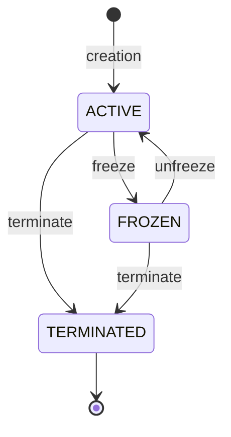

# Bitnob — Card Issuing : cours « Card Issuing » et « Fraud & Compliance »

Source : bitnob.dev (texte des pages téléchargé le 2026-10-08). Contenu pédagogique, pas une spécification d'API : les endpoints cités sont illustratifs et **incohérents d'un module à l'autre** (voir « Points d'attention »). Les pages sont tronquées à certains endroits dans le texte source (signalé par module).

## Sommaire

### Cours 1 — Card Issuing Course (23 modules)

- Page de cours : [card-issuing-course](https://bitnob.dev/docs/card-issuing/card-issuing-course) — table des 23 modules
- Index de section : [_index](https://bitnob.dev/docs/card-issuing/card-issuing-course/_index) — vide, aucun contenu
- Parties : modules 1-4 fondations ; 5-8 fonds, dépenses, états, limites ; 9-11 frais, MCC, remboursements ; 12-14 UX, ops, cas d'usage ; 15-17 fraude, KPI, marketing ; 18-22 chaîne de valeur, BIN, autorisations, conformité, programmes ; 23 capstone.

| Module | Titre | Lien |
| --- | --- | --- |
| 1 | What Virtual Cards Actually Are | [module-1](https://bitnob.dev/docs/card-issuing/card-issuing-course/module-1) |
| 2 | Card Lifecycle from a Product Perspective | [module-2](https://bitnob.dev/docs/card-issuing/card-issuing-course/module-2) |
| 3 | Registering Card Users | [module-3](https://bitnob.dev/docs/card-issuing/card-issuing-course/module-3) |
| 4 | Issuing a Card | [module-4](https://bitnob.dev/docs/card-issuing/card-issuing-course/module-4) |
| 5 | Funding Virtual Cards | [module-5](https://bitnob.dev/docs/card-issuing/card-issuing-course/module-5) |
| 6 | Spend Transactions and Monitoring | [module-6](https://bitnob.dev/docs/card-issuing/card-issuing-course/module-6) |
| 7 | Freezing, Unfreezing, and Terminating Cards | [module-7](https://bitnob.dev/docs/card-issuing/card-issuing-course/module-7) |
| 8 | Managing Card Limits | [module-8](https://bitnob.dev/docs/card-issuing/card-issuing-course/module-8) |
| 9 | Fees, Cross-Border Charges, and Revenue Modeling | [module-9](https://bitnob.dev/docs/card-issuing/card-issuing-course/module-9) |
| 10 | Restricted Merchant Categories (MCCs) and Real Merchant Behavior | [module-10](https://bitnob.dev/docs/card-issuing/card-issuing-course/module-10) |
| 11 | Refunds, Reversals, and Chargebacks | [module-11](https://bitnob.dev/docs/card-issuing/card-issuing-course/module-11) |
| 12 | Designing Card UX for Trust and Clarity | [module-12](https://bitnob.dev/docs/card-issuing/card-issuing-course/module-12) |
| 13 | Card Operations and Support Playbook | [module-13](https://bitnob.dev/docs/card-issuing/card-issuing-course/module-13) |
| 14 | Card-Based Product Use Cases and Strategy | [module-14](https://bitnob.dev/docs/card-issuing/card-issuing-course/module-14) |
| 15 | Fraud Patterns and Spend Abuse | [module-15](https://bitnob.dev/docs/card-issuing/card-issuing-course/module-15) |
| 16 | Metrics and KPIs for Card Products | [module-16](https://bitnob.dev/docs/card-issuing/card-issuing-course/module-16) |
| 17 | Marketing and Distribution Strategy for Card Products | [module-17](https://bitnob.dev/docs/card-issuing/card-issuing-course/module-17) |
| 18 | Understanding the Full Value Chain of Virtual Cards | [module-18](https://bitnob.dev/docs/card-issuing/card-issuing-course/module-18) |
| 19 | BINs - Identification, Validation, and Strategic Use | [module-19](https://bitnob.dev/docs/card-issuing/card-issuing-course/module-19) |
| 20 | Card Authorizations, Silent Transactions, and Pre-Authorizations | [module-20](https://bitnob.dev/docs/card-issuing/card-issuing-course/module-20) |
| 21 | Compliance, Security, and Regulatory Responsibilities | [module-21](https://bitnob.dev/docs/card-issuing/card-issuing-course/module-21) |
| 22 | How Virtual Card Programs Are Really Built and Operated | [module-22](https://bitnob.dev/docs/card-issuing/card-issuing-course/module-22) |
| 23 | Capstone Project and Final Reflections | [module-23](https://bitnob.dev/docs/card-issuing/card-issuing-course/module-23) |

### Cours 2 — Fraud & Compliance for Virtual Cards (10 modules)

- Page de cours : [card-fraud-course](https://bitnob.dev/docs/card-issuing/card-fraud-course) — formation pour Risk, Treasury, Support, Compliance, Engineering ; capstone = simulation (ex. refund laundering) + rapport d'incident formel
- Index de section : [_index](https://bitnob.dev/docs/card-issuing/card-fraud-course/_index) — vide, aucun contenu

| Module | Titre (page) | Lien |
| --- | --- | --- |
| 1 | Introduction to Virtual Card Fraud | [module-1](https://bitnob.dev/docs/card-issuing/card-fraud-course/module-1) |
| 2 | Understanding and Preventing Virtual Card Fraud | [module-2](https://bitnob.dev/docs/card-issuing/card-fraud-course/module-2) |
| 3 | Incident Response and Post-Fraud Investigation Workflows | [module-3](https://bitnob.dev/docs/card-issuing/card-fraud-course/module-3) |
| 4 | MCC & BIN-Based Threats and Controls | [module-4](https://bitnob.dev/docs/card-issuing/card-fraud-course/module-4) |
| 5 | Refund, Reversal, and Chargeback Abuse | [module-5](https://bitnob.dev/docs/card-issuing/card-fraud-course/module-5) |
| 6 | Transaction Pattern Detection | [module-6](https://bitnob.dev/docs/card-issuing/card-fraud-course/module-6) |
| 7 | Designing Controls & Prevention Systems | [module-7](https://bitnob.dev/docs/card-issuing/card-fraud-course/module-7) |
| 8 | Logging, Audit Trails, and Incident Reporting | [module-8](https://bitnob.dev/docs/card-issuing/card-fraud-course/module-8) |
| 9 | Compliance, PCI-DSS, and Scheme Requirements | [module-9](https://bitnob.dev/docs/card-issuing/card-fraud-course/module-9) |
| 10 | Capstone Simulation — End-to-End Fraud & Risk Response | [module-10](https://bitnob.dev/docs/card-issuing/card-fraud-course/module-10) |

Note : les titres de la table d'index du cours fraude (« Real-World Fraud Cases », « Audit Logging... ») diffèrent des titres réels des pages (modules 2, 3, 8) ; la table ci-dessus donne les titres des pages.

## Points d'attention (lire avant de s'appuyer sur ces pages)

- Endpoints illustratifs et contradictoires : `POST /api/customers` et `POST /api/cards` (modules 3-4) vs `POST /virtualcards/registercarduser`, `/virtualcards/createcard`, `/virtualcards/topup` (module 5) vs `POST /api/cards/:cardId/status` (module 7) vs `POST /virtualcards/setlimits` (module 8, « illustrative »). Pour le contrat réel, utiliser l'API reference, pas ces cours.
- Seuils de déclins incohérents : cours 1 = résiliation après 4 déclins consécutifs (carte avec succès) ou 3 (jamais réussie) ; cours fraude = gel après 3 déclins consécutifs.
- Troncatures dans le texte source : cours 1 module 15 (tableau « Card velocity » coupé), module 19 (exemple Python Luhn coupé) ; cours fraude module 4 (règle `if MCC in [6051, 4829] and userTier ...` coupée), module 6 (règle « Declines » coupée), module 10 (ligne « Velocity » coupée).
- Chiffres « example » (frais, plafonds) = exemples pédagogiques, pas des tarifs Bitnob garantis.

---

# Cours 1 — Card Issuing Course

### Module 1 — What Virtual Cards Actually Are
Source : https://bitnob.dev/docs/card-issuing/card-issuing-course/module-1
Objectif : définir la carte virtuelle et sa place dans l'écosystème carte.

- Carte virtuelle = carte de paiement 100 % logicielle, avec PAN, expiry, CVV, nom ; usage principal en ligne (card-not-present, CNP).
- Émise par un émetteur licencié connecté à un scheme : Visa, Mastercard, Verve (Interswitch, Nigeria/Afrique de l'Ouest), UnionPay, Discover, AmEx.
- Trois types : physique (ATM/POS/online), virtuelle (online/CNP uniquement), tokenisée (Apple Pay etc., sans contact).
- Pas adaptée au POS ni aux ATM sauf tokenisation ou support explicite.
- Avantages : sécurité (gel/terminaison instantanés, blocage par catégorie), contrôle (limites par carte, cartes éphémères), programmabilité (création par API).
- Création : requête à l'émetteur, réservation PAN/expiry/CVV dans le processeur (ex. Marqeta, Galileo, Interswitch), carte active ; généralement < 5 secondes.
- Limites : pas d'ATM, pas de POS, 3D Secure exigé par certains marchands, frais cross-border possibles même en USD, blocages MCC (jeux, crypto, P2P).

### Module 2 — Card Lifecycle from a Product Perspective
Source : https://bitnob.dev/docs/card-issuing/card-issuing-course/module-2
Objectif : maîtriser les trois états d'une carte et qui contrôle les transitions.

- Machine d'état stricte : ACTIVE, FROZEN, TERMINATED ; TERMINATED est définitif (aucune réactivation : créer une nouvelle carte).
- Une carte peut passer directement ACTIVE vers TERMINATED sans gel préalable (réponse du quiz : fraude/abus).
- FROZEN : ni achats, ni top-ups, ni retraits ; déclencheurs = utilisateur, système de sécurité, conformité (KYC expiré), règle plateforme (3 top-ups échoués).
- Règles exemples : carte avec ≥1 succès, terminée après 4 déclins consécutifs ; jamais réussie, après 3 déclins.
- Terminaison : des webhooks restent émis pour reversals/refunds ; le solde final peut être remboursé.
- UX : afficher la raison du gel/de la fermeture, ne pas cacher la carte, proposer « créer une nouvelle carte ».
- Pièges : top-up sur carte gelée (fonds bloqués), réactiver une carte terminée, terminer sans rembourser le solde, ne pas journaliser les transitions.

### Module 3 — Registering Card Users
Source : https://bitnob.dev/docs/card-issuing/card-issuing-course/module-3
Objectif : comprendre l'enregistrement obligatoire du porteur et le mapper à son modèle utilisateur.

- Chaque carte doit être rattachée à une personne vérifiée ou à une entreprise (KYC/AML, anti-fraude, litiges, limites, audits).
- Champs requis (généralement) : `first_name`, `last_name`, `email`, `phone_number`, `country`, `reference` (ID interne).
- Appel illustratif : `POST /api/customers` ; réponse `{ "status": "success", "data": { "card_user_id": "...", "reference": "user_001" } }`.
- `reference` à stocker définitivement : c'est elle qui sert à émettre les cartes ; mapping 1:1 avec l'utilisateur.
- Erreurs : email/téléphone dupliqués (409 Conflict ou échec silencieux), champs manquants (400), carte avant enregistrement, changement de `reference` après coup.
- Bonne pratique : un card user par vrai utilisateur ; préfixer la référence (`prod:user_001`, `wallet:user_xyz`) pour séparer projets/environnements.
- Réponse du quiz : le numéro de téléphone doit être unique (déduplication d'identités).

### Module 4 — Issuing a Card
Source : https://bitnob.dev/docs/card-issuing/card-issuing-course/module-4
Objectif : spécifier la création d'une carte et ses prérequis.

- Émettre = allouer PAN/expiry/CVV, lier au card user, créer l'enregistrement avec limites, activer. Déclencheurs : inscription, premier dépôt, demande, logique programmatique, événement.
- Règle : n'émettre qu'après que l'utilisateur a une valeur réelle (identité, argent ou intention).
- Prérequis : card user enregistré, `card_user_id` stocké, quota respecté, `reference` valide.
- Requête illustrative `POST /api/cards` : `reference` (requis, doit correspondre à l'utilisateur), `label` (optionnel), `currency` (défaut USD). Schéma complet : API reference « Create Card ».
- Réponse : `cardId`, `status: "active"`, `maskedPan`, `expiry`, `cvv: "***"`, `createdAt`. PAN/CVV/expiry visibles une seule fois.
- Webhook d'échec : `virtualcard.created.failed` (champs `reference`, `reason` ex. `reference_does_not_match_registered_user`, `amount`, `createdStatus`, `customerEmail`).
- Quotas typiques : 2 cartes par utilisateur, création limitée (ex. 5/minute), label ≤ 32 caractères.
- Ne jamais ré-afficher le CVV après le premier appel (conformité scheme) ; stocker le `cardId`.

### Module 5 — Funding Virtual Cards
Source : https://bitnob.dev/docs/card-issuing/card-issuing-course/module-5
Objectif : comprendre le financement prépayé et le flux register → issue → fund.

- Cartes prépayées : financées avant usage depuis wallet fiat, solde stablecoin (ex. USDT) ou float de la plateforme.
- Actifs supportés (tableau) : stablecoins USDT (TRC20/ERC20), USDC, et BTC, convertis automatiquement en USD.
- Règles exemples : top-up min 3 $, max 2 500 $ par top-up, solde max 50 000 $, frais fixe 1 $ (par tranche jusqu'à 100 $), marge FX variable.
- Flux : `POST /virtualcards/registercarduser`, puis `POST /virtualcards/createcard`, puis `POST /virtualcards/topup` avec `{ "cardId", "amount": 100, "sourceAsset": "USDT_TRC20" }` (réponse : statut, taux, nouveau solde).
- Erreurs : `insufficient_funds`, `card_not_active`, `invalid_card_id`, `rate_expired`.
- Webhook de succès cité : `virtualcard.topup.completed` ; ne jamais conclure au succès sur un simple `200`.
- Bonnes pratiques : valider le statut avant de financer, afficher frais et conversion FX, journaliser les références de top-up pour la réconciliation.

### Module 6 — Spend Transactions and Monitoring
Source : https://bitnob.dev/docs/card-issuing/card-issuing-course/module-6
Objectif : suivre autorisations, règlements et événements de dépense par webhook.

- Flux d'autorisation : le marchand envoie une demande, le processeur vérifie statut de carte, solde, restrictions MCC, règles de vélocité/fraude ; approuvé ou refusé ; webhook envoyé.
- Webhooks transactionnels : `virtualcard.transaction.debit`, `.declined`, `.refund`, `.reversed`, `.authorization.failed`, `.crossborder`, `.terminated.refund`.
- Payload type (`debit`) : `eventId`, `companyId`, `event`, `data` avec `cardId`, `id`, `amount` (ex. 49990000) et `displayAmount` (49.99), `currency`, `transactionType`, `reference`, `narrative`, `timestamp`, `status`, `reason`, `merchantName`, `merchantMcc`, `merchantCountry`.
- Le payload `declined` a `status: "declined"` et `reason` (ex. `insufficient_funds`).
- À stocker : ID transaction, `cardId`, référence utilisateur, montant, devise, horodatage, statut, marchand/MCC, raison d'échec ; filtrable par utilisateur/carte/statut/période.
- Terminaison automatique : 4 déclins consécutifs si ≥1 succès, 3 si jamais réussi ; suivre les compteurs en phase avec le fournisseur.
- Monitoring : alertes sur déclins multiples, MCC suspects (jeux, transfert d'argent), remboursements/reversals vs dépense totale, log de tous les webhooks reçus.

### Module 7 — Freezing, Unfreezing, and Terminating Cards
Source : https://bitnob.dev/docs/card-issuing/card-issuing-course/module-7
Objectif : implémenter les transitions d'état et gérer les cas limites.

- Gel et dégel passent par « Update Card Status » : `POST /api/cards/:cardId/status` avec `{ "status": "frozen" }` ou `{ "status": "active" }` (illustratif).
- Gel : conserve carte et solde, interdit paiements et top-ups, reste visible ; dégel journalisé (horodatage, initiateur), refusé si terminée.
- Terminaison : définitive, pas de top-up, mais refunds/reversals en attente peuvent encore arriver.
- Règles auto : ≥1 succès puis 4 déclins consécutifs, ou 0 succès et 3 déclins ; carte gelée recevant des tentatives peut être escaladée.
- Refund sur carte terminée : crédité au float/master wallet de la plateforme, utilisateur à notifier, webhook `virtualcard.transaction.terminated.refund`.
- Retrait (si supporté) : carte gelée ne peut pas retirer ; carte terminée doit garder un solde minimum (ex. 1 $) avant clôture.
- Webhooks à surveiller : `virtualcard.transaction.declined.frozen`, `.declined.terminated`, `.terminated.refund`, `virtualcard.withdrawal.failed`.
- Dev : journaliser qui/quand, refuser toute opération sur carte terminée, idempotence et réconciliation par horodatage contre les race conditions.

### Module 8 — Managing Card Limits
Source : https://bitnob.dev/docs/card-issuing/card-issuing-course/module-8
Objectif : poser des limites comme outil de risque, conformité et produit.

- Types : par transaction (ex. 500 $), quotidienne, mensuelle, plafond de solde (ex. 50 000 $), limite de top-up (ex. 2 500 $), contrôles de vélocité (ex. 3 par minute).
- Appliquées au niveau plateforme, processeur (scheme) ou émetteur (conformité).
- Peuvent être fixées à la création, mises à jour par API (ex. `PATCH /cards/:id/limits`) ou gérées au niveau utilisateur/wallet.
- Appel illustratif `POST /virtualcards/setlimits` : `cardId`, `dailyLimit`, `transactionLimit`, `balanceCap`.
- Patterns : limites fixes par palier (Basic 500 $/mois, Pro 2 000 $, Business 10 000 $), budget dynamique, limites réglables par l'utilisateur (avec garde-fous fraude), contrôle temps réel par API.
- Déclencheurs programmatiques : défaut par palier, hausse à l'upgrade, baisse/gel après déclins multiples, revue sur gros top-up, hausse graduée après premier succès.
- UX : barre de progression, message clair (« daily limit of $500 »), modale d'explication ; monitoring des cartes proches des limites et de l'exposition du float.

### Module 9 — Fees, Cross-Border Charges, and Revenue Modeling
Source : https://bitnob.dev/docs/card-issuing/card-issuing-course/module-9
Objectif : comprendre les frais et bâtir un modèle de revenu.

- Frais : émission (ex. 1 $), top-up (ex. 1 $ par 100 $), FX (conversion monnaie locale vers USD), cross-border (réseau), retrait, litige/chargeback, remplacement après terminaison.
- Cross-border même en USD : compte la localisation de la banque acquéreuse du marchand, pas la devise. Exemple du cours : Facebook Ads via une banque irlandaise, 2,5 % + 0,50 $.
- Modèles de revenu : markup fixe au top-up, spread en pourcentage (ex. taux FX 750 facturé 765), abonnement (ex. 2 $/mois), hybride (le plus courant : 1 $/carte + 1 $/100 $ + 2,5 % FX cross-border + partage de volume du processeur).
- Absorber, répercuter à l'identique ou marger les frais selon la stratégie.
- Transparence : frais affichés à la confirmation, avertissement cross-border, détail « 0,50 $ + 2,5 % », politiques de remboursement ; éviter les frais surprise.

### Module 10 — Restricted Merchant Categories (MCCs) and Real Merchant Behavior
Source : https://bitnob.dev/docs/card-issuing/card-issuing-course/module-10
Objectif : comprendre les MCC et traiter les refus liés aux marchands.

- MCC = code à 4 chiffres attribué par le réseau, envoyé avec chaque demande d'autorisation (risque, règles fraude, restrictions réglementaires, analytics).
- Exemples : 5815 streaming numérique, 7995 jeux/paris, 4829 transfert d'argent, 6211 courtiers en valeurs, 7801 jeux gouvernementaux US, 5966 télémarketing.
- Souvent bloqués : 7995, 6051 (crypto/change/dettes), 7273 (rencontres), 5966, 7801/7802, 4829, 6211 ; refus même avec solde suffisant.
- Échecs fréquents ≠ bug produit : routage par acquéreur UE (Facebook Ads), Netflix avec tokens expirés, Shein/Temu avec acquéreurs non US, Binance en 6051, PayPal avec hold apparaissant en authorization-reversal.
- Produit : message clair, soft blocklist de marchands, pré-éducation, alternatives (gift cards).
- Interne : journaliser et tagger chaque déclin par MCC, analyser MCC les plus refusés et déclins malgré solde plein ; MCC dans le dashboard admin ; routage MCC-aware (une carte par catégorie) pour les plateformes avancées.

### Module 11 — Refunds, Reversals, and Chargebacks
Source : https://bitnob.dev/docs/card-issuing/card-issuing-course/module-11
Objectif : distinguer les trois événements et leur effet sur le solde.

| Type | Déclencheur | Fonds déplacés | Webhook |
| --- | --- | --- | --- |
| Reversal | annulé avant règlement | non (hold levé) | `virtualcard.transaction.reversed` |
| Refund | après règlement, par le marchand | oui | `virtualcard.transaction.refund` |
| Chargeback | litige du porteur après règlement | oui (clawback marchand) | `virtualcard.transaction.chargeback.initiated/...resolved` (si supporté) |

- Délai de remboursement : 2 à 14 jours ouvrés (selon marchand/région).
- Chargeback : enquête de l'émetteur, frais de litige possibles, excès = risque conformité ; toutes les plateformes n'exposent pas d'API chargeback.
- Refund sur carte terminée : fonds vers le master wallet/float, plateforme responsable de notifier/restituer (`virtualcard.transaction.terminated.refund` avec `cardId` et montant).
- Interne : tracer `reference` et `transactionId` entre événements, mesurer le délai transaction-remboursement, vue de réconciliation des chaînes.
- Disputes initiées par l'utilisateur : formulaire structuré, preuves, SLA de réponse (ex. 3 jours ouvrés), statut communiqué.

### Module 12 — Designing Card UX for Trust and Clarity
Source : https://bitnob.dev/docs/card-issuing/card-issuing-course/module-12
Objectif : concevoir des interfaces par état qui réduisent le support.

- Carte active : label, PAN masqué, expiry, CVV (une fois), statut, solde disponible, bouton top-up, 5 dernières transactions.
- Carte gelée : statut, explication, CTA « Unfreeze », contact support ; carte terminée : statut, solde final, politique de remboursement, « Create new card », raison (« closed after 4 failed attempts »).
- Top-up : montant, frais en temps réel, confirmation (« adding $50, you'll pay $51 »), chargement (webhook ou polling), écran de succès avec nouveau solde.
- Déclins : messages précis par cause (fonds insuffisants, marchand non supporté, carte gelée, trop de tentatives) ; jamais « Something went wrong ».
- Historique : marchand, montant/statut, horodatage, type (spend/refund/reversal), raison de déclin ; interactif.
- Bonus : barre de limites, réglages, reçus, alertes, bouton retry. À éviter : carte vide sans retour, carte qui disparaît, solde non mis à jour.

### Module 13 — Card Operations and Support Playbook
Source : https://bitnob.dev/docs/card-issuing/card-issuing-course/module-13
Objectif : outiller ops et support avec un minimum viable.

- Fonctions : debug de transactions, suivi de cycle de vie, éducation, escalade, application des politiques, retour d'information produit/conformité.
- Outillage minimal : recherche carte par utilisateur, explorateur de transactions (avec log de livraison webhook, solde avant/après), journal des événements de cycle de vie (qui, règle auto vs admin), suivi des remboursements (vers carte ou float, délai attendu), visionneuse de webhooks (headers pour vérifier la signature).
- Checklists : déclin (carte active ? solde ? raison ? MCC ? retry ?), remboursement non reçu (refund ou reversal ? carte active ou terminée ? webhook `transaction.refund`/`transaction.terminated.refund` ? crédité où ?), carte gelée/terminée.
- Escalade : MCC vers produit/conformité, déclin système vers ingénierie, risque chargeback vers risk/legal, remboursement hors SLA vers processeur/émetteur ; SLA, canaux partagés.
- Données accessibles aux non-ingénieurs (Retool, Supabase, admin) avec permissions par rôle.

### Module 14 — Card-Based Product Use Cases and Strategy
Source : https://bitnob.dev/docs/card-issuing/card-issuing-course/module-14
Objectif : associer cycle de vie, limites et UX à chaque cas d'usage.

- Six cas : paiements freelancers (carte USD financée en USDT/fiat), contrôle d'abonnements (une carte par service), cartes marketing/ads, notes de frais d'entreprise (gel auto après inactivité), épargne vers dépense, cartes événementielles (cadeaux, expiration à 30 jours).
- Matrice : abonnements = Active→Frozen→Terminated, top-up par l'utilisateur, plafond mensuel ; freelancers = top-up système, limite par projet ; équipes = top-up admin ; promotions = auto-terminate, préchargé ; épargne = Frozen→Active, top-up par objectif.
- Monétisation : FX + top-up (freelancers), frais mensuels (abonnements), SaaS par carte/utilisateur (équipes), coût absorbé en CAC (promotions), markups B2B2C (finance embarquée).
- Distribution : B2C, plateforme/SaaS, revendeur/white-label, API-first.
- Questions clés : qui finance, carte visible ou silencieuse, cycle de vie, comportement visé, gestion support, activité principale ou fonctionnalité.

### Module 15 — Fraud Patterns and Spend Abuse
Source : https://bitnob.dev/docs/card-issuing/card-issuing-course/module-15
Objectif : reconnaître les abus et poser des garde-fous. (Texte source tronqué : tableau des signaux précoces coupé.)

- Acteurs attirés : card testers, blanchisseurs, arbitragistes, churners d'abonnements, exploiteurs de litiges.
- Cinq patterns : card testing (nombreuses petites transactions sur plusieurs PAN), overfunding + dumping (gros top-ups, marchands étranges, refunds sous 24 h), arbitrage cross-border, chargeback abuse, déclins multiples + account cycling (même IP/device/wallet).
- Scoring exemple : +2 top-up > 1 000 $ dans l'heure suivant la création du compte ; +1 trois échecs en 10 min ; +3 refund > 50 % de l'activité ; +2 même device sur 4 comptes ; +5 litige sur plus d'une transaction. Seuils : gel, revue admin, terminaison, shadow ban d'émission.
- Garde-fous : limiter les cartes par utilisateur, retarder les détails complets jusqu'au premier top-up, revue manuelle des gros top-ups, blocage MCC, lock geo/IP, règles de vélocité, vérification renforcée pour refund/terminaison.
- Playbook : geler, bloquer la création, exporter les 5 dernières transactions, alerter, blacklist IP/domaine/wallet, contre-litige avec preuves.
- Automatisation : auto-approve petit premier top-up ; revue pour gros top-up sur nouveau compte ; gel + alerte à 3+ déclins en 1 h ; auto-refus MCC 7995, 4829, 6051.

### Module 16 — Metrics and KPIs for Card Products
Source : https://bitnob.dev/docs/card-issuing/card-issuing-course/module-16
Objectif : choisir les KPI de santé, risque et revenu.

- Catégories : adoption/émission, usage, monétisation, risque/fraude, santé opérationnelle.
- Adoption : cartes par utilisateur, taux d'activation (≥1 transaction), taux de succès d'émission, délai avant premier top-up.
- Usage : transactions par carte active/mois, top-up moyen, délai avant premier spend, dépense par MCC, churn de cartes.
- Revenu : marge FX, frais moyens par utilisateur, LTV mensuelle par carte, revenu vs coût cross-border, marge de float.
- Risque : taux de déclin, taux de terminaison auto, refunds en % des dépenses, taux de chargeback (problème de conformité réseau si > 1 %), utilisateurs à haute vélocité.
- Ops : taux de succès des webhooks, délai moyen de remboursement, top-ups échoués, tickets pour 1 000 utilisateurs, délai émission-financement-dépense.
- Avancés : revenu par MCC, conversion top-up, coût par carte émise, point mort par carte.

### Module 17 — Marketing and Distribution Strategy for Card Products
Source : https://bitnob.dev/docs/card-issuing/card-issuing-course/module-17
Objectif : positionnement, personas et distribution (contenu marketing, peu transposable).

- Positionnement : accès financier (« Spend USD from anywhere »), contrôle, vitesse, flexibilité, liberté.
- Personas : freelancer en Afrique, parent, équipe finance de startup, développeur fintech, travailleur à distance.
- Modèles : B2C (ASO, influenceurs, incitations), product-led growth (une carte gratuite à l'onboarding, forfaits Pro/Business, tarif par siège), API-first (docs, Postman, sandbox).
- Activation : émission après création de valeur (premier top-up), premier spend sur marchand à faible risque, transformer le premier déclin en éducation.
- Conformité de la communication : ne pas sur-promettre (« spend anywhere » sans réserves), afficher les frais (ex. « 2.5% FX fee, no hidden charges »).

### Module 18 — Understanding the Full Value Chain of Virtual Cards
Source : https://bitnob.dev/docs/card-issuing/card-issuing-course/module-18
Objectif : situer son produit dans la chaîne et savoir ce qu'on contrôle.

- Vous êtes l'émetteur de l'expérience, pas de la carte : UX, politique (qui obtient une carte, frais), intégration API (top-ups, logs, webhooks).
- Couche API (Bitnob, Marqeta, Lithic, Union54...) : création, abstraction de la conformité, routage des fonds, webhooks.
- Processeur (Galileo, Interswitch...) : état et cycle de vie, contrôles d'autorisation, limites, historique. Émetteur : détient les fonds, possède la plage BIN (6-8 premiers chiffres), gère chargebacks.
- Réseau : routage, règles globales (MCC, FX, chargebacks), BIN, interchange.
- Contrôle : oui = cycle de vie, qui obtient une carte, alimentation ; non = décision du marchand, frais cross-border, timing des refunds ; parfois = restrictions MCC.
- Revenus par acteur : vous (top-up, frais de carte, FX, abonnement), API (frais par carte/transaction), processeur (autorisation), émetteur (interchange, litiges, intérêts de float), réseau (cross-border, scheme).
- Risques par origine : déclins légitimes (acquéreur/émetteur/MCC), frais surprise (routage réseau), refunds perdus (marchand), chargebacks (émetteur/réseau).

### Module 19 — BINs - Identification, Validation, and Strategic Use
Source : https://bitnob.dev/docs/card-issuing/card-issuing-course/module-19
Objectif : lire un BIN et valider un numéro de carte. (Exemple Python Luhn tronqué dans le texte source.)

- BIN = IIN, 6 à 8 premiers chiffres : émetteur, marque, pays, type (debit/prepaid/credit), consommateur/commercial.
- Structure : `[BIN][account number][check digit]` ; le dernier chiffre se valide par Luhn.
- Exemples du cours : 507814 Verve Nigeria prépayée ; 536307 Mastercard Nigeria prépayée ; 414709 Visa US débit ; 457102 Visa Europe crédit ; 528412 Mastercard Kenya débit.
- Outils de lookup : binlist.net, lookup.binlist.io, bincheck.io.
- Luhn : depuis la droite, doubler un chiffre sur deux (retirer 9 si > 9), sommer ; valide si total mod 10 = 0. Détecte les fautes de frappe, ne vérifie ni fonds ni statut.
- Usages marchands : bloquer des BIN à risque, restreindre des géographies, estimer FX/cross-border, personnaliser 3D Secure.
- Usage produit : afficher marque/devise, prévoir la compatibilité, suivre la fraude par BIN, registre interne de BIN avec règles (ex. BIN 507814 + marchand étranger = prévenir l'utilisateur).

### Module 20 — Card Authorizations, Silent Transactions, and Pre-Authorizations
Source : https://bitnob.dev/docs/card-issuing/card-issuing-course/module-20
Objectif : distinguer autorisation et règlement, expliquer les holds.

- Autorisation : demande en temps réel marchand vers émetteur ; si approuvée, le montant est réservé (solde disponible diminue) mais pas transféré ; le règlement peut avoir lieu minutes ou jours plus tard.
- Annulation avant règlement = reversal ; carte terminée pendant un hold = réconciliation complexe.
- Autorisations silencieuses : 0 $ ou 1 $ pour vérifier la carte (Spotify, Apple, Uber, Meta, Netflix trial) ; disparaissent en 7-14 jours si non réglées.
- Pré-autorisations réelles : hôtel (~200 $), location de voiture (~500 $), carburant (~150 $), apps.
- Produit : afficher séparément solde disponible et autorisations en attente (ex. Available 43 $, Pending 57 $, Total top-up 100 $) ; libellés « Merchant test authorization », « Pending hold, not charged », expiration estimée.
- Cas limites : carte terminée avec pré-auth active (reversal vers float/wallet), montants pré-auth vs final (même chaîne), doublons (replier dans l'UI), règlement tardif (apparier par référence, marchand, proximité de temps).
- Dev : suivre `authorizationId` et `settlementId` séparément, ne pas finaliser une dépense sur la seule autorisation, utiliser `transaction.reversed`, libérer l'affichage des holds après N jours.

### Module 21 — Compliance, Security, and Regulatory Responsibilities in Virtual Card Products
Source : https://bitnob.dev/docs/card-issuing/card-issuing-course/module-21
Objectif : cadre de conformité (PCI DSS, KYC/AML) et partage des responsabilités.

- Cadres : PCI DSS (données carte), KYC/AML, règles des schemes, protection des données (ex. GDPR), réglementations locales (CBN, FCA...).
- Données : PAN stockable seulement chiffré et conforme ; CVV non stockable après émission (ni en clair ni chiffré) ; expiry avec contrôles ; nom du porteur faible risque.
- Si non conforme PCI : données tokenisées, jamais de PAN/CVV dans les logs, CVV affiché une seule fois, PAN masqué partout, SDK/gateways conformes.
- Fournisseur PCI DSS Level 1 (Bitnob, Lithic, Marqeta) : on hérite d'une partie de la conformité mais on ne doit pas la contourner (outils admin/support sur données tokenisées).
- Interdits : stocker le CVV, logger des PAN complets, rejouer des payloads sans stockage sécurisé, laisser le support copier des PAN, afficher des cartes sans authentification (PIN/FaceID).
- AML : empreinte device/email/source de fonds, limite d'émission, refunds plafonnés et liés à une dépense réussie, KYC avant activation ou gros top-up.
- À journaliser : création, transitions de cycle de vie (qui/quand), raisons de déclin, refunds/chargebacks/litiges, changements de palier KYC.
- Produit : paliers KYC visibles (ex. « Tier 1 : limite 50k NGN/jour »), détail frais + taux FX, notification de terminaison irréversible, blocage UI des catégories interdites.

### Module 22 — How Virtual Card Programs Are Really Built and Operated
Source : https://bitnob.dev/docs/card-issuing/card-issuing-course/module-22
Objectif : comprendre la structure légale et technique d'un programme carte.

- Étapes : sponsoring de BIN (semaines/mois, approbation réseau), onboarding scheme, setup processeur (plages PAN, règles fraude, limites), politique d'émission (qui, limites, paliers KYC, source de fonds), gestion des litiges/chargebacks, reporting et réconciliation (fichiers de règlement).
- Propriété : propriété légale de la carte = émetteur ; génération des numéros = processeur ; règles fraude = program manager + processeur ; UX/financement/top-ups/marketing = vous ; litiges = partagé ; conformité scheme = émetteur + réseau.
- Partage des revenus : l'essentiel (interchange, ex. 1,4 %) va à l'émetteur ; réseau ~0,1-0,2 % de frais scheme + FX ; vous gagnez via FX, frais utilisateurs, rebates (si volume).
- KPI suivis par émetteurs : ratio activation-dépense, dépense moyenne par carte, taux de fraude, taux de déclin, ratio de chargeback (> 1 % = risque de pénalités ou retrait), efficacité d'usage du float.
- Questions à poser à un program manager : qui contrôle les BIN et MCC, classification de carte, taux d'approbation, traitement des chargebacks et frais, vélocité par défaut, marque propre.

### Module 23 — Capstone Project and Final Reflections
Source : https://bitnob.dev/docs/card-issuing/card-issuing-course/module-23
Objectif : concevoir un produit carte de bout en bout (exercice).

- Étape 1 : choisir un cas (abonnements Gen Z, cartes de dépenses PME africaines, cartes USD pour étudiants nigérians, API d'émission pour plateformes).
- Étape 2 : brief produit (utilisateur/problème, émission, financement USDT/wallet, limites/frais/cycle de vie, échec/remboursement, métriques de succès).
- Étape 3 : expérience (vue carte, top-up, échec de paiement, dashboard ops, messages de déclin/remboursement).
- Étape 4 : conformité et ops (paliers KYC, PCI, chargebacks/remboursements, logs support/audit, formation).
- Étape 5 : livrable (PRD, article de blog recommandé, pitch deck, page Notion) ; publication optionnelle.
- Pas de contenu technique d'API ; certification optionnelle dans un programme structuré.

---

# Cours 2 — Fraud & Compliance for Virtual Cards

Objectif du cours (page [card-fraud-course](https://bitnob.dev/docs/card-issuing/card-fraud-course)) : comprendre la fraude carte, la détecter via systèmes et APIs, protéger le float et rester conforme aux schemes/régulateurs, garder l'auditabilité. Public : trésorerie, risk/fraud, PM, support, ingénieurs fiabilité API, compliance.

### Module 1 — Introduction to Virtual Card Fraud
Source : https://bitnob.dev/docs/card-issuing/card-fraud-course/module-1
Objectif : comprendre pourquoi les cartes virtuelles attirent la fraude et classer les vecteurs.

- Facteurs d'exposition : émission instantanée, modèle prépayé, absence de 3DS/OTP dans certains cas, top-ups crypto vers fiat (pseudo-anonymat, arbitrage FX), refunds/chargebacks (simuler un retour de cash), KYC faible.
- Catégories : refund abuse (surtout vers cartes terminées), chargeback fraud, merchant collusion, card cycling, velocity abuse, float laundering, MCC exploitation.
- Chemins d'attaque : top-up, spend, refund, terminate ; créer 5 cartes qui échouent 3 fois pour tester le seuil d'auto-terminaison ; spend carte A et refund carte B (pas de matching de refund) ; retrait après refund avec ancien CVV ; refund + chargeback sur le même MCC.
- Philosophie de prévention : visibilité, contexte (relier un refund à la dépense d'origine), mémoire (comportement dans le temps), vitesse ; rendre la fraude coûteuse et longue.
- Quiz : un refund sur carte terminée est un signal d'alerte (souvent sans dépense correspondante, exploitable pour blanchiment) ; pattern de vélocité courant = création, top-up et refund en 10-15 minutes ; toujours valider l'existence d'une dépense correspondante avant un refund.

### Module 2 — Understanding and Preventing Virtual Card Fraud
Source : https://bitnob.dev/docs/card-issuing/card-fraud-course/module-2
Objectif : vecteurs d'attaque, protections intégrées, bonnes pratiques.

- Vecteurs : identifiants volés (phishing/malware), intégrations marchands compromises, ingénierie sociale (clients ou support), account takeover (credential stuffing), abus d'API programmatique (clé fuitée ou sans rate limit).
- Cas : abus B2B d'un système de notes de frais (fausses factures, pas d'approbation par transaction) ; SIM swap pour intercepter l'OTP d'activation ; clés API sandbox et production exposées dans du code frontend.
- Protections natives : numéro unique par transaction/marchand, contrôles de dépense et de marchand, auto-expiry et faibles plafonds, pas de vol de carte physique.
- Contrôles plateforme : 2FA et biométrie, verrouillage de carte après activité suspecte, rotation stricte des clés API et rate limits, détection d'anomalies comportementales.
- SOP équipe : restrictions MCC, approbation secondaire pour création à forte valeur, vélocité (cartes par utilisateur par jour).
- Signaux : carte créée et utilisée immédiatement, plusieurs cartes en succession, écart de comportement, déclins fréquents, connexions depuis lieux/appareils inhabituels.
- Quiz : pratique la plus sûre = biométrie pour la création de carte.

### Module 3 — Incident Response and Post-Fraud Investigation Workflows
Source : https://bitnob.dev/docs/card-issuing/card-fraud-course/module-3
Objectif : répondre vite, documenter, contenir.

- Réponse : rapide, documentée, transverse (finance, support, legal, ingénierie), récupérable (refund/gel/reversal).
- Playbook en 6 étapes : (1) identifier `cardId`/`cardUserId`/référence ; (2) reconstituer la chronologie (création, top-up, spend, refund/reversal, gel/terminaison) ; (3) vérifier webhooks (livraison de `transaction.debit`, `refund`, `chargeback`, IDs dupliqués) ; (4) analyser l'exposition du float ; (5) historique device/IP ; (6) confinement (geler toutes les cartes, bloquer la création, désactiver les retraits, journaliser avec horodatage et signature).
- Matrice SLA : refund suspect vers carte terminée = 1 h ; échecs multiples sur carte neuve = 30 min ; chargeback d'un marchand partenaire = 24 h ; fuite de clé API = immédiat (révoquer, rotation) ; usurpation d'identité = 2 h (verrouiller, KYC à nouveau).
- Escalade : exposition de float > 1 000 $ vers le Treasury Lead ; webhook manquant après refund confirmé vers API Infra ; collusion marchand vers Compliance/Legal (SAR si requis).
- Template d'incident : ID (ex. FRC-2024-0021), détection, utilisateurs, cartes, références webhook, exposition float, type de fraude, chronologie, confinement, résolution, leçons, lien d'audit.
- Après coup : blocklist, ré-test du moteur de matching des refunds, revue d'autres cartes similaires, mise à jour des règles.
- Quiz : première étape = récupérer user et card ID ; le log webhook confirme chronologie et intégrité ; refund sur carte terminée = vers le float (pas le wallet utilisateur) et geler/flagger le compte.

### Module 4 — MCC & BIN-Based Threats and Controls
Source : https://bitnob.dev/docs/card-issuing/card-fraud-course/module-4
Objectif : exploitation des MCC et BIN et contrôles côté émission. (Règle de code tronquée dans le texte source.)

- MCC (4 chiffres, assigné par le réseau) : exemples 4816, 4829 (transfert d'argent, risque élevé), 5815, 6051 (crypto/devises), 7995 (jeux).
- Abus : MCC jumping (tester des cartes volées sur de nombreux MCC), refund laundering via MCC 6051/4829 (collusion marchand-utilisateur), decline mapping (apprendre quels MCC sont bloqués pour automatiser).
- Contrôles : bloquer par défaut 4829, 6051, 7995, 7801 ; journaliser les MCC par utilisateur ; limites de MCC par utilisateur (1-2 types par carte) ; signaler les MCC inhabituels ; escalade pour tout override.
- BIN : émetteur, pays, scheme, type de financement, usage consommateur/entreprise ; détermine acceptation, interchange/FX, périmètre de conformité (sanctions, licences).
- Risques d'alignement BIN/MCC : BIN Nigeria utilisé sur MCC 6051 US, BIN corporate sur MCC 7297, BIN voyage sur jeux ; actions : détecter les écarts, terminer les cartes hors mapping, mettre à jour le reporting scheme.
- Exemples de conformité : cartes cadeaux non rechargeables (un top-up par type de BIN) ; avertissement FX si BIN et pays marchand diffèrent ; MCC crypto exigent un KYC de palier ≥ 2.
- Ingénierie : taguer chaque carte avec les métadonnées BIN, valider le MCC à chaque autorisation, conserver les logs MCC pour audit, détection d'anomalies par utilisateur.
- Quiz : 7995 bloqué car catégorie jeux à haut risque ; le BIN révèle l'établissement émetteur ; refund d'un MCC bloqué = signaler pour enquête.

### Module 5 — Refund, Reversal, and Chargeback Abuse
Source : https://bitnob.dev/docs/card-issuing/card-fraud-course/module-5
Objectif : flux internes et détection de l'abus de remboursements.

- Définitions : refund (après règlement, fonds vers carte ou float) ; reversal (avant règlement, souvent sous 24 h, autorisation annulée, aucun fonds déplacé) ; chargeback (litige après règlement, reversal forcé).
- Flux refund : processeur renvoie les fonds à Bitnob, qui crédite la carte (si active) ou le master account (carte gelée/terminée). Flux chargeback : demande de reversal au processeur, débit marchand puis crédit Bitnob, frais de pénalité du processeur.
- Abus : refund abuse (top-up 100 $, spend 90 $, terminaison, refund 90 $ en float, demande de payout), exploits de reversal (cycle top-up, spend, reversal, rapide), chargeback fraud (litige tardif pour achat légitime).
- Signaux de chargeback : litiges fréquents d'un même utilisateur sur plusieurs cartes, MCC à risque, aucune plainte préalable au support.
- Contrôles : refund exigeant une référence de dépense correspondante ; refunds toujours crédités au float pour cartes terminées ; flag si > 2 chargebacks/mois ; flag blanchiment si ratio reversal:top-up > 0,3 ; bloquer les refunds de MCC à risque sans dépense.
- SLA : refund posté sous 2 jours ouvrés après webhook ; levée de hold immédiate ; fenêtre de dispute ~30 jours (varie selon le scheme) ; escalade trésorerie 24 h ; refund sur carte terminée escaladé à la compliance sous 1 h.
- Logs : référence de dépense d'origine + référence webhook dans chaque refund, intégrité du ledger top-up, spend, refund ; MCC/marchand/BIN/IP/device ; valeur de refunds suivie par semaine.
- Quiz : reversal = avant règlement et libère le hold ; refund sur carte terminée = crédité au float et journalisé ; 3 chargebacks en une semaine sur 3 cartes = verrouiller le compte et enquêter.

### Module 6 — Transaction Pattern Detection
Source : https://bitnob.dev/docs/card-issuing/card-fraud-course/module-6
Objectif : détecter les patterns par vélocité, graphes et clustering. (Règle « Declines » tronquée dans le texte source.)

- Règles de vélocité exemples : ≤ 2 cartes par utilisateur par 24 h ; max 2 refunds en 1 h ; ≤ 5 autorisations en 30 min ; max 500 $ déplacés via refund puis retrait en 1 h ; gel après 3 déclins consécutifs (suite tronquée).
- Analyse du flux de float : boucles top-up, spend, refund, retrait ; float vers un même marchand/MCC chez différents utilisateurs ; refund égal à la dépense d'un autre compte ; carte terminée recevant un refund puis payout wallet.
- Clustering device/IP : fingerprint, IP partagée, signatures (création + terminaison en 5 min), ID mobile ; 5+ comptes sur un même device = tout verrouiller et revoir ; score de risque par device.
- Comportement marchand : un marchand remboursant beaucoup d'utilisateurs ; utilisateur à nombreux MCC en peu de temps ; flag d'un marchand si taux de refund > 20 % du volume de charges réussies sur 7 jours.
- Graphe : nœuds carte, utilisateur, marchand, device ; base du scoring automatique.
- Actions : 3 cartes créées/déclinées/terminées en 1 h = verrouiller compte et IP ; refund d'un MCC à risque sans dépense = geler et alerter la trésorerie ; device partagé sur 4 comptes = bloquer l'émission ; 2 reversals puis gros retrait = flag blanchiment.
- Alertes catégorisées (refund-abuse, velocity-spike, mcc-mismatch) routées : Treasury si float exposé, Engineering si anomalie webhook, Compliance si conflit BIN/MCC.

### Module 7 — Designing Controls & Prevention Systems
Source : https://bitnob.dev/docs/card-issuing/card-fraud-course/module-7
Objectif : passer de la détection à la prévention, avec règles et couche de décision.

- Défense en couches : API (rate limits, auth, vérification de payload), cycle de vie, contrôles de transaction (MCC, BIN, géoloc, comportement), système de refund (matching, temps), identité.
- Règles immédiates : max 2 cartes/utilisateur/24 h ; top-up seulement si carte active ; deny si MCC ∈ [6051, 4829, 7995] ou conflit BIN ; refund exige un `spendRef` des 30 derniers jours ; auto-flag si > 2 litiges en 7 jours ; gel après 3 autorisations échouées consécutives ; retrait avec solde minimum 1 $ après opération.
- Prévention comportementale : fingerprint déjà vu en fraude (bloquer création et login), vélocité hors norme (limiter), nouveau MCC + nouveau marchand (soft-approve avec vérification secondaire), pattern de blanchiment (revue manuelle), boucle float carte-wallet-carte (verrouiller, trésorerie).
- Couche de décision temps réel : objet JSON avec `cardId`, `merchant.mcc`, `user.kycTier`, `deviceHash`, `rules` (`mccBlocked`, `userTierTooLow`, `velocitySafe`), `decision`, `reason` ; vise transparence, audit et réglage des règles.
- Webhooks comme détecteurs : `transaction.reversed` sans `transaction.debit`, refund sans autorisation correspondante, `declined` + carte terminée, `topup.failed` multiples. Tous authentifiés, horodatés, journalisés, mappés aux mouvements de float.
- Politiques : refunds seulement vers cartes actives ; compteur glissant de chargebacks sur 7 jours bloque la création ; compteur de déclins sur 15 minutes ; blocage temporaire d'un marchand si vélocité de refunds élevée ; blocklist IP partagée par comptes flaggés.
- Quiz : exiger un `spendRef` confirme la légitimité et bloque les faux refunds ; refund-to-float sur carte terminée sans revue = blanchiment de float ; journaliser les décisions en temps réel = transparence et auditabilité.

### Module 8 — Logging, Audit Trails, and Incident Reporting
Source : https://bitnob.dev/docs/card-issuing/card-fraud-course/module-8
Objectif : traçabilité complète (« You cannot secure what you cannot trace »).

- Logs de cycle de vie : création (`cardId`, `userId`, IP, `deviceHash`, BIN, heure) ; gel/dégel (`cardId`, raison, acteur) ; terminaison (type manuel/auto, déclencheur) ; top-up (montant, `walletId`, source du float, `topUpRef`) ; retrait.
- Logs de transaction : autorisation (MCC, marchand, BIN, pays, succès/échec), refund (`refundRef`, `originalSpendRef`, MCC source), reversal (`reversalRef`, `originalAuthId`), chargeback (`chargebackRef`, raison, frais), déclin (code, retries).
- Événements sécurité : login (IP, device, méthode 2FA), usage de clé API, activité webhook (statut, headers, hash du payload, retries), signature webhook invalide.
- Audit trail = historique ordonné, immuable : `timestamp`, acteur, action, cible, état avant/après, origine, `correlationId`.
- Template de rapport : Case ID (ex. FRC-2024-0012), utilisateurs, cartes, marchands, impact float, chronologie, confinement, journal de décision, leçons, pièces jointes.
- Outillage : logging central (Elastic, Datadog, Loki + Grafana), rétention d'au moins 1 an, alertes temps réel (MCC flaggés, reversals, chargebacks), dashboard de risque, export pour régulateurs.
- Dev : journaliser toute action mutante, `correlationId` sur chaque opération système, vérifier les signatures webhook, logs en append-only (pas d'écrasement par retries), API de requête de logs ; ne pas logger de PII ni de CVV en clair ; champ `reason` pour chaque gel/dégel/terminaison.

### Module 9 — Compliance, PCI-DSS, and Scheme Requirements
Source : https://bitnob.dev/docs/card-issuing/card-fraud-course/module-9
Objectif : exigences PCI-DSS et règles de schemes pour un intégrateur.

- PCI-DSS : standard de stockage, traitement et transmission des données de porteur. Même sans stocker PAN/CVV, on peut afficher des données partielles, les transmettre, logger des métadonnées, ou les proxifier.
- Minimum : jamais de PAN/CVV complet non chiffré (stockage/transmission) ni dans les logs ; HTTPS avec TLS 1.2+ ; contrôle d'accès par rôle et chiffrement au repos ; rotation des secrets et clés API ; audit d'accès aux APIs/UIs carte ; formation PCI annuelle.
- Règles scheme : BIN aligné avec l'usage, contrôle explicite des MCC 6051/7995/4829, refunds sans risque AML, réponse aux chargebacks sous le SLA scheme (~30 jours), information FX et markup correct pour cross-border, pas d'émission vers pays sous embargo, reporting du volume et du ratio de chargebacks.
- Top-up, spend, withdraw peut relever du stored value / e-money (obligations locales UE, UK, Nigeria).
- Échecs exemples : PAN dans les logs d'un environnement dev (breach PCI), MCC 6051 activé (violation scheme), chargeback hors SLA 30 jours (marchand débité, émetteur pénalisé), refund vers float sans audit trail (exposition trésorerie).
- Zones : US (FinCEN, prépayé), EU (PSD2, e-money), Nigeria (CBN), UK (FCA), Inde (RBI) ; « Design like you're regulated ».
- Checklist d'audit : TLS 1.2+ partout, pas de PAN/CVV dans logs/réponses, 2FA sur les accès admin, opérations internes journalisées, webhooks signés et vérifiés, SLA refund/chargeback tenus 99 % du temps, KYC avant spend sur 6051/7995/4829, revue hebdomadaire du float, revues de conformité trimestrielles journalisées.
- Rôles : ingénieurs (ne jamais logger PAN/CVV, signer les webhooks), PM (restrictions MCC, limites), compliance (registre de risques), trésorerie (réconciliation du float), support (SLA).

### Module 10 — Capstone Simulation — End-to-End Fraud & Risk Response
Source : https://bitnob.dev/docs/card-issuing/card-fraud-course/module-10
Objectif : appliquer le cours sur un incident de blanchiment par refund. (Ligne « Velocity » tronquée dans le texte source.)

- Scénario : 3 utilisateurs font un top-up en 30 min ; chaque carte est terminée peu après ; refunds en moins de 2 h d'un marchand MCC 6051 ; refunds vers le float (cartes terminées) ; les 3 utilisateurs retirent ce float vers leur wallet.
- Chronologie utilisateur A : top-up 100 $ à 09:11 UTC, autorisation MCC 6051 refusée, terminaison auto après 3 échecs, refund 100 $ à 11:07, crédité au float sans `spendRef`, retrait 100 $ à 11:10. Perte initiale : 100 $ x 3 = 300 $.
- Forensique : mêmes `deviceHash` et IP, même marchand/MCC, BIN corporate, séquence webhook `transaction.declined`, `transaction.terminated`, `refund.success`.
- Confinement : geler les wallets, bloquer le marchand pour les refunds, blacklister IP et device, désactiver la création de cartes pour le groupe, journaliser l'exposition, ouvrir le rapport FRC-2024-009.
- Cause racine : refunds d'un marchand à risque routés vers le float à cause du timing de terminaison, sans application du lien refund vers dépense. Score : Medium-High (contenu tôt) ; conformité : minime.
- Remédiation : Treasury (récupérer le float), Fraud (règle : bloquer un refund sans dépense correspondante sous 7 jours), Engineering (imposer le lien `spendRef` dans le handler webhook), Compliance (monitoring renforcé du marchand), Support (réponse type), Product (alertes de cycle de vie par utilisateur/IP/device).

---

## À retenir pour DioteKo

Le sujet principal (émission de cartes virtuelles Visa/Mastercard : BIN, MCC, PAN/CVV, PCI-DSS, chargebacks scheme) est **hors périmètre** : DioteKo vend des certificats payés en Lightning, sans carte. Les éléments transposables, à valider avec l'équipe avant implémentation :

- **Ne pas conclure au succès sur la seule réponse API** : le cours 1 (module 5) impose la confirmation par webhook, et le cours fraude (module 7) demande des webhooks authentifiés, horodatés et journalisés. Transposable au pipeline de paiement Bitnob (webhooks `transfer.success`, réconciliation d'invoices Lightning en attente).
- **Idempotence et IDs d'événement dupliqués** : le cours fraude (module 3) recommande de chercher les IDs de webhook dupliqués (retries ou abus) ; le cours 1 (module 7) cite idempotence et réconciliation par horodatage contre les race conditions.
- **Lien remboursement vers paiement d'origine** : règle centrale du cours fraude (modules 5, 7, 10) : jamais de remboursement/crédit sans référence du paiement initial (`spendRef` dans le cours). Transposable à tout remboursement d'un certificat payé.
- **Vélocité et blocage par seuils** : plafonds de création/paiements par utilisateur, device et IP, flag d'un ratio reversal:top-up (> 0,3), clusters device/IP (5+ comptes) ; à adapter à la création de demandes de certificats et d'invoices.
- **Audit trail structuré** : `timestamp`, acteur, action, cible, avant/après, origine, `correlationId`, append-only, raison pour chaque transition, pas de PII/secrets en clair, rétention d'au moins 1 an ; cohérent avec les logs `[START]/[ENTITY]/[CALL]/[RESULT]/[STATE]` de CLAUDE.md.
- **Gestion d'incident** : template d'incident, SLA par type, escalade au-delà d'un seuil d'exposition financière (ex. 1 000 $ dans le cours) ; matrice de confinement (geler, bloquer la création, désactiver les retraits).
- **Posture de conformité** : « design like you're regulated » (cours fraude, module 9) ; KYC par paliers avant les opérations à risque ; rotation des clés API et rate limits (cours fraude, module 2 : fuite de clé API = révocation immédiate) ; signer et vérifier les webhooks (cours fraude, modules 8-9).
- **Non transposable** : MCC, BIN/Luhn, 3D Secure, autorisation/règlement, interchange, frais cross-border/FX, limites carte, UX de carte (états Active/Frozen/Terminated), marketing de cartes.
