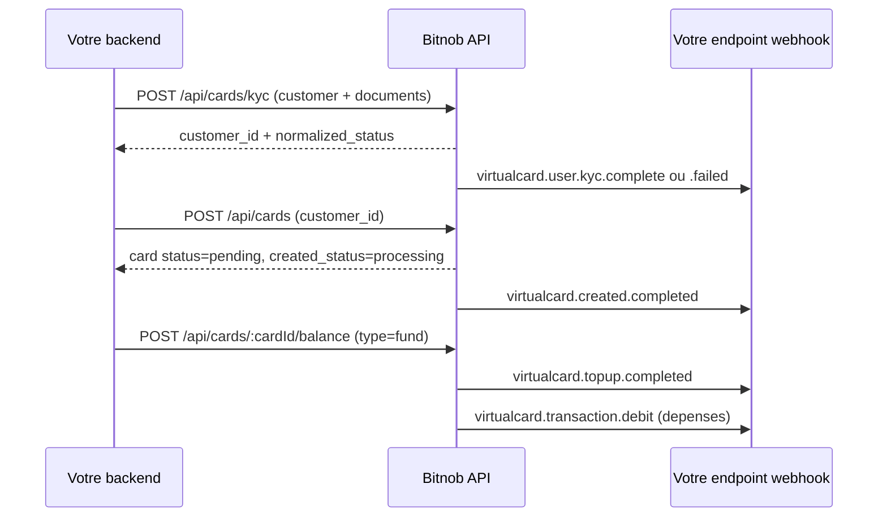
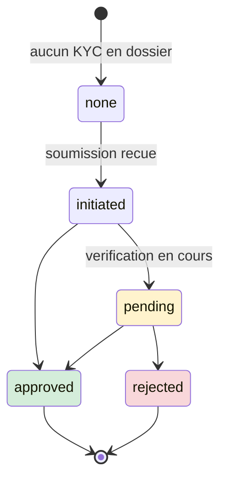
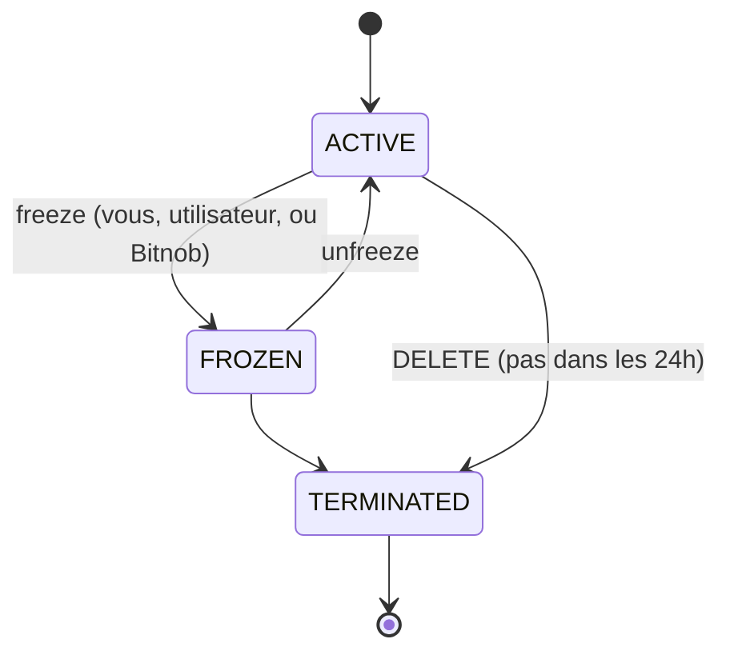

# Bitnob - Card Issuing (cartes virtuelles) - reference

> Source : documentation publique `https://bitnob.dev` (texte brut telecharge le 2026-10-08). Tout ce qui suit est tire de ces pages ; ce qui n'y figure pas est indique "non precise dans la doc".
> Perimetre DioteKo : les cartes ne sont PAS dans le perimetre actuel (voir la section finale).
> Convention montants : micro-unites, `1 USD = 1 000 000` (ex. `5000000` = 5 USD).
> Convention webhooks : cles JSON en camelCase, noms d'evenements pointes (`virtualcard.transaction.debit`).

## Sommaire

1. [Vue d'ensemble et couverture des pages](#1-vue-densemble-et-couverture-des-pages)
2. [Partie A - Docs "Card Issuing"](#partie-a---docs-card-issuing)
   - [Overview (index et /overview)](#overview--virtual-cards-overview)
   - [Card Issuance](#card-issuance)
   - [Card KYC (guide)](#card-kyc-guide)
   - [Card Funding](#card-funding)
   - [Card Status Management](#card-status-management)
   - [Contactless Payment](#contactless-payment)
   - [Decline Rule Policy / Fee Schedule](#decline-rule-policy--virtual-card-fee-schedule)
   - [Transaction Monitoring](#transaction-monitoring)
   - [Webhooks (guide)](#webhooks-guide)
   - [Webhook Security & Delivery](#webhook-security--delivery)
   - [Decrypt card secured details](#decrypt-card-secured-details)
   - [Virtual Cards - API Endpoint Reference](#virtual-cards--api-endpoint-reference-docs)
   - [Integration Guide (end-to-end)](#virtual-card-integration-guide-end-to-end)
   - [Playbooks : Support, Fraud & Compliance, Treasury](#playbooks)
   - [Marketing, Glossaire, Zero to Card Toolkit](#marketing-glossaire-toolkit)
3. [Partie B - API reference "virtual-cards" (dernier bloc)](#partie-b---api-reference-virtual-cards)
   - [Virtual Cards (index + endpoints cartes)](#virtual-cards-api-index-et-endpoints)
   - [Card KYC (API)](#card-kyc-api)
   - [Get Card Details (secure)](#get-card-details-sensitive)
   - [Update Card Contact](#update-card-contact)
   - [Update Spending Limits](#update-spending-limits)
   - [Card Transactions](#card-transactions)
   - [Simulate Webhook (sandbox)](#simulate-webhook-sandbox)
   - [Webhooks (reference)](#webhooks-api-reference)
4. [Contradictions, obsolescences et pieges](#contradictions-obsolescences-et-pieges)
5. [A retenir pour DioteKo](#a-retenir-pour-dioteko)

---

## 1. Vue d'ensemble et couverture des pages

Bitnob n'est PAS un emetteur agree : il distribue des cartes **Visa virtuelles prepayees en USD** emises par des partenaires regules (le processeur aval nomme dans la doc est "Miden", cite dans les champs `provider_transaction_id` et la note cross-border). Auth des appels API (visible dans tous les exemples Python de l'API reference) : headers `x-auth-client`, `x-auth-timestamp` (secondes), `x-auth-nonce`, `x-auth-signature` = `HMAC-SHA256(secret, "{client_id}:{timestamp}:{nonce}:{body}")` en hex ; `body` vide pour les GET ; la query string n'est pas dans la chaine signee ; base URL `https://api.bitnob.com`.



### Couverture (tous les fichiers du lot, 28 pages)

| fichier brut | URL source | section |
| --- | --- | --- |
| `docs__card-issuing.md` | https://bitnob.dev/docs/card-issuing | Overview |
| `docs__card-issuing__overview.md` | https://bitnob.dev/docs/card-issuing/overview | Overview (contenu identique) |
| `docs__card-issuing__card-issuance.md` | https://bitnob.dev/docs/card-issuing/card-issuance | Card Issuance |
| `docs__card-issuing__card-kyc.md` | https://bitnob.dev/docs/card-issuing/card-kyc | Card KYC (guide) |
| `docs__card-issuing__card-funding.md` | https://bitnob.dev/docs/card-issuing/card-funding | Card Funding |
| `docs__card-issuing__card-status-management.md` | https://bitnob.dev/docs/card-issuing/card-status-management | Card Status Management |
| `docs__card-issuing__contactless-cards.md` | https://bitnob.dev/docs/card-issuing/contactless-cards | Contactless Payment |
| `docs__card-issuing__card-decline-rule-policy.md` | https://bitnob.dev/docs/card-issuing/card-decline-rule-policy | Decline Rule Policy / Fee Schedule |
| `docs__card-issuing__transaction-monitoring.md` | https://bitnob.dev/docs/card-issuing/transaction-monitoring | Transaction Monitoring |
| `docs__card-issuing__webhooks.md` | https://bitnob.dev/docs/card-issuing/webhooks | Webhooks (guide) |
| `docs__card-issuing__webhook-security-delivery.md` | https://bitnob.dev/docs/card-issuing/webhook-security-delivery | Webhook Security & Delivery |
| `docs__card-issuing__decrypt-card-secured-details.md` | https://bitnob.dev/docs/card-issuing/decrypt-card-secured-details | Decrypt card secured details |
| `docs__card-issuing__virtual-card-api-endpoint-reference.md` | https://bitnob.dev/docs/card-issuing/virtual-card-api-endpoint-reference | API Endpoint Reference (docs) |
| `docs__card-issuing__virtual-card-integration-guide.md` | https://bitnob.dev/docs/card-issuing/virtual-card-integration-guide | Integration Guide |
| `docs__card-issuing__support-team-playbook.md` | https://bitnob.dev/docs/card-issuing/support-team-playbook | Playbooks |
| `docs__card-issuing__virtual-card-fraud-and-compliance-playbook.md` | https://bitnob.dev/docs/card-issuing/virtual-card-fraud-and-compliance-playbook | Playbooks |
| `docs__card-issuing__treasury-and-finance-operations-playbook.md` | https://bitnob.dev/docs/card-issuing/treasury-and-finance-operations-playbook | Playbooks |
| `docs__card-issuing__marketing-virtual-cards.md` | https://bitnob.dev/docs/card-issuing/marketing-virtual-cards | Marketing |
| `docs__card-issuing__virtual-card-glossary.md` | https://bitnob.dev/docs/card-issuing/virtual-card-glossary | Glossaire |
| `docs__card-issuing__zero-to-card-business-toolkit.md` | https://bitnob.dev/docs/card-issuing/zero-to-card-business-toolkit | Zero to Card Toolkit |
| `api-reference__virtual-cards__virtual-cards.md` | https://bitnob.dev/api-reference/virtual-cards/virtual-cards | API : index + endpoints cartes |
| `api-reference__virtual-cards__card-kyc.md` | https://bitnob.dev/api-reference/virtual-cards/card-kyc | API : Card KYC |
| `api-reference__virtual-cards__get-card-details.md` | https://bitnob.dev/api-reference/virtual-cards/get-card-details | API : Get Card Details |
| `api-reference__virtual-cards__update-card-contact.md` | https://bitnob.dev/api-reference/virtual-cards/update-card-contact | API : Update Card Contact |
| `api-reference__virtual-cards___update-spending-limits.md` | https://bitnob.dev/api-reference/virtual-cards/_update-spending-limits | API : Update Spending Limits |
| `api-reference__virtual-cards__card-transactions.md` | https://bitnob.dev/api-reference/virtual-cards/card-transactions | API : Card Transactions |
| `api-reference__virtual-cards__simulate-webhook.md` | https://bitnob.dev/api-reference/virtual-cards/simulate-webhook | API : Simulate Webhook |
| `api-reference__virtual-cards__webhooks.md` | https://bitnob.dev/api-reference/virtual-cards/webhooks | API : Webhooks |

Lacunes du texte brut telecharge : plusieurs blocs de code/exemples de reponse sont restes sous forme de jetons non resolus (`$1f`, `$20`, `$21` a `$28`). Concerne : exemple de reponse de Create Card, Create Lite Card, Get Card, List Cards, Fund/Withdraw, Get Cards by Customer, Card Transactions (liste), exemple Python de Card KYC / Create Card / Create Lite Card, exemples Go de Simulate Webhook, et les exemples Python/Go/PowerShell/JS de dechiffrement. Pour ces blocs : "non precise dans la doc telechargee" ; se referer a la page en ligne.

---

# Partie A - Docs "Card Issuing"

## Overview : Virtual Cards Overview

- Sources : https://bitnob.dev/docs/card-issuing et https://bitnob.dev/docs/card-issuing/overview (deux pages au texte identique).
- Objet : presenter les cartes virtuelles Visa en USD, prepayees, creees a la demande via API.

Points cles :

| sujet | detail |
| --- | --- |
| Carte | Visa virtuelle, PAN 16 chiffres, CVV, expiry livres instantanement |
| Devise | USD uniquement (pas de carte en devise locale) |
| Usage | en ligne (CNP) ; contactless en magasin via Apple/Google Wallet ; pas de retrait ATM |
| Financement | USDT (TRC20, ERC20), USDC, BTC, NGN ; conversions FX gerees par Bitnob |
| Modele de solde | prepaye ; pas de decouvert ni de credit |
| Frais | frais porteur optionnels (definis par plateforme) ; frais Bitnob "transparents" |
| 3DS | non supporte actuellement ("coming soon where required") |
| Sandbox | "Simulate Webhook" pour simuler de la depense avant la prod |

Flux decrit : creer (`Create Card`) -> financer (`Fund or Withdraw`) -> le porteur recoit la carte -> depense en ligne -> controle (freeze/unfreeze, terminate, monitoring). Use cases : abonnements SaaS, e-commerce, depense programmatique, depenses corporate, crypto-to-card. Mentions legales : Bitnob n'est pas emetteur agree, emission/onboarding/settlement par partenaires.

## Card Issuance

- Source : https://bitnob.dev/docs/card-issuing/card-issuance
- Objet : creer une carte virtuelle via `POST /api/cards` (carte "lite" : `POST /api/cards/lite`, voir Partie B).

Proprietes de la carte supportee : scheme Visa, type virtual (sans plastique), USD, CNP en ligne, emission instantanee, 3DS non active.

Pre-requis : cle API (sandbox ou prod), source de financement (wallet), **Card KYC valide pour chaque utilisateur final** (la reponse KYC fournit `customer_id`, a passer a Create Card). KYC supplementaire possible selon volume/limites/reglementation.

### POST /api/cards

Corps (exemple de la doc) :

```json
{
  "card_type": "virtual",
  "name": "Chinedu Okafor",
  "created_by": "2c9f5b61-8b1a-4c3d-a4f7-6d9e12b4c890",
  "reference": "CARD_CREATE_3e096ff5-0c94-4653-adcc-b232676c84e7",
  "currency": "USD",
  "amount": 2000000,
  "card_brand": "visa",
  "contactless_payment": true,
  "webhook_url": "https://example.com/webhooks/cards",
  "customer_id": "019edfe3-ec39-70a9-aa57-c8af06475491"
}
```

| champ | type | requis | description |
| --- | --- | --- | --- |
| card_type | String | Oui | seul `virtual` supporte ; les lite cards passent par `POST /api/cards/lite` |
| name | String | Oui | nom complet du porteur tel qu'il apparait sur la carte |
| currency | String | Oui | devise (ex. `USD`) ; tout est regle dans cette devise |
| amount | Integer | Oui | financement initial en micro-unites (`5000000` = 5 USD) |
| webhook_url | String | Non | URL de callback des evenements de cette carte |
| created_by | String (UUID) | Non | ID de l'utilisateur/admin createur (doit etre un UUID, pas un email) |
| contactless_payment | Boolean | Non | active le paiement NFC/tap |
| customer_id | String | "Oui sauf si customer envoye" selon cette page | `customer_id` retourne par Card KYC (voir contradiction plus bas : l'API reference le marque Required) |
| card_limits | Object | Non | limites en micro-unites : `transaction_limit`, `daily_limit`, `weekly_limit`, `monthly_limit`, `yearly_limit`, `all_time_limit` |
| reference, card_brand | - | - | presents dans l'exemple ; `reference` sert a l'idempotence (voir API reference) |

Reponse : exemple non resolu dans le brut (`$23`). La forme est donnee par l'Integration Guide et l'API reference (voir plus bas) : `status: "pending"`, `created_status: "processing"`.

### Webhook `virtualcard.created.completed`

```json
{
  "eventId": "7f3a9c2b-4d1e-4f5a-8b9c-1d2e3f4a5b6c",
  "companyId": "6fbce816-de98-45e5-882f-70fb379d0a0c",
  "event": "virtualcard.created.completed",
  "data": {
    "id": "80dd9cc5-82ba-4395-8c8e-4567f1e90ab4",
    "status": "active",
    "reference": "CARD_CREATE_A4FAC6DF5727",
    "companyId": "6fbce816-de98-45e5-882f-70fb379d0a0c",
    "createdStatus": "completed",
    "reissue": false
  }
}
```

La doc recommande de verifier la signature et de traiter le webhook comme source de verite.

Bonnes pratiques : etiqueter les cartes, stocker les metadonnees de facon securisee (PAN/CVV non renvoyes), lier a un `userReference`, verifier les webhooks, prevoir un bouton "freeze".

FAQ : jusqu'a **3 cartes actives** par utilisateur ; creation instantanee ; reutilisable jusqu'a freeze/terminate/expiration ; rappeler "create" avec le meme `userReference` cree une 2e carte (utiliser l'idempotence ou suivre vos cartes actives).

## Card KYC (guide)

- Source : https://bitnob.dev/docs/card-issuing/card-kyc
- Objet : verifier l'identite du porteur ; **pas d'approbation = pas de carte** (exigence de conformite).



Etapes : 1) soumettre (Bitnob cree/utilise un customer et transmet au fournisseur) -> `customer_id` + statut initial ; 2) verification asynchrone ; 3) polling ou webhook (recommande) ; 4) une fois `approved`, issuance. **BVN et NIN : verification instantanee ; autres types d'ID : resultat sous 10 minutes.**

Prerequis : sandbox ou prod ; "endpoint assigne et headers d'auth a confirmer avec le contact Bitnob" ; noms de champs en snake_case (le tooling accepte aussi camelCase, ex. `customer_id` / `customerId`).

### POST /api/cards/kyc - champs de requete

| champ | type | requis | notes |
| --- | --- | --- | --- |
| customer | object | Oui | identite a verifier ; cree le customer et retourne `customer_id` |
| occupation | string | Oui | snake_case minuscule (ex. `software_engineer`) |
| employment_status | string | Oui | ex. `employed` |
| account_purpose | string | Oui | usage prevu de la carte |
| annual_salary | string | Oui | revenu annuel declare, unites majeures entieres, **envoye en string** |
| expected_monthly_volume | string | Oui | volume mensuel prevu, unites majeures, string |
| terms_of_service_accepted | bool | Oui | doit etre `true` (sinon "Terms of service must be accepted") |
| place_of_birth | string | Non | lieu de naissance |
| webhook_url | string | Non | callback par soumission ; vide = webhook configure au niveau de l'entreprise |
| id_front_image | string | Conditionnel | image base64 de l'avant du document ; requise pour les types document, **jamais** pour `bvn`/`nin` ; jusqu'a 1 Mo (API reference) |
| redirect_url | string | Non | lien de redirection |

Objet `customer` :

| champ | requis | notes |
| --- | --- | --- |
| customer_type | Oui | `individual` ou `business`, minuscule ; les valeurs capitalisees sont rejetees |
| first_name, last_name | Oui | aussi pour les business (personne physique) ; verifies contre le document, a saisir exactement comme sur le document |
| date_of_birth | Oui | `YYYY-MM-DD` ; aussi pour business |
| id_type | Oui | voir regles ci-dessous |
| id_number | Oui | BVN, NIN ou numero de document ; doit etre unique ; stocke chiffre |
| email | Oui | cle de reconciliation par entreprise |
| phone_number, dial_code | Non | a envoyer ensemble (ex. `+234`, numero sans indicatif) |
| business_name, registration_number | Oui si business | en plus des champs personnels |
| line1, city, state, postal_code, country | Oui | adresse ; pour `bvn`/`nin`, `country` doit etre `NGA` |
| line2 | Non | |

Regles d'ID : `id_type` accepte `passport`, `nin`, `bvn`, `national_id`, `vnin`, `drivers_license`, `voters_card`, `ghana_card`. `bvn`/`nin` : pays `NGA`, pas d'image. `nin` : `date_of_birth` obligatoire. Documents (`passport`, `drivers_license`, `ghana_card`, `national_id`, `voters_card`, `vnin`) : `id_front_image` en base64. Pays ISO 3166-1 alpha-3 (`NGA`, `GHA`, `USA`). L'image doit montrer l'avant en entier, nette, en cours de validite ; flou/partiel/expire = cause de rejet la plus courante ; les captures d'ecran sont toujours rejetees.

Exemple (individu, passeport) : voir la doc ; format du corps identique a l'exemple BVN de l'API reference ci-dessous.

### Reponse

| champ | notes |
| --- | --- |
| customer_id | id Bitnob (jamais l'id interne du fournisseur) ; sert aux lookups et a l'issuance |
| normalized_status | **a lire** : `initiated`, `pending`, `approved`, `rejected` (et `none` en lecture) |
| status | vocabulaire brut du fournisseur |
| email, first_name, last_name | echo |
| completion_link | URL pour finir la verification si info manquante ; vide sinon |

Mapping brut -> normalise : `action_required` -> `pending` ; `denied` -> `rejected` ; autres valeurs passees telles quelles. Statuts terminaux : `approved`, `rejected` uniquement. `GET` du statut (polling) retourne aussi `reason` (labels de rejet) et accepte `none` ; l'URL exacte du endpoint de statut n'est pas precisee dans la doc telechargee.

### Webhooks KYC

| evenement | sens |
| --- | --- |
| `virtualcard.user.kyc.pending` | en revue (non final) |
| `virtualcard.user.kyc.complete` | approuve (`kycPassed: true`) |
| `virtualcard.user.kyc.failed` | rejete (`kycPassed: false`, `reason`, `rejectionDetails`) |

```json
{
  "data": {
    "companyId": "550e8400-e29b-41d4-a716-446655440000",
    "customerEmail": "jane.doe@example.com",
    "customerId": "01a015ec-dc11-76e9-9a5a-68bddb798c37",
    "id": "01a015ec-dc11-76e9-9a5a-68bddb798c37",
    "kycPassed": false,
    "reason": "RETRY: UNSATISFACTORY_PHOTOS",
    "rejectionDetails": [
      { "code": "UNSATISFACTORY_PHOTOS", "message": "The document or its details could not be read clearly. Please upload a sharper photo." }
    ]
  },
  "event": "virtualcard.user.kyc.failed",
  "event_id": "3725226b-24ee-4a0a-a9ff-2d6b9069997a"
}
```

Piege : sur `failed` (et `pending`) l'identifiant de livraison est `event_id` (snake_case) a la racine, sans `companyId` racine, contrairement a l'enveloppe standard (`eventId`). `reason` prefixe l'action (`RETRY: ...`). Afficher `rejectionDetails[].message` au client, brancher la logique sur `code`.

Traitement : repondre 2xx vite ; livraison **at-least-once** -> idempotence sur `event_id` (pas sur `customerId`+`event` : un meme client peut legitimement produire plusieurs `pending`/`failed`/`complete`) ; `pending` n'est pas terminal ; verifier la signature "selon votre config webhook Bitnob".

Erreurs courantes : `invalid created_by: must be a valid UUID` ; `customer_type must be Individual or Business` (voir contradiction) ; `KYC is required before a card can be issued for this customer` ; `card KYC is not available` (service indisponible pour l'environnement). Des rate limits s'appliquent (retry avec backoff). La page contient aussi des notes support (phrases clientes par statut, escalade, infos a collecter : company_id, customer_id, email, statut brut/normalise, `id_type`, presence de `id_front_image`, horodatage, erreur exacte).

## Card Funding

- Source : https://bitnob.dev/docs/card-issuing/card-funding
- Objet : charger une carte prepayee depuis le solde Bitnob (stablecoins ; FX interne vers USD).

Contraintes :

| contrainte | valeur |
| --- | --- |
| Maximum par carte | 50 000 USD |
| Maximum par transaction | 2 500 USD |
| Minimum | "ex. 2 USD" (exemple, valeur exacte non garantie) |
| FX | echec si la valeur de l'actif source varie trop entre devis et execution |
| Solde wallet | impossible de financer plus que le solde Bitnob |
| Delai | quasi immediat une fois le swap interne confirme |

### POST /api/cards/:cardId/balance

```json
{ "amount": 2000000, "reference": "FUND_TYU039847383", "type": "fund" }
```

| champ | type | requis | description |
| --- | --- | --- | --- |
| amount | Integer | Oui | micro-unites (`2000000` = 2,00 USD) |
| type | String | Oui | `fund` (credite la carte) ou `withdraw` (debite vers votre compte) |
| reference | String | Oui | identifiant unique client = **idempotence** : meme reference = transaction d'origine renvoyee |

Reponse : exemple non resolu (`$22`) ; voir Integration Guide (statut initial `pending`).

Webhook `virtualcard.topup.completed` : `data` = `cardId`, `id`, `companyId`, `amount` (micro-unites), `reference`, `narrative` (ex. `card_topup_3_usd`), `status: "completed"`, `initiatedFrom: "wallet"`, `isTerminated: false`. En cas d'echec : `virtualcard.topup.failed`, meme forme, `status: "failed"`.

Erreurs : solde wallet insuffisant -> 400 ; carte gelee/terminee -> 403 ; actif source non supporte -> 400 ; taux expire -> 409 (retenter). Bonnes pratiques : verifier `status=active` avant, journaliser le taux FX, attendre le webhook (ne pas se fier au seul HTTP 200). Patterns : on-demand, auto-fund, per-event, recurring. Tout le financement est initie par la plateforme via API (pas par l'utilisateur final).

## Card Status Management

- Source : https://bitnob.dev/docs/card-issuing/card-status-management



Modele "strict a trois etats" selon cette page (l'API reference mentionne en plus `pending` apres creation).

| etat | regles |
| --- | --- |
| ACTIVE | operationnelle ; autorise, recoit refunds, recurrents ; devient actif a la creation ou apres unfreeze |
| FROZEN | ne peut pas autoriser ni etre financee ; peut encore regler des transactions deja autorisees ; reactivable ; gel pour fraude peut exiger une revue conformite |
| TERMINATED | definitif ; ni utilisee, ni financee, ni reactivee ; reste visible en historique ; peut encore recevoir reversals/ajustements marchands |

Gels automatiques : suspicion de fraude, remboursement non autorise (ex. 20 USD AliExpress sur une carte qui n'a jamais depense chez AliExpress). Terminaisons automatiques : fraude confirmee, echecs multiples, violations d'usage (MCC interdits, pays non supportes), **3e violation de la decline rule apres prelevement des frais** (voir Decline Rule Policy).

Developer guide :

| action | endpoint |
| --- | --- |
| Freeze | `POST /api/cards/:cardId/status` avec `{"status":"frozen"}` |
| Unfreeze | `POST /api/cards/:cardId/status` avec `{"status":"active"}` |
| Terminate | `DELETE /api/cards/:cardId` (irreversible ; impossible dans les 24h suivant la creation) |
| Lire le statut | `GET /api/cards/:cardId` (`active`, `frozen`, `terminated`) |

Webhooks lies : `virtualcard.transaction.declined.frozen`, `virtualcard.transaction.declined.terminated` (avec `cardId`, `reference`, `reason`, `timestamp` d'apres la doc ; voir la reference pour les champs exacts). Note : la page mentionne un "Trip model" affichant `terminated` - terme non explique (probable reste d'une autre doc).

## Contactless Payment

- Source : https://bitnob.dev/docs/card-issuing/contactless-cards
- Objet : ajouter manuellement la carte a Apple Wallet / Google Pay (Bitnob n'ajoute pas la carte automatiquement).

Pre-requis : carte virtuelle active (ni gelee, ni expiree, ni terminee), OS a jour, **region de l'Apple ID = Etats-Unis**, connexion stable. Etapes : recuperer numero/expiry/CVV/nom depuis le dashboard Bitnob ("cardholder details"), puis dans Wallet (iPhone : "+" > Debit or Credit Card > Enter Card Details Manually ; Android : "+" > New Card > Enter card details manually), saisir, verifier par SMS/email. Paiement : approcher le telephone du terminal ou choisir Apple Pay/Google Pay en ligne ; Face ID/PIN possibles. Retirer la carte du wallet ne la gele pas. Ne jamais partager les details ni faire de capture sauvegardee.

Lien API : `contactless_payment` (booleen a la creation), webhook `virtualcard.contactless.activation`, transactions `virtualcard.transaction.contactless` (voir plus bas). Aucun endpoint d'activation n'est decrit dans cette page.

## Decline Rule Policy / Virtual Card Fee Schedule

- Source : https://bitnob.dev/docs/card-issuing/card-decline-rule-policy (titre affiche : "Virtual Card Fee Schedule", frais effectifs 2025, en USD, B2B sous Partner Agreement).

Frais de base : creation de carte **1,00 USD** par carte (debite du wallet entreprise, meme si jamais chargee) ; la ligne "Card funding - 1.00 USD flat (load..." est **tronquee** dans le texte telecharge (non precise dans la doc telechargee ; l'exemple de reponse de funding montre `fee_amount: "1000000"`, `fee_type: "funding_fee"`).

Violation de decline rule = decline pour : solde insuffisant ; autorisation non finalisee par le marchand (reversal) ; carte non active (gelee). Chaque violation incremente un compteur.

| tentative declinee | frais | consequence |
| --- | --- | --- |
| 1ere | aucun | gratuit |
| 2e | 0,75 USD | carte reste active |
| 3e | 0,75 USD | carte **terminee definitivement** |

Frais debites du wallet USD de l'entreprise ; webhook `virtualcard.transaction.declined.charge` a chaque frais (et a la terminaison) avec `cardId`, `feeAmount` (micro-unites), `reference`, `status`, `violationCount`. Terminaison aussi si le debit de frais rend le wallet negatif. Reemission : frais de creation (1 USD). Litiges : sous 14 jours apres le releve. Eviter : financer correctement, ne pas tenter sur carte gelee, suivre les `violationCount`.

## Transaction Monitoring

- Source : https://bitnob.dev/docs/card-issuing/transaction-monitoring

Types : Authorization, Top-Up, Reversal, Refund, Chargeback, Withdrawal, Termination.

`GET /api/cards/:cardId/transactions` ; filtres cites par cette page : `status` (approved, declined, reversed, refunded), `type` (spend, topup, refund...), `dateFrom`, `dateTo`. **Obsolete/incoherent avec l'API reference** (voir contradictions) : l'exemple de reponse utilise `transactionId`, `amount: 9.99` (flottant), `timestamp`, `mcc`.

Codes de decline cites : `insufficient_funds`, `card_inactive`, `mcc_not_allowed`, `invalid_card_details`, `international_blocked`, `velocity_limit`, `issuer_downtime`, `fraud_block`.

MCC bloques par defaut (processeur) : 4829 (transfert d'argent), 6051 (crypto/non-fiat), 7995 (paris), 7273 (rencontres), 5966 (telemarketing), 7801-7802 (casinos/courses en ligne US).

Refunds vs reversals : reversal = auth annulee avant reglement (3 a 14 jours ouvres) ; refund = apres reglement ; sur carte inactive les refunds vont au wallet plateforme ; reversals acceptes meme apres terminaison (credites au "master balance"). Chargeback : initie par le porteur, jusqu'a 60 jours, frais possibles. Top-up : toujours "approved" si le financement reussit, cartes actives seulement. Withdrawals : "$1 doit rester", carte active, plafonds quotidiens ; **par defaut les cartes Bitnob ne supportent pas POS/ATM**.

Evenements cites : `virtualcard.transaction.debit`, `.declined`, `.refund`, `.reversed`, `.authorization.failed`, `.crossborder`.

## Webhooks (guide)

- Source : https://bitnob.dev/docs/card-issuing/webhooks
- Livraison : HTTPS POST vers l'URL de callback enregistree.

Enveloppe commune :

```json
{ "eventId": "", "companyId": "", "event": "", "data": { } }
```

Cles camelCase ; `event` pointe ; montants entiers en micro-unites ; evenements de transaction incluent `displayAmount` (flottant en unites majeures).

Conventions de fil (transactions) :
- `transactionType` (stable, a utiliser pour router) : `authorization`, `settlement`, `pre_auth_approved`, `authorization_declined`, `refund_authorization`, `refund_settled`, `reversal_settled`, `cross_border_pending`, `cross_border_settled`, `cross_border_reversal`, `contactless_pending`, `contactless_settled`, `verification`.
- `status` : `completed`, `pending` (cross-border en attente), `decline` (sic dans ce guide ; l'API reference dit `declined`), `terminated`.
- `reference` : reference locale Bitnob (prefixe `CARD_*`) = cle de jointure avec le ledger.
- `eventId` : unique par livraison ; **cle d'idempotence** ; les retries reutilisent le meme `eventId`.

Catalogue complet des evenements (tous documentes avec payload dans l'API reference) :

| evenement | categorie | description |
| --- | --- | --- |
| `virtualcard.created.completed` | Lifecycle | carte creee et active |
| `virtualcard.created.failed` | Lifecycle | creation rejetee (`reason` ex. `card_operation_failed`) |
| `virtualcard.terminated.refund` | Lifecycle | terminee, solde restant rembourse |
| `virtualcard.regularized` | Lifecycle | carte sortie d'un etat degrade vers un statut stable |
| `virtualcard.expiration` | Lifecycle | date d'expiration atteinte |
| `virtualcard.topup.completed` / `.failed` | Top-up | financement reussi / echoue |
| `virtualcard.withdrawal.completed` / `.failed` | Retrait | retrait carte reussi / echoue |
| `virtualcard.transaction.debit` | Transaction | debit regle (settlement/authorization/pre_auth_approved/contactless) |
| `virtualcard.transaction.credit` | Transaction | credit (refund, ajustement) |
| `virtualcard.transaction.authorization` | Transaction | autorisation (hold), reglement en attente |
| `virtualcard.transaction.settlement` | Transaction | reglement d'une auth precedente |
| `virtualcard.transaction.verification` | Transaction | auth a 0 USD (card-on-file) |
| `virtualcard.transaction.pre-auth.approved` | Transaction | pre-auth (hotel, essence) |
| `virtualcard.transaction.reversed` | Transaction | auth annulee ; aussi pour cross-border |
| `virtualcard.transaction.refund` | Transaction | refund marchand (auth + settlement) |
| `virtualcard.transaction.crossborder` | Transaction | cross-border ; `cross_border_pending` = frais debite du wallet entreprise ; `cross_border_settled` = debit du solde carte |
| `virtualcard.transaction.contactless` | Transaction | tap-to-pay (pending et settled) |
| `virtualcard.transaction.terminated.refund` | Transaction | refund par transaction lors du nettoyage de terminaison |
| `virtualcard.transaction.declined` | Decline | decline generique |
| `virtualcard.transaction.declined.charge` | Decline | frais de violation de decline rule |
| `virtualcard.transaction.declined.frozen` | Decline | auth declinee, carte gelee |
| `virtualcard.transaction.declined.terminated` | Decline | auth sur carte terminee (inclut `balanceBeforeTermination`) |
| `virtualcard.transaction.authorization.failed` | Decline | auth rejetee (PAN/CVV, AVS) |
| `virtualcard.transaction.issuerexpiration` | Decline | carte expiree chez l'emetteur |
| `virtualcard.contactless.activation` | Activation | client active pour contactless/NFC |
| `virtualcard.user.kyc.pending` / `.complete` / `.failed` | KYC | voir Card KYC |

Piege : le meme `event` est utilise avec plusieurs `transactionType` (contactless, crossborder, refund, reversed) : **brancher d'abord sur `event`, puis sur `transactionType`**. Cross-border : correler les deux evenements via `reference` (`CARD_CROSSBORD_*`) ; si l'API de verification du processeur est indisponible, `status` reste `pending` avec `transactionType: cross_border_settled` (reconcilie ensuite).

Bonnes pratiques (tableau de la doc) : repondre 200 (retries : jusqu'a 3 avec backoff exponentiel sur non-2xx) ; dedoublonner par `eventId` ; verifier la signature HMAC (`hmac_sha512(secret, body)` dans `X-Bitnob-Signature`) ; ignorer les champs inconnus (champs optionnels ajoutes sans changement de version) ; journaliser et reconcilier avec l'endpoint des transactions. Sandbox : s'abonner d'abord aux evenements sandbox.

## Webhook Security & Delivery

- Source : https://bitnob.dev/docs/card-issuing/webhook-security-delivery

| header | valeur |
| --- | --- |
| Content-Type | `application/json` |
| `x-bitnob-signature` | HMAC-SHA512 (hex) du corps brut avec votre webhook secret |

Verification : lire le **corps brut** (string), calculer `HMAC-SHA512(secret, rawBody)` en hex, comparer a `x-bitnob-signature` en temps constant. Ne pas re-serialiser le JSON. Exemples fournis en Python, JavaScript, Go, cURL (`openssl dgst -sha512 -hmac`). Echec : repondre 400.

```js
const expected = crypto.createHmac('sha512', BITNOB_SECRET).update(rawBody).digest('hex');
// comparer a req.headers['x-bitnob-signature'] en temps constant
```

Conseils : HTTPS obligatoire, ne pas coder le secret en dur, journaliser, anti-rejeu par `eventId`, repondre 200 vite. Retries : jusqu'a 3 tentatives, backoff exponentiel (ex. 1 s, 2 s, 4 s) ; doublons possibles (handlers idempotents) ; journal d'echecs dans le dashboard "coming soon" ; replay depuis le dashboard "feature coming". Tests : sandbox, `Simulate Webhook`, curl/Postman.

Piege : l'exemple JS utilise `crypto.timingSafeEqual` sur deux `Buffer` de longueurs potentiellement differentes (leve une exception si les longueurs different) ; verifier la longueur avant. Comment obtenir le webhook secret : non precise dans ces pages.

## Decrypt card secured details

- Source : https://bitnob.dev/docs/card-issuing/decrypt-card-secured-details
- Objet : `GET /api/cards/:cardId/secure` renvoie PAN/CVV **toujours chiffres** avec une cle publique RSA que vous enregistrez ; le dechiffrement se fait chez vous.

Setup en 2 etapes : (1) generer une paire RSA >= 2048 bits (cles `bitnob-cards-public.pem` / `bitnob-cards-private.pem`, la privee n'est jamais envoyee) ; (2) enregistrer la cle publique **uniquement via le dashboard** : Settings > Controls > Card encryption key > Add new key (aucune API). L'en-tete doit etre `-----BEGIN PUBLIC KEY-----` (SPKI) ; le PKCS#1 (`BEGIN RSA PUBLIC KEY`) est rejete (conversion : `openssl rsa -RSAPublicKey_in -in pkcs1.pem -pubout -out spki.pem`). Une cle 2048 bits fait 9 lignes, corps base64 de 392 caracteres, finit par `IDAQAB`. Re-enregistrer une cle remplace l'ancienne (rotation non retroactive : garder l'ancienne cle privee).

Schema (envelope encryption, type JWE) :

| champ | contenu |
| --- | --- |
| `encrypted_key` | cle AES-256 aleatoire (32 octets) chiffree par RSA-OAEP **SHA-256** |
| `encrypted_data` | JSON des details en AES-256-GCM : `nonce(12) || ciphertext || tag(16)`, pas d'AAD |
| `algorithm` | toujours `RSA-OAEP-256+AES-256-GCM` (rejeter toute autre valeur) |

Les deux champs sont du base64 standard avec padding. Reponse : `data.encrypted_details`, plus `data.balance_amount` (**string**, hors du blob) et `data.balance_currency`. Contenu dechiffre : `card_id`, `card_number`, `cvv`, `expiry_month`, `expiry_year`, `name`, `balance_amount` (nombre), `balance_currency`. Un vecteur de test (cle privee de test publiee volontairement) permet de valider son code sans appel API.

Erreurs : `400 no encryption key is registered` (aucune cle enregistree) ; `400 invalid RSA public key` ; `503` (lecture de la cle impossible, transitoire) ; echec RSA = OAEP en SHA-1 au lieu de SHA-256 (cause la plus courante) ou mauvaise cle privee ; echec GCM = nonce/tag mal decoupes ; ne jamais ignorer l'echec d'auth GCM. Bonnes pratiques PCI : ne jamais journaliser (journaliser `card_id`), ne pas persister, ne pas mettre en URL/analytics/error trackers, renvoyer au navigateur sur TLS uniquement au porteur. Les exemples de code Python/Go/PowerShell/JS sont non resolus dans le brut.

## Virtual Cards - API Endpoint Reference (docs)

- Source : https://bitnob.dev/docs/card-issuing/virtual-card-api-endpoint-reference
- Base URL pour tous les endpoints : `https://api.bitnob.com`.

| action | methode et chemin | description |
| --- | --- | --- |
| Create Card | `POST /api/cards` | emet une carte pour un client |
| Get Card | `GET /api/cards/:cardId` | infos generales, solde, statut |
| Get Card Secure Details | `GET /api/cards/:cardId/secure` | numero, expiry, CVV (chiffres) |
| List Cards | `GET /api/cards` | liste paginee des cartes de l'entreprise |
| Fund or Withdraw | `POST /api/cards/:cardId/balance` | champ `type` = `fund`/`withdraw` + `amount` positif |
| Freeze or Unfreeze | `POST /api/cards/:cardId/status` | bascule `active` / `frozen` |
| Terminate | `DELETE /api/cards/:cardId` | irreversible ; impossible dans les 24 h suivant la creation |

La page liste aussi (liens) Create Lite Card, Get Cards by Customer, Update Card Contact, Card Transactions, Simulate Webhook, absents du tableau.

## Virtual Card Integration Guide (end-to-end)

- Source : https://bitnob.dev/docs/card-issuing/virtual-card-integration-guide
- Parcours : KYC -> creation -> top-up -> depense (webhook) -> refund/reversal -> freeze/terminate -> webhooks.

1. **Card KYC** `POST /api/cards/kyc` ; reponse enveloppee :

```json
{
  "success": true,
  "message": "Card KYC initiated successfully",
  "data": {
    "customer_id": "01a01914-0000-7000-a000-000000000000",
    "status": "approved",
    "completion_link": "",
    "email": "ifeoma.okafor@example.com",
    "first_name": "Ifeoma",
    "last_name": "Okafor",
    "normalized_status": "approved"
  },
  "timestamp": "2026-04-18T13:01:06.145180019Z"
}
```

Si `pending` : `completion_link` a faire finir au porteur ; resultat via `virtualcard.user.kyc.complete` / `.failed`.

2. **Create Card** `POST /api/cards` avec `customer_id`, `card_limits`, etc. Reponse : `data.card` (`id`, `company_id`, `customer_id`, `card_type`, `card_brand`, `status: "pending"`, `created_status: "processing"`, `name`, `balance_amount: "0"`, `balance_currency`, `display_amount`, `contactless_payment`, `reference`, `created_at`), `metadata.request_id`, `timestamp`. Conserver `data.card.id`.

3. **Top-up** `POST /api/cards/:cardId/balance` : la reponse est immediate avec `data.success: false`, `data.message: "Card funding processing"`, `data.transaction.status: "pending"`, `balance_before == balance_after`, `fee_amount: "1000000"`, `fee_type: "funding_fee"`. Le resultat final arrive par webhook.

4. **Depense** : webhook `virtualcard.transaction.debit` (`transactionType: settlement`, `amount: 10000000`, `displayAmount: 10.0`, `merchantName`, `merchantMcc`, `merchantCountry`).
5. **Refund / reversal** : `virtualcard.transaction.refund` (`refund_settled`) et `virtualcard.transaction.reversed` (`reversal_settled`, `reason: "authorization_expired"`).
6. **Freeze / Unfreeze / Terminate** : voir Card Status Management (terminate impossible dans les 24 h).
7. Recapitulatif des evenements : identique au catalogue ci-dessus.

Notes dev : cles d'idempotence pour top-ups et creation ; toujours verifier les signatures ; suivre le statut en base (`active`, `frozen`, `terminated`) ; ne pas stocker le CVV ; n'afficher `masked_pan` qu'apres authentification.

## Playbooks

### Support Team Playbook
- Source : https://bitnob.dev/docs/card-issuing/support-team-playbook
- Cycle de vie decrit : Created -> Funded -> Active -> Frozen -> Terminated ; les problemes de cycle de vie representent >50 % des tickets (commencer par verifier le statut).
- Recettes : (1) transaction declinee : verifier statut, solde (marge FX), dernier webhook `virtualcard.transaction.declined`, champ `reason`, MCC bloque, historique de retries ; (2) petit debit inattendu (1 USD) : hold marchand, reversal sous 2-14 jours ; (3) refund absent : chercher `virtualcard.transaction.refund`/`reversed`, carte inactive = refund vers master/float, escalader si >14 jours ouvres ; (4) gel/terminaison automatique : >=3 echecs, 3e violation = terminaison, refund sur carte non depensiere = gel ; (5) top-up OK mais carte KO : confirmer le webhook (la doc ecrit `topup.success`, voir contradictions), statut, devise/FX.
- Donnees a avoir : card ID, statut, historique par `cardId`, logs webhooks, raisons de decline, statut refund ; recherche par `reference`, `cardId`, `userId`, `webhookId`.
- Escalade : pas de webhook -> Engineering/Infra ; refund non credite -> Treasury/Settlements ; payload incomplet -> API engineering ; pattern multi-utilisateurs -> Fraud/Risk ; marchand bloque -> Compliance/BIN sponsor.

### Virtual Card Fraud & Compliance Playbook
- Source : https://bitnob.dev/docs/card-issuing/virtual-card-fraud-and-compliance-playbook
- Fraudes decrites : abus de refund, card cycling/load testing, fraude au chargeback, blanchiment via float inter-comptes, test de marchands compromis (MCC 6012, 6051, 7995), collusion marchand.
- Garde-fous : decline-rule enforcement (3e violation = terminaison), validation des refunds (transaction ID correspondante), limites par niveau de KYC, journalisation d'integrite des webhooks (signature), regles de velocite, detection d'anomalies de parrainage. Hooks de risque cote ingenierie : scoring a la creation/top-up/depense, empreinte appareil, geoloc IP, audit trail. Geler une carte suspecte via `Update Card Status`.
- Conformite : PAN/CVV jamais journalises ni affiches apres emission ; **terminaison impossible dans les 24 h** ; ledger complet pour refunds/chargebacks ; conservation des logs >= 5 ans (selon juridiction) ; respect des regles BIN/partenaire.
- Seuils d'escalade : refunds > 10 % des top-ups en 24 h ; > 5 echecs sur carte neuve ; chargebacks multi-cartes ; IP flaggee. Protocole : refund suspect > 100 USD -> geler + audit ; refund sans depense -> verrouiller + escalader au processeur ; >= 3 chargebacks -> bloquer l'utilisateur ; ratio refund/top-up > 70 % -> revue blanchiment. Trois cas pratiques detailles (refund sur carte terminee, boucle de chargebacks, refund orphelin).

### Treasury & Finance Operations Playbook
- Source : https://bitnob.dev/docs/card-issuing/treasury-and-finance-operations-playbook
- Float : crypto (USDT TRC20, SOL, ETH), fiat (compte USD, ledger emetteur), solde prepaye processeur ; seuil de refill indicatif (ex. 5 000 USD) ; si top-ups echouent faute de float : suspendre la creation de cartes.
- Top-up : Bitnob verifie le solde, reserve et mappe a un `cardId` ; metriques : volume quotidien, usage du float, % d'echecs, latence wallet-carte.
- Refunds/reversals : carte active = credit carte ; terminee = float/master ; reconciler quotidiennement `virtualcard.transaction.refund`, `.reversed`, `.terminated.refund` ; exception si non confirme apres 14 jours.
- Reconciliation quotidienne via `List Cards` et `Card Transactions` ; tampon FX 1-2 % ; entrees "Settlement Pending" > 24 h a escalader ; chargebacks = responsabilite financiere (case ledger : `reasonCode`, `merchantId`, `chargebackAmount`, `resolutionStatus`). Un tableau de seuils de float est tronque dans le brut (ligne "Float 5 % of daily top-ups"). Checklists quotidienne/hebdomadaire incluses.

## Marketing, Glossaire, Toolkit

- **Marketing Virtual Cards** - https://bitnob.dev/docs/card-issuing/marketing-virtual-cards : guide de positionnement (clarte d'usage, confiance, controle), ce qu'il ne faut pas promettre (contourner des limites, anonymat, acces international sans identite), segments, campagnes, outils de croissance (top MCC, decline logs), alignement conformite (ne pas lister de MCC restreints comme supportes, pas de logos Visa/Mastercard sans permission, ne pas promettre de retrait cash). Sans impact technique.
- **Virtual Card Glossary (UI-Ready)** - https://bitnob.dev/docs/card-issuing/virtual-card-glossary : textes de tooltip pour CVV, Expiry, Termination (refunds tardifs routes vers master/float), Freeze, Top-up, Withdrawal (laisser >= 1 USD sur la carte), Decline, Cross-Border Fee (certains marchands traitent hors US), Reversal, Refund, Chargeback, MCC, BIN (6-8 premiers chiffres), Authorization, Float, FX Fee, Sandbox.
- **Zero to Card Business Toolkit** - https://bitnob.dev/docs/card-issuing/zero-to-card-business-toolkit : **simple plan (outline)** de 12 sections ; la page precise que les ressources telechargeables (templates, collection Postman, landing page) ne sont pas encore disponibles. Aucune donnee technique.

---

# Partie B - API reference "virtual-cards"

## Virtual Cards (API index et endpoints)

- Source : https://bitnob.dev/api-reference/virtual-cards/virtual-cards
- Objet : API v2 pour emettre et gerer des cartes virtuelles debit en USD. Un bouton "Try It Out" renvoie vers `/api-reference/virtual-cards/play-ground` (non fourni).

Endpoints listes : `POST /api/cards`, `POST /api/cards/lite`, `GET /api/cards/:cardId`, `GET /api/cards`, `POST /api/cards/:cardId/balance`, `POST /api/cards/:cardId/status`, `DELETE /api/cards/:cardId`, `GET /api/customers/:customerId/cards`.

### Migration depuis v1 (changements cassants v2)

- Fund + Withdraw -> `POST /api/cards/:cardId/balance` avec `type: "fund" | "withdraw"`.
- Freeze + Unfreeze -> `POST /api/cards/:cardId/status` avec `status: "frozen" | "active"`.
- Termination -> `DELETE /api/cards/:cardId` avec `reason` dans le corps (v1 : `POST .../terminate`).
- Details securises -> `GET /api/cards/:cardId/secure` (v1 : `/details`).
- Spend limits -> `PUT /api/cards/:cardId/spend-limits` (anciennement `spending-limits`).
- Tous les montants : micro-unites de la devise de la carte.

### Create Card - `POST /api/cards`

Pre-requis : Card KYC approuve (asynchrone : attendre `approved`).

| champ | type | requis | description |
| --- | --- | --- | --- |
| amount | number | Oui | financement initial, plus petite unite (`5000000` = 5 USD) |
| card_type | string | Oui | seul `virtual` |
| currency | string | Oui | ex. `USD` |
| name | string | Oui | nom associe a la carte |
| customer_id | UUID | Oui | client retourne par Card KYC ; identite non renvoyee ici |
| contactless_payment | boolean | Non | NFC |
| created_by | UUID | Non | trace d'audit |
| webhook_url | string | Non | URL HTTPS des webhooks de la carte |
| card_brand | string | Non | ex. `visa` |
| reference | string | Non | reference unique client (idempotence et reconciliation) |
| card_limits | object | Non | limites en micro-unites : `transaction_limit`, `daily_limit`, `weekly_limit` (fenetre glissante 7 j), `monthly_limit` (mois calendaire), `yearly_limit`, `all_time_limit` (entiers) |

Reponse (`data.card`) : `id`, `company_id`, `customer_id`, `card_type`, `status` (`pending` puis `active`), `created_status` (`processing` puis `completed`), `name`, `preferred_name`, `masked_pan` (vide pendant `processing`), `balance_amount` (string, `"0"` au depart), `balance_currency`, `display_amount`, `contactless_payment`, `spending_limits` (objet, vide si aucune), `reference` (generee serveur, ex. `CARD_CREATE_49C9464924DC`), `webhook_url`, `user_metadata` (JSON stringifie), `billing_address` (`line1`, `line2`, `city`, `state`, `postal_code`, `country`), `created_by`, `created_at`, `updated_at` ; racine : `success`, `message`, `metadata.request_id`, `timestamp`. Une carte neuve est `pending`/`processing` avec `masked_pan` vide : ecouter le webhook (ou poller `GET /api/cards/:cardId`). Exemple de reponse non resolu dans le brut.

### Create Lite Card - `POST /api/cards/lite`

Carte "lite" : profil client leger ; **uniquement depense et terminaison, financement non supporte, top-up max 250 USD**.

| champ | type | requis |
| --- | --- | --- |
| type | string | Oui, doit valoir `lite` |
| amount | number | Oui (ex. `2000000` = 2 USD) |
| currency | string | Oui |
| name | string | Oui |
| webhook_url | string | Non |
| customer | object | Oui |
| customer.customer_type | string | Oui (`individual`/`business`) |
| customer.first_name, last_name, email | string | Oui |
| customer.phone_number, dial_code | string | Oui (ex. `08012345678`, `+234`) |

Le customer est cree par cet appel (pas besoin d'appeler une API Customers avant). Reponse : meme forme que Create Card, `card_type: "lite"`, champ `card_limits` (au lieu de `spending_limits`).

### Get Card - `GET /api/cards/:cardId`

Infos generales (solde, statut), sans PAN/CVV. Parametre : `cardId` (string, requis). Exemple de reponse non resolu.

### Rate limits (par carte)

| operation | limite |
| --- | --- |
| Topup / fund | 1 par 30 s |
| Withdraw | 1 par 60 s |
| Card details | 2 par 60 s |

### List Cards - `GET /api/cards`

Query optionnels : `card_type` (seul `virtual`), `status` (`active`, `pending`, `frozen`, `terminated`...), `search` (4 derniers chiffres du PAN ou nom), `cursor` (base64 opaque = `data.page_info.next_cursor`), `limit` (defaut 20). Exemple de reponse non resolu.

### Fund or Withdraw - `POST /api/cards/:cardId/balance`

Corps : `amount` (number, requis, plus petite unite), `type` (`fund`/`withdraw`, requis), `reference` (string, requis, **idempotence**). `cardId` doit appartenir a votre entreprise. Traitement **asynchrone** : reponse immediate `data.transaction.status: "pending"`, `balance_before == balance_after`.

Champs de reponse : `success`/`message` (acceptation), `data.success` (false tant que le fournisseur traite), `data.message`, `transaction` (meme forme que Card Transactions) avec `type` (`funding`/`withdrawal`), `status` (`pending` -> `completed`/`failed`), `balance_before`, `balance_after`, `fee_amount`, `fee_type` (`funding_fee` pour fund et withdraw), `request_id`, `timestamp`.

### Update Card Status - `POST /api/cards/:cardId/status`

Corps : `{"status":"frozen"}` ou `{"status":"active"}` (autres valeurs rejetees). Geler bloque toute nouvelle autorisation en conservant solde et PAN. Reponse : `success`, `message` ("Card frozen successfully" / "Card activated successfully"), `data.card` (projection reduite : `id`, `customer_id`, `card_type`, `status`, `masked_pan`, `balance_amount`, `balance_currency`, `card_brand`, `name`, `reference`, `display_amount`), `metadata.request_id`, `timestamp`.

### Terminate Card - `DELETE /api/cards/:cardId`

Corps requis : `{"reason": "Employee departure"}` (stocke pour audit). Irreversible ; le solde restant est retourne au wallet entreprise. **Rejet si la carte a moins de 24 h** (freezer a la place).

```json
{
  "success": true,
  "message": "Card terminated successfully",
  "data": {
    "card_id": "32768fea-df55-4c60-9ac8-8f95be23319c",
    "status": "terminated",
    "remaining_balance": "5000000",
    "balance_returned": true,
    "terminated_at": "2026-04-18T14:00:00Z",
    "reason": "Employee departure"
  }
}
```

Erreur : `{"success": false, "message": "Card cannot be terminated within 24 hours of creation", "error": {"code": "CARD_TERMINATION_COOLDOWN", "details": "..."}}`. Les cartes terminees restent visibles sur `GET /api/cards` et `GET /api/cards/:cardId`.

### Get Cards by Customer - `GET /api/customers/:customerId/cards`

Retourne `data.cards[]` (champs : `id`, `company_id`, `customer_id`, `card_type`, `status`, `created_status`, `card_brand` (`visa`, `mastercard`), `name`, `preferred_name`, `first_six_digit`, `last_four_digit`, `masked_pan`, `balance_amount` (string), `balance_currency`, `display_amount`, `contactless_payment`, `card_limits`, `reference`, `user_metadata`, `billing_address`, `created_by`, `created_at`, `updated_at`) et `data.page_info` (`has_next_page`, `has_previous_page`, `previous_cursor`, `next_cursor`, `total`). Exemple non resolu.

## Card KYC (API)

- Source : https://bitnob.dev/api-reference/virtual-cards/card-kyc
- Route : `POST /api/cards/kyc` ; corps = voir le guide Card KYC (memes champs). Differences/precisions de l'API reference : `id_type` accepte `bvn`, `nin`, `passport`, `drivers_license`, `national_id`, `vnin`, `voters_card`, `ghana_card` ; `id_front_image` base64 **jusqu'a 1 Mo**, requise pour les types document, jamais pour `bvn`/`nin` ; `webhook_url` = "notifie quand le resultat change, a la place du polling" ; `terms_of_service_accepted` faux/absent -> `Terms of service must be accepted`.
- Reponse : `success`, `message` ("Card KYC initiated successfully"), `data` {`customer_id`, `status`, `normalized_status`, `completion_link`, `email`, `first_name`, `last_name`}, `timestamp`.

```json
{
  "customer": {
    "customer_type": "individual", "first_name": "Ifeoma", "last_name": "Okafor",
    "date_of_birth": "1990-01-15", "id_type": "bvn", "id_number": "12345678901",
    "email": "ifeoma.okafor@example.com", "phone_number": "8034567890", "dial_code": "+234",
    "line1": "18 Wuse Zone 4", "city": "Abuja", "state": "FCT", "postal_code": "900001", "country": "NGA"
  },
  "occupation": "business_consultant", "employment_status": "employed",
  "account_purpose": "business expenses", "annual_salary": "9600000",
  "expected_monthly_volume": "850000", "place_of_birth": "Enugu",
  "terms_of_service_accepted": true,
  "webhook_url": "https://example.com/webhooks/card-kyc"
}
```

## Get Card Details (Sensitive)

- Source : https://bitnob.dev/api-reference/virtual-cards/get-card-details
- Route : `GET /api/cards/:cardId/secure`. Credentials toujours chiffres avec la cle publique enregistree (obligatoire avant l'appel). A n'appeler que si necessaire ; ne jamais journaliser/stocker ; envisager un 2FA avant affichage.
- Reponse : `success`, `message`, `data.encrypted_details` {`encrypted_data`, `encrypted_key`, `algorithm: "RSA-OAEP-256+AES-256-GCM"`}, `data.balance_amount` (string, minor units), `data.balance_currency`, `timestamp`. Rate limit : 2 par 60 s par carte. Details du dechiffrement : voir [Decrypt card secured details](#decrypt-card-secured-details).

## Update Card Contact

- Source : https://bitnob.dev/api-reference/virtual-cards/update-card-contact
- Route : `PATCH /api/cards/:cardId/contact`. Corps (tous deux optionnels, seuls les champs envoyes changent) : `email` (string), `mobile` (string). Usage : notifications et verification du porteur.
- Reponse : `success`, `message` ("Card contact updated successfully"), `data` {`success`, `message`}, `timestamp`.

```json
{ "email": "admin@co.com", "mobile": "0249024564" }
```

## Update Spending Limits

- Source : https://bitnob.dev/api-reference/virtual-cards/_update-spending-limits (chemin prefixe par `_`, probablement page non listee dans le menu).
- Route : `PUT /api/cards/:cardId/spend-limits`. Corps : `spending_limits` (objet requis) contenant au choix `transaction_limit`, `daily_limit`, `weekly_limit`, `monthly_limit`, `yearly_limit`, `all_time_limit` (entiers, micro-unites ; 50 USD = `50000000`). Ne mettre que les limites a changer.
- Reponse : `success`, `message` ("Spending limits updated successfully"), `data` {`success`, `message`}, `timestamp`.

## Card Transactions

- Source : https://bitnob.dev/api-reference/virtual-cards/card-transactions
- Routes : `GET /api/cards/transactions` (liste), `GET /api/cards/:cardId/transactions`, `GET /api/cards/:cardId/transactions/:transactionId`. Pagination par curseur.

Query : `cursor` (base64 opaque, `next_cursor`/`previous_cursor`), `limit` (defaut 20), `type` (`fee`, `funding`, `purchase`, `refund`, `withdrawal`), `status` (`pending`, `completed`, `failed`).

Champs d'une transaction : `id`, `card_id`, `company_id`, `type`, `status`, `amount` (string, plus petite unite), `currency`, `display_amount`, `balance_before`, `balance_after`, `fee_amount` (0 si aucun), `fee_type` (ex. `CARD_CREATION_FEE`, `CARD_TOPUP_FEE`), `reference`, `description`, `metadata` (JSON stringifie), `cardholder_name`, `last_four_digit`, `provider_transaction_id` (id du processeur, ex. Miden ; absent sur les transactions purement internes), `created_by`, `transaction_date`, `created_at`, `updated_at`, `failure_code` (ex. `PROVIDER_REJECTED`) et `failure_reason` (uniquement si `failed`). `page_info` : `has_next_page`, `has_previous_page`, `next_cursor`, `previous_cursor`, `total`.

`Get Card Transaction` : meme schema dans `data.transaction`. Exemple (frais de creation) : `type: "fee"`, `amount: "1000000"`, `fee_type: "CARD_CREATION_FEE"`, `reference: "CARD_CREATE_49C9464924DC-creation_fee"`, `description: "Card creation fee"`. Reponse de liste : non resolue dans le brut.

## Simulate Webhook (sandbox)

- Source : https://bitnob.dev/api-reference/virtual-cards/simulate-webhook
- Route : `POST /api/cards/:card_id/simulate-webhook`. Auth HMAC standard `/api`, organisation active requise, **sandbox uniquement** (route epinglee sandbox par middleware ; le service aval refuse aussi le non-sandbox).

Corps : `card_id` (string, requis), `event_type` (string, requis) parmi `authorization`, `settlement`, `reversal`, `decline`.

Reponse 200 : `success`, `message` ("Card webhook simulated"), `data` {`event_type` (nom qualifie, ex. `virtualcard.transaction.authorization`), `reference` (ex. `SIMULATE_AUTH_<uuid>`), `callback_url` (masque), `dispatched` (bool), `skip_reason` (si `dispatched=false`, ex. "no callback URL configured on card and no provider URL resolved")}, `timestamp`. Erreurs : 400 (card_id manquant, corps invalide, `event_type` hors liste) ; 403 (hors sandbox) ; erreurs gRPC mappees. `companyId` derive de la session (pas de ciblage d'un autre tenant). Pas de simulation pour les evenements KYC dans cette page.

## Webhooks (API reference)

- Source : https://bitnob.dev/api-reference/virtual-cards/webhooks

Regles generales : renvoyer `200 OK` ; si non-200, jusqu'a 3 retries avec backoff exponentiel ; dedoublonner par `eventId` racine. Recommandation : ne pas se reposer uniquement sur les webhooks, poller aussi l'endpoint des transactions. Webhook accessible publiquement (en local : ngrok/localtunnel, tests uniquement).

Verification : header `x-bitnob-signature` = HMAC SHA512 (hex) du **corps brut** avec la cle secrete ; signer le corps brut (re-serialiser change les octets) ; parser le JSON seulement apres validation.

```js
// Express : express.raw({ type: 'application/json' })
const hash = crypto.createHmac('sha512', process.env.BITNOB_WEBHOOK_SECRET).update(req.body).digest('hex');
if (hash === req.headers['x-bitnob-signature']) { const event = JSON.parse(req.body); }
```

IP sources (liste d'autorisation, couche secondaire uniquement) : `18.171.51.218`, `13.134.154.133` (peuvent changer, annonces a l'avance ; la signature reste le controle authoritatif).

Statuts de fil : `completed`, `pending`, `declined`, `terminated`, `failed` (echecs de top-up/withdraw/authorization). Conventions `transactionType` : voir guide Webhooks.

Payloads documentes (champs de `data`) :

| evenement | champs principaux |
| --- | --- |
| `virtualcard.user.kyc.complete` | `companyId`, `customerId`, `customerEmail`, `reason` (""), `kycPassed: true` |
| `virtualcard.user.kyc.failed` | idem + `id`, `rejectionDetails[{code,message}]`, `kycPassed: false` ; `event_id` racine |
| `virtualcard.user.kyc.pending` | `reason` "", `kycPassed: false` ; `event_id` racine |
| `virtualcard.created.completed` | `id`, `status`, `reference`, `companyId`, `createdStatus`, `reissue` |
| `virtualcard.created.failed` | `id`, `companyId`, `reference`, `reason`, `amount`, `createdStatus: "failed"`, `customerEmail` |
| `virtualcard.terminated.refund` | `cardId`, `id`, `amount`, `reference`, `narrative` ("card_termination_refund"), `timestamp`, `status`, `reason` |
| `virtualcard.regularized` | `cardId`, `companyId`, `status`, `reference` |
| `virtualcard.expiration` | `cardId`, `companyId`, `expiredAt` |
| `virtualcard.topup.completed` / `.failed` | `cardId`, `id`, `companyId`, `amount`, `reference`, `narrative`, `status`, `initiatedFrom`, `isTerminated` |
| `virtualcard.withdrawal.completed` / `.failed` | idem, `initiatedFrom: "card"` |
| `virtualcard.transaction.debit` / `authorization` / `settlement` / `pre-auth.approved` / `contactless` / `credit` / `refund` | `cardId`, `id`, `companyId`, `amount`, `displayAmount`, `currency` (minuscule), `transactionType`, `reference`, `narrative`, `timestamp`, `status`, `reason` (nullable), `merchantName`, `merchantMcc` (ISO 18245), `merchantCountry` (alpha-2 minuscule) |
| `virtualcard.transaction.reversed` | idem ; `transactionType`: `reversal_settled` ou `cross_border_reversal` ; `reason` ex. `authorization_expired` |
| `virtualcard.transaction.verification` | `amount: 0`, `displayAmount: 0.0`, `transactionType: "verification"` |
| `virtualcard.transaction.crossborder` | pending : `amount` = FRAIS (pas le principal), `chargedAmount`, `settlementCountry`, `reference` `CARD_CROSSBORD_*`, `status: "pending"` ; settled : principal debite du solde carte |
| `virtualcard.transaction.terminated.refund` | `cardId`, `id`, `amount`, `reference`, `narrative`, `timestamp`, `status`, `reason` |
| `virtualcard.transaction.declined` | `amount`, `displayAmount`, `transactionType: "debit"`, `status: "declined"`, `reason` (ex. `insufficient_funds`), champs marchand |
| `virtualcard.transaction.declined.charge` | `cardId`, `id`, `feeAmount`, `violationCount`, `reference`, `status` |
| `virtualcard.transaction.declined.frozen` | `cardId`, `companyId`, `reason` (`card_is_frozen`), `reference` |
| `virtualcard.transaction.declined.terminated` | `cardId`, `id`, `amount`, `displayAmount`, `transactionType`, `reference`, `status`, `transactionReference`, `balanceBeforeTermination`, champs marchand |
| `virtualcard.transaction.authorization.failed` | `reason` (ex. `avs_mismatch`), `amount`, `transactionType: "authorization"`, `status: "failed"` |
| `virtualcard.transaction.issuerexpiration` | `reason: "card_expired"`, `transactionType: "authorization"`, `status: "declined"` |
| `virtualcard.contactless.activation` | `cardId`, `companyId`, `customerId`, `status: "activated"`, `activatedAt` |

Exemple representatif (`virtualcard.transaction.debit`) :

```json
{
  "eventId": "06cd8fab-da0b-4c4d-87e8-0a1b2c3d4e5f",
  "companyId": "5f4e3d2c_1b0a_4d8c_9e7f_6a5b4c3d2e1f",
  "event": "virtualcard.transaction.debit",
  "data": {
    "cardId": "c8f1a3b2_9e4d_4f1a_b8c7_2d3e5f6a7b8c",
    "id": "tx_debit_a1b2c3d4e5f6",
    "amount": 1599000, "displayAmount": 1.599, "currency": "usd",
    "transactionType": "settlement", "reference": "purchase_ref_1234abcd",
    "narrative": "purchase_at_netflix_com", "timestamp": "2026-05-16T14:22:10Z",
    "status": "completed", "reason": null,
    "merchantName": "netflix_com", "merchantMcc": "4899", "merchantCountry": "us"
  }
}
```

Remarque : les exemples de la doc utilisent des IDs avec underscores (`5f4e3d2c_1b0a_...`) alors que les IDs reels sont des UUID.

---

## Contradictions, obsolescences et pieges

| # | sujet | detail |
| --- | --- | --- |
| 1 | Frais de decline | Politique : 0,75 USD a la 2e et 3e violation ; mais l'exemple de webhook `declined.charge` montre `feeAmount: 500000` (0,50 USD) et `violationCount: 5` (impossible si terminaison a la 3e). Exemple non fiable. |
| 2 | `customer_id` a la creation | Guide Issuance : "Yes, unless customer is sent" ; API reference : Required (identite non renvoyee). La description de la reponse parle encore de customer "cree implicitement depuis l'objet customer" : obsolete pour Create Card (valable pour Create Lite Card). |
| 3 | Etat apres creation | API reference intro : "created in an active state" ; schema de reponse : `status: pending` / `created_status: processing` ; Issuance : "instantane". Se fier au webhook `created.completed`. |
| 4 | Modele d'etats | Status Management : "strict three-state" ; l'API a aussi `pending` (et `regularized` evoque un etat degrade). |
| 5 | Montants d'exemple | Fund param API : `2000000 = $20.00` (faux, = 2 USD ailleurs) ; Card Transactions : `'5000000' = $50.00` (faux, = 5 USD). Diviser par 1 000 000. |
| 6 | Enveloppe de webhook | Standard : `eventId` + `companyId` racine. KYC `failed`/`pending` : `event_id` (snake_case) sans `companyId` racine ; l'exemple `complete` a `eventId`. A parser tolerant. |
| 7 | `status` de decline | Guide Webhooks : `decline` ; API reference : `declined`. |
| 8 | Transaction Monitoring obsolete | Exemple en camelCase (`transactionId`, `amount: 9.99`), filtres `dateFrom/dateTo`, `approved/spend` ; l'API reference actuelle est en snake_case, montants en string de micro-unites, filtres `type`/`status` differents. Utiliser l'API reference. |
| 9 | Nom d'evenement | Support Playbook cite `topup.success` ; le vrai nom est `virtualcard.topup.completed`. |
| 10 | `customer_type` | Erreur citee "must be Individual or Business" vs regle "minuscule obligatoire, capitalise rejete". |
| 11 | Online-only vs contactless | Issuance : CNP en ligne uniquement ; Overview/Contactless : tap-to-pay via wallets (ajout manuel, Apple ID region US). |
| 12 | Retrait/ATM | Overview : pas d'ATM ; Monitoring : retraits POS/ATM "si active" mais non supportes par defaut ; l'API a pourtant `type: "withdraw"` (vers votre compte, >= 1 USD restant selon glossaire). |
| 13 | Actifs de funding | Overview : USDT, USDC, BTC, NGN ; Funding : parle de stablecoins (et wallet BTC/USDT/NGN dans le schema). |
| 14 | Auth API vs webhook | API : HMAC-SHA256 `x-auth-*` ; webhooks : HMAC-SHA512 `x-bitnob-signature`. Ne pas melanger. |
| 15 | Exemples de limites | `card_limits` de l'Integration Guide : `monthly_limit: 3000000` (3 USD) < `daily_limit: 300000000` (300 USD) ; incoherent. |
| 16 | Placeholders non resolus | `$1f`, `$20`..`$28` dans le brut : exemples de reponse/code manquants. |
| 17 | Endpoint KYC / statut | Guide KYC : "confirmer host et headers avec le contact Bitnob" ; l'API reference donne `https://api.bitnob.com`. Endpoint de lecture du statut KYC non precise. |
| 18 | Fee schedule tronque | La ligne "Card funding" des frais de base est coupee ; pas de bareme complet dans la doc telechargee. |
| 19 | Terminate | Status Management ne mentionne pas le `reason` requis dans le corps du DELETE (API reference : requis). |
| 20 | Divers | "Trip model" (Status Management), cartes `mastercard` dans List Cards vs "Visa" partout ailleurs, page `_update-spending-limits` possiblement non publiee, toolkit = plan seulement. |

---

## A retenir pour DioteKo

Les cartes ne sont **pas dans le perimetre actuel** (tables `bitnob_cards` gardees mais non utilisees). Rien ci-dessous n'implique de les implementer. Seuls les elements reutilisables sont listes.

1. **Verification de signature des webhooks (cartes)** : header `x-bitnob-signature`, HMAC-SHA512 du corps brut, hex, comparaison temps constant ; conserver le raw body (`express.raw` / `rawBody` NestJS). Ne pas confondre avec l'auth des appels sortants (HMAC-SHA256, headers `x-auth-client` / `x-auth-timestamp` / `x-auth-nonce` / `x-auth-signature`, chaine `clientId:timestamp:nonce:body`). Cette doc ne dit pas si les webhooks payouts/autres produits utilisent la meme signature : a verifier sur la doc du produit concerne.
2. **Enveloppe d'evenement** : `eventId`, `companyId`, `event`, `data` (camelCase). Attention : les webhooks KYC `failed`/`pending` envoient `event_id` (snake_case) sans `companyId` racine -> le parseur doit accepter `eventId` ou `event_id`. Brancher d'abord sur `event`, puis sur `transactionType` quand present.
3. **Idempotence** : dedoublonner sur `eventId` (stable entre retries, livraison at-least-once, max 3 tentatives avec backoff, repondre 2xx vite) ; cote requetes, `reference` unique = idempotence (fund/withdraw, creation de carte). Ne pas dedoublonner KYC sur `customerId`+`event`.
4. **Card KYC** (si un jour un KYC Bitnob est utile) : `POST /api/cards/kyc` -> `customer_id` + `normalized_status` (`initiated`, `pending`, `approved`, `rejected`, `none`) ; seuls `approved`/`rejected` sont terminaux ; webhooks `virtualcard.user.kyc.pending|complete|failed` ; BVN/NIN seulement pour le Nigeria (`NGA`, pas d'image). Donnees personnelles : ne pas les journaliser (regle projet).
5. **Simulation de webhook (sandbox)** : `POST /api/cards/:card_id/simulate-webhook` (`event_type` : `authorization`, `settlement`, `reversal`, `decline`) ; sandbox uniquement ; necessite une carte ; `dispatched=false` si aucune URL de callback ; pas de simulation KYC. Utile seulement comme modele de test de reception de webhooks.
6. **Montants** : micro-unites (1 USD = 1 000 000) cote cartes ; `display_amount` / `displayAmount` = unites majeures ; plusieurs champs sont des strings (`balance_amount`) a convertir. Ne pas supposer la meme convention pour les autres produits Bitnob.
7. **Obsolescences a connaitre** : les exemples et guides ci-dessus contiennent des incoherences (voir tableau) ; se fier a l'API reference (snake_case en REST, camelCase en webhooks) en cas de doute.
