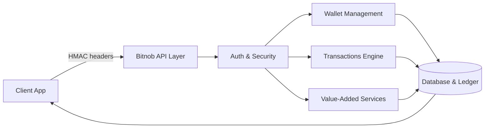
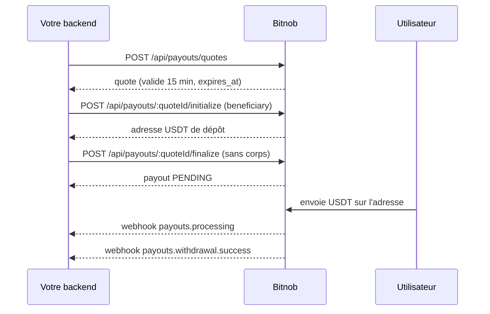
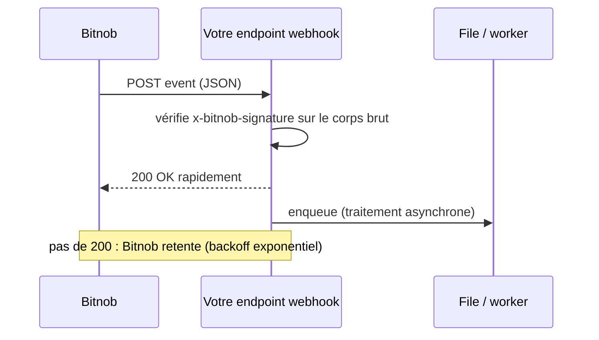

# Bitnob — Section Genesis (référence)

> Source : https://bitnob.dev/docs/genesis et sous-pages. Texte lu depuis les copies Markdown locales (lot « genesis »), état de la doc au 2026-10-08. Rien n'est inventé : « non précisé dans la doc » signale un trou de la source.

## Sommaire des pages couvertes

Ordre logique de la navigation (niveau 1 = `##`, niveau 2 = `###`/`####`).

| # | Page | Fichier brut | Lien source |
|---|---|---|---|
| 1 | Introduction : Our "Genesis Block" (racine) | `docs__genesis.md` | https://bitnob.dev/docs/genesis |
| 1b | Introduction (alias `/overview`, contenu identique) | `docs__genesis__overview.md` | https://bitnob.dev/docs/genesis/overview |
| 2 | Setting Up a Bitnob Account | `docs__genesis__account-setup.md` | https://bitnob.dev/docs/genesis/account-setup |
| 3 | Core Concepts & Architecture | `docs__genesis__core-concepts-and-architecture.md` | https://bitnob.dev/docs/genesis/core-concepts-and-architecture |
| 3a | Index de section Core Concepts (page d'index sans contenu) | `docs__genesis__core-concepts-and-architecture___index.md` | https://bitnob.dev/docs/genesis/core-concepts-and-architecture/_index |
| 3b | Currency Handling for Inexperienced Devs | `docs__genesis__core-concepts-and-architecture__currency-handling-for-inexperienced-devs.md` | https://bitnob.dev/docs/genesis/core-concepts-and-architecture/currency-handling-for-inexperienced-devs |
| 4 | Tutorials (hub) | `docs__genesis__tutorials.md` | https://bitnob.dev/docs/genesis/tutorials |
| 4a | Index de section Tutorials (page d'index sans contenu) | `docs__genesis__tutorials___index.md` | https://bitnob.dev/docs/genesis/tutorials/_index |
| 4b | Tutorial : Accept USDT and settle in Naira | `docs__genesis__tutorials__send-usdt-to-ngn.md` | https://bitnob.dev/docs/genesis/tutorials/send-usdt-to-ngn |
| 4c | Tutorial : Swap Bitcoin to USDT | `docs__genesis__tutorials__swap.md` | https://bitnob.dev/docs/genesis/tutorials/swap |
| 4d | Tutorial : Send Bitcoin (on-chain ou Lightning) | `docs__genesis__tutorials__send-bitcoin.md` | https://bitnob.dev/docs/genesis/tutorials/send-bitcoin |
| 4e | Tutorial : Purchase Airtime/Data (page non listée dans le hub, préfixe `_`) | `docs__genesis__tutorials___buy-airtime.md` | https://bitnob.dev/docs/genesis/tutorials/_buy-airtime |
| 5 | API Best Practices (hub) | `docs__genesis__api-best-practices.md` | https://bitnob.dev/docs/genesis/api-best-practices |
| 5a | Index de section API Best Practices (page d'index sans contenu) | `docs__genesis__api-best-practices___index.md` | https://bitnob.dev/docs/genesis/api-best-practices/_index |
| 5b | API Key & Credential Security | `docs__genesis__api-best-practices__api-keys-and-credentials.md` | https://bitnob.dev/docs/genesis/api-best-practices/api-keys-and-credentials |
| 5c | Webhooks & Event Handling (Webhook Best Practices) | `docs__genesis__api-best-practices__webhook-best-practices.md` | https://bitnob.dev/docs/genesis/api-best-practices/webhook-best-practices |
| 5d | Idempotency & Reference Integrity | `docs__genesis__api-best-practices__idempotency-and-reference-integrity.md` | https://bitnob.dev/docs/genesis/api-best-practices/idempotency-and-reference-integrity |
| 5e | Quote Lifecycle & Expiry | `docs__genesis__api-best-practices__quote-expiry-and-transaction-windows.md` | https://bitnob.dev/docs/genesis/api-best-practices/quote-expiry-and-transaction-windows |
| 5f | Testing, Simulation, and Building in Sandbox | `docs__genesis__api-best-practices__simulating-flows-and-testing-in-sandbox.md` | https://bitnob.dev/docs/genesis/api-best-practices/simulating-flows-and-testing-in-sandbox |
| 5g | Observability, Logging, and Traceability | `docs__genesis__api-best-practices__observability-logging-and-traceability.md` | https://bitnob.dev/docs/genesis/api-best-practices/observability-logging-and-traceability |
| — | « Error Handling, Retries, and Fallbacks » : listée dans le hub 5 mais **aucune page fournie** (lien pointe vers `/docs/genesis/api-best-practices/`) | — | non précisé dans la doc |

20 fichiers bruts, dont 3 index vides (`_index`).

---

## 1. Introduction : Our "Genesis Block"

Lien : https://bitnob.dev/docs/genesis (et https://bitnob.dev/docs/genesis/overview, texte identique)

**À quoi ça sert** : page de présentation de la mission de Bitnob (infrastructure crypto/paiement, ancrage africain, ouverte au monde). Aucun contrat d'API.

**Points clés**
- Sections : The Problem (coûts et barrières techniques pour adopter crypto/paiements en marchés émergents), Our Dream (écosystème développeurs), Key Features.
- Produits cités : stablecoins, Bitcoin, Lightning, fiat on/off ramps.
- Key feature unique listée : « Comprehensive Crypto Rails » (Bitcoin, stablecoins, Lightning « for near-instant transfers »).
- La page `/overview` est un doublon exact de la racine.

---

## 2. Setting Up a Bitnob Account

Lien : https://bitnob.dev/docs/genesis/account-setup

**À quoi ça sert** : création du compte développeur, clés HMAC, différence sandbox/production, vérification via `/api/whoami`. Page centrale pour l'authentification.

### 2.1 Création de compte et profil
- Inscription via https://app.bitnob.com/ (signup `accounts.bitnob.com/auth/signup`) : email, code de confirmation par email, mot de passe d'au moins 12 caractères (lettres, chiffres, symboles).
- Dashboard : sections API Keys, Wallets, Transactions, Usage Reports. Invitation de collègues via les paramètres du compte.
- Profil : nom société/projet, téléphone et adresse (factures/notifications), logo optionnel.

### 2.2 KYC et conformité
- Sandbox : vérification optionnelle, « default limits ».
- Pour lever les limites et débloquer la Production : documents d'enregistrement, pièces d'identité, coordonnées bancaires dans « Identity & Compliance ».
- Délai annoncé : 24 à 48 h, confirmation par email. Montants des limites : non précisé dans la doc.

### 2.3 Sandbox vs Production
| Point | Valeur |
|---|---|
| Base URL sandbox | `https://api.bitnob.com` |
| Base URL production | `https://api.bitnob.com` (la même) |
| Ce qui change | les clés (Secret Key), pas l'URL |
| Client ID | identique en sandbox et production |
| Secret Key | différent par environnement ; les mélanger provoque des échecs d'authentification |
- Sandbox : tester wallets, paiements, webhooks sans fonds réels ; les données sandbox « may reset periodically » (ne pas s'en servir comme archive).
- Production : transactions réelles ; ne basculer qu'après tests complets et KYC.

### 2.4 Générer Client ID et Secret Key
- Chemin : Settings > API Keys > Create Key (formulaire de création).
- Le Secret Key n'est montré qu'une fois (« you won't see the secret again »).
- Stockage : variables d'environnement ou vault (AWS Secrets Manager, HashiCorp Vault) ; jamais dans Git ; rotation régulière.
- Exemple `.env` : `BITNOB_CLIENT_ID`, `BITNOB_SECRET_KEY`.

### 2.5 Authentification HMAC (API standard)
```plaintext
stringToSign = CLIENT_ID:TIMESTAMP:NONCE:PAYLOAD
raw_hmac     = HMAC_SHA256(stringToSign, CLIENT_SECRET)
signature    = HexEncode(raw_hmac)
```
- `PAYLOAD` = corps JSON exact envoyé ; chaîne vide s'il n'y a pas de corps.
- Quatre en-têtes obligatoires sur chaque requête :

| Header | Valeur | Rôle |
|---|---|---|
| `X-Auth-Client` | CLIENT_ID | identifie l'appelant |
| `X-Auth-Timestamp` | Unix timestamp **en secondes** | anti-rejeu |
| `X-Auth-Nonce` | nonce de 16 octets encodé hex | unicité par requête |
| `X-Auth-Signature` | HMAC hex | intégrité/authenticité |
- Exemple PHP de la page : `$nonce = bin2hex(random_bytes(16))`, `hash_hmac('sha256', $stringToSign, $secretKey)`.
- Renvoi vers l'API reference : `/api-reference/authentication#hmac-request-signing`.

### 2.6 Enterprise API (auth par clé)
- Base URL différente : `https://api.platform.bitnob.com`. En-têtes : `X-API-Key` (obligatoire), `X-API-VERSION` (optionnel, défaut `v1`), `Content-Type: application/json` pour les écritures. Org déduite de la clé. Ne jamais mettre la clé dans une app mobile/front. Détail : voir `enterprise-ressources-changelog.md`.

### 2.7 Vérifier la configuration
- `GET https://api.bitnob.com/api/whoami` avec les 4 en-têtes HMAC ; réponse attendue `200 OK` avec les détails du compte. Exemples cURL, Node (axios), PHP.

### 2.8 Étapes suivantes
Quickstart (créer wallets, paiements de test, callbacks), Core Concepts, Tutorials (ex. Lightning).

**Pièges**
- Même URL sandbox/prod : c'est le secret qui décide de l'environnement.
- Dans l'exemple cURL de la page, la valeur `x-auth-*` est vide (placeholders) ; ne pas copier tel quel.

---

## 3. Core Concepts & Architecture

Lien : https://bitnob.dev/docs/genesis/core-concepts-and-architecture

**À quoi ça sert** : vue d'ensemble conceptuelle de la plateforme (rails crypto, fiat, services à valeur ajoutée).

**Points clés**
- Infrastructure : Crypto Rails (Bitcoin on-chain + Lightning, stablecoins), Fiat Integration (on/off ramps devises africaines), Value-Added Services (airtime, bills), Account & Wallet Services, Multi-Asset Management.
- Entités : Accounts (clés API, analytics, sécurité), Wallets (BTC Wallet on-chain ; Stablecoin Wallet USDT/USDC sur ERC20, TRC20…).
- Flux de transactions : crypto (on-chain, Lightning, stablecoins), fiat (dépôts depuis banque/mobile money, retraits), services (airtime/bills, cartes virtuelles).
- Rate limits : « some API calls have usage limits », en-têtes de réponse indiquant l'usage/quota restant ; seuils exacts renvoyés à l'API reference (non précisés ici).
- Sécurité : HMAC sur toutes les requêtes ; permissions par rôle pour grandes organisations ; HTTPS ; KYC selon pays/montant ; alertes sur transactions suspectes ou grosses.
- Cartes virtuelles : usage unique ou récurrent, financement temps réel depuis le wallet.
- Architecture conceptuelle (texte de la page) :


- Bonnes pratiques : tester en sandbox sur `api.bitnob.com`, utiliser les webhooks « where available », suivre les changelogs.

**Pièges** : le vocabulaire « tokens » / « Token Lifecycles » est ambigu (l'auth réelle est HMAC, pas de jeton) ; la section « Regulatory Requirements » est dupliquée dans la page.

### 3.1 Index de section Core Concepts
Lien : https://bitnob.dev/docs/genesis/core-concepts-and-architecture/_index — page d'index sans contenu.

### 3.2 Currency Handling for Inexperienced Devs
Lien : https://bitnob.dev/docs/genesis/core-concepts-and-architecture/currency-handling-for-inexperienced-devs

**À quoi ça sert** : règles pour stocker, convertir et afficher les montants sans erreurs d'arrondi.

**Points clés (unités de montants)**
- Stocker en plus petite unité entière : `1 BTC = 100,000,000 sats` ; fiat : `1 NGN = 100 kobo`, `1 USD = 100 cents`. Éviter les flottants.
- Exemple : 0,001 BTC = 100 000 sats ; swap de 0.999876 BTC = 99 987 600 sats en base, affichage 0.9999 BTC.
- Convertir uniquement aux bords (affichage). Les balances sont renvoyées en plus petites unités par `Get Balances` (`/api-reference/wallets#get-balances`) ; pour le FX utiliser `Get Exchange Rate` / `Convert Amount` (`/api-reference/exchange-rates`).
- Taux : le verrouiller et le stocker à chaque conversion ; calcul entier si possible, sinon bibliothèque décimale (bigdecimal.js, decimal Python, BigDecimal).
- Stablecoins : décimales variables selon la chaîne/token (ex. USDT TRC20 6 décimales) ; garder la métadonnée par chaîne en config. La page parle de « micropennies », terme non standard.
- Frais : gas on-chain et frais Lightning/service réduisent le montant reçu ; à communiquer clairement.
- Multi-devises : un champ/colonne par devise, références pour lier les conversions à une transaction.
- Exemple « Accept BTC, Pay in NGN » : sats -> taux -> kobo -> frais -> entier en base -> affichage `₦2000.00`.
- Tests : 1 sat, 1 kobo, montants proches du max, arrondis 0.9999 -> 1.0000, formats locaux.

**Pièges** : la page contient des sections dupliquées (« Convert Only at the Edges » / « Handling exchange »). Elle ne dit pas quelles unités renvoient les webhooks ou les endpoints Lightning (voir §5.3 et §4.4).

---

## 4. Tutorials

Lien : https://bitnob.dev/docs/genesis/tutorials

**À quoi ça sert** : hub de guides pas à pas. Précise que les wallets Bitcoin, USDT et USDC sont créés automatiquement à l'onboarding. Liste 3 tutoriels (USDT -> NGN, Swap BTC -> USDT/USDC, Send Bitcoin). Le tutoriel Airtime n'est pas listé.

### 4.0 Index de section Tutorials
Lien : https://bitnob.dev/docs/genesis/tutorials/_index — page d'index sans contenu.

### 4.1 Tutorial : Accept USDT from Users and Settle in Naira
Lien : https://bitnob.dev/docs/genesis/tutorials/send-usdt-to-ngn

**À quoi ça sert** : flux Offramp complet : recevoir de l'USDT on-chain (TRC20) et régler en NGN sur un compte bancaire. C'est le flux « payouts » (quote -> initialize -> finalize).



**Concepts** : Quote (taux verrouillé, valide **15 minutes**), Source of Funds (`source: "onchain"`, `chain: "trc20"`), Address (fournie après initialize), Settlement (détection auto du dépôt, conversion au taux de la quote, virement NGN).

**Étape 1 — `POST /api/payouts/quotes`** (Create Payouts Quote)
```json
{
  "from_asset": "USDT",
  "to_currency": "NGN",
  "country": "NG",
  "source": "onchain",
  "chain": "trc20",
  "amount": "1000",
  "reference": "PAYOUT_RS27519160015009872077"
}
```
- Taux garanti jusqu'à `expires_at` ; il faut initialiser, finaliser et recevoir les fonds dans cette fenêtre. Le corps de réponse est un placeholder non rendu (`$23`) dans la copie lue : non disponible.

**Étape 2 — `POST /api/payouts/:quoteId/initialize`**
```json
{
  "quote_id": "QT_86",
  "beneficiary": {
    "destination_type": "bank",
    "country": "NG",
    "account_number": "0123456789",
    "bank_code": "058",
    "account_name": "Ada Okafor"
  },
  "reference": "PAYOUT_RS27519160015009872077",
  "payment_reason": "vendor payment",
  "callback_url": "https://example.com/webhooks/payouts"
}
```
- Vérifier le compte avant avec `Account Lookup` (`/api-reference/payouts/account-lookup`). Réponse (placeholder `$24`) non disponible ; elle contient l'adresse USDT à afficher. Afficher le montant exact (1000 USDT) et la chaîne TRC20.

**Étape 3 — `POST /api/payouts/:quoteId/finalize`**
- Pas de corps : signer avec une chaîne de corps vide. À appeler avant `expires_at` sinon la quote est « dead » : refaire quote + initialize.
- Réponse : `success`, `message: "Payout finalized successfully"`, `data.payout` avec `id`, `quote_id`, `company_id`, `status: "PENDING"`, `source: "ONCHAIN"`, `chain: "CHAIN_TYPE_TRON"`, `address`, `from_asset`, `to_currency`, `amount: "1000"`, `settlement_amount: "1399794.80"`, `fees: "0"`, `beneficiary{…}`, `reference`, `callback_url`, `country`, `expires_at`; plus `timestamp`.

**Étape 4 — Simulate Deposit (sandbox uniquement) — `POST /api/addresses/simulate-deposit`**
```json
{
  "address": "TJZCwdcH2GZRLjt8aAphrhCZtEbJLqEAfC",
  "amount": "1000000000",
  "currency": "USDT",
  "chain": "tron"
}
```
- N'existe qu'en sandbox ; la transaction apparaît dans l'API Transactions avec `metadata.is_simulated: "true"` et une référence `sim_*`. La production rejette l'appel.
- Piège d'unité : l'exemple envoie `amount: "1000000000"` pour un payout de `1000` USDT (facteur 10^6) ; la page n'explique pas l'unité de ce champ.

**Étape 5 — Cycle de règlement**
1. Confirmation du dépôt (« usually within 1–2 blocks for TRC20 »).
2. Conversion USDT -> NGN au taux de la quote.
3. Virement NGN.
4. Webhook `payouts.processing` quand le rail de règlement prend le payout, puis `payouts.withdrawal.success` sur `callback_url` à la fin.

**Étape 6 — Expiration, sous-paiement, échec**
- Sous-paiement : le payout est quand même traité, le fiat livré est proratisé sur le montant reçu au taux initial (dans une marge autorisée, marge non précisée).
- Pas de dépôt avant expiration (15 min) : annulation + webhook `payouts.withdrawal.expired`.
- Échec de retrait (ex. compte invalide) : statut `FAILED` ; à détecter par `Get Payout by ID` (`/api-reference/payouts/list-payouts#get-payout-by-id`).

**Bonnes pratiques** : `reference` unique par payout (trace ID) ; stocker `quote_id`, `reference`, `beneficiary`, `address` ; faire du polling sur Get Payout by ID si pas de webhooks.

### 4.2 Tutorial : Swap Bitcoin to USDT
Lien : https://bitnob.dev/docs/genesis/tutorials/swap

**À quoi ça sert** : convertir du BTC en USDT via le moteur de swap (Trading API).

**Étapes et routes**
1. Solde : `GET /api/balances/BTC` (ou `GET /api/balances` pour tout) ; lire `availableBalance`.
2. Quote (optionnelle) : `POST /api/trading/quotes`
```json
{ "base_currency": "BTC", "quote_currency": "USDT", "quantity": "10", "side": "sell" }
```
   Réponse : `data.quote` avec `id`, `price`, `expires_at`, `created_at`, `original_quantity`, `consumed_quantity`, `remaining_quantity`, `exchange{send_quantity, send_currency, receive_quantity, receive_currency}`, `side` en majuscules (`SELL`) ; `metadata.request_id`. **La quote expire en 60 secondes.**
3. Exécution : `POST /api/trading/orders`
```json
{
  "base_currency": "BTC", "quote_currency": "USDT", "side": "sell",
  "quantity": "0.0001", "price": "88989.119625",
  "quote_id": "b8da95f6-13b6-41f3-9675-9d24535df1b3",
  "metadata": { "reference": "user-btc-sell" }
}
```
   (en-têtes `x-auth-client`, `x-auth-timestamp`, `x-auth-nonce`, `x-auth-signature`). Vérifier avec `Get Order By ID`. Le corps de réponse est un placeholder non rendu (`$22`).
4. Vérifier le solde : `GET api/wallets/usdt` (champs `availableBalance`, `totalReceived`, `currency`).

**Erreurs** : solde BTC insuffisant -> `400` avec message ; quote expirée -> redemander ; wallet verrouillé/indisponible -> échec du swap. Logger `swapId` et `reference`.

**Pièges** : ici la `reference` est dans `metadata.reference` (pas à la racine) ; les trois routes de lecture de solde sont différentes (`/api/balances/BTC` puis `api/wallets/usdt`, sans slash initial).

### 4.3 Tutorial : Send Bitcoin (On-chain or Lightning)
Lien : https://bitnob.dev/docs/genesis/tutorials/send-bitcoin

**À quoi ça sert** : envoyer du BTC depuis le wallet BTC unique de Bitnob vers une adresse on-chain ou une facture Lightning. La page est tronquée (texte puis « Extraits de code » sans prose).

**Points clés**
- Prérequis : compte vérifié, clé API, BTC dans le wallet consolidé, destination.
- On-chain : confirmation typique 10 à 60 minutes.
- On-chain — `POST /api/withdrawals`
```json
{
  "to_address": "bc1qp22hg0aj99npxxcsjqg3rxafm8nspa9nc3fjy7",
  "amount": "0.00001",
  "currency": "BTC",
  "chain": "bitcoin",
  "reference": "GNT_Ty12334z",
  "description": "Testing BTC on BTC to base"
}
```
- Lightning — `POST /api/lightning/pay`
```json
{ "reference": "LT_PT25000900130010051104509", "request": "lnbc1m1p5ml78t..." }
```
- Réponse Lightning :
```json
{
  "success": true,
  "message": "Lightning payment sent successfully",
  "data": {
    "id": "4b89cdf8-7590-4428-84b4-a55b4767ceb4",
    "payment_hash": "c0d32a2f...",
    "preimage": "bb425920...",
    "amount_sat": 1,
    "fee_sat": 20,
    "status": "paid",
    "created_at": "2026-03-22T14:19:12Z",
    "reference": "LT_PT25000900130010051104509",
    "transaction_id": "4b89cdf8-7590-4428-84b4-a55b4767ceb4"
  },
  "metadata": { "request_id": "lightning_req_019d15e9-..." },
  "timestamp": "2026-03-22T14:19:12.848877395Z"
}
```
- Unités : `amount_sat` et `fee_sat` en satoshis (entiers) ; `amount` du withdrawal en BTC (chaîne décimale). La `preimage` est renvoyée à la réponse du paiement sortant.

**Pièges** : cette page ne couvre que l'envoi ; la **création de facture Lightning (réception)** n'y est pas décrite (renvoi seulement vers `/api-reference/lightning#create-invoice` depuis la page Swagger). Statuts d'un withdrawal et suivi par hash/confirmations : non précisés ici malgré le hub qui les promet.

### 4.4 Tutorial : Purchase Airtime or Data (page non listée)
Lien : https://bitnob.dev/docs/genesis/tutorials/_buy-airtime

**À quoi ça sert** : acheter airtime/data en payant en BTC ou USDT sans financer de wallet (just-in-time). La page n'apparaît pas dans le hub Tutorials et utilise des routes `/v1/...` : probablement ancienne ou non publiée.

**Points clés**
- Routes citées : `GET /v1/airtime/operators`, `GET /v1/data/operators`, `POST /v1/airtime/purchase`, `GET /v1/airtime/status/:reference`.
- Corps d'exemple : `phoneNumber`, `amount` (fiat local, ex. 2000 NGN), `operator`, `paymentAsset`, `reference`, `callbackUrl`. Champs listés dans le tableau : `phoneNumber`, `amount`, `currency`, `operator`, `paymentAsset` (USDT ou BTC), `paymentMethod` (`trc20`, `erc20`, `lightning`, `bitcoin`), `reference`, `callbackUrl`.
- Réponse : `paymentRequest{asset, method, amount, address, expiresAt}`, `reference`, `status: "awaiting_payment"`.
- Webhooks cités : `airtime.payment.received`, `airtime.delivered`, `airtime.failed`, `airtime.expired`, `airtime.underpayment`.

**Pièges** : exemples JSON non valides (clés/valeurs sans guillemets), incohérence `paymentAsset`/`paymentMethod` entre l'exemple et le tableau. À ne pas utiliser comme contrat sans vérification.

---

## 5. API Best Practices

### 5.0 API Best Practices (hub)
Lien : https://bitnob.dev/docs/genesis/api-best-practices

**À quoi ça sert** : introduction et sommaire des 7 guides. Les bonnes pratiques valent « beyond Bitnob » (APIs financières en général).

**Points clés**
- Thèmes : sécurité des clés, webhooks résilients, idempotence/expiration des quotes/concurrence, rate limits/retries/timeouts, éviter les échecs silencieux, simulation, traçabilité.
- Guides listés : API Key & Credential Security, Webhook Best Practices, Idempotency & Reference Integrity, Quote Expiry & Transaction Windows, **Error Handling, Retries, and Fallbacks (page absente du lot)**, Simulating Flows & Testing in Sandbox, Observability Logging & Traceability.
- Pour : développeurs d'APIs financières, startups, ingénieurs plateforme, toute équipe passant en production.

### 5.1 Index de section API Best Practices
Lien : https://bitnob.dev/docs/genesis/api-best-practices/_index — page d'index sans contenu.

### 5.2 API Key & Credential Security
Lien : https://bitnob.dev/docs/genesis/api-best-practices/api-keys-and-credentials

**À quoi ça sert** : gestion sûre des clés (dev, staging, prod, CI/CD).

**Points clés**
- Ne jamais coder en dur ; variables d'environnement, secrets système ou vault.
- Séparer sandbox/prod : `BITNOB_CLIENT_ID` (identique), `BITNOB_SANDBOX_SECRET_KEY`, `BITNOB_PRODUCTION_SECRET_KEY` ; ne jamais utiliser le secret de prod en dev/staging.
- Clés jamais côté frontend/mobile (APK/IPA décompilables) : passer par votre backend.
- Rotation tous les **60 à 90 jours** (valider la nouvelle clé via `Validate Authentication` avant de retirer l'ancienne) et immédiatement si départ d'un ingénieur, exposition d'un credential staging, nouveaux partenaires. Rotation à clés chevauchantes : ajouter Key B, déployer B, retirer Key A.
- Secret manager en prod (AWS/GCP Secret Manager, Vault, Doppler, Infisical, 1Password) ; pas de `.env` en prod.
- Détection de fuites : GitGuardian, TruffleHog, GitHub Advanced Security ; scripts cherchant `sklive`/`sktest`.
- Rédiger les logs : ne jamais logger l'en-tête `Authorization` ni la clé complète (middleware Express d'exemple).
- Surveillance : volume (alerte si x10), IP/pays inhabituels, endpoints jamais utilisés ; métriques `api.requests.total`, `api.requests.by-endpoint`, `api.requests.by-country`, `api.failures.by-code`.
- Jetons signés courts (JWT) entre vos services internes, ne pas réutiliser la clé Bitnob.
- Proxy/gateway optionnel, expiration/versioning de clés si vous émettez vos propres clés, outil interne d'audit des clés.

**Pièges** : la page parle de clés `sk_live_…` / `sk_test_…` et de l'en-tête `Authorization`, vocabulaire d'un modèle bearer qui ne correspond pas au HMAC `Client ID + Secret` de la page Account Setup (voir « À retenir »).

### 5.3 Webhooks & Event Handling (Webhook Best Practices)
Lien : https://bitnob.dev/docs/genesis/api-best-practices/webhook-best-practices

**À quoi ça sert** : construire un récepteur de webhooks fiable (retries, doublons, vérification de signature, files).



**Points clés**
- Un webhook = requête HTTP POST de Bitnob vers votre serveur à chaque changement. Catalogues d'événements par produit dans l'API reference : addresses (`/api-reference/addresses/webhooks#webhook`), withdrawal, payouts (`/api-reference/payouts/webhooks#payout-webhooks`), virtual cards.
- Exemple de payload `transfer.success` (dépôt/transfert stablecoin) :
```json
{
  "event": "transfer.success",
  "event_id": "944a4089-6065-49ca-8f43-fb10f15c59e6",
  "data": {
    "address": "TRMPscTMrXg21YuDFuvpXRUkwEbipHEZXN",
    "amount": "2000000",
    "chain": "tron",
    "currency": "USDT",
    "fee": "1000000",
    "hash": "4ae43085...",
    "reference": "SND_SBLNC_80c7895d89e9",
    "timestamp": "2025-12-12T20:30:18Z",
    "transaction_id": "3ac20197-f0c7-4553-ac32-9ead17c7f0a9"
  }
}
```
  Unité de `amount`/`fee` (chaînes ; apparemment en micro-unités USDT à 6 décimales) : non précisée dans la doc.
- Bitnob fournit : livraison pour tous les flux asynchrones, **dashboard** de logs/payloads/tentatives, webhooks pour offramps, swaps, airtime, confirmations de paiement.
- Handler : route POST, répondre `200 OK` vite, ne pas bloquer (queue), logger chaque tentative (timestamp + reference). Les exemples Node/Python/Go lisent `event` et `reference` au niveau racine et testent `airtime.delivered`, alors que le payload réel met `reference` dans `data`.
- **Retries** : si endpoint hors ligne/timeout, réponse 4xx ou 5xx, ou absence de `200 OK`. Intervalle en backoff exponentiel ; nombre d'essais et délais : non précisés dans la doc (renvoi à `/api-reference/addresses/webhooks#overview`).
- **Idempotence** : vérifier si la `reference` est déjà traitée avant d'agir, sinon double crédit/airtime/funding ; table suggérée `id, reference, event, status, received at`.
- Architecture recommandée : ack immédiat puis file (BullMQ/BeeQueue, Sidekiq, Celery, Redis Streams/Kafka).
- **Signature** : en-tête `x-bitnob-signature` ; HMAC **SHA-512**, hex, calculé sur le **corps brut** (pas du JSON re-sérialisé), comparaison `timingSafeEqual` :
```javascript
crypto.createHmac('sha512', secret).update(payload).digest('hex')
```
  Clé (`secret`) utilisée : non précisée sur cette page (renvoi à `Verifying Events` dans l'API reference).
- **IP source** à autoriser : `18.171.51.218` et `13.134.154.133` (peuvent changer, annoncées à l'avance). Ce n'est pas une frontière de sécurité : toujours vérifier la signature.
- HTTPS obligatoire pour l'URL de webhook.
- Test local : ngrok/localtunnel/cloudflared ; simulate deposit en sandbox ; cartes : endpoint `Simulate Webhook` (`/api-reference/virtual-cards/simulate-webhook`).
- Toujours : endpoint dédié, 200 rapide, idempotence, logs (event, reference, timestamp, statut de livraison), queue, signature, dashboard Bitnob pour inspecter/rejouer.

### 5.4 Idempotency & Reference Integrity
Lien : https://bitnob.dev/docs/genesis/api-best-practices/idempotency-and-reference-integrity

**À quoi ça sert** : garantir l'exécution unique malgré retries, doubles clics, timeouts, workers dupliqués.

**Points clés**
- Idempotence = répéter la même requête n'a pas d'effet supplémentaire. S'applique aux webhooks, payouts, airtime, transferts BTC/USDT, swaps, tout mouvement irréversible.
- Utiliser `reference` sur chaque transaction : « It becomes your deduplication key. Bitnob stores and enforces it, and you should too. » Exemple `{"reference": "swap_txn_20250408_001"}`. La `reference` est aussi renvoyée dans le webhook.
- Table dédiée (`id, reference, status, source, timestamp`) pour contrôler vite et auditer.
- Concurrence : verrou transactionnel Postgres (`SELECT … FOR UPDATE` sur `idempotency_keys`) ou Redis `SETNX processed:<ref>` + `EXPIRE … 3600`.
- Nommage : préfixe de type (`swap_`, `offramp_`, `airtime_`) + date/séquence (`swap_20250408_001`) ; éviter timestamps bruts et UUID sans métadonnée.
- Endpoints où mettre `reference` : `/api/payouts/initialize`, `/v1/airtime/purchase`, `/v1/transactions/convert`, `/v1/bitcoin/send`, `/v1/card/fund` (liste de la page ; renvoie à `Initialize Payout`, `Create Withdrawal`, `Create Order`).
- Anti-patterns : ne pas logger la reference, références aléatoires/horodatées, tout traiter comme neuf.

**Pièges** : la page ne dit pas ce que Bitnob renvoie (code HTTP/erreur) en cas de `reference` dupliquée ; routes `/v1/...` et `/api/payouts/initialize` divergent de `/api/payouts/:quoteId/initialize` (§4.1). Le tableau d'exemple utilise un nom d'événement (`virtualcard.created.success`) comme `reference`, ce qui est incohérent.

### 5.5 Quote Lifecycle & Expiry
Lien : https://bitnob.dev/docs/genesis/api-best-practices/quote-expiry-and-transaction-windows

**À quoi ça sert** : traiter la quote comme un objet à état avec fenêtre limitée (swaps, payouts, flux avec prix temps réel).

**Points clés**
- Une quote = « temporary pricing contract » : taux, montants attendus, moyen de paiement, expiration. Endpoints : `Create Payouts Quote` et Trading `Quotes` (relisable via `Get Quote by ID`).
- Structure simplifiée : `quoteId`, `fromAsset`, `toCurrency`, `amount`, `settlementAmount`, `exchangeRate`, `expiresAt` ; « Any payments made after that time may be rejected, returned, or underpaid ». (Noms camelCase illustratifs, différents des champs `snake_case` réels.)
- Utilisé pour offramps, airtime/data, financement de cartes, swaps BTC -> USDT.
- Bonnes pratiques : afficher un compte à rebours (`expiresAt`), nouvelle quote si expirée ; surveiller le **sous-paiement** (webhook `payouts.asset.underpayment`, transaction « paused or canceled », à vous de décider remboursement/retry) ; ne jamais réutiliser une quote expirée ; stocker la quote avec la transaction (reference, quote id, rate, expires at, user id, status) ; gérer mauvais actif / après expiration / sur-paiement (rejet ou remboursement, alerte support).
- Pré-chauffer les quotes pour un montant fixe en rafraîchissant à l'expiration.
- Sandbox : créer des quotes, simuler un paiement, déclencher des webhooks.

### 5.6 Testing, Simulation, and Building in Sandbox
Lien : https://bitnob.dev/docs/genesis/api-best-practices/simulating-flows-and-testing-in-sandbox

**À quoi ça sert** : tester tout le flux sans fonds réels (quotes, dépôts, payouts, webhooks).

**Points clés**
- URL sandbox ET production : `https://api.bitnob.com` ; clés différentes, rotation indépendante.
- Simulable : quotes BTC/USDT, dépôts (on-chain, Lightning, USDT TRC20…), réception de webhooks, retries, sous-paiement, échecs de payout, timeouts/expiration.
- **Simuler un dépôt** : `POST /api/payouts/simulate-address-deposit`
```json
{ "address": "TGexampleTRC20address", "amount": 2.00 }
```
  Effet : marque la quote comme financée, déclenche le webhook `asset.received`, lance la livraison.
- **Lightning** : corps `{ "invoice": "lnbc1exampleinvoice", "amount": 50000 }` ; la page dit que le sandbox simule la confirmation et déclenche les webhooks associés ; l'endpoint n'est pas répété et l'unité de `amount` n'est pas précisée.
- **Sous-paiement** : envoyer 1.70 pour une quote de 2.00 -> webhook `payouts.asset.underpayment`, quote en `pending`/incomplete.
- **Expiration** : validité « usually 15 minutes » ; après `expiresAt`, tentative d'initiation/simulation -> réponse `QUOTE_EXPIRED`.
- **Retries webhooks** : exposer le handler avec `ngrok http 3000`, mettre `callbackUrl` à l'URL ngrok, renvoyer 500 volontairement, observer délais/nombre de tentatives.
- Dashboard webhooks Bitnob : payloads, statut de livraison, tentatives, en-têtes/métadonnées.
- Cas limites à tester : mauvais actif, webhook avant création de la reference en base, doublon après succès, paiement juste après expiration, facture Lightning expirée, reference réutilisée, callback inaccessible, paiements successifs, signature falsifiée, webhooks parallèles.
- Setup local : `.env.sandbox` avec `BITNOB_API_KEY_SANDBOX=sk_test_xyz`, `BITNOB_BASE_URL=https://api.bitnob.com` ; script runner (quote, payout, simulate, logs).

**Pièges** : exemples JSON sans guillemets ; `invoice` utilisé pour une adresse TRC20 dans l'exemple de sous-paiement ; endpoint de simulation différent de celui du tutoriel USDT (`/api/addresses/simulate-deposit`, §4.1).

### 5.7 Observability, Logging, and Traceability
Lien : https://bitnob.dev/docs/genesis/api-best-practices/observability-logging-and-traceability

**À quoi ça sert** : savoir quoi journaliser et corréler (webhook reçu ? quel taux ? pourquoi un payout a échoué ?).

**Points clés**
- Observer : chaque requête vers Bitnob, chaque webhook reçu, chaque reference/quote, chaque erreur, chaque cycle de vie (start -> success/fail).
- Résolution serveur : `Get Transaction By ID Or Reference` (`/api-reference/transactions#get-transaction-by-id-or-reference`) et `Get All Transactions` (mêmes filtres).
- Journal par reference : `reference, type, status, quoteId, fromAsset, toCurrency, amount, expiresAt, webhookReceived, createdAt`. Ajouter sans écraser.
- Ne jamais logger les clés/`Authorization` ; horodater partout.
- Webhooks : stocker event, reference, payload complet, statut de traitement, nombre de tentatives, cause d'échec.
- Alertes de base : retries webhook > 3x, quote expirée avant paiement, taux d'échec de payout > 1 % sur 5 min, erreurs inconnues sur `POST /payouts/initialize`.
- Dashboard de réconciliation interne : recherche par reference, requête/réponse brutes, historique des statuts, marquage manuel résolu/remboursé, rejeu de webhooks.
- Exposer à l'utilisateur un statut simplifié : pending, confirmed, expired, failed (+ montant, taux, horodatages).

---

## À retenir pour DioteKo

### Encaissement Lightning (factures, preimage, statuts)
- **Réception de facture Lightning : non décrite dans le lot genesis.** Seule la page Swagger (autre lot) pointe vers `/api-reference/lightning#create-invoice`. Source : tutoriel Send Bitcoin ; Core Concepts.
- Paiement sortant `POST /api/lightning/pay` : `status: "paid"`, `preimage`, `payment_hash`, `amount_sat`/`fee_sat` en sats, `reference` à l'envoi (https://bitnob.dev/docs/genesis/tutorials/send-bitcoin).
- Simulation sandbox Lightning : corps `{invoice, amount}`, endpoint et unité de `amount` non précisés (https://bitnob.dev/docs/genesis/api-best-practices/simulating-flows-and-testing-in-sandbox).

### Webhooks
- Signature : en-tête `x-bitnob-signature`, HMAC-SHA512 hex sur le corps brut, `timingSafeEqual` ; secret exact non précisé ici (webhook-best-practices).
- Noms d'événements exacts cités : `transfer.success` (avec `event_id`, `data.transaction_id`, `data.reference`), `payouts.processing`, `payouts.withdrawal.success`, `payouts.withdrawal.expired`, `payouts.asset.underpayment`, `asset.received` (cité comme webhook de simulation), plus `airtime.*` (probablement legacy). Le jeu complet des événements payouts (`payouts.initialized`, …) est dans le changelog, voir `enterprise-ressources-changelog.md`.
- Retries : sur non-200 / 4xx / 5xx / timeout, backoff exponentiel (cadence non chiffrée). Répondre 200 vite, traiter en file, dédupliquer sur `event_id`/`reference`.
- IP sources : `18.171.51.218`, `13.134.154.133` (confort réseau, pas sécurité).
- HTTPS obligatoire pour l'URL de webhook.

### Sandbox vs live, clés, go-live
- Même base URL `https://api.bitnob.com` ; même Client ID ; **seul le Secret Key change** (account-setup, api-keys-and-credentials).
- Go-live : tester tous les flux en sandbox, soumettre le KYC (24-48 h), utiliser le secret de production.
- Sandbox : données pouvant être réinitialisées ; `GET /api/whoami` pour valider.

### Idempotence (`reference`)
- `reference` unique, lisible, préfixée, stockée côté DioteKo ; renvoyée dans les webhooks ; verrou transactionnel ou `SETNX` en concurrence (idempotency-and-reference-integrity).
- Comportement de Bitnob sur doublon de `reference` : non précisé dans la doc.

### Unités de montants
- Stocker en entiers (sats, kobo, cents) ; BTC 1e8 sats ; Lightning API en sats (`amount_sat`) ; `amount` des withdrawals/quotes en chaînes décimales ; webhook `transfer.success` en chaînes (unité non documentée) (currency-handling…).

### Limites / KYC
- KYC optionnel en sandbox, requis pour la production ; seuils non chiffrés. Rate limits : en-têtes présents mais seuils renvoyés à l'API reference.
- Validité des quotes : payouts 15 min ; trading quote 60 s.

### Contradictions et informations qui paraissent obsolètes
1. **Endpoint de simulation** : `POST /api/payouts/simulate-address-deposit` (body `address`, `amount: 2.00`) vs `POST /api/addresses/simulate-deposit` (body `address`, `amount`, `currency`, `chain`) — pages 5.6 vs 4.1.
2. **Sous-paiement** : 5.5/5.6 -> quote paused/pending + `payouts.asset.underpayment` ; 4.1 -> payout traité au prorata. Le changelog (autre lot) ne liste pas `payouts.asset.underpayment` parmi les 4 événements payouts documentés.
3. **Durée des quotes** : 15 min (payouts) vs 60 s (trading) — produits différents, mais 5.5 ne le distingue pas.
4. **Modèle d'auth** : HMAC `CLIENT_ID:TIMESTAMP:NONCE:PAYLOAD` en secondes + hex (account-setup) vs vocabulaire `sk_live/sk_test`, `Authorization`, `BITNOB_API_KEY_SANDBOX` (api-keys, sandbox) : obsolète/ambigu. Voir aussi la page SDK du lot developer-resources (signature différente).
5. **Exemples de code** des pages 5.3/5.4 utilisent `airtime.*` et `/v1/...` : probablement hérités d'une ancienne API.
6. Page « Error Handling, Retries, and Fallbacks » référencée mais absente.
7. Corps de réponse non rendus (`$22`, `$23`, `$24`) dans les tutoriels swap et USDT -> NGN ; JSON des pages sandbox/airtime non valides.
