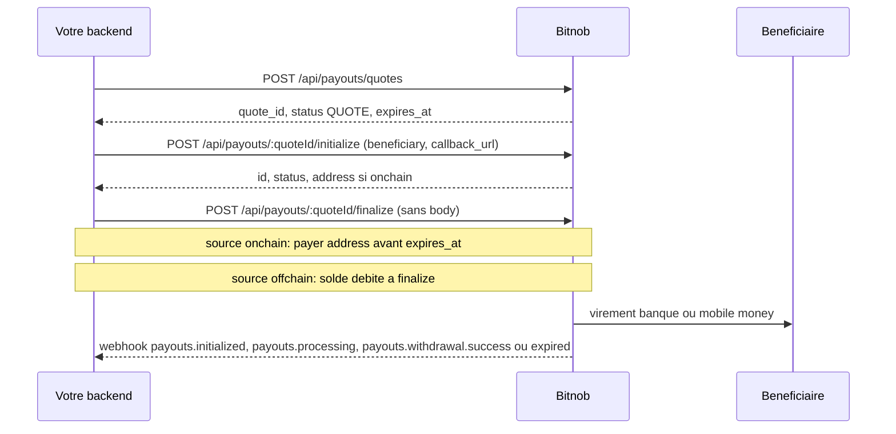
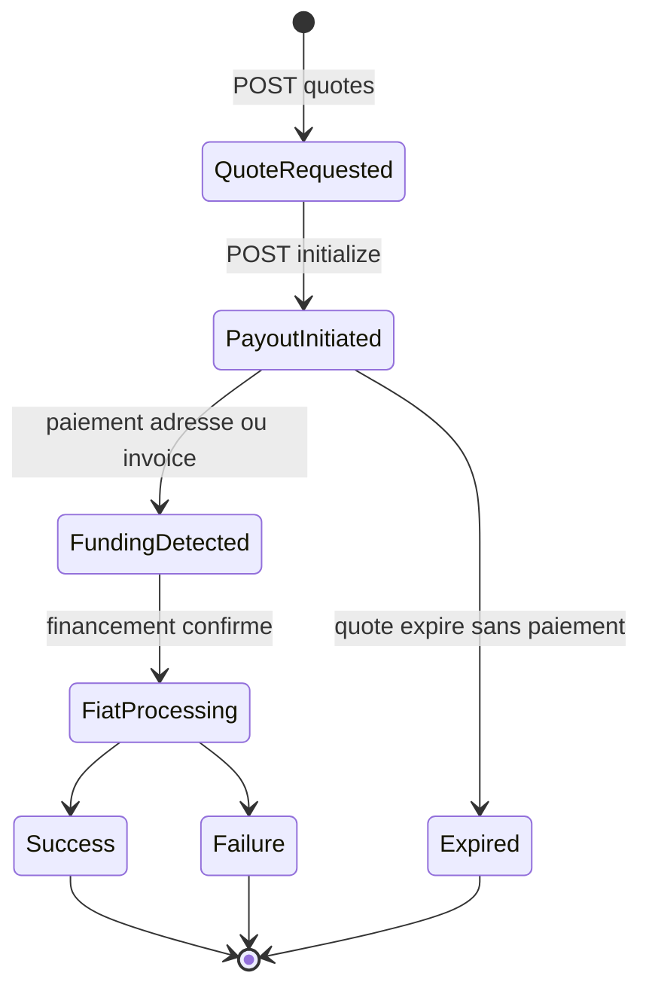

# Bitnob — Payouts (référence de la doc bitnob.dev)

> Partie « Payouts » du README de référence Bitnob. Source : texte brut des pages `https://bitnob.dev/docs/payouts*` téléchargé en Markdown (36 pages, lot `docs__payouts*`). Rien n'a été re-vérifié sur le web dans cette tâche ; tout ce qui suit vient du texte téléchargé.
>
> Limites du texte brut : certaines réponses JSON d'exemple n'ont pas été rendues dans le téléchargement (placeholders `$21`...`$2d` dans les pages `requesting-and-initiating-payment`, `full-payout-flow`, `how-to-send-payouts-with-bitnob`, `payout-live-example`, `swift-payout`). Quelques tableaux « Payout Timing Expectations » des pages corridors sont aussi tronqués. Ces trous sont signalés « non récupéré ». Les pages de référence API (`/api-reference/payouts...` : Get Supported Countries, Get Limits, Account Lookup, Webhooks, Verifying Events, Source IPs) ne font pas partie de ce lot : elles sont seulement citées.
>
> Ordre des sections : l'ordre exact de la navigation du site n'est pas dans le texte brut ; l'ordre ci-dessous suit une progression logique (intro, guides, flux, rails, corridors, webhooks, erreurs, annexes, cours PM).

## Sommaire

1. [Table de couverture des 36 fichiers](#table-de-couverture-des-36-fichiers)
2. [Vue d'ensemble : contrat API en un coup d'oeil](#vue-densemble--contrat-api-en-un-coup-doeil)
3. Pages
   - [Introduction / Overview](#introduction-payout)
   - [How to Send Payouts with Bitnob (tutoriel)](#how-to-send-payouts-with-bitnob)
   - [Payouts API Integration Guide (payout-live-example)](#payouts-api--integration-guide-payout-live-example)
   - [Settlement Models](#settlement-models)
   - [Requesting a Quote and Initiating a Payout](#requesting-a-quote-and-initiating-a-payout)
   - [Building a Full Payout Flow](#building-a-full-payout-flow)
   - [Payouts Lifecycle](#payouts-lifecycle)
   - [Understanding the Trip Timeline](#understanding-the-trip-timeline)
   - [Supported Currencies](#supported-currencies)
   - [SWIFT Cross-Border Payouts](#swift-cross-border-payouts)
   - [Corridor-Specific Behavior (index)](#corridor-specific-behavior-index)
   - [Corridor Nigeria](#corridor-nigeria-ngn-payouts)
   - [Corridor Ghana](#corridor-ghana-ghs-payouts)
   - [Corridor Kenya](#corridor-kenya-kes-payouts)
   - [Webhooks for Payouts](#webhooks-for-payouts)
   - [Error Handling](#error-handling-payouts)
   - [Mass Payouts](#mass-payouts)
   - [Glossary of Terms](#glossary-of-terms)
   - [Payouts Use Cases](#payouts-use-cases)
   - [Incident Reporting (postmortem)](#incident-reporting-postmortem-template)
   - [Payouts for PMs (cours, 12 modules + capstone)](#payouts-for-pms-cours)
4. [Contradictions et obsolescences](#contradictions-et-obsolescences-dans-la-doc-payouts)
5. [À retenir pour DioteKo](#à-retenir-pour-dioteko)

---

## Table de couverture des 36 fichiers

| # | Fichier brut | Lien source | Section |
| --- | --- | --- | --- |
| 1 | `docs__payouts.md` | https://bitnob.dev/docs/payouts | [Introduction](#introduction-payout) |
| 2 | `docs__payouts__overview.md` | https://bitnob.dev/docs/payouts/overview | [Introduction](#introduction-payout) (contenu identique à #1) |
| 3 | `docs__payouts___tutorials__how-to-send-payouts-with-bitnob.md` | https://bitnob.dev/docs/payouts/_tutorials/how-to-send-payouts-with-bitnob | [Tutoriel](#how-to-send-payouts-with-bitnob) |
| 4 | `docs__payouts__payout-live-example.md` | https://bitnob.dev/docs/payouts/payout-live-example | [Integration Guide](#payouts-api--integration-guide-payout-live-example) |
| 5 | `docs__payouts__settlemnt-models.md` | https://bitnob.dev/docs/payouts/settlemnt-models | [Settlement Models](#settlement-models) |
| 6 | `docs__payouts__requesting-and-initiating-payment.md` | https://bitnob.dev/docs/payouts/requesting-and-initiating-payment | [Requesting a Quote](#requesting-a-quote-and-initiating-a-payout) |
| 7 | `docs__payouts__full-payout-flow.md` | https://bitnob.dev/docs/payouts/full-payout-flow | [Full Payout Flow](#building-a-full-payout-flow) |
| 8 | `docs__payouts__payouts-lifecycle.md` | https://bitnob.dev/docs/payouts/payouts-lifecycle | [Lifecycle](#payouts-lifecycle) |
| 9 | `docs__payouts__understanding-trip-timeline.md` | https://bitnob.dev/docs/payouts/understanding-trip-timeline | [Trip Timeline](#understanding-the-trip-timeline) |
| 10 | `docs__payouts__supported-currencies.md` | https://bitnob.dev/docs/payouts/supported-currencies | [Supported Currencies](#supported-currencies) |
| 11 | `docs__payouts__swift-payout.md` | https://bitnob.dev/docs/payouts/swift-payout | [SWIFT](#swift-cross-border-payouts) |
| 12 | `docs__payouts__corridor-specific-behavior.md` | https://bitnob.dev/docs/payouts/corridor-specific-behavior | [Corridors (index)](#corridor-specific-behavior-index) |
| 13 | `docs__payouts__corridor-specific-behavior__nigeria-payout.md` | https://bitnob.dev/docs/payouts/corridor-specific-behavior/nigeria-payout | [Nigeria](#corridor-nigeria-ngn-payouts) |
| 14 | `docs__payouts__corridor-specific-behavior__ghana-payout.md` | https://bitnob.dev/docs/payouts/corridor-specific-behavior/ghana-payout | [Ghana](#corridor-ghana-ghs-payouts) |
| 15 | `docs__payouts__corridor-specific-behavior__kenya-payout.md` | https://bitnob.dev/docs/payouts/corridor-specific-behavior/kenya-payout | [Kenya](#corridor-kenya-kes-payouts) |
| 16 | `docs__payouts__webhook-payout.md` | https://bitnob.dev/docs/payouts/webhook-payout | [Webhooks](#webhooks-for-payouts) |
| 17 | `docs__payouts__error-handling.md` | https://bitnob.dev/docs/payouts/error-handling | [Error Handling](#error-handling-payouts) |
| 18 | `docs__payouts__mass-payouts.md` | https://bitnob.dev/docs/payouts/mass-payouts | [Mass Payouts](#mass-payouts) |
| 19 | `docs__payouts__glossary-terms.md` | https://bitnob.dev/docs/payouts/glossary-terms | [Glossary](#glossary-of-terms) |
| 20 | `docs__payouts__payouts-use-cases-unlocking-the-potential-of-bitcoin-and-stablecoin-settlement.md` | https://bitnob.dev/docs/payouts/payouts-use-cases-unlocking-the-potential-of-bitcoin-and-stablecoin-settlement | [Use Cases](#payouts-use-cases) |
| 21 | `docs__payouts__incident-reporting.md` | https://bitnob.dev/docs/payouts/incident-reporting | [Incident Reporting](#incident-reporting-postmortem-template) |
| 22 | `docs__payouts__payouts-for-pms.md` | https://bitnob.dev/docs/payouts/payouts-for-pms | [PM course](#payouts-for-pms-cours) |
| 23 | `docs__payouts__payouts-for-pms___index.md` | https://bitnob.dev/docs/payouts/payouts-for-pms/_index | VIDE (index de section sans contenu) |
| 24 | `docs__payouts__payouts-for-pms__module-1.md` | https://bitnob.dev/docs/payouts/payouts-for-pms/module-1 | [PM course](#payouts-for-pms-cours) |
| 25 | `docs__payouts__payouts-for-pms__module-2.md` | https://bitnob.dev/docs/payouts/payouts-for-pms/module-2 | [PM course](#payouts-for-pms-cours) |
| 26 | `docs__payouts__payouts-for-pms__module-3.md` | https://bitnob.dev/docs/payouts/payouts-for-pms/module-3 | [PM course](#payouts-for-pms-cours) |
| 27 | `docs__payouts__payouts-for-pms__module-4.md` | https://bitnob.dev/docs/payouts/payouts-for-pms/module-4 | [PM course](#payouts-for-pms-cours) |
| 28 | `docs__payouts__payouts-for-pms__module-5.md` | https://bitnob.dev/docs/payouts/payouts-for-pms/module-5 | [PM course](#payouts-for-pms-cours) |
| 29 | `docs__payouts__payouts-for-pms__module-6.md` | https://bitnob.dev/docs/payouts/payouts-for-pms/module-6 | [PM course](#payouts-for-pms-cours) |
| 30 | `docs__payouts__payouts-for-pms__module-7.md` | https://bitnob.dev/docs/payouts/payouts-for-pms/module-7 | [PM course](#payouts-for-pms-cours) |
| 31 | `docs__payouts__payouts-for-pms__module-8.md` | https://bitnob.dev/docs/payouts/payouts-for-pms/module-8 | [PM course](#payouts-for-pms-cours) |
| 32 | `docs__payouts__payouts-for-pms__module-9.md` | https://bitnob.dev/docs/payouts/payouts-for-pms/module-9 | [PM course](#payouts-for-pms-cours) |
| 33 | `docs__payouts__payouts-for-pms__module-10.md` | https://bitnob.dev/docs/payouts/payouts-for-pms/module-10 | [PM course](#payouts-for-pms-cours) |
| 34 | `docs__payouts__payouts-for-pms__module-11-circular.md` | https://bitnob.dev/docs/payouts/payouts-for-pms/module-11-circular | [PM course](#payouts-for-pms-cours) |
| 35 | `docs__payouts__payouts-for-pms__module-12.md` | https://bitnob.dev/docs/payouts/payouts-for-pms/module-12 | [PM course](#payouts-for-pms-cours) |
| 36 | `docs__payouts__payouts-for-pms__capstone-project.md` | https://bitnob.dev/docs/payouts/payouts-for-pms/capstone-project | [PM course](#payouts-for-pms-cours) |

Note : le module 11 est publié sous l'URL `.../module-11-circular` (alors que l'index du cours le lie en `.../module-11`).

---

## Vue d'ensemble : contrat API en un coup d'oeil

Synthèse recoupée entre les pages (détail et divergences plus bas). La source la plus récente/la plus détaillée est `payout-live-example` + `webhook-payout` + `swift-payout`.

Base URL et auth (`payout-live-example`) :

- Base URL `https://api.bitnob.com`, identique sandbox et production. Aucun hôte sandbox séparé : c'est le `CLIENT_SECRET` utilisé pour signer qui sélectionne sandbox ou production. Le `CLIENT_ID` est le même dans les deux environnements. Exception : les comptes Enterprise utilisent `https://api.platform.bitnob.com`.
- Headers : `X-Auth-Client`, `X-Auth-Timestamp` (secondes Unix, pas ms), `X-Auth-Nonce` (aléatoire unique, UUID conseillé), `X-Auth-Signature`.
- Signature : `HMAC-SHA256(CLIENT_SECRET, CLIENT_ID:TIMESTAMP:NONCE:REQUEST_BODY)` en hex. `REQUEST_BODY` = corps JSON brut octet pour octet ; chaîne vide pour GET et pour finalize.
- Whitelist IP possible dans le dashboard (Settings, IP) ; une fois activée, les IP non listées sont rejetées.
- Le compte doit être activé pour les payouts par l'équipe compliance de Bitnob (la doc dit de les prévenir sur Slack).

Routes de payout (méthode + chemin exact) :

| Méthode | Chemin | Rôle | Source |
| --- | --- | --- | --- |
| GET | `/api/payouts/supported-countries` | Pays disponibles | live-example |
| GET | `/api/payouts/supported-countries/:countryCode` | Exigences bénéficiaire, `corridors[]`, `destination_types`, limites | live-example, swift-payout |
| GET | `/api/payouts/supported-countries/:countryCode/requirements` | Cité comme source de la structure `beneficiary` | requesting-and-initiating-payment |
| GET | `/api/payouts/banks/:country` | Noms + codes de banques (et codes opérateurs mobile money) | live-example |
| GET | `/api/payouts/limits?country=NG&currency=NGN` | Min/max par corridor | live-example |
| GET | `/api/payouts/account-lookup?country=..&account_number=..&bank_code=..[&type=mobile_money]` | Résolution du nom de compte | live-example |
| POST | `/api/payouts/quotes` | Créer le quote (verrouille taux + frais) | toutes |
| POST | `/api/payouts/:quoteId/initialize` | Attacher bénéficiaire ; renvoie l'adresse de financement si `onchain` | toutes |
| POST | `/api/payouts/:quoteId/finalize` | Approuver/soumettre ; aucun body | tutoriel, live-example, swift |
| POST | `/api/payouts/quotes/{quoteId}/deposits` | SANDBOX : simuler le dépôt on-chain | live-example |
| GET | `/api/payouts/{id}` | Lire un payout par id | live-example, error-handling |
| GET | `/api/payouts/reference/{reference}` | Lire un payout par votre référence | live-example, error-handling |
| GET | `/api/payouts?status=completed&from_date=2026-07-01T00:00:00Z` | Lister (réponse : `data.items`, `total_count`, `limit`, `offset`, `has_more`) | live-example |
| GET | `/api/payouts/fetch/:id` et `/api/payouts/fetch/:reference` | Variante ancienne des routes de lecture (voir contradictions) | full-payout-flow, requesting |

Flux nominal :



---

### Introduction: Payout

- Fichiers : `docs__payouts.md` et `docs__payouts__overview.md` (contenu identique).
- Liens : https://bitnob.dev/docs/payouts , https://bitnob.dev/docs/payouts/overview

À quoi ça sert : présenter l'API Payouts, qui envoie de l'argent vers des comptes bancaires et des wallets mobile money dans plusieurs pays, financée en Bitcoin, USDT/USDC ou fiat, livrée en monnaie locale.

Contenu clé :

- Flux annoncé : financer le wallet business (BTC, USDT, ou virement bancaire « where available ») ou payer en temps réel ; créer un payout via `Create Payouts Quote`, puis `Initialize Payout`, puis `Finalize Payout` ; Bitnob traite « immédiatement ou dans des fenêtres de règlement » selon pays/canal ; suivi par polling de `Get Payout by ID` ou par webhooks.
- Phrase à noter : les statuts sont décrits comme « pending → processing → success or failed » (vocabulaire générique, ne correspond pas aux valeurs exactes des autres pages).
- Méthodes de financement : Bitcoin (BTC), stablecoins (USDT/USDC), virements fiat « where available » (NGN, GHS, KES et autres).
- Canaux : comptes bancaires et mobile money (M-Pesa, MTN Mobile Money...). Disponibilité par pays ; matrice live via `Get Supported Countries`, exigences par pays via `Get Country Details`.
- Aucune route, aucun champ détaillé sur cette page.

---

### How to Send Payouts with Bitnob

- Lien : https://bitnob.dev/docs/payouts/_tutorials/how-to-send-payouts-with-bitnob
- Fichier : `docs__payouts___tutorials__how-to-send-payouts-with-bitnob.md`

À quoi ça sert : tutoriel complet Create Quote, Initialize, Finalize, avec exemples de code signés (cURL, Python, JavaScript, Go) et variante SWIFT.

Auth : HMAC-SHA256 ; `payload = CLIENT_ID:ts:nonce:body` ; pour finalize le payload est `CLIENT_ID:ts:nonce:` (body vide). Headers `X-Auth-Client`, `X-Auth-Timestamp`, `X-Auth-Nonce`, `X-Auth-Signature`. Exemples Python/JS : `ts` en secondes, `nonce` = 16 octets hex.

Étape 1 — `POST https://api.bitnob.com/api/payouts/quotes`

Exemple offchain :

```json
{
  "amount": "10",
  "country": "NG",
  "from_asset": "USDC",
  "reference": "PAYOUT-1776440856915951000",
  "source": "offchain",
  "to_currency": "ngn"
}
```

Exemple on-chain (destination Ghana) :

```json
{
  "from_asset": "usdc",
  "to_currency": "ngn",
  "source": "onchain",
  "chain": "ethereum",
  "settlement_amount": "20",
  "country": "GH",
  "payment_reason": "diag test"
}
```

Pièges : `to_currency` est en minuscule (`ngn`) dans cet exemple (casse libre ou normalisée côté serveur : non précisé) ; l'exemple on-chain mélange `to_currency: ngn` et `country: GH` (incohérence d'exemple, probablement une faute de copie). On peut passer `settlement_amount` au lieu de `amount` pour fixer le montant fiat reçu. Réponse du quote : non récupérée (`$25`). À retenir selon la page : `quote_id` (sert à initialize et finalize), `settlement_amount` (ce que reçoit le bénéficiaire), `expires_at` (quotes à durée limitée, il faut en recréer un si expiré).

Étape 2 — `POST https://api.bitnob.com/api/payouts/{quoteId}/initialize`

```json
{
  "customer_id": "8c8b0b31-0b5f-4a4e-9e43-18b4f9a62c11",
  "beneficiary": {
    "account_number": "0123456789",
    "bank_code": "058",
    "account_name": "Ada Okafor"
  },
  "reference": "offramp-init-001",
  "client_meta_data": "{\"batch\":\"march-payouts\"}",
  "payment_reason": "Supplier settlement",
  "callback_url": "https://example.com/webhooks/payouts"
}
```

Exemple de réponse affiché (attention, voir contradictions) :

```json
{
  "success": true,
  "data": {
    "payout": {
      "id": "c8a98c1e-5e8c-49b7-a74b-cb788acf7a60",
      "quote_id": "QT_100003",
      "status": "INITIATED",
      "from_asset": "USDT",
      "to_currency": "NGN",
      "amount": "5.000000",
      "settlement_amount": "57.220000",
      "exchange_rate": { "rate": "11.444400" },
      "beneficiary": { "account_name": "John Doe", "account_number": "GB29NWBK60161331926819", "bank_name": "Deutsche Bank AG", "swift_code": "DEUTDEFF" },
      "reference": "PAYOUT_SK9709071007161103150096",
      "expires_at": "2026-04-18T11:45:01Z"
    }
  }
}
```

Statut `INITIATED` (majuscules) ; le payout passe de `QUOTE` à `INITIATED`, les détails bénéficiaire sont validés, la transaction est préparée mais pas exécutée. Les données bénéficiaire de l'exemple de réponse (IBAN, SWIFT) ne correspondent pas à la requête NGN : exemple de doc incohérent.

Étape 3 — `POST https://api.bitnob.com/api/payouts/{quoteId}/finalize` (aucun body, signer avec body vide). Effet : wallet débité, payout soumis au rail de règlement, statut `PENDING` (ou état de traitement suivant). Réponse : non récupérée (`$28`).

SWIFT (même page) : quand le pays/la devise n'a pas de rail local, SWIFT sert de repli pour USD, EUR, GBP, HKD... Le flux reste Quote, Initialize, Finalize ; le détail complet du bénéficiaire va dans `initialize`. Exemple de quote : `from_asset USDC`, `to_currency USD`, `source offchain`, `amount "1500.00"`, `country GB`, réponse avec `quote_id: QT_100005`, `status: QUOTE`, `exchange_rate.rate: "1"`, `expires_at: 2026-04-18T12:32:55Z`. Le corps d'initialize SWIFT (champs détaillés dans la section SWIFT plus bas) contient ici en plus `quote_id` dans le body.

Webhooks (section de la page) — NOMS ANCIENS, voir contradictions : `payout.transfer.success` et `payout.transfer.failed`, avec payload `{event, event_id, data:{fees,type:"debit",amount,status:"success"|"failed",channel:"payout",reference,action:"ngn_account_payout"|"ghs_account_payout",id,companyId,callbackUrl,transaction_id}}`.

---

### Payouts API — Integration Guide (payout-live-example)

- Lien : https://bitnob.dev/docs/payouts/payout-live-example
- Fichier : `docs__payouts__payout-live-example.md`

À quoi ça sert : guide d'intégration le plus complet et le plus récent (exemples datés juillet 2026) : compte, credentials, auth, lookups, flux, sandbox, statuts, webhooks, erreurs, checklist go-live.

1. Compte : créer un compte sur https://app.bitnob.com/ ; l'équipe compliance doit activer le compte pour les payouts. Credentials dans Settings, API Keys : Base URL `https://api.bitnob.com` (sandbox = prod), Client ID (public, identique dans les deux environnements), Client Secret (un par environnement, affiché une seule fois). Whitelist IP : Settings, IP (`http://app.bitnob.com/settings?section=ip&view=endpoints`).

Go live = remplacer le `CLIENT_SECRET` sandbox par le secret production ; base URL et `CLIENT_ID` ne changent pas.

2. Auth (voir synthèse plus haut). Erreurs d'auth : signature invalide (vérifier secret et body identique), timestamp hors plage (secondes, pas ms), `401 Unauthorized` (header manquant ou signature fausse), `403 Forbidden` (clé sans permission).

3. Funding `source` :

| source | sens |
| --- | --- |
| `offchain` | Le solde de votre compte Bitnob est débité directement ; pas de dépôt externe ; le solde doit couvrir le payout |
| `onchain` | Vous envoyez un dépôt crypto à une adresse générée (BTC on-chain, Lightning ou stablecoins) |

4. Lookups recommandés :

```http
GET {BASE_URL}/api/payouts/supported-countries
GET {BASE_URL}/api/payouts/supported-countries/NG
GET {BASE_URL}/api/payouts/banks/NG
GET {BASE_URL}/api/payouts/limits?country=NG&currency=NGN
GET {BASE_URL}/api/payouts/account-lookup?country=NG&account_number=0123456789&bank_code=058
GET https://api.bitnob.com/api/payouts/account-lookup?country=GH&type=mobile_money&bank_code=MTN&account_number=233246838933
```

Pour mobile money : `type=mobile_money`, `bank_code` = code de l'opérateur (ex. `MTN`), `account_number` = téléphone au format international (ex. `233246838933`). Réponse :

```json
{
  "success": true,
  "message": "Beneficiary lookup completed",
  "data": { "account_name": "ESTHER AIDOO", "account_number": "233246838933", "bank_code": "", "bank_name": "", "country": "GH", "is_verified": true },
  "timestamp": "2026-06-26T17:08:04.073851191Z"
}
```

Vérifier `is_verified == true` et le nom ; en mobile money `bank_code`/`bank_name` peuvent revenir vides.

5. Flux — Étape 1 : `POST {BASE_URL}/api/payouts/quotes` (exemple KES) :

```json
{
  "from_asset": "BTC",
  "to_currency": "KES",
  "source": "onchain",
  "country": "KE",
  "chain": "lightning",
  "settlement_amount": "500",
  "payment_reason": "Invoice payment",
  "reference": "your-un-kes"
}
```

Champs de requête (tableau de la page) :

| champ | requis | notes |
| --- | --- | --- |
| `from_asset` | oui | actif crypto de financement (BTC, USDT...) |
| `to_currency` | oui | fiat reçu (KES, GHS, NGN...) |
| `source` | oui | `offchain` ou `onchain` |
| `country` | oui | code pays destination (KE...) |
| `chain` | si `onchain` | `lightning`, `bitcoin`, ou chaîne stablecoin |
| `settlement_amount` | l'un des deux | montant reçu par le bénéficiaire, en `to_currency` |
| `amount` | l'un des deux | montant en `from_asset` ; fournir un seul côté |
| `payment_reason` | optionnel | pour vos archives |
| `reference` | optionnel | référence unique ; rend les retries sûrs et sert à retrouver le payout |

Réponse : quote sous `data.payout`, statut `QUOTE`, `expires_at` court. Champs clés : `quote_id`, `status`, `source`/`chain` (renvoyés en `ONCHAIN` / `CHAIN_TYPE_LIGHTNING`), `sat_amount` / `btc_amount` / `amount`, `cent_amount` / `settlement_amount`, `fees` / `cent_fees`, `exchange_rate`, `expires_at`. JSON complet : non récupéré (`$24`, `$25` pour GHS).

Étape 2 — Initialize (`POST {BASE_URL}/api/payouts/{quoteId}/initialize`), exemple Nigeria :

```json
{
  "quote_id": "QT2_21012473",
  "beneficiary": { "account_number": "7067307317", "bank_code": "100004", "account_name": "SADIQ AJI MUSTAPHA", "country": "NG" },
  "reference": "payout-1777919122721-wln774",
  "payment_reason": "Evolt payment",
  "callback_url": "https://your-app.example.com/webhooks/payout",
  "client_meta_data": "{\"evoltUserId\":\"...\",\"source\":\"evolt-backend\"}"
}
```

`callback_url` recommandé ; `customer_id` optionnel (lie le payout à un client) ; `client_meta_data` optionnel (chaîne JSON renvoyée pour réconciliation). Réponse : statut `PENDING_ADDRESS_DEPOSIT` et, en `onchain`, l'`address` à payer. Pour `chain: lightning`, c'est une facture BOLT11 (`lnbc...`).

| chain | contenu de `address` |
| --- | --- |
| lightning | facture BOLT11 `lnbc...`, payable depuis n'importe quel wallet Lightning |
| bitcoin | adresse BTC on-chain ; envoyer exactement `btc_amount` |
| stablecoin | adresse de dépôt sur la chaîne concernée |

Exemple mobile money Ghana : `beneficiary` = `{account_number: "233246838933", account_name: "SADIQ AJI MUSTAPHA", country: "GH"}`. Le numéro de téléphone sert d'`account_number` et il n'y a PAS de `bank_code`. Réponses : non récupérées (`$26`, `$27`).

Étape 3 — Finalize : `POST {BASE_URL}/api/payouts/{quoteId}/finalize`, aucun body (signer avec chaîne vide). Confirme et soumet au règlement. Onchain : l'adresse a déjà été renvoyée à initialize, on peut payer dès qu'on l'a. Offchain : le solde est débité à cette étape. La réponse renvoie le payout (même forme qu'à l'étape 2) avec le statut mis à jour.

Étape 4 — Financer. Onchain : payer l'adresse avant `expires_at` (invoice Lightning, BTC exact `btc_amount`, ou dépôt stablecoin) ; ensuite le règlement suit. Offchain : rien à faire. SANDBOX : on ne peut pas diffuser de vrai dépôt, il faut le simuler :

```http
POST {BASE_URL}/api/payouts/quotes/{quoteId}/deposits
{ "amount": "50000" }
```

Réponse :

```json
{
  "success": true,
  "message": "Deposit simulated successfully",
  "data": { "id": "payout_abc123", "reference": "your-unique-ref-123", "status": "processing" },
  "timestamp": "2026-07-02T12:03:00Z"
}
```

L'unité de `amount` dans le body n'est pas précisée (l'exemple `50000` n'est pas relié à un montant de quote). Le `status` de cette réponse est en minuscules (`processing`), à la différence des statuts de payout.

Étape 5 — Suivi : `GET {BASE_URL}/api/payouts/{id}`, `GET {BASE_URL}/api/payouts/reference/{reference}`, `GET {BASE_URL}/api/payouts?status=completed&from_date=...`. Réponse unitaire sous `data.payout` ; la liste renvoie `data.items` + `total_count`, `limit`, `offset`, `has_more`. Champs observés : `id`, `quote_id`, `reference`, `status` (`COMPLETED`), `source` (`ONCHAIN`), `from_asset`, `to_currency`, `settlement_amount`, `country`, `beneficiary`, `created_at`, `updated_at`.

6. Statuts de payout (MAJUSCULES) :

| status | sens |
| --- | --- |
| `QUOTE` | quote créé, pas initialisé |
| `PENDING_ADDRESS_DEPOSIT` | initialisé, en attente du dépôt crypto |
| `PROCESSING` | dépôt reçu, règlement en cours |
| `COMPLETED` | fonds livrés (seul état de succès) |
| `FAILED` | payout non abouti |

« Treat `COMPLETED` as the only success state » : ne pas déduire le succès de la réponse de finalize.

8. Webhooks (`callback_url`) : voir [Webhooks for Payouts](#webhooks-for-payouts). Bonnes pratiques : répondre vite en 2xx, traiter en asynchrone, être idempotent (même événement possiblement livré plusieurs fois), réconcilier par `reference`, confirmer par `GET {BASE_URL}/api/payouts/reference/{reference}` avant de libérer un bien/service.

9. Erreurs : corps `{"error":{"code":"UNAUTHORIZED","message":"Authentication required","request_id":"req_123456","timestamp":"..."}}`. Statuts : 400 requête invalide, 401 auth, 403 non autorisé, 429 rate limit (backoff), 5xx temporaire (backoff). Communiquer `request_id` et la `reference` au support.

10. Checklist go-live : payout sandbox complet jusqu'à `completed`, signature vérifiée pour requêtes avec et sans body, `reference` stockée et réconciliation par lookup/webhook, gérer `pending → processing → completed/failed`, secret jamais côté client ni dans le VCS, secret sandbox remplacé par le secret live.

Section 7 « Full worked example (onchain) » : script bash non récupéré (`$28`).

---

### Settlement Models

- Lien : https://bitnob.dev/docs/payouts/settlemnt-models (faute d'orthographe dans l'URL officielle : `settlemnt`)
- Fichier : `docs__payouts__settlemnt-models.md`

À quoi ça sert : comparer deux modèles de financement.

| modèle | description |
| --- | --- |
| Wallet-Funded Settlement | pré-financement du wallet business Bitnob ; chaque payout débite le solde (vérifier avec `Get Balances`) ; traitement « instantané » après validation KYC/KYB, liquidité, compliance |
| On-the-Fly Settlement | pas de solde ; chaque payout financé par paiement d'une adresse/invoice BTC, Lightning ou USDT |

Flux On-the-Fly en 8 étapes : quote (`POST /api/payouts/quotes`), Bitnob renvoie montant à financer + expiration (« typiquement 15 minutes ») + quote ID, initialize avec `quoteId` + bénéficiaire (`POST /api/payouts/:quoteId/initialize`), adresse ou invoice renvoyée (selon source `OFFCHAIN` ou `ONCHAIN`), paiement dans la fenêtre, confirmation, payout fiat, webhook terminal.

Concepts : quote expiry fixe (ex. 15 min) ; sous-paiement = payout ajusté ; sur-paiement = crédité sur le solde interne ; sources de financement BTC, USDT, USDC (TRC20, ERC20 ou autres chaînes) ; timeout = demande invalidée.

Webhooks cités (ANCIENS NOMS) : `payout.transfer.success`, `payout.transfer.failed`, avec la mention « intermediate states are not delivered as webhooks ». Contredit la page `webhook-payout` (voir contradictions).

---

### Requesting a Quote and Initiating a Payout

- Lien : https://bitnob.dev/docs/payouts/requesting-and-initiating-payment
- Fichier : `docs__payouts__requesting-and-initiating-payment.md`

À quoi ça sert : référence champ par champ du quote et de l'initialize dans le modèle On-the-Fly.

`POST /api/payouts/quotes` — corps :

| champ | type | requis | description |
| --- | --- | --- | --- |
| `from_asset` | String | oui | actif crypto source (BTC, USDT, USDC) |
| `to_currency` | String | oui | devise fiat de destination (NGN, KES) |
| `source` | String | oui | `'onchain'` (dépôt blockchain) ou `'offchain'` (solde wallet) |
| `amount` | String | oui* | montant crypto ; requis si pas de `settlement_amount` |
| `settlement_amount` | String | oui* | montant fiat cible ; requis si pas de `amount` |
| `chain` | String | non | réseau (BITCOIN, trc20, erc20) ; requis si `source` = `onchain` |
| `payment_reason` | String | oui | but du paiement |
| `reference` | String | oui | votre référence unique pour ce quote |
| `country` | String | oui | code ISO à 2 lettres (NG, KE) |

Attention : cette page marque `payment_reason` et `reference` comme requis, alors que `payout-live-example` et `swift-payout` les donnent comme optionnels (voir contradictions).

Réponse du quote : champs `id`, `status` (ex. `'QUOTE'`), `quote_id`, `settlement_amount`, `exchange_rate` (objet : `rate`, `btc_rate`, `currency`, `effective_rate`), `amount`, `from_asset`, `to_currency`, `expires_at` (ISO 8601), `fees` / `cent_fees` (unités majeures / mineures). JSON complet : non récupéré (`$21`).

`POST /api/payouts/:quoteId/initialize` — corps :

| champ | type | requis | description |
| --- | --- | --- | --- |
| `customer_id` | String | oui | identifiant du client qui initie la transaction |
| `beneficiary` | Object | oui | coordonnées banque/wallet ; structure variable par pays (`GET /api/payouts/supported-countries/:countryCode/requirements`) |
| `reference` | String | oui | référence unique du payout |
| `payment_reason` | String | non | motif |
| `callback_url` | String | non | URL webhook pour ce payout |
| `client_meta_data` | String | non | chaîne JSON de métadonnées internes |

Ici `customer_id` est « requis », alors qu'il est « optionnel » dans `live-example` et `swift-payout` (contradiction).

Étapes 3 et 4 : le client paie l'`amountToPay` à `paymentAddress` avant `expiresAt` (noms en camelCase dans le texte, différents des champs snake_case de l'API) ; ensuite Bitnob poursuit seul le payout fiat. Suivi via webhooks ou `GET /api/payouts/fetch/:reference`. Statuts listés (minuscules, ANCIEN vocabulaire) : `awaiting_payment`, `payment_received`, `processing`, `success`, `failed`, `expired`.

La page cite à tort « Offramps » interne (« This now properly matches your internal Offramps flow ») : texte de travail laissé dans la doc.

---

### Building a Full Payout Flow

- Lien : https://bitnob.dev/docs/payouts/full-payout-flow
- Fichier : `docs__payouts__full-payout-flow.md`

À quoi ça sert : guide de bout en bout en 5 étapes (quote, initiate, fund, webhooks, confirm).

- Étape 1 : `POST /api/payouts/quotes` avec `{from_asset: "USDT", to_currency: "NGN", source: "offchain", amount: "20", payment_reason, reference, country: "NG"}` ; sauvegarder `quote_id`, `amount`, `expiry`. Réponse : non récupérée (`$23`).
- Étape 2 : `POST /api/payouts/:quoteId/initialize` avec `customer_id`, `beneficiary{account_number, bank_code, account_name}`, `reference`, `payment_reason`, `callback_url`. Sauvegarder `id` et `reference`, montrer l'`address` à l'utilisateur ; réponse non récupérée (`$24`).
- Étape 3 : payer l'`address`, montant exact, avant `expiry`, bon actif/chaîne (BTC, USDT TRC20, Lightning).
- Étape 4 : webhooks — ANCIEN schéma : seuls `payout.transfer.success` et `payout.transfer.failed` sont livrés ; « Intermediate states — asset received, processing, and expired — are observed by polling `GET /api/payouts/:id` ».
- Étape 5 (optionnelle) : `GET /api/payouts/fetch/:id` ; statuts cités : `quote, initiated, pending, processing, completed, failed` (minuscules) ; champs de règlement `settlement_amount`, `exchange_rate`, `beneficiary` ; timeline `created_at`, `updated_at`, `expiry`.

Payload de succès :

```json
{
  "event": "payout.transfer.success",
  "event_id": "944a4089-6065-49ca-8f43-fb10f15c59e6",
  "data": {
    "id": "4c281868-7b0d-4c4f-bcd7-bb3bbc9248bc",
    "reference": "offramp-init-001",
    "to_currency": "NGN",
    "settlement_amount": 32664,
    "beneficiary": { "account_name": "Ada Okafor", "account_number": "0123456789", "bank_code": "058" },
    "status": "success",
    "transaction_id": "3ac20197-f0c7-4553-ac32-9ead17c7f0a9"
  }
}
```

Snapshot de statut (polling) : `{"data":{"id","reference","from_asset":"USDT","amount":"20","status":"PENDING"}}` après réception du financement.

Bonnes pratiques : stocker `id` + `reference`, valider le timing vs `expiry`, ne pas se reposer sur le polling seul, vérifier la signature de chaque événement (voir Verifying Events) et allowlister les Source IPs si filtrage, handlers idempotents (Bitnob peut retenter), gérer sous/sur-paiement, surveiller les timestamps `trip`.

Tableau « Full Payout Lifecycle Example » : Failure = `payout.transfer.failed` webhook ; Expired = « Status stays quote past expires_at (poll) ».

---

### Payouts Lifecycle

- Lien : https://bitnob.dev/docs/payouts/payouts-lifecycle
- Fichier : `docs__payouts__payouts-lifecycle.md`

À quoi ça sert : décrire les 5 étapes d'un payout et les webhooks associés (version la plus alignée avec `webhook-payout`, 4 événements).



| étape | action / remarque | webhook |
| --- | --- | --- |
| 1 Quote Requested | `POST /api/payouts/quotes` ; expiry strict « typically 15 minutes » ; champ trip `quote_at` | aucun |
| 2 Payout Initiated | `POST /api/payouts/:quoteId/initialize` ; renvoie adresse (BTC/USDT ou invoice Lightning), montant, `id` ; champ `initialized_at` | `payouts.initialized` |
| 3 Funding Detected | paiement détecté ; observable seulement par polling `GET /api/payouts/:id` ; trop tard = annulé/réconcilié à la main ; sous-paiement = ajusté proportionnellement | aucun |
| 4 Fiat Processing | après confirmation complète ; `processing_start` | `payouts.processing` |
| 5 Completion | succès, échec ou expiration ; `completion_time` | succès : `payouts.withdrawal.success` ; expiré : `payouts.withdrawal.expired` ; ÉCHEC : aucun webhook, status passe à `FAILED`, à lire par polling |

Point critique : cette page dit explicitement qu'il n'y a pas de webhook pour l'échec (« — (poll GET /api/payouts/:id) »).

Bonnes pratiques : l'`id` ou votre `reference` sert d'ancre ; traiter séparément événements de financement et de payout ; vérifier chaque signature.

---

### Understanding the Trip Timeline

- Lien : https://bitnob.dev/docs/payouts/understanding-trip-timeline
- Fichier : `docs__payouts__understanding-trip-timeline.md`

À quoi ça sert : décrire l'objet « Trip », timeline d'un payout, retournée sur le payout (`Get Payout by ID`).

| champ (camelCase) | type | sens |
| --- | --- | --- |
| `quoteAt` | timestamp | génération du quote |
| `expiredAt` | timestamp | expiration du quote si pas de paiement |
| `submittedAt` | timestamp | soumission à Bitnob |
| `initializedAt` | timestamp | initialisation interne |
| `assetReceivedAt` | timestamp | première détection du financement (blockchain/Lightning) |
| `assetConfirmedAt` | timestamp | financement confirmé et dépensable |
| `processingAt` | timestamp | début du traitement vers le bénéficiaire |
| `settlementAt` | timestamp | début du traitement fiat |
| `settlementFailedAt` | timestamp | échec côté fiat |
| `completionTime` | timestamp | état final (succès, échec, expiration) |
| `timeToFinish` | entier (s) | `completionTime - submittedAt` |

```json
{ "trip": { "quoteAt": 1731668369, "expiredAt": null, "submittedAt": 1731668388, "initializedAt": 1731668389, "assetReceivedAt": 1731668395, "assetConfirmedAt": 1731668410, "processingAt": 1731668420, "settlementAt": 1731668450, "settlementFailedAt": null, "completionTime": 1731668450, "timeToFinish": 62 } }
```

Timestamps en secondes epoch Unix ; `null` = étape non atteinte. Contradiction : le glossaire et le module 10 emploient `quote_at`, `initialized_at`, `processing_start`, `completion_time` (snake_case) ; et les réponses d'exemple récentes (`payout-live-example`) montrent `created_at` / `updated_at` sans objet `trip`. Le format réel du Trip n'est donc pas confirmé.

---

### Supported Currencies

- Lien : https://bitnob.dev/docs/payouts/supported-currencies
- Fichier : `docs__payouts__supported-currencies.md`

À quoi ça sert : snapshot des devises/rails ; la source de vérité est `Get Supported Countries` / `Get Country Details` (« the table is a snapshot »).

| devise | méthode de règlement | région |
| --- | --- | --- |
| GHS | Mobile Money only (MTN MoMo) | Ghana |
| GMD | Mobile Money only (Afrimoney, Qmoney) | Gambie |
| KES | M-Pesa Mobile Money only (numéro personnel, Paybill, Till) | Kenya |
| NGN | NIP Instant Bank Transfers | Nigeria |
| RWF | Mobile Money only (MTN MoMo, Airtel Money) | Rwanda |
| UGX | Mobile Money only (MTN MoMo, Airtel Money) | Ouganda |
| USD | ACH, Wire (US) ; Local Bank Transfer (43 pays) ; SWIFT (environ 100 pays) | US, Europe, UAE, Inde, Chine, Afrique du Sud, etc. |
| XAF | Mobile Money only (MTN Cameroun ; Airtel Money, Moov Money Gabon) | Cameroun, Gabon |
| XOF | Mobile Money only : Orange Money, Free Money, Expresso, Wave au Sénégal ; Orange Money, MTN MoMo, Moov Money en Côte d'Ivoire ; Moov Money, Airtel Money au Niger | Sénégal, Côte d'Ivoire, Niger |

Pour DioteKo : XOF/Sénégal = mobile money uniquement (aucune banque listée). Régions résumées : Amérique du Nord (USD), Europe (USD), Afrique (GHS, GMD, KES, NGN, RWF, UGX, USD, XAF, XOF), Asie (USD). Pays/devise absent : contacter l'account manager. Définitions : ACH (US, plus lent/moins cher), Wire (montants élevés), NIP (temps réel NIBSS).

---

### SWIFT Cross-Border Payouts

- Lien : https://bitnob.dev/docs/payouts/swift-payout
- Fichier : `docs__payouts__swift-payout.md`

À quoi ça sert : payouts internationaux par virement SWIFT quand le corridor n'a pas de rail local (USD, EUR, HKD, GBP...). Un pays supporte SWIFT si `GET /api/payouts/supported-countries/:country` renvoie un corridor dont `destination_types` contient `"swift"`.

```http
1. POST /api/payouts/quotes                    -> { quote_id }
2. POST /api/payouts/:quoteId/initialize       <- beneficiary ici
3. POST /api/payouts/:quoteId/finalize         <- sans body
```

Quote — champs (le quote ne porte aucun bénéficiaire) :

| champ | type | requis | description |
| --- | --- | --- | --- |
| `from_asset` | String | oui | actif débité (USDC, USD, BTC, USDT), alphanumérique, 10 car. max |
| `to_currency` | String | oui | devise reçue (USD, EUR, GBP, HKD), 10 car. max |
| `source` | String | oui | `offchain` (débite le solde) ou `onchain` (financement crypto) |
| `chain` | String | conditionnel | requis si `onchain` : `'ETHEREUM'`, `'TRON'`, `'BTC'`... |
| `amount` | String décimal | conditionnel | un seul de `amount` / `settlement_amount` / `amount_in_base_units` |
| `settlement_amount` | String décimal | conditionnel | montant côté réception |
| `amount_in_base_units` | String entier | conditionnel | plus petite unité de l'actif source |
| `country` | String | oui | ISO 3166-1 alpha-2 ou alpha-3 |
| `payment_reason` | String | optionnel | texte libre |
| `reference` | String | optionnel | clé d'idempotence/suivi |
| `client_meta_data` | String | optionnel | métadonnées libres |

Initialize — champs de premier niveau : `beneficiary` (Object, requis), `customer_id` (UUID, optionnel), `reference` (optionnel, remplace/complète celui du quote), `payment_reason`, `callback_url` (override webhook par payout), `client_meta_data`. Tous les champs sont en snake_case. Enums en minuscules en entrée (`destination_type`, `remittance_purpose`, `sender.type`) ; le serveur les passe en majuscules vers le rail.

`beneficiary` (cœur SWIFT) — requis partout :

| champ | description |
| --- | --- |
| `destination_type` | doit être `'swift'` ; sinon le serveur retombe sur `'bank'` |
| `country` | ISO alpha-2, doit correspondre au quote |
| `account_name` | au moins 2 mots de 2 caractères ou plus ; honorifiques (Mr/Mrs/Dr) et « J. » rejetés |
| `account_number` | IBAN pour pays IBAN (`^[A-Z0-9]{15,34}$`) ; sinon 5 à 34 caractères |
| `swift_code` | BIC 8 ou 11 majuscules `^[A-Z]{4}[A-Z]{2}[A-Z0-9]{2}([A-Z0-9]{3})?$` |
| `bank_name`, `bank_address`, `bank_city`, `bank_post_code`, `bank_country` | identité/adresse de la banque réceptrice |
| `remittance_purpose` | enum snake_case minuscule |
| `beneficiary` (objet imbriqué) | adresse physique du destinataire : `country`, `city`, `post_code`, `address` ; `type` (`business` ou `individual`) requis seulement pour RW et SG |
| `sender` | identité du payeur (obligatoire) |

`sender` : communs `type` (`business`/`individual`), `account_name`, `country`, `city`, `address`, `post_code`. `business` : `registration_number` (2 à 30 caractères). `individual` : `date_of_birth` (`YYYY-MM-DD` strict), `country_of_birth`. Un `individual` avec `registration_number` : champ ignoré silencieusement ; un `business` sans : échec de validation. Les appelants API doivent fournir `sender` (le dashboard l'injecte automatiquement, pas l'API).

Champs spécifiques par pays : AU `bsb_number` (`^\d{6}$`, sans tirets), IN `IFSCode` (camelCase, `^[A-Z]{4}0[A-Z0-9]{6}$`), HK `swift_code` avec regex `^[A-Za-z]{4}HK[A-Za-z0-9]{2}([A-Za-z0-9]{3})?$`, RW/SG `beneficiary.type`.

`remittance_purpose` : `family_support`, `education`, `gift_and_donation`, `medical_treatment`, `maintenance_expenses`, `travel`, `small_value_remittance`, `liberalized_remittance`, `other`, `construction_expenses`, `hotel_accommodation`, `advertising_expenses`, `advisory_fees`, `business_insurance`, `insurance_claims`, `delivery_fees`, `exported_goods`, `service_charges`, `loan_payment`, `office_expenses`, `property_purchase`, `property_rental`, `royalty_fees`, `shares_investment`, `fund_investment`, `tax_payment`, `transportation_fees`, `utility_bills`, `personal_transfer`, `salary_payment`, `other_fees`, `computer_services`, `reward_payment`, `influencer_payment`.

Finalize : aucun body (tout body envoyé est ignoré) ; le payout est réglé et la fiche finale renvoyée.

Exemple de limites (GB, USD) : `{"currency":"USD","destination_types":["swift"],"limits":{"min_amount":"1","max_amount":"2000000"}}`.

Erreurs de validation SWIFT :

| HTTP | code | cause |
| --- | --- | --- |
| 400 | `INVALID_BODY` | JSON invalide ou forme inattendue |
| 400 | `INVALID_BENEFICIARY_DATA` | `country` manquant ou champ SWIFT manquant/invalide ; le message liste chaque champ |
| 422 | `UNSUPPORTED_CORRIDOR` | pas de schéma pour (country, destination_type) |
| 422 | `AMOUNT_OUTSIDE_LIMITS` | montant hors min/max du corridor |
| 422 | `INSUFFICIENT_BALANCE` | solde société insuffisant (source `offchain`) |
| 410 | `QUOTE_EXPIRED` | TTL du quote écoulé avant initialize/finalize |

Pièges listés par la page : ne pas mettre le bénéficiaire dans le quote ; casse des enums ; BIC en majuscules ; trois blocs d'adresse distincts (`bank_*`, `beneficiary.*`, `sender.*`) ; `country` apparaît deux fois (haut de `beneficiary` et `beneficiary.country`) ; variante `sender` ; `IFSCode` camelCase ; BSB sans tiret. Réponses JSON des étapes : non récupérées (`$22`).

---

### Corridor-Specific Behavior (index)

- Lien : https://bitnob.dev/docs/payouts/corridor-specific-behavior
- Fichier : `docs__payouts__corridor-specific-behavior.md`

À quoi ça sert : explique pourquoi chaque corridor a ses rails, régulations, liquidité et attentes, et liste les guides publiés : Nigeria, Ghana, Kenya uniquement. Aucun guide Sénégal ni UEMOA. Pour les autres pays, la version machine (types de destination, champs bénéficiaire, patterns de validation) vient de `Get Country Details`, la liste des pays de `Get Supported Countries` : « treat the API as the source of truth ». Chaque page corridor est censée couvrir : méthodes de règlement, vitesse, fiabilité, liquidité/volatilité, conseils opérationnels, tableaux de référence.

---

### Corridor Nigeria (NGN Payouts)

- Lien : https://bitnob.dev/docs/payouts/corridor-specific-behavior/nigeria-payout
- Fichier : `docs__payouts__corridor-specific-behavior__nigeria-payout.md`

- Rail principal : NIP (NIBSS Instant Payments), règlement en secondes, couvre presque toutes les banques. Wallets (Opay, Palmpay, Moniepoint, Paga) traités comme des comptes bancaires (numéro à 10 chiffres dérivé du téléphone, code institution propre).
- Validation : numéro NUBAN à 10 chiffres + `bank_code`, Name Enquiry NIP en temps réel avant confirmation (`Account Lookup` ; codes via `Get Banks`) ; bloquer si le nom diffère fortement.
- Tiers de comptes : Tier 1 environ 50 000 NGN par transaction, 300 000 NGN de plafond de solde ; Tier 2 200 000 à 500 000 NGN courants ; Tier 3 très élevé. Dépassement : rejet instantané ou reversal.
- Autres : séparation des paiements au-delà de 5 millions NGN si nécessaire ; maintenance bancaire souvent minuit à 6h.
- Référence : SLA normal « 98% payouts under 5 minutes » ; reversal instantané ou manuel sous 24 h ; buffer de liquidité 2 à 3 fois le volume quotidien. Tableau « Payout Timing » tronqué (non récupéré).
- Limites min/max appliquées par Bitnob : `Get Limits` (valeurs non données ici).

---

### Corridor Ghana (GHS Payouts)

- Lien : https://bitnob.dev/docs/payouts/corridor-specific-behavior/ghana-payout
- Fichier : `docs__payouts__corridor-specific-behavior__ghana-payout.md`

- Seul rail : mobile money (MTN MoMo, Telecel Cash, AirtelTigo Money). Pas de virement bancaire GHS ; `Get Supported Countries` renvoie `mobile_money` comme unique `destination type` du corridor.
- Account Lookup : `type=mobile_money`, réseau en majuscules comme `bank_code`, téléphone avec indicatif `233` comme `account_number` ; codes opérateurs via `Get Banks`.
- Format : 10 chiffres au national (0XXXXXXXXX), `233XXXXXXXXX` à l'international (ex. 024xxxxxxx devient 23324xxxxxxx). Préfixes : MTN 024, 025, 054, 055, 059 ; Telecel 020, 050 ; AirtelTigo 026, 056. Conseil : déduire le réseau du préfixe plutôt que le demander.
- Tiers wallet : Tier 0 environ 1 000 GHS/jour ; Tier 1 environ 5 000 à 10 000 GHS/jour ; Tier 2 business plus élevé. Dépassement : échec immédiat ou auto-reversal.
- SLA normal : payout instantané ; confirmation de financement sous 15 minutes. Principaux risques : mauvais réseau pour le préfixe, limites de tier, wallet inactif.
- Utile par analogie pour le Sénégal (opérateurs, normalisation du numéro, lookup) mais rien n'est dit pour SN.

---

### Corridor Kenya (KES Payouts)

- Lien : https://bitnob.dev/docs/payouts/corridor-specific-behavior/kenya-payout
- Fichier : `docs__payouts__corridor-specific-behavior__kenya-payout.md`

- Rail principal M-Pesa (Safaricom) ; rail secondaire virement bancaire (montants élevés). Contradit `supported-currencies` (« M-Pesa only »).
- Format wallet 07xxxxxxxx ; préfixes Safaricom 070, 071, 072, 074, 075 ; Airtel 073, 078 ; Telkom T-Kash 077.
- Limites M-Pesa consommateur : 150 000 KES par transaction (environ 1 000 USD), 300 000 KES par jour. Découper automatiquement au-dessus. Retries : max 3 sur 1 heure pour incidents temporaires ; downtime Safaricom environ minuit à 5h.
- SLA : plus de 95 % des payouts sous 2 minutes ; reversal instantané ou sous 24 h ; buffer liquidité 2 à 3 fois le volume quotidien. Tableau « Payout Timing » tronqué.

---

### Webhooks for Payouts

- Lien : https://bitnob.dev/docs/payouts/webhook-payout
- Fichier : `docs__payouts__webhook-payout.md`

À quoi ça sert : source la plus récente pour les événements webhook de payout.

Configuration : `callback_url` à l'initialize (par payout) ou URL webhook globale au niveau du compte. Livraison : HTTPS POST sur `callback_url`.

Sécurité : « signed with an HMAC-SHA512 signature using your API secret » ; vérifier la signature (code dans `Verifying Events`, IP dans `Source IPs`, pages hors lot).

Événements (noms exacts) :

| event | déclencheur | `data.status` |
| --- | --- | --- |
| `payouts.initialized` | initialisé contre un quote, accepté pour traitement ; rien de livré | `initiated` |
| `payouts.processing` | pris en charge par le rail de règlement ; pas encore livré | `processing` |
| `payouts.withdrawal.success` | fonds livrés ; événement à utiliser pour créditer/clôturer | `success` |
| `payouts.withdrawal.expired` | non complété avant expiration du quote ; rien réglé ; re-quote | `expired` |

Règle importante : `data.status` est en minuscules (`initiated`, `processing`, `success`, `expired`) et n'est PAS le statut de cycle de vie du payout. Le statut du payout (Get Payout) est en MAJUSCULES : `QUOTE` → `INITIATED` → `PENDING` → `PROCESSING` → `COMPLETED` / `FAILED`. Dispatcher sur le champ `event`, pas sur `data.status`.

Enveloppe : `{event, event_id, data}`. Champs de `data` : `id`, `quote_id`, `company_id`, `reference`, `status`, `from_asset`, `to_currency`, `amount`, `settlement_amount`, `fees`, `beneficiary{country, bank_code, account_number masqué "****3001"}`, `created_at`, `updated_at`, et `completed_at` (success et expired). Pour `expired` : pas de `beneficiary` mais un `payment_reason`. Valeurs d'exemple en minuscules (`from_asset: "usdt"`, `to_currency: "ngn"`, `country: "ng"`).

```json
{
  "event": "payouts.withdrawal.success",
  "event_id": "d9c4758ub-5e93-4cdf-bb123-frt474865",
  "data": {
    "id": "019f812d-ed2c-7f17-a2e9-12435e670813",
    "quote_id": "QT2_21434859",
    "company_id": "9876543-6c68-477b-bd95-769nn698",
    "reference": "76543-1234-4304-869j-3a98e85f0812",
    "status": "success",
    "from_asset": "usdt",
    "to_currency": "ngn",
    "amount": "100.988948",
    "settlement_amount": "140174.8",
    "fees": "0",
    "beneficiary": { "country": "ng", "bank_code": "100004", "account_number": "****3001" },
    "created_at": "2026-07-20T20:18:18.541002Z",
    "updated_at": "2026-07-20T20:18:39.515031203Z",
    "completed_at": "2026-07-20T20:18:39.515031203Z"
  }
}
```

Livraison et retry : Bitnob attend un `200 OK` ; sinon retente 3 fois après le premier échec ; doublons possibles, dédupliquer sur `event_id`. Bonnes pratiques : vérifier la signature d'abord, idempotence, répondre vite en 200 puis traiter en tâche de fond, journaliser tous les payloads, ne pas dépendre du polling intensif.

Absences constatées : AUCUN événement d'échec n'est défini dans cette page (4 événements seulement). Le champ `failure_reason` cité par `error-handling` n'apparaît dans aucun payload d'exemple.

---

### Error Handling (payouts)

- Lien : https://bitnob.dev/docs/payouts/error-handling
- Fichier : `docs__payouts__error-handling.md`

À quoi ça sert : scénarios d'erreur du modèle On-the-Fly. Cette page n'a PAS été mise à jour avec les nouveaux webhooks `payouts.*`.

1. Quote expiré : appeler avec un `quoteId` expiré renvoie `400 Bad Request` avec raison `quote_expired` ; payout jamais initié, record reste en `QUOTE`. « No webhook is sent for expiry » (contredit `payouts.withdrawal.expired`). Détection : polling `GET /api/payouts/:id`.
2. Sous-paiement : le payout est traité au prorata du montant réellement reçu, au taux du quote (dans une marge tolérée) ; événement `payout.transfer.success` ; champ `amountReceived` à lire dans les payloads (n'existe pas dans les payloads d'exemple).
3. Sur-paiement : le payout du montant prévu est traité ; l'excédent est crédité au solde interne du client ou à un futur remboursement.
4. Paiement après expiration : possible remboursement automatique, ou crédit au solde interne, ou ticket support manuel.
5. Transaction de financement bloquée : `assetReceivedAt` peut être renseigné mais `assetConfirmedAt` retardé ; le payout ne démarre qu'après les seuils de confirmation.
6. Échec de livraison (banque/mobile money rejette) : événement `payout.transfer.failed` (ANCIEN nom) ; lire `failure_reason` via le webhook ou `Get Payout by ID` ; vérifier le compte avec `Account Lookup` avant retry.
7. Échec de livraison webhook : retries documentés avec « immediate retry, exponential backoff (e.g., 1 min, 5 min, 15 min), up to a maximum (e.g., 24 hours) » — contredit « 3 retries » de `webhook-payout`. Réconciliation de secours : `GET /api/payouts/reference/:reference`, `GET /api/payouts/:id`, ou balayage de `List Payouts`.
8. Rejet compliance/risque : `payout.transfer.failed` ; capturer `failure_reason`, alerter l'équipe compliance.

Résumé de la page : « Only two payout webhooks are delivered (`payout.transfer.success`, `payout.transfer.failed`) » : obsolète vis-à-vis de `webhook-payout`/`payouts-lifecycle`.

---

### Mass Payouts

- Lien : https://bitnob.dev/docs/payouts/mass-payouts
- Fichier : `docs__payouts__mass-payouts.md`

À quoi ça sert : décrit un modèle de paiements en lot (plusieurs payouts par requête). Aucune route de batch n'est donnée : le « flux » décrit (« Request a Mass Payout Quote », « Initiate Mass Payout ») ne référence que les trois appels unitaires (quote, initialize, finalize) et `List Payouts`. Ne pas considérer qu'un endpoint batch existe.

Principes : financement atomique du lot ; visibilité par payout (statut + Trip) ; fenêtre de financement = validité du quote ; isolation des erreurs ; webhooks par payout ; retries individuels.

Limites indiquées : 5 000 payouts max par lot (extensible Enterprise) ; fenêtre de financement max 15 minutes ; confirmation de financement max 60 minutes depuis la première détection ; idempotency keys obligatoires. Même actif de financement par lot. Cibles : banques (NIP, SEPA), mobile money (MTN Ghana, M-Pesa), adresses crypto (via `Create Withdrawal`). Actifs : BTC, USDT, USDC (chaîne à préciser), fiat NGN, GHS, KES, ZAR, VND... Webhooks cités (ANCIENS) : `payout.transfer.success`, `payout.transfer.failed`.

---

### Glossary of Terms

- Lien : https://bitnob.dev/docs/payouts/glossary-terms
- Fichier : `docs__payouts__glossary-terms.md`

Définitions utiles :

- `Quote` : offre de prix temporaire et contraignante. `Quote ID` : verrouille le taux.
- `Reference` / Idempotency Key : renvoyer la même `reference` retourne le payout existant au lieu d'en créer un second, donc un retry après timeout ne paie pas deux fois.
- `API Key` : `CLIENT_ID` identique dans les deux environnements ; `CLIENT_SECRET` par environnement, sélectionne sandbox ou production ; secrets non interchangeables.
- `Request Signature` : HMAC-SHA256 avec en-têtes signés, pas de bearer token.
- `Funding Address` : adresse blockchain ou invoice Lightning générée par Bitnob.
- `Payout Status` : « QUOTE, INITIATED, PENDING, PROCESSING, completed, failed ; `completed` is the only success state » (casse mixte dans la définition).
- `Funding Status` : pending, paid, underpaid, expired (vocabulaire distinct des statuts de payout).
- `Trip` : objet de timestamps seulement (`quote_at`, `initialized_at`, `processing_start`, `completion_time`), sans identifiant de trip.
- `Settlement Failed`, `Settlement Window`, `Sandbox Environment` (simulé), `Production Environment`, `On-the-Fly`, `Wallet-Funded`, `Funding Window`, `Underpayment`, `Overpayment`, `Callback URL`, `Webhook`.

---

### Payouts Use Cases

- Lien : https://bitnob.dev/docs/payouts/payouts-use-cases-unlocking-the-potential-of-bitcoin-and-stablecoin-settlement
- Fichier : `docs__payouts__payouts-use-cases-unlocking-the-potential-of-bitcoin-and-stablecoin-settlement.md`

Page marketing : 7 cas d'usage (freelances, créateurs/micro-payouts, règlement marchands, remises transfrontalières, ONG/aide, gaming/eSports, paie et décaissements de masse) plus cas émergents. Aiguillages API utiles : `Withdrawal` (`/api-reference/withdrawal#create-withdrawal`) pour envoyer des stablecoins/BTC vers un wallet ; `Payouts` quand le destinataire veut du fiat local ; `Bulk Transfers` (`/api-reference/bulk-transfers`) pour les lots crypto ; `Lightning` (`/api-reference/lightning`) pour les petits transferts ; `Get Balances` (`/api-reference/wallets#get-balances`). Aucune route ni champ détaillé ici. Pas d'angle administration publique.

---

### Incident Reporting (postmortem template)

- Lien : https://bitnob.dev/docs/payouts/incident-reporting
- Fichier : `docs__payouts__incident-reporting.md`

Modèle de postmortem en 8 sections (aperçu de l'incident, timeline, cause racine, impact, actions immédiates, leçons, actions préventives, communication) et exemple rempli fictif (retards du corridor NIP, 24 avril 2025 : 143 utilisateurs, 157 payouts retardés, 0 échec définitif, 50 USD de remboursements commerciaux). Sans API. Seule information indirecte : les incidents de rail peuvent causer des échecs de livraison de webhooks et exiger des « webhook replays » manuels, sans mécanisme de replay documenté dans ce lot.

---

### Payouts for PMs (cours)

Cours conceptuel pour product managers (12 modules + capstone). Pas de route API propre ; renvois vers `/api-reference/payouts`, `Account Lookup`, `Get Limits`, `Get Balances`, `Payout Webhooks`, `Quote Expiry and Transaction Windows` (`/docs/genesis/api-best-practices/quote-expiry-and-transaction-windows`) et `Webhook Best Practices` (`/docs/genesis/api-best-practices/webhook-best-practices`) — ces deux dernières pages sont hors lot.

| Page | Lien | Contenu utile |
| --- | --- | --- |
| Course Overview | https://bitnob.dev/docs/payouts/payouts-for-pms | Présentation, 12 modules d'environ 10 à 15 min, capstone, tableau des modules. |
| `_index` (VIDE) | https://bitnob.dev/docs/payouts/payouts-for-pms/_index | Index de section sans contenu. |
| Module 1 | https://bitnob.dev/docs/payouts/payouts-for-pms/module-1 | Déplacer de l'argent vs des données : irréversibilité, finalité, conformité. |
| Module 2 | https://bitnob.dev/docs/payouts/payouts-for-pms/module-2 | Opportunités/risques BTC et stablecoins ; un quote verrouille le taux pour une fenêtre fixe ; valider chaîne et adresse. |
| Module 3 | https://bitnob.dev/docs/payouts/payouts-for-pms/module-3 | Custodial vs dynamique. L'adresse de financement est renvoyée par `Initialize Payout` quand la source est onchain ; `Create Payouts Quote` verrouille le taux jusqu'à `expires_at`. |
| Module 4 | https://bitnob.dev/docs/payouts/payouts-for-pms/module-4 | Cycle de vie en 5 phases. Note : « no endpoint funds a payout — the customer pays on-chain ». Vitesses : NIP en minutes, UK Faster Payments en minutes, SEPA heures à lendemain. Webhooks cités : ANCIENS `payout.transfer.success/failed`. |
| Module 5 | https://bitnob.dev/docs/payouts/payouts-for-pms/module-5 | Erreurs : « Expiry arrives as a payout webhook » (contredit error-handling) ; Bitnob considère tout autre que 200 comme échec (timeouts et 4xx inclus) ; « retries up to 3 times with exponential backoff » ; dédupliquer sur `event_id`. |
| Module 6 | https://bitnob.dev/docs/payouts/payouts-for-pms/module-6 | UX et attentes : NIP < 1 min, UK Faster Payments 5 à 30 min, SEPA 1 jour ouvré ; le quote renvoie `fees` et `exchange_rate` ; scénarios de test heureux/malheureux. |
| Module 7 | https://bitnob.dev/docs/payouts/payouts-for-pms/module-7 | Trésorerie/liquidité. `Supported Countries` ne porte aucun signal de santé/liquidité du corridor. |
| Module 8 | https://bitnob.dev/docs/payouts/payouts-for-pms/module-8 | Sécurité. Dit « Sign all webhook payloads using your API secret with HMAC SHA-256 » (contredit SHA-512 de `webhook-payout`). |
| Module 9 | https://bitnob.dev/docs/payouts/payouts-for-pms/module-9 | KYC/KYB. « Bitnob does not expose per-tier payout ceilings » : seuls les planchers/plafonds de corridor viennent de `Get Limits` ; Customers API (`/api-reference/customers`). |
| Module 10 | https://bitnob.dev/docs/payouts/payouts-for-pms/module-10 | KPIs. Liquidité côté corridor Bitnob non exposée par l'API ; retries webhooks 3 fois ; `total_count` dans List Payouts. |
| Module 11 | https://bitnob.dev/docs/payouts/payouts-for-pms/module-11-circular | Économies circulaires et différences régionales ; mobile money Ghana/Kenya instantané, SWIFT USD plusieurs jours. |
| Module 12 | https://bitnob.dev/docs/payouts/payouts-for-pms/module-12 | Principes d'exploitation, conclusion. |
| Capstone | https://bitnob.dev/docs/payouts/payouts-for-pms/capstone-project | Exercice fictif CrossSend (NGN, GHS, KES, VND), 8 livrables. |

---

## Contradictions et obsolescences dans la doc Payouts

| # | Sujet | Divergence | Page(s) | Position retenue |
| --- | --- | --- | --- | --- |
| 1 | Noms d'événements webhook | Ancien : `payout.transfer.success` / `payout.transfer.failed` (2 seuls). Nouveau : `payouts.initialized`, `payouts.processing`, `payouts.withdrawal.success`, `payouts.withdrawal.expired` (4). | Ancien : tutoriel, full-payout-flow, settlement-models, error-handling, mass-payouts, module-4. Nouveau : webhook-payout, payouts-lifecycle, payout-live-example. | Les 4 événements `payouts.*` sont la version la plus détaillée et la plus récente (exemples juillet 2026). Les pages anciennes sont probablement obsolètes mais non corrigées. Accepter les deux familles de noms si doute. |
| 2 | Événement d'échec | `payout.transfer.failed` existe dans l'ancien schéma ; absent du nouveau. `payouts-lifecycle` dit explicitement : échec = pas de webhook, statut `FAILED` à lire par polling. | lifecycle vs error-handling | Ne pas compter sur un webhook d'échec ; poller. |
| 3 | Webhook d'expiration | `error-handling` : « No webhook is sent for expiry ». `webhook-payout` / `lifecycle` : `payouts.withdrawal.expired` existe. | error-handling vs webhook-payout | `payouts.withdrawal.expired` (récent). |
| 4 | Vocabulaire de statuts payout | `QUOTE / INITIATED / PENDING / PROCESSING / COMPLETED / FAILED` (webhook-payout) ; `QUOTE / PENDING_ADDRESS_DEPOSIT / PROCESSING / COMPLETED / FAILED` (live-example) ; `awaiting_payment / payment_received / processing / success / failed / expired` minuscules (requesting) ; `quote, initiated, pending, processing, completed, failed` minuscules (full-payout-flow) ; `INITIATED` après initialize (tutoriel) mais `PENDING_ADDRESS_DEPOSIT` après initialize (live-example). | plusieurs | MAJUSCULES, vocabulaire de `payout-live-example` + `webhook-payout` ; mais `INITIATED` et `PENDING_ADDRESS_DEPOSIT` coexistent sans explication : normaliser la casse et accepter les deux. |
| 5 | Statut dans le webhook | `data.status` en minuscules (`initiated`, `processing`, `success`, `expired`) ≠ statut du payout en MAJUSCULES. | webhook-payout | Dispatcher sur `event`. |
| 6 | Signature des webhooks | HMAC-SHA512 (webhook-payout) vs HMAC SHA-256 (module 8). | webhook-payout vs module 8 | À vérifier sur `Verifying Events` (hors lot) avant d'implémenter. |
| 7 | Nombre de retries webhook | 3 retries après le premier échec (webhook-payout, modules 5/6/10) vs backoff 1/5/15 min jusqu'à environ 24 h « e.g. » (error-handling). | | Plan de repli : ne pas supposer plus de 3 retries, prévoir une réconciliation par polling. |
| 8 | Routes de lecture | `GET /api/payouts/{id}`, `/api/payouts/reference/{reference}` (live-example, error-handling) vs `GET /api/payouts/fetch/:id` et `/fetch/:reference` (full-payout-flow, requesting). | | Routes sans `fetch` = plus récentes ; `fetch` possiblement obsolète. À tester en sandbox. |
| 9 | Champs requis du quote/initialize | `payment_reason`, `reference` requis (requesting) vs optionnels (live-example, swift) ; `customer_id` requis (requesting) vs optionnel (live-example, swift). | | Fournir toujours `reference`, `payment_reason`, et `customer_id` si dispo (supporte tous les cas). |
| 10 | Expiration de quote | « typiquement 15 minutes » ; erreur : `400 quote_expired` (error-handling) vs `410 QUOTE_EXPIRED` (swift). | | Gérer 400 et 410. Durée exacte non garantie : lire `expires_at`. |
| 11 | Trip | `camelCase` (trip page) vs `snake_case` (glossaire, module 10) ; absent des exemples de réponse récents. | | Format réel non confirmé. |
| 12 | Corridors | Ghana : « MTN MoMo seulement » (currencies) vs MTN + Telecel + AirtelTigo (corridor Ghana) ; Kenya : « M-Pesa only » (currencies) vs M-Pesa + banque (corridor Kenya). | | Se fier à `Get Country Details`. |
| 13 | Exemples incohérents | Réponse d'initialize NGN avec bénéficiaire IBAN/SWIFT (tutoriel) ; quote on-chain `country: GH` avec `to_currency: ngn` (tutoriel) ; texte « internal Offramps flow » (requesting). | | Ne pas copier les exemples tels quels. |
| 14 | Mass payouts | Flux « batch » décrit sans route dédiée. | mass-payouts | Probablement non exposé ; confirmer avec Bitnob. |
| 15 | Montant de simulation de dépôt | `{ "amount": "50000" }` sans unité. | live-example | Non précisé : tester en sandbox. |

---

## À retenir pour DioteKo

1. Payout vers une administration au Sénégal : XOF est supporté en **mobile money uniquement** (Orange Money, Free Money, Expresso, Wave) ; aucune banque sénégalaise n'est listée (`supported-currencies`). Aucun guide corridor Sénégal. Pour une administration publique (compte bancaire probable), il faut vérifier avec `GET /api/payouts/supported-countries/SN` (champ `corridors[].destination_types`) et `GET /api/payouts/banks/SN`. Si seule la mobile money est possible, le bénéficiaire doit avoir un wallet. Fallback SWIFT possible seulement si `destination_types` de SN contient `"swift"` (devise USD/EUR, pas XOF ; champs lourds : `sender`, `swift_code`, `remittance_purpose`...).
2. Champs bénéficiaire SN/XOF : non précisés dans ce lot. Par analogie avec le Ghana (mobile money) : `beneficiary = { account_number: <téléphone au format international sans +>, account_name, country }`, sans `bank_code` à l'initialize ; mais l'`Account Lookup` mobile money exige `type=mobile_money` + `bank_code` = code opérateur (obtenu via `Get Banks`). Le code opérateur requis à l'initialize pour le Sénégal (Wave, Orange Money...) n'est pas documenté ici : à confirmer via `Get Country Details` SN avant d'écrire le DTO. Autres paramètres du quote : `country: "SN"`, `to_currency: "XOF"`.
3. Source `offchain` vs `onchain` : `offchain` débite le solde Bitnob au moment du **finalize** (erreur `INSUFFICIENT_BALANCE` 422 sinon) ; `onchain` renvoie à l'initialize une `address` à payer (BOLT11 `lnbc...` si `chain: lightning`, adresse BTC, ou dépôt stablecoin) avant `expires_at`. Simulation sandbox exacte : `POST /api/payouts/quotes/{quoteId}/deposits` avec body `{ "amount": "50000" }` (réponse `data.status: "processing"`, `message: "Deposit simulated successfully"`) ; unité du montant non précisée. Pour une démo hackathon, `offchain` est le plus simple (pas de dépôt) mais nécessite un solde sandbox ; la doc ne dit pas comment l'alimenter.
4. Webhooks : 4 événements, noms exacts `payouts.initialized`, `payouts.processing`, `payouts.withdrawal.success`, `payouts.withdrawal.expired` (cohérents avec ce qui est déjà dans `bitnob-webhook.service.ts` d'après la mémoire de l'agent). **Aucun webhook d'échec** n'est défini dans la page récente ; une page ancienne mentionne `payout.transfer.failed` (obsolète ou à gérer en bonus). Un échec ne se détecte que par polling : statut `FAILED`. Dispatcher sur `event` ; dédupliquer sur `event_id` ; `data.status` en minuscules ; `reference` pour corréler ; account_number masqué dans le payload.
5. Réconciliation : toujours définir sa propre `reference` (idempotence documentée : même `reference` = même payout renvoyé) ; réconcilier par `GET /api/payouts/reference/{reference}` ou `GET /api/payouts/{id}` ou `GET /api/payouts?status=...&from_date=...` ; ne considérer `COMPLETED` (ou webhook `payouts.withdrawal.success`) comme seule preuve de livraison, jamais la réponse de finalize ; prévoir un job de polling pour les payouts non terminaux (puisque l'échec n'a pas de webhook et que les retries sont limités à 3).
6. Sandbox vs live : même base URL `https://api.bitnob.com` ; seul le `CLIENT_SECRET` change (le `CLIENT_ID` est le même). Compte à activer par la compliance Bitnob pour les payouts ; whitelist IP optionnelle mais bloquante si activée. Enterprise : `https://api.platform.bitnob.com`.
7. Limites min/max : non fournies dans ce lot hors exemples (SWIFT GB USD : min 1, max 2 000 000 ; Kenya M-Pesa 150 000 KES par transaction ; Ghana wallet Tier 0 environ 1 000 GHS/jour). Pour XOF/SN : `GET /api/payouts/limits?country=SN&currency=XOF` (route citée, pas de valeur). Erreur `AMOUNT_OUTSIDE_LIMITS` (422) en cas de violation.
8. Quote : durée « typiquement 15 minutes », lire `expires_at` ; recréer un quote si expiré (400 `quote_expired` ou 410 `QUOTE_EXPIRED`).
9. Pièges d'implémentation : signer le body octet pour octet (finalize = body vide) ; timestamp en secondes ; `source`/`chain` renvoyés en `ONCHAIN` / `CHAIN_TYPE_LIGHTNING` (casse différente de la requête) ; webhook `from_asset`/`to_currency`/`country` en minuscules ; ne pas copier les exemples incohérents du tutoriel.
10. Lien avec le pay-in : la source `onchain` + `chain: lightning` génère une facture BOLT11 pour financer un payout : ce n'est pas un pay-in marchand ; les pay-ins (réception d'un paiement citoyen) relèvent d'autres sections de la doc, hors de ce lot.
