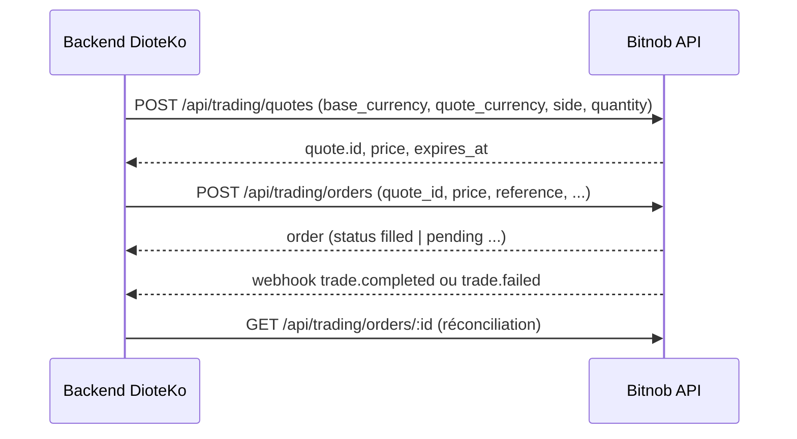

# Bitnob — Trading et Bulk Transfers (référence)

Source : documentation Bitnob (bitnob.dev), pages téléchargées en Markdown le 2026-10-08. Ce fichier résume uniquement ce qui est écrit dans ces pages ; tout ce qui n'y figure pas est marqué « non précisé dans la doc ». Les noms techniques, champs et extraits de code sont reproduits tels quels en anglais.

Base URL de l'API : `https://api.bitnob.com` (même hôte sandbox et production ; c'est le secret HMAC qui sélectionne l'environnement — voir `api-reference-payouts-customers.md`, page « Payouts API — Integration Guide »).

Authentification des exemples : headers `x-auth-client`, `x-auth-timestamp`, `x-auth-nonce`, `x-auth-signature` ; `string_to_sign = CLIENT_ID:TIMESTAMP:NONCE:BODY` ; HMAC-SHA256 hex ; corps vide (`''`) pour GET/DELETE.

## Sommaire

1. [Docs Trading (concepts, guides)](#1-docs-trading)
2. [API reference Trading](#2-api-reference-trading)
3. [API reference Bulk Transfers](#3-api-reference-bulk-transfers)
4. [Contradictions et obsolescences](#4-contradictions-et-obsolescences)
5. [À retenir pour DioteKo](#5-à-retenir-pour-dioteko)
6. [Index des pages couvertes](#6-index-des-pages-couvertes)

Flux de base (quote puis ordre) :



---

## 1. Docs Trading

### Trading Overview — `/docs/trading` et `/docs/trading/overview`
Source : https://bitnob.dev/docs/trading ; https://bitnob.dev/docs/trading/overview (contenu identique).

- Rôle : accès programmatique aux conversions USDT, USDC, Bitcoin et NGN (naira nigérian). Pas de livre d'ordres à gérer, prix en temps réel via routage multi-exchanges/OTC.
- Paires supportées : USDT ↔ Bitcoin, USDC ↔ Bitcoin, USDC ↔ USDT, NGN ↔ USDT, NGN ↔ USDC, NGN ↔ Bitcoin. Aucune paire vers XOF/XAF/EUR/USD fiat : non précisé dans la doc (le trading ne couvre pas le fiat sauf NGN).
- Fonctions : quote (prix), exécution d'un trade avec quote verrouillée ou taux marché, règlement dans un wallet Bitnob, suivi des trades.
- Affirmations : « There are no trade limits » (pas de plafond de volume imposé par Bitnob) ; exécution atomique (rempli entièrement ou pas du tout) ; webhook `trade.completed`.
- Liens vers l'API reference : `/api-reference/trading`.

### How Trading Works — `/docs/trading/how-trading-works`
Source : https://bitnob.dev/docs/trading/how-trading-works

- Deux appels seulement : un quote, un ordre ; le reste (routage, règlement) est abstrait.
- Composants : Quote Engine, Routing Logic, Execution Engine, Wallet System.
- Scénarios : acheter BTC avec USDT (quote USDT → BTC puis exécuter), vendre BTC pour USDT, swap USDC/USDT, acheter USDT avec naira, cash-out BTC vers NGN.
- Propriétés : atomicité ; expiration du quote « about 30 seconds in development and 10 seconds in production » ; erreur `quote_expired` si expiré ; `quoteId` garantit le montant de sortie affiché.
- Responsabilités de l'intégrateur : stocker/passer le `quoteId`, fournir un `reference` unique, ne pas se fier à la réponse synchrone seule (utiliser le webhook `trade.completed`).

### How Trading Works — Part 2 — `/docs/trading/how-trading-works-2`
Source : https://bitnob.dev/docs/trading/how-trading-works-2

- Formation du prix : le champ `rate` reflète liquidité live, routage et une marge de protection « optional based on your tier or configuration ». Ne pas reconstruire le prix ; ne pas le mettre en cache au-delà de `expiresAt`.
- Taux marché vs quote verrouillé : « Market rate » = `POST /api/trading/orders` sans `quoteId` ; « Locked quote » = quote préalable puis exécution avec son id. Pour les paires NGN, le quote verrouillé est obligatoire (un ordre au taux marché est rejeté).
- Unités documentées dans cette page : USDT en cents (`10000 = $100.00`), Bitcoin en satoshis (`100000 = 0.001 BTC`), NGN en unités majeures (`5000 = ₦5,000`, kobo non accepté). Voir contradictions §4 : l'API reference actuelle utilise des chaînes décimales en unités majeures.
- `Rate = Output / Input` : exemple `rate: 2250` = 2 250 sats par cent (modèle d'exemple legacy).
- Frais : « Bitnob charges no fees by default » ; un champ `fee` peut apparaître (même unité que l'entrée) pour certains clients/tiers.
- Garanties : quote verrouillé = exécution atomique et finale ; quote expiré = échec propre, aucun trade involontaire ; mise à jour de solde immédiate ; `trade.completed` confirme l'état.
- Exemple de flux de vente utilisateur : `POST /api/trading/quotes`, afficher, verrouiller, `POST /api/trading/orders` avec `reference` + `quoteId`, webhook `trade.completed`, mise à jour du ledger interne, éventuel payout.

### Create Quote (guide) — `/docs/trading/create-quote`
Source : https://bitnob.dev/docs/trading/create-quote

- Route : `POST /api/trading/quotes`.
- Requête (tous requis) :

| champ | type | requis | description |
| --- | --- | --- | --- |
| `base_currency` | string | oui | `BTC`, `USDT`, `USDC` ou `NGN` |
| `quote_currency` | string | oui | idem ; pour le naira, un côté doit être NGN |
| `side` | string | oui | `buy` ou `sell` |
| `quantity` | string | oui | montant de la devise de base, en unités majeures (ex. `0.0001` BTC, `5000` pour ₦5 000) |

- Pour une paire NGN : mettre en `base_currency` ce que l'on dépense et `side: "sell"`.
- Réponse 200 : enveloppe `success`, `message`, `data.quote`, `metadata.request_id`, `timestamp`. Champs de `data.quote` : `id`, `base_currency`, `quote_currency`, `side` (renvoyé en majuscules `BUY`/`SELL`), `quantity`, `price`, `expires_at`, `created_at`, `original_quantity`, `consumed_quantity`, `remaining_quantity`, `is_exhausted`, `exchange{send_quantity, send_currency, receive_quantity, receive_currency}`.
- Exemple de réponse : BTC/USDT, `price: "69034.33817175"`, `exchange.send_quantity: "6.91"` USDT pour `receive_quantity: "0.00010000"` BTC.
- Notes : validité « usually 30 seconds for development and 10 seconds in production » ; sans `quoteId` l'ordre s'exécute au taux marché ; frais selon le tier (défaut 0) ; NGN : `quote_id` requis à l'exécution ; limite NGN `₦500–₦10,000,000` par trade.
- Erreurs :

| code | message | correctif |
| --- | --- | --- |
| 400 | Invalid asset pair | paire supportée ; NGN d'un côté pour le naira |
| 400 | Missing or invalid amount | nombre positif en unités majeures, dans les limites |
| 403 | NGN not enabled | demander l'activation du naira à Bitnob |
| 403 | Insufficient balance | seulement si les vérifications de solde sont activées |
| 500 | Quote service unavailable | réessayer / support |

### Execute Trade — `/docs/trading/execute-trade`
Source : https://bitnob.dev/docs/trading/execute-trade

- Route : `POST /api/trading/orders`.
- Requête :

| champ | type | requis | description |
| --- | --- | --- | --- |
| `base_currency` | string | oui | `BTC`, `USDT`, `USDC`, `NGN` |
| `quote_currency` | string | oui | idem |
| `side` | string | oui | `buy` ou `sell` |
| `quantity` | string | oui | unités majeures |
| `price` | string | oui | le même prix que celui du quote (ex. `88989.119625`) |
| `quote_id` | string | conditionnel | requis pour les paires NGN, optionnel pour le crypto (omis = taux marché live) |
| `reference` | string | non (ici) | pour suivi ; voir idempotence |

- Corps de réponse : l'extrait JSON est cassé dans la source (`$22`, non récupéré). Champs listés : `id`, `base_currency`, `quote_currency`, `side`, `order_type`, `quantity`, `price`, `order.status` (`filled`, `pending`, `cancelled`), `created_at`, `updated_at`, `filled_quantity`, `remaining_quantity`, `quote_id`, puis fills (`id`, `order_id`, `counterparty_order_id`, `quantity`, `created_at`) et consommation du quote (`quote_id`, `consumed_quantity`, `remaining_quantity`, `is_exhausted`).
- Comportement : avec `quoteId` le taux est verrouillé (expiré = échec `quote_expired`) ; sans, taux live avec sortie pouvant varier légèrement ; NGN : `quote_id` toujours requis.
- Idempotence : « You must submit a unique reference for each trade attempt. Reusing the same reference will return the original trade object ». Voir contradiction avec la table d'erreurs (409 Duplicate reference).
- Webhooks : `trade.completed`, `trade.failed`.
- Erreurs :

| code | message |
| --- | --- |
| 400 | Quote expired |
| 400 | Invalid asset pair |
| 400 | Quote required (`quote_id` obligatoire pour NGN) |
| 403 | NGN not enabled |
| 400 | Missing or invalid amount |
| 409 | Duplicate reference |
| 422 | Insufficient balance |
| 500 | Execution failed |

### Trade Status & History — `/docs/trading/trade-status-and-history`
Source : https://bitnob.dev/docs/trading/trade-status-and-history

- `GET /api/trading/orders/:id` : `id` = id Bitnob ou votre `reference` (la doc dit « Trade ID or reference ID »). Réponse : `data.order` avec `id`, `base_currency`, `quote_currency`, `side`, `order_type` (`limit` dans l'exemple), `quantity`, `price`, `status` (`filled`), `exchange` (`internal`), `created_at`, `updated_at`, `filled_quantity`, `remaining_quantity`.
- `GET /api/trading/orders` (liste paginée), paramètres de requête :

| paramètre | type | requis | description |
| --- | --- | --- | --- |
| `from` | string | non | actif source (`usdt`, `usdc`, `btc`, `ngn`) |
| `to` | string | non | actif cible |
| `status` | string | non | `completed`, `failed` |
| `startDate` | string | non | ISO8601, trades après |
| `endDate` | string | non | ISO8601, trades avant |
| `limit` | integer | non | défaut 20, max 100 |
| `cursor` | string | non | curseur de pagination |

- Réponse liste : `data.orders[]` (mêmes champs avec `quote_id`). Voir contradictions : l'API reference ne documente aucun de ces filtres.

### Trade Webhooks — `/docs/trading/trade-webhooks`
Source : https://bitnob.dev/docs/trading/trade-webhooks

- Événements : `trade.completed`, `trade.failed`.
- `trade.completed` : `event`, `event_id`, `data{tradeId, reference, from, to, inputAmount, outputAmount, rate, walletId, status:"completed", timestamp}` (montants entiers en cents/sats).
- `trade.failed` : `data{tradeId:null, reference, from, to, inputAmount, reason, status:"failed", timestamp}` ; `reason` ex. `Quote expired`, `Insufficient balance`.
- Sécurité : HTTPS POST, header `X-Bitnob-Signature` (HMAC SHA-512), secret webhook (« Tooling > HMAC Generator »). Handler idempotent (doublons possibles), logger tous les événements, alerter sur volume de `trade.failed`.

### Error Handling Patterns — `/docs/trading/error-handling-patterns`
Source : https://bitnob.dev/docs/trading/error-handling-patterns

- Table d'erreurs (identique au guide Execute) ; pour « NGN not enabled », le message d'exemple est `feature-not-enabled` (403).
- Retry : réessayer avec le même `reference` ; si le premier a réussi, Bitnob renvoie le trade original ; si échec antérieur, « a 409 or error will be returned without re-execution ».
- Quote expiré : message soft à l'utilisateur, demander un nouveau quote ; vérifier avec Get Quote by ID.
- Monitoring : suivre `trade.failed`, alerter (ex. 5+ échecs en 1 min), logger référence, quoteId, montants, wallet, chain.
- Protéger l'utilisateur : ne pas débiter avant `trade.completed` confirmé.

### Best Practices for Trading — `/docs/trading/best-practices-for-trading`
Source : https://bitnob.dev/docs/trading/best-practices-for-trading

- Utiliser le quote verrouillé (NGN : obligatoire) ; `reference` unique (UUID) pour idempotence ; réagir aux webhooks ; réconciliation quotidienne/horaire via `GET /api/trading/orders` ; valider `expiresAt` côté serveur ; normaliser les unités (cents USDT, sats BTC, naira entier) côté frontend/backend ; vérifier `X-Bitnob-Signature` (HMAC SHA-512) ; limites min/max côté frontend car « Bitnob has no enforced volume limits ».
- Table de réponses : Quote expired 400, Duplicate reference 409, Insufficient balance 422, Internal execution error 500 (retry une fois avec backoff).
- La page se termine par une phrase résiduelle d'édition (« Would you like to now finalize... ») : à ignorer.

### FAQ: Trading Fundamentals — `/docs/trading/faq-trading-fundamentals`
Source : https://bitnob.dev/docs/trading/faq-trading-fundamentals

- Définitions : trade = ordre (`Create Order`) ; quote = offre temporaire ; spread = différence marché/prix donné (modèle de revenu) ; atomique ; expiration (30 s dev / 10 s prod) ; sources de prix : exchanges centralisés (Binance, Kraken), OTC.
- Sats et cents : l'API « uses these smallest units for USDT and Bitcoin » ; NGN est l'exception (unités majeures).
- Mentions obsolètes : `POST /trades/execute` et `GET /trades/quote` (routes legacy, ne correspondent pas à `/api/trading/orders` et `/api/trading/quotes`).
- « Bitnob does not charge for quotes ».

### How Integrators Can Make Money — `/docs/trading/how-integrators-can-make-money`
Source : https://bitnob.dev/docs/trading/how-integrators-can-make-money

- Modèles : spread/markup sur le taux, offre bundle (accepter BTC, convertir en USDT avec marge 1-2 %), frais de plateforme/exécution (Bitnob ne facture pas de frais de trading par défaut), accès par sous-comptes B2B2C, swap instantané avec exécution différée (avancé), spread incitatif.
- Bonnes pratiques : tracer chaque trade (input/output/spread/frais), utiliser `reference`, enregistrer les revenus séparément, limites par utilisateur/jour.
- Exemple legacy : `{"rate": 2250, "outputAmount": "225000"}` (ne correspond pas au schéma actuel du quote).

### Trading API Revenue Playbook — `/docs/trading/trading-api-revenue-playbook`
Source : https://bitnob.dev/docs/trading/trading-api-revenue-playbook

- Cinq modèles : spread invisible, frais de markup transparents, contrôle FX en cross-border, marge de plateforme B2B2C, exécution par lots. Cadre de ledger : `reference`, `bitnobRate`, `userRate`, `inputAmount`, `outputAmount`, `bitnobOutput`, `spreadEarned`, `feeCharged`, `timestamp`. Mention d'une route legacy `/trades/execute`.

### Trading Revenue Reporting Manual — `/docs/trading/trading-revenue-reporting-manual`
Source : https://bitnob.dev/docs/trading/trading-revenue-reporting-manual

- Pour les équipes finance : formules `spreadEarned = bitnobOutput - userOutput`, `feeCharged = percentageFee * inputAmount`, données à stocker par trade (champs « returned by Get Order By ID » — attention : ces noms `tradeId/from/to/inputAmount/...` ne figurent pas dans le schéma d'ordre actuel), ledger en unités de base (sats/cents ; NGN en naira entier), rapport mensuel type, réconciliation via `Get Orders`, notes fiscales.

### On Designing the Trading Experience — `/docs/trading/on-designing-the-trading-experience`
Source : https://bitnob.dev/docs/trading/on-designing-the-trading-experience

- Texte éditorial UX : présenter le quote avec précision (entrée, sortie, taux, compte à rebours), bloquer l'action après expiration, étapes de confirmation (« Validating quote… », « Executing trade… »), saisies précises (BTC en sats, stablecoins en cents/dollars, NGN en naira entier), message de succès explicite avec référence, échec clair (« no funds were lost »), transparence sur les frais. Aucune spécification d'API.

### Trading UX Implementation Guidelines — `/docs/trading/trading-ux-implementation-guidelines`
Source : https://bitnob.dev/docs/trading/trading-ux-implementation-guidelines

- Règles pratiques : afficher les valeurs du quote (`inputAmount`, `outputAmount`, `rate`, `fee`, `expiresAt` — noms legacy), compte à rebours `expiresAt - now`, désactiver « Confirm » à expiration, stepper de progression, confirmer seulement après `trade.completed` ou `Get Order By ID` avec `status = completed`, normalisation des entrées, page de succès (montants, taux, wallet, référence), table d'états d'erreur (Quote expired / Insufficient balance / Duplicate reference / Execution failure).

### Support Manual for Integrator Teams — `/docs/trading/support-manual-for-integrator-teams`
Source : https://bitnob.dev/docs/trading/support-manual-for-integrator-teams

- Manuel de support : réponses types aux questions utilisateurs (trade échoué, montant différent, « où sont mes fonds », pourquoi les quotes expirent vite), outils à fournir (historique avec `reference/status/input/output`, compte à rebours, bouton refresh), modèles de messages, rappels (reference unique, `quoteId`, ne jamais confirmer après `expiresAt`, se fier au webhook), quand contacter Bitnob (webhooks absents, échecs répétés avec quotes valides, impossibilité de réconcilier). Mentionne « about 10 seconds » de validité.

---

## 2. API reference Trading

### Trading — vue d'ensemble — `/api-reference/trading/trading`
Source : https://bitnob.dev/api-reference/trading/trading

Index des routes de la page :

| action | méthode et chemin |
| --- | --- |
| Get prices | `GET /api/trading/prices` |
| Create quote | `POST /api/trading/quotes` |
| Get quote by ID | `GET /api/trading/quotes/:id` |
| Create order | `POST /api/trading/orders` |
| Get orders | `GET /api/trading/orders` |
| Get order by ID | `GET /api/trading/orders/:id` |
| Cancel order | `DELETE /api/trading/orders/:id` |

Résumé des modes : marché (quote puis order avec `quote_id` avant expiration) ; DCA (`POST /api/trading/scheduled-orders`, cadence daily/weekly/monthly, suivi via `.../executions`, pause/reprise `PUT .../:id`) ; limit-style (`POST /api/trading/target-orders` avec `target_price` ; statut `active`, devient `expired` si `expires_at` atteint) ; naira (même flux, NGN d'un côté, unités majeures ₦500–₦10 000 000, `quote_id` requis).

#### Create Quote — `POST /api/trading/quotes`
Requête (tous `string`, requis) : `base_currency`, `quote_currency`, `side` (`buy` ou `sell`), `quantity` (montant de la devise de base).

Réponse : `success`, `message`, `data.quote` {`id` (UUID), `base_currency`, `quote_currency`, `side` (`BUY`/`SELL`), `quantity`, `price`, `expires_at`, `created_at`, `original_quantity`, `consumed_quantity`, `remaining_quantity`, `is_exhausted`, `exchange{send_quantity, send_currency, receive_quantity, receive_currency}`}, `metadata`, `timestamp`. « Quotes are valid for 30 seconds ».

Exemple (sample de la page) :

```json
{ "base_currency": "BTC", "quote_currency": "USDT", "side": "buy", "quantity": "0.0001" }
```

Exemple NGN : `{"base_currency":"NGN","quote_currency":"USDT","side":"SELL","quantity":"500"}`. `side` est relatif à `base_currency` (`SELL` dépense la base). `exchange` vaut `null` pour NGN (règlement sur la liquidité propre de Bitnob). Prix NGN exemple : `"price": "0.00071644"` (USDT par NGN). Utiliser `id` comme `quote_id` de l'ordre.

#### Create Order — `POST /api/trading/orders`
Requête : `base_currency`, `quote_currency`, `side`, `quantity`, `price`, `quote_id` (tous marqués Required dans cette page ; `quote_id` « UUID » requis) ; `reference` apparaît dans l'exemple (optionnel, non listé) ; `quantity_in_base_units` apparaît dans l'exemple NGN (« not supported on NGN pairs (send `false` or omit) » ; sémantique pour le crypto non précisée dans la doc).

Réponse : `success`, `message`, `data.order` {`id`, `base_currency`, `quote_currency`, `side`, `order_type` (`limit` ou `market`), `quantity`, `price`, `status` (`pending`, `filled`, `rejected`), `created_at`, `updated_at`, `filled_quantity`, `remaining_quantity`, `quote_id`, `reference`}, `data.fills[]` (`id`, `order_id`, `quantity`, `created_at`), `data.quote_consumption` (`quote_id`, `consumed_quantity`, `remaining_quantity`), `metadata`, `timestamp`. Le JSON d'exemple crypto est absent de la source (`$23`).

Exemple NGN : requête `{"base_currency":"NGN","quote_currency":"USDT","side":"SELL","quantity":"500","price":"0.00071644","quote_id":"...","quantity_in_base_units":false,"reference":"SWAP_..."}`. Réponse : `order_type: "market"`, `status: "filled"`, `fills: []`, `quote_consumption: null` (« NGN conversions settle inline »), `filled_quantity: "0.3582182311500126"` (USDT reçus). Noter dans cet exemple `price: "1395.79718876"` côté ordre, alors que le quote affichait `0.00071644` : l'ordre exprime l'inverse (NGN par USDT) ; incohérence non expliquée dans la doc.

#### Get Orders — `GET /api/trading/orders`
Réponse : liste d'ordres avec `id`, `base_currency`, `quote_currency`, `side`, `order_type`, `status`, `quantity`, `price`, `filled_quantity`, `remaining_quantity`, `exchange`, `created_at`, `updated_at`, `metadata`, `timestamp`. Paramètres de requête (filtres, pagination) non précisés dans l'API reference (voir le guide « Trade Status & History »). Exemple JSON absent (`$25`).

#### Get Order By ID — `GET /api/trading/orders/:id`
Réponse : `data.order` avec `id`, `base_currency`, `quote_currency`, `side`, `order_type`, `quantity`, `price`, `status`, `created_at`, `updated_at`, `filled_quantity`, `remaining_quantity`, `quote_id`, `reference`. Exemple : USDC/USDT `BUY`, `status: "filled"`, `reference: "test-order-..."`.

#### Cancel Order — `DELETE /api/trading/orders/:id`
Annule un ordre encore annulable (`pending` ou `active`) ; renvoie `data.order` avec `status: "cancelled"`, `quote_id` (peut être vide), `reference` (peut reprendre l'id de l'ordre). Corps signé vide. Réponse 200 `message: "Order cancelled successfully"`.

#### Get Prices — `GET /api/trading/prices`
Réponse : `data.prices[]` avec `base_currency`, `quote_currency`, `price` (prix d'une unité de base en devise de cotation), `as_of` (ISO 8601). Exemple : BTC/USDC, BTC/USDT, USDC/USDT. Indicatif, sans expiration.

#### Get Quote by ID — `GET /api/trading/quotes/:id`
Réponse `data` : `quote_id`, `original_quantity`, `consumed_quantity`, `remaining_quantity`, `price`, `expires_at`, `is_expired`, `is_exhausted`, `consumption_count` (string). Soumettre un ordre sur un quote expiré/épuisé renvoie `QUOTE_EXPIRED` / `QUOTE_EXHAUSTED`.

### Scheduled Orders (DCA) — `/api-reference/trading/create-scheduled-order`
Source : https://bitnob.dev/api-reference/trading/create-scheduled-order

Version la plus récente (réponses `success: true`, objet sous `data.schedule`).

- `POST /api/trading/scheduled-orders`. Corps :

| champ | type | requis | description |
| --- | --- | --- | --- |
| `currency` | string | oui | actif acheté à chaque exécution (`BTC`) |
| `quote_currency` | string | oui | devise dépensée (`USDT`, `USDC`) |
| `amount` | string | oui | entier en chaîne, plus petite unité de `quote_currency` (ex. `"50000000"` = 50 USDT avec 6 décimales) |
| `frequency` | string | oui | `daily`, `weekly`, `monthly` |
| `execution_time` | string | oui | `HH:MM` 24 h UTC |
| `day_of_week` | number | conditionnel | requis pour `weekly` (0 = dimanche … 6) ; passer `0` sinon |
| `day_of_month` | number | conditionnel | requis pour `monthly` ; 1–28 recommandé (29–31 sautent les mois courts) ; `0` sinon |
| `reference` | string | non | idempotence / suivi |

L'API exige les deux champs `day_of_week` et `day_of_month` à chaque requête (met `0` pour l'inutilisé).
- `GET /api/trading/scheduled-orders?status=active` (filtre `status` : `active`, `paused`, `cancelled`, `completed`) → `data.schedules[]`.
- `PUT /api/trading/scheduled-orders/:id` : champs optionnels `amount`, `frequency`, `day_of_week`, `day_of_month`, `execution_time`, `status` (`paused` ou `active`). `next_execution_at` n'est recalculé que si l'on change les ancres de cadence.
- `GET /api/trading/scheduled-orders/:id` → `data.schedule` (`id`, `company_id`, `currency`, `quote_currency`, `amount`, `frequency`, `day_of_week`, `day_of_month`, `execution_time`, `status`, `next_execution_at` (null si terminal), `last_executed_at`, `total_executions`, `total_amount_spent`, `total_quantity_acquired`, `created_at`, `updated_at`, `reference`). Source : https://bitnob.dev/api-reference/trading/get-scheduled-order
- `GET /api/trading/scheduled-orders/:id/executions` → `data.executions[]` (`id`, `order_id`, `status` : `completed`, `failed` ou `skipped`, `quantity`, `price`, `quote_amount`, `executed_at`) + `page_info{has_next_page, has_previous_page, next_cursor, previous_cursor, total}`.
- Il n'y a pas de route `retry` dans cette version.

### Scheduled Orders et Target Orders (page legacy) — `/api-reference/trading/_scheduled-order`
Source : https://bitnob.dev/api-reference/trading/_scheduled-order

Page au chemin préfixé par `_` (probablement ancienne version / brouillon). Routes différentes de la version actuelle :

| action | chemin legacy |
| --- | --- |
| créer / lister | `POST` / `GET /api/trading/schedules` |
| lire / modifier | `GET` / `PUT /api/trading/schedules/:id` |
| exécutions | `GET /api/trading/schedules/:id/executions` |
| réessayer | `POST /api/trading/schedules/executions/:executionId/retry` |
| target orders | `POST`, `GET /api/trading/target-orders` ; `GET /api/trading/target-orders/:id` |

Différences notables : `frequency` accepte aussi `once` ; `amount` est une décimale (`"100.00"`) ; enveloppe `status: "success"` (pas `success: true`) ; objets directement sous `data` ; `data.schedules` / `data.target_orders` ; statut d'exécution `completed`, `failed`, `pending` ; champ `can_retry` ; liste limit défaut/max 100. Ne pas utiliser ces chemins sans vérification en sandbox.

### Target Orders — `/api-reference/trading/create-target-order`
Source : https://bitnob.dev/api-reference/trading/create-target-order

- `POST /api/trading/target-orders`. Corps : `base_currency`, `quote_currency`, `side` (`buy` ou `sell`), `quantity`, `target_price` (tous requis) ; `expires_at` (optionnel, ISO 8601), `reference` (optionnel). Un `buy` se déclenche quand le marché tombe à `<= target`, un `sell` quand il monte à `>= target`.
- Réponse `data.order` : `id`, `company_id`, `base_currency`, `quote_currency`, `side` (majuscules), `quantity`, `filled_quantity`, `remaining_quantity`, `target_price`, `average_fill_price` (vide avant le 1er fill), `locked_amount`, `remaining_locked`, `locked_currency`, `status` (`active`, `triggered`, `filled`, `cancelled`, `expired`), `expires_at`, `first_triggered_at`, `last_fill_at`, `fully_filled_at`, `created_at`, `updated_at`, `reference`.
- Séquestre : `locked_amount` est bloqué à la création (achat : `quantity × target_price` plus frais en `quote_currency` ; vente : `quantity` de `base_currency`) et rendu au wallet en cas d'annulation/expiration.
- `GET /api/trading/target-orders?status=active` → `data.orders[]` (statuts filtrables : `active`, `triggered`, `filled`, `cancelled`, `expired`).
- `GET /api/trading/target-orders/:id` → `data.order`.
- Annulation d'un target order : route non précisée dans la doc.

---

## 3. API reference Bulk Transfers

### Bulk Transfers — `/api-reference/bulk-transfers/bulk-transfers`
Source : https://bitnob.dev/api-reference/bulk-transfers/bulk-transfers

But : envoyer de nombreux transferts crypto en un lot, soit via CSV/XLSX (URL S3 présignée, `PUT`, puis preview), soit en passant les items inline. Tout lot démarre en `draft`, ne débite qu'au `confirm` (irréversible). Les lots partiellement échoués se relancent item par item via `retry` ; des « schedules » (clonage d'un `template_batch_id` en daily/weekly/monthly) sont évoqués dans l'intro mais aucune route de schedule n'est documentée.

Statuts du lot : `draft`, `pending`, `processing`, `completed`, `failed`, `cancelled`. Statuts d'item : `pending`, `processing`, `confirmed`, `failed`. Les valeurs sont en minuscules.

Routes de la page :

| action | route |
| --- | --- |
| Upload preview | `POST /api/bulk-transfers/previews` |
| Créer un brouillon | `POST /api/bulk-transfers` |
| Lister | `GET /api/bulk-transfers` |
| Obtenir | `GET /api/bulk-transfers/:batchId` |
| Confirmer | `POST /api/bulk-transfers/:batchId/confirm` |
| Réessayer | `POST /api/bulk-transfers/:batchId/retry` |

Le chemin de génération de l'URL S3 présignée n'est pas précisé dans la doc.

**Upload preview** : `multipart/form-data`, champ `file` (CSV ou XLSX, colonnes chain, currency, address, amount, description optionnelle, taille max 5 MB). Réponse : `parsed_items[]` (`row_index` 1-based, `chain`, `currency`, `address`, `amount`, `description`), `errors[]` (`row_index`, `address`, `reason`), `accepted_count`, `rejected_count`. `curl -X POST ".../api/bulk-transfers/previews" -H "x-auth-client: ..." -F "file=@transfers.csv"`.

**Create draft** (`POST /api/bulk-transfers`) : corps :

| champ | type | requis | description |
| --- | --- | --- | --- |
| `description` | string | non | libellé interne (ex. « March 2026 Payroll ») |
| `items` | array | oui | éléments du lot |
| `items[].row_index` | number | non | n° de ligne source, renvoyé en réponse |
| `items[].chain` | string | oui | `bitcoin`, `tron`, `ethereum`... |
| `items[].currency` | string | oui | `BTC`, `USDT` ou `USDC` (doit exister sur la chaîne) |
| `items[].address` | string | oui | valide pour la chaîne |
| `items[].amount` | string | oui | décimal (`"0.001"` BTC, `"1500.00"` USDT) — unités majeures, pas de base units |
| `items[].description` | string | non | mémo |
| `allow_partial` | boolean | non | si `true`, les items valides sont traités même si d'autres échouent à la validation |
| `idempotency_key` | string | non | évite la création en double |

Réponse : `id`, `company_id`, `description`, `status`, `total_items`, `success_count`, `failed_count`, `created_at`, `submitted_at` (vide en draft), `completed_at`, `items[]` (`id`, `status`, `failure_reason`, `retries`, `withdrawal_id`). Exemple JSON de réponse absent de la source (`$1f`).

**List** (`GET /api/bulk-transfers`) : `data.batches[]` + `next_page_token` (vide en dernière page) ; paramètres de filtre/pagination non précisés dans la doc (« optional filtering and pagination »).

**Confirm** (`POST /api/bulk-transfers/:batchId/confirm`) : le lot doit être en `draft` ; passe en `processing` ; renvoie `id`, `status`, `submitted_at`. Irréversible.

**Retry** (`POST /api/bulk-transfers/:batchId/retry`) : corps `{"item_ids": ["uuid", ...]}` (requis) ; seuls les items `failed` sont remis en file. À utiliser après correction (ex. recharge du solde).

### Get Bulk Transfer — `/api-reference/bulk-transfers/get-bulk-transfer`
Source : https://bitnob.dev/api-reference/bulk-transfers/get-bulk-transfer

`GET /api/bulk-transfers/:batchId` (`batchId` UUID, requis). Réponse identique à « Create draft » : batch complet avec tous les items et leurs statuts. Exemple absent (`$1f`).

Sandbox : la doc ne précise rien sur le comportement des bulk transfers en sandbox (fonds, chaînes de test, confirmations) — non précisé dans la doc.

---

## 4. Contradictions et obsolescences

1. **Unités de montant** : les guides (`how-trading-works-2`, `best-practices`, `faq`) disent USDT en cents et BTC en satoshis ; l'API reference et le guide `create-quote` utilisent des chaînes décimales en unités majeures (`"0.0001"` BTC). Se fier à l'API reference. Les webhooks restent en `inputAmount/outputAmount` entiers (legacy).
2. **Schéma webhook trade** (`tradeId`, `from`, `to`, `rate`, `walletId`, `bitcoin`) ne correspond pas au schéma d'ordre actuel (`base_currency`, `quote_currency`, `side`, `price`) ; non confirmé en sandbox.
3. **Routes legacy** dans la FAQ et le playbook : `POST /trades/execute`, `GET /trades/quote`.
4. **TTL du quote** : 30 s dev / 10 s prod (guides) contre « 30 seconds » (API reference) ; l'exemple de l'API reference donne `created_at` 13:54:34 et `expires_at` 13:59:31, soit environ 5 minutes. Toujours lire `expires_at`.
5. **`quote_id`** : « conditionnel » (guide Execute) contre `Required` (API reference) ; obligatoire pour NGN dans les deux.
6. **`reference`** : guide = idempotence (« returns the original trade ») ; table d'erreurs = 409 Duplicate reference ; `error-handling` = « a 409 or error ». Comportement exact non tranché.
7. **Statuts d'ordre** : guide `filled/pending/cancelled`, API `pending/filled/rejected` (+ `cancelled` au cancel) ; filtre de liste `completed/failed` ne correspond pas à `filled`. Webhook : `completed/failed`.
8. **Scheduled orders** : deux jeux de routes (`/schedules` contre `/scheduled-orders`), enveloppes, unités du `amount`, statuts d'exécution différents (§2). Page `_scheduled-order` à considérer obsolète.
9. **Target orders** : `partially_filled` (legacy) contre `triggered` (actuel) ; `data.target_orders` contre `data.orders`.
10. **Create Order** : prix de l'ordre NGN (`1395.79`) à l'inverse du prix du quote (`0.00071644`).
11. **Extraits JSON manquants** dans la source téléchargée (placeholders `$1e`, `$1f`, `$20`...) : réponse Execute Trade, Create Order (crypto), Get Orders, exécutions DCA historiques, Bulk (création/liste/get), snippets Go. Les formes sont déduites des tables de champs.
12. **Support manual / playbook** : mention de fenêtres de 10 s et de champs legacy (`inputAmount`, `outputAmount`, `fee`).

---

## 5. À retenir pour DioteKo

Contexte : DioteKo veut Bitnob comme rail de paiement ; ce lot ne couvre que Trading/Bulk. Les endpoints payouts, customers et beneficiary sont dans `api-reference-payouts-customers.md`.

1. **Conversion BTC/USDT vers fiat : le trading ne la fait pas.** Les seules paires fiat du Trading sont NGN (NGN/USDT, NGN/USDC, NGN/BTC). Pas de XOF, EUR, USD ici. La conversion crypto vers fiat local (dont XOF mobile money au Sénégal, vu dans la page `docs/payouts/supported-currencies` hors de ce lot) passe par l'API Payouts (`from_asset` BTC/USDT/USDC, `to_currency`, `source: offchain`). Le Trading sert au plus à convertir entre actifs crypto (ex. BTC vers USDT) avant un payout.
2. **Si on utilise le Trading : flux quote puis order.** `POST /api/trading/quotes` puis `POST /api/trading/orders` avec `quote_id` + `price` du quote avant `expires_at` ; `reference` unique (UUID) ; confirmer par webhook `trade.completed`/`trade.failed` (header `X-Bitnob-Signature`, HMAC SHA-512, sur le corps brut) et par `GET /api/trading/orders/:id`.
3. **Unités** : suivre l'API reference (chaînes décimales en unités majeures, ex. `"0.0001"` BTC), pas les guides en cents/sats. Valider en sandbox, car ce point est contradictoire dans la doc. Ne jamais utiliser de flottants JS pour ces montants.
4. **Pas de `customer_id` dans le Trading ni dans Bulk Transfers** : aucun de ces endpoints n'en demande. (Pour les payouts, voir l'autre fichier : optionnel à l'initialize.)
5. **Bulk transfers = envois crypto on-chain** (`chain`, `currency` BTC/USDT/USDC, `address`) et non des payouts fiat. Flux draft puis `confirm` (irréversible), puis `retry` par item. Utile pour des décaissements crypto groupés, pas pour des mobile money. Comportement sandbox non documenté : tester avant de s'y fier.
6. **Idempotence** : utiliser `idempotency_key` (bulk) et `reference` (ordres, DCA, target orders) systématiquement ; logguer `metadata.request_id` renvoyé par l'API (format `req_...`) pour le support, sans logguer de secrets.
7. **Pièges** : `side` renvoyé en majuscules mais accepté en minuscules dans les exemples ; les quotes NGN exigent NGN d'un côté et `side: sell` pour dépenser la base ; DCA exige `day_of_week` et `day_of_month` ensemble ; target orders bloquent les fonds à la création.

---

## 6. Index des pages couvertes

33 pages au total (17 `docs/trading*`, 16 `api-reference`). Aucune page vide.

| fichier source | lien |
| --- | --- |
| docs__trading.md | https://bitnob.dev/docs/trading |
| docs__trading__overview.md | https://bitnob.dev/docs/trading/overview |
| docs__trading__how-trading-works.md | https://bitnob.dev/docs/trading/how-trading-works |
| docs__trading__how-trading-works-2.md | https://bitnob.dev/docs/trading/how-trading-works-2 |
| docs__trading__create-quote.md | https://bitnob.dev/docs/trading/create-quote |
| docs__trading__execute-trade.md | https://bitnob.dev/docs/trading/execute-trade |
| docs__trading__trade-status-and-history.md | https://bitnob.dev/docs/trading/trade-status-and-history |
| docs__trading__trade-webhooks.md | https://bitnob.dev/docs/trading/trade-webhooks |
| docs__trading__error-handling-patterns.md | https://bitnob.dev/docs/trading/error-handling-patterns |
| docs__trading__best-practices-for-trading.md | https://bitnob.dev/docs/trading/best-practices-for-trading |
| docs__trading__faq-trading-fundamentals.md | https://bitnob.dev/docs/trading/faq-trading-fundamentals |
| docs__trading__how-integrators-can-make-money.md | https://bitnob.dev/docs/trading/how-integrators-can-make-money |
| docs__trading__trading-api-revenue-playbook.md | https://bitnob.dev/docs/trading/trading-api-revenue-playbook |
| docs__trading__trading-revenue-reporting-manual.md | https://bitnob.dev/docs/trading/trading-revenue-reporting-manual |
| docs__trading__on-designing-the-trading-experience.md | https://bitnob.dev/docs/trading/on-designing-the-trading-experience |
| docs__trading__trading-ux-implementation-guidelines.md | https://bitnob.dev/docs/trading/trading-ux-implementation-guidelines |
| docs__trading__support-manual-for-integrator-teams.md | https://bitnob.dev/docs/trading/support-manual-for-integrator-teams |
| api-reference__trading__trading.md | https://bitnob.dev/api-reference/trading/trading |
| api-reference__trading___scheduled-order.md | https://bitnob.dev/api-reference/trading/_scheduled-order |
| api-reference__trading__create-scheduled-order.md | https://bitnob.dev/api-reference/trading/create-scheduled-order |
| api-reference__trading__get-scheduled-order.md | https://bitnob.dev/api-reference/trading/get-scheduled-order |
| api-reference__trading__create-target-order.md | https://bitnob.dev/api-reference/trading/create-target-order |
| api-reference__bulk-transfers__bulk-transfers.md | https://bitnob.dev/api-reference/bulk-transfers/bulk-transfers |
| api-reference__bulk-transfers__get-bulk-transfer.md | https://bitnob.dev/api-reference/bulk-transfers/get-bulk-transfer |

Les 9 autres fichiers du lot (`api-reference__payouts__*` x7, `beneficiary`, `customers`) sont couverts dans `api-reference-payouts-customers.md`.
