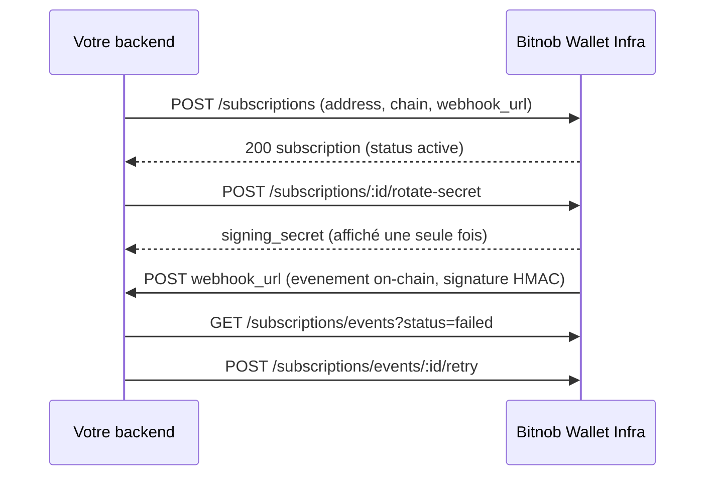
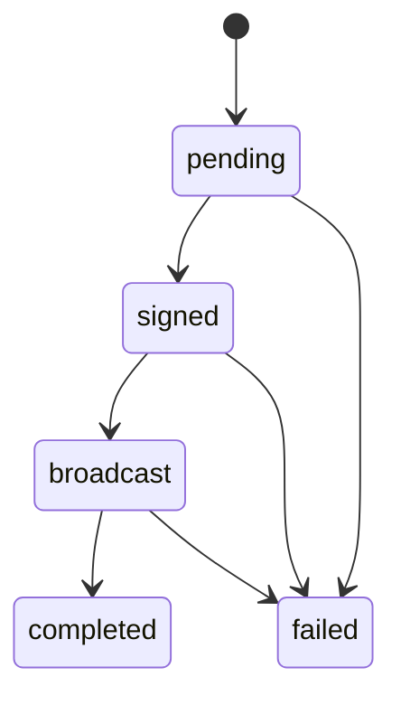

# Bitnob — Wallet Infrastructure API (Enterprise)

Source : pages `bitnob.dev` téléchargées en Markdown (lot « wallet-infrastructure »). Tout ce qui suit vient de ces pages ; ce qui n'y figure pas est noté « non précisé dans la doc ».

## Sommaire

- [Vue d'ensemble, auth et conventions](#vue-densemble-auth-et-conventions)
- [Wallet Infrastructure API (ressources développeur)](#wallet-infrastructure-api-ressources-développeur)
- [Assets](#assets)
- [Gas stations](#gas-stations)
- [Meta](#meta)
- [Subscriptions](#subscriptions)
- [Transactions](#transactions)
- [Vaults](#vaults)
- [Wallets](#wallets)
- [Webhooks](#webhooks)
- [Anomalies de la doc](#anomalies-de-la-doc)
- [À retenir pour DioteKo](#à-retenir-pour-dioteko)

## Vue d'ensemble, auth et conventions

- Produit : wallets gérés ou co-custodial (« managed or co-custodial »), multi-chaînes, pour clients Enterprise.
- Base URL (Postman) : `https://api.platform.bitnob.com` (différente de `https://api.bitnob.com` de l'API HMAC classique).
- Auth : header `X-API-Key` (un secret par organisation, permissions par scopes). **Pas** le flux HMAC (`X-Auth-*`) du reste de l'API Bitnob.
- Les transactions sont « auto-signées avec votre clé API » (signature faite par l'Enclave Bitnob, cf. `signed_at` « signed by the Enclave »).
- Deux styles de réponse coexistent (voir [Anomalies](#anomalies-de-la-doc)) : enveloppe `{success, message?, data, meta?}` (vaults, wallets, gas stations) et enveloppe `{object: "list", data, url, has_more, next_cursor?}` (assets, subscriptions, transactions, webhooks).
- Deux styles de pagination : `limit`/`offset` (vaults, wallets, adresses, gas stations ; défaut 20, max 100) et curseur `starting_after`/`ending_before` + `next_cursor` (transactions, subscriptions, webhooks).
- Montants : toujours en `string`, en plus petite unité de l'asset pour les transactions (`asset_decimals` fourni), mais en unité native lisible pour les seuils de gas station (`"0.5"`) et les balances de wallet (`"5.2"`).

## Wallet Infrastructure API (ressources développeur)

Lien : https://bitnob.dev/docs/developer-resources/wallet-infrastructure-api

À quoi ça sert : télécharger la collection Postman, l'environnement Postman et la spec OpenAPI 3.0 de l'API.

- Spec live : `https://api.platform.bitnob.com/openapi.json` ; YAML : `/api-collections/swagger/bitnob-wallet-infrastructure.openapi.yaml`.
- Contenu annoncé de la spec : 30 chemins, 42 opérations, 9 tags de ressources, 30 schémas réutilisables ; idempotence, pagination, rate-limit et enveloppes d'erreur « documentés inline » (le détail de ces points n'est pas repris dans les pages lues).
- Vérification de signature webhook annoncée : **HMAC-SHA256 sur l'objet canonique `{data, event, timestamp}`**. Nom du header de signature, encodage (hex/base64), sérialisation exacte de l'objet : non précisé dans la doc lue.
- Variables d'environnement Postman : `base_url` (défaut `https://api.platform.bitnob.com`), `api_key` (secret).
- Contenu de la collection : Wallets, Vaults, Transactions, Gas Stations, Subscriptions, Webhooks, Assets, **RPC** (proxy JSON-RPC 2.0 vers les nœuds ; aucune page détaillée dans le lot), Meta.
- Génération client : `openapi-generator-cli generate -i https://api.platform.bitnob.com/openapi.json -g typescript-fetch -o ./bitnob-wallet-client`.
- Test de connectivité : `curl https://api.platform.bitnob.com/me -H "X-API-Key: $BITNOB_API_KEY"` (200 = clé valide).
- Piège : `X-API-Key` est un credential, à ne jamais commiter ni exposer dans un client navigateur/mobile ; garder des environnements Postman séparés sandbox/production.

## Assets

Lien : https://bitnob.dev/api-reference/wallet-infrastructure/assets

À quoi ça sert : données de référence en lecture seule (assets et chaînes supportés). Nécessite une clé avec accès lecture.

| Méthode | Chemin | Rôle |
| --- | --- | --- |
| GET | `/assets` | Liste des assets |
| GET | `/assets/chains` | Liste des chaînes et réseaux |
| GET | `/assets/:id` | Un asset (404 si non supporté) |

**GET /assets — query** (tous optionnels) : `chain` (string, ex. `ethereum`, `bitcoin`, `tron`, `solana`), `network` (string, ex. `mainnet`, `sepolia`), `type` (string, `native` ou `token`).

**Objet asset** : `object` (toujours `asset`), `id` (uuid ; à passer comme `asset_id`), `name`, `symbol`, `chain`, `type` (`native`/`token`), `decimals` (integer).

**Objet chain** : `object` (`chain`), `id` (ex. `ethereum`), `name`, `networks` (string[], ex. `["mainnet","sepolia"]`, Tron : `["mainnet","nile"]`).

```json
{ "object": "list", "data": [ { "object": "asset", "id": "3f9c1a20-1e7d-4b8a-9c2e-7a1b2c3d4e5f", "name": "USD Coin", "symbol": "USDC", "chain": "ethereum", "type": "token", "decimals": 6 } ], "url": "/assets", "has_more": false }
```

Piège : les exemples de wallets utilisent des `asset_ids` symboliques (`ETH`, `USDC_ETH`) alors que `GET /assets` renvoie un `id` uuid — la correspondance exacte n'est pas précisée dans la doc.

## Gas stations

Lien : https://bitnob.dev/api-reference/wallet-infrastructure/gas-stations

À quoi ça sert : wallets pré-financés qui paient les frais de transaction d'autres wallets de l'organisation. Sur Tron : staking TRX et délégation de ressources (energy / bandwidth).

| Méthode | Chemin | Rôle |
| --- | --- | --- |
| GET | `/gasstations` | Liste |
| POST | `/gasstations` | Création |
| GET | `/gasstations/:id` | Détail |
| PATCH | `/gasstations/:id` | Mise à jour |
| POST | `/gasstations/:id/refill` | Recharge depuis un wallet |
| POST | `/gasstations/:id/sponsor-broadcast` | Sponsorise et diffuse une tx Tron signée à l'extérieur |

**POST /gasstations — body**

| Champ | Type | Requis | Détail |
| --- | --- | --- | --- |
| `name` | string | oui | 2-100 caractères |
| `chain` | string | oui | ex. `ethereum`, `tron` |
| `network` | string | oui | ex. `mainnet`, `sepolia` |
| `threshold` | string | oui | numérique > 0, en asset natif ; en dessous, `health_status` passe `healthy` -> `low` |
| `auto_refill_enabled` | boolean | non | recharge auto depuis `refill_from_wallet_id` |
| `refill_amount` | string | non | numérique > 0, montant par recharge |
| `refill_from_wallet_id` | uuid | non (requis si `auto_refill_enabled = true`) | wallet trésorerie source |
| `gas_strategy` | string | non | ex. `medium`, `aggressive` ; vide = stratégie par défaut |

**Réponse (GasStationResponse)** : enveloppe `{success, message, data}`. Champs de `data` : `id`, `name`, `chain`, `network`, `symbol`, `address`, `balance`, `balance_usd`, `threshold`, `threshold_percent` (integer, `(balance/threshold)*100`), `health_status` (`healthy`/`low`), `auto_refill_enabled`, `refill_amount`, `refill_from_wallet_id`, `gas_strategy`, `status` (`active`/`inactive`, `active` après création), `created_at`, `updated_at` (RFC3339). Champs **Tron uniquement** : `energy_limit`, `energy_used`, `energy_remaining`, `bandwidth_limit`, `bandwidth_used`, `bandwidth_remaining` (integer), `staked_for_energy`, `staked_for_bandwidth` (string, TRX).

**GET /gasstations — query** : `limit` (défaut 20, max 100), `offset` (défaut 0), `chain`, `status` (`active`/`inactive`). Réponse : `data[]` de GasStationResponse + `meta` (`total`, `limit`, `offset`, `has_more`). L'exemple JSON de la liste est illisible dans la source (`$20`).

**PATCH /gasstations/:id — body** (tous optionnels) : `name`, `threshold`, `auto_refill_enabled`, `refill_amount`, `refill_from_wallet_id` (uuid), `gas_strategy`, `status` (`active` reprend, `inactive` met en pause). Réponse : GasStationResponse avec `updated_at` rafraîchi.

**POST /gasstations/:id/refill — body** (tous requis) : `source_wallet_id` (uuid), `amount` (string > 0), `idempotency_key` (string, 1-64 caractères). Format de la réponse : non précisé dans la doc.

**POST /gasstations/:id/sponsor-broadcast — body**

| Champ | Type | Requis | Détail |
| --- | --- | --- | --- |
| `from_address` | string | oui | adresse Tron de l'émetteur |
| `to_address` | string | oui | adresse Tron du destinataire |
| `asset` | string | oui | symbole, ex. `USDT` |
| `amount` | string | oui | plus petite unité, en string |
| `network` | string | oui | ex. `mainnet` |
| `signed_tx` | string | oui | hex de la tx pré-signée côté client |
| `tx_hash` | string | oui | hash correspondant à `signed_tx` |
| `fee_level` | string | non | `low`/`medium`/`high` ; défaut = stratégie de la station |

Réponse : `object` (`sponsor_transaction`), `mode` (ex. `sponsor_and_broadcast`), `status` (ex. `accepted`), `tx_hash`, `sponsor_tx_id`, `root_sponsor_tx_id`, `gas_station_id`, `sponsor_amount_trx`, `broadcast_accepted` (boolean).

Erreurs : codes non précisés dans la doc.

## Meta

Lien : https://bitnob.dev/api-reference/wallet-infrastructure/meta

À quoi ça sert : métadonnées de la clé API utilisée (organisation, scopes, horodatages). À appeler au démarrage pour valider les credentials.

- Route : `GET /me` (pas de paramètre).
- Réponse : `object` (`api_key`), `id` (uuid), `name`, `organization_id` (uuid), `scopes` (string[]), `api_version` (ex. `v1`), `last_used_at`, `created_at` (RFC3339).
- Scopes cités : `wallets:read`, `wallets:manage`, `transactions:manage`, `subscriptions:manage`.
- Erreur : une opération hors des scopes de la clé renvoie `401` (selon la doc ; un `403` serait plus habituel, à vérifier en réel).

## Subscriptions

Lien : https://bitnob.dev/api-reference/wallet-infrastructure/subscriptions

À quoi ça sert : surveiller l'activité on-chain d'une adresse et POSTer les événements correspondants sur votre `webhook_url`. `/subscriptions` gère les abonnements ; `/subscriptions/events` liste, inspecte et relance les livraisons.

| Méthode | Chemin | Rôle |
| --- | --- | --- |
| GET | `/subscriptions` | Liste paginée (curseur) |
| POST | `/subscriptions` | Création |
| GET | `/subscriptions/:id` | Détail |
| PATCH | `/subscriptions/:id` | Mise à jour (seuls `event_type` et `webhook_url`) |
| DELETE | `/subscriptions/:id` | Soft-delete, détache du fournisseur amont ; `204` sans corps |
| POST | `/subscriptions/:id/rotate-secret` | Nouveau secret HMAC |
| GET | `/subscriptions/events` | Liste des livraisons, plus récentes d'abord |
| GET | `/subscriptions/events/:id` | Une livraison |
| POST | `/subscriptions/events/:id/retry` | Relance une livraison |

**GET /subscriptions — query** : `starting_after`, `ending_before` (curseurs opaques), `limit`, `chain`, `network`, `status` (valeurs non précisées).

**POST /subscriptions — body**

| Champ | Type | Requis | Détail |
| --- | --- | --- | --- |
| `address` | string | oui | adresse on-chain surveillée |
| `chain` | string | oui | ex. `ethereum`, `tron` |
| `webhook_url` | string (url) | oui | endpoint HTTPS |
| `network` | string | non | ex. `mainnet`, `testnet` |
| `event_type` | string | non | ex. `transfer` ; défaut = tous les types |
| `label` | string | non | libre |
| `metadata` | object | non | clé/valeur renvoyée à chaque lecture |

**SubscriptionResponse** (exemple) : `id` (`sub_...`), `address`, `chain`, `network`, `webhook_url`, `event_type`, `label`, `status` (`active`), `created_at`.

**Rotate secret** : réponse `{ "object": "signing_secret", "signing_secret": "hn_whs_..." }`. Le secret en clair n'est renvoyé que sur cette réponse ; les lectures suivantes n'exposent qu'une forme masquée. Il sert à vérifier le header de signature de chaque livraison (nom du header : non précisé dans la doc).

**Livraison (EventResponse)** : `id` (`evt_...`), `subscription_id`, `status` (`pending`/`delivered`/`failed`), `attempts` (integer), `tx_hash`, `created_at`, `delivered_at`. Liste : `object: "list"`, `has_more`, `next_cursor`. Filtres : `starting_after`, `ending_before`, `limit`, `status`, `subscription_id` (uuid).

**Retry** : `POST /subscriptions/events/:id/retry` re-met en file ; format de réponse non précisé dans la doc.

Le **corps du payload envoyé** à `webhook_url` (champs, enveloppe, noms d'événements on-chain) n'est pas décrit dans ces pages ; seul `event_type` d'exemple : `transfer`.



## Transactions

Lien : https://bitnob.dev/api-reference/wallet-infrastructure/transactions

À quoi ça sert : déplacer de la valeur d'un wallet vers une destination on-chain. Création auto-signée avec la clé API puis diffusée.

| Méthode | Chemin | Rôle |
| --- | --- | --- |
| GET | `/transactions` | Liste paginée (curseur) |
| POST | `/transactions` | Création |
| GET | `/transactions/:id` | Détail |

**GET /transactions — query** : `starting_after`, `ending_before`, `limit`, `wallet_id` (uuid), `status` (ex. `pending`, `completed`, `failed`), `direction` (`inbound`/`outbound`), `asset` (symbole, ex. `ETH`, `USDC_ETH`), `created_at[gte]`, `created_at[lte]` (RFC3339).

**POST /transactions — body**

| Champ | Type | Requis | Détail |
| --- | --- | --- | --- |
| `wallet_id` | uuid | oui | wallet source |
| `to_address` | string | oui | destinataire on-chain |
| `amount` | string | oui | plus petite unité de l'asset |
| `asset` | string | oui | symbole, ex. `USDC`, `ETH` |
| `network` | string | non | défaut = réseau par défaut de l'environnement |
| `fee_level` | string | non | `low`/`medium`/`high` |
| `gas_station_id` | uuid | non | requis seulement si `sponsor_gas = true` |
| `sponsor_gas` | boolean | non | la gas station paie les frais |
| `note` | string | non | libre |

Pas de champ ni de header d'idempotence documenté sur cette route (contrairement à la création de wallet).

**TransactionResponse** : `id`, `wallet_id`, `from_address`, `to_address`, `amount`, `asset`, `asset_decimals`, `status` (`pending`, `signed`, `broadcast`, `completed`, `failed`), `direction`, `tx_hash` (vide tant que non diffusée), `created_at`, `signed_at`, `broadcast_at`, `completed_at`, `fee_amount` (plus petite unité de l'asset de gas), `confirmations`, `block_number`, `note`, `gas_station_id`, `sponsored` (boolean).



Seule la liste des statuts est documentée ; les transitions ci-dessus (dont les arcs vers `failed`) sont une lecture de l'ordre des champs, non confirmée par la doc.

## Vaults

Lien : https://bitnob.dev/api-reference/wallet-infrastructure/vaults

À quoi ça sert : conteneurs de seed HD. Chaque wallet appartient à exactement un vault. Vault `dedicated` = un wallet par chaîne (trésorerie/opérationnel) ; vault `pool` = wallets illimités (style exchange).

- `GET /vaults` — query : `limit` (défaut 20, max 100), `offset` (défaut 0), `vault_type` (`dedicated`/`pool`), `status` (`active` par défaut, `archived`).
- `GET /vaults/:id` — même objet `VaultResponse`.
- Pas de route de création de vault dans ces pages (un vault dédié est auto-créé à la création d'un wallet sans `vault_id`).

**VaultResponse** : `id` (uuid), `name`, `vault_type`, `status`, `wallet_count` (integer), `provider_wallet_id` (identifiant interne Enclave, opaque), `metadata` (object), `created_at`, `updated_at`. Liste : `{success, data[], meta{total, limit, offset, has_more}}` ; détail : `{success, message, data}`.

## Wallets

Lien : https://bitnob.dev/api-reference/wallet-infrastructure/wallets

À quoi ça sert : groupements logiques d'adresses dérivées de la seed d'un vault ; un wallet cible une chaîne.

| Méthode | Chemin | Rôle |
| --- | --- | --- |
| GET | `/wallets` | Liste |
| POST | `/wallets` | Création |
| GET | `/wallets/:id` | Détail |
| PATCH | `/wallets/:id` | Nom et metadata |
| GET | `/wallets/:id/addresses` | Adresses dérivées |
| POST | `/wallets/:id/addresses` | Dérive une nouvelle adresse |

**GET /wallets — query** : `limit` (défaut 20, max 100), `offset`, `vault_id` (uuid), `customer_ref_id`, `wallet_type` (`hot`/`cold`/`operational`), `status` (`active`, `inactive`, `pending`, `suspended`, `archived` ; actifs par défaut), `chain` (ex. `ethereum`, `bitcoin`, `solana`, `tron`, `base`, `arbitrum`), `include_primary_addresses`, `include_balances`, `include_archived`, `include_gas_stations` (booleans, désactivés par défaut). L'exemple JSON de la liste est illisible dans la source (`$20`).

**POST /wallets — body**

| Champ | Type | Requis | Détail |
| --- | --- | --- | --- |
| `name` | string | oui | 2-100 caractères |
| `idempotency_key` | string | oui | 1-64 caractères ; même clé = un seul wallet créé, les retries renvoient la même réponse |
| `vault_id` | uuid | non | omis = vault dédié auto-créé |
| `chain` | string | non | détermine courbe et format d'adresse |
| `customer_ref_id` | string | non | votre identifiant client ; utile en vault pool |
| `wallet_type` | string | non | `hot` (défaut), `cold`, `operational` |
| `asset_ids` | string[] | non | ex. `["ETH","USDC_ETH"]` |
| `network` | string | non | défaut = réseau par défaut de l'environnement |
| `metadata` | object | non | clé/valeur libre |

**WalletResponse** : `id`, `vault_id`, `name`, `chain`, `customer_ref_id`, `wallet_type`, `status` (`active` après création), `primary_addresses[]` (AddressInfo : `chain`, `address`, `network`, `address_format`, `derivation_path`), `balances[]` (BalanceInfo : `asset_id`, `balance`, `locked`, `available`, `pending_in`, `currency`, `decimals`), `created_at`, plus `metadata`/`updated_at` après PATCH. Enveloppe `{success, message, data}`.

**PATCH /wallets/:id — body** : `name` (string, 2-100), `metadata` (object). Attention : `metadata` **remplace** l'objet existant (pas de fusion).

**GET /wallets/:id/addresses — query** : `limit`, `offset`, `asset_id` (déduit la chaîne), `chain`, `network`, `status` (`active`/`inactive`).

**POST /wallets/:id/addresses — body** : `asset_id` (string 2-50, requis ; chaîne déduite, ex. `USDC_ETH` -> `ethereum`), `network` (requis ; `mainnet`, `sepolia`, `testnet`, `devnet`), `address_format` (override), `derivation_path` (override, BIP-44 par défaut), `label`.

**AddressResponse** : `id`, `wallet_id`, `chain`, `network`, `address`, `address_format` (`EIP-55`, `P2WPKH`/`P2TR`, `Base58`...), `derivation_path`, `is_primary`, `label`, `status` (`active`/`inactive`), `created_at`. Liste : `{success, data[], meta}`.

Pièges : testnet et mainnet ne sont pas interchangeables (vérifier `network`) ; il n'y a pas de route DELETE wallet ni de route de balance dédiée dans ces pages (la collection parle de « list balances » : voir `include_balances`).

## Webhooks

Lien : https://bitnob.dev/api-reference/wallet-infrastructure/webhooks

À quoi ça sert : notifications de la plateforme (distinctes des subscriptions on-chain) vers un endpoint HTTPS que vous contrôlez.

| Méthode | Chemin | Rôle |
| --- | --- | --- |
| GET | `/webhooks` | Liste (curseur) |
| POST | `/webhooks` | Création |
| GET | `/webhooks/:id` | Détail |
| PATCH | `/webhooks/:id` | Mise à jour partielle |
| DELETE | `/webhooks/:id` | Soft-delete ; `204` sans corps |
| POST | `/webhooks/:id/rotate-secret` | Nouveau secret |
| GET | `/webhooks/event-types` | Catalogue des événements |
| GET | `/webhooks/events` | Livraisons |
| GET | `/webhooks/events/:id` | Une livraison |
| POST | `/webhooks/events/:id/retry` | Relance |

**POST /webhooks — body** : `name` (string, requis), `url` (string url HTTPS, requis), `event_types` (string[], optionnel ; omis = tous les événements). Header optionnel `Idempotency-Key` (1-255 caractères ASCII imprimables) : même clé + même corps = réponse en cache ; même clé + corps différent = `409`. Le secret de signature est renvoyé **une seule fois** à la création ; le format de la réponse de création n'est pas détaillé dans la doc.

**Objet webhook** : `id` (uuid), `object` (`webhook`), `name`, `url`, `status` (ex. `active`), `event_types`, `has_signing_secret` (boolean), `last_triggered_at` (omis tant que jamais déclenché), `created_at`, `updated_at`.

**PATCH** : `name`, `url`, `event_types` (remplace l'ensemble existant). `signing_secret` jamais renvoyé.

**Rotate secret** : `{ "object": "signing_secret", "signing_secret": "hn_whs_..." }` (affiché une seule fois).

**Événements** :
- `GET /webhooks/event-types` renvoie des objets `{type, category, name, description}` ; `category` parmi `wallet`, `security`, `compliance`.
- Noms exacts cités dans la doc (exemples seulement) : `transaction.confirmed`, `wallet.created`. La liste complète n'est pas lisible (exemple de réponse corrompu : `$20`) : non précisé dans la doc lue.

**Livraison (`webhook_event`)** : `object`, `id` (`evt_...`), `webhook_id` (`whk_...`), `type`, `destination` (URL), `delivery_status` (`pending`/`delivered`/`failed`), `delivery_attempts`, `max_attempts` (5 dans l'exemple), `http_status_code`, `error_message` (null), `next_retry_at` (null), `created_at`, `delivered_at`. Filtres : `starting_after`, `ending_before`, `limit`, `status`, `webhook_id`.

**Retry** : réponse `{ "object": "webhook_event", "status": "queued" }`.

**Signature** (source : page ressources développeur) : HMAC-SHA256 sur l'objet canonique `{data, event, timestamp}`, avec le `signing_secret` (préfixe `hn_whs_`). Nom du header, encodage et tolérance d'horodatage : non précisés dans la doc lue. Les pages API reference ne montrent pas de payload de livraison.

## Anomalies de la doc

- Quatre exemples de réponse sont des artefacts de rendu (`$20`, `$1f`) : List Wallets, List Gas Stations, List Webhooks, List Event Types. Le catalogue complet d'événements est donc inconnu.
- Pagination et enveloppes hétérogènes (offset vs curseur ; `success/data/meta` vs `object:list`).
- Les ids d'exemple ne sont pas toujours des uuid (`wallet_001`, `gs_eth_001`) alors que les champs sont typés uuid.
- `/me` : « Operations outside these scopes return `401` » (sémantiquement un `403`).
- La collection mentionne « list balances » et un tag RPC sans page API reference correspondante dans le lot.
- Page ressources : le lien « Webhooks » de la collection n'est pas un lien (pas de page dédiée liée), mais la page `webhooks` existe.
- Aucune page n'indique de rate limit chiffré, ni de liste d'erreurs par route.

## À retenir pour DioteKo

- **Lightning : non.** Aucune page ne mentionne Lightning, BOLT11 ou LNURL. Chaînes citées : `ethereum`, `bitcoin` (formats `P2WPKH`/`P2TR`, donc on-chain), `tron`, `solana`, `base`, `arbitrum`. Cette API ne remplace pas la réception de paiements Lightning (pour DioteKo : voir l'API Bitnob HMAC existante). Elle sert à créer des wallets gérés/co-custodial et à envoyer/recevoir **on-chain**.
- Mode de réception : dériver une adresse (`POST /wallets/:id/addresses`, vault `pool` + `customer_ref_id`) puis surveiller via `POST /subscriptions` (ou webhooks plateforme) ; la confirmation arrive en webhook (`transaction.confirmed` en exemple).
- Transposable : (1) webhooks Bitnob avec secret par endpoint, rotation, relance (`retry`) et historique de livraison avec `max_attempts` ; (2) signature HMAC-SHA256 sur `{data, event, timestamp}` : vérifier en comparaison à temps constant, rejeter les timestamps trop anciens (tolérance non documentée, à définir côté DioteKo) ; (3) idempotence : `idempotency_key` dans le body (wallets, refill) et header `Idempotency-Key` (création de webhook, `409` si corps différent) ; (4) montants en string, `decimals` fournis.
- Auth différente : `X-API-Key` + base `https://api.platform.bitnob.com`, à ne pas mélanger avec le client HMAC (`X-Auth-*`, `https://api.bitnob.com`). Clé jamais côté mobile.
- Avant tout usage : récupérer la spec live `https://api.platform.bitnob.com/openapi.json` pour obtenir payload de livraison, header de signature, catalogue d'événements et codes d'erreur, absents des pages lues.
